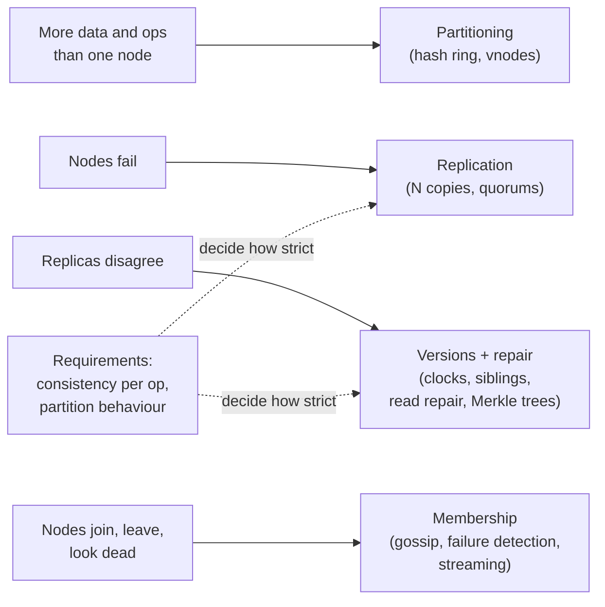
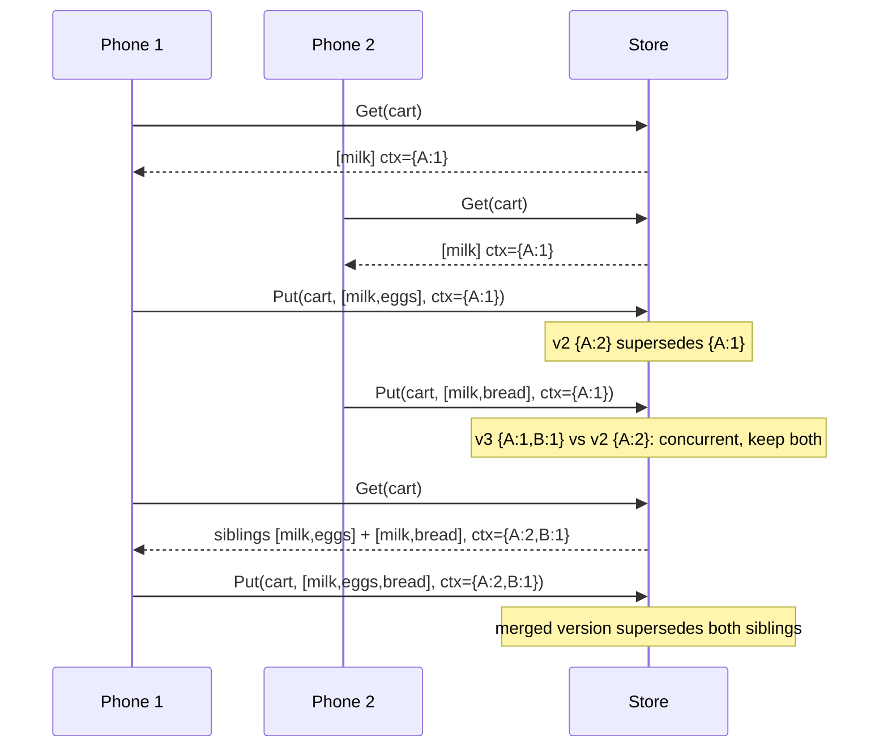
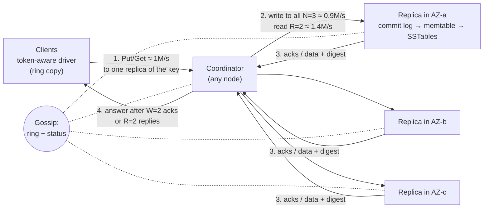
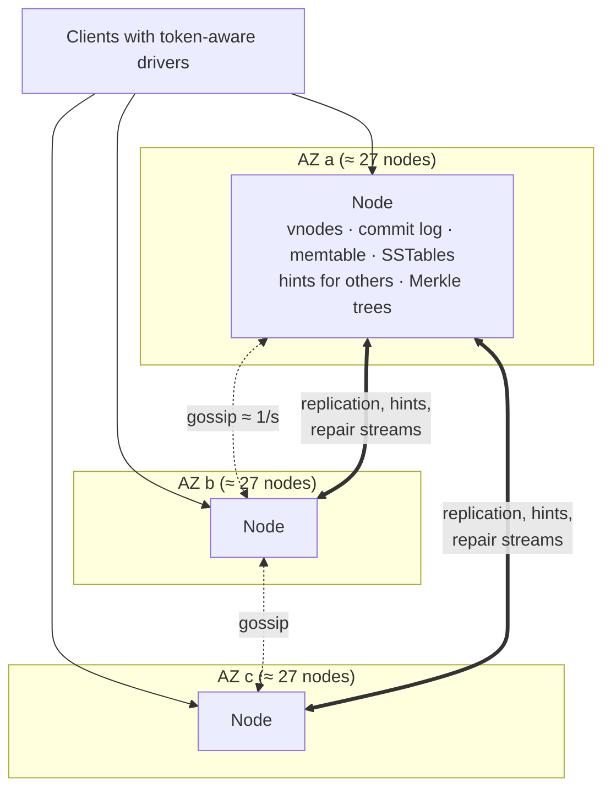

# C4 Unit 1 — Guided design: requirements, estimation, API and data model, from one node to a ring

> Time: ~3.5 h · CORE: §1–§4 (3 h) · STRETCH: the multi-region notes in §1 and §4 (0.5 h) · Lab: none in this
> unit (Unit 2 builds `labs/c4/antientropy`) · Framework card: [docs/INTERVIEW_FRAMEWORK.md](../../docs/INTERVIEW_FRAMEWORK.md)

"Design a distributed key-value store" is the case study where Track A stops being a list of topics and becomes
one system. Every idea from A4 and A5 is on the board at once: hash partitioning and virtual nodes, replication,
quorums, versions, clocks, repair, membership. That is why interviewers like it, and why it goes wrong in a
specific way: the candidate recites the Dynamo paper's table of techniques, and the interviewer asks *why* each
one is there. "Why hinted handoff and not just a strict quorum?" "Why vector clocks, for this data?" "What does
your repair process do to a delete?" A recited design has no answer; a derived one does.

This unit derives the first 25 minutes: the requirements whose answers pick the architecture, the numbers that
size it (and the surprise that operations, not bytes, decide the node count), an API that carries consistency and
causality instead of hiding them, and the high-level design built one step at a time from a single node. Unit 2
does the deep dives. As in C1, commit to every decision in writing *before* you open the reveal.

## Before you start

You need A4 (replication, consistent hashing with virtual nodes, rebalancing) and A5 (consistency models, quorums,
clocks). A2's LSM tree is the engine inside every node. Warm-up (write the answers down, then check):

1. `N = 3`. With `W = 1, R = 1`, can a read miss an acknowledged write? With `W = 2, R = 2`? Does `W = 2, R = 2`
   make the store linearizable?
2. 80 nodes on a consistent-hash ring with virtual nodes; you add an 81st. Roughly what fraction of the keys
   moves, and from which nodes? What if you had used `hash(key) mod nodes` instead?
3. In an LSM store, why is a delete a *write*, and when is it allowed to disappear?

<details data-kind="answer">
<summary>Warm-up answers</summary>

1. With `W = 1, R = 1` the read and write sets can be disjoint, so yes. With `W = 2, R = 2`, `R + W = 4 > 3`, so
   every read set overlaps every write set in at least one replica and a read sees the latest *acknowledged*
   write (assuming no sloppy quorum). It is **not** linearizable: two reads during an in-flight write can see new
   then old, and a failed write can surface later ([A5 Unit 1 §4](../A5-consistency/unit-1-consistency-quorums.md#4-what-quorums-do-not-guarantee)).
2. ≈ 1/81 ≈ 1.2% of the keys, taken in small slices from many existing nodes (each vnode of the new node splits
   one range). With `mod` hashing, going from 80 to 81 buckets changes the bucket of ≈ 80/81 ≈ 99% of keys
   ([A4 Unit 2 §6](../A4-replication-partitioning/unit-2-partitioning.md#6-consistent-hashing-and-virtual-nodes)).
3. SSTables are immutable, so the only way to "remove" a key is to write a newer record that says "deleted" (a
   tombstone) that shadows older values during reads and compaction. It may disappear only when no older value
   it shadows can still come back, which, in a replicated store, includes copies on *other* replicas
   ([A2 Unit 2 §5](../A2-storage/unit-2-write-paths.md#5-lsm-trees)). Unit 2 §7 is that sentence turned into a
   lab.

</details>

**Session plan (2 × 1.5 h):** Session 1: §1 requirements and §2 estimation, both done on paper before each
reveal, then `sd estimate -n 5`. Session 2: §3 API and data model, then §4 in five steps, ending with your own HLD
on one page. STRETCH (0.5 h): the multi-region notes.

---

## §1 Requirements and the questions that change the design (0:00–0:06)

### The failure story

"Design a distributed key-value store." The candidate says "like DynamoDB", draws a consistent-hash ring, writes
"N = 3, R = 2, W = 2" and "vector clocks", and moves on. At 0:14 the interviewer asks: "A customer wants to list
every key with the prefix `tenant:42:`." Hash partitioning scatters that prefix over all 80 nodes; the ring has to
go. At 0:20: "Some clients need to create a key only if it doesn't exist, and two of them must never both
succeed." Quorums cannot do that, at any `R` and `W`. At 0:24: "During an AZ partition, which side keeps
accepting writes?" The candidate says "both", and then cannot say what happens when the partition heals and the
two sides hold different values for the same key. Three questions, and the architecture on the board is wrong
for two of them.

The opposite failure is the candidate who asks about the client languages, the serialisation format and the
admin UI. Neither candidate asked the questions that pick between the two families of designs that exist.

### Predict

<!-- predict id="C4-U1-P01" -->
**Predict.** Set a 5-minute timer. For "design a distributed key-value store", write down:

1. the core operations, and what you'd put out of scope;
2. the non-functional requirements, *each with a number* (keys, value size, operations per second with the
   read/write split, latency, availability, durability);
3. the **clarifying questions whose answers change the architecture**, at least four, and for each what changes.

Then rank them: which single answer changes the *replication protocol*, and which changes the *partitioning*?
<!-- /predict -->

### Reveal

<details data-kind="reveal" data-for="C4-U1-P01">
<summary>Reveal</summary>

A strong 5-minute card, with the numbers this module uses from here on:

**Functional.** `get(key)`, `put(key, value)`, `delete(key)`, each with a per-request **consistency level**;
optional TTL per write; keys ≤ 256 B, values ≤ 1 MB (larger blobs go to an object store, with the key holding a
pointer). **Out of scope:** range scans and secondary indexes, multi-key transactions, a query language, cross-key
atomicity. Conditional writes (create-if-absent, compare-and-set) are *parked* with a sentence: "if we need them,
the design changes; I'll come back to that" (§8 of Unit 2).

**Non-functional (assumptions stated out loud):** ≈ 10^10 keys, values ≈ 1 KB on average; ≈ 1M operations/s at
peak, ≈ 70% reads (≈ 700k reads/s, ≈ 300k writes/s); single-key p99 ≤ 10 ms inside a region at the default
consistency level; reads *and writes* available 99.99% (≈ 4 min/month) for the clients' use cases (carts,
sessions, device state, feature flags: "always writable"); an acknowledged write at the default level survives
the loss of any one node or any one AZ; add and remove nodes without downtime; one region with three AZs to start
(multi-region is STRETCH, below).

**The questions that change the design**, in order of how much they move:

| Question | Why it changes boxes |
|---|---|
| What must a read return after a write, per operation? Does anything need create-if-absent or compare-and-set? | Picks the **replication protocol**. "Usually the latest, stale is tolerable for a moment" → leaderless quorums with tunable `R`/`W` (A5 Unit 1 §3). "Never two winners" → consensus per key range (Raft or Paxos), which no quorum setting provides. |
| During a network partition, which matters more: accepting writes on both sides, or never returning conflicting data? | AP (sloppy quorums, hinted handoff, conflict resolution on heal) vs CP (the minority side refuses writes). It's the same axis as the first question, asked as a failure. |
| Two clients write the same key concurrently: merge, last-writer-wins, or reject one? | Picks the **versioning**: one timestamp per write (LWW, loses one), version vectors with siblings (keeps both; the API must carry a context), CRDT merge (only for mergeable types), or rejection (consensus again). |
| Point lookups only, or range scans by key prefix? | Picks the **partitioning**: hash (even load, no scans) vs range (scans, but hot ranges need splitting and the design drifts towards Bigtable/Spanner-style range groups). |
| How many keys, how big are values, what read/write mix? | Sizes the cluster and decides whether **operations or bytes** set the node count (§2), whether large values need key-value separation, and which compaction strategy fits. |
| One region or several, and do all regions accept writes? | Replica placement per region, per-region quorums (`LOCAL_QUORUM`), and cross-region conflicts become the normal case, not the failure case. |
| TTLs, and how long must deletes "stick"? | Tombstone lifetime vs repair frequency (Unit 2 §7); expiry is a write. |

**Which answer moves the most?** The consistency/partition answer: it chooses between two different families of
systems (Dynamo-style leaderless vs consensus-replicated ranges), and every later box follows from it. Range scans
come second: they change the partitioning, and they usually arrive with "and ordered", which pushes towards range
partitioning with consensus. This module follows the **"always writable, tunable consistency, point lookups"**
answer through the Dynamo-style design, because that is where most of the A4/A5 machinery lives, and then flips it
in Unit 2 §8.

Two common mistakes. (1) Naming a product ("like DynamoDB", "like Cassandra") instead of asking; the product name
doesn't tell you what a read must return. (2) Asking about consistency as an adjective ("strong or eventual?")
instead of per operation: real clients want strong for 2% of their keys and "always writable" for the rest, and
the design that serves both is different from either.

</details>

### How it actually works

**A single-node key-value store is a solved problem.** A2's LSM tree is it: a write-ahead log, a memtable, sorted
immutable files, bloom filters, compaction. Everything that makes this case study hard comes from four facts, and
each one forces a family of mechanisms:



**Scope by consequence.** For each candidate requirement, ask what it *forces*: a new protocol (compare-and-set
forces consensus), a new partitioning (scans force ranges), a new process (deletes that must stick force repair
within a deadline). A requirement that only adds a field (TTL, a content type) is a sentence, not a question.

**Ask per operation, not per system.** The clients of a shared KV store are heterogeneous. A session store wants
writes to succeed during an AZ partition and doesn't care if one of two concurrent "touch" writes loses. A
uniqueness claim ("this idempotency key is mine") must never have two winners. A store that offers a consistency
level *per request*, and a separate strongly consistent path for the few operations that need one, serves both;
a store that picks one global answer forces half of its clients to work around it.

**STRETCH: multi-region, as a requirement.** "Writes in every region" means two writes to the same key in two
regions within one cross-region round trip (≈ 80–150 ms between the US and Europe) are *concurrent* by
construction: conflicts stop being a failure case. Either keys have a home region (writes go there, other regions
read replicas), or the versioning must merge (Unit 2 §6). Ask which, before drawing anything.

**Banking link.** Your adapters already depend on key-value-shaped state with different consistency needs: the
idempotency key that stops a retried callback from posting a payment twice (two winners would be a double
posting), the SSO session a member's phone touches every few seconds (losing one touch is harmless, rejecting it is
a logout), the device-binding record that must survive any single failure. One store with one consistency answer
serves at most two of the three. The [design exercise](design-exercise.md) is exactly that store.

### Build it

No Go lab for this section; the module's labs are in Unit 2 §7–§8. Write the requirements card for two variants in
≤ 5 minutes each: (a) a session and shopping-cart store for a consumer app (always writable, stale reads fine for a
second, carts must not lose items); (b) a cluster-configuration store for 2,000 services (a few GB, watch for
changes, compare-and-set, must never return a stale leader address). Acceptance: the two cards differ in at least
three NFRs and in the answer to the first question in the table, and you can say which family of design each one
leads to.

### Break it

Take the card from the reveal and flip one requirement at a time: (a) "list all keys with a given prefix" becomes
a core operation; (b) 1% of keys need create-if-absent with exactly one winner; (c) clients in two regions, 90 ms
apart, both write. For each, write what changes.

<details data-kind="answer">
<summary>What changes</summary>

- **(a) Prefix scans:** hash partitioning scatters a prefix over every node, so a scan becomes an 80-way
  scatter-gather with the slowest node's latency ([A4 Unit 3 §9](../A4-replication-partitioning/unit-3-hot-keys-indexes-sizing.md#9-secondary-indexes-across-partitions-and-cross-partition-queries)). Either partition by
  range (keys sorted, ranges split when they grow or get hot) or keep hash partitioning and make the prefix the
  partition key with a sort key inside it (Cassandra's partition key + clustering columns, DynamoDB's partition +
  sort key): a scan within one partition is local; a scan across partitions still isn't.
- **(b) Create-if-absent with one winner:** a quorum can't do it: two coordinators can each get `W` acknowledgements
  from overlapping replica sets for two different values, and both report success. You need a single serialisation
  point per key: a consensus round per key (Cassandra's lightweight transactions run Paxos per partition), or a
  leader per range elected with Raft. Make it a separate, slower path (≈ 4 round trips instead of 1) used only by
  the 1% (Unit 2 §8).
- **(c) Two writing regions:** concurrent writes to one key are now routine (any two writes within ≈ 90 ms), so LWW
  silently drops whichever lost the clock race, and with clock skew the "loser" may be the later write. Either give
  every key a home region (writes are forwarded, ≈ 90 ms for remote writers), or keep siblings / use CRDT types and
  resolve on read. Replication factor per region (`3 + 3`) and per-region quorums (`LOCAL_QUORUM`) keep the 10 ms
  p99 for local operations.

One flipped requirement and the replication protocol, the partitioning or the versioning changes. That is why
the questions come first.

</details>

### In the wild

- **Dynamo** (the 2007 SOSP paper) is the internal Amazon store behind the shopping cart: "always writable" was the
  requirement, and consistent hashing, sloppy quorums, hinted handoff, vector clocks with client-side merge,
  Merkle-tree anti-entropy and gossip membership all follow from it. It is the design this module derives.
- **Cassandra** combines Dynamo's replication and membership with a Bigtable-style data model: a partition key
  hashed onto the ring plus clustering columns sorted inside each partition (which is how it answers "scan by
  prefix" within one partition). Consistency is chosen per request (`ONE`, `QUORUM`, `LOCAL_QUORUM`, `ALL`, …);
  conflicts are resolved per cell by timestamp (last-write-wins).
- **DynamoDB**, despite the name, is not Dynamo: the 2022 USENIX ATC paper describes partitions replicated by a
  Multi-Paxos group with a leader that takes writes, eventually consistent reads by default, strongly consistent
  reads on request, and conditional writes. (TODO-VERIFY: current internals beyond that paper.)
- **etcd** and **ZooKeeper** are the other family: one consensus group, linearizable writes, compare-and-set and
  watches, a few GB of data. Nobody stores 10 TB of carts in them, and nobody stores a cluster's leader lease in an
  eventually consistent store.
- **Redis Cluster** shards by hash slot with asynchronous primary-replica replication: fast and simple, but a
  failover can lose acknowledged writes, and there is no tunable consistency. It answers a different question.

### Trade-offs

| Decision | Option | Wins when | Loses when | When the answer flips |
|---|---|---|---|---|
| Replication family | Leaderless quorums (Dynamo-style, AP with tunable consistency) | Writes must succeed through node and AZ failures; most data tolerates brief staleness; conflicts are mergeable or LWW is fine | Any operation needs "exactly one winner" or linearizable reads | The first create-if-absent / compare-and-set requirement on the core path |
| | Consensus per range (CP: Raft/Paxos groups) | Linearizable reads and writes, CAS, transactions | The minority side of a partition can't write; a leader per range adds a hop and hot spots | "Always writable during partitions" is a hard requirement |
| Partitioning | Hash (ring with vnodes) | Point lookups; even load without tuning | Prefix or range scans | A core scan requirement |
| | Range (sorted keys, split on size/load) | Scans; ordered iteration | Sequential keys hot-spot one range; needs split/merge machinery | Keys are random and nobody scans |

### Senior bar

- **Failure modes.** Naming a product instead of asking; consistency as one adjective for the whole system;
  forgetting that create-if-absent is a different protocol; "both sides accept writes" with no merge story;
  ignoring deletes until the interviewer asks.
- **Numbers.** The card must give keys, value size, peak ops with the read/write split, the latency target and
  the failure the default level must survive: §2 needs all six.
- **Ops.** Add an operational requirement unprompted: "operators add capacity without downtime, and a replaced
  node must be back to full redundancy within a couple of hours". It decides per-node data density in §2.
- **Cost.** Say early that replication traffic across AZs, not disks, is the line item that grows with writes.

Interviewer follow-up probes:

1. "Why do you keep asking about consistency per operation? Just make it strongly consistent."

<details data-kind="answer">
<summary>Model answer</summary>

Because "strongly consistent" has a price that most of these clients don't want to pay: every write needs a
majority of a fixed replica set (or a leader), so during an AZ partition the minority side rejects writes, and
every write pays a leader round trip. For sessions and carts, rejecting a write is a visible outage while a
stale read for a second is invisible. For the few operations that do need it (claims, uniqueness, counters that
mustn't double-count) I'd offer a separate strongly consistent path. Offering both and making the client choose
per request is what Cassandra's consistency levels and DynamoDB's `ConsistentRead` flag do.

</details>

2. "What if the values were 100 KB instead of 1 KB?"

<details data-kind="answer">
<summary>Model answer</summary>

Storage grows 100× to ≈ 1 PB logical and ≈ 4 PB on disk, so bytes, not operations, would decide the node count,
and per-node data density decides rebuild time (Unit 1 §2). Compaction rewrites values repeatedly, so I'd separate
keys from values (WiscKey-style value logs, or blobs in an object store with a pointer in the KV store). The read
path also changes: a quorum read that fetches two full 100 KB values to compare them doubles the bytes, so one
data read plus digests matters more.

</details>

### Check yourself

1. Which requirement forces consensus, regardless of `R` and `W`?
2. Which requirement changes the partitioning scheme, and to what?
3. Why is "strong or eventual?" the wrong way to ask the consistency question?

<details data-kind="answer">
<summary>Answers</summary>

1. Any "exactly one winner" operation: create-if-absent, compare-and-set, uniqueness. Quorums give overlap, not a
   single order of competing writes.
2. Range or prefix scans: hash partitioning scatters them; range partitioning (or a partition key with a sort key
   inside it) keeps them local.
3. Because the answer differs per operation, and a store that offers one global answer serves only some of its
   clients; ask what each kind of read must return after a write, and what each must do during a partition.

</details>

---

## §2 Estimation: replica operations, not bytes, decide the node count (0:06–0:10)

### The failure story

The candidate computes 10^10 × 1 KB = 10 TB, times 3 replicas = 30 TB, divides by 4 TB NVMe drives and says
"eight nodes, ten with headroom". The interviewer asks how many operations each node then serves. One million
client operations per second become ≈ 2.3 million *replica* operations (a write lands on all three replicas, a
quorum read touches two), so each of ten nodes would take ≈ 230k replica operations a second with a p99 under
10 ms, which is roughly ten times what an LSM node does with compaction running. Then: "one node dies; how long
until its data is fully replicated again?" 3 TB streamed at a rate that doesn't wreck foreground latency is most of
a working day, during which a second failure in the same ranges loses quorum. The disk arithmetic was right and
answered the wrong question.

### Predict

<!-- predict id="C4-U1-P02" -->
**Predict.** From the §1 card (10^10 keys of ≈ 1 KB, 700k reads/s and 300k writes/s at peak, `N = 3`,
`R = W = 2`), compute, with the arithmetic shown:

1. logical storage, replicated storage, and on-disk storage with LSM overhead (assume ≈ 1.3×);
2. replica operations per second at peak;
3. nodes needed **by operations** (assume ≈ 30k replica operations/s per node at target utilisation) and **by
   disk** (assume ≈ 2 TB of data per node); which number wins?
4. replication bandwidth for writes, cluster-wide and per node.

Then: what single change to the API's defaults would cut the node count by about a third?
<!-- /predict -->

<!-- predict id="C4-U1-P03" -->
**Predict.** One node dies. (a) How long does it take to rebuild its data on a replacement if streaming is
throttled to ≈ 100 MB/s to protect foreground latency, with the per-node data from your answer above, and with
4 TB per node? (b) While it is down, how many hinted writes accumulate per hour for its ranges? What do the two
numbers tell you about how full you want each node to be?
<!-- /predict -->

### Reveal

<details data-kind="reveal" data-for="C4-U1-P02">
<summary>Reveal</summary>

| Number | Arithmetic | Value | Decision it drives |
|---|---|---|---|
| Logical data | 10^10 × ≈ 1 KB | ≈ 10 TB | Fits nowhere on one node; partition |
| Replicated | × 3 | ≈ 30 TB | |
| On disk | × ≈ 1.3 (LSM space amplification, compaction headroom; [A2 Unit 2 §6](../A2-storage/unit-2-write-paths.md#6-b-tree-or-lsm-the-amplification-decision)) | ≈ 40 TB | |
| Replica ops at peak | reads 700k × R(2) = 1.4M; writes 300k × N(3) = 0.9M | ≈ 2.3M/s | A write costs `N` replica writes whatever `W` is |
| Nodes by ops | 2.3M / ≈ 30k | ≈ 77 → **≈ 80 nodes** (≈ 27 per AZ) | **Operations size the cluster** |
| Nodes by disk | 40 TB / ≈ 2 TB | ≈ 20 nodes | Not the constraint here |
| Data per node | 40 TB / 80 | ≈ 0.5 TB | Fast rebuilds (P03); disks mostly empty |
| Replication bandwidth | 300k × 1 KB × 3 | ≈ 0.9 GB/s ≈ 7.2 Gbps cluster-wide; ≈ 11 MB/s ≈ 90 Mbps per node | The NIC (10–25 Gbps) is not the constraint |
| Cross-AZ share | one replica per AZ → ≈ 2 of 3 replica writes cross an AZ | ≈ 0.6 GB/s ≈ 52 TB/day | A cost line (below), not a capacity limit |

The ≈ 30k replica operations/s per node is an **assumption** (NVMe, ≈ 1 KB values, most reads served from cache
and bloom-filtered SSTables, compaction running); real engines range from ≈ 10k to well over 100k depending on
value size, read path and hardware. Say "≈ 30k, I'd benchmark it", and show that the node count scales linearly
with it.

**The change that cuts a third:** default reads at `R = 1` (`ONE`) instead of `QUORUM`: 0.7M + 0.9M = 1.6M replica
operations → ≈ 55 nodes. The consistency level is a capacity decision, not only a correctness one; that's the
sentence that scores. (Giving it up for the reads that need read-your-writes is the trade.)

**Cost line.** Cross-AZ transfer is billed in most clouds, often ≈ $0.01/GB in each direction (TODO-VERIFY
current pricing per provider). ≈ 52 TB/day × ≈ $0.02/GB ≈ $1,000/day, ≈ $30k/month, from replication alone,
before read traffic. Coordinators that pick a replica in their own AZ for the data read (and digests from the
others) and token-aware clients that land on a local replica cut the read share of that bill.

Wrong turns: dividing by disks (≈ 10 nodes that can't serve the load); counting a write as `W` replica writes
(the third replica still gets the write, just later); forgetting peak vs average (≈ 330k ops/s on average would
suggest ≈ 25 nodes).

</details>

<details data-kind="reveal" data-for="C4-U1-P03">
<summary>Reveal</summary>

**(a) Rebuild time.** 0.5 TB / 100 MB/s = 5,000 s ≈ **1.4 h**. At 4 TB per node: ≈ 40,000 s ≈ **11 h**. During
the rebuild, the dead node's ranges have two live replicas: `QUORUM` still works, but one more failure among the
same replica sets makes those keys unavailable at `QUORUM` (and loses data written at `W = 1`). The window of
reduced redundancy is proportional to data per node, so dense nodes buy cheaper disks with longer exposure. With
virtual nodes, the replacement pulls its ranges from many peers at once, so the throttle is the new node's own
disk and network, not one donor.

**(b) Hints.** The dead node's share of replica writes: 0.9M / 80 ≈ 11k writes/s × ≈ 1 KB ≈ **11 MB/s ≈ 40 GB per
hour**, spread over the stand-in nodes. Stores bound this: Cassandra stops storing hints for a node after a hint
window (`max_hint_window`, ≈ 3 hours by default; TODO-VERIFY), ≈ 120 GB here, after which only anti-entropy
repair can bring the node back in sync (Unit 2 §5, §7).

**What it tells you:** keep per-node data small enough that a replacement is back to full redundancy within the
hint window and well within a working shift. At this load, ops-sizing already gives ≈ 0.5 TB per node; if a
future workload made the cluster disk-bound, the rebuild time is what would stop you filling 8 TB drives.

**STRETCH: the AZ-loss headroom.** Lose one AZ (a third of the nodes) at peak: every range has two live replicas,
reads at `QUORUM` hit both survivors, and writes land on both (plus hints). Load per survivor: (1.4M reads +
0.6M writes + ≈ 0.3M hint writes) / 54 nodes ≈ 43k replica operations/s, ≈ 1.5× the planned 30k. Either provision
≈ 1.5× (≈ 120 nodes), or decide in advance what gets shed (hint storage, background repair, low-priority
clients). Saying which is the senior answer; "it's fine, we have three AZs" is not.

</details>

### How it actually works

**The replica-operation multiplier.** Client operations are not what the nodes do. For a leaderless store:

```
replica ops/s ≈ reads × R  +  writes × N  +  read repair  +  hint replay  +  repair and streaming
```

A write is sent to all `N` replicas in parallel; `W` decides only when the coordinator answers. A quorum read
usually asks `R` replicas, one for the full value and the others for a digest (a hash), and fetches full values
only on a mismatch, so its *bytes* are closer to one read than to `R` reads, but its *operations* are `R`. The
background terms are small in steady state and large after failures, which is exactly when you have the least
capacity: budget for them.

**What a node actually runs out of.** CPU for request handling, serialisation and compaction; disk IO for
compaction (leveled compaction rewrites data ≈ 10× or more over its life, A2 Unit 2 §6) and for reads that miss
the cache; memory for memtables, bloom filters (≈ 10 bits per key for ≈ 1% false positives: 10^10 keys × 3
replicas / 80 nodes ≈ 375M keys per node ≈ 470 MB of filters) and the page cache. Disk *capacity* is rarely first
at 1 KB values.

**Sizing per failure domain.** Place the nodes evenly across three AZs with one replica of every range per AZ.
That makes "lose an AZ" a planned event: every key keeps two replicas, so `QUORUM` survives it, and the
calculation in the P03 reveal says what it costs.

**Banking link.** You've sized adapter fleets by "requests per second per instance"; this is the same arithmetic
with a multiplier you have to derive from the protocol. A vendor callback that fans out to three systems of
record is three writes, not one; the store is no different.

### Build it

No Go lab for this section. Use A0's estimate drill: `sd estimate -kind servers -n 3` and `sd estimate -kind
storage -n 3`. Then recompute the reveal's sheet without looking at it, for 2,000 writes/s and 50,000 reads/s of
4 KB values with 2 × 10^9 keys. Acceptance: you get the node count by ops and by disk within ±25% of the worked
answer, say which one wins, and name the decision it drives, in ≤ 4 minutes.

<details data-kind="answer">
<summary>Worked answer</summary>

Storage: 2 × 10^9 × 4 KB = 8 TB logical, 24 TB replicated, ≈ 31 TB on disk. Replica ops: 50k × 2 + 2k × 3 =
106k/s → ≈ 4 nodes by ops at ≈ 30k. By disk at ≈ 2 TB per node: ≈ 16 nodes. **Disk wins** this time, so the
decisions are data density and rebuild time: 16 nodes × ≈ 2 TB each is ≈ 5.5 h per rebuild at 100 MB/s, and a
minimum of three nodes per AZ anyway.

</details>

### Break it

Change one input at a time and say which constraint moves: (a) values grow to 10 KB; (b) the default read becomes
`ALL`; (c) the mix flips to 90% writes; (d) peak traffic is 10× the average instead of 3×.

<details data-kind="answer">
<summary>What moves</summary>

- **(a) 10 KB values:** ≈ 100 TB logical, ≈ 390 TB on disk; ops are unchanged, so 80 nodes would hold ≈ 4.9 TB
  each: rebuilds take ≈ 14 h and compaction rewrites 10× more bytes. Bytes now compete with ops; add nodes or
  separate values from keys.
- **(b) `ALL` reads:** 2.1M + 0.9M = 3M replica ops → ≈ 100 nodes, and a single slow or dead replica fails or
  slows every read of its ranges: the p99 becomes the slowest of three, and availability drops to the product of
  three replicas' availability.
- **(c) 90% writes:** 900k writes × 3 = 2.7M replica writes plus 100k × 2 reads: ≈ 97 nodes, write-dominated,
  so compaction throughput and write amplification, not read caching, decide per-node capacity. LSM fits; tune
  compaction for writes (size-tiered).
- **(d) 10× peaks:** the cluster is sized for the peak, so it sits at ≈ 10% utilisation most of the day. Elastic
  scaling of a stateful store takes hours (streaming), so you can't chase a 10× spike; either provision for it,
  or put a queue or rate limits in front of the writers that cause it.

</details>

### In the wild

- **Netflix** published a benchmark of Cassandra on AWS in 2011 showing writes scaling roughly linearly with node
  count past a million writes per second (TODO-VERIFY: the exact node count and instance type). The lesson people
  remember is linearity; the one to remember here is that it took hundreds of nodes, i.e. per-node throughput
  sized the cluster.
- **Discord** moved its message store from Cassandra to ScyllaDB in 2022–2023 and reported running on far fewer
  nodes with better tail latency (TODO-VERIFY: the node counts in their post). Same data, same protocol family;
  per-node operations per second changed the bill.
- **DynamoDB** documents per-partition throughput limits (≈ 3,000 read units and ≈ 1,000 write units per partition;
  TODO-VERIFY) and splits partitions by size as well as by throughput: the number of partitions follows the
  operations, not just the bytes.

### Trade-offs

| Decision | Option | Wins when | Loses when | When the answer flips |
|---|---|---|---|---|
| Node density | Many small nodes (≈ 0.5 TB each) | Fast rebuilds, small blast radius, ops-bound workloads | More machines to operate; more ring metadata and gossip; more cross-node traffic per operation | Disk-bound workloads where small nodes waste CPU, or a per-node licence cost |
| | Few dense nodes (4–8 TB each) | Cheaper per TB; fewer machines | Rebuilds take a working day; one failure moves a lot of load | Rebuild time exceeds the hint window or the on-call tolerance |
| Default read level | `QUORUM` (`R = 2`) | Reads see acknowledged writes (`R + W > N`) | ≈ 1.45× the replica operations of `ONE` here | Most reads tolerate a moment of staleness → `ONE`, with `QUORUM` on request |
| | `ONE` (`R = 1`) | ≈ 30% fewer nodes; lowest latency | Stale reads after writes; read repair converges slower | A read feeds a decision (balance check, permission) |

### Senior bar

- **Failure modes.** Sizing by disk alone; counting writes as `W` replica writes; ignoring peak; forgetting that
  failures *add* work (hints, repair, streaming) exactly when capacity is lost; no headroom for an AZ loss.
- **Numbers.** ≈ 2.3M replica ops/s, ≈ 80 nodes, ≈ 0.5 TB per node, ≈ 1.4 h rebuild, ≈ 40 GB of hints per
  node-hour, ≈ 52 TB/day across AZs: six numbers, each tied to a decision.
- **Ops.** Throttled streaming and compaction are knobs you will turn during incidents; know which ones you have.
  Capacity planning works in units of "one AZ": add nodes three at a time, one per AZ, or placement drifts.
- **Cost.** At this scale, cross-AZ replication (≈ $30k/month at the assumed price) can rival the machines; a
  store that replicates across AZs is buying availability with it, so say so.

Interviewer follow-up probes:

1. "Traffic grows 10×. What changes?"

<details data-kind="answer">
<summary>Model answer</summary>

≈ 23M replica operations/s → ≈ 800 nodes at the same per-node rate; per-node data falls to ≈ 50 GB unless data
grows too. The protocol doesn't change, but the things that grow with node count do: gossip state (still small,
≈ 800 entries), ring metadata, the number of simultaneous failures you should expect (at 800 nodes, some node is
always being replaced), and repair scheduling. I'd look first at per-node efficiency (a faster engine changes the
node count linearly), at whether `ONE` reads are acceptable for most clients, and at hot keys, which don't get
better with more nodes because a key's replicas are still three machines.

</details>

2. "Why not fewer, bigger machines?"

<details data-kind="answer">
<summary>Model answer</summary>

A node twice as big halves the machine count but doubles rebuild time, doubles the load that moves when it dies,
and doesn't fix per-key hot spots. It's right when the cluster is disk-bound and rebuilds stay inside the hint
window; at ≈ 0.5 TB per node and ops-bound, I'd rather have more, smaller nodes. The flip condition is rebuild
time versus the hint window and the operational cost of the machine count.

</details>

### Check yourself

1. Why does a write cost `N` replica operations even when `W = 2`?
2. Which assumption does the node count scale linearly with, and what do you say about it?
3. What decides how full you want each node's disk, if not the price per TB?

<details data-kind="answer">
<summary>Answers</summary>

1. The coordinator sends the write to every replica in the preference list; `W` only decides how many
   acknowledgements it waits for before answering. The remaining replicas still apply it (or receive a hint).
2. Replica operations per node (≈ 30k here); say it's an assumption to benchmark and show the node count for a
   different value.
3. Rebuild time after a failure (data per node ÷ streaming rate), compared with the hint window and the risk of a
   second failure during the rebuild.

</details>

---

## §3 API and data model: consistency levels, causal context and tombstones (0:10–0:16)

### The failure story

The API on the board is `put(key, value)` and `get(key) → value`. Two phones read the same cart, `[milk]`; one adds
`eggs`, the other adds `bread`; both `put`. With one timestamp per write, the later `put` wins and the cart is
`[milk, bread]`: the eggs are gone, and nobody got an error. The interviewer asks how the store could have known
the two writes were concurrent rather than one after the other. It couldn't: the `put` carried no information
about what the client had read. Then: "what does `delete` do?" "It removes the row." A replica that was down
during the delete still has the row; the next background repair sees one replica with the key and one without,
and copies it back. The deleted cart reappears, a week later.

### Predict

<!-- predict id="C4-U1-P04" -->
**Predict.** Write the API: the three or four operations with their parameters and results. Decide: (a) how a
client chooses consistency; (b) what `get` returns when replicas hold concurrent versions; (c) what a `put`
carries so that the store can tell "this replaces what I read" from "this is concurrent with something I never
saw"; (d) the errors, and in particular what a client must assume after a timed-out `put`.
<!-- /predict -->

<!-- predict id="C4-U1-P05" -->
**Predict.** Write the record a replica stores for one key, field by field, and the structure on each node's
disk. Then: what exactly does a `delete` write, how long must that record live, and what decides the length?
<!-- /predict -->

### Reveal

<details data-kind="reveal" data-for="C4-U1-P04">
<summary>Reveal</summary>

```text
Get(key, consistency = ONE | QUORUM | ALL | LOCAL_QUORUM)
  → { values: [value…], context: opaque }      // one value normally, several if concurrent ("siblings")
  | NotFound | Unavailable | Timeout

Put(key, value, context, consistency, ttl?)   // context = what the client read (empty for a blind write)
  → { context }                                // the new version, for the client's next Put
  | Unavailable | Timeout

Delete(key, context, consistency)             // writes a tombstone
  → ok | Unavailable | Timeout
```

- **(a) Consistency per request**, with a server-side default (`QUORUM`). The level maps to `R` or `W`; `ONE` for
  "fast, may be stale", `QUORUM` for "sees acknowledged writes", `ALL` almost never (one slow replica stalls it).
- **(b) Siblings.** If the replicas the coordinator consulted hold versions that neither supersedes, `Get`
  returns *all* of them with a context covering all of them. The client (or a registered merge function) resolves
  them, for a cart the union, and writes back with that context, which collapses the siblings.
- **(c) The context** is an opaque token encoding the version vector(s) of what was read. A `Put` with a context
  says "this supersedes those versions"; the store keeps any version the context doesn't cover as a sibling.
  Without it, every write is either blindly last-writer-wins or concurrent with everything. The eggs survive
  because the second phone's `Put` carried a context that didn't include the first phone's write: the store keeps
  both, and the next `Get` merges them.
- **(d) Errors that mean different things.** `Unavailable`: fewer than `R`/`W` replicas were reachable, nothing was
  sent, safe to retry. `Timeout`: the write was sent and fewer than `W` acknowledged in time, so it **may have been
  applied anywhere from zero to `N` replicas and may surface later** (no rollback; A5 Unit 1 §4). The client must
  retry with the same context and value (an identical version collapses), or treat the outcome as unknown.
  HTTP form, if asked: `GET /v1/kv/{key}` → 200, or 300 Multiple Choices with every sibling (Riak's HTTP API does
  this; TODO-VERIFY current behaviour), or 404; `PUT` with the context in a header; 503 for `Unavailable`; 504 for
  `Timeout`.

**Limits stated in the API:** keys ≤ 256 B, values ≤ 1 MB, enforced at the coordinator (a 50 MB value would block a
replica's compaction and every read of its neighbours).

**What is not in the API, said out loud:** compare-and-set and create-if-absent. They need one serialisation
point per key; the AP path doesn't have one (Unit 2 §8).

**Tempting wrong answers.** A `version` integer the client increments (two clients increment from the same value
and collide); returning "the newest by timestamp" as the only value (that's LWW with extra steps); hiding
`Timeout` as a generic error (the client retries a non-idempotent merge and duplicates work).

</details>

<details data-kind="reveal" data-for="C4-U1-P05">
<summary>Reveal</summary>

**Per key, per replica:**

| Field | Why |
|---|---|
| `key` | Hashed to a token for placement; stored in token order inside each file |
| `value` (bytes, ≤ 1 MB) | Absent for a tombstone |
| `version` | A version vector `{node: counter}` per sibling (or a single write timestamp in LWW mode) |
| `deleted` flag + `deleted_at` | A tombstone is a version like any other; its time decides when it can be dropped |
| `expires_at` (optional) | TTL; an expired value is treated as a tombstone from that moment |
| `written_at` | For LWW, for metrics, for TTL arithmetic |

**On each node's disk:** A2's LSM, unchanged: a commit log (append-only, replayed after a crash), a memtable, and
immutable SSTables sorted by token, each with a bloom filter and an index, merged by compaction. Sorting by token
rather than by key is a small choice with a big consequence: a token range (a vnode, or a Merkle-tree leaf in
Unit 2 §7) is a contiguous slice of every file, so repairing or streaming a range is a sequential scan.

**Cluster metadata (not per key):** the ring (which tokens each node owns), each node's status and address,
datacentre and AZ of each node, and the keyspace settings (`N` per DC, defaults). It is small (kilobytes per
node) and every node holds a copy, kept in sync by gossip (Unit 2 §8).

**What a delete writes:** a **tombstone**, `{key, deleted: true, version, deleted_at}`, sent to all `N` replicas
like any write. It must outlive every copy of the value it shadows: a replica that missed the delete still holds
the value, and the first repair that compares the two replicas must find the tombstone, or it will copy the value
back (a "zombie"). So it lives for a **grace period that must be longer than the longest time a replica can stay
out of sync**: the longest outage you let a node come back from, plus the time until a full repair reaches it.
Cassandra calls it `gc_grace_seconds` and defaults it to 10 days (TODO-VERIFY), and requires repairs to complete
more often than that. Unit 2 §7 builds this and breaks it.

</details>

### How it actually works

**Causality in the contract.** Version vectors are A5's
[vector clocks](../A5-consistency/unit-2-time-ordering.md#2-logical-time-lamport-and-vector-clocks) applied
per key: each coordinator that handles a write increments its own entry. Version `a` supersedes `b` if every entry
of `a` is ≥ the matching entry of `b`; otherwise they are concurrent and both are kept. The context is just the
merge of the vectors the client read, handed back opaque so clients can't forge or misuse it.



**Who assigns versions.** The coordinator, not the client: a client clock is untrusted and a client ID per vector
entry would grow without bound. Dynamo bounds vector size by truncating the oldest entries past a threshold (≈ 10
in the paper; TODO-VERIFY), which can turn a superseded version into a false sibling, never the reverse. LWW mode
replaces the vector with one timestamp per write; it is what Cassandra does per cell, and it is only safe when
losing a concurrent write is acceptable (Unit 2 §6).

**Tombstones are data with a deadline.** A tombstone costs a record on every replica and makes reads scan past it;
a workload that deletes heavily (queues stored in a KV store) can fill partitions with tombstones that every read
must skip. That's why stores warn when one read crosses thousands of tombstones, and why "use a KV store as a
queue" is a known anti-pattern. TTLs are the same mechanism with the delete scheduled at write time.

**Banking link.** The `Timeout` row is the vendor callback you've debugged: the request reached the vendor, the
response didn't reach you, and the only safe retry is one that the other side recognises as the same operation.
Here the "same operation" is the same value with the same context: the store sees an identical version and
collapses it. A1's idempotency keys are the same idea one layer up.

### Build it

No new lab for this section: A5's `labs/a5/clocks` already builds the version vectors and `SiblingRegister` this
API exposes, and `labs/a5/quorum` builds the coordinator that returns siblings and a merged context. Re-run them
(`go test -race ./labs/a5/clocks/ ./labs/a5/quorum/`) and then write, in your notes, the `Get`/`Put` signatures of
`labs/a5/quorum` next to the API above: which parameter is the context, which result is the siblings, and which
error is `Unavailable` versus `Timeout`. Acceptance: you can point at the line in that package where a stale
context produces a sibling.

### Break it

Three thought experiments, each with the cart above: (a) remove the context from `Put` but keep vector clocks;
(b) keep the context but switch the store to LWW with a 50 ms clock skew between coordinators; (c) make `Delete`
remove the record instead of writing a tombstone, with one replica down during the delete and a weekly repair.

<details data-kind="answer">
<summary>What happens</summary>

- **(a) No context:** the store can't tell a replacement from a concurrent write, so every `Put` becomes a new
  sibling of everything already there. The cart accumulates siblings on every write ("sibling explosion"); reads
  get slower and larger until a client merges, and even a merge can't remove them because it has no context
  either.
- **(b) LWW with skew:** the two concurrent writes are ordered by their timestamps, not by when they happened, so
  one add is lost silently; with 50 ms of skew, a write made up to 50 ms *after* another can lose to it. Context or
  not, LWW has no sibling to keep (A5 Unit 2 §1).
- **(c) Delete without a tombstone:** the down replica keeps the value; the healthy two have nothing. A week later
  the repair finds a key on one replica that the others lack, cannot tell "deleted" from "never received", and
  copies it back to all three. The cart (or a member's deleted personal data) is back.

</details>

### In the wild

- **Riak** exposes the context as a vector-clock (later dotted-version-vector) token returned on every read and
  expected on every write, returns siblings when `allow_mult` is on, and offers CRDT data types (counters, sets,
  maps) that merge siblings automatically (TODO-VERIFY current defaults per bucket type).
- **Cassandra** has no siblings: every cell carries a write timestamp (the coordinator's, or one the client sets
  with `USING TIMESTAMP`) and the highest wins; `USING TTL` writes an expiring cell; deletes are tombstones kept for
  `gc_grace_seconds`.
- **DynamoDB** has no siblings either: one item per key, a `ConsistentRead` flag per read, and conditional writes
  (`ConditionExpression`) executed by the partition's leader, which is how it offers create-if-absent.
- **Project Voldemort** (LinkedIn) was an open-source Dynamo descendant with vector clocks and client-side
  resolution.

### Trade-offs

| Decision | Option | Wins when | Loses when | When the answer flips |
|---|---|---|---|---|
| Version in the API | Opaque context + siblings | Concurrent writes must not be lost (carts, collaborative state) | Clients must handle siblings; vectors grow with coordinators | Data where losing a concurrent write is fine (sessions, caches) → LWW |
| | One timestamp, last-writer-wins | Simple clients, no siblings, small metadata | Silent loss of concurrent writes; clock skew picks the winner | Any data where a lost update is a bug |
| Consistency choice | Per request, with a default | Heterogeneous clients; cost control per call | Clients can choose wrongly; harder to reason about globally | A single tenant with uniform needs → fixed level |
| Delete | Tombstone with a grace period | Deletes stick across failures and repairs | Space and read cost until purged; grace must outlast outages | Never "hard delete" in a replicated store; shorten the grace only with faster repair |

### Senior bar

- **Failure modes.** No context in `put`; LWW for data that needs merging; `Timeout` treated as failure (the write
  may land later); deletes that remove rows; unbounded values; tombstone-heavy partitions that make reads crawl.
- **Numbers.** Context size: a version vector with ≈ 3–10 entries of ≈ 8–16 bytes each, tens to ≈ 160 bytes per
  sibling; tombstones: at ≈ 5% deletes, ≈ 4 × 10^8 per day kept ≈ 10 days ≈ 4 × 10^9, ≈ 0.4 TB logical at ≈ 100 B
  each.
- **Ops.** Alert on reads that scan many tombstones and on keys with more than a few siblings: both are client
  bugs surfacing as latency.
- **Cost.** Siblings and tombstones are stored bytes and read work; neither is free, but both are cheaper than the
  bugs they prevent.

Interviewer follow-up probes:

1. "Why not let the server merge siblings itself?"

<details data-kind="answer">
<summary>Model answer</summary>

Because the server doesn't know what the bytes mean. Union is right for a cart's items and wrong for its
"checked out" flag; "max" is right for a high-water mark and wrong for a balance. The server can merge when the
type is declared and mergeable: a CRDT counter, set or map (Riak's data types), where the merge is defined and
always converges. For opaque bytes it must either keep both (siblings) or pick one (LWW). The senior move is to
offer CRDT types for the data that fits them and siblings or LWW for the rest, per keyspace.

</details>

2. "A client's `Put` times out. What should it do?"

<details data-kind="answer">
<summary>Model answer</summary>

Assume it may have been applied on zero to `N` replicas and may become visible later; nothing is rolled back.
Retry the *same* value with the *same* context: if the first attempt landed, the retry produces an identical
version that collapses into it; if it didn't, the retry is the write. Never retry with a fresh read-modify-write
without first reading back (a non-idempotent merge like "append an item" would apply twice). If the operation
must not apply twice under any circumstances, it doesn't belong on this path: put it behind an idempotency key
on the consensus path.

</details>

### Check yourself

1. What is the difference between `Unavailable` and `Timeout` for a write, and why does the client care?
2. Why does a tombstone need to outlive the longest outage of any replica?
3. When is last-writer-wins the right versioning?

<details data-kind="answer">
<summary>Answers</summary>

1. `Unavailable`: not enough replicas reachable, nothing sent, safe to retry anywhere. `Timeout`: sent, not
   enough acknowledgements in time, may have been applied and may appear later; retry only idempotently.
2. A replica that was down during the delete still has the value; if the tombstone is purged before repair
   reaches that replica, repair sees "value on one replica, nothing on the other" and resurrects it.
3. When losing one of two concurrent writes is acceptable (session touches, caches, idempotent overwrites of the
   whole value) and clocks are reasonably synchronised; never for read-modify-write data like carts or counters.

</details>

---

## §4 High-level design: from one node to a ring of coordinators (0:16–0:25)

### The failure story

The board shows a "master" box holding the key-to-node map. Every request goes through it to find the node. "How
many requests a second does the master handle?" A million. "What happens when it dies?" The whole store is down,
which contradicts the 99.99% writes on the §1 card. The candidate replaces it with `node = hash(key) mod 80`.
"Now add a node." Eighty-one buckets: ≈ 99% of the 40 TB moves at once. The candidate switches to consistent
hashing and puts each key's three replicas on "the next three positions on the ring". With virtual nodes, two of
those positions belong to the same physical machine for some keys, and for others all three replicas sit in one AZ.
None of these were exotic mistakes; each came from drawing the next box without asking what fails.

This section builds the design in five steps. At each one, commit before you open the reveal.

### Predict

<!-- predict id="C4-U1-P06" -->
**Predict (steps 1–2: one node, then partitioning).** Start from one node running A2's LSM. Which of the §2
numbers breaks it first? Then choose a partitioning scheme for point lookups, say how a key finds its node without
a central lookup service, and say what moves (how much, from where) when node 81 joins.
<!-- /predict -->

<!-- predict id="C4-U1-P07" -->
**Predict (steps 3–4: replication and coordination).** Place three replicas of every key: by what rule, so that
one node or one AZ failure never takes two of them? Who receives a client's request and talks to the replicas?
Trace a `Put` at `QUORUM` and a `Get` at `QUORUM` as numbered arrows with peak rates, and say what the client sees
when one of the three replicas is slow (p99 of 200 ms instead of 2 ms).
<!-- /predict -->

<!-- predict id="C4-U1-P08" -->
**Predict (step 5: what keeps it correct).** List the background processes the design needs, and next to each
the requirement or failure that forces it. Then: where is the single point of failure now?
<!-- /predict -->

### Reveal

<details data-kind="reveal" data-for="C4-U1-P06">
<summary>Reveal</summary>

**Step 1, one node.** Operations break it first: ≈ 2.3M replica operations/s against ≈ 30k per node is ≈ 77×; the
40 TB is ≈ 10× a large NVMe drive and would also break it, but later. Even at a hundredth of the load, one node is
a single point of failure for 99.99% availability. So: partition *and* replicate.

**Step 2, partitioning.** Point lookups and no scans → **hash partitioning on a consistent-hash ring with virtual
nodes** ([A4 Unit 2 §6](../A4-replication-partitioning/unit-2-partitioning.md#6-consistent-hashing-and-virtual-nodes)):
hash each key to a 64-bit token; each physical node owns many small token ranges (≈ 16–256 vnodes per node). A
key's owner is the first vnode clockwise from its token.

**No lookup service:** the ring is small (≈ 80 nodes × 16–256 tokens ≈ a few thousand entries, tens of KB) and
every node, and every smart client, holds a full copy, kept current by gossip (Unit 2 §8). Any node can compute any
key's replicas locally. That removes the master from the request path entirely.

**Node 81 joins:** it takes ≈ 1/81 ≈ 1.2% of the data, ≈ 0.5 TB, as many small slices, one per vnode, each
streamed from the node that owned it before, so ≈ all 80 nodes donate a little in parallel and none donates much
([A4 Unit 2 §7](../A4-replication-partitioning/unit-2-partitioning.md#7-rebalancing-request-routing-and-operating-a-partitioned-system)).
`mod` hashing would move ≈ 99%; a ring without vnodes would move one contiguous range from one or two neighbours,
which makes those neighbours the bottleneck and leaves the load uneven.

**Why not range partitioning:** it's the right answer for scans, and wrong here: sequential keys
(`order:000001`, `order:000002`, …) all land on the last range and hot-spot one node, so it needs automatic
splitting and a placement service, the machinery of the CP family (Unit 2 §8).

</details>

<details data-kind="reveal" data-for="C4-U1-P07">
<summary>Reveal</summary>

**Step 3, replica placement: the preference list.** Walk clockwise from the key's token and take the next `N = 3`
vnodes that belong to **distinct physical nodes in distinct AZs**, skipping any vnode whose node or AZ is already
chosen. The plain "next three positions" rule fails exactly as in the failure story: with vnodes, consecutive
positions often belong to the same node. The list continues past three: positions 4, 5, … are the **fallbacks**
used when a replica is down (sloppy quorum, Unit 2 §5). Cassandra's `NetworkTopologyStrategy` is this rule with
racks; A4's `LookupN` and A5's `PreferenceList` build it.

**Step 4, coordination.** Any node can **coordinate** a request: compute the preference list, forward to the
replicas, wait, answer. A *token-aware* client library holds the ring and sends each request directly to one of
the key's replicas, saving a hop; otherwise a plain load balancer spreads requests over all nodes and the receiving
node forwards. No proxy tier is needed; it would be one more box to scale and fail.



**`Put` at `QUORUM`:** (1) client → coordinator, which stamps a new version from the context; (2) coordinator →
all three replicas in parallel (≈ 300k writes/s × 3 ≈ 0.9M replica writes/s); each appends to its commit log and
memtable and acks; (3) after **2** acks, (4) success to the client. The third replica finishes in the background;
if it is down, a fallback stores a hint for it (Unit 2 §5).

**`Get` at `QUORUM`:** (1) client → coordinator; (2) one full read from the closest replica plus one digest read
from another (≈ 700k × 2 ≈ 1.4M replica reads/s); (3) if the digest matches, (4) return. On a mismatch, fetch
the full values, reconcile (newest version, or siblings), return, and **read-repair** the stale replica
asynchronously.

**One slow replica:** the coordinator waits for the 2 fastest of 3, so one slow replica is invisible on most
requests: the latency is the *second*-fastest of three. Only when it is one of the two chosen for a read, or one
of two healthy ones fails at the same moment, does the client feel it. Stores add *speculative retry*: if a replica
hasn't answered by roughly its p99, send the request to the next one too. With `ALL`, the slow replica's 200 ms is
every request's latency.

**Per node at peak:** (0.9M + 1.4M) / 80 ≈ 29k replica operations/s, the §2 budget.

</details>

<details data-kind="reveal" data-for="C4-U1-P08">
<summary>Reveal</summary>

**Step 5, the processes that keep it correct:**

| Process | Forced by | Deep dive |
|---|---|---|
| Gossip membership and failure detection | No master; every node must know the ring and who is up, within seconds | Unit 2 §8 |
| Hinted handoff | "Always writable" when a home replica is down: a fallback keeps the write and hands it over later | Unit 2 §5 |
| Read repair | Replicas diverge after failures; hot keys should converge on the read path, for free | Unit 2 §5, A5 |
| Anti-entropy repair (Merkle trees) | Cold keys never get read; hints expire; a node can be out longer than the hint window | Unit 2 §7, lab |
| Compaction with tombstone GC | LSM storage; deletes must eventually free space, but only after the grace period | Unit 2 §7 |
| Streaming (bootstrap, decommission, replace) | Add and remove nodes without downtime | Unit 2 §8 |

**Single point of failure: none on the request path,** and that's the point of the design: any node can
coordinate, every key has three replicas in three AZs, and the ring is replicated on every node. The interviewer
then wants the *subtle* ones:

- **A key's replica set.** A hot key lives on exactly three machines whatever the cluster size (Unit 2 §8).
- **Correlated failure.** A bad config push or a deploy to every node at once, a disk-full on all nodes because
  compaction headroom ran out, or (in LWW mode) clock skew everywhere: the replicas fail together, not
  independently, and the availability arithmetic assumed independence.
- **The seed list and ring metadata.** New nodes find the cluster through seed nodes; a wrong seed list at boot
  can produce a node that thinks it's alone. Ring changes must be serialised (one bootstrap at a time) or two
  joining nodes claim overlapping ranges; many systems use a consensus store for that metadata even when the
  data path is leaderless.

</details>

### How it actually works



**Every node is the same program** with every role: coordinator for the requests it receives, replica for its
ranges, stand-in (hint holder) for neighbours that are down, repair participant, gossip peer. That symmetry is
what removes the special boxes, and it is also why operational mistakes are correlated: one bad binary is every
node.

**The write path inside a replica** is A2's: append to the commit log (with periodic or group fsync: replication
across AZs, not the local fsync, is what makes an acknowledged write survive a node loss), insert into the
memtable, ack. Memtables flush to SSTables; compaction merges them and, past the grace period, drops tombstones.

**The read path inside a replica:** memtable, then SSTables newest first, skipping files whose bloom filter says
no; the newest version wins (or all concurrent versions are returned). A row cache or the OS page cache absorbs
hot keys.

**Tuning the quorum, previewed.** `N = 3, R = W = 2` is the default because it tolerates one replica down for both
reads and writes and gives `R + W > N`. `W = 1` makes writes faster and more available and gives up read-your-writes
at `R = 2`; `R = 1, W = 3` makes reads cheap and writes fragile. Unit 2 §5 does the availability arithmetic.

**STRETCH: multi-region.** Replicate each key to three nodes in each region (`N = 3 + 3`); a coordinator waits for a
quorum in *its own* region (`LOCAL_QUORUM`, 2 of 3 local) and replicates to the other region asynchronously, so
local p99 stays at ≈ 10 ms and a region loss loses up to the replication lag of writes. `EACH_QUORUM` waits for a
quorum in every region: ≈ one cross-region round trip (≈ 80–150 ms) on every write, for an RPO of zero. Concurrent
writes in two regions are then routine, which puts §6 of Unit 2 (conflict resolution) on the critical path.

### Build it

No new lab for this section: these steps are labs you've already built. `labs/a4/ring` is step 2 (`Lookup`,
`LookupN`, `MovedFraction`) and `labs/a5/quorum` is steps 3–4 (`PreferenceList`, `Fallbacks`, `Put` with `W`, `Get`
with `R` and read repair). Re-run both, then draw this section's HLD from memory on one page with the five steps
labelled and the per-hop rates written on the arrows. Acceptance: the page has no box that §1 or §2 doesn't force,
and you can say what each box does when the node it runs on dies.

### Break it

(a) Build the preference list as "the next three vnodes" with 16 vnodes per node on an 80-node ring: roughly how
often do two replicas of a key land on the same machine? (b) Place replicas by node but ignore AZs, with nodes
spread evenly over three AZs: what fraction of keys lose quorum when one AZ goes down? (c) Make the default
`W = 3`: with one of 80 nodes down, what fraction of writes fail?

<details data-kind="answer">
<summary>Answers</summary>

- **(a)** With 1,280 vnodes spread over 80 nodes, any two of the three positions belong to the same node with
  probability ≈ 1/80, and there are three pairs, so ≈ 3 × 1/80 ≈ 3.75% of keys get two replicas on one machine:
  roughly one key in 27 loses two copies when one machine dies. The distinct-node rule makes it zero.
- **(b)** For a key to keep quorum it needs ≥ 2 replicas outside the failed AZ. With random placement over three
  AZs, the chance that ≥ 2 of 3 replicas are in the failed AZ is 3 × (1/3)² × (2/3) + (1/3)³ ≈ 0.26: **≈ 26% of
  keys** become unavailable at `QUORUM` during an AZ outage, instead of 0% with one replica per AZ.
- **(c)** Every key with that node in its preference list: 3/80 ≈ **3.75%** of writes fail (with a strict quorum),
  and every slow replica's latency becomes the write's. `W = 3` turns "one node down" from invisible into a
  visible outage for a slice of the keyspace.

</details>

### In the wild

- **Cassandra**: every node coordinates; drivers are token-aware and datacentre-aware; `NetworkTopologyStrategy`
  places replicas per DC across racks; virtual nodes via `num_tokens` (the default dropped from 256 to 16 in 4.0,
  with a token-allocation algorithm for balance; TODO-VERIFY); speculative retry on reads.
- **Riak** divides the ring into a fixed number of partitions (`ring_size`, 64 by default; TODO-VERIFY) assigned to
  nodes, which is a different way to get the many-small-ranges property of vnodes.
- **ScyllaDB** keeps Cassandra's protocol and ring but runs one shard per CPU core inside each node, so the
  per-node operations figure in §2 is much higher on the same hardware.
- **Dynamo** coordinated writes on the first healthy node of the preference list and let clients choose between
  a load balancer and partition-aware routing; the paper reports the latency saved by the latter.

### Trade-offs

| Decision | Option | Wins when | Loses when | When the answer flips |
|---|---|---|---|---|
| Who coordinates | Any node, behind a load balancer | Simple clients; any language | An extra hop to reach a replica; uneven coordinator load | Latency-sensitive clients → token-aware drivers |
| | Token-aware client (ring in the driver) | Saves a hop; coordinator is a replica | Clients must track the ring; a stale ring sends to the wrong node (which forwards) | Many thin clients in many languages → load balancer |
| | Dedicated proxy tier | Central policy (auth, rate limits) | Another tier to scale and fail; extra hop | Multi-tenant SaaS needing per-tenant admission control |
| Vnodes per node | Few (≈ 16) | Less metadata, cheaper repair and streaming bookkeeping | Less even load unless tokens are allocated carefully | Heterogeneous hardware → more vnodes (weighted) |
| | Many (≈ 256) | Even load by statistics; many donors when a node joins | More ranges to repair and stream; more fallbacks to track | Large clusters where per-range overhead dominates |
| Replica placement | One per AZ (rack-aware) | AZ loss keeps quorum for every key | Needs balanced AZ capacity; cross-AZ traffic on every write | Single-AZ deployment (then racks) |

### Senior bar

- **Failure modes.** A master on the request path; `mod` hashing; preference lists without distinct-node and
  distinct-AZ rules; `ALL` or `W = N` as defaults; a coordinator that waits for the slowest replica; ignoring the
  stale-ring case for smart clients.
- **Numbers.** ≈ 29k replica operations/s per node at peak; ≈ 1.2% of data moves when one of 80 nodes joins;
  ≈ 26% of keys lose quorum on an AZ loss with AZ-blind placement.
- **Ops.** Adding nodes is a streaming operation of hours; do it one at a time (or with a placement service), one
  per AZ, and watch streaming throughput against foreground p99.
- **Cost.** Token-aware routing with local-AZ data reads cuts the cross-AZ read bill; writes always cross AZs.

Interviewer follow-up probes:

1. "Why not a master that keeps the key map? It's simpler."

<details data-kind="answer">
<summary>Model answer</summary>

Simpler to explain, worse on both requirements that matter: it's a single point of failure for 99.99%
availability unless it is itself replicated with consensus, and it would sit on the path of ≈ 1M requests a
second unless clients cache its map, at which point the map is replicated anyway. The ring is small enough that
every node holds it, so the "master" is unnecessary for routing. Where a coordinator genuinely helps is *changes*
to the ring: serialising joins and leaves so two nodes don't claim the same range. Many systems put that small,
rarely written metadata in a consensus store while the data path stays leaderless, which is the version I'd
draw.

</details>

2. "A client's ring copy is stale and it sends a request to a node that no longer owns the key."

<details data-kind="answer">
<summary>Model answer</summary>

That node is still a valid coordinator: it computes the current preference list from its own ring copy and
forwards. The cost is one extra hop. If the *node's* view is stale too, the write may go to the old owner, which is
why a range keeps being written to both the old and the new owner while it is being streamed, and why a node
refuses ownership claims for a range until streaming is done. The client driver refreshes its ring from gossip
(or from a system table) on such a redirect.

</details>

### Check yourself

1. Why must the preference list skip vnodes, and what two properties must its first `N` entries have?
2. What does one slow replica do to `QUORUM` latency, and what to `ALL`?
3. Name four background processes and the requirement that forces each.

<details data-kind="answer">
<summary>Answers</summary>

1. Because consecutive ring positions can belong to the same physical node; the first `N` entries must be
   distinct physical nodes in distinct failure domains (AZs or racks).
2. `QUORUM` waits for the 2 fastest of 3, so one slow replica usually doesn't show; `ALL` waits for the slowest, so
   every request takes the slow replica's latency.
3. Gossip/failure detection (no master, nodes must know the ring and who's up); hinted handoff (always writable
   with a replica down); anti-entropy repair (cold keys and long outages); compaction with tombstone GC (LSM, and
   deletes that eventually free space); also read repair and streaming.

</details>

---

## Unit wrap-up

**The first 25 minutes, as a walkthrough** (compare with your own from §4):

| Time | What happens | Why it scores |
|---|---|---|
| 0:00 | "I'll scope, estimate, define the API, then build the design from one node up, and go deep on quorums under failure, conflicts and repair." | Plan announced |
| 0:01 | Functional: get/put/delete with a consistency level, TTL, ≤ 1 MB values. Out: scans, transactions, CAS (parked). | Few core ops |
| 0:03 | NFRs with numbers: 10^10 keys × 1 KB, 1M ops/s peak (70/30), p99 ≤ 10 ms, 99.99% reads *and writes*, survive one node or AZ. Questions: consistency per op? partition behaviour? concurrent writes? scans? multi-region? | The questions that pick the family |
| 0:06 | ≈ 40 TB on disk, ≈ 2.3M replica ops/s → ≈ 80 nodes by ops vs ≈ 20 by disk; ≈ 0.5 TB/node → ≈ 1.4 h rebuild; `ONE` reads would save ≈ 30%; ≈ 52 TB/day cross-AZ. | Numbers → decisions by 0:10 |
| 0:10 | API: `Get` → values + context, `Put` with context, `Delete` → tombstone, consistency per request; `Unavailable` vs `Timeout`. | Causality and failure in the contract |
| 0:13 | Record: key, value, version vector, tombstone + time, TTL; LSM sorted by token; ring metadata via gossip. | Model follows the protocol |
| 0:16 | One node → hash ring with vnodes → preference list (distinct nodes, distinct AZs) → any-node coordinator → `N = 3, R = W = 2`; both paths with rates; background processes listed. | Every box derived; complete by 0:25 |

| Decision | Default | Flip when… |
|---|---|---|
| Replication family | Leaderless quorums, tunable per request | Any "exactly one winner" operation on the core path → consensus per range (Unit 2 §8) |
| Partitioning | Hash ring, ≈ 16–256 vnodes per node | Core range or prefix scans → range partitioning (or partition + sort key) |
| Node count | By replica operations (≈ 80 here) | Large values or low traffic → by bytes and rebuild time |
| Default levels | `N = 3`, `QUORUM` reads and writes | Most reads tolerate staleness → `ONE` reads (≈ 30% fewer nodes) |
| Versioning in the API | Opaque context + siblings | Lost concurrent writes acceptable → LWW timestamps |
| Deletes | Tombstones kept for a grace period > longest outage + repair interval | Never hard-delete; shorten the grace only with faster repair |
| Coordination | Token-aware drivers; any node coordinates | Thin multi-language clients → load balancer in front |
| Replica placement | One replica per AZ | Single AZ → per rack |

Next: [Unit 2](unit-2-deep-dives.md) goes deep on quorums under failure, conflicts, anti-entropy and deletes
(with the `antientropy` lab), and membership, hot keys and the CP alternative (with the STRETCH `membership` lab).
Before starting it, run `sd review` and redo the §2 estimate sheet from memory.
