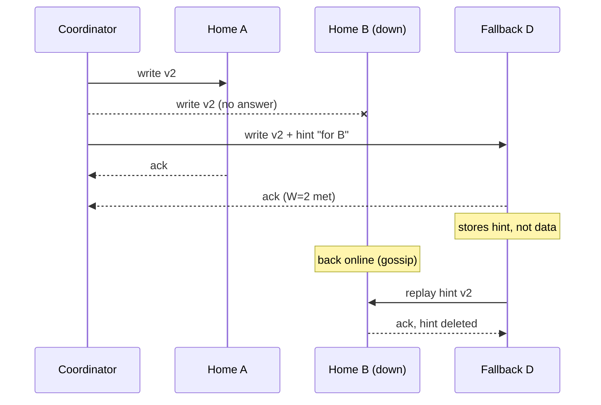
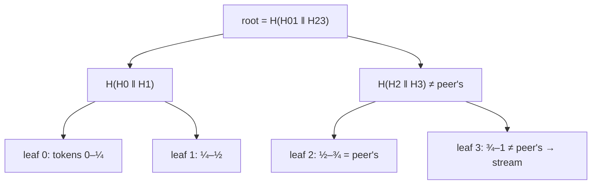
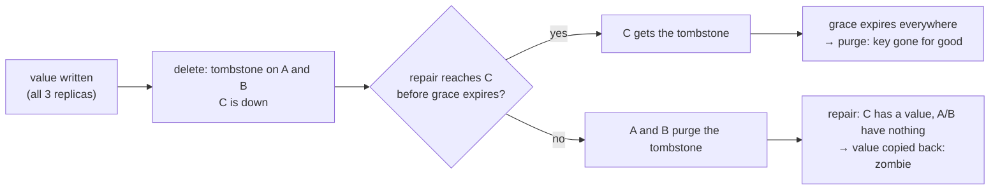
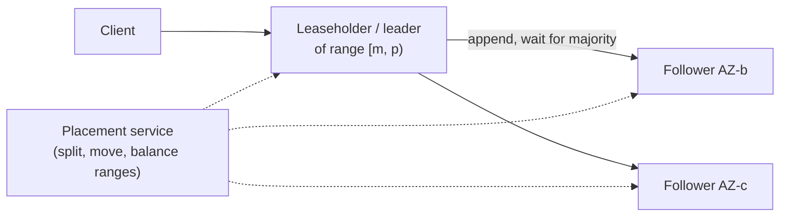

# C4 Unit 2 — Deep dives: quorums under failure, conflicts, anti-entropy and deletes, membership and the CP flip

> Time: ~5.5 h · CORE: §5–§7, §8 except the parts marked STRETCH, and Common mistakes (4 h, incl. ≈ 1.5 h gate
> work) · STRETCH: `labs/c4/membership`, phi accrual and the multi-region notes (1.5 h) · Labs:
> `labs/c4/antientropy` (CORE), `labs/c4/membership` (STRETCH)

Unit 1 ended at 0:25 with a complete design: a hash ring with virtual nodes, preference lists across AZs, any node
coordinating, `N = 3` and `QUORUM` by default, and a list of background processes. This unit is the last twenty
minutes of the interview, where the interviewer picks at the parts that only work if you understand what they're
for: what a quorum does when replicas are down (§5), what happens when two writes are concurrent (§6), how
replicas that drifted apart find their differences, and why deletes are the hardest write (§7), and how nodes
agree on who is alive, what a hot key does, and what changes when someone needs compare-and-set (§8).

Most of the coordinator machinery was built in A5's labs; this unit links to them and builds the two pieces they
leave out: Merkle-tree anti-entropy with tombstone garbage collection (CORE) and gossip membership with an accrual
failure detector (STRETCH).

## Before you start

You need Unit 1 of this module, A5 Unit 1 §3–§4 (quorums and what they don't guarantee) and A5 Unit 2 §1–§2
(last-write-wins, vector clocks). Warm-up:

1. With sloppy quorums, `N = 3, R = W = 2`, a write is acknowledged by one home replica and one stand-in. A read at
   `QUORUM` goes to two home replicas. Is it guaranteed to see the write?
2. Two coordinators with clocks 40 ms apart write the same key 10 ms apart under last-write-wins. Which write
   survives?
3. From Unit 1 §2: how many hinted writes per hour accumulate for one dead node, and roughly how long does it take
   to rebuild that node's data on a replacement?

<details data-kind="answer">
<summary>Warm-up answers</summary>

1. No. `R + W > N` guarantees overlap between the *home* replicas that acknowledged the write and the home replicas
   read; a stand-in is outside that set, so the read may hit the two home replicas that don't have it yet. That is
   the price of being always writable ([A5 Unit 1 §4](../A5-consistency/unit-1-consistency-quorums.md#4-what-quorums-do-not-guarantee)).
2. The one with the higher timestamp, which is not necessarily the later one: if the later write came from the
   coordinator whose clock is 40 ms behind, it carries the *smaller* timestamp and is silently discarded
   ([A5 Unit 2 §1](../A5-consistency/unit-2-time-ordering.md#1-physical-clocks-and-last-write-wins)).
3. ≈ 40 GB per hour (≈ 11k replica writes/s × ≈ 1 KB), and ≈ 1.4 h to stream ≈ 0.5 TB at ≈ 100 MB/s.

</details>

**Session plan:** Session 1 (2 h): §5 and §6, every Predict in writing. Session 2 (2 h): §7, then
`labs/c4/antientropy` and its two break-its. Session 3 (1.5 h): §8 (CORE parts), Common mistakes, then the gate
work: first `sd quiz C4`, the [design exercise](design-exercise.md) (45 min, solo) and the
[teach-back](teachback.md). STRETCH (1.5 h, any time): `labs/c4/membership`, the phi-accrual detector and the
multi-region notes. Second `sd quiz C4` on a later day.

---

## §5 Quorums under failure: tuning N, R and W, sloppy quorums and hinted handoff (0:25–0:30)

### The failure story

The store runs strict quorums, `N = 3, W = 2`. A rolling restart takes one node down for five minutes at a time.
During one of those windows, a node in another AZ loses a disk. For keys whose replica set contains both nodes,
writes fail: with one replica per AZ and ≈ 27 nodes per AZ, that's ≈ 1/27 × 1/27 ≈ 0.14% of keys. At 300k writes/s,
over 300 seconds, ≈ 125,000 failed writes, most of them cart adds, each one a customer seeing an error. The team
switches to sloppy quorums so that a stand-in can take the write. A month later a node's NIC fails on a Friday
night and it stays down for six hours. Hints stop being stored after three, because that is the hint window. When
the node returns, it is missing three hours of writes for its ranges, and the clients that read at `ONE` start
serving week-old carts from it. Nobody had decided what "always writable" costs.

### Predict

<!-- predict id="C4-U2-P01" -->
**Predict.** For each operation, choose `R`, `W` (with `N = 3`) and strict or sloppy, and say what failure each
choice survives: (a) add an item to a cart (must not fail, merging is fine); (b) read a session right after login
(must see the write that created it); (c) read a feature flag (100× more reads than writes, seconds of staleness
fine, writes by admins only).
<!-- /predict -->

<!-- predict id="C4-U2-P02" -->
**Predict.** A node is down for six hours with a three-hour hint window. What is on it when it returns? Which
reads return wrong answers, at which consistency levels? What exactly fixes it, and what should the operator do
*before* it serves reads again?
<!-- /predict -->

### Reveal

<details data-kind="reveal" data-for="C4-U2-P01">
<summary>Reveal</summary>

| Operation | Choice | Survives | Gives up |
|---|---|---|---|
| (a) Cart add | **Sloppy** `W = 2`, `R = 2`, siblings merged on read | Any two of the extended preference list up: effectively never fails | A read right after the write may miss it until the hint is delivered (≈ seconds to minutes); concurrent adds become siblings (§6) |
| (b) Session after login | **Strict** `W = 2`, `R = 2` (`QUORUM`) | One home replica down for reads and writes | During a failure of two home replicas, both fail rather than lie |
| (c) Feature flag | `W = 3` (`ALL`), `R = 1` | Reads survive two of three replicas down and cost one replica op | A flag write fails while any replica is down: the admin retries; rare writes make that fine |

The rule underneath: with `N` replicas, **writes tolerate `N − W` failed replicas and reads tolerate `N − R`**,
and `R + W > N` makes read and write sets overlap *on the home replicas*. Choose the side that must stay up, then
spend the overlap on the other side. (c) is the case people miss: for read-heavy, rarely written data,
`R = 1, W = N` keeps the overlap and makes reads as cheap and available as possible.

Tempting wrong answers: `ALL` for the session ("to be safe": one slow replica stalls every login); `ONE`/`ONE` for
the session (the login's own read can miss the write); strict quorum for carts (the failure story).

</details>

<details data-kind="reveal" data-for="C4-U2-P02">
<summary>Reveal</summary>

**On return:** hints for the first three hours are replayed to it by the stand-ins (≈ 120 GB across the cluster
at ≈ 40 GB/hour, throttled so replay doesn't swamp foreground traffic); the last three hours of writes for its
ranges, ≈ 11k replica writes/s × 3 h ≈ 1.2 × 10^8 writes, are simply **absent**. Nothing on that node knows it is
missing them.

**Wrong answers:** reads at `ONE` that land on it return stale values (or "not found" for keys created in the gap).
Reads at `QUORUM` are still correct: the two replicas consulted include at least one that has the write, the
coordinator reconciles to the newer version and read-repairs the stale one, which is how hot keys heal
themselves. Cold keys stay wrong until something compares them.

**The fix is anti-entropy repair** (§7): compare the returning node's ranges with the other replicas' by Merkle
tree and stream the differences. **Before it serves reads** at levels that can count it alone, run that repair (or
keep it out of the read path until repair finishes); after an outage longer than the hint window, that is a
runbook step, not an option. And if the outage was longer than the tombstone grace period (≈ 10 days in Cassandra;
TODO-VERIFY), **don't bring it back at all**: wipe it and rebuild it from the other replicas, or its old values for
since-deleted keys will be repaired back into the cluster (§7).

</details>

### How it actually works

**Strict vs sloppy, mechanically.** A strict quorum counts acknowledgements only from the key's `N` home
replicas. A sloppy quorum walks the preference list past the home replicas: if a home replica is down, the next
healthy fallback accepts the write as a **hint** ("this belongs to node X") and its acknowledgement counts towards
`W`. When X is back (gossip says so, §8), the stand-in replays its hints and deletes them.



A5's [quorum lab](../A5-consistency/unit-1-consistency-quorums.md#4-what-quorums-do-not-guarantee) measured the
trade on five nodes with a 30% chance that each is down: strict quorums accepted ≈ 78% of writes, sloppy ones
accepted all of them and returned stale reads ≈ 7% of the time during the handoff window.

**Availability arithmetic.** With independent per-replica unavailability `p`, a strict quorum write needs at least
`W` of `N` replicas: for `p = 0.001`, `N = 3`: `W = 2` fails with probability ≈ 3p² ≈ 3 × 10^-6 (≈ 99.9997%);
`W = 3` fails with ≈ 3p ≈ 0.3% (≈ 99.7%). Independence is the assumption that breaks: a rolling restart makes one
replica deliberately unavailable for minutes, so the "second failure" only has to happen during that window, which
is what the failure story was. Sloppy quorums turn that window from an outage into a staleness window.

**Hints are a queue with a disk.** ≈ 40 GB per dead node per hour, spread over the stand-ins (with vnodes, many of
them). The hint window bounds the disk; after it, the store stops queueing and relies on repair. Replay must be
throttled (it's a burst of writes at exactly the moment a node is warming up), and a node that is down long enough
to lose hints is a node that needs repair before it can be trusted.

**Read repair is the cheap, partial fix.** On a quorum read whose replicas disagree, the coordinator writes the
reconciled version back to the stale ones. Hot keys converge within seconds; keys nobody reads never do. Some
stores also read-repair a small random fraction of reads at `ONE` in the background (Cassandra had a
`read_repair_chance` setting, removed in 4.0; TODO-VERIFY).

**STRETCH: quorums across regions.** With replicas in two regions (`3 + 3`), `QUORUM` over all six is 4 and every
operation pays a cross-region round trip; `LOCAL_QUORUM` (2 of the local 3) keeps operations local and replicates
to the other region asynchronously; `EACH_QUORUM` (2 of 3 in *each* region) gives cross-region durability on every
write for ≈ 80–150 ms. The choice is an RPO decision: what may be lost if a region disappears.

### Build it

No new lab for this section: `labs/a5/quorum` already implements strict and sloppy quorums, hinted handoff and read
repair (`Put` with `Sloppy`, `DeliverHints`, `Get` with `ReadRepair`). Re-run it and its break-it with this
section's question in mind:

```bash
go test -race ./labs/a5/quorum/ && go test -tags breakit -run BreakIt -v ./labs/a5/quorum/
```

Then, in your notes, translate the break-it's second table into this case study: at ≈ 0.14% of keys with two home
replicas unavailable during a rolling restart, how many writes per five-minute window does strict `W = 2` reject
at 300k writes/s, and how many reads at `QUORUM` are stale with sloppy `W = 2`? Acceptance: both numbers, and the
operation from P01 for which each one is acceptable.

### Break it

Thought experiments: (a) set an unlimited hint window and keep a node down for two days; (b) let a write at
consistency level "any" succeed when only a hint was stored, then lose the stand-in before replay; (c) run
`W = 1, R = 1` as the default during a rolling restart.

<details data-kind="answer">
<summary>What happens</summary>

- **(a) Unlimited hints, two days:** ≈ 40 GB/h × 48 h ≈ 1.9 TB of hints, ≈ 25 GB per stand-in with vnodes, which
  fits; but replay is ≈ 1.9 TB of writes aimed at one node (≈ 5 h at 100 MB/s, longer than rebuilding its
  0.5 TB from scratch), and every hint is a write that compaction already processed once on the stand-in. Past a
  point, replacing the node is cheaper than replaying to it. That's why hint windows are hours, not days.
- **(b) Hint-only acknowledgement:** the write exists on exactly one machine that isn't even a replica of the key;
  lose it before replay and an acknowledged write is gone, with no replica that ever had it. Cassandra's `ANY`
  level does allow this; it is a durability of 1, chosen knowingly or not at all.
- **(c) `ONE`/`ONE` during a restart:** writes acknowledged by one replica, reads served by one replica; the
  restarting node comes back and serves reads at `ONE` for keys it missed. Read-your-writes breaks for a slice of
  clients every time you deploy. `R + W ≤ N` is a choice you make per operation, not a default.

</details>

### In the wild

- **Dynamo** introduced sloppy quorums and hinted handoff as the mechanism behind "always writable", with
  `(N, R, W) = (3, 2, 2)` as the common configuration in the paper.
- **Cassandra** offers per-request levels (`ANY`, `ONE`, `TWO`, `QUORUM`, `LOCAL_QUORUM`, `EACH_QUORUM`, `ALL`), stores
  hints for down replicas for up to `max_hint_window` (≈ 3 hours by default; TODO-VERIFY), and leaves the rest to
  `nodetool repair`. Its consistency levels count only replicas, except `ANY`, which counts a stored hint.
- **Riak** distinguishes `r`/`w` from `pr`/`pw` (how many *primary* replicas must answer), which is how a client asks
  for strict behaviour on a sloppy store (TODO-VERIFY current defaults).
- **DynamoDB** sidesteps the question with a leader per partition: writes go to the leader and a quorum of its
  replicas; eventually consistent reads may hit any replica; strongly consistent reads go to the leader.

### Trade-offs

| Decision | Option | Wins when | Loses when | When the answer flips |
|---|---|---|---|---|
| Quorum type | Strict | A read must see every acknowledged write (sessions, claims-adjacent data) | Writes fail when `N − W + 1` home replicas are unavailable | "Always writable" is a hard requirement and staleness is tolerable → sloppy |
| | Sloppy + hinted handoff | Carts, presence, event capture: availability first | Stale reads during handoff; hints can be lost; a disk queue to monitor | A read feeds a decision → strict for that operation |
| Hint window | Short (≈ 1–3 h) | Bounded disk and replay; forces repair discipline | Outages longer than the window always need repair | Long expected outages with no repair tooling (then fix the tooling) |
| | Long (≈ days) | Fewer repairs after medium outages | Replay storms; replay cost exceeds a rebuild | Never longer than the time a rebuild takes |
| `R`/`W` split | `QUORUM`/`QUORUM` | Symmetric tolerance of one failure; read-your-writes | ≈ 1.45× the replica ops of `ONE` reads | Read-heavy, rarely written → `R = 1, W = N` |

### Senior bar

- **Failure modes.** `R + W > N` sold as strong consistency; sloppy quorums without a hint-backlog metric;
  bringing a node back after the hint window without repair; `ANY` as a default; `ALL` anywhere on the hot path;
  forgetting that a failed (timed-out) write can still surface later.
- **Numbers.** Strict `W = 2` fails ≈ 0.14% of keys' writes while two specific nodes in different AZs are down
  (≈ 125k writes per five-minute window here); hints ≈ 40 GB per dead node per hour; ≈ 1.2 × 10^8 missing writes
  after a six-hour outage with a three-hour window.
- **Ops.** Dashboards: hint backlog per target, hint replay rate, read-repair rate, per-replica dropped mutations.
  Runbook: outage > hint window → repair before serving `ONE`; outage > grace period → rebuild, don't rejoin.
- **Cost.** Hints are writes stored twice (once as hints, once on replay); repair after long outages is a
  full-range read on every replica involved.

Interviewer follow-up probes:

1. "You have `R + W > N`. So reads are strongly consistent, right?"

<details data-kind="answer">
<summary>Model answer</summary>

No. Overlap gives "a quorum read sees some replica that acknowledged the latest *completed* write", which is weaker
than linearizable: two reads during an in-flight write can see new then old; a write that timed out (reported as a
failure) can be read later; read repair can race with a concurrent write; and with sloppy quorums the overlap only
holds on home replicas, so a write held by a stand-in is invisible to a quorum read. If the client needs
linearizable reads for some keys, I'd route those through a consensus path (§8), not through bigger `R` and `W`.

</details>

2. "How would you pick the hint window?"

<details data-kind="answer">
<summary>Model answer</summary>

From two numbers: how long an outage I expect to resolve without replacing the node (reboots, NIC swaps, a few
hours), and how long a full rebuild takes (≈ 1.4 h at 0.5 TB per node here). Hints beyond the rebuild time are
worse than a rebuild, so the window sits between "typical short outage" and "rebuild time × a small factor":
≈ 3 h here. Past the window the runbook is repair; past the tombstone grace period it is rebuild. And I'd alert
on hint backlog, because a growing backlog means a node is down or a stand-in can't keep up.

</details>

### Check yourself

1. How many failed replicas can writes and reads each tolerate with `N`, `R`, `W`?
2. Why doesn't a sloppy quorum guarantee that a quorum read sees the write?
3. What must happen before a node that was down longer than the hint window serves reads at `ONE`?

<details data-kind="answer">
<summary>Answers</summary>

1. Writes tolerate `N − W` failed replicas, reads `N − R` (strict quorum).
2. The overlap argument covers the home replicas only; an acknowledgement from a stand-in is outside the home set
   that the read consults, until the hint is replayed.
3. An anti-entropy repair of its ranges (or keep it out of single-replica reads until repair completes); if it was
   down longer than the tombstone grace period, rebuild it instead.

</details>

---

## §6 Versions and conflicts: last-write-wins, vector clocks and siblings, CRDTs (0:30–0:34)

### The failure story

The store resolves conflicts by timestamp. Three things happen in the same week. A member's phone and laptop add
items to the same cart 20 ms apart through coordinators in different AZs whose clocks are 50 ms apart; the later
add carries the earlier timestamp and is discarded. A "messages unread" counter is maintained by read-modify-write;
two increments from two devices read 7, write 8, and the counter is one short forever. And a team that switched
carts to siblings with a union merge finds that items customers *removed* come back: one phone removed `eggs` while
the other, which still had the old cart, added `bread`; union of `{milk, bread, eggs}` and `{milk}` is the cart with
eggs. Three bugs, three different data types, one conflict policy.

### Predict

<!-- predict id="C4-U2-P03" -->
**Predict.** Choose the conflict resolution for each, and say what goes wrong with the alternatives: (a) a shopping
cart; (b) a session record (data + last-seen time); (c) a "likes" counter incremented from many devices; (d) a
username-to-user-id claim.
<!-- /predict -->

<!-- predict id="C4-U2-P04" -->
**Predict.** The cart is stored with siblings and merged by union. Explain exactly why a removed item comes back,
and design a merge that keeps concurrent adds but doesn't resurrect removes. What does your fix store that the
plain set didn't, and when can that extra data be thrown away?
<!-- /predict -->

### Reveal

<details data-kind="reveal" data-for="C4-U2-P03">
<summary>Reveal</summary>

| Data | Resolution | Why not the others |
|---|---|---|
| (a) Cart | Siblings (version vectors) merged by the application, or an observed-remove set CRDT | LWW loses concurrent adds; a plain union resurrects removes (P04) |
| (b) Session | **LWW** on the whole value (or per field) | Losing one of two concurrent "touch" writes is harmless; siblings would make every read pay a merge for nothing |
| (c) Likes counter | **PN-counter** CRDT: one increment counter and one decrement counter per replica, merged by per-entry max | LWW or read-modify-write loses increments; siblings of plain integers can't be merged correctly (sum double-counts the shared base, max loses increments) |
| (d) Username claim | **None of these: consensus** (compare-and-set) | Every after-the-fact resolution has already told two users "the name is yours"; the conflict must be prevented, not resolved (§8) |

The point an interviewer is listening for: conflict resolution is **a property of the data type**, not of the
store. A store that offers one policy is wrong for some of its data; the senior design offers LWW, siblings and a
few CRDT types per keyspace, and routes "exactly one winner" to a consensus path.

</details>

<details data-kind="reveal" data-for="C4-U2-P04">
<summary>Reveal</summary>

**Why it comes back:** a set's value doesn't record *why* an element is absent. Sibling 1 is `{milk}` (eggs
removed); sibling 2 is `{milk, eggs, bread}` (bread added to a copy that still had eggs). Union can't tell "eggs
was removed" from "eggs was never added", so it keeps eggs. Dynamo's paper calls out exactly this for its cart:
deleted items can resurface.

**The fix: an observed-remove set (OR-Set).** Every add creates an element with a unique tag (`eggs@A:3`, the
node and counter that added it). A remove deletes the *tags it observed*, recorded as a tombstone set. Merge:
an element is present if it has at least one tag that isn't tombstoned. The concurrent `bread@B:1` survives (no
one observed it, so no one removed it); `eggs@A:3` was observed and removed, so it stays removed; a concurrent
*re-add* of eggs (`eggs@B:2`) survives because it's a new tag ("add wins").

**What it stores extra:** the tags and the removed-tag tombstones. They can be garbage-collected once every replica
has seen the remove (causal stability), which is the same "tombstones until everyone knows" problem as §7, one
level down. Riak's data types and "dotted" implementations compress this metadata; it never disappears entirely.

</details>

### How it actually works

**Last-write-wins** keeps the version with the highest timestamp. It is correct for whole-value overwrites where
losing a concurrent write is acceptable, and its failure is silent: no error, no sibling, just one write gone. Clock
skew makes it worse, because the "winner" is decided by whose clock is ahead
([A5 Unit 2 §1](../A5-consistency/unit-2-time-ordering.md#1-physical-clocks-and-last-write-wins)). Hybrid logical
clocks fix the causal case (a write that read value *v* always gets a higher timestamp than *v*) but not the
concurrent case ([A5 Unit 2 §3](../A5-consistency/unit-2-time-ordering.md#3-hybrid-and-bounded-uncertainty-clocks)).

**Version vectors** record, per key, one counter per coordinator that has written it. `a` supersedes `b` when every
entry of `a` is ≥ `b`'s; otherwise they are siblings and both are kept until a client writes back with a context
that covers both ([A5 Unit 2 §2](../A5-consistency/unit-2-time-ordering.md#2-logical-time-lamport-and-vector-clocks)).
Two practical problems: vectors grow with the number of coordinators (Dynamo truncates past a threshold, risking
false siblings), and when many clients write through one coordinator without contexts, each blind write is a new
sibling ("sibling explosion"). Dotted version vectors (Riak 2.0) attach a single "dot" to each sibling so that
concurrent writes through the same node don't multiply (TODO-VERIFY implementation details).

**CRDTs** are data types whose merge is commutative, associative and idempotent, so replicas that have seen the same
updates converge whatever the order or duplication. The common ones:

| Type | State | Merge | Use |
|---|---|---|---|
| G-counter | one counter per replica | per-entry max; value = sum | likes, views |
| PN-counter | two G-counters (increments, decrements) | merge each | counts that go down |
| LWW-register | value + timestamp | keep the higher timestamp | session fields |
| Multi-value register | values + version vectors | keep concurrent values | "siblings" as a type |
| OR-Set | elements with unique add tags + removed tags | union of both; present = has a live tag | carts, membership lists |

A G-counter in Go, to make "merge by max" concrete:

```go
package crdt

// GCounter is a grow-only counter: one slot per replica, merged by max.
type GCounter map[string]uint64

// Inc adds n on behalf of replica id.
func (g GCounter) Inc(id string, n uint64) { g[id] += n }

// Value is the sum of every replica's slot.
func (g GCounter) Value() uint64 {
	var v uint64
	for _, n := range g {
		v += n
	}
	return v
}

// Merge folds o into g. Applying the same o twice changes nothing.
func (g GCounter) Merge(o GCounter) {
	for id, n := range o {
		if n > g[id] {
			g[id] = n
		}
	}
}
```

Two replicas that each counted `+1` for different devices merge to 2, and re-delivering either state is harmless.
The cost is a slot per replica that ever incremented, which is why counters in leaderless stores are a
special-purpose type, not "an integer".

**Banking link.** Money is the data type for which none of this is acceptable: a balance is not a counter you merge
after the fact, and "the debit won the clock race" is not an explanation an examiner accepts. Ledgers live on the
consensus side of the line (C9); a Dynamo-style store may hold the *cache* of a balance, never the balance.

### Build it

No new lab for this section: `labs/a5/clocks` builds the version vectors, `Reconcile`, an `LWWRegister` and a
`SiblingRegister`, and its break-it counts how many causally ordered writes LWW loses as clock error grows. Re-run
it (`go test -race ./labs/a5/clocks/` and `go test -tags breakit -run BreakIt -v ./labs/a5/clocks/`), then write a
PN-counter next to the G-counter above (two `GCounter`s, `Value` = increments − decrements) and a three-line test
that merges two replicas' states in both orders and twice. Acceptance: the merged value is the same in all three
cases.

### Break it

(a) Store the likes counter as a plain integer with siblings and merge siblings by summing them; (b) merge cart
siblings by "keep the longest one"; (c) truncate version vectors at 3 entries in a cluster where writes for a key
go through 5 different coordinators over its life.

<details data-kind="answer">
<summary>What happens</summary>

- **(a) Sum of siblings:** two siblings of 7 + 1 = 8 each sum to 16, double-counting the base 7 they share. Plain
  integers don't carry enough information to merge; that's what the per-replica slots of a G-counter are for.
- **(b) Longest cart wins:** it's LWW with a different tie-breaker: one device's changes are discarded whenever the
  other's cart happens to be longer, including removes (a shorter cart because the customer removed things loses
  to the stale longer one).
- **(c) Truncation:** a version whose vector lost its oldest entries looks concurrent with versions it actually
  supersedes, so clients see *false siblings* and must merge things that were never in conflict. Truncation errs
  towards spurious conflicts, never towards lost writes, which is the safe direction, but a client that merges
  badly (b) turns a false sibling into a lost update.

</details>

### In the wild

- **Cassandra** resolves every cell by its write timestamp (LWW), which is why its documentation stresses clock
  synchronisation; its counter columns are a separate type with different guarantees (a retried counter update can
  apply twice; TODO-VERIFY current semantics).
- **Riak** offers siblings (`allow_mult`) and data types: counters, sets, maps, registers and flags, implemented as
  CRDTs (TODO-VERIFY current defaults per bucket type).
- **Dynamo** returned siblings to the application, and the cart merged them by union, accepting resurfaced removes
  as the price.
- **Redis Enterprise** markets an "Active-Active" geo-replicated mode built on CRDTs (TODO-VERIFY which types and
  semantics).
- **Automerge** and **Yjs** apply the same idea to collaborative documents; C16 goes there.

### Trade-offs

| Decision | Option | Wins when | Loses when | When the answer flips |
|---|---|---|---|---|
| Conflict policy | LWW timestamps | Whole-value overwrites where a lost concurrent write is harmless | Read-modify-write data; clock skew decides winners | Any lost update is a bug → siblings or a CRDT |
| | Siblings + application merge | Arbitrary data with a domain merge (carts) | Every client must merge correctly; sibling explosion without contexts | The type has a standard merge → CRDT |
| | CRDT types | Counters, sets, maps: convergence by construction | Metadata grows; only specific types; removes need tombstones | "Exactly one winner" → consensus |
| | Prevent (consensus/CAS) | Uniqueness, claims, balances | Latency ≈ several round trips; minority side can't write | Data that must stay writable through partitions → merge instead |

### Senior bar

- **Failure modes.** One policy for all data; LWW on read-modify-write data; counters as integers; union merges that
  resurrect removes; blind writes without contexts creating sibling explosions; "we'll resolve conflicts later" for
  uniqueness.
- **Numbers.** Clock skew: NTP keeps well-run hosts within ≈ milliseconds of each other, but faults (a VM pause, a
  bad time source) reach hundreds of ms; LWW's loss window equals the skew. Metadata: a version vector of ≈ 3–10
  entries per sibling; an OR-Set carries a tag per add and per remove until GC.
- **Ops.** Metrics on sibling counts per read and on vector sizes; alert on keys whose sibling count keeps growing
  (a client writing without a context).
- **Cost.** CRDT metadata is stored and shipped on every read of that key; for hot keys it matters.

Interviewer follow-up probes:

1. "Why not just synchronise clocks really well and use timestamps?"

<details data-kind="answer">
<summary>Model answer</summary>

Because better clocks shrink the window, they don't remove it. Two writes inside the skew window are ordered by
clock error; two genuinely concurrent writes (two devices, same millisecond) lose one whatever the clocks say. For
whole-value overwrites like sessions that's fine and LWW is the right, cheap answer. For carts and counters, the
loss isn't about clocks at all: the information needed to merge was never recorded. Spanner-style bounded
uncertainty (TrueTime) buys external consistency by *waiting out* the uncertainty on commit, which is the
consensus side of the line, not a better LWW.

</details>

2. "Your version vectors are growing to dozens of entries. What do you do?"

<details data-kind="answer">
<summary>Model answer</summary>

First find out why: entries are per coordinator, so dozens means writes for one key arrive through dozens of nodes
(no token-aware routing) or that client IDs are being used as entries. Route writes for a key through its replicas
(token-aware clients) so the vector stays at ≈ `N` entries, use dotted version vectors so that blind writes through
one node don't multiply siblings, and, as a backstop, truncate the oldest entries past a threshold, accepting
occasional false siblings, which are safe as long as clients merge correctly.

</details>

### Check yourself

1. Which conflict policy suits a session record, and why not siblings?
2. Why can't two sibling integers be merged into a correct counter?
3. What does an OR-Set store that a plain set doesn't, and why?

<details data-kind="answer">
<summary>Answers</summary>

1. LWW: losing one of two concurrent touches is harmless; siblings would make every read merge for nothing.
2. Integers don't record which increments they share; summing double-counts the common base and max loses
   increments. Per-replica slots (G-counter) record exactly that.
3. A unique tag per add and the set of removed tags, so that a merge can tell "removed after being observed" from
   "never seen", keeping concurrent adds without resurrecting removes.

</details>

---

## §7 Anti-entropy and deletes: Merkle trees, tombstones and zombies (0:34–0:39)

### The failure story

A node fails a disk controller and goes back to the vendor. It returns twelve days later with its data intact and
is added back to the ring. Within the hour, the compliance team asks why member records deleted last week, under a
right-to-erasure request, are back in the nightly export. The store's grace period for tombstones is ten days. The
other two replicas of those keys had compacted their tombstones away on day ten; the returning node still had the
old values; the scheduled repair compared the replicas, found keys on one that the others lacked, and did what
repair is supposed to do: it copied them back. Separately, the repair itself runs for nine hours every week and
pushes p99 from 6 ms to 40 ms while it streams, because it is shipping far more than the few thousand keys that
actually differ.

### Predict

<!-- predict id="C4-U2-P05" -->
**Predict.** Two replicas each hold the same ≈ 0.5 TB range (≈ 5 × 10^8 keys of ≈ 1 KB) and differ in ≈ 1,000
keys. How do they find those keys, and how many bytes cross the network, for: (a) one ships everything to the
other; (b) they exchange a list of (key, hash) pairs; (c) they compare Merkle trees of depth `d` (pick `d`)? For (c)
say what limits how deep you go.
<!-- /predict -->

<!-- predict id="C4-U2-P06" -->
**Predict.** State the rule for when a tombstone may be purged, in terms of the outage length, the repair interval
and the grace period. Then: what should happen to a node that has been down longer than the grace period, and how
could a store purge tombstones without trusting a fixed grace period at all?
<!-- /predict -->

### Reveal

<details data-kind="reveal" data-for="C4-U2-P05">
<summary>Reveal</summary>

| Method | What crosses the network | ≈ Bytes |
|---|---|---|
| (a) Ship everything | Every key and value | ≈ 0.5 TB |
| (b) Key + hash list | 5 × 10^8 × (≈ 50 B key + 8 B hash) | ≈ 29 GB, then the 1,000 values |
| (c) Merkle tree, depth 20 (≈ 10^6 leaves of ≈ 480 keys ≈ 0.5 MB each) | Hashes along ≈ 1,000 root-to-leaf paths: ≈ 1,000 × 2 × 20 ≈ 40,000 hashes ≈ 1.3 MB; then the ≈ 1,000 differing leaves, both ways | ≈ 1.3 MB of hashes + ≈ 1,000 × 0.5 MB × 2 ≈ **1 GB** |

**How (c) works:** each replica hashes every leaf (a contiguous slice of the token range) and every pair of
children up to a root. Compare roots: equal means identical, one hash for the whole range. Different: compare the
two children, and descend only where they differ. The cost is proportional to *differences × depth*, not to keys.
The lab measures it: one difference at depth `d` costs exactly `1 + 2d` comparisons.

**What limits the depth:** the tree's memory (`2^(d+1) − 1` hashes: depth 20 is ≈ 64 MB per range being repaired)
and the time to build it, against the over-streaming of shallow trees (a mismatch ships the whole leaf, ≈ 0.5 MB
at depth 20 but ≈ 500 MB at depth 10). The lab's depth sweep shows the same knee on 100,000 keys: 200,000 entries
shipped at depth 0, ≈ 3,700 at depth 10, 94 at depth 16. Real stores cap the depth per range and accept some
over-streaming. Building the trees means reading every key of the range on every replica: ≈ 0.5 TB of reads per
node per full repair, ≈ 20 min to ≈ 1.4 h at 100–500 MB/s, which is why repair is scheduled and throttled.

Tempting wrong answers: "read repair handles it" (only for keys that get read); "compare row counts" (equal
counts, different contents); "hash the whole range" (tells you *that* they differ, not *where*).

</details>

<details data-kind="reveal" data-for="C4-U2-P06">
<summary>Reveal</summary>

**The rule:** a tombstone may be purged only when **every replica of its range already has it**. A fixed grace
period approximates that: it's safe only if **grace > the longest outage you allow a node to return from + the
time until a full repair reaches it**. With a weekly repair, a 10-day grace is guaranteed safe only for outages
under ≈ 3 days; the lab's zombie timeline shows the boundary (grace 10: 2- and 5-day outages leave no zombies, the
5-day one only because it ends on the day a repair runs; 9 days and longer bring all 100 deleted keys back).

**A node down longer than the grace period** must not rejoin with its data: wipe it and rebuild it from the other
replicas (a "replace"), so it has nothing old to repair back. Make that a guard in the tooling, not a runbook
footnote: a node that was down more than the grace period refuses to start.

**Purging without trusting the clock:** purge only tombstones that are older than the last repair that covered
every replica of the range (the lab's `SafeCutoff` is `min(now − grace, lastFullRepair)`). Then a node that missed
the delete can't resurrect it, because the tombstone is kept until a repair has carried it to that node, however
long that takes. Cassandra has an option along these lines for incrementally repaired data
(`only_purge_repaired_tombstones`; TODO-VERIFY). The cost is that a range that is never fully repaired never frees
its tombstones, which is the right failure: visible disk growth instead of invisible resurrection.

</details>

### How it actually works



**Leaves cover token ranges, not key counts.** Because each node stores keys sorted by token (Unit 1 §3), a leaf
is a contiguous slice of every SSTable: hashing it is a sequential scan, and streaming it is too. Every field that
matters is in the leaf hash (key, version, tombstone flag, value), length-prefixed so that different contents
can't produce the same bytes; the lab tests each.

**Who builds the trees, and when.** Two designs. *Build on demand* (Cassandra's "validation compaction"): each
replica reads the range and builds a tree when a repair session starts, compares, streams, throws the tree away.
Simple, but every repair reads everything. *Maintain incrementally* (Riak's active anti-entropy): each node keeps
persistent trees and updates the affected leaf hash on every write, so a comparison can run any time, at the cost
of extra work on the write path and trees to rebuild if they're corrupted (TODO-VERIFY current Riak behaviour).
Incremental repair goes further: mark data that has been repaired and only compare what was written since.

**Read repair vs anti-entropy:**

| | Read repair | Anti-entropy (Merkle) |
|---|---|---|
| Triggers on | A read whose replicas disagree | A schedule, or an operator after an outage |
| Fixes | Keys that get read, within seconds | Every key in the range, including cold ones |
| Costs | Extra writes on some reads | Reading the whole range on each replica, plus streaming |
| Misses | Cold keys; anything not read before tombstones expire | Nothing in the range, if it completes |

**The tombstone lifecycle**, with the deadline that matters:



**Banking link.** Deletes with a legal deadline (account closure, erasure requests, retention expiry) are where a
replicated store's tombstone rules become a compliance control. The questions an auditor asks map onto this
section: how do you know every copy is gone (repair completion per range), by when (grace period plus repair
interval), and what prevents a restored node or backup from bringing it back (the rebuild-don't-rejoin guard, and
restoring backups only through the same repair path).

### Build it

`labs/c4/antientropy` (CORE). Implement, in the order of [`labs/c4/README.md`](../../labs/c4/README.md):
`Entry.Wins` and the `Replica` (merge with a deterministic winner, copies in and out, `Compact`); `Bucket`,
`BuildTree` and the tree accessors; `Diff` (descend only where hashes differ, counting comparisons); `Repair`
(ship the entries of differing leaves both ways, merge with `Apply`); and `SafeCutoff`.

Acceptance tests, among others: identical trees cost exactly **1** comparison; one difference at depth `d` costs
exactly `1 + 2d`; repairing 10,000 keys with 3 divergences applies exactly 3 entries and ships only the entries of
the differing leaves (≈ 60); six writers and three repairers on overlapping replica pairs run under `-race`
without deadlock and converge; the zombie scenario resurrects the deleted value with a plain compaction and
doesn't with `SafeCutoff`. Run `go test -race ./labs/c4/antientropy/`, then `sd lab C4`.

### Break it

From the lab README: (1) `go test -tags breakit -run BreakIt_DepthSweep -v ./labs/c4/antientropy/` repairs 100,000
keys with 20 differences at depths 0–16; (2) `go test -tags breakit -run BreakIt_ZombieTimeline -v
./labs/c4/antientropy/` simulates 40 days with outages of 2–20 days, grace periods of 3–14 days and weekly repair.
Predict before running: at what depth does `Sent` stop falling much, and which (grace, outage) rows produce
zombies? Then (3) mutate your code: hash only keys in the leaf hash; make `Compact` use `<=`.

<details data-kind="answer">
<summary>What you should see</summary>

1. `Sent` falls roughly by 4× per two levels until leaves hold about one differing key each (≈ 200,000 → 3,700 →
   94 from depth 0 to 10 to 16) while comparisons grow linearly with depth (1 → 235 → 471) and the tree's memory
   quadruples every two levels (32 B → 64 KB → 4 MB). The knee for 100,000 keys is around depth 12–14; for 5 × 10^8
   keys the same leaf size needs ≈ 12 more levels, which is why real trees cap depth and over-stream.
2. Zombies appear exactly when the tombstones are purged on the healthy replicas before the first repair after the
   outage: grace 3 always (even a 2-day outage plus waiting for the weekly repair exceeds it), grace 7 and 10 from
   9-day outages, grace 14 only at 20 days; the `SafeCutoff` column is all zeros.
3. Hashing only keys: `TestBuildTree_EveryFieldIsInTheHash` fails, and in production a replica with a stale *value*
   or a missed *delete* looks identical to the healthy one, so repair never fixes it. `<=` in `Compact`:
   `TestReplica_CompactRemovesOnlyOldTombstones` fails; the symptom is an off-by-one in the grace period, which
   matters only at the boundary, which is exactly where an incident lives.

</details>

### In the wild

- **Dynamo** used a Merkle tree per key range held by a node, so that membership changes only require recomputing
  trees for the affected ranges.
- **Cassandra**: `nodetool repair` runs validation compactions to build Merkle trees per range, compares them and
  streams mismatching ranges; incremental and subrange repair limit the work; `gc_grace_seconds` (default 864,000 s,
  10 days; TODO-VERIFY) is the tombstone grace period, and the documentation's rule is that every node must be
  repaired within it. Tools like Cassandra Reaper exist to schedule repairs so they finish in time.
- **Riak** maintained persistent hash trees for active anti-entropy, updated on writes (TODO-VERIFY current
  versions).
- **ScyllaDB** replaced Merkle-tree leaves with row-level repair that compares and transfers individual rows, to
  avoid over-streaming whole ranges (TODO-VERIFY).
- **Git** and **Bitcoin** use the same hash-tree idea for a different purpose: proving that two copies of a large
  structure agree by comparing one hash.

### Trade-offs

| Decision | Option | Wins when | Loses when | When the answer flips |
|---|---|---|---|---|
| Convergence | Read repair only | Read-heavy, hot data; cheap | Cold keys never heal; deletes resurrect after grace | Any requirement that deletes stick → add scheduled repair |
| | Scheduled Merkle repair | Every key converges within the interval | Full-range reads; IO and streaming spikes | Write-path budget available → incremental trees |
| Tree depth | Shallow (≈ 10) | Small trees, cheap to build and compare | Ships whole large leaves on every mismatch | Many scattered differences → deeper, or row-level repair |
| | Deep (≈ 20) | Ships only small leaves | ≈ 64 MB per tree per range; more hash comparisons | Memory-limited nodes or very small ranges |
| Tombstone purge | Fixed grace period (≈ 10 days) | Simple; bounded tombstone space | Unsafe if any node returns after the grace or repair is late | Repair completion is tracked → purge only repaired tombstones |
| | Purge only after full repair | No resurrection, whatever the outage | Tombstones accumulate when repair falls behind | Never flips back for data with deletion obligations |

### Senior bar

- **Failure modes.** No anti-entropy at all; repair scheduled less often than the grace period; returning a node
  after the grace period; repair that streams whole ranges and wrecks p99; leaf hashes that omit versions or the
  tombstone flag; repair holding locks across replicas (the lab tests for that deadlock).
- **Numbers.** Merkle comparison ≈ 1,000 differences × 2 × 20 levels ≈ 40,000 hashes ≈ 1.3 MB vs ≈ 29 GB for a
  key list vs ≈ 0.5 TB for a full copy; tree ≈ 64 MB at depth 20; a full repair reads ≈ 0.5 TB per node.
- **Ops.** Track "last full repair" per range and alert when it approaches the grace period; throttle streaming;
  a guard that refuses to start a node down longer than the grace period; tombstone-scan warnings on reads.
- **Cost.** A full repair every week is a full read of the dataset every week, ≈ 40 TB of IO cluster-wide; the
  incremental and row-level variants exist because that line is real.

Interviewer follow-up probes:

1. "A node was down two weeks. Your grace period is ten days. Do you bring it back?"

<details data-kind="answer">
<summary>Model answer</summary>

Not with its data. Its replicas have purged tombstones for deletes it never saw, so any repair would copy those
values back. I'd remove it from the ring, wipe it, and replace it: a fresh node takes over its tokens and streams
the ranges from the other replicas (≈ 1.4 h at 0.5 TB). And I'd make that automatic: a node checks how long it has
been down against the grace period at startup and refuses to join. If the data on it is needed (it was the only
copy of something), that's a sign `W` was too low, not a reason to rejoin.

</details>

2. "Repair is eating your IO and p99. What do you do?"

<details data-kind="answer">
<summary>Model answer</summary>

Make it smaller and slower rather than rarer: subrange repair (one vnode range at a time), incremental repair
(only data written since the last repair), a streaming throttle tied to foreground latency, and scheduling across
the week so every range finishes within the grace period with margin. Deeper trees or row-level repair cut the
over-streaming. Running it less often is the one change I wouldn't make without also extending the grace period,
because that's what turns slow repair into zombies.

</details>

### Check yourself

1. Why does a Merkle comparison cost proportional to differences × depth rather than to keys?
2. State the safe-purge rule for tombstones, and the grace-period approximation of it.
3. What does read repair miss that anti-entropy catches?

<details data-kind="answer">
<summary>Answers</summary>

1. Matching subtrees are skipped after one comparison; only paths to differing leaves are walked, two child
   comparisons per level.
2. Purge only when every replica has the tombstone (i.e. after a full repair that started after the delete);
   approximated by grace > longest allowed outage + repair interval.
3. Keys that aren't read (cold data), including deletes that must reach a replica that missed them before the
   grace period ends.

</details>

---

## §8 Membership, rebalancing, hot keys, and when the answer flips to consensus (0:39–0:45)

### The failure story

Node 37 hits a 12-second garbage-collection pause at peak. Every node has a fixed 10-second timeout on heartbeats,
so all 79 others mark it dead at about the same time: coordinators route around it, stand-ins start writing hints,
and an automation script that "replaces dead nodes" starts streaming 0.5 TB to a new machine. Two seconds later 37
is fine. Meanwhile a product launch puts a single key, the launch-page config, at ≈ 150k reads/s; its three
replicas can serve ≈ 90k between them and their p99 goes to seconds, which takes down every *other* key on those
three nodes. And at 0:41 the interviewer says: "Usernames live in this store too. Two people must never get the
same one."

### Predict

<!-- predict id="C4-U2-P07" -->
**Predict.** (a) How does every node learn that a node has died, without a coordinator, and roughly how long does
it take for 80 nodes? (b) How do you avoid convicting a node that is merely slow (a GC pause), given that
heartbeat intervals differ between peers? (c) What is the difference between "dead to the failure detector" and
"removed from the ring", and why must they be different actions?
<!-- /predict -->

<!-- predict id="C4-U2-P08" -->
**Predict.** Usernames need create-if-absent with exactly one winner (≈ 1% of writes) and linearizable reads for
those keys. Compare three options: (1) a consensus round per key on the existing replicas; (2) turning the whole
store into consensus groups per key range; (3) a separate CP store for the claims. For each: latency per claim,
behaviour during an AZ partition, and what else changes. Which do you pick, and when does the answer flip?
<!-- /predict -->

### Reveal

<details data-kind="reveal" data-for="C4-U2-P07">
<summary>Reveal</summary>

**(a) Gossip.** Every second, each node bumps its own heartbeat counter and exchanges its table of everyone's
heartbeats with one to three random peers; each side keeps the newer entry per member. A change spreads like an
epidemic: the number of nodes that know roughly doubles (or better) per round, so all 80 know within ≈ log₂ 80 ≈
6–7 rounds plus a little, ≈ 5–10 seconds. The lab measures it: fanout 1 reaches every one of 64 nodes in ≈ 7 rounds
and 1,024 nodes in ≈ 11. Each node's cost is a few messages a second whatever the cluster size.

**Each node then decides for itself** whether a peer is alive, from how long that peer's heartbeat has stood still
in *its own* table; it never copies another node's verdict (one false suspicion would spread like the news does).
A restarted node bumps a **generation** number so that its counter starting again from zero is still recognised as
newer (the lab's `Heartbeat{Generation, Version}`).

**(b) Not convicting slow nodes.** A fixed timeout is wrong for some peer: too short for one that heartbeats
slowly or pauses, too long for one that heartbeats every 100 ms. An **accrual detector** (phi accrual) keeps each
peer's recent inter-arrival times and outputs a suspicion level, `phi = −log10(P(a heartbeat this late))`; with an
exponential model, `phi = silence / (mean · ln 10)`. At a 1-second mean, phi = 8 (a common threshold) is ≈ 18 s of
silence: the 12-second pause would not have convicted node 37. Add a **suspect** stage before **dead**, indirect
probes (SWIM: ask a few other nodes to ping the suspect), and keep the conviction *cheap*.

**(c) Dead vs removed.** Conviction changes only routing: coordinators skip the node, stand-ins store hints, reads
go elsewhere. Nothing moves. **Removal** (decommission, replace) changes ownership and streams ≈ 0.5 TB, and is an
operator decision (or a slow, deliberate automation) taken after minutes or hours, never on a detector's verdict.
If conviction moved data, every GC pause would start a 1.4-hour stream and every false positive would be an
incident. Dynamo made membership changes explicit administrator actions for the same reason.

</details>

<details data-kind="reveal" data-for="C4-U2-P08">
<summary>Reveal</summary>

| Option | Latency per claim | AZ partition | What else changes |
|---|---|---|---|
| (1) Paxos per key on the key's 3 replicas (Cassandra's lightweight transactions) | ≈ 4 round trips (prepare, read, propose, commit) ≈ 4 × ≈ 1–2 ms cross-AZ + disk ≈ **5–10 ms**; more under contention | The majority side (2 of 3 replicas) can claim; the minority side refuses | Nothing for the other 99% of writes; CAS keys must not also be written with plain writes, or linearizability is lost |
| (2) Raft group per key range for everything (CockroachDB, TiKV) | ≈ 1 round trip to a majority from the range's leader, ≈ **2–4 ms**; linearizable reads from a leaseholder without a quorum | The minority side of **every** range refuses writes; no sloppy quorums, no hinted handoff | The whole store becomes CP: leaders per range (hot spots, leader balancing), range splits and a placement service; "always writable" for carts is gone |
| (3) A separate CP store (etcd/ZooKeeper-style) for claims only | ≈ 1–2 ms in-region | The CP store's minority side refuses | Two stores, two failure domains, and no atomicity between "claim the name" and "write the profile": you need an outbox or a saga (A6) to tie them |

**Pick (1)** when CAS is a small fraction (1%) of traffic on the same keyspace: the claim pays ≈ 4 round trips, the
rest of the store keeps its availability, and there's one system to run. **Flip to (2)** when most operations need
linearizability, or you need multi-key transactions, or ordered scans (range partitioning and consensus groups go
together). **(3)** is right when the strongly consistent data is small and operationally separate (cluster
metadata, leases, leader election), which is exactly why many leaderless stores keep their own *ring changes* in
one.

What changes in the API: `PutIfAbsent(key, value)` and `CompareAndSet(key, expected, value)`, returning
`Applied | NotApplied(current)`, documented as slower and as failing on the minority side of a partition. A
`Timeout` on a CAS still means "unknown": the client reads back (linearizably) before retrying.

</details>

### How it actually works

**Gossip, round by round** (the STRETCH lab's model): bump your own heartbeat; exchange tables with `k` random
peers; keep the newer heartbeat per member and note *when* it last advanced; derive status from that age
(alive → suspect → dead). Nodes also occasionally contact members they consider dead: without that, a healed
partition never rejoins, because each side considers the other dead and never talks to it (the lab's break-it:
whole again in 2 rounds with probes, still split after 200 without).

**Phi accrual (STRETCH).** The detector keeps a window of recent inter-arrival times per peer. Because the model is
per peer, one threshold means different timeouts for different peers: after 1 s of silence, phi ≈ 4.3 for a peer
that beats every 100 ms and ≈ 0.22 for one that beats every 2 s (lab test). Cassandra's detector uses an
exponential model and a conviction threshold (`phi_convict_threshold`, default 8; TODO-VERIFY); Akka's uses a normal
distribution.

**Joining, leaving and replacing.** A joining node picks tokens (vnodes), announces itself as *joining* through
gossip, and streams its ranges from their current owners; while it streams, writes for those ranges go to both the
old and the new owner, so nothing is missed; when streaming completes it becomes *normal* and the old owners drop
the data they no longer own (Cassandra's `nodetool cleanup`). Decommission is the reverse. Replace reuses a dead
node's tokens and streams from the surviving replicas. At ≈ 0.5 TB per node, each is ≈ 1.4 h; do them one at a
time, one per AZ when adding capacity, with streaming throttled against foreground p99. Adding 20 nodes before a
peak is ≈ a day of work, which is why capacity is added weeks ahead, not on the morning of.

**Hot keys.** A key's three replicas are three machines whatever the cluster size, so a 150k reads/s key needs more
than the store's partitioning:

| Fix | What it does | Limits |
|---|---|---|
| Spread reads over all replicas at `ONE` | ≈ 3 × 30k = 90k reads/s ceiling | Not enough here; stale reads |
| Cache at the coordinator / in the client (seconds) | Each of 80 coordinators serves its share from memory (≈ 2k/s each) | Staleness up to the TTL; invalidation on write |
| Replicate the hot key more widely (`N` per key, or copies under suffixed keys `k#0..k#9`) | Spreads reads over 30 machines | Writes must update every copy; readers pick one at random |
| Split a hot *write* key (`counter#0..#15`, sum on read) | Spreads writes | Reads fan out and merge |

A4 Unit 3 §8 covers detection (sampling the top keys per node) and the trade-offs
([A4 Unit 3 §8](../A4-replication-partitioning/unit-3-hot-keys-indexes-sizing.md#8-skew-hot-keys-and-celebrity-problems)).
For the launch config, a client-side cache with a few seconds' TTL is the right answer: it was never data that
needed a quorum read at 150k/s.

**The CP alternative, drawn.**



Each range (≈ 64–512 MB, split on size or load; TODO-VERIFY current defaults per system) is a Raft group with a
leader; writes go through the leader and commit on a majority; a leader holding a time-based lease serves
linearizable reads locally (A5 Unit 3 §3 on leases). It buys compare-and-set, transactions and ordered scans; it
costs the minority side of every partition and a leader per range to balance. That is the trade the §1 questions
were asking about, and it is why this question belongs at the start of the interview, not at 0:41
([A5 Unit 3 §2](../A5-consistency/unit-3-consensus-leases.md#2-raft-terms-elections-and-the-log)).

### Build it

STRETCH: `labs/c4/membership`. Implement `Heartbeat.Newer` (generation first), the simulated `Cluster` (`Round`:
bump, snapshot, exchange with `Fanout` live peers plus a periodic probe of one dead member, recompute statuses from
heartbeat age; `Stop`, `Restart`, `Partition`, `Heal`, `View`) and the `PhiDetector`. Acceptance tests, among
others: 64 nodes with fanout 1 all hear from each other within 15 rounds; a crashed node is suspect before dead on
every node and nobody else is suspected; a restarted node is accepted within 12 rounds because of its generation; a
healed partition rejoins only because of dead-member probes; phi ≈ 1 after 2.3 s and ≈ 8 after 18.4 s of silence at
a 1-second rhythm. Run `go test -race ./labs/c4/membership/`.

### Break it

From the lab README: the fanout sweep (rounds to full dissemination for 16 to 1,024 nodes) and the partition
without dead-member probes. Then a thought experiment: a node pauses for 12 s, then for 30 s. With a fixed 10 s
timeout and with phi 8 at a 1-second mean heartbeat, which pauses convict it, and what happens next in each case?

<details data-kind="answer">
<summary>What happens</summary>

- **Fanout sweep:** rounds grow with log n (fanout 1: 5, 7, 9, 11 rounds for 16, 64, 256, 1,024 nodes) and messages
  per node per round equal the fanout regardless of n. At one round per second, 1,024 nodes all know in ≈ 11 s:
  set the conviction threshold well above that, or the detector races the gossip.
- **No dead probes:** the two halves never talk again after convicting each other, even though the network is
  fine; membership is a protocol state, not a network property.
- **12 s pause:** the fixed timeout convicts (hints start, and any automation keyed on "dead" starts a 1.4 h
  stream); phi 8 needs ≈ 18 s and doesn't convict. **30 s pause:** both convict; with conviction affecting only
  routing, the cost is ≈ 30 s of hints (≈ 330 MB) replayed when it returns. That's the case for a cheap conviction
  and an expensive, deliberate removal.

</details>

### In the wild

- **Cassandra** gossips once per second with up to three peers (TODO-VERIFY), uses heartbeat generations and
  versions, convicts with a phi-accrual detector, and makes ring changes (bootstrap, decommission, replace,
  `removenode`) operator actions with streaming.
- **SWIM** (Das, Gupta and Motivala, 2002) adds indirect probes and a suspicion protocol; HashiCorp's `memberlist`
  (used by Consul, Serf and Nomad) implements a SWIM variant.
- **Akka Cluster** uses phi accrual with a normal-distribution model; the original paper is Hayashibara et al.,
  2004.
- **Dynamo** propagated membership by gossip with seed nodes to avoid logical partitions, and made adding and
  removing nodes an explicit administrator action.
- **CockroachDB** and **TiKV** are the CP alternative: ranges (TiKV calls them regions) replicated by Raft, split on
  size, rebalanced by a placement component (TiKV's PD); **Spanner** uses Paxos groups with TrueTime;
  **Cassandra's lightweight transactions** are option (1), Paxos per partition on the existing replicas.

### Trade-offs

| Decision | Option | Wins when | Loses when | When the answer flips |
|---|---|---|---|---|
| Failure detection | Fixed heartbeat timeout | Uniform peers, simple to reason about | Too short for some peers (GC pauses), too long for others | Heterogeneous or pause-prone nodes → phi accrual |
| | Phi accrual + suspect stage | Adapts per peer; fewer false positives | Slower to convict a truly dead node; one more parameter | Hard real-time failover → leases with fencing instead |
| Reaction to "dead" | Routing only (hints, fallbacks) | False positives are cheap | A truly dead node keeps its ownership until an operator acts | Never automate data movement on a detector verdict alone |
| Strong operations | Paxos per key (LWT-style) | CAS is a small fraction; one system | ≈ 4 round trips per CAS; contention; don't mix with plain writes | Most operations need it → Raft per range |
| | Raft groups per range | Linearizable everything, transactions, scans | Minority side unavailable for every range; leader hot spots | "Always writable" is a hard requirement → stay leaderless |
| | Separate CP store | Small, separate strongly consistent data (metadata, leases) | Two systems; no atomicity across them | Claims tied to other writes → same store, LWT |

### Senior bar

- **Failure modes.** A central health checker that becomes the SPOF; fixed timeouts below GC-pause length;
  conviction that triggers streaming; no generation on restart; no dead-member probing; parallel bootstraps
  claiming overlapping ranges; hot keys "solved" by adding nodes; CAS on top of quorums; CP introduced for
  everything when 1% needed it.
- **Numbers.** Gossip ≈ 5–10 s to reach 80 nodes; phi 8 ≈ 18 s at 1-s heartbeats; one join or replace ≈ 1.4 h at
  0.5 TB; a hot key's ceiling ≈ 90k reads/s on three replicas; a per-key Paxos CAS ≈ 4 round trips ≈ 5–10 ms
  cross-AZ.
- **Ops.** One topology change at a time; watch streaming against p99; a "nodes considered down by how many peers"
  view to tell a dead node from a partitioned observer; top-k key sampling per node.
- **Cost.** CAS keys cost ≈ 4× the replica round trips of plain writes; Raft-per-range costs leader balancing and
  placement machinery.

Interviewer follow-up probes:

1. "One node is flapping: up, down, up, every couple of minutes. What happens and what do you do?"

<details data-kind="answer">
<summary>Model answer</summary>

Each down transition starts hints on the stand-ins and each up transition starts replay, so the cluster spends its
time queueing and replaying hints for one node, and coordinators keep changing their routing. Nothing moves data
(conviction only reroutes), so it's noise, not catastrophe. I'd look at phi and pause metrics to find the cause
(GC, a failing NIC), raise its conviction threshold or take it out deliberately (drain and decommission, or stop it
and replace it), rather than let the detector keep toggling it. The metric that catches it is the number of
up/down transitions per node per hour.

</details>

2. "Why not use Raft for everything? It's simpler to reason about."

<details data-kind="answer">
<summary>Model answer</summary>

It is simpler to reason about, and it's the right answer when most operations need linearizability. It costs
exactly the requirement this store started from: during a partition, the side without a majority can't write, for
every range, and every write goes through one leader per range (a hot spot to balance, and a leader election when
it dies, with a few seconds of unavailability for that range). For carts and sessions that's a visible outage
in exchange for a guarantee nobody asked for. I'd keep the leaderless path for them and offer per-key consensus for
the 1% that needs it; if the requirement grows to transactions or scans, I'd switch the whole design.

</details>

3. "You need to add 20 nodes before a sales event in two weeks."

<details data-kind="answer">
<summary>Model answer</summary>

At ≈ 1.4 h of throttled streaming per node, one at a time, that's ≈ 28 hours of streaming: spread it over several
days, one node per AZ in rotation so placement stays balanced, with cleanup on the donors afterwards, and a pause
rule if foreground p99 rises. Recompute per-node load first (≈ 2.3M replica ops / 100 nodes ≈ 23k) to check the
target. And separately: find the event's hot keys in advance (launch pages, promotions) and cache them in clients,
because 20 more nodes do nothing for a key that lives on three.

</details>

### Check yourself

1. Why must each node judge liveness itself instead of copying a peer's verdict?
2. What does a heartbeat generation fix?
3. Why doesn't adding nodes fix a hot key, and what does?
4. Which requirement flips the design from leaderless quorums to consensus per range?

<details data-kind="answer">
<summary>Answers</summary>

1. A copied verdict spreads a single false positive to the whole cluster as fast as gossip spreads news; local
   judgement from heartbeat age means each node needs its own evidence.
2. A restarted node's counter starts again at zero; without a generation that compares first, peers ignore its
   "older" heartbeats until it catches up with its pre-crash count.
3. A key's replicas are `N` machines regardless of cluster size; caching (client or coordinator), wider replication
   of that key, or splitting it spreads the load.
4. Linearizable operations as the norm (compare-and-set, uniqueness, transactions) or ordered scans; a small CAS
   fraction is served by per-key Paxos without flipping everything.

</details>

---

## Common mistakes

The ones that cost candidates the "senior" mark on this problem, with the move that fixes each:

| Mistake | Why it fails | The senior move |
|---|---|---|
| "Like DynamoDB" instead of requirements | A product name doesn't say what a read returns or what happens in a partition | Ask consistency per operation, partition behaviour, concurrent-write semantics, scans, regions |
| Sizing by disk only | 10 TB × 3 / 4 TB drives ≈ 10 nodes that can't serve ≈ 2.3M replica ops/s | Replica ops = reads × R + writes × N; ≈ 80 nodes by ops, ≈ 20 by disk |
| A master on the request path | SPOF and a 1M req/s bottleneck | The ring on every node, kept by gossip; any node coordinates |
| `hash mod N` | Adding one node moves ≈ 99% of keys | Consistent hashing with vnodes: ≈ 1/N moves, from many donors |
| "Next three ring positions" as replicas | Two replicas on one machine, or three in one AZ | Distinct physical nodes in distinct AZs; fallbacks after them |
| `R + W > N` = strong consistency | Not linearizable; sloppy quorums break even the overlap | Say what it guarantees; consensus for what needs more |
| `ALL` or `W = N` as the default | One slow or dead replica stalls or fails requests | `QUORUM` default; `R = 1, W = N` only for rarely written, read-heavy data |
| Sloppy quorums without a hint budget | Hint queues fill disks; long outages silently lose writes | Bounded hint window, backlog alerts, repair after longer outages |
| One conflict policy for everything | LWW loses cart adds; siblings waste reads for sessions | LWW, siblings or CRDTs per data type; consensus for uniqueness |
| Counters as integers | Concurrent increments lost or double-counted | PN-counter CRDT, or a consensus path |
| Union merge for carts | Removed items resurrect | OR-Set (tags + removed tags), add-wins |
| `put` without a context | LWW in disguise, or sibling explosion | Opaque causal context from the last read |
| `delete` removes the row | Repair resurrects it from a replica that missed the delete | Tombstones kept for a grace period > outage + repair interval |
| No anti-entropy | Cold keys never converge; deletes don't stick | Scheduled Merkle repair within the grace period; track last full repair |
| Rejoining a node down past the grace period | Zombies | Rebuild, don't rejoin; enforce it at startup |
| Fixed 10 s timeouts that move data | Every GC pause becomes an incident | Phi accrual + suspect stage; conviction reroutes, removal is deliberate |
| Hot key "solved" by adding nodes | A key's replicas are still three machines | Client/coordinator cache, wider replication, key splitting |
| CAS on quorums, or Raft for everything | Two winners, or the minority side of every range down | Per-key Paxos for the CAS fraction; flip to Raft per range only when most operations need it |

---

## Unit wrap-up

**The last 20 minutes, as a walkthrough** (Unit 1's wrap-up has 0:00–0:25):

| Time | What happens | Why it scores |
|---|---|---|
| 0:25 | Deep dive 1: quorums under failure. Per-operation `R`/`W`; strict vs sloppy with numbers (≈ 0.14% of keys during a restart window); hints ≈ 40 GB per node-hour, bounded by a window; repair after longer outages. | Availability with arithmetic and a runbook |
| 0:30 | Deep dive 2: conflicts. LWW for sessions, siblings or OR-Set for carts, PN-counter for counts, consensus for usernames; why union resurrects removes. | Resolution as a property of the data |
| 0:34 | Deep dive 3: anti-entropy and deletes. Merkle trees (≈ 1.3 MB of hashes vs ≈ 0.5 TB), depth vs over-streaming, tombstones and the grace rule, rebuild-don't-rejoin, purge only after full repair. | The hardest write, with numbers |
| 0:39 | Membership and growth: gossip (≈ 5–10 s to 80 nodes), phi accrual (≈ 18 s at phi 8), conviction reroutes and removal streams, one join ≈ 1.4 h; hot key → caching. | Operability |
| 0:41 | The flip: usernames → per-key Paxos for the 1%, Raft per range if most operations need it; the cost of each. | Knows when the design changes |
| 0:44 | "First thing I'd validate: per-node replica ops on our hardware, because the node count scales with it." | Ownership |

| Decision | Default | Flip when… |
|---|---|---|
| Quorum type | Strict for reads that feed decisions; sloppy for always-writable data | Read must see every acknowledged write → strict |
| Levels | `QUORUM` / `QUORUM`; `R = 1, W = N` for read-heavy rarely written data | Staleness tolerable → `ONE` reads (≈ 30% fewer nodes) |
| Hint window | ≈ 3 h (≈ 120 GB per dead node), then repair | Never longer than a rebuild takes |
| Conflicts | LWW for whole-value overwrites; siblings/OR-Set for carts; PN-counter for counts | Exactly one winner → consensus |
| Convergence | Read repair + weekly Merkle repair within the grace period | Write-path budget available → incremental trees |
| Tombstones | Grace ≈ 10 days > outage + repair interval; purge only after full repair | Never shorten without faster repair |
| Node down past grace | Rebuild from replicas, never rejoin | Never |
| Failure detection | Gossip + phi accrual + suspect stage; conviction reroutes only | Hard real-time failover → leases + fencing |
| Hot keys | Client/coordinator cache with a short TTL | Hot writes → split the key |
| Strong operations | Per-key Paxos (LWT-style) for the small CAS fraction | Most operations linearizable, transactions or scans → Raft per range |

**Gate work (≈ 1.5 h of this unit):** `go test -race ./labs/c4/antientropy/` green and `sd lab C4` recorded; first
`sd quiz C4`; the [design exercise](design-exercise.md) (45 minutes, solo, a different prompt); the
[teach-back](teachback.md). Second `sd quiz C4` on a later day. Then `sd review`: the tags `quorum`, `consistency`,
`replication`, `conflict-resolution` and `estimation` come back in C6, C8 and C9, and E2 builds a replicated KV
store for real.
