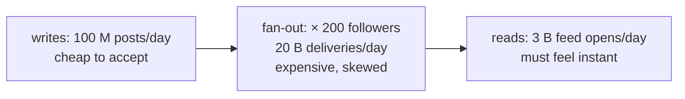
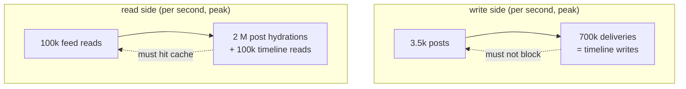
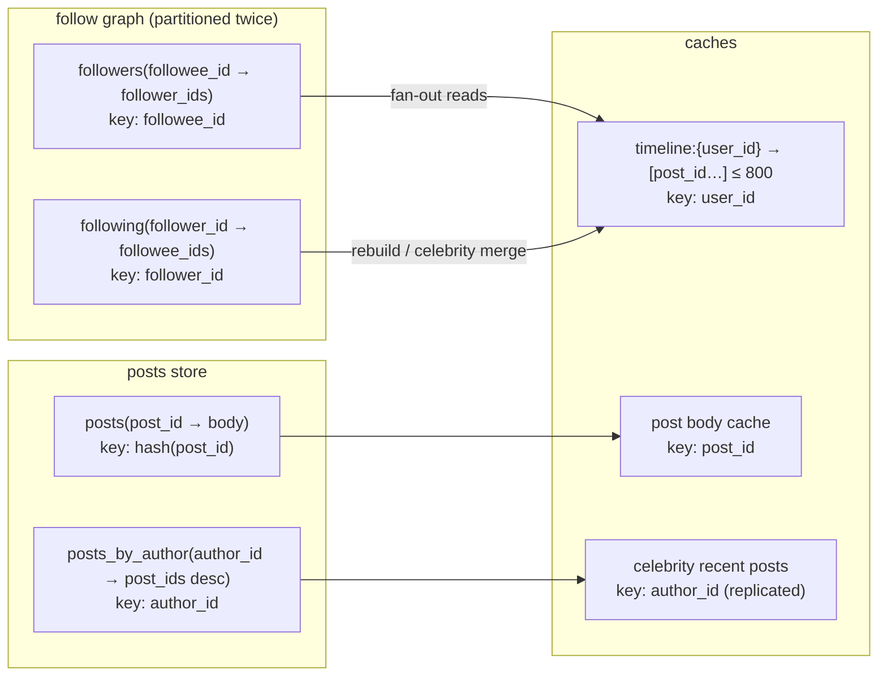
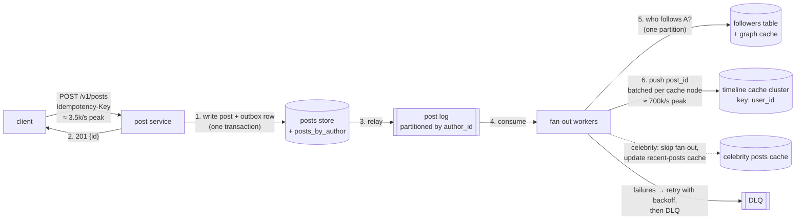

# C5 Unit 1 — Guided design: requirements, estimation, API and data model, high-level design

> Time: ~4 h · CORE: §1–§4 · STRETCH: the media and multi-region notes at the end of §4 · Lab: none in this unit
> (the estimate sheet and the two diagrams are the work; Unit 2 has `labs/c5/feed`)

This unit runs the first 25 minutes of a news-feed interview the way [A0](../A0-framework-estimation/README.md)
taught you to run them, with one difference: before every decision you commit to your own answer in a predict
block, and only then see the reveal. Treat the predicts as the interview. If you skip them you will recognise the
design and still be unable to produce it on a whiteboard.

## Before you start

You should have passed [A3](../A3-caching/README.md) (caching), [A4](../A4-replication-partitioning/README.md)
(replication and partitioning) and [A6](../A6-async/README.md) (queues, logs, outbox, backpressure). Warm-up,
answer first:

1. A cache cluster of 10 nodes serves a key read by 30 M users in the same minute. What goes wrong, and what are
   two fixes?
2. A service commits a row and then publishes "row created" to a log. Which failure loses the event, and what is the
   fix called?
3. You partition a table by `user_id` and need "all rows where `author_id = X`". What are your two options and what
   does each cost?

<details data-kind="answer">
<summary>Warm-up answers</summary>

1. A hot key: one node takes the whole load (≈ 500k reads/s if 30 M reads land in a minute) while nine idle. Fixes
   from A3 §7 and A4 §8: replicate the key (read from any of N copies, or a local in-process cache with a short
   TTL), or split it into sub-keys. Feeds hit this on every celebrity's "recent posts" list.
2. A crash between the commit and the publish loses it (and publishing first invents events for rolled-back
   writes). The fix is the transactional outbox (A6 Unit 2 §1): the event row commits with the data, a relay
   publishes at-least-once, consumers dedupe by event ID.
3. A local secondary index with scatter-gather (reads fan out to every partition, writes stay local) or a global
   index partitioned by `author_id` (reads hit one partition, writes become a second, usually asynchronous, write).
   A4 §9. The follow graph needs both directions, which is exactly this decision.

</details>

---

## §1 Requirements and the clarifying questions that change the design

### The failure story

Two candidates get the prompt "design a news feed like Twitter's home timeline". Candidate A writes down "users
can post, follow, and see a feed" and starts drawing boxes at 0:02. Candidate B spends five minutes asking
questions and gets answers that reshape everything: the average account follows 200 others, a few accounts have
tens of millions of followers, the feed is reverse-chronological (no ranking) for this interview, a post must be
visible to followers "within a few seconds, not instantly", the author must see their own post immediately, and
media is handled by an existing upload service that returns IDs.

At 0:30 both have a cache, a queue and a database. A's interviewer asks "what happens when an account with 50
million followers posts?" and A hears it for the first time. B designed for it at 0:04 because it was the answer
to the question "how skewed is the follower distribution?". The difference wasn't knowledge; it was which
questions got asked before anything was drawn.

### Predict

<!-- predict id="C5-U1-P01" -->
**Predict.** Write your answers down before opening the reveal.

1. List the five clarifying questions you would ask about a news feed, and for each, say *which design decision*
   depends on the answer. Then mark the one question whose answer changes the design the most.
2. Write the functional requirements (3–5 bullets), the non-functional requirements *each with a number* (scale,
   latency, availability, freshness/consistency), and an explicit out-of-scope list.
<!-- /predict -->

### Reveal

<details data-kind="reveal" data-for="C5-U1-P01">
<summary>Reveal</summary>

The questions, and what hangs on each:

| Question | What the answer decides |
|---|---|
| **How skewed is the follow graph?** Average and maximum followers; are there accounts with tens of millions? | Push vs pull vs hybrid fan-out (Unit 2 §5). This is the one that matters most: with no celebrities, pure fan-out on write is fine; with 50 M-follower accounts it is not. |
| Is the feed reverse-chronological or ranked? | A chronological feed is a merge of sorted lists; a ranked feed is a candidate-generation + scoring pipeline (Unit 2 §7, STRETCH). Scope to chronological unless told otherwise. |
| What freshness is required? "A post appears in followers' feeds within N seconds" and "the author sees it immediately"? | Whether fan-out can be asynchronous (it must be, at scale) and what read-your-own-writes needs (§3, Unit 2 §7). |
| What is in a post: text only, or media? Who stores media? | Blob/metadata split; whether the feed service touches bytes (it shouldn't) and whether a CDN is in the design. |
| Scale: DAU, posts per day, feed opens per user per day, page size? | Every number in §2. If the interviewer won't give them, state assumptions out loud. |
| Are deletes, edits, blocks and unfollows required to propagate, and how fast? | Lazy filtering vs eager removal (Unit 2 §7); tombstones. |
| Is there a "profile" view of one author's posts? Search, notifications, likes? | Profile reads come from the posts store by author, not from timelines; the rest is out of scope. |

The tempting mistake is to ask about *features* (likes? comments? hashtags?) instead of about *shape and
numbers*. Features extend the design; skew, freshness and scale change it.

**Requirements card (the one used for the rest of the module; assumptions where the prompt was silent):**

Functional:
- Create a text post (media referenced by ID from an existing upload service).
- Follow and unfollow another user.
- Read the home feed: posts by followed users, newest first, paginated.
- Read one user's posts (profile); delete own post.

Non-functional, with numbers:
- Scale: ≈ 300 M DAU; ≈ 100 M posts/day; a user opens the feed ≈ 10 times a day; 20 posts per page.
- Graph: average ≈ 200 followees and ≈ 200 followers per user (in a closed graph the two averages are equal);
  heavy tail up to ≈ 50 M followers for a few hundred accounts.
- Latency: feed read p99 ≤ 200 ms server-side; post creation p99 ≤ 300 ms.
- Freshness: a post appears in followers' feeds within ≈ 5 s typically, ≤ 60 s at p99 (an SLO on fan-out lag).
  The author sees their own post immediately on their profile and in their own feed.
- Availability: feed reads 99.9%; degraded mode (slightly stale feed) is acceptable over an error page.
- Durability: an acknowledged post is never lost; timelines are a rebuildable cache, not the source of truth.
- Consistency: eventual for followers (bounded by the freshness SLO); monotonic for a given reader (the feed never
  goes backwards between two refreshes).

Out of scope (say it out loud): ranking and recommendations, likes/comments/reposts, search, notifications,
media processing, ads, abuse/moderation, analytics.

</details>

### How it actually works

The requirements phase has one output that drives the whole session: the **shape of the load**, in three facts.



1. **Writes are rare and cheap; deliveries are 200× more numerous.** The system's dominant work is not storing
   posts, it is getting each post in front of each follower. Whether you do that work at write time (push) or at
   read time (pull) is the design.
2. **Reads dominate writes by ≈ 30:1 in requests and ≈ 600:1 in rows** (each read hydrates 20 posts). Anything on
   the read path that touches a database per post is dead on arrival; the read path is a cache path.
3. **Skew is extreme.** The median account has a few dozen followers; a few hundred accounts have tens of
   millions. A design that is correct on average and wrong for the tail falls over on the tail, because that is
   where the load is.

The freshness number ("within ≈ 5 s, author sees it immediately") is what makes an asynchronous design *allowed*.
Without it you would have to deliver synchronously, and 50 M synchronous writes per celebrity post is not a design.
Always get this number; if the interviewer says "instantly", push back with the cost, then offer the hybrid where
the author's own view is immediate and followers' views are seconds behind.

### Build it

No lab for this section — see Unit 2 §5 (`labs/c5/feed`). Instead, run a five-minute timed scoping of a variant
("design the activity feed inside a banking app: transactions, alerts and messages from the credit union, newest
first") and write its requirements card. Keep it; the [design exercise](design-exercise.md) uses that variant.

### Break it

Change one requirement at a time and write down what it does to the design, before reading the answer: (a) the
interviewer says "no account has more than 5,000 followers"; (b) "the feed must be ranked by relevance"; (c) "a
post must be visible to all followers within 500 ms"; (d) "posts expire after 24 hours".

<details data-kind="answer">
<summary>What each change does</summary>

(a) The celebrity problem disappears: pure fan-out on write, no merge-on-read path, a simpler read path; the
fan-out rate is still 20 B/day, so the async pipeline stays. (b) The read path becomes candidate generation
(the chronological merge is now just the *candidate* set) plus feature hydration and scoring; latency budget
doubles; precomputed ranking per user becomes a storage cost (Unit 2 §7 STRETCH). (c) Fan-out lag can no longer
be absorbed by a queue; you need either synchronous push (impossible for celebrities) or pull-on-read for
everyone with a very hot "recent posts per author" cache; cost rises sharply, and you should say that 500 ms is
the requirement to negotiate. (d) Timelines can be bounded by time instead of count, storage shrinks to ≈ 2 days
of posts, and the posts store can be a TTL-based store; retention changes the storage estimate by ≈ 1,000×.

</details>

### In the wild

- **Twitter/X** has described the home timeline as a Redis-cached list of ≈ 800 tweet IDs per user, filled by
  fan-out on write for most authors, with high-follower accounts merged at read time (the "Timelines at Scale"
  talk, 2012/2013, gave ≈ 300k timeline reads/s against ≈ 5k tweets/s and fan-out of ≈ 4,000 deliveries per
  tweet on average at the time; `TODO-VERIFY: exact figures and current architecture`).
- **Facebook** news feed is ranked, not chronological: an aggregator pulls recent activity from "leaf" servers
  that hold recent actions in memory, then ranks (the Multifeed architecture; `TODO-VERIFY: current details`).
  Ranking pushes the design toward pull.
- **Instagram** and **LinkedIn** have both described hybrid feeds; the recurring pattern is the same split
  between ordinary and high-fan-out authors.
- Your **banking app's activity list** is a feed with ≈ 5 authors per member (cores, card processor, the credit
  union, fraud) and a very different skew: every "author" is a celebrity.

### Trade-offs

| Option | Wins when | Loses when | When the answer flips |
|---|---|---|---|
| Chronological feed (scope choice) | Interview time is 45 min; correctness is checkable; the mechanism (merge of sorted lists) is clear | Product needs relevance | Flip to ranked when the interviewer says engagement/relevance; keep chronological as the candidate layer |
| Eventual freshness (seconds) | Allows asynchronous fan-out, bounded queues, graceful degradation | Products where "I posted and my friend didn't see it" within seconds is a bug | Flip toward synchronous or pull-on-read when the freshness SLO drops below ≈ 1 s |
| Text + media IDs only | Feed service never moves bytes; media is a separate, CDN-fronted problem | The interviewer wants the upload path designed | Add the blob/metadata split from A0's photo-sharing exercise when asked |

### Senior bar

- **Failure modes of the requirements phase**: NFRs without numbers; not asking about skew; accepting "instantly"
  without naming its cost; scoping in features (likes, search) that add boxes but no insight; forgetting deletes
  and unfollows, which the interviewer will raise at 0:38.
- **Capacity**: by 0:06 you should be able to say "≈ 1k posts/s, ≈ 35k feed reads/s average, 200× fan-out, a tail
  of 50 M-follower accounts" — the numbers of §2 come from these four facts.
- **Ops**: freshness is an SLO you will measure (fan-out lag: post creation time → time it lands in the last
  timeline); say so when you state it.
- **Cost**: the two cost drivers are RAM for timelines and the write capacity consumed by fan-out; both come from
  the graph's shape, so the skew question is also the cost question.

Interviewer follow-up probes:

1. "You assumed 200 followers on average. What if it's 2,000?"

<details data-kind="answer">
<summary>Model answer</summary>

Fan-out writes go from ≈ 20 B/day to ≈ 200 B/day (≈ 2.3 M/s average, ≈ 7 M/s peak): the cache cluster's write
side grows ≈ 10×, and the hybrid threshold moves down because more authors are expensive to push. Timeline memory
doesn't change (bounded per reader), but each timeline churns 10× faster, so an 800-entry window covers a tenth of
the time. I'd re-check whether the product wants every post from 2,000 followees, or whether this is already a
ranking problem.

</details>

2. "Why is 'within 5 seconds' acceptable? Would you accept 5 minutes?"

<details data-kind="answer">
<summary>Model answer</summary>

Seconds are invisible to a human scrolling; the author's own view is immediate, which is what people actually
check. Five minutes would be visible in conversations ("did you see my post?") and breaks products with live
events. The number matters because it sizes the fan-out backlog I'm allowed: at a 700k/s peak fan-out rate, a 5 s
budget means a backlog of ≈ 3.5 M deliveries is fine and 60 s means ≈ 40 M; that bounds the queue and tells me
when to shed (A6 Unit 3 §3).

</details>

3. "What's the single assumption that, if wrong, breaks your design?"

<details data-kind="answer">
<summary>Model answer</summary>

That readers can tolerate a bounded timeline (≈ 800 entries) and seconds of lag. If the product needs unbounded
scroll-back with perfect completeness, the timeline cache becomes a durable, partitioned timeline *store* (fan-out
on write into a wide-column table), roughly 100× the storage, and I'd want that number on the table before
agreeing.

</details>

### Check yourself

1. Which clarifying question changes the design the most, and what does it decide?
2. State the freshness requirement with a number and say what design freedom it buys.
3. Name three things you put out of scope and why none of them changes the core design.

<details data-kind="answer">
<summary>Answers</summary>

1. The skew of the follower distribution: it decides push vs pull vs hybrid, the cost drivers and the hot keys.
2. "Visible to followers within ≈ 5 s typically, ≤ 60 s at p99; immediately to the author." It allows
   asynchronous fan-out behind a bounded queue, and tells you how much backlog is acceptable.
3. Ranking, likes/comments, search (also notifications, media processing, ads): each is a separate pipeline
   that consumes the same events; the write path, fan-out and timeline cache are unchanged by them.

</details>

---

## §2 Estimation: six numbers that decide the design

### The failure story

A candidate estimates for eight minutes and fills a board: posts per day, per second, per year, storage in five
years, bytes of text, bytes of metadata, bandwidth in and out. None of it is used afterwards. Then the
interviewer asks "so how big is the timeline cache?" and "how many cache writes per second does fan-out cause?",
and the two numbers that would have decided the design were never computed.

The point of the estimate is not coverage. It is to find the numbers near a threshold: a single primary's write
capacity, one node's memory, one cache node's ops/s, one worker's throughput. Everything else is noise.

### Predict

<!-- predict id="C5-U1-P02" -->
**Predict.** Using the requirements card from §1 (300 M DAU, 100 M posts/day, 10 feed opens per DAU per day, 20
posts per page, ≈ 200 followers on average, ≈ 1 KB per post, timelines of 800 IDs), compute by hand, in under six
minutes, with units: (1) post QPS, average and peak; (2) feed-read QPS, average and peak, and the post *lookups*
per second those reads imply; (3) fan-out deliveries per second, average and peak; (4) timeline-cache memory for
all DAU, IDs only; (5) posts storage per year with 3× replication; (6) peak egress for text-only feed pages. Next
to each number, write the decision it drives.
<!-- /predict -->

### Reveal

<details data-kind="reveal" data-for="C5-U1-P02">
<summary>Reveal</summary>

| # | Number | Arithmetic | Decision |
|---|---|---|---|
| 1 | Posts: ≈ 1.2k/s avg, ≈ 3.5k/s peak | 100 M / 86,400 ≈ 1,160/s; × 3 peak | Fits one well-run primary's write range (≈ 1k–10k TPS) with little headroom; partition the posts store anyway, by `post_id`, because of *size* (row 5) and because reads by ID must scale |
| 2 | Feed reads: ≈ 35k/s avg, ≈ 100k/s peak → ≈ 2 M post lookups/s | 300 M × 10 / 86,400 ≈ 34.7k/s; × 3; × 20 posts | No database on the read path. Timelines in a cache cluster; post bodies in a cache too (hot set: ≈ 2 days of posts ≈ 200 M × 1 KB ≈ 200 GB) |
| 3 | Fan-out: ≈ 230k/s avg, ≈ 700k/s peak | 100 M × 200 = 20 B deliveries/day / 86,400; × 3 | Fan-out is asynchronous (A6), behind a log partitioned by author; the cache cluster needs ≈ 10–15 nodes for the write side alone at ≈ 100k ops/s each at 50–70% utilisation. A 50 M-follower post alone is ≈ 70 s of the *whole* cluster's write capacity → hybrid |
| 4 | Timeline memory: ≈ 2.4 TB raw IDs | 300 M × 800 × 8 B (time-sortable 64-bit IDs); ≈ 2–3× in a real cache's data structures, `TODO-VERIFY` for your engine; ×2 replicas | ≈ 50–70 nodes at ≈ 200 GB usable each. RAM is the cost driver: bound entries, store IDs not bodies, evict inactive users, use time-sortable IDs so no timestamp is stored |
| 5 | Posts: ≈ 100 GB/day ≈ 37 TB/year raw ≈ 110 TB/year replicated | 100 M × 1 KB × 365 × 3 | Partitioned, LSM-friendly store (append-heavy, point reads by ID); 5 years ≈ 550 TB; media not included (object storage) |
| 6 | Egress: ≈ 2 GB/s ≈ 16 Gbps peak | 100k/s × 20 posts × 1 KB × 8 | Spread over a fleet; compress; no CDN (personalised, authenticated) — the CDN belongs in front of media, not the feed |

Two numbers that did *not* make the list, on purpose: bandwidth *in* (≈ 3.5k/s × 1 KB ≈ 3.5 MB/s, irrelevant)
and the graph's storage (≈ 300 M × 200 × 2 directions × ≈ 16 B ≈ 2 TB: partitioned, but it never threatens a
decision except that a celebrity's follower list is ≈ 50 M entries ≈ 400 MB and must never be read on a hot path).

The tempting errors: counting fan-out per *post* and forgetting ×200 (the 200× is the whole problem); storing
full posts in timelines (≈ 1 KB instead of 8 B per entry: 125× the RAM, ≈ 300 TB); forgetting hydration (a feed
read is 20 reads); and sizing the posts store by write rate (fine) instead of by size (not fine).

</details>

### How it actually works

**Deliveries are the unit of work.** Writes × fan-out = deliveries; reads × page size = hydrations. Put both on the
board and the design follows:



**Where each number crosses a threshold** (the numbers in [docs/NUMBERS.md](../../docs/NUMBERS.md)):

- 3.5k posts/s against a primary's ≈ 1k–10k TPS: single-primary is *possible* but leaves no room for growth or
  for the second write every post needs (the outbox row). Partitioning the posts store is decided by size
  (hundreds of TB) rather than by write rate; say that distinction out loud.
- 700k timeline writes/s against ≈ 100k ops/s per cache node: this is a *cluster*, and fan-out must be rate-shaped
  (A6's backpressure) so a celebrity post or a burst cannot consume it all.
- 2 M hydrations/s against anything but a memory cache: that is why the post *body* cache exists, separate from
  timelines (different key, different size, different hit pattern).
- 2.4 TB of timeline IDs: no single node, no "just use Redis" without a partitioning story (consistent hashing by
  `user_id`, A4 §6) and a replication story (a lost node = cold timelines for 1/N of users).

**Little's law for the fan-out workers** (A0 Unit 2 §5): if a delivery takes ≈ 1 ms of worker time when batched
(pipelined writes of ≈ 100 entries per round trip), 700k/s needs ≈ 700 worker-threads' worth of concurrency; at
50 per worker process that is ≈ 14 processes, plus headroom for a celebrity burst. The *backlog* allowed by the
5 s freshness target is ≈ 3.5 M deliveries; beyond that you are breaking the SLO and should shed or prioritise.

**Latency budget for a read (p99 ≤ 200 ms):** API + auth ≈ 10 ms; timeline fetch from cache ≈ 1–2 ms (one
partition); merge with ≈ 3 celebrity lists ≈ 1–2 ms each, in parallel; hydrate 20 posts in one batched cache call
≈ 2–5 ms; filter + serialise ≈ 5 ms. Comfortable — *when everything hits cache*. A timeline miss that rebuilds from
≈ 200 followees' recent posts is the p99 risk, which is why Unit 2 §6 exists.

### Build it

No lab for this section — see Unit 2 §5 (`labs/c5/feed`). Check your sheet against this program (it is also the
kind of thing you can type in two minutes during a mock to sanity-check yourself), then run `sd estimate -n 5`:

```go
// The C5 estimate sheet: deliveries and hydrations are the units of work.
package main

import "fmt"

func main() {
	const (
		dau          = 300e6
		postsPerDay  = 100e6
		opensPerUser = 10.0
		pageSize     = 20.0
		avgFollowers = 200.0
		postBytes    = 1024.0
		timelineLen  = 800.0
		idBytes      = 8.0
		secPerDay    = 86400.0
		peak         = 3.0
	)
	posts := postsPerDay / secPerDay
	reads := dau * opensPerUser / secPerDay
	fmt.Printf("posts/s        avg %.0f  peak %.0f\n", posts, posts*peak)
	fmt.Printf("feed reads/s   avg %.0f  peak %.0f  (hydrations peak %.1fM/s)\n", reads, reads*peak, reads*peak*pageSize/1e6)
	fmt.Printf("fan-out/s      avg %.0f  peak %.0f\n", posts*avgFollowers, posts*avgFollowers*peak)
	fmt.Printf("timeline RAM   %.1f TB raw IDs\n", dau*timelineLen*idBytes/1e12)
	fmt.Printf("posts storage  %.0f TB/year x3 replicas\n", postsPerDay*postBytes*365*3/1e12)
	fmt.Printf("egress peak    %.1f Gbps\n", reads*peak*pageSize*postBytes*8/1e9)
	fmt.Printf("one 50M-follower post = %.0f s of a 700k/s fan-out fleet\n", 50e6/700e3)
}
```

### Break it

Re-run the sheet with (a) `avgFollowers = 2000`, (b) `timelineLen = 8000`, (c) `postBytes = 1024` stored *in*
the timeline instead of `idBytes`. Before each run, say which decision flips.

<details data-kind="answer">
<summary>What flips</summary>

(a) Fan-out ≈ 7 M/s peak: the cache cluster's write side is ≈ 10× bigger, the hybrid threshold drops (more authors
are "expensive"), and the async pipeline needs priority lanes to keep ordinary posts' freshness under a burst.
(b) Timeline RAM ≈ 24 TB raw: now you are looking at a persistent timeline *store* (wide-column, SSD) instead of a
RAM cache, or at caching only the newest 800 and paging the rest from the posts store. (c) ≈ 300 TB of RAM:
nobody does this; it is the single most common mistake in this design ("store the post in the timeline so reads
don't hydrate") and the sheet shows why in one line.

</details>

### In the wild

- The ≈ 800-entry home timeline and the ≈ 300k reads/s vs ≈ 5k writes/s ratio are the figures Twitter engineers
  gave publicly for 2012-era traffic (`TODO-VERIFY: exact numbers; they are an order of magnitude lower than the
  sheet above, which assumes 2020s scale`).
- Redis and Memcached run at ≈ 100k+ simple ops/s per instance ([NUMBERS.md](../../docs/NUMBERS.md)); pipelining
  raises it severalfold, which is why fan-out workers batch timeline writes per cache node.
- Twitter's Snowflake IDs (64-bit, time-ordered: 41 bits of milliseconds, worker ID, sequence) are what makes "8
  bytes per timeline entry, sorted by time" possible; Instagram described a similar scheme generated inside
  Postgres.

### Trade-offs

| Option | Wins when | Loses when | When the answer flips |
|---|---|---|---|
| IDs only in timelines, hydrate on read | RAM ≈ 8 B/entry; one body cache serves every timeline; deletes/edits need no timeline rewrite | Every read is 20 extra lookups (batched) | Never store bodies in timelines at this scale; a small *denormalised* projection (author, timestamp) is defensible if hydration becomes the p99 driver |
| 800-entry window | Memory bounded and predictable; covers hours for heavy followers, days for light ones | Users who scroll past it | Flip to "page past the window from the posts store" (pull) rather than a bigger window; or persist timelines when the product is an archive |
| Peak factor 3× | Consumer daily pattern | Live events (a final, an election) with 10× spikes on both posts and reads | Design shedding for 10×, provision for 3× |

### Senior bar

- **Failure modes**: the 8× bits/bytes slip on egress; forgetting the ×200; forgetting hydration; sizing RAM by
  posts instead of by readers; assuming a cache node's 100k ops/s is available for fan-out when reads also need
  it.
- **Capacity**: say the two unit-of-work numbers (≈ 700k deliveries/s, ≈ 2 M hydrations/s) and the one tail
  number (≈ 50 M deliveries for one post) — they justify every box in §4.
- **Ops**: the fan-out backlog (in deliveries and in *age of the oldest undelivered post*) and the timeline-cache
  hit ratio are the two capacity dashboards; both derive directly from this sheet.
- **Cost**: ≈ 50–70 cache nodes for timelines dominate; a persistent timeline store would trade RAM for SSD and
  ≈ 10× the storage bytes.

Interviewer follow-up probes:

1. "You said the posts store fits one primary. Why partition it then?"

<details data-kind="answer">
<summary>Model answer</summary>

Size and read scaling, not write rate: ≈ 110 TB/year replicated doesn't fit a node, and 2 M hydrations/s on
misses must spread across partitions. Write rate is the number people check first and it is the wrong reason
here; I'd partition by hashed `post_id` for point reads and keep an `author_id`-partitioned projection for profile
pages.

</details>

2. "How many fan-out workers, and how did you get there?"

<details data-kind="answer">
<summary>Model answer</summary>

Little's law: 700k deliveries/s × ≈ 1 ms each (batched writes) ≈ 700 in flight; at ≈ 50 concurrent batches per
process ≈ 14 processes, and I'd run ≈ 2× that for a celebrity burst and node loss. The backlog the SLO allows is
≈ 3.5 M deliveries (5 s × 700k/s); beyond it, prioritise ordinary authors over the celebrity backlog.

</details>

3. "What's the memory if you cache timelines only for users active in the last 7 days instead of all 300 M DAU?"

<details data-kind="answer">
<summary>Model answer</summary>

DAU are by definition active; the win comes from the *inactive* registered users you never cached and from
evicting DAU who go quiet. If weekly actives are, say, ≈ 1.5× DAU and you keep only the last 7 days, the cache
holds ≈ 450 M timelines ≈ 3.6 TB raw: eviction by inactivity is what keeps that from growing with registrations.

</details>

### Check yourself

1. What are the two "units of work" in a feed, and what rate does each have at peak?
2. Why do you size the timeline cache by readers and the posts store by writes?
3. One 50 M-follower post equals how long of the whole fan-out fleet's capacity, and what does that number decide?

<details data-kind="answer">
<summary>Answers</summary>

1. Deliveries (≈ 700k/s peak) and hydrations (≈ 2 M/s peak).
2. A timeline is per reader and bounded (800 entries), so RAM = readers × 800 × 8 B; the posts store grows with
   every post forever (× replication).
3. ≈ 70 s at 700k/s (≈ 50 M / 700k). It decides the hybrid: that author's post is merged on read, not pushed.

</details>

---

## §3 API and data model

### The failure story

A team ships `GET /feed?page=3`. Within a week support has a ticket pattern: "I saw the same post twice while
scrolling" (new posts arrived and shifted the pages, A1 Unit 2 §2) and "my app shows my post twice" (the client
retried a `POST /posts` whose response was lost on a flaky connection; no idempotency key). Then the data model:
posts live in one table partitioned by `author_id` "so a profile page is one partition". Profile pages are fast.
Hydrating a feed page (20 posts by 20 different authors) is 20 partitions per read, and the celebrity's partition
takes 10 M reads/s the moment they post. Meanwhile the follow graph has one table, `(follower_id, followee_id)`,
partitioned by `follower_id`; "who follows X?" (the fan-out worker's one question) is a scatter-gather over every
partition, 3.5k times a second.

### Predict

<!-- predict id="C5-U1-P03" -->
**Predict.** Write your answers down first.

1. Sketch the API: method, path, key fields and status codes for create post, read feed, follow, unfollow, read a
   profile, delete post. Where does an idempotency key go, and what is the cursor?
2. Data model: list the access patterns first (who reads what, keyed by what, at what rate). Then give the
   entities, the **partition key** of each, and which store holds it. How many tables does the follow graph need,
   and why?
3. What exactly is stored in a timeline entry, and where do timelines live?
<!-- /predict -->

### Reveal

<details data-kind="reveal" data-for="C5-U1-P03">
<summary>Reveal</summary>

**API** (resource-oriented, A1 Unit 2 §1):

| Call | Notes |
|---|---|
| `POST /v1/posts` `{text, media_ids[]}` + `Idempotency-Key` → **201** `{id, created_at}` | The key is scoped per user; a retry returns the same post (A1 Unit 3 §2). 202 is also defensible if you want to say "accepted, fan-out pending", but the post itself is durable before the response either way |
| `GET /v1/feed?cursor=&limit=20` → **200** `{items: [post…], next_cursor}` | Keyset cursor = (post time, post ID) of the last item, opaque and signed (A1 Unit 2 §2). Never `page=` |
| `PUT /v1/me/following/{user_id}` → **204**; `DELETE` → **204** | Idempotent by construction (PUT/DELETE); 404 for an unknown user |
| `GET /v1/users/{id}/posts?cursor=` → 200 | Profile: served from the posts store/projection, not from timelines |
| `DELETE /v1/posts/{id}` → **204** (owner only; 404 if not owner, so IDs aren't probed) | Deletes propagate lazily (Unit 2 §7) |

**Access patterns, then the model:**

| Pattern | Rate (peak) | Keyed by |
|---|---|---|
| Get post bodies by ID (hydration) | ≈ 2 M/s, mostly cache | `post_id` |
| Append a post | ≈ 3.5k/s | `post_id` (time-sortable) |
| List an author's posts newest-first (profile, celebrity merge) | ≈ 10k/s | `author_id`, then time |
| "Who follows A?" (fan-out) | ≈ 3.5k/s, each returning ≈ 200 (or 50 M) | `followee_id` |
| "Who does U follow?" (timeline rebuild, celebrity merge) | ≈ 100k/s (every feed read for the celebrity set) | `follower_id` |
| Read U's timeline | ≈ 100k/s | `user_id` |
| Write into U's timeline | ≈ 700k/s | `user_id` |

Entities and partition keys:

- `posts(post_id PK, author_id, text, media_ids, created_at, deleted_at)` — partitioned by **hash(post_id)**.
  IDs are time-sortable 64-bit (Snowflake-style), so a timeline entry needs no timestamp and ordering is a
  comparison of IDs. An LSM-based store fits (append-heavy, point reads; A2 Unit 2 §5).
- `posts_by_author(author_id, post_id DESC)` — a projection partitioned by **author_id**, maintained from the same
  write (same transaction in a single store, or an async projection from the post event with the event ID as the
  dedupe key; A4 §9's global-index decision). Serves profiles and the celebrity merge. A celebrity's row is hot
  on *reads*; cache its newest ≈ 100 IDs in the celebrity-posts cache (Unit 2 §5).
- The follow graph needs **two tables** (or one table with two clustering orders): `following(follower_id,
  followee_id)` partitioned by **follower_id** and `followers(followee_id, follower_id)` partitioned by
  **followee_id**. Each is one partition per query. They are kept in sync through the same mechanism as any
  dual write: either both in one transaction when the store allows it, or an outbox event that writes the second
  table idempotently. A 50 M-follower list is ≈ 400 MB in one partition: store a `follower_count` and a
  `is_celebrity` flag on the user, and page the big list in chunks only inside the fan-out worker (which, for a
  celebrity, never needs it).
- `timeline:{user_id}` → a bounded sorted list of **post IDs** (8 B each), newest first, capped at ≈ 800, in the
  timeline cache cluster (partitioned by `user_id` with consistent hashing, A4 §6). Not durable; rebuildable from
  `following` + `posts_by_author`.
- `user(user_id, follower_count, is_celebrity, last_active_at)`; a celebrity flag flips when the count crosses the
  threshold (with hysteresis, Unit 2 §5).

The tempting wrong answers: partition posts by author (hot partition on reads for celebrities and 20 partitions
per hydration); one graph table (scatter-gather for the other direction); store post bodies in timelines
(§2's 125× RAM); offset pagination.

</details>

### How it actually works



**Why the ID carries the time.** A 64-bit ID with the millisecond in its high bits sorts by creation time, breaks
ties with a per-generator sequence, and needs no coordination (A4-style independent generators; C3 designs it).
Every timeline entry is then 8 bytes, every merge compares integers, and the cursor is one number plus a version
byte.

**Why two graph tables.** The two questions ("who follows A", "who does U follow") are each asked at high rate with
a different key. A single table serves one of them per partition and makes the other a fan-out across all
partitions (A4 §9). Writing two tables is the cost; a follow is rare (hundreds per second, not hundreds of
thousands), so the cost is small, and the inconsistency window between the two writes is harmless as long as the
second write is idempotent and eventually applied.

**Why the cursor is (time, ID) and not an offset.** Feeds change under the reader; keyset paging returns each
post that existed for the whole walk exactly once (A1 Unit 2 §2). The lab tests exactly this property while posts
are being added and deleted.

**Idempotent post creation.** Mobile clients retry. The key is scoped per user (a 24-hour window is plenty),
stored with the post it produced, and a retry returns the same post without a second fan-out — the lab's
`TestPost_DuplicateClientIDReturnsSamePost`.

### Build it

No lab for this section — the API and the partition keys are design decisions; `labs/c5/feed` in Unit 2 §5
implements this contract in memory (`Post` with a client ID, `Feed` with a (time, ID) cursor, `Follow`/`Unfollow`,
`Delete`), so the acceptance tests there are this section's tests.

### Break it

Take the lab's cursor codec (`EncodeCursor` in `labs/c5/feed/feed.go`) and imagine it in production as is: an
unsigned base64 of `nanos:id`. Write down two things a client could do with it and what each costs you. Then
decide whether the fix is signing (A1's HMAC cursor) or something else.

<details data-kind="answer">
<summary>What an unsigned cursor allows</summary>

A client can fabricate positions (enumerate IDs, scrape by jumping around in time) and can send crafted input to
your decoder; neither is a security boundary breach (the feed is still filtered by the authenticated user's
follow set), but both are API hygiene and abuse surface. Signing (HMAC, A1 Unit 2 §2) closes both at ≈ 1 µs per
check and lets you change the format later. What signing does *not* fix is a cursor reused after an unfollow:
the walk continues from the position, and the removed author's posts are simply absent — correct, by design.

</details>

### In the wild

- **Twitter** tweet IDs are Snowflake IDs (time-ordered 64-bit); the public API pages with `since_id` /
  `max_id` style cursors, i.e. keyset paging on the ID (`TODO-VERIFY: current API v2 pagination tokens`).
- **Instagram** generated time-sortable 64-bit IDs inside sharded Postgres (41 bits of time, shard ID, sequence;
  described in their engineering blog).
- **Cassandra/ScyllaDB** "wide rows" (partition key = user, clustering key = time desc) are the standard shape for
  `posts_by_author` and for persistent timelines; Twitter's Manhattan and the open-source Cassandra both model it
  this way.
- **Stripe-style** idempotency keys on creates are the general form of the lab's `clientID`.

### Trade-offs

| Option | Wins when | Loses when | When the answer flips |
|---|---|---|---|
| Posts partitioned by `post_id` + author projection | Hydration spreads evenly; profile is one partition via the projection | Two writes per post (projection) | Partition by `author_id` only if profile reads dominate *and* there are no celebrities (there always are) |
| Two graph tables | Both directions are one partition reads | Dual write to keep in sync | Keep two unless the store offers a native reverse index with the same guarantees |
| Time-sortable IDs | 8-byte entries, no stored timestamp, trivial merge | Needs a coordinated-enough ID scheme (C3) | Flip to UUIDv7 or ULID if you want a standard; the property is the same |
| Signed keyset cursor | Correct under concurrent inserts, no server state | No "jump to page N" | Never offset for a feed |

### Senior bar

- **Failure modes**: non-idempotent creates (duplicate posts, double fan-out); graph tables drifting (a follower
  missing from one direction → they never receive posts, or keep receiving after unfollow); hot `author_id`
  partition for celebrities; a 400 MB follower list read on every post.
- **Capacity**: the projection and the second graph table each add one write per event at a few thousand per
  second — trivial next to fan-out; the celebrity follower list is the one row you must never read on a hot path.
- **Ops**: a reconciliation job that compares the two graph tables (count mismatches per user) and repairs; cursor
  secret rotation; schema evolution of the post body (tolerant readers, A1 Unit 2 §3).
- **Cost**: storage ×(1 + projections); negligible against timelines in RAM.

Interviewer follow-up probes:

1. "Why not one `follows` table with two indexes?"

<details data-kind="answer">
<summary>Model answer</summary>

In a single-node relational database, that *is* two tables under the hood (the secondary index), kept in sync by
the engine, and it's fine. Partitioned, a secondary index on the non-partition column is either local (scatter
query) or global (asynchronous second write). I'd rather own that second write explicitly as a table so the
consistency window and its repair are visible.

</details>

2. "Where does the author's `follower_count` come from, and can it be wrong?"

<details data-kind="answer">
<summary>Model answer</summary>

A counter maintained from follow/unfollow events, idempotently (event ID dedupe). It can drift under replays or
bugs; a periodic recount from the `followers` table corrects it. It only gates the celebrity flag, which has
hysteresis, so small drift is harmless; I'd alert on recount deltas above a few percent.

</details>

3. "The client sends the same `Idempotency-Key` with different text. What do you return?"

<details data-kind="answer">
<summary>Model answer</summary>

422 (or 409) with a stable error code: the key is bound to the first request's fingerprint. Returning the original
post would silently drop the user's edit; creating a second post would defeat the key. A1 Unit 3 §2 has the full
state machine.

</details>

### Check yourself

1. Why is the posts table partitioned by `post_id` and not by `author_id`?
2. What two writes does a single "follow" cause, and what keeps them consistent?
3. What is inside a timeline entry, and why only that?

<details data-kind="answer">
<summary>Answers</summary>

1. Hydration reads by ID at ≈ 2 M/s must spread across partitions, and celebrity authors would make an
   author-partitioned table hot on reads; profiles are served by a projection partitioned by author.
2. A row in `following` (by follower) and in `followers` (by followee); one transaction if the store allows,
   otherwise an outbox event applied idempotently plus a reconciliation job.
3. An 8-byte time-sortable post ID: enough to order, merge and hydrate; bodies would multiply RAM by ≈ 125.

</details>

---

## §4 High-level design: both paths, end to end, by 0:25

### The failure story

A candidate draws the post path first and gets absorbed: API, validation, database, queue, workers, retries, dead
letters. At 0:27 the interviewer asks how a feed is read, and the answer is "from the cache". Which cache? What's
in it? What happens on a miss? There is no read path on the board, and the read path is where 100k requests a
second live. The checkpoint rule from A0 exists for this: *a complete end-to-end diagram by 0:25*, both paths,
thin if necessary, every box justified by a number from §2 or a requirement from §1.

### Predict

<!-- predict id="C5-U1-P04" -->
**Predict.** Draw both paths before opening the reveal:

1. The **post path**: from `POST /v1/posts` to the moment the post ID sits in a follower's timeline. Mark the
   asynchronous boundary, say what makes the post durable before the response, how the fan-out worker learns who
   the followers are, and what it does for a celebrity.
2. The **read path**: from `GET /v1/feed` to the response. Say what is read from where, in what order, what
   happens on a timeline-cache miss, and where celebrity posts enter.
3. Label at least three arrows with rates from §2. Then write one sentence per box: which requirement or number
   justifies it.
<!-- /predict -->

### Reveal

<details data-kind="reveal" data-for="C5-U1-P04">
<summary>Reveal</summary>

**Post path.**



Justifications: the transaction with the outbox row is what makes "acknowledged = never lost, and will be
delivered" true (A6 Unit 2 §1); the log partitioned by author keeps one author's posts in order per partition and
spreads authors across partitions (A6 Unit 1 §2); workers are stateless and scale with the 700k/s number; the
celebrity branch exists because of the 50 M number; the DLQ exists because a delivery can fail permanently (a
deleted user) without blocking the partition (A6 Unit 2 §3).

**Read path.**

```mermaid
sequenceDiagram
  participant C as client
  participant F as feed service
  participant TL as timeline cache
  participant G as following table
  participant CC as celebrity posts cache
  participant PC as post body cache / posts store
  C->>F: GET /v1/feed?cursor=&limit=20 (≈ 100k/s peak)
  F->>TL: GET timeline:{user} (IDs after cursor)
  alt miss (inactive user, node lost)
    F->>G: followees of user
    F->>PC: recent post IDs per followee (posts_by_author), merge, write back
  end
  F->>G: celebrity followees of user (cached per user)
  F->>CC: recent IDs for each celebrity followee (parallel)
  F->>F: k-way merge, newest first, after cursor; dedupe
  F->>PC: MGET 20 bodies (≈ 2 M/s peak); fall back to posts store on miss
  F->>F: drop deleted / blocked; build next_cursor
  F-->>C: 200 {items, next_cursor} (p99 ≤ 200 ms)
```

Justifications: timelines in a cache because of ≈ 100k reads/s with a 200 ms p99; the body cache because of
≈ 2 M hydrations/s; the celebrity merge because their posts were never pushed; the rebuild on miss because the
cache is not durable and must be recoverable from the truth (posts + graph); filtering at hydration because deletes
are lazy.

**Rates on arrows** (peak): posts ≈ 3.5k/s; deliveries ≈ 700k/s; feed reads ≈ 100k/s; hydrations ≈ 2 M/s.

The tempting wrong versions: fan-out inside the request (latency = followers × write time; a celebrity post never
returns); publish the event after commit without an outbox (lost posts in followers' feeds, A6's dual-write
problem); no miss path (one lost cache node = errors for 1/N of users forever); no celebrity merge (either 50 M
writes or missing posts).

</details>

### How it actually works

**Walk one post through.** Alice (200 followers) posts at 12:00:00.000. The API checks her idempotency key,
writes the post row and an outbox row in one transaction on the posts store partition for its ID, and returns 201
at 12:00:00.020. Her profile reads the posts store, so she sees the post immediately. The relay publishes the
event to the post log's partition for Alice at 12:00:00.100. A fan-out worker consuming that partition reads her
follower list (200 IDs, one partition of the `followers` table or its cache), groups them by timeline-cache node,
and issues ≈ 200 sorted-set inserts in ≈ 10 pipelined round trips, each insert also trimming the list to 800. By
12:00:00.400 every follower's timeline has the ID. The worker commits its offset *after* the writes (at-least-once;
an insert of an ID that is already present is a no-op, so a replay is harmless — the idempotent effect A6 Unit 2 §2
needs).

**Walk one read through.** Bob opens the app at 12:00:03. The feed service fetches `timeline:bob` from cache: 800
IDs, newest first; Alice's post is near the top. Bob follows two celebrities; their recent-IDs lists come from the
celebrity cache in parallel. The service merges three sorted lists after the cursor (none, first page), takes 20
IDs, hydrates them with one batched read from the body cache (19 hits, 1 miss served from the posts store and
back-filled), drops one that was deleted a minute ago, and returns 19 posts plus a cursor built from the 19th
post's ID. Total ≈ 15 ms.

**Walk one celebrity post through.** Star (50 M followers) posts. Same transaction, same relay. The fan-out
worker sees `is_celebrity` and does *not* read the 50 M-row follower list; it updates Star's recent-posts entry in
the celebrity cache (one key, replicated to every cache node or to a dedicated tier because 30 M readers will hit
it in the next minute: A3 §7's hot key). Every follower sees it on their next read, immediately — which is *faster*
than fan-out on write, at the price of a merge per read.

**What is stateful, and what failing looks like.**

| Component | State | If it dies |
|---|---|---|
| Post service, feed service | none | Replace; LB health checks (A1 Unit 1 §5) |
| Posts store | the truth; partitioned, replicated (A4) | A partition's failover: writes to that partition stall seconds; reads from replicas continue |
| Post log | durable, retained days | Fan-out stops; posts still durable; backlog drains after recovery; freshness SLO burns |
| Fan-out workers | offsets only | Rebalance; replays are idempotent |
| Timeline cache | derived, rebuildable | 1/N users rebuild on next read → protect the posts store from a rebuild stampede (Unit 2 §6) |
| Celebrity cache | derived | Rebuild from `posts_by_author`; a hot key during rebuild needs coalescing (A3 §6) |

**Multi-region (STRETCH, 0.5 h).** Timelines are per user, so pin each user's timeline to the region nearest them;
posts replicate across regions asynchronously (A4 §2) and fan-out runs in every region from its own copy of the log,
so a follower in Frankfurt gets Alice's post from the Frankfurt workers. Cross-region freshness adds the
replication lag (≈ 100 ms) to the SLO. The graph is small enough to replicate everywhere. Media is on a CDN
regardless.

**Media (STRETCH).** The upload service returns media IDs after writing to object storage and queuing
transcodes; the post references IDs; hydration returns CDN URLs; the feed service never touches bytes. A0's
photo-sharing exercise covered the egress math that makes the CDN mandatory.

### Build it

No lab for this section — the two diagrams and the three walkthroughs *are* the deliverable; the lab in Unit 2 §5
implements the fan-out worker's decision and the read path's merge in one process. Rehearse the walkthroughs out
loud, timed: all three in under four minutes is the bar.

### Break it

Two thought experiments; write your answer with numbers before opening each.

(a) Every fan-out worker is down for 10 minutes at peak. What do readers see, what accumulates where, and what
happens in the first minute after the workers come back?

(b) The timeline cache loses a node holding 1/40 of all users, and the cluster has no replicas. What happens to
the posts store at 100k feed reads/s, and what do you add?

<details data-kind="answer">
<summary>What happens</summary>

(a) Posts still succeed (durable + outbox); authors see their own posts; followers see nothing new from ordinary
authors for 10 minutes, but celebrity posts still appear (merged on read: an underrated argument for the hybrid).
The log accumulates ≈ 10 × 60 × 3.5k ≈ 2 M posts ≈ 400 M deliveries. On recovery, workers drain at their capacity
(≈ 700k/s if sized for peak with no headroom → ≈ 10 minutes to drain *while new peak traffic also arrives*, so
realistically longer); the freshness SLO is burnt and you should prioritise newer posts or recent readers (A6 Unit
3 §3). The cache cluster takes the full write rate during the drain; cap the drain so reads keep their share.
(b) 2.5% of users (≈ 7.5 M) now miss; at their share of reads (≈ 2.5k/s) each miss rebuilds from ≈ 200 followees'
recent posts: ≈ 500k `posts_by_author` reads/s against a store sized for ≈ 10k/s — a stampede that takes the
posts store down for everyone (A3 §6, A7's metastable failure). Add: replicas for the timeline tier (a lost node
fails over), request coalescing per user during rebuild, a rebuild *budget* (concurrency limit; serve an empty or
partial feed with a "pull to refresh" rather than overload the truth), and rebuild from the body cache's
`posts_by_author` projection where possible.

</details>

### In the wild

- The **outbox + log + idempotent worker** chain is how every large feed decouples the write from delivery;
  Kafka (or an equivalent partitioned log) partitioned by author is the common choice (A6 Unit 1).
- **Redis sorted sets** (`ZADD` with the ID as score, `ZREMRANGEBYRANK` to trim, `ZREVRANGEBYSCORE` to page after a
  cursor) are the textbook timeline structure; Twitter used Redis lists for home timelines (`TODO-VERIFY: current
  store`).
- **Hydration via `MGET`** against Memcached/Redis with a fallback to the store is what A3 §2 called cache-aside
  with batching.
- A6's **DLQ** is where a delivery to a deleted or blocked user ends up; it is also the audit trail when someone
  asks why a follower never saw a post.

### Trade-offs

| Option | Wins when | Loses when | When the answer flips |
|---|---|---|---|
| Asynchronous fan-out behind a log | Post latency independent of followers; backlog absorbs bursts; replay | Seconds of lag; another system to run | Flip to synchronous push only for tiny graphs (≤ ≈ 100 followers for everyone) |
| Timeline cache (RAM, derived) | p99 ≤ 200 ms at 100k/s; rebuildable | RAM cost; miss storms after node loss | Flip to a persistent timeline store when scroll-back must be unbounded or memory is the dominant cost |
| Celebrity merge on read | 50 M writes avoided; celebrity posts appear instantly | A merge on every read; hot celebrity keys | Flip to pushing celebrity posts to *active* followers only, if merge latency dominates |
| Lazy deletes (filter at hydration) | O(1) delete; no timeline scan | A deleted post's ID lingers in 50 M lists | Eager removal only for small follower counts, or when compliance requires the ID gone too |

### Senior bar

- **Failure modes**: dual write without outbox (lost deliveries); non-idempotent timeline writes under replay
  (duplicates); fan-out in the request path; no miss path; a celebrity list read per post; a rebuild stampede
  after cache loss; one slow cache node stalling every worker (bulkheads per node, A7 Unit 3 §1).
- **Capacity**: ≈ 700k deliveries/s and ≈ 2 M hydrations/s at peak; ≈ 50–70 timeline nodes; ≈ 15–30 fan-out
  processes; log retention of a few days ≈ 100 M posts × 1 KB × days.
- **Ops**: fan-out lag SLO (age of the oldest undelivered post, per partition); timeline hit ratio; rebuilds/s;
  DLQ depth; a replay tool to re-fan-out a range of posts; rolling deploys of the cache with warm replicas.
- **Cost**: RAM for timelines, then the cache cluster's write capacity, then the log; the posts store is cheap by
  comparison because it's disk.

Interviewer follow-up probes:

1. "Walk me through what happens if the fan-out worker crashes after writing 150 of Alice's 200 followers."

<details data-kind="answer">
<summary>Model answer</summary>

The offset wasn't committed, so another worker re-reads the event and re-writes all 200; the first 150 inserts are
no-ops because the ID is already in those timelines (sorted set semantics). Followers 151–200 get it late by the
rebalance time. This is A6's at-least-once plus an idempotent effect; the lab's `insertSorted` has the same
property.

</details>

2. "Why a log and not a queue for posts?"

<details data-kind="answer">
<summary>Model answer</summary>

Per-author ordering (an author's posts land in followers' timelines in order; with a queue they could interleave
across workers), replay (re-fan-out after a bug or a cache rebuild), and fan-out to other consumers (search,
notifications) from the same stream. A queue would be fine if fan-out were the only consumer and ordering didn't
matter; here both matter.

</details>

3. "What's your p99 read latency made of, and what's the first thing that blows it?"

<details data-kind="answer">
<summary>Model answer</summary>

≈ 2 ms timeline fetch, ≈ 2 ms celebrity lists in parallel, ≈ 5 ms batched hydration, ≈ 5 ms merge and serialise,
plus API overhead: ≈ 15–30 ms typical. The first thing that blows it is a timeline miss that rebuilds from ≈ 200
followees (hundreds of milliseconds), so the miss path is budgeted, coalesced and allowed to return a partial feed.

</details>

### Check yourself

1. What makes a post "never lost" even though delivery is asynchronous?
2. Why is a celebrity post visible to followers *sooner* than an ordinary post?
3. Name the four rates you must be able to put on the arrows.

<details data-kind="answer">
<summary>Answers</summary>

1. The post row and the outbox row commit in one transaction before the 201; the relay and workers deliver at
   least once from durable state.
2. It is merged on read from the celebrity cache, which is updated once; ordinary posts wait for the fan-out
   backlog.
3. Posts ≈ 3.5k/s, deliveries ≈ 700k/s, feed reads ≈ 100k/s, hydrations ≈ 2 M/s (peak).

</details>

---

## Unit wrap-up

| Decision | Default | Flip when… |
|---|---|---|
| Scope | Chronological feed, text + media IDs, follow/unfollow, delete; eventual freshness (≈ 5 s) with immediate self-view | Ranked feed requested → candidate + scoring pipeline (Unit 2 §7) |
| The numbers that matter | ≈ 700k deliveries/s and ≈ 2 M hydrations/s at peak; ≈ 2.4 TB of timeline IDs; one 50 M-follower post ≈ 70 s of the fleet | Followers 10× → threshold down, cluster 10×; window 10× → persistent timeline store |
| API | Idempotent `POST /v1/posts`; `GET /v1/feed` with a signed (time, ID) cursor; PUT/DELETE follows | Never offset paging; 202 if you want to say "fan-out pending" |
| Data model | Posts by hashed `post_id` + author projection; graph in two tables; timelines = bounded lists of 8-byte IDs | Posts by author only with no celebrities and profile-dominated reads |
| Post path | Transaction with outbox → log by author → idempotent fan-out workers → timeline cache; celebrities skip fan-out | Synchronous push only for tiny graphs |
| Read path | Timeline cache → celebrity merge → batched hydration → filter → cursor; coalesced, budgeted rebuild on miss | Persistent timelines when scroll-back must be complete |

Next: Unit 2 makes the three risky decisions (fan-out strategy, the cache, consistency) under the probe ladder, and
`labs/c5/feed` makes you build the worker's decision and the reader's merge.
