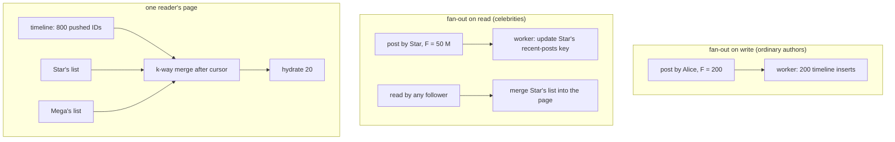
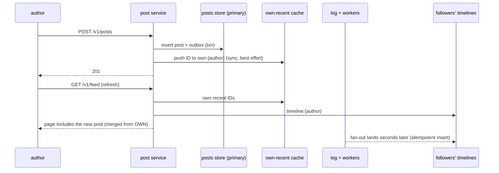

# C5 Unit 2 — Deep dives: fan-out strategy, the timeline cache, freshness and consistency

> Time: ~5 h · CORE: §5–§7 and "Common mistakes" · STRETCH: the ranking pipeline at the end of §7 and break-it
> experiments 3–4 in `labs/c5/README.md` · Lab: `labs/c5/feed`

Unit 1 produced the end-to-end design by 0:25. This unit is minutes 25–40: the three places an interviewer will
dig, each with the probe ladder (fails? 10×? why not Y? how would you know? cost? migration?), and the lab that
makes you build the two decisions the whole design rests on — what the fan-out worker does with a post, and how a
reader's page is assembled.

## Before you start

Warm-up from Unit 1 — answer first:

1. What are the two units of work in a feed, and their peak rates in the module's numbers?
2. Why do timeline entries hold only an 8-byte ID?
3. What happens to a post if every fan-out worker is down, and what still works for readers?

<details data-kind="answer">
<summary>Warm-up answers</summary>

1. Deliveries (≈ 700k/s) and hydrations (≈ 2 M/s).
2. Memory: 300 M × 800 × 8 B ≈ 2.4 TB versus ≈ 300 TB with bodies; and bodies change (edits, deletes) while IDs
   don't.
3. The post is durable (row + outbox in one transaction) and the author sees it on their profile; followers of
   ordinary authors see nothing new until workers return; celebrity posts still appear because they are merged on
   read.

</details>

---

## §5 Fan-out on write, fan-out on read, and the hybrid

### The failure story

Monday: a sports star with 50 M followers posts a transfer rumour at 18:02. The fan-out pipeline, which handled
≈ 700k deliveries/s all week, now has 50 M deliveries for one event sitting at the head of one log partition.
The worker for that partition grinds through them at ≈ 50k/s (one worker, batched): ≈ 17 minutes. Every other
author whose posts hashed to that partition waits behind the rumour. The star's followers see the post at
wildly different times, up to 17 minutes apart, and the replies arrive before the original for most of them.
Meanwhile the cache cluster takes a sustained 50k extra writes/s on top of peak, and p99 read latency on those
nodes doubles.

Tuesday, the fix: "pull for everyone". Each feed read now merges the recent posts of all ≈ 200 followees: 100k
reads/s × 200 = 20 M list reads/s, against a cluster that did 100k timeline reads/s on Monday. The cluster is
200× too small, and the p99 is a second.

Wednesday: somebody asks what the number is where pushing stops making sense.

### Predict

<!-- predict id="C5-U2-P01" -->
**Predict.** Write your answers down first.

1. Per author per day, write the cost of **push** (fan-out on write) and of **pull** (fan-out on read) as formulas
   in follower count `F`, posts per day `P`, feed opens per follower per day `O`, timeline write cost `w` and
   list read cost `r`. Which variable does the follower count cancel out of, and what does that tell you?
2. Given that, what actually makes a 50 M-follower post a problem for push, and what makes "pull for everyone" a
   problem for reads? Propose a threshold rule with numbers (the module's: ≈ 700k deliveries/s fleet, 5 s freshness
   target, average 200 followees).
3. An author sits at exactly the threshold and gains and loses followers all day. What goes wrong if the mode is
   decided by the current follower count at read time, and what is the fix?
<!-- /predict -->

### Reveal

<details data-kind="reveal" data-for="C5-U2-P01">
<summary>Reveal</summary>

1. Push: `P × F × w` deliveries per day. Pull: every follower's feed open must read this author's recent list
   whether or not they posted, so `F × O × r` per day. Dividing both by `F`: push costs `P × w` per follower-day,
   pull costs `O × r`. **The follower count cancels.** Push is cheaper per follower whenever the author posts fewer
   than `O × r / w` times a day (with `O ≈ 10` and `r ≈ w`, fewer than ≈ 10 posts a day — nearly everyone). So
   celebrities are *not* pulled because pushing them is more expensive in total work; per follower it is the same
   work either way.
2. What breaks push for a celebrity is the **burst**: 50 M deliveries arriving at once, at the head of one
   partition, is a latency and fairness problem (≈ 70 s of the entire fleet, 17 minutes of one worker), not a
   throughput-per-day problem. What breaks pull for everyone is that **read cost scales with the number of pulled
   sources** (200 per read), while a timeline is one read. The hybrid keeps the number of pulled sources per read
   small (most users follow a handful of celebrities) and caps the burst any single post can cause. A threshold
   rule: an author is "pulled" when one post would exceed a delivery budget of ≈ 1–2 s of fleet capacity (≈ 1 M
   followers at 700k/s), *and* the expected number of pulled sources per read stays ≈ ≤ 10 (check against the
   graph: how many users follow more than 10 accounts above 1 M?). Both numbers are tunable; say both.
3. Deciding by the *current* count duplicates or loses posts: a post fanned out while the author was ordinary is
   also merged on read once they become a celebrity (duplicate), and a post that was merged on read vanishes when
   they drop below (loss). The fix is to **record the mode per post** at write time (the lab does this) and to
   flip the author's flag with **hysteresis** (up at 1.2×, down at 0.8× the threshold) so it doesn't oscillate.

</details>

### How it actually works

**The three strategies on one graph.**



**The delivery pipeline, in detail.** The post log is partitioned by `author_id` so an author's posts stay ordered
and a replay re-delivers one author's range. Workers consume a partition, read the author's follower IDs (one
partition of `followers`, cached), group them by timeline-cache node and write in pipelined batches (≈ 100
inserts per round trip, so ≈ 1 ms of worker time per 100 deliveries). An insert is `add ID to the sorted list,
then trim to 800`, which is idempotent: a replayed delivery is a no-op. The offset is committed after the batch
succeeds (A6 Unit 1 §4). Failures are retried with backoff; a permanently failing delivery (deleted user, a
timeline that won't fit) goes to a DLQ with the post and user IDs so it can be replayed or ignored.

**Lanes.** Authors between ≈ 10k and ≈ 1 M followers are the awkward middle: pushed, but each post is 10k–1 M
deliveries. Give them their own lane (a separate consumer group, or a separate log) with a rate cap, so a mid-tier
burst can never delay ordinary authors' posts; a 1 M-follower post then takes a bounded few seconds without
touching anyone else's freshness (A6 Unit 3 §3's priority and per-tenant limits, applied to authors).

**Push to active followers only.** A follower who hasn't opened the app in 30 days has no cached timeline (evicted,
§6). Delivering to them is wasted work and wasted RAM. Fan-out consults an `active` bit (last seen ≤ 30 days) and
skips the rest; when an inactive user returns, their timeline is rebuilt from their followees' recent posts. If
≈ 30% of followers are inactive, deliveries drop ≈ 30% at the cost of a rebuild per returning user.

**The celebrity side.** A celebrity's post updates one key: `recent:{author}` → newest ≈ 100 post IDs. Thirty
million readers will fetch it within minutes: a hot key (A3 §7). Replicate it to every cache node (or a dedicated
replicated tier) and let feed servers hold a copy in process memory for ≈ 1–5 s. A reader's page merges their
timeline with the `recent:` lists of the celebrities they follow (the list of which celebrities a user follows is
tiny and cached per user).

**Per-post mode.** Every post carries `fanned_out: true|false`, decided at write time from the author's flag. The
reader merges only the `recent:` entries with `fanned_out = false`; everything else comes from timelines. An author
crossing the threshold in either direction never duplicates or loses posts, and you can migrate an author's mode
with no backfill. The lab's `TestPost_ThresholdCrossingNeitherDuplicatesNorLosesPosts` pins this down.

**What the threshold is really made of.** Three independent budgets, each with a number: (1) the burst any one
post may cause (≈ 1–2 s of fleet capacity); (2) the number of pulled sources a read may merge (≈ 10); (3) the hot
key's read rate (a 50 M-follower account's list may be read ≈ 100k times a second after a post: replication
factor follows from that). Pick the threshold so all three hold; say which one binds for your graph.

### Build it

Lab `labs/c5/feed`, file `labs/c5/feed/feed.go` (see [`labs/c5/README.md`](../../labs/c5/README.md)). Implement
`Follow`, `Unfollow`, `Followers`, then `Post`: validate; dedupe by `(author, clientID)`; assign a fixed-width ID
from a counter and `CreatedAt` from `Config.Now`; if the author has fewer than `CelebrityThreshold` followers,
insert an entry into every follower's timeline (sorted by `Before`, trimmed to `MaxTimeline`, counted in
`Stats.FanoutWrites`), otherwise append it to the author's pull list. Then `Feed`: validate `limit` and the cursor
first; k-way merge the reader's timeline and the pull lists of every followee, newest first, strictly after the
cursor (`sort.Search` per source); skip entries whose post no longer exists *before* counting toward `limit`; set
`NextCursor` only if another live post exists. Finish with `Delete`, `Timeline`, `Stats`.

Acceptance: `go test -race ./labs/c5/feed/` — the fan-out tests (`TestPost_FansOutToEveryFollowerAndNobodyElse`,
`TestPost_CelebrityIsNotFannedOutButAppearsInFeeds`, `TestPost_ThresholdCrossingNeitherDuplicatesNorLosesPosts`),
the merge and paging tests (`TestFeed_MergesTimelineAndCelebritySourcesInGlobalOrder`,
`TestFeed_PagesWithoutDuplicatesOrSkipsUnderMutation`), and `TestConcurrent_PostsFollowsAndReadsUnderRace`.

### Break it

Run the fan-out amplification experiment (break-it 1 in `labs/c5/README.md`) after your tests pass:

```sh
go test -tags breakit -run BreakIt -v ./labs/c5/feed/
```

Predict the `fanout_writes` column for the three thresholds (every author a celebrity; hybrid at 100; nobody a
celebrity) before running. Then do break-it 2: make `Feed` decide by the author's *current* follower count instead
of the per-post record and run `-run ThresholdCrossing`.

<details data-kind="answer">
<summary>What you should see, and why</summary>

Reference run (2,000 users, 20 random follows each, everyone follows `u0`, 5 posts each): all-pull **0** timeline
writes but the read phase ≈ 4× slower (every read merges ≈ 21 sources); hybrid ≈ **199k** writes (10,000 posts ×
≈ 20 followers, `u0` excluded); all-push ≈ **209k** (`u0`'s 5 posts × 1,999 followers added). The gap between
hybrid and all-push is only ≈ 5% here because `u0` has 2,000 followers, not 50 M; scale `u0` to the module's
numbers and the celebrity alone is 50 M of the writes. In break-it 2, `p1` (fanned out before alice crossed the
threshold) is served twice once she is a celebrity (timeline + merged list), and `p2` (merged on read) disappears
once she drops below it — the duplicate-and-loss pair the per-post record prevents.

</details>

### In the wild

- **Twitter/X** has described exactly this hybrid: fan-out on write into Redis-cached home timelines for most
  accounts, with high-follower accounts' tweets merged at read time ("Timelines at Scale", 2012/2013;
  `TODO-VERIFY: the follower threshold used, and the current design`).
- **Instagram** engineering talks have described fan-out on write for the feed with special handling for very
  large accounts (`TODO-VERIFY: specifics`).
- **Facebook**'s ranked feed pulls candidates from in-memory "leaf" servers at read time (Multifeed): with
  ranking, pull is natural because the candidate set must be scored anyway.
- **Mastodon** fans out on write into per-user Redis home timelines (bounded) and rebuilds from followed accounts
  on demand; the fediverse adds the cost of fanning out across servers (`TODO-VERIFY: current limits`).

### Trade-offs

| Option | Wins when | Loses when | When the answer flips |
|---|---|---|---|
| Fan-out on write for all | Reads are one lookup; graph has no heavy tail | A burst from one author blocks a partition; wasted deliveries to inactive users | Flip to hybrid as soon as one post can exceed ≈ 1–2 s of fleet capacity |
| Fan-out on read for all | No fan-out pipeline; always fresh; trivial deletes/unfollows | Read cost ∝ followees (≈ 200 sources per read); hot per-author lists | Only for small followee counts (≈ ≤ 20) or ranked feeds that pull candidates anyway |
| Hybrid with per-post mode | Bounded bursts, bounded merge width, celebrity posts appear instantly | Two code paths; a threshold and hysteresis to operate | — (the default at scale) |
| Push to active followers only | ≈ 30% fewer deliveries; smaller cache | A rebuild per returning user; the active bit must be maintained | Flip to push-to-all when rebuild stampedes dominate (§6) |
| Mid-tier lane with rate cap | A 1 M-follower post can't delay ordinary posts | Another consumer group to run | Needed once mid-tier bursts are visible in the freshness SLO |

### Senior bar

- **Failure modes**: head-of-line blocking by a big author on a partition; a celebrity's follower list read on the
  write path (≈ 400 MB); deciding mode at read time (duplicates/loss); non-idempotent inserts under replay
  (duplicates); the `recent:` hot key on one node; fan-out to inactive users eating RAM and write capacity.
- **Capacity**: ≈ 700k deliveries/s peak; a 1 M-follower post ≈ 1.5 s of fleet; a 50 M-follower post ≈ 70 s (or
  ≈ 17 min on one worker); merge width per read ≈ 1 + celebrity followees.
- **Ops**: fan-out lag per lane; per-partition backlog; DLQ depth with per-reason counts; a replay tool keyed by
  author and time range; the threshold and hysteresis as live config; a dashboard of "posts above 1 M deliveries
  today".
- **Cost**: deliveries are the write bill of the cache tier; every 10% of deliveries saved (inactive skip, higher
  threshold) is ≈ 10% of that tier's write capacity.

Interviewer follow-up probes:

1. "What's your threshold, and why that number?"

<details data-kind="answer">
<summary>Model answer</summary>

I'd start at ≈ 1 M followers: one post is then ≈ 1 M deliveries ≈ 1.5 s of a 700k/s fleet, which fits the 5 s
freshness target without a dedicated lane, and only a few thousand accounts qualify, so most readers merge zero or
a few pulled sources. Then I'd measure two things and adjust: the p99 merge width per read and the burst backlog
per post. The number is a knob with hysteresis, not a constant.

</details>

2. "A user follows 2,000 celebrities. What happens to their reads?"

<details data-kind="answer">
<summary>Model answer</summary>

Their merge width is 2,000 lists: ≈ 50–100 ms of parallel cache reads and a big merge — a p99 problem for that
user only. Options: cap merged sources per read (take the N most recently active celebrities, which ranking would
do anyway), or precompute that user's page asynchronously (push the merge result into their timeline on a timer).
I'd check how many such users exist before building either; usually it's a rounding error with a cap.

</details>

3. "Why not push celebrity posts only to their followers who are online right now?"

<details data-kind="answer">
<summary>Model answer</summary>

That's a reasonable refinement: "online now" is ≈ 1–5% of followers, so a 50 M-follower post becomes ≈ 1–2 M
deliveries, and everyone else gets it on read. It costs presence tracking on the write path and keeps two
mechanisms for one author; I'd only do it if merge latency for heavy celebrity-followers became the bottleneck.

</details>

### Check yourself

1. Why does follower count cancel out of the push-vs-pull cost per follower, and what does *not* cancel?
2. Name the three budgets a celebrity threshold must satisfy.
3. What makes a replayed delivery harmless?

<details data-kind="answer">
<summary>Answers</summary>

1. Both costs are proportional to `F`; push is `P × w` per follower-day, pull is `O × r`. What doesn't cancel is
   the *burst* of a single post (push) and the *merge width per read* (pull).
2. Burst per post ≤ ≈ 1–2 s of fleet; pulled sources per read ≈ ≤ 10; the hot key's read rate ≤ what its
   replicas serve.
3. Insert-into-sorted-set is idempotent: an ID already present is a no-op, and the offset is committed after the
   batch.

</details>

---

## §6 The timeline cache: bounded lists, misses, hot keys

### The failure story

The timeline tier is 40 cache nodes with no replicas, "because it's just a cache". A node is replaced during a
kernel upgrade; its 1/40 of users (≈ 7.5 M) now miss. Each miss rebuilds the timeline from ≈ 200 followees'
recent posts: at that cohort's ≈ 2.5k feed reads/s that is ≈ 500k `posts_by_author` reads/s against a store sized
for ≈ 10k/s. The store's p99 goes to seconds, every *other* user's hydration misses now time out too, feed servers
run out of connections, and the app shows an error page to 300 M people because one of forty cache nodes was
upgraded on schedule.

Second story, slower: timelines are unbounded lists ("we'll trim later"). After a year, heavy followers have
lists of 200k entries; the tier's memory is 5× the plan; the cheapest fix, trimming to 800, is deployed in a
hurry and briefly runs the cluster at 100% CPU.

### Predict

<!-- predict id="C5-U2-P02" -->
**Predict.** Write your answers down first.

1. Size the timeline tier for the module's numbers (300 M DAU, 800 entries, 8-byte IDs), including replication and
   a realistic data-structure overhead, and say how many nodes of ≈ 200 GB usable RAM that is.
2. A reader misses (inactive user returning, or a lost node). Write the rebuild procedure, then list three
   mechanisms that keep 7.5 M simultaneous misses from taking down the posts store.
3. A reader scrolls past the 800th entry. What do you do? And what do you evict to keep memory bounded as users
   come and go?
<!-- /predict -->

### Reveal

<details data-kind="reveal" data-for="C5-U2-P02">
<summary>Reveal</summary>

1. Raw: 300 M × 800 × 8 B ≈ **2.4 TB**. Real sorted-set/list encodings cost ≈ 2–3× the raw bytes per element
   unless compactly encoded (Redis listpack/ziplist encodings for small sets are close to raw; large sets are not —
   `TODO-VERIFY: per-element overhead for your engine and encoding`). Call it ≈ 5–7 TB, ×2 with one replica ≈ 10–14
   TB → ≈ 50–70 nodes at ≈ 200 GB usable. That's the cost line; it's why the window is 800 and not 8,000.
2. Rebuild: read the user's followee list (one partition), fetch each followee's newest ≈ 50 IDs from
   `posts_by_author` (or its cache), k-way merge, keep the newest 800, write the list with an inactivity TTL, serve
   the page. Protection: (a) **replicas** so a lost node fails over instead of missing; (b) **coalescing** per user
   (one rebuild in flight per key; concurrent readers wait or get the partial result — A3 §6) and a **rebuild
   budget** (a concurrency limit per feed server and per store; beyond it, serve a thin page — the user's celebrity
   lists plus "pull to refresh" — instead of queuing against the store); (c) **warm the replacement node** from a
   replica or a snapshot before it takes traffic, and roll the fleet slowly. (d) is the one people forget:
   rebuild from the *body cache's* `posts_by_author` projection, not the store, so a rebuild storm hits RAM, not
   disk.
3. Past the window: fall back to pull — page from `posts_by_author` of the user's followees, merging after the
   cursor (slow and rare; rate-limit it) — or tell the product "the feed ends here" (Twitter's historical answer).
   Eviction: by **reader inactivity** (TTL refreshed on every read, ≈ 30 days; or LRU over users), never by
   oldest-entry across users; and the per-user trim to 800 on every insert.

</details>

### How it actually works

```mermaid
flowchart LR
  R[feed read] --> T{timeline:{user}<br/>present?}
  T -- hit --> P[page after cursor]
  T -- miss --> L{coalesce + budget}
  L -- slot --> B[rebuild from followees'<br/>recent IDs - cache first - merge - write back with TTL]
  L -- no slot --> S[thin page: celebrity lists only,<br/>client retries later]
  B --> P
  P --> H[hydrate from body cache / store]
```

**Structure.** One key per reader, `timeline:{user_id}`, a sorted set with the post ID as score and member (or a
list, when IDs always arrive in order). Insert = `ZADD` + `ZREMRANGEBYRANK 0 -801` (keep newest 800); page =
`ZREVRANGEBYSCORE (cursor -inf LIMIT 0 21`. Partitioned across nodes by `user_id` with consistent hashing (A4 §6)
so adding nodes moves ≈ 1/N of keys; replicated once (A4 §2), asynchronous, because the data is rebuildable.

**Memory per entry** is the whole cost story. 8 bytes of ID becomes ≈ 16–40 bytes inside a generic sorted set
(pointers, skip-list levels, allocator rounding); compact encodings bring small sets near raw. A product decision
("800 entries") is a memory decision in disguise: at 2.4 TB raw, every byte of per-entry overhead is 300 GB.

**Eviction.** Two different things: per-user trimming (bounded window, every insert) and per-cluster eviction of
whole timelines by inactivity (TTL or LRU on the key). A3 §3 covered why LRU by key is right here: the access
pattern is "readers come back daily or not at all". Inactive users' timelines are not maintained (§5's active-only
fan-out) and rebuilt on return.

**Misses are the p99 and the outage risk.** A hit is ≈ 1 ms; a rebuild is ≈ 200 reads plus a merge, ≈ 50–200 ms
from cache, seconds from disk. Three things bound the damage: coalesce per key (one rebuild, many waiters), budget
the concurrency (shed to a thin page beyond it, A7 Unit 3 §2), and keep the rebuild's source in RAM
(`posts_by_author` projection in the body cache). After a node loss, the rebuild rate is `reads/s of the lost
cohort`, and the budget is what keeps that from becoming the store's load.

**Hot keys on the read side.** Timelines are per user, so they are never hot. The hot keys are the celebrity
`recent:` lists and the bodies of viral posts: both are small, replicated to N nodes or a dedicated tier, and
cached in-process on feed servers for a few seconds (A3 §7, A4 §8). A viral *body* read at 100k/s from one key is
served by the in-process copy; the hydration cache tier never sees it.

**The body cache.** Separate tier, keyed by `post_id`, LRU: the hot set is the last ≈ 2 days of posts, ≈ 200 M ×
1 KB ≈ 200 GB (A3 §4's hit-rate math: posts older than a few days are rarely in anyone's first page). Misses go to
the posts store; a feed read of 20 IDs is one batched `MGET` plus a batched store read for the misses.

### Build it

The lab's `MaxTimeline` bound and `Timeline()` accessor are this section's piece: `insertSorted` must keep the list
newest-first and trim the tail, and `TestFeed_DepthIsBoundedByMaxTimeline` checks that paging ends at the window.
Rebuild-on-miss is *not* in the lab (the in-memory timelines never evict); as an extension, add `Evict(user)` and
make `Feed` rebuild from the followees' pull lists and recent fanned-out posts when the timeline is missing — the
tests will tell you whether your rebuild produces exactly the same page as the never-evicted timeline would.

### Break it

Break-it 4 in `labs/c5/README.md`: shrink `MaxTimeline` to 10 in a scratch copy of the depth test and page through a
reader who follows 50 active authors; count what is reachable. Then compute, for a user who follows 500 accounts
posting 10 times a day each, how many hours of posts an 800-entry window holds, and what that implies for a reader
who opens the app once a day.

<details data-kind="answer">
<summary>What you should see, and why</summary>

Only the newest 10 posts across all 50 authors are reachable; the 11th and older are gone from the timeline (still
in the posts store). For the heavy follower: ≈ 5,000 posts/day enter the window, so 800 entries cover ≈ 4 hours; a
once-a-day reader has lost ≈ 84% of what their followees posted. That is a product fact ("the feed shows recent
posts, not all posts") or a reason for the past-the-window pull path, and it is also why ranking exists: a heavy
follower's chronological feed is unreadable anyway.

</details>

### In the wild

- **Redis sorted sets** (`ZADD`, `ZREVRANGEBYSCORE`, `ZREMRANGEBYRANK`) with listpack encoding for small sets;
  Redis's `maxmemory-policy allkeys-lru` (approximate LRU) is the per-cluster eviction. Memory overhead per element
  depends on the encoding — measure it with `MEMORY USAGE` before you size a tier.
- **Twitter** home timelines: ≈ 800 entries in Redis, rebuilt from the tweet store on a miss; the "timeline
  service" also kept tweets' author and timestamp alongside the ID in some designs (`TODO-VERIFY: current store
  and entry layout`).
- **Memcached** fleets with `MGET` for hydration (Facebook's memcache paper, "Scaling Memcache at Facebook",
  2013, describes leases to prevent thundering herds on misses — A3 §6's mechanism).
- **Stale-while-revalidate** behaviour for a rebuild (serve what you have, rebuild in the background) is the same
  pattern A3 §6 derived for any cache miss storm.

### Trade-offs

| Option | Wins when | Loses when | When the answer flips |
|---|---|---|---|
| RAM timeline cache, 800 entries, 1 replica | p99 ≈ 1 ms; rebuildable; bounded cost | ≈ 50–70 nodes; miss storms after node loss | Persistent timeline store (SSD, wide rows) when scroll-back must be complete or RAM dominates the bill |
| No replicas ("it's a cache") | Half the RAM | Every node loss is a rebuild storm | Only with a rebuild budget *and* a warm-up procedure, and even then measure the cost of the storm |
| Rebuild synchronously, coalesced | Correct page on first read after a miss | Latency ≈ 100 ms+ on misses; storms need a budget | Flip to a thin page + async rebuild when the miss rate is high (deploys, node loss) |
| Inactivity TTL on timelines | Memory tracks active users, not registrations | Returning users pay a rebuild | TTL shorter when RAM is tight, longer when the store is the bottleneck |
| Separate body cache | Hydration never touches timelines' RAM; hot set ≈ 200 GB | One more tier | Merge the tiers only at small scale |

### Senior bar

- **Failure modes**: rebuild storms after node loss or a cold deploy; unbounded lists; eviction by oldest entry
  across users (empties active users' timelines); a hot `recent:` key on one node; `MGET` fan-out to a slow node
  stalling the whole page (hedge or time out per node, A4 §9's tail math).
- **Capacity**: ≈ 2.4 TB raw IDs, ≈ 10–14 TB provisioned; ≈ 100k timeline reads/s and ≈ 700k inserts/s; a lost
  node = rebuild rate equal to its cohort's read rate; body cache ≈ 200 GB hot set.
- **Ops**: hit ratio per tier; rebuilds/s and rebuild p99; memory per node with headroom for failover (a node must
  absorb a dead neighbour's keys); rolling restarts with warm replicas; a kill switch that serves thin pages.
- **Cost**: the RAM tier is the bill; every overhead byte per entry is ≈ 300 GB, every 100 entries of window is
  ≈ 300 GB raw.

Interviewer follow-up probes:

1. "A cache node dies. Walk me through the next 60 seconds."

<details data-kind="answer">
<summary>Model answer</summary>

Its replica is promoted (seconds); reads for that cohort go there with no misses. If there were no replica: 1/N of
users miss; coalescing limits it to one rebuild per user; the rebuild budget caps concurrency and sheds the rest to
thin pages; rebuilds read the `posts_by_author` projection from the body cache; the replacement node is warmed
from a snapshot before it takes the hash range. Metrics: miss ratio, rebuilds/s, store QPS, thin-page rate.

</details>

2. "Why not make the window 8,000 instead of 800?"

<details data-kind="answer">
<summary>Model answer</summary>

10× the RAM (≈ 24 TB raw, hundreds of nodes) for the few users who scroll that far; cheaper to serve deep pages
from the posts store with the pull path, rate-limited, since they're rare. If the product shows that most users
scroll deep, the design flips to a persistent timeline store rather than a bigger cache.

</details>

3. "How do you deploy a new version of the cache tier without a miss storm?"

<details data-kind="answer">
<summary>Model answer</summary>

One node at a time: promote its replica, drain, upgrade, re-sync from the new primary, swap back, next node; keep
the rebuild budget armed in case. Never restart a hash range without a warm copy; treat the tier like a database
for deploy purposes even though its data is rebuildable.

</details>

### Check yourself

1. What is the difference between trimming and eviction in this tier, and what key does each act on?
2. Three mechanisms that stop 7.5 M misses from reaching the posts store?
3. Why are timelines never hot keys, and what is?

<details data-kind="answer">
<summary>Answers</summary>

1. Trimming keeps one user's list at ≤ 800 entries (per insert); eviction removes whole timelines of inactive
   users (by TTL/LRU on the key).
2. Replicas (no miss), per-key coalescing (one rebuild per user), a rebuild budget that sheds to thin pages — plus
   sourcing rebuilds from the body cache instead of disk.
3. A timeline is read by exactly one user. The celebrity `recent:` lists and viral post bodies are hot; they are
   replicated and cached in-process.

</details>

---

## §7 Freshness, ordering and consistency (and what a ranked feed changes)

### The failure story

A user posts, pulls to refresh, and the post isn't there: their feed is served from their timeline, which is
behind the fan-out backlog, and their profile is served from a read replica that is 2 s behind the primary. They
post again. Now two identical posts exist (no idempotency key on the second attempt, which was a new request), and
a minute later both are in every follower's feed.

Elsewhere, a fan-out worker replays a batch after a rebalance; the timeline write appends instead of inserting,
and a reader sees the same post twice, 30 entries apart. A deleted post comes back after a timeline rebuild, because
the rebuild read `posts_by_author` before the delete propagated to the projection. A user unfollows a harasser and
keeps seeing their posts for a day, because unfollow only changed the graph and nobody touched the timeline.

None of these are "the cache is stale". They are each a missing *decision* about which consistency property the
feed promises and where that property is enforced.

### Predict

<!-- predict id="C5-U2-P03" -->
**Predict.** Write your answers down first.

1. List the consistency properties you would promise for this feed (think: the author's own view, duplicates,
   ordering between refreshes, deletes, unfollows, blocks), each with *where* it is enforced and *how fast*.
2. Fan-out deliveries can arrive out of order and more than once. What exactly must the timeline write do so
   that neither is visible to readers?
3. A post is deleted. Give the cheapest mechanism that guarantees no reader ever sees it again, including after a
   timeline rebuild, and say what it costs.
<!-- /predict -->

### Reveal

<details data-kind="reveal" data-for="C5-U2-P03">
<summary>Reveal</summary>

1. The promises, with enforcement points:

| Property | Promise | Where enforced |
|---|---|---|
| Read-your-own-posts | Author sees their post immediately on profile and in their own feed | Profile reads the posts store at the primary (or a replica known to be caught up: A4 §3's read-your-writes); the author's own fresh post IDs (last few minutes) are merged into their feed page from a per-author "own recent" list written synchronously at post time |
| No duplicates | A post appears at most once per page and per walk | Idempotent timeline insert (set semantics); per-post mode (never both pushed and merged); dedupe by ID during the merge as a last line |
| Order | Newest first by ID (time-sortable); a walk never goes backwards | Inserts are sorted, not appended; cursor is (ID) keyset; a reader's requests stick to one replica, or the page carries a version so a lagging replica is skipped |
| Deletes | Never served after the delete acknowledges; the ID disappears from timelines eventually | Tombstone in the body cache (`post_id → deleted`) written synchronously with the delete; hydration drops tombstoned IDs; the projection and timelines are cleaned lazily |
| Unfollow / block | No posts from that author on the next read | Eager removal from the one timeline (`ZREM` of that author's recent IDs, or a filter at read for a grace period); block also filters at hydration by author |
| Freshness to followers | ≈ 5 s typical, ≤ 60 s p99 | Fan-out lag SLO; lanes and a budget on the backlog |

2. The timeline write must be an **idempotent insert into a sorted structure**: adding an ID that exists is a
   no-op (replay-safe), and the position is by ID, not by arrival (order-safe). Append-only lists satisfy neither.
3. **Tombstone at hydration.** The delete writes `deleted:{post_id}` (or a `deleted_at` on the body) to the body
   cache *before* acknowledging, and hydration drops it. It costs one cache write per delete plus a tombstone's
   lifetime (keep it as long as any timeline could still hold the ID — the window's age, ≈ days — or forever in the
   store row). Scanning 50 M timelines to remove the ID is the eager alternative; it buys nothing readers can see,
   and is only worth it for compliance ("the ID must not exist anywhere") or for tiny fan-outs.

</details>

### How it actually works

**Eventual, with the window stated.** Followers' feeds are a materialised view maintained asynchronously; the only
honest promise is "within the fan-out lag SLO". The author's experience is the exception you engineer: their own
writes are visible immediately by reading the truth (and by merging their own recent IDs into their feed). This is
A4 §3's read-your-writes, scoped to the one reader who notices.



**Monotonic reads for one reader.** Between two refreshes, the page must not "go backwards" (a post that was there
vanishes, then reappears). Causes: the timeline replica lag after a failover (the reader hits a replica that
hasn't seen the insert yet). Fixes from A4 §3: route a session's reads to the same replica; or carry a version
(the newest ID the client has seen) and have the server wait or fall through when the replica is behind it. The
cursor also helps: a walk continues strictly after the cursor regardless of inserts at the top.

**Out-of-order and duplicate deliveries** are normal (replays, rebalances, retries: A6 Unit 1 §3–§4). Sorted,
idempotent inserts make both invisible. The lab's `insertSorted` places by `Before` and `TestConcurrent_*` would
show duplicates if a replayed delivery appended; break-it 3 below makes you prove it.

**Deletes, edits, blocks.** Delete: tombstone synchronously in the body cache + `deleted_at` in the store; lazy
elsewhere. Edit: hydration always reads the current body, so edits are free — the cost shows up only if you
denormalised author or text into timelines (don't). Block: a per-reader `blocked` set checked at hydration
(small, cached), plus eager removal of the blocked author's entries from the one timeline. Unfollow: eager
`ZREM` of that author's recent IDs from the follower's timeline (the author's `posts_by_author` head gives the IDs),
which is what the lab's `Unfollow` does by filtering on the stored author.

**Rebuild races.** A rebuild reads `posts_by_author` lists; if a delete hasn't reached the projection yet, the
deleted ID re-enters the timeline. Harmless, because hydration tombstones it — which is why the tombstone, not
timeline cleanup, is the guarantee.

**STRETCH — what a ranked feed changes (≈ 1 h).** Chronological merge becomes *candidate generation*: the
timeline, the celebrity lists, and recommended posts produce ≈ 500–1,000 candidates. Then *feature hydration*
(author affinity, engagement counts, recency, media type — from feature stores and counters), *scoring* by a model
(≈ milliseconds per candidate in batch), and *re-ranking* rules (author diversity caps, dedupe of reposts, policy
filters). The architecture gains a feature store, a model-serving tier and an offline training pipeline, and the
read path's latency budget roughly doubles; many systems precompute and cache a user's ranked page for minutes
and only re-rank on refresh. Freshness is now a *product* trade-off (a ranked page is seconds-to-minutes old by
design), consistency promises get weaker (a post may be ranked out), and the celebrity problem becomes a ranking
feature (a celebrity's post competes with everything else) instead of a delivery problem. Facebook's news feed and
Twitter's "For you" are ranked; Twitter's "Following" tab and Mastodon are chronological (`TODO-VERIFY: current
product behaviour`).

### Build it

Lab `labs/c5/feed`: `Delete` (lazy — the entry stays in timelines and `Feed` skips it before counting toward
`limit`), `Unfollow` (eager — filter the follower's timeline by author), and the dedupe property that falls out of
the per-post mode. Acceptance: `TestDelete_DeletedPostsAreNeverServedAndPagesStayFull`,
`TestUnfollow_RemovesThatAuthorsPostsFromFeed`, `TestFeed_PagesWithoutDuplicatesOrSkipsUnderMutation`.

### Break it

Simulate a replayed delivery: in your `Post`, fan out each post **twice** (call the per-follower insert loop two
times). Run `go test -race ./labs/c5/feed/`. Then change `insertSorted` so that an entry already present is a
no-op and run again. Which tests failed in between, and what does the fix correspond to in the production design?

<details data-kind="answer">
<summary>What you should see, and why</summary>

With the double fan-out, every timeline holds each ID twice; `tCheckStrictOrder` fails (strict order rules out
duplicates) in the feed and paging tests, and `TestPost_FansOutToEveryFollowerAndNobodyElse` fails on
`FanoutWrites`. Making the insert idempotent (search for the key; if present, return the list unchanged) restores
every test except the write counter (count only real insertions). In production this is the sorted-set `ZADD`
semantics plus committing the offset after the batch: at-least-once delivery with an idempotent effect, the
same rule as A6 Unit 2 §2.

</details>

### In the wild

- **Twitter** tweet deletion: the deletion propagates to timelines asynchronously, with hydration-time checks as
  the guarantee (`TODO-VERIFY: current mechanism`); the public API's "tweet not found" at hydration is the visible
  version.
- **Facebook TAO** (the social graph cache) gives read-after-write for the writer by routing the writer's reads to
  the master region for a window; the general technique for "the author must see it now".
- **Instagram** switched its main feed from chronological to ranked in 2016 and later re-added chronological
  options (`TODO-VERIFY: dates and current options`); the engineering story behind it is the STRETCH section.
- **Kafka** consumer rebalances replaying uncommitted batches (A6 Unit 1 §3) are the concrete source of the
  duplicate deliveries this section designs around.

### Trade-offs

| Option | Wins when | Loses when | When the answer flips |
|---|---|---|---|
| Own-recent merge for read-your-writes | Author sees the post immediately with no sync fan-out | One more small list per author; a few seconds of overlap to dedupe | Skip it if the author's own posts are not in their feed by product design (then profile from the primary is enough) |
| Lazy delete (tombstone at hydration) | O(1) delete; correct everywhere including rebuilds | IDs linger in timelines; tombstones to retain | Eager scan only for small fan-outs or legal "must not exist anywhere" requirements |
| Eager unfollow removal | Immediate, cheap (one timeline) | Needs the author's recent IDs | Filter at read instead when the author's IDs aren't cheaply available |
| Sticky replica per session | Monotonic reads with no server state | Uneven load across replicas | Version-carrying reads when sessions can't be pinned |
| Ranked feed (STRETCH) | Engagement; heavy followers get a usable feed | Latency, freshness, a model to run, weaker promises | Chronological when the product is "what my friends said, in order" |

### Senior bar

- **Failure modes**: author can't see own post (replica lag + fan-out lag) → duplicate posts; append instead of
  sorted insert; deleted posts resurrected by rebuilds without tombstones; unfollow not reflected; feed going
  backwards after a cache failover; denormalised author/text in timelines going stale.
- **Capacity**: tombstones ≈ deletes/day × window days (tiny); own-recent lists ≈ 300 M × a few IDs; dedupe sets per
  merge are 20–100 IDs.
- **Ops**: fan-out lag SLO; a "stale own post" alert (synthetic probe: post, then read own feed within 1 s); duplicate
  rate sampled from pages; a reconciliation that checks random timelines against the truth.
- **Cost**: negligible in hardware; large in correctness debt if skipped.

Interviewer follow-up probes:

1. "The author refreshes 200 ms after posting and the post isn't there. What went wrong, and what's the fix?"

<details data-kind="answer">
<summary>Model answer</summary>

Their feed came from their timeline (behind the fan-out backlog) and their profile from a lagging replica. Fix: the
post service writes the ID to an own-recent list synchronously and the feed merges it; profile reads go to the
primary (or a caught-up replica) for the author for a few seconds. And the client must retry with the same
idempotency key, so a second tap can't create a second post.

</details>

2. "What's your guarantee for deletes, and how would you prove it in production?"

<details data-kind="answer">
<summary>Model answer</summary>

"Never served after the delete acknowledges", enforced at hydration by a tombstone written before the ack.
Timelines are cleaned lazily. Proof: a synthetic canary that posts, fans out, deletes, then reads followers' feeds
(hit + rebuild paths) and alerts on any sighting; plus a counter of tombstone hits at hydration, which should
decay as timelines churn.

</details>

3. "How does ranking change the fan-out decision?"

<details data-kind="answer">
<summary>Model answer</summary>

Fan-out still produces candidates cheaply, but the page is no longer the merge; it's the scored top-k of a larger
candidate set that includes pulled sources (celebrities, recommendations). Pull becomes more natural because every
candidate is fetched and scored anyway; precomputed ranked pages trade freshness for latency; and the celebrity
problem turns into a ranking feature. The delivery pipeline stays; the read path grows a model.

</details>

### Check yourself

1. Which single mechanism makes both replays and out-of-order deliveries invisible?
2. Where is the delete guarantee enforced, and why not in the timelines?
3. What does a ranked feed cost that a chronological one doesn't?

<details data-kind="answer">
<summary>Answers</summary>

1. An idempotent insert into a structure sorted by ID.
2. At hydration, by a tombstone written before the delete acknowledges; timelines are many (≈ followers) and
   rebuildable, hydration is the one chokepoint every read passes through.
3. A feature store, model serving, a training pipeline, roughly double the read latency, and weaker freshness and
   consistency promises.

</details>

---

## Common mistakes

The ones that cost candidates the "senior" mark on this problem, with the sentence that fixes each:

| Mistake | Why it fails | The senior move |
|---|---|---|
| Fan-out inside the `POST` request | Latency ∝ followers; a celebrity post never returns; a worker crash loses deliveries | Commit post + outbox, return 201, deliver asynchronously from a log |
| "Use Kafka" with no number | A queue is a buffer, not a design; the interviewer asks "for what rate?" | "≈ 700k deliveries/s peak, partitioned by author for ordering and replay" |
| Fan-out on write for everyone | One 50 M-follower post = 70 s of the fleet and head-of-line blocking | Hybrid with a per-post mode and a threshold you can justify with three budgets |
| Fan-out on read for everyone | Read cost ∝ followees (≈ 200 sources/read); 20 M list reads/s | Pull only for the few; a timeline for the rest |
| Storing post bodies in timelines | ≈ 125× the RAM; stale on edit/delete | 8-byte time-sortable IDs; hydrate from a body cache |
| Unbounded timelines | Memory grows with history; trimming later is an outage | Trim to ≈ 800 on every insert; pull past the window |
| `page=N` pagination | Duplicates and skips under inserts | Signed keyset cursor on (ID) |
| No idempotency key on create | Retries create duplicate posts and double fan-out | Key per user, bound to the request, stored with the post |
| Posts partitioned by author only | Celebrity partition is hot; hydration touches 20 partitions | Partition by hashed `post_id`; an author projection for profiles |
| One graph table | The other direction is a scatter-gather at 3.5k/s | Two tables, one per direction, kept in sync idempotently |
| Reading the celebrity's follower list on post | ≈ 400 MB per post | A flag on the user; the worker never reads a celebrity's list |
| Deciding push/pull by current follower count at read time | Duplicates and losses when an author crosses the threshold | Record the mode per post; hysteresis on the flag |
| Append-only timeline writes | Replays duplicate, out-of-order deliveries misorder | Idempotent sorted insert |
| No miss path / no rebuild budget | One lost cache node becomes a store outage | Replicas, coalescing, a budget with thin pages, rebuild from RAM |
| "Strong consistency for the feed" | Unachievable at this fan-out; wrong product promise | Eventual with a stated lag SLO; read-your-writes for the author only |
| Forgetting deletes, unfollows, blocks | The 0:38 probe | Tombstone at hydration; eager removal from one timeline; block filter |
| Treating the cache as the truth | Nothing to rebuild from after a loss | Posts + graph are the truth; timelines are a view |

---

## Unit wrap-up

| Decision | Default | Flip when… |
|---|---|---|
| Fan-out | Hybrid: push for authors below the threshold, merge on read above it; mode recorded per post; hysteresis; mid-tier lane; push to active followers only | All-push when no author can exceed ≈ 1–2 s of fleet per post; all-pull only for tiny followee counts or ranked candidate generation |
| Threshold | ≈ 1 M followers to start; tuned by burst budget, merge width per read, hot-key read rate | Lower when bursts hurt freshness; higher when merge width hurts p99 |
| Timeline cache | Sorted set per reader, 800 IDs, trimmed per insert, inactivity TTL, 1 replica, consistent hashing by user | Persistent timeline store when scroll-back must be complete |
| Misses | Coalesced, budgeted rebuild from the author projection in RAM; thin page beyond budget; warm replacements | — |
| Hot keys | Celebrity `recent:` lists and viral bodies replicated + in-process cached | — |
| Consistency | Eventual to followers (≈ 5 s SLO); read-your-writes for the author via own-recent merge + primary reads; monotonic per session; idempotent sorted inserts | Ranked feed: promises weaken, pull grows, read path gains a model |
| Deletes / unfollows | Tombstone at hydration (sync) + lazy cleanup; eager removal from one timeline on unfollow/block | Eager scan only for compliance or tiny fan-outs |

Gate work from here: make `go test -race ./labs/c5/feed/` pass and run `sd lab C5`; `sd quiz C5` (twice, on
different days); the [design exercise](design-exercise.md) under 45 minutes; the [teach-back](teachback.md). Then
`sd review` until the C5 cards are gone.
