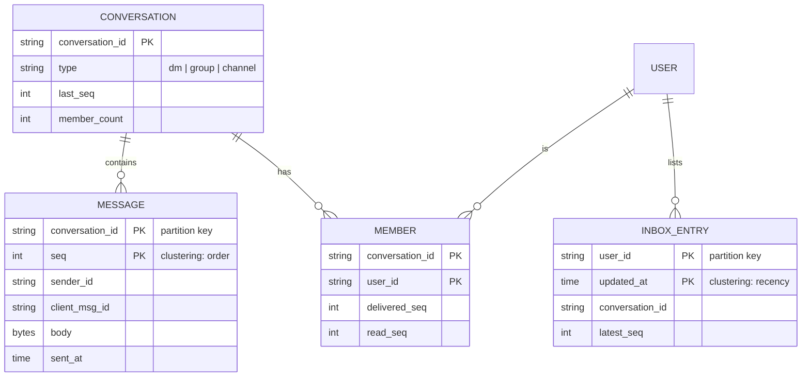
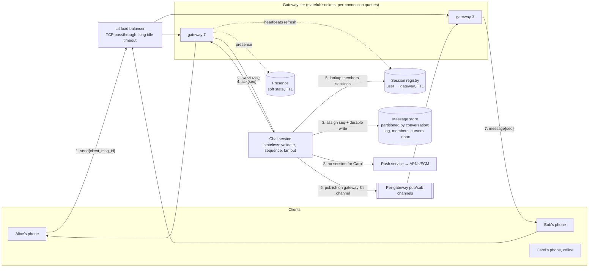
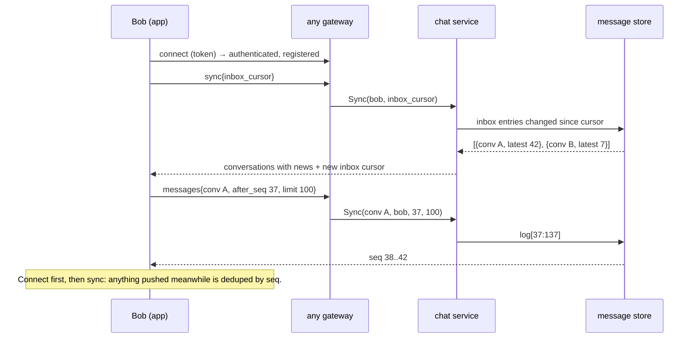

# C6 Unit 1 — Guided design: a messaging service in 45 minutes

> Time: ~4 h · CORE: §1–§4 · STRETCH: the gRPC-streams alternative in §3 and the "requirement change at 0:30"
> break-it in §4 · Lab: `labs/c6/chat` (built in Unit 2)

This is the first of two passes over the chat case study. Here you walk the 45-minute framework from
[`docs/INTERVIEW_FRAMEWORK.md`](../../docs/INTERVIEW_FRAMEWORK.md) through a messaging service, one phase per
section, and at every decision you commit to an answer before the reveal. Unit 2 takes the three riskiest parts of
the design apart (connections, ordering, sync) and has you build the core in Go. The
[design exercise](design-exercise.md) is the solo pass: a banking variant of the same problem, under the clock.

Chat looks easy ("it's just sending strings") and is one of the hardest standard case studies, because its
guarantees are the ones that are easy to say and hard to deliver: every member sees the same order, nothing is
lost, nothing is duplicated, across devices, reconnects and deploys, while holding millions of open sockets.

## Before you start

You should have passed A1, A5 and A6. Warm-up, answer before opening:

1. (A1) A WebSocket makes a backend "sticky" without any load-balancer feature. Why, and what does that do to a
   deploy of that backend?
2. (A5) Two chat servers in different racks stamp messages with their own clocks. A message stamped 10:00:00.120
   sorts before one stamped 10:00:00.130. What can you *not* conclude from that?
3. (A6) A consumer sends a push notification, then crashes before committing its offset. What does the user see
   after the restart, and what is the fix?

<details data-kind="answer">
<summary>Warm-up answers</summary>

1. The connection *is* the affinity: every frame the client sends arrives at the process holding the socket, so
   that process must hold the per-connection state (who this is, what they last received). A deploy must therefore
   close sockets, and every closed socket is a client that reconnects, re-authenticates and resyncs. A1 Unit 1 §5
   calls this "affinity is inherent" and tells you to set a drain deadline and make clients reconnect;
   [§4](#4-high-level-design-the-send-path-and-the-sync-path) and Unit 2 §5 make that a design.
2. That the first was sent first. Physical clocks on two machines are unrelated at the 10 ms level (NTP skew is
   routinely milliseconds, occasionally seconds), so the stamps order nothing across senders. Order has to be
   assigned by one writer, which is the whole of Unit 2 §6
   ([A5 Unit 2 §1](../A5-consistency/unit-2-time-ordering.md#1-physical-clocks-and-last-write-wins)).
3. Two notifications for one message: the effect happened, the commit didn't, and the redelivery repeats the
   effect. Fix: an idempotent consumer (dedupe by message id, atomically with the effect), because delivery is
   at-least-once ([A6 Unit 2 §2](../A6-async/unit-2-outbox-consumers.md#2-idempotent-consumers-and-dedupe)). Every
   hop of a chat system has this shape.

</details>

---

## §1 Requirements and the clarifying questions

### The failure story

A platform team ships "messages" for a banking app as a REST endpoint plus a poll: the app asks
`GET /messages?since=<timestamp>` every 5 seconds. The support-agent pilot (2,000 agents, 50,000 members) is a
success. Then it launches to 3 M members.

- 3 M members × one poll every 5 s ≈ 600k requests/s, of which ≈ 99.9% return nothing. The real message rate is
  ≈ 200 messages/s. The read replicas fall over on a Monday morning; the fix is "poll every 30 s", and now a reply
  takes up to 30 s to show up.
- A member's phone and laptop show a conversation in different orders: two agents answered within the same second
  and each device sorted by the timestamp of whichever response arrived first.
- The app times out after 10 s on a slow network, retries, and the member's "please close my account" arrives
  twice. An agent closes the account twice; the second attempt errors in the core and pages someone.
- Compliance asks for proof that the member *saw* the fee disclosure sent in chat. There is no read receipt, only
  a row in a table.

None of these is a scaling problem in the usual sense. Nobody had written down what "chat" had to guarantee, so
the design guaranteed nothing. In an interview, the first six minutes exist to prevent exactly this.

### Predict

<!-- predict id="C6-U1-P01" -->
**Predict.** The interviewer says only: "Design a messaging service, something like WhatsApp or Slack." Write
your answers down before opening the reveal.

1. The five clarifying questions whose answers would change your design the most, and the answer you'd assume for
   each if told "you decide".
2. Which non-functional requirement *dominates* this design (creates the most boxes), and which guarantee is the
   hardest to actually deliver?
3. What do you put explicitly out of scope, and why is each cut safe for a 45-minute design?
<!-- /predict -->

### Reveal

<details data-kind="reveal" data-for="C6-U1-P01">
<summary>Reveal</summary>

1. The five, with the assumption to proceed with:
   - **1:1 only, or groups? How big?** (Assume: 1:1 and groups up to 256; channels with 10k+ members as an
     extension.) This decides the fan-out strategy and whether per-recipient copies are affordable.
   - **How fast must delivery be when both sides are online, and what happens when the recipient is offline?**
     (Assume: under a second online; a push notification and catch-up on reconnect when offline.) This decides the
     connection model: persistent sockets rather than polling, and a push service beside it.
   - **Must every member see the same order? May a message be lost or duplicated?** (Assume: same order for
     everyone in a conversation; nothing acknowledged is lost; no duplicates visible.) This decides where order is
     assigned and forces idempotent sends.
   - **Receipts, presence, typing indicators?** (Assume: delivered and read receipts; online presence; typing is a
     nice-to-have.) These are soft-state fan-outs that often exceed message traffic.
   - **Retention and end-to-end encryption?** (Assume: messages kept for years; the server may read them, E2E is
     out of scope.) This decides the storage model and what the server can do (search, moderation, dedupe).
   Plus the scale question you always ask: how many daily users, how many messages each (assume 50 M DAU,
   ≈ 40 messages per user per day). The tempting wrong list asks about *features* (stickers, reactions, bots) that
   don't change the architecture.
2. **Dominant NFR:** the number of simultaneously open connections. It forces a stateful connection tier, a session
   registry, a drain and reconnect story, and heartbeats, which is more boxes than any other requirement creates.
   **Hardest guarantee:** consistent order with no loss and no duplicates, across several devices per user,
   reconnects and deploys. Most of Unit 2 is about it.
3. Out of scope, with why each is safe: media (upload to object storage, send a URL in the message: it sits beside
   the message path, not in it), end-to-end encryption (key distribution is its own design; the message path
   carries opaque bytes either way), search, voice/video calls (a different system: signalling over this one,
   media over WebRTC), bots and integrations (just another client), moderation and spam. Each can be bolted onto
   the side of the message path later; none changes how a message gets from A to B in order.

</details>

### How it actually works

What goes on the board in the first six minutes:

**Functional requirements.**

1. Send and receive text messages in 1:1 conversations and groups of up to 256 members.
2. A conversation list with the latest message and an unread count per conversation.
3. Catch-up after being offline: a device that reconnects sees every message it missed, once, in order.
4. Delivered and read receipts; online presence.
5. Several devices per user, all consistent.

**Non-functional requirements, each with a number** (the interviewer's answers are in the table; when told "you
decide", say the number out loud and move on):

| Requirement | Number |
|---|---|
| Scale | 50 M DAU; ≈ 40 messages sent per DAU per day; ≈ 20% of DAU online at the same time at peak |
| Delivery latency, both online | p95 ≤ 500 ms end to end; send acknowledged in p99 ≤ 200 ms server-side |
| Catch-up on reconnect | p99 ≤ 1 s for up to 100 missed messages per conversation |
| Ordering | Every member of a conversation sees the same order; a reply never appears before its question |
| Loss / duplicates | An acknowledged message is never lost (durable on ≥ 2 replicas before the ack); no visible duplicates |
| Availability | 99.99% for send and receive (≈ 53 min/year, [NUMBERS.md](../../docs/NUMBERS.md)) |
| Retention | Text kept for 5 years; media out of scope |
| Group size | ≤ 256 members; a 10k+ "channel" is an extension question |

**Out of scope** (said out loud): media, E2E encryption, search, calls, bots, moderation, message editing and
deletion (mention that deletion is a tombstone message if asked).

**Every requirement creates a component.** This is the senior move at the end of the phase: say what each
requirement will cost you, so the boxes you draw at 0:16 are already justified.

| Requirement | What it forces into the design |
|---|---|
| Sub-second delivery to 10 M online users | Persistent connections (not polling) → a stateful gateway tier, heartbeats, a registry of who is connected where |
| Offline users | A durable message store as the source of truth, a push-notification path, a sync API driven by a cursor |
| Same order for everyone | One writer per conversation assigning sequence numbers; clients that dedupe and detect gaps |
| No loss, no duplicates | Ack only after a durable write; idempotent sends keyed by a client-generated id |
| Groups of 256 | Fan-out to members at write time; a per-user inbox for the conversation list |
| Receipts, presence | Per-(conversation, user) cursors; soft state with a TTL, published only to interested parties |
| 5-year retention at this volume | A partitioned, append-mostly store with cold tiers; not one relational primary |

Say the dominant NFR and the hardest guarantee in one sentence each, then: "The risky parts are the connection
tier, ordering across devices, and catch-up after offline; I'll deep-dive those." That sentence is your deep-dive
plan, announced at 0:06.

### Build it

No lab for this section — see §4 and Unit 2, where the lab (`labs/c6/chat`) implements the guarantees you just
wrote down.

### Break it

Change one requirement at a time and list what it removes from or adds to the table above: (a) drop "every member
sees the same order" (a per-device order is acceptable); (b) add "end-to-end encrypted" now, not later; (c) make
the group limit 100,000. Write the deltas before opening the answer.

<details data-kind="answer">
<summary>What changes, and why</summary>

- **(a)** The single writer per conversation goes away: each device can order by arrival and the store needs only
  a monotonic id per message, not a dense sequence. You lose gap detection, so catch-up must rely on "give me
  everything after id X" with no way to know X is current; receipts become ambiguous ("read up to which message?").
  Most products refuse this cut; it is worth knowing it is the cut that simplifies the most.
- **(b)** The server can no longer read bodies: no server-side search, no content moderation, no dedupe by
  content (dedupe by client message id still works, since ids are metadata), no server-side rendering of previews.
  Sequence numbers, receipts, presence and sync are unchanged: they are metadata. Key distribution and multi-device
  key management become a design of their own, which is why you scope it out of the 45 minutes but say exactly
  what stays and what goes.
- **(c)** Fan-out on write stops being affordable: one message into a 100k channel is 100k inbox updates and up to
  100k pushes. The design needs the hybrid from Unit 2 §7: small groups fan out on write, big channels fan out on
  read, with a threshold derived from numbers. Receipts per member stop making sense (a "read by 73,000" count at
  most).

</details>

### In the wild

- **WhatsApp**: 1:1 and groups (the group limit has been raised several times; `TODO-VERIFY: current maximum group
  size`), end-to-end encrypted by default with the Signal protocol, so the server stores and forwards ciphertext
  and the client is the source of truth for history.
- **Slack**: workspaces with channels, server-readable messages (search is a core feature), retention configurable
  per plan, and a real-time WebSocket API alongside the REST Web API.
- **Discord**: "servers" with up to hundreds of thousands of members, which made it the public case study for
  fan-out and storage choices (its engineering blog on storing messages, 2017 and 2023).
- **Signal**: E2E with "sealed sender", so the server knows as little as possible about who talks to whom; the
  opposite end of the "what may the server read" axis.
- **Matrix**: a federated protocol where no single server orders a room, which is why its rooms are a DAG of
  events rather than a sequence. Useful contrast for Unit 2 §6.

### Trade-offs

| Scope decision | Wins when | Loses when | When the answer flips |
|---|---|---|---|
| 1:1 + small groups only | You can fan out on write everywhere; simple inbox | Product adds "communities" later; the design has no hybrid path | Flip to the hybrid (write for small, read for big) the moment any conversation exceeds ≈ 1k members |
| Server-readable messages | Search, moderation, previews, simple multi-device | Privacy expectations; regulatory exposure of plaintext | Flip to E2E when the threat model includes the operator (consumer messaging), not when it is a support channel inside a regulated app |
| Media out of scope (URL in message) | Message path stays small and fast | Product needs inline previews or encryption of media | Keep it out of the message path regardless; the flip is only in where thumbnails are generated |
| Receipts and presence in scope | Product expectations; compliance ("they saw it") | Fan-out of soft state dominates traffic | Flip to coarse presence (last seen, pulled) above ≈ a few thousand contacts per user |

### Senior bar

- **Failure modes of this phase**: listing features instead of guarantees; NFRs without numbers ("fast",
  "reliable"); never saying what is out of scope, so the interviewer assumes E2E, search and media are all in;
  not naming the dominant NFR, so the design at 0:16 has no connection tier and no registry.
- **Capacity numbers**: produced in §2, but you already know the shape: ≈ 10 M concurrent connections is the
  number that shapes everything else.
- **Operations**: a chat product is a 24×7 stateful system; say early that deploys of the connection tier are an
  operational event, not a `kubectl rollout`.
- **Cost**: the connection fleet is modest; storage with 5-year retention and the presence/receipt fan-out are
  what grow.

Interviewer follow-up probes:

1. "Why not just run XMPP or Matrix instead of designing this?"

<details data-kind="answer">
<summary>Model answer</summary>

Both solve real parts of the problem (XMPP's stream management gives acks and resumption; Matrix gives federation
and a sync API), and I'd study their protocols. But the interview question is the *system*: holding 10 M sockets,
ordering within a conversation, fan-out, storage for 5 years, presence at scale. Neither protocol decides those for
you, and federation (Matrix) adds a requirement we don't have. Reusing a protocol is a reasonable product decision;
it doesn't remove the design.

</details>

2. "The PM says E2E encryption is coming in a year. What do you design now?"

<details data-kind="answer">
<summary>Model answer</summary>

Keep everything that is metadata on the server (sequence numbers, receipts, presence, sync cursors, dedupe by
client message id) and treat the body as opaque bytes from day one: never dedupe or route by content, never
build features that need plaintext on the server unless the product accepts losing them (search, moderation,
link previews). Then E2E changes the client and the key service, not the message path.

</details>

3. "What changes if this is the secure-message centre inside a credit union's banking app?"

<details data-kind="answer">
<summary>Model answer</summary>

Scale drops by orders of magnitude (tens of thousands online, not millions) and the hard requirements move: audit
retention for 7 years with legal hold, proof of delivery and of reading (receipts become compliance records),
tenant isolation across credit unions, agent handoff within a conversation, and attachments of statements. The
connection tier shrinks to a few boxes; the ordering, receipt and audit guarantees get stricter. That is the
[design exercise](design-exercise.md).

</details>

### Check yourself

1. Which requirement forces a stateful tier into an otherwise stateless design?
2. Name two things the server loses when messages are end-to-end encrypted, and one thing it keeps.
3. Why is "no visible duplicates" phrased with "visible"?

<details data-kind="answer">
<summary>Answers</summary>

1. Sub-second delivery to users who are online: it needs a persistent connection held by *some* process.
2. Loses server-side search and content moderation (also dedupe by content, previews); keeps sequence numbers,
   receipts, presence and sync, which are all metadata.
3. Because delivery is at-least-once end to end (retries after timeouts, redelivery after reconnects); the system
   cannot promise a message is *transmitted* once, only that clients never *show* it twice (dedupe by sequence
   number on the receiving side, by client message id on the sending side).

</details>

---

## §2 Estimation: what the numbers decide

### The failure story

The team from §1 fixes the polling and moves to WebSockets. They size the new service the way they sized every
other service: by requests per second. "≈ 23k messages per second average, maybe 70k at peak: eight API boxes with
headroom." Launch day: the eight boxes each hold ≈ 1.2 M idle sockets, which is ≈ 36 GB of connection state on a
32 GB box; the first one swaps, then dies, then its 1.2 M clients reconnect to the other seven, which die in turn.
The next morning, a routine deploy restarts all of them at once and 10 M clients reconnect inside a minute. The
token-validation service, sized for ≈ 20k logins/s, receives 10 M validations in 60 s.

They had estimated the wrong quantity. In a chat system the first number is not messages per second; it is open
connections, and the second is what happens when they all reconnect.

### Predict

<!-- predict id="C6-U1-P02" -->
**Predict.** Use these inputs: 50 M DAU; 40 messages sent per DAU per day; each message reaches ≈ 2.5 recipient
devices on average (1:1 dominates, some groups, some users with two devices); ≈ 20% of DAU online at the same time
at peak; ≈ 30 KB of memory per idle connection; ≈ 200 B stored per message (text + metadata); 5-year retention;
3× replication; a heartbeat every 30 s per connection. Compute, with units, and write the decision each number
drives:

1. Peak sends/s and peak deliveries/s (use a peak factor of 3).
2. Concurrent connections at peak, memory for them across the fleet, and the number of gateway servers if one holds
   ≈ 500k connections and you plan for 50% utilisation plus two spares.
3. Storage per year and over the retention period, with replication.
4. Heartbeat frames per second across the fleet and per gateway.
5. If the gateway fleet restarts over 3 minutes, the reconnect rate; if it restarts over 60 minutes, the rate.
<!-- /predict -->

### Reveal

<details data-kind="reveal" data-for="C6-U1-P02">
<summary>Reveal</summary>

1. Sends: 50 M × 40 = 2 × 10⁹ per day ÷ 86,400 s ≈ **23k sends/s average**, × 3 ≈ **≈ 70k/s peak**. Deliveries:
   × 2.5 ≈ 58k/s average, **≈ 175k pushes/s peak**. Decision: 70k writes/s is 10–70× what one relational primary
   does for small transactional writes (≈ 1–10k TPS, [NUMBERS.md](../../docs/NUMBERS.md)), so the message store is
   partitioned from day one, by conversation.
2. Connections: 20% × 50 M = **10 M concurrent**. Memory: 10 M × 30 KB = **≈ 300 GB** across the fleet (nothing
   dramatic in total, but it cannot live on eight boxes). Gateways: 10 M ÷ 500k = 20 at 100%; at 50% utilisation
   ≈ 40, plus 2 spares ≈ **42 gateway servers**. Decision: a dedicated connection tier exists; its sizing is by
   connections, not QPS; and each box is a blast radius of ≈ 250k users.
3. Storage: 2 × 10⁹ × 200 B = 400 GB/day ≈ **146 TB/year raw**, ≈ **440 TB/year replicated**, ≈ **2.2 PB over 5
   years**. Decision: an append-mostly, partitioned store with tiering to cold storage after ≈ 90 days; never one
   node.
4. Heartbeats: 10 M ÷ 30 s ≈ **333k frames/s fleet-wide**, ≈ **8k/s per gateway**. At ≈ 100 B on the wire with
   TLS, TCP and IP overhead that is ≈ 33 MB/s ≈ 270 Mbps fleet-wide, ≈ 6 Mbps per box: bandwidth is irrelevant;
   the decision is about CPU (cheap) and, on the client, battery (not cheap). Heartbeat interval is a battery and
   NAT decision, not a bandwidth one.
5. 10 M ÷ 180 s ≈ **55k reconnects/s** for a 3-minute restart; each is a TLS handshake, a token validation, a
   registry write and a sync call. Over 60 minutes it is ≈ **2.8k/s**. Decision: gateway deploys are rolling and
   slow by design, clients back off with jitter, and the auth and sync paths are sized for the reconnect wave, not
   the steady state.

The tempting wrong answers: sizing by messages/s only; forgetting replication and retention (×3 and ×5 together
are 15× the raw yearly figure); computing heartbeat *bandwidth* and concluding heartbeats are free.

</details>

### How it actually works

The estimate sheet, as it should look on the board at 0:10. Six numbers, each followed by its decision:

| Quantity | Arithmetic | ≈ Result | Decision it drives |
|---|---|---|---|
| Peak sends | 50 M × 40 / 86,400 × 3 | 70k/s | Partition the message store by conversation; no single primary |
| Peak deliveries | 70k × 2.5 | 175k/s | Fan-out happens in the chat service, delivered through per-gateway channels; ≈ half go to offline devices → push service |
| Concurrent connections | 20% × 50 M | 10 M | A stateful gateway tier of ≈ 40 boxes at ≈ 250k live users each; a session registry; a drain plan |
| Reconnect wave | 10 M / deploy window | 55k/s (3 min) vs 2.8k/s (60 min) | Rolling deploys over ≈ an hour; jittered client backoff; auth and sync sized for the wave |
| Storage | 2 × 10⁹ × 200 B × 365 × 3 | 440 TB/year, 2.2 PB at 5 years | Append-mostly partitioned store; cold tier after ≈ 90 days |
| Sync reads | 50 M × ≈ 10 reconnects/day / 86,400 × 3 | ≈ 17k/s peak | Serve the tail of each conversation from memory/cache; the store sees mostly appends |

**The latency budget for a send**, so the 200 ms ack and 500 ms delivery targets are defensible:

```
client ──(mobile RTT ≈ 50–100 ms, not ours)──▶ gateway ──(≈ 0.5 ms)──▶ chat service
   chat service ──(assign seq + durable write, quorum of 2 in region ≈ 2–5 ms)──▶ store
   chat service ──(registry lookup ≈ 0.5 ms, pub/sub to recipient's gateway ≈ 1 ms)──▶ gateway ──▶ recipient
```

Server-side work is ≈ 10 ms; the targets are dominated by two mobile round trips. That is why "p95 ≤ 500 ms" is
achievable and "p99 ≤ 50 ms end to end" is not something you should accept without pushing back.

**What the numbers rule out**, said out loud at 0:10: polling (10 M × 1 poll/5 s = 2 M req/s for nothing); one
relational primary for messages (70k writes/s); a per-recipient copy of every message for large channels
(a 10k channel would turn 1 write into 10k); and a single global sequence generator for all messages (70k/s
through one counter is feasible but it is a needless single point of failure; order is per conversation).

**The number that would flip the design if it were 10× off**: the 20% concurrency. At 2% (1 M connections) the
gateway tier is four boxes and deploys stop being an event; at 100% during a global event (a cricket final, a
breaking-news channel) it is 50 M connections and the tier, the registry and the reconnect wave are all 5× bigger.
Say which assumption you'd want to check against real data first.

### Build it

No lab for this section. Drill the arithmetic with `sd estimate -kind qps`, `-kind storage`, `-kind concurrency`
and `-kind servers`; the chat numbers above are a good set to redo from memory before the design exercise. If you
still have the A0 `capacity` lab around, encode the chat spec as a `Spec` and check your sheet against
`Estimate`.

### Break it

Re-derive two rows of the sheet under a changed assumption, and say which decision changes:

1. Replace WebSockets with HTTP polling every 5 s from every online device.
2. The concurrency assumption is 50%, not 20% (a product used mostly during one evening hour).
3. Messages average 2 KB (people paste logs), and retention is "forever".

<details data-kind="answer">
<summary>What changes</summary>

1. 10 M ÷ 5 s = 2 M requests/s, ≈ 99.9% of them empty, against a message rate of 70k/s: ≈ 30× the useful load,
   and the latency floor becomes the poll interval. Nothing else in the design survives this; it is the reason
   persistent connections are not optional at this scale. (Polling is fine for a bot or a low-traffic admin UI.)
2. 25 M connections → ≈ 105 gateways, ≈ 750 GB of connection state, and a full-fleet restart over 3 minutes is
   ≈ 140k reconnects/s. The decision that flips is the deploy policy (slower, more waves) and the registry's write
   capacity; the storage rows don't move at all. Connections and messages scale independently, which is why you
   estimate both.
3. 2 × 10⁹ × 2 KB = 4 TB/day, ≈ 1.5 PB/year raw, ≈ 4.4 PB/year replicated, growing without bound. The flip:
   compression per partition, cold tiers become mandatory, and "forever" gets negotiated into a retention policy
   with legal hold, because the cost line is now dominated by storage, not compute.

</details>

### In the wild

- **WhatsApp** reported ≈ 2 M concurrent connections on a single server in 2012 (Erlang on FreeBSD; their
  "1 million is so 2011" post) — `TODO-VERIFY: exact figure and hardware`. It shows that connections per box is a
  tuning question (kernel buffers, user-space state per socket), not a hard limit near 65k; the 64k limit people
  quote is ephemeral *client* ports per source IP, which does not bound a server's accepted connections.
- **Go**: an idle TLS connection served by one goroutine costs roughly a goroutine stack (≈ 2–8 KB) plus TLS
  record buffers and `bufio` buffers (≈ 10–40 KB) plus kernel socket buffers; ≈ 20–50 KB is a reasonable planning
  figure — `TODO-VERIFY: measure on your runtime version and TLS settings`. Reducing it means smaller buffers and
  fewer goroutines per connection, which is what the high-connection-count servers do.
- **Discord** has written about the storage side at scale: messages in Cassandra (2017) and later ScyllaDB
  (2023), partitioned by channel and a time bucket, with the engineering problems coming from hot partitions
  (very busy channels) rather than raw volume.
- **Linux**: the limits you actually hit are file descriptors (`ulimit -n`, `fs.file-max`), conntrack tables on
  any NAT or stateful firewall in the path (`nf_conntrack_max`), and memory for socket buffers
  (`net.ipv4.tcp_rmem/wmem`), long before CPU.

### Trade-offs

| Option | Wins when | Loses when | When the answer flips |
|---|---|---|---|
| Few large gateways (≈ 1 M connections each) | Cheapest fleet; fewest registry entries to move | One box dying reconnects 1 M users at once; kernel tuning is deep | Flip to more, smaller boxes when the reconnect wave from one box exceeds what auth and sync absorb (§4, Unit 2 §5) |
| Many small gateways (≈ 100k each) | Small blast radius; simple tuning | 100 boxes to deploy and monitor; more registry churn | Flip to larger boxes once the reconnect handling is proven |
| Heartbeat every 30 s | Dead sockets found within ≈ 1 min; NAT mappings stay alive | ≈ 2× the frames of a 60 s interval; battery cost on mobile | Flip longer when measurements show NATs on your users' networks keep idle TCP mappings for longer (`TODO-VERIFY` per carrier); shorter if presence must be accurate to seconds |
| Hot tail in memory + cold store | Sync and history reads mostly avoid disk | Memory per active conversation; cache invalidation on edits/deletes | Flip to store-only reads if the store's read latency already meets the budget (LSM point reads of recent data are often in cache anyway) |

### Senior bar

- **Failure modes**: sizing by QPS and forgetting connections; forgetting the reconnect wave (the deploy that
  takes the auth service down); forgetting replication × retention; treating heartbeat cost as bandwidth.
- **Capacity numbers**: 10 M connections ≈ 300 GB fleet memory ≈ 40 gateways; 70k sends/s; 175k deliveries/s;
  440 TB/year; 55k reconnects/s if you restart everything in 3 minutes. All ≈.
- **Operations**: the connection count per gateway and the fleet-wide reconnect rate are the two metrics to put on
  the first dashboard; a deploy is a planned reconnect wave with a rate limit.
- **Cost**: ≈ 42 mid-size boxes is a modest compute bill (≈ $10–15k/month at list prices, `TODO-VERIFY` current
  pricing); 2.2 PB replicated on object storage at ≈ $0.023/GB-month is ≈ $50k/month by year five, so storage
  tiering is where the money is.

Interviewer follow-up probes:

1. "What happens during a global event when 50% of your users are online at once?"

<details data-kind="answer">
<summary>Model answer</summary>

Connections go from 10 M to 25 M, so the gateway tier needs ≈ 2.5× the boxes; because the registry holds one entry
per connection it needs 2.5× the write throughput too. Messages per second may not rise as much (people read more
than they write during an event), so the store is less affected than the connection tier. The design response is
elastic gateway capacity with pre-warming before known events, plus admission control: when a gateway is at its
connection limit it refuses new sockets with a retry-after rather than accepting and dying, which is the load
shedding from A6/A7 applied to connections.

</details>

2. "Which costs more over five years, the gateway fleet or storage?"

<details data-kind="answer">
<summary>Model answer</summary>

Storage, once retention compounds: ≈ 440 TB/year replicated reaches ≈ 2.2 PB by year five, ≈ $50k/month on
standard object storage, versus ≈ $10–15k/month for the gateway fleet (list prices, `TODO-VERIFY`). So the
cost-driven decisions are tiering and compression of old messages, and negotiating retention, not shaving gateway
boxes.

</details>

### Check yourself

1. What is the first number you estimate for a chat system, and why is it not messages per second?
2. Why does a 3-minute gateway deploy matter to the *auth* service?
3. Roughly how many stored bytes per year does 2 × 10⁹ messages/day at 200 B produce, replicated 3×?

<details data-kind="answer">
<summary>Answers</summary>

1. Concurrent connections: it determines whether you need a stateful tier at all, how many boxes, and the size of
   the reconnect wave. Messages/s sizes the store and the fan-out, which are separate decisions.
2. Every reconnect re-authenticates: 10 M in 3 minutes is ≈ 55k token validations/s, far above steady-state login
   traffic.
3. ≈ 440 TB (146 TB raw × 3).

</details>

---

## §3 API and data model

### The failure story

Version one of the API was "obvious": `POST /messages {conversation_id, body}` returning the new row, and
`GET /messages?conversation_id=…&since=<timestamp>` to fetch new ones. Three bugs shipped with it:

- A member on a train sends "yes, go ahead", the request times out at 10 s, the app retries, and the agent sees
  "yes, go ahead" twice. Nothing in the request made the retry safe.
- `since=<timestamp>` misses messages: two messages stored in the same millisecond, one returned, the client asks
  for `since=` that millisecond and skips the other (or, with `>=`, sees the first again). Clock skew between two
  chat servers makes a message stored *later* carry an *earlier* timestamp, so it is never returned to anyone who
  already synced past it. These are the offset-pagination bugs of
  [A1 Unit 2 §2](../A1-networking-api/unit-2-api-design.md#2-pagination), in a worse form.
- Messages had a global auto-increment id from one sequence. At 70k inserts/s it was the hottest row in the
  system, and the id leaked how many messages the whole product had.

### Predict

<!-- predict id="C6-U1-P03" -->
**Predict.** Write your answers down first.

1. Pick the client transport for a mobile app (WebSocket, long polling, SSE, gRPC streams, plain HTTP) and state
   when the answer flips.
2. Design the `send` request and its acknowledgement so that a retry after a timeout is safe. What does the client
   generate, what does the server return, and what is the dedupe key?
3. Design the call a device makes after being offline for an hour: parameters, response, and how it pages.
4. Write the primary key of the messages table and the partition key, and say exactly where the order of messages
   within a conversation comes from.
<!-- /predict -->

### Reveal

<details data-kind="reveal" data-for="C6-U1-P03">
<summary>Reveal</summary>

1. **WebSocket** for the app: bidirectional, one long-lived connection carrying sends, deliveries, receipts and
   presence, with ping/pong frames for liveness. It flips to **SSE** for a web client that only *receives* (a
   dashboard watching a channel) because SSE is plain HTTP with auto-reconnect and `Last-Event-ID`; to **long
   polling** where WebSockets are blocked (restrictive corporate proxies) or for very low-traffic clients; to
   **gRPC bidirectional streams** for first-party native clients on HTTP/2 when you want typed frames and
   deadlines (STRETCH below); and to **plain HTTP** for bots and server-side integrations that send a few messages
   and never need push. Transport is per client type, not one choice for the product.
2. The client generates a **client message id** (a UUID, or `device_id + counter`) and sends
   `send {conversation_id, client_msg_id, body}`. The server dedupes on **(conversation_id, sender_id,
   client_msg_id)** and acknowledges with `ack {client_msg_id, seq, sent_at}` after the message is durably stored.
   A retry carrying the same client id returns the same `seq` and stores nothing. The tempting wrong answers are
   "dedupe by body and sender within a few seconds" (a member really can send "ok" twice) and "the server
   generates the id" (then the retry has no way to refer to the first attempt). This is the idempotency key from
   [A1 Unit 3 §2](../A1-networking-api/unit-3-idempotency-auth.md#2-idempotency-keys-end-to-end), inside a frame.
3. `GET /v1/conversations/{id}/messages?after_seq=41&limit=100` → the messages with `seq > 41` in order, plus
   `has_more`. The client pages by repeating with the last `seq` it received; it never sends timestamps. For "all my
   conversations", one call: `GET /v1/sync?inbox_cursor=…` returns the conversations that changed since the cursor
   with each one's `latest_seq`, so the client fetches only the conversations with news (Unit 2 §7).
4. Primary key **`(conversation_id, seq)`**, partition key **`conversation_id`** (for very busy channels,
   `(conversation_id, time_bucket)`), clustered by `seq`. The order comes from **one writer per conversation that
   assigns `seq = last_seq + 1` and persists the message in the same atomic step**; it does not come from
   timestamps, from the client, or from a global sequence. A unique constraint (or equivalent lookup) on
   `(conversation_id, sender_id, client_msg_id)` makes the dedupe atomic with the insert.

</details>

### How it actually works

**Transports, compared** (the mechanics are in
[A1 Unit 2 §4](../A1-networking-api/unit-2-api-design.md#4-rest-vs-grpc-vs-graphql-and-streaming)):

| Transport | Direction | Liveness | Fits | Costs |
|---|---|---|---|---|
| WebSocket | both ways, framed | ping/pong control frames; your own heartbeat | Mobile and web apps: sends, deliveries, receipts, presence on one connection | Stateful backend; proxies and load balancers must support upgrades and long idle times; no HTTP caching or semantics |
| SSE | server → client | browser auto-reconnect with `Last-Event-ID` | Receive-only web clients; notifications | Sends go over separate HTTP requests; one-way |
| Long polling | server → client, one request per batch | request timeout | Clients behind restrictive proxies; very low traffic | A request per event batch; latency = re-poll gap; connection churn |
| gRPC bidirectional stream | both ways, typed | HTTP/2 pings; deadlines | First-party native clients, service-to-service | HTTP/2 end to end; browsers need a proxy |
| Plain HTTP | request/response | none | Bots, integrations, fallback send path | No push |

**The frame protocol** over the WebSocket (JSON or Protobuf; small, versioned, one `type` field):

| Direction | Frame | Fields | Semantics |
|---|---|---|---|
| client → server | `send` | `conversation_id`, `client_msg_id`, `body`, `kind` | Idempotent per (conversation, sender, client id) |
| server → client | `ack` | `client_msg_id`, `seq`, `sent_at` | Sent after a durable write; the client replaces its pending bubble |
| server → client | `message` | `conversation_id`, `seq`, `sender_id`, `body`, `sent_at` | A delivery; the client dedupes by `(conversation_id, seq)` and detects gaps |
| client → server | `delivered` | `conversation_id`, `seq` | The device has stored up to `seq` |
| client → server | `read` | `conversation_id`, `seq` | The user has seen up to `seq` |
| server → client | `receipt` | `conversation_id`, `user_id`, `delivered_seq`, `read_seq` | Cursors, not per-message flags |
| both | `presence`, `typing` | `user_id`, `state` | Soft state, never persisted, never acked |
| both | `ping` / `pong` | | Liveness; the server closes a socket silent for 2 intervals |
| server → client | `resync` | `conversation_id`, `latest_seq` | "You lagged; fetch from your cursor" (Unit 2 §5) |

**The REST side** (for things that are not real-time, and for clients without a socket):

```
POST /v1/conversations                      {type, member_ids}            → 201 {id}
POST /v1/conversations/{id}/members         {user_id}                     → 200
GET  /v1/conversations/{id}/messages        ?after_seq=&limit=            → 200 {items, has_more}   (catch-up, forward)
GET  /v1/conversations/{id}/messages        ?before_seq=&limit=           → 200 {items, has_more}   (history, backward)
POST /v1/conversations/{id}/messages        Idempotency-Key: <client id>  → 201 {seq, sent_at}      (send without a socket)
GET  /v1/sync                               ?inbox_cursor=                → 200 {conversations[], next_cursor}
POST /v1/media                              (upload)                      → 201 {url}
```

Status codes follow [A1 Unit 2 §1](../A1-networking-api/unit-2-api-design.md#1-resources-methods-status-codes-and-errors):
a conversation the caller isn't a member of is a 404, not a 403, so the API never confirms it exists.

**Data model, from the access patterns.** The patterns: append a message to a conversation and read its tail;
read a conversation's messages after a seq (catch-up) or before a seq (scrolling back); list a user's
conversations by recency with unread counts; look up where a user is connected; dedupe a send.



- **`messages (conversation_id, seq)`** — the log. Partitioned by `conversation_id` so a conversation's tail is one
  partition read; for channels that outgrow a partition, `(conversation_id, bucket)` where `bucket` is a time
  window (what Discord does), with `seq` still clustering within the bucket. Row ≈ 200 B; appends only.
- **`members (conversation_id, user_id)`** — membership plus the two receipt cursors; a second index by `user_id`
  (or a separate `user_conversations` table) answers "which conversations am I in".
- **`inbox (user_id, updated_at)`** — the conversation list, materialised per user: updated on every message for
  groups up to a threshold (write amplification × members, Unit 2 §7); read once per app open.
- **`send_dedupe (conversation_id, sender_id, client_msg_id) → seq`**, with a TTL of ≈ 24 h: long enough for any
  retry, short enough to bound storage (2 × 10⁹ × ≈ 100 B/day ≈ 200 GB/day of dedupe entries if kept forever).
  In a relational store it is a unique index on the messages table instead.
- **`sessions (user_id) → [{device_id, gateway_id, connection_id, expires_at}]`** — the registry, in a store with
  TTLs (Redis-like), refreshed by heartbeats.

**Where `seq` comes from.** Three implementations, same contract:

| Implementation | How | Wins when | Loses when |
|---|---|---|---|
| Transactional row lock | `UPDATE conversations SET last_seq = last_seq + 1 … RETURNING last_seq` + `INSERT messages` in one transaction, unique index for dedupe | SQL store partitioned by conversation; strongest, simplest | Throughput per conversation bounded by the row lock (hundreds/s per conversation: fine; one conversation rarely exceeds 10 msg/s) |
| Lease-owned sequencer | One chat-service node owns the conversation (consistent hashing), assigns seqs in memory, writes `(conversation_id, seq)` with a conditional insert; ownership protected by a lease and a fencing token ([A5 Unit 3 §3](../A5-consistency/unit-3-consensus-leases.md#3-leases-and-fencing-tokens)) | Wide-column stores without transactions; very high per-conversation rates | Failover complexity; a crash between assign and write leaves a gap, so clients must tolerate gaps or the sequencer re-reads `last_seq` on takeover |
| Per-user inbox sequence | Each recipient's inbox has its own seq; a message is written to every member's inbox (fan-out on write) | Catch-up is one cursor per *user*; small groups | Write amplification × members; a conversation has no single order of record |

The lab uses the first shape in memory: one lock per conversation guards seq assignment, the append, the dedupe
entry and the fan-out.

**STRETCH — gRPC streams instead of WebSockets.** For first-party native clients a bidirectional gRPC stream gives
typed frames, deadlines that propagate, and HTTP/2 multiplexing; the cost is HTTP/2 end to end (mobile networks and
corporate proxies sometimes interfere) and browsers needing gRPC-Web through a proxy. Many products run both: gRPC
streams for native apps, WebSockets for web.

### Build it

The lab's API is this section's API with the network removed: `Send(ctx, convo, sender, clientMsgID, body)` is the
`send` frame and its `ack` (the returned `Message` carries `Seq`); `Sync(convo, user, afterSeq, limit)` is
`GET …/messages?after_seq=`; `Connect(ctx, user)` is the socket; `MarkRead` is the `read` frame; `Unread` is the
inbox's badge. You build it in Unit 2 ([`labs/c6/README.md`](../../labs/c6/README.md)).

### Break it

Without code: take the `send` frame and remove `client_msg_id`, then walk through a retry after a 10 s timeout
where the first attempt *did* reach the server. Then take the data model and replace `seq` with `sent_at` as the
clustering column; walk through two chat-service nodes with clocks 30 ms apart storing two messages into one
conversation, followed by a device that syncs between the two writes.

<details data-kind="answer">
<summary>What goes wrong</summary>

Without the client id the server has no way to recognise the retry: two rows, two deliveries, two notifications,
and nothing the client can do afterwards except delete one and hope. With `sent_at` as the order: node A (clock
fast) stores message 1 at 10:00:00.130; the device syncs with `after=10:00:00.130`; node B (clock slow) stores
message 2 at 10:00:00.110, which is now *before* the device's cursor and will never be returned to it, while
another device that syncs later sees message 2 before message 1. A sequence assigned by one writer per conversation
has neither problem: there is no cursor a later message can fall behind.

</details>

### In the wild

- **Discord** stores messages in a wide-column store keyed by `(channel_id, bucket)` with `message_id` (a
  time-ordered Snowflake) as the clustering column; the bucket is a time window so a huge channel never becomes one
  unbounded partition. Their 2017 and 2023 engineering posts describe the schema and the hot-partition problems it
  produced.
- **Slack** identifies a message by channel plus a `ts` string (`"1700000000.123456"`) that is unique within the
  channel and used as the cursor for history calls (`oldest`/`latest`) — `TODO-VERIFY: current API semantics`.
- **Matrix** clients catch up with `GET /sync?since=<token>`; the token is an opaque server cursor, the same shape
  as `inbox_cursor` above.
- **XMPP** stream management (XEP-0198) adds per-stanza acknowledgements and stream resumption: the ack frame and
  the resumable session, standardised.
- **Facebook Messenger** described (2014, "Building Mobile-First Infrastructure for Messenger") an ordered,
  per-user queue called Iris with sequence numbers that clients sync from — the per-user-inbox shape in the table
  above — `TODO-VERIFY: current architecture`.
- **MQTT** QoS levels are a clean vocabulary for delivery guarantees: QoS 0 at-most-once, QoS 1 at-least-once with
  packet ids, QoS 2 exactly-once via a two-phase handshake. Chat products are QoS 1 plus receiver dedupe.

### Trade-offs

| Option | Wins when | Loses when | When the answer flips |
|---|---|---|---|
| WebSocket for everything | One connection carries all real-time traffic; lowest latency | Stateful tier; proxies; no HTTP semantics | Flip to SSE for receive-only web clients, to HTTP for bots |
| Client-generated message id | Retries are safe; offline queueing on the device works | Clients must persist pending ids across restarts | Never flip; a server-generated id cannot make the *first* attempt's retry safe |
| `seq` per conversation | Total order, gap detection, cheap catch-up per conversation | A user in thousands of conversations syncs thousands of cursors (fix: the inbox cursor) | Flip to a per-user sequence (fan-out on write into inboxes) when catch-up by user matters more than a single order per conversation and groups are small |
| Dedupe table with TTL | Bounded storage; works in stores without unique indexes | A retry after the TTL duplicates | Flip to a unique index in the messages table when the store supports it |
| Thin `message` frames (ids only) | Tiny frames; clients fetch bodies lazily | An extra round trip per message | Flip to fat frames (the default here) because bodies are small and latency matters |

### Senior bar

- **Failure modes**: non-idempotent sends; timestamps as cursors (missed and repeated messages under skew and
  ties); a global sequence as a hot spot; unbounded `limit`; `since` semantics that are inclusive on one end and
  exclusive on the other depending on who wrote the client; dedupe TTL shorter than the client's retry window.
- **Capacity**: a `messages` row ≈ 200 B; a dedupe entry ≈ 100 B with a 24 h TTL ≈ 200 GB live; inbox updates ×
  members per message (a 256-member group: 256 small writes per message).
- **Operations**: schema evolution of the frame protocol (a `type` and a version field from day one; unknown frame
  types ignored, as in [A1 Unit 2 §3](../A1-networking-api/unit-2-api-design.md#3-versioning-and-evolution)); old
  app versions in the wild for years.
- **Cost**: the dedupe table and the inbox fan-out are the write-amplification lines; both are bounded by design
  choices (TTL, threshold) rather than by hardware.

Interviewer follow-up probes:

1. "A client's clock is a day fast. What breaks?"

<details data-kind="answer">
<summary>Model answer</summary>

Nothing in ordering or sync, because neither uses client time: `seq` is assigned by the server and `sent_at` is
server time. The client may *display* its own local time for pending messages; once the `ack` arrives it uses
`sent_at`. If the design had used client timestamps for order, that device's messages would sort above everyone
else's for a day; that is exactly why they don't.

</details>

2. "How does a bot without a WebSocket send a message, and how does it get replies?"

<details data-kind="answer">
<summary>Model answer</summary>

It sends with `POST /v1/conversations/{id}/messages` and an `Idempotency-Key` header carrying its client message
id, so the same dedupe applies. For replies it either polls `GET …/messages?after_seq=` with a cursor, or
registers a webhook (signed, at-least-once, deduped by `(conversation_id, seq)` on its side), which is
[A1 Unit 2 §5](../A1-networking-api/unit-2-api-design.md#5-long-running-operations-and-webhooks).

</details>

3. "Why not UUIDs as message ids and sort by them?"

<details data-kind="answer">
<summary>Model answer</summary>

A random UUID carries no order; a time-based one (UUIDv7, Snowflake) carries *generation* time, which is a
server's clock again, so two chat-service nodes can still disagree with the real order within a conversation
and gaps are undetectable. Use a client-generated id for idempotency and a server-assigned per-conversation `seq`
for order. A time-ordered id is fine as a *secondary* clustering key once order is already fixed by the sequencer.

</details>

### Check yourself

1. What is the dedupe key for a send, and why is the sender part of it?
2. Which direction of paging uses `after_seq` and which `before_seq`?
3. What are the three ways to implement "one writer per conversation" and which does the lab use?

<details data-kind="answer">
<summary>Answers</summary>

1. `(conversation_id, sender_id, client_msg_id)`. Client ids are generated independently by each device, so two
   senders may legitimately produce the same id; scoping by sender keeps one sender's retry from suppressing
   another sender's message.
2. Catch-up after offline is `after_seq` (forward, from the cursor); scrolling back through history is
   `before_seq`.
3. A transactional row lock on `last_seq`; a lease-owned in-memory sequencer with fencing; per-user inbox
   sequences with fan-out on write. The lab uses the first, as a lock per conversation.

</details>

---

## §4 High-level design: the send path and the sync path

### The failure story

The "stateless chat service behind an L7 load balancer" design makes it to production. Alice sends to Bob; her
frame arrives at gateway 7, which stores the message and then has to deliver it to Bob. Bob's socket is on gateway
3. Gateway 7 doesn't know that. Version one broadcasts every message to every gateway (42 × 175k = 7 M
frames/s of mostly-irrelevant traffic). Version two uses the load balancer's sticky-session cookie as "the
registry"; it works until the first deploy, when the balancer drains gateway 3, Bob reconnects to gateway 11, and
messages for Bob keep going to gateway 3 for the length of the cookie.

Version three stores the message and *then* publishes a "new message" event from the chat service. A deploy kills a
chat-service pod between the store write and the publish: Bob is online, the message is in the store, and Bob's
phone will show it only when someone sends the next message or he restarts the app. Support calls it "the
disappearing message".

### Predict

<!-- predict id="C6-U1-P04" -->
**Predict.** Draw (on paper or in Mermaid) the end-to-end design for two paths: Alice sends to Bob, and Bob's
phone reconnects after an hour offline. Then answer:

1. Which boxes are stateful, and what state does each hold?
2. Where is the order of a conversation decided, and when does Alice get her `ack`?
3. How does the message find Bob's socket, and what happens if the gateway holding it dies between the store
   write and the push?
4. What happens for Carol, who is a member of the group but offline?
<!-- /predict -->

### Reveal

<details data-kind="reveal" data-for="C6-U1-P04">
<summary>Reveal</summary>

1. **Stateful**: the gateways (which users' sockets they hold, per-connection send queues), the session registry
   (user → gateway, with TTL), the message store (the log per conversation, membership, receipt cursors, the
   inbox), and the presence store (soft, TTL). **Stateless**: the chat service (validate, sequence via the store,
   fan out), the push dispatcher, the API tier for REST. The tempting wrong answer makes the chat service hold
   sockets; keep sockets in a tier that deploys rarely and does little, and business logic in a tier that deploys
   often.
2. In the store write for the conversation's partition: `seq` is assigned and the row persisted in one atomic step
   by the single writer for that conversation. The `ack` goes back to Alice **after that durable write** (quorum
   of 2 replicas in the region) and **before** fan-out: the ack means "stored and ordered", not "delivered". Bob's
   delivery receipt is a separate frame later.
3. The chat service looks up `bob` in the session registry, finds `gateway 3, connection 9f2`, and publishes the
   `message` frame on gateway 3's channel (a pub/sub topic per gateway, or a direct RPC). If gateway 3 dies before
   pushing, the message is safe in the store; Bob's phone notices the dead socket (heartbeat timeout), reconnects to
   another gateway, and its first action is `sync` from its last `seq`, which returns the message. The push path
   is allowed to lose frames because the sync path always recovers from the log. Nobody retries pushes forever.
4. The registry has no live session for Carol, so the chat service hands the delivery to the push-notification
   service (C7) with a collapse key per conversation; her inbox entry and unread count are updated in the store.
   When she opens the app, her device connects, then syncs, and the group messages arrive from the store.

</details>

### How it actually works



Every box, justified:

| Box | Why it exists | What it must never do |
|---|---|---|
| L4 load balancer | Spread 10 M long-lived TCP connections; TCP passthrough keeps TLS termination and WebSocket framing on the gateway | Terminate idle sockets early (idle timeout ≥ 2× heartbeat); do L7 routing it doesn't need |
| Gateway | Hold the socket, authenticate at connect, heartbeat, register the session, serialise frames in and out, keep a *bounded* send queue per connection | Hold business logic; buffer unboundedly for slow clients; deploy often |
| Session registry | Answer "where is Bob" for fan-out; entries expire with the heartbeat TTL so a dead gateway's users disappear on their own | Be the load balancer's sticky table; be consulted on the send path for anything but fan-out |
| Chat service | Validate membership, call the store to sequence and persist, fan out by looking up sessions, hand offline members to push | Hold sockets; assign seq from its own clock or memory without the store |
| Message store | The log per conversation, membership and receipt cursors, the inbox; the source of truth every sync reads from | Be bypassed: a frame on a socket is never the only copy of a message |
| Per-gateway channels | Decouple "which gateway" from "which process": the chat service publishes to a gateway by id, not by address | Carry the only copy; be durable (the store is durable, the bus can be best-effort) |
| Push service | Reach offline devices through APNs/FCM with collapse keys and rate limits (C7) | Be relied on for content: the push wakes the app, the app syncs |
| Presence store | Online/offline/last-seen as soft state with TTL ≈ heartbeat interval | Be persisted to the message store or fanned out to everyone |

**The send path, with times** (server-side budget ≈ 10 ms; the two mobile round trips dominate):

```mermaid
sequenceDiagram
    participant A as Alice (app)
    participant G7 as gateway 7
    participant CS as chat service
    participant MS as message store
    participant R as registry
    participant G3 as gateway 3
    participant B as Bob (app)
    A->>G7: send{conv, client_msg_id=c1, body}
    G7->>CS: Send(conv, alice, c1, body)
    CS->>MS: member? dedupe(c1)? seq = last_seq+1; INSERT (conv, seq) [one atomic step, quorum write ≈ 2–5 ms]
    MS-->>CS: seq = 42
    CS-->>G7: ack{c1, seq 42}
    G7-->>A: ack (pending bubble → sent)
    CS->>R: sessions(bob, carol)
    R-->>CS: bob @ gateway 3; carol: none
    CS->>G3: publish message{conv, 42} on gateway-3 channel
    G3-->>B: message{conv, seq 42}
    B->>G3: delivered{conv, 42}
    CS->>MS: carol: inbox + unread; enqueue push
```

**The sync path** (Bob's phone after an hour offline):



The order matters: **connect, then sync**. A device that syncs first and connects second has a window in which a
message is stored after the sync and before the socket exists; it will see it only on the next message or the next
sync. Connecting first means every message after the sync point either arrives on the socket or is returned by the
sync, possibly both, and the client dedupes by `(conversation_id, seq)`.

**Failure handling, per box**, which is what you say at 0:40:

| Failure | Effect | Mitigation |
|---|---|---|
| Gateway dies (≈ 250k users) | Sockets drop; their registry entries expire with the TTL | Clients reconnect with jittered backoff to other gateways, then sync; the chat service tolerates publishing to a dead gateway (best-effort bus) |
| Chat service pod dies after the store write, before fan-out | Online recipients don't get the push; the message is safe | Recipients recover on their next sync; a `resync` hint piggybacks on the next frame or heartbeat response carrying `latest_seq` (Unit 2 §6); for strict delivery, fan-out can be driven from an outbox read by a worker ([A6 Unit 2 §1](../A6-async/unit-2-outbox-consumers.md#1-the-dual-write-problem-and-the-transactional-outbox)) |
| Registry unavailable | Fan-out can't find sockets | Degrade: treat everyone as offline (push + sync) for the outage; registry is replicated and small |
| Message store partition unavailable | Sends to those conversations fail with a retryable error; reads of the tail may be served from the gateway/chat-service cache | Replicated partitions with fast failover; the client keeps the message pending with its client id and retries (idempotent) |
| Push provider down | Offline users aren't woken | Deliveries are still in the store and the inbox; the push service retries with backoff (C7) |

### Build it

The lab (`labs/c6/chat`, Unit 2) is the chat service, the store, the registry and the per-connection queues of
this diagram in one process: `Join` is membership, `Send` is steps 2–7, `Connect` is a socket with its bounded
queue registered under a user, `Sync` is the sync path, `MarkRead`/`Unread` are the receipt cursors. The point of
building it is to feel which guarantees come from *one lock per conversation* and which from *the client always
syncing from the log*.

### Break it

STRETCH. Rehearse the design out loud with a timer; at 0:30 apply one of these interviewer changes and adapt in
≤ 5 minutes, keeping the end-to-end diagram intact: (a) "Now it must work across two regions, with users in both";
(b) "Now there are channels with 100,000 members"; (c) "Now every message must be end-to-end encrypted". Write what
changes and what stays before opening the answer.

<details data-kind="answer">
<summary>What good adaptation looks like</summary>

- **(a)** Gateways in both regions; a conversation is *homed* in one region where its single writer lives, so
  order stays total; a send from the other region crosses once (≈ 80–150 ms, [NUMBERS.md](../../docs/NUMBERS.md))
  before the ack; fan-out crosses back through an inter-region bus; the registry is per region with a global
  "which region" lookup. Say what you refuse: two sequencers for one conversation (A5: there is no cheap way to
  merge two total orders). Unit 2 §7 STRETCH.
- **(b)** Fan-out on write becomes 100k inbox updates per message: switch those channels to fan-out on read (no
  per-member inbox rows; members pull the channel's tail when they open it), rate-limit and aggregate pushes
  (digest), drop per-member receipts for a count, and bucket the channel's partition by time. Everything about
  1:1 and small groups stays.
- **(c)** The body becomes ciphertext; the server keeps seq, dedupe by client id, receipts, presence, sync; it loses
  search, moderation and previews; a key service and per-device key management appear beside the design. The
  message path is unchanged, which is the point of having treated the body as opaque bytes.

</details>

### In the wild

- **Slack** has described a tier of stateful "gateway servers" holding WebSockets and "channel servers" that own
  channels (assigned by consistent hashing) and serialise their events: the gateway/sequencer split above —
  `TODO-VERIFY: current component names and responsibilities`.
- **Discord**'s gateway protocol is public: clients connect over WebSocket, heartbeat with the last sequence number
  they saw, and can `RESUME` a session by `session_id` and `seq` to replay missed events instead of starting over,
  which is the sync path with a resumable session.
- **WhatsApp** built the connection tier in Erlang (one lightweight process per connection) and used a
  store-and-forward model where the server keeps a message only until it is delivered (plus E2E), the opposite
  retention choice from a server-side history product.
- **Redis pub/sub** and **NATS** are typical per-gateway channel buses: cheap, best-effort fan-out of frames to the
  one gateway that holds the socket, with no durability needed because the store has the message.
- **APNs / FCM** are the push providers; the design treats them as a wake-up signal, never as a delivery channel for
  content (C7 covers the dispatcher).

### Trade-offs

| Option | Wins when | Loses when | When the answer flips |
|---|---|---|---|
| Registry (user → gateway) + per-gateway channels | Any gateway can hold any user; fan-out publishes to one gateway; simple LB (L4) | Registry is a dependency on the fan-out path; TTL staleness | Flip to route-by-hash (gateway = hash(user), no registry) when you control the LB's routing (L7 by user id) and accept rebalancing storms when gateways change |
| Broadcast every message to every gateway | No registry | 42 × traffic; every gateway filters 175k frames/s | Only for tiny fleets (≤ 3 gateways) |
| Ack after durable write, before fan-out | Honest ack ("stored"); fast | Sender doesn't know about delivery yet | Never flip to ack-after-delivery: a recipient's phone being offline would make the sender's send "fail" |
| Fan-out in the chat service | One place with the membership and the registry; offline/online decision in one spot | Chat service CPU scales with deliveries (175k/s) | Flip to a fan-out worker tier reading an outbox when deliveries dominate and you want retries and isolation per gateway |
| L4 (TCP passthrough) LB for sockets | Cheapest per connection; TLS and framing on the gateway | No per-request routing (you don't need it); health = TCP | Flip to L7 only if you need routing by user id (route-by-hash) or WebSocket-aware features at the edge |

### Senior bar

- **Failure modes**: sockets on the same tier as business logic (every deploy is a reconnect wave); sticky cookies
  as the registry; broadcast fan-out; ack before the write is durable (a crash loses an acked message); relying on
  the push path for delivery (a lost frame is a lost message); sync before connect (the window); unbounded
  per-connection queues (a slow phone kills a gateway).
- **Capacity numbers**: 42 gateways at ≈ 250k live users; 175k deliveries/s published to per-gateway channels
  (≈ 4k/s per gateway); registry ≈ 10 M entries × ≈ 100 B ≈ 1 GB, refreshed ≈ 333k/s by heartbeats (batch the
  refreshes); push ≈ half of deliveries.
- **Operations**: gateway deploys are rolling and rate-limited (Unit 2 §5); the chat service deploys freely; the
  dashboards show connections per gateway, reconnects/s, fan-out publish failures, sync latency, store write p99
  per partition, push backlog.
- **Cost**: dominated by storage over time; the bus and registry are small; egress is tiny (text).

Interviewer follow-up probes:

1. "Gateway 3 dies with 250,000 sockets. Walk me through the next 60 seconds."

<details data-kind="answer">
<summary>Model answer</summary>

Clients notice within a heartbeat interval (or immediately, on a TCP reset) and reconnect with jittered
exponential backoff spread over tens of seconds, landing on the other gateways via the L4 balancer: ≈ 250k
reconnects spread over ≈ 30–60 s is ≈ 4–8k/s of handshakes, token validations and syncs, which the auth and sync
paths are sized for. Their registry entries on gateway 3 expire with the TTL (≈ one heartbeat interval) or are
overwritten by the new connections. Messages sent to them in the gap are in the store; the first sync after
reconnect returns them. Senders saw acks the whole time, because acks never depended on gateway 3.

</details>

2. "The chat service crashes after writing the message but before publishing to Bob's gateway. Bob is online.
   When does he see it?"

<details data-kind="answer">
<summary>Model answer</summary>

With the basic design, on his next sync: the next message in that conversation (its frame carries `seq 43`, so
the client sees a gap at 42 and syncs), the next heartbeat response carrying `latest_seq` per active
conversation, or the next app open. If that is too long for the product, drive fan-out from an outbox row written
in the same transaction as the message and processed by a worker that retries until each gateway publish succeeds
(A6 Unit 2 §1): then a crash leaves an unprocessed outbox row, not a lost push. The trade is an extra write and a
worker tier for a stronger push guarantee.

</details>

3. "Why do you need a registry at all? Hash the user id to a gateway."

<details data-kind="answer">
<summary>Model answer</summary>

Route-by-hash works if the load balancer can route a new connection by user id (L7, parsing the token) and if you
accept that adding or removing a gateway moves a slice of users (consistent hashing bounds it to ≈ 1/N). It
removes a dependency from the fan-out path. The registry wins when the balancer is L4, when gateways scale often,
or when a user has several devices on different gateways. Both are defensible; I'd pick the registry for an L4
fleet and say the flip condition.

</details>

### Check yourself

1. What does the `ack` mean, exactly, and what does it not mean?
2. Why must a device connect before it syncs, not after?
3. Which path is allowed to lose frames, and what makes that acceptable?

<details data-kind="answer">
<summary>Answers</summary>

1. "Your message is durably stored with sequence number N in this conversation." Not "delivered" or "read"; those
   are receipts carried later.
2. So the window between the sync's snapshot and the socket's existence is closed: anything stored after the sync
   point arrives on the socket (possibly also in the sync; dedupe by seq).
3. The push path (bus → gateway → socket). The store is the source of truth and the client always syncs from its
   cursor, so a lost push costs latency, never a message.

</details>

---

## Unit wrap-up

| Decision | Default for this case study | Flip when… |
|---|---|---|
| Scope | 1:1 + groups ≤ 256, text, server-readable, receipts + presence; media, E2E, search, calls out | Threat model includes the operator → E2E; conversations > ≈ 1k members → hybrid fan-out |
| First number | Concurrent connections (10 M), then the reconnect wave, then sends/s | — |
| Transport | WebSocket for apps; SSE for receive-only web; HTTP for bots | Proxies block upgrades → long polling |
| Idempotent send | Client message id; dedupe on (conversation, sender, id) with a TTL ≥ retry window | Never flip |
| Order | `seq` per conversation from a single writer, assigned with the durable write | Never timestamps; per-user sequences only if catch-up by user matters more than a single order |
| Catch-up | `after_seq` per conversation; an inbox cursor for "what changed anywhere"; connect, then sync | — |
| Tiers | Stateful gateways + registry; stateless chat service; partitioned log store; best-effort bus; push for offline | Tiny fleet → broadcast instead of registry |
| Ack | After the quorum write, before fan-out | Never after delivery |
| Failure stance | The push path may lose frames; the sync path always recovers from the log | Product needs strict push → outbox-driven fan-out |

Next: Unit 2 opens the three risky parts (connections at scale, ordering and delivery, offline sync and fan-out)
and has you build the core in [`labs/c6/chat`](../../labs/c6/README.md). Run `sd review` first if cards are due.
