# C6 Unit 2 — Deep dives: connections, ordering, sync, and the lab

> Time: ~5 h · CORE: §5–§7, the lab and ≈ 1 h of gate work · STRETCH: multi-region and end-to-end encryption in
> §7, the presence fan-out arithmetic · Lab: `labs/c6/chat`

Unit 1 produced a design whose risk sits in three places: the tier that holds ten million sockets, the guarantee
that everyone sees the same messages in the same order exactly once, and the path that brings a device back after
it was offline. Those are the deep dives an interviewer will steer you into between 0:25 and 0:40, and they are
the ones this unit takes apart. The lab makes you build the guarantees of §6 and §7 and the bounded delivery of §5
in one Go package, which is the only reliable way to stop them being fuzzy.

## Before you start

Warm-up from Unit 1, answer before opening:

1. What does a send `ack` promise, and what does it not promise?
2. A device syncs and then connects. What can go wrong?
3. Why is `seq` assigned by the store write and not by the chat service's clock?

<details data-kind="answer">
<summary>Warm-up answers</summary>

1. "Durably stored with sequence number N in this conversation" (quorum write done). Not delivered, not read.
2. A message stored between the sync's snapshot and the socket's creation is neither returned by the sync nor
   pushed; the device sees it only on its next sync. Connect first, then sync, then dedupe by seq.
3. Two chat-service nodes have unrelated clocks; the store's single writer per conversation is the only place
   where "next" is well defined, and assigning the number in the same atomic step as the write means no two
   messages can share or skip a number.

</details>

---

## §5 Connections at scale

### The failure story

Tuesday, 14:00, a routine deploy of the gateway tier. The rollout restarts all 42 gateways over three minutes. Ten
million clients lose their socket and do what the SDK tells them: reconnect after one second, then every second.
The sequence of casualties:

1. ≈ 55k TLS handshakes per second hit the fleet, then the same clients again a second later because the first
   gateways are still starting. CPU on the surviving gateways goes to handshakes, and *they* stop answering
   heartbeats, so their clients disconnect too.
2. Each reconnect validates a token. The auth service, sized for ≈ 20k/s, queues, times out, and the gateways
   reject connections, which the clients retry after one second.
3. Each successful reconnect writes a registry entry and issues a sync. The registry's write path saturates; the
   sync path hits the store with ≈ 50k reads/s of "what did I miss" for users who missed nothing.
4. Forty minutes later the fleet is still flapping. Traffic was never above a normal Tuesday; the *rate of change*
   was. This is the metastable failure from
   [A7 Unit 1 §3](../A7-reliability/unit-1-timeouts-retries.md#3-retry-budgets-amplification-and-metastable-failures)
   with sockets instead of requests.

Separately, on an ordinary day: a carrier's NAT silently drops a mapping after a few idle minutes. The phone
believes it is connected; the gateway believes it is connected; frames for that user go into the gateway's
per-connection send buffer, which is an unbounded slice. Several hundred thousand such zombie sockets later, the
gateway is out of memory.

### Predict

<!-- predict id="C6-U2-P06" -->
**Predict.** Write your answers down first.

1. The fleet must be restarted. Design the deploy so that the reconnect rate never exceeds what auth and sync can
   absorb (say ≈ 10k/s). How many gateways per step, how long per step, and what does the client's reconnect
   policy look like?
2. What does a gateway need in order to find dead sockets, how often does it check, and what sets the interval?
3. Name the one thing per connection that must be bounded, and say what the gateway does when the bound is hit.
4. A reconnecting device re-authenticates, re-registers and resyncs every time. Which of those can you avoid for a
   reconnect that happens within a minute, and with what mechanism?
<!-- /predict -->

### Reveal

<details data-kind="reveal" data-for="C6-U2-P06">
<summary>Reveal</summary>

1. Drain gateways in **small waves**: one gateway (≈ 250k users) at a time is ≈ 250k reconnects; spread over
   60 s by the client's jitter that is ≈ 4k/s, under the 10k/s budget, so one gateway per minute → the whole fleet
   in ≈ 42 minutes. Each drained gateway sends a **close frame with a "reconnect after X ± jitter" hint** rather
   than dropping TCP, and the balancer stops sending it new connections first (A1's connection draining). The
   client policy: **exponential backoff with full jitter, capped** (1 s → 2 → 4 → … → 60 s), reset only after a
   connection has been healthy for a while, plus honouring any `Retry-After` the server sends when it is at
   capacity. The tempting wrong answer is a fixed 1 s retry, which is what produced the storm.
2. A **heartbeat**: ping/pong frames (or application-level) on an interval, with the gateway closing any socket
   that misses two in a row. The interval is set by the *shortest NAT or proxy idle timeout* on your users'
   networks (so the mapping stays alive) and by **battery** on mobile (every ping wakes the radio); ≈ 30–60 s is
   typical. TCP keepalive alone is not enough: it is often too slow (minutes by default) and it doesn't tell your
   application anything.
3. The **per-connection send queue**. When it is full, the gateway does **not** block the fan-out and does not
   grow the queue: it drops the frame for that connection, marks the connection as lagging, and sends a `resync`
   hint (or simply closes the socket with a "resync" close code). The client then syncs from its cursor. The log
   is the truth; the socket is a hint. The lab pins exactly this policy.
4. **Resumable sessions**: on connect the client presents a session id (and its last seen seq per active
   conversation); if the gateway tier still has the session (cached registry entry within a TTL), it skips the
   full auth (the session was authenticated recently; re-validate the token only when it is near expiry) and the
   sync becomes "replay from seq" instead of a full inbox walk. Beyond the TTL it is a fresh connect. This is what
   makes a 42-minute rolling deploy invisible to users.

</details>

### How it actually works

**Anatomy of a gateway.** Per connection: a read loop (parse frames, forward `send`/`read`/`delivered` to the chat
service, answer pings), a write loop draining a **bounded** queue to the socket, a heartbeat timer, and ≈ 20–50 KB
of state. Per process: a connection table, the registry client that batches heartbeat refreshes (one registry
write per connection per interval is ≈ 333k writes/s fleet-wide; batching per gateway cuts it to ≈ 42 writes/s of
bulk refreshes), a subscriber to its own pub/sub channel, and a drain controller.

```mermaid
stateDiagram-v2
    [*] --> Connecting: TCP + TLS
    Connecting --> Authenticated: token valid (or session resumed)
    Authenticated --> Registered: registry entry (user, device → gateway), TTL = 2 × heartbeat
    Registered --> Live
    Live --> Live: frames in/out; heartbeat refreshes TTL
    Live --> Lagging: send queue full → drop frame, send resync hint
    Lagging --> Live: client synced from cursor
    Live --> Draining: deploy: close frame "reconnect after 5–60 s"
    Live --> Dead: two missed heartbeats
    Draining --> [*]
    Dead --> [*]: entry expires
```



**Heartbeats and the registry's TTL agree.** If the registry entry lives 2 × interval and the gateway refreshes it
every interval, a dead gateway's users vanish from the registry within ≈ 2 intervals without anyone cleaning up;
until then fan-out publishes to a dead gateway and nothing happens, which is fine because the store has the message
and the client's sync recovers it.

**Draining a gateway** (the deploy playbook):

1. Mark the gateway draining; the balancer stops routing new connections to it (A1 Unit 1 §5).
2. Send each live connection a close frame carrying a reconnect-after hint drawn uniformly from [5 s, 60 s], in
   batches, so the gateway's own egress isn't a burst.
3. Wait for the drain deadline (≈ 90 s); close whatever is left.
4. Deploy; re-admit to the balancer; wait for the fleet-wide reconnect rate to fall back before the next gateway.

**The reconnect wave, quantified**: one gateway per minute → ≈ 250k reconnects/min ≈ 4k/s, each ≈ 1 TLS handshake
(order of a millisecond of CPU; a few thousand per second per core, `TODO-VERIFY` for your cipher suite), 1 token
validation (or a session resume), 1 registry write (batched), 1 sync. Compare: a 3-minute full restart is ≈ 55k/s
of each. The product sees nothing at 4k/s and goes down at 55k/s. The deploy *speed* is a capacity decision.

**Authentication on a long-lived socket.** The token is validated at connect; it then expires mid-connection
(access tokens live ≈ minutes to an hour, [A1 Unit 3 §3](../A1-networking-api/unit-3-idempotency-auth.md#3-authentication-and-tokens)).
Either the server closes the socket at expiry with a "re-auth" code and the client reconnects with a fresh token,
or the client sends a `refresh {token}` frame in-band before expiry. The second avoids a reconnect; both must
exist (the first as the backstop).

**Where a gateway's limits really are**, in order: memory for per-connection state (≈ 30 KB × 500k = 15 GB);
file descriptors (raise the limit; 500k is fine); CPU for TLS handshakes during waves (steady-state frames are
cheap); the conntrack table on any stateful middlebox in the path (a NAT or firewall tracking 500k flows per
backend); and egress during a drain. Not ephemeral ports: the server accepts on one port, and the 4-tuple
distinguishes connections.

### Build it

Lab `labs/c6/chat`, file `chat.go`: implement `Connect`, `Subscription.Close` and `Subscription.Dropped` (see
[`labs/c6/README.md`](../../labs/c6/README.md)). A `Subscription` is one socket's send queue: a channel with
capacity `Options.SubscriberBuffer`, registered under the user, closed when `Close` is called or the context is
done, and never written to after it is closed. The policy is the one from the reveal: non-blocking offers, drop
when full, count the drops, let the client resync.

Acceptance tests: `TestConnect_SlowSubscriberNeverBlocksSendersAndMustResync` (1,000 sends against a subscriber
that never reads must finish immediately, `Dropped` must be exactly 992 with a buffer of 8, and `Sync` from the
last buffered seq must return the other 992), `TestConnect_CloseClosesTheChannelAndStopsDelivery`,
`TestConnect_ContextCancellationClosesTheSubscription` and `TestConnect_NoGoroutineLeaksAfterCloseAndCancel`
(100 subscriptions closed by cancellation and by `Close`; the goroutine count must return to baseline, which
rules out a per-subscription goroutine that waits on a context nobody cancels).

### Break it

On a copy of your passing lab: (a) replace the non-blocking offer with a plain channel send and run
`go test -race -run SlowSubscriber ./labs/c6/chat/`; (b) replace the bounded channel with an unbounded slice per
subscription; (c) implement the context hook as a goroutine that selects only on `ctx.Done()`, and run
`go test -race -run NoGoroutineLeaks ./labs/c6/chat/`. Predict each outcome first.

<details data-kind="answer">
<summary>What you should see, and why it matters</summary>

(a) The test times out: 1,000 sends never complete because the 9th offer blocks on a reader that never comes; in
production that is one phone on a bad network stalling every send into a 256-member group (the fan-out happens
under the conversation's lock, so it stalls every *sender* too). (b) Nothing fails and nothing is dropped; memory
grows for every dead socket; the test that would catch it is the one that checks `Dropped` can be non-zero, which
is why the policy is pinned. (c) The leak test prints ≈ 50 goroutine stacks parked in `select` on `ctx.Done()`:
the subscriptions closed explicitly with `Close` left their goroutine waiting on a context that will never be
cancelled. On a gateway that is ≈ 250k goroutines after one day of ordinary disconnects. `context.AfterFunc`
(Go 1.21+) or a `done` channel closed by `Close` fixes it.

</details>

### In the wild

- **RFC 6455** (WebSocket) defines ping/pong control frames and close frames with status codes; `1001 Going
  Away` is the conventional "server is shutting down" code, and the IANA registry adds `1012 Service Restart` and
  `1013 Try Again Later` — `TODO-VERIFY: registry entries and client library support`.
- **Discord**'s gateway documents the pattern end to end: clients heartbeat at a server-specified interval carrying
  the last event sequence they saw, and after a disconnect send `RESUME` with a session id and that seq to get the
  missed events replayed instead of starting over.
- **NGINX** closes idle proxied WebSockets after `proxy_read_timeout` (default 60 s) and **AWS ALB** after its
  idle timeout (default 60 s): the heartbeat interval must be shorter than every idle timeout in the path, or the
  path must be configured for long idle times.
- **NAT behaviour**: RFC 5382 recommends that NATs keep an established TCP mapping for at least 2 h 4 min, but
  middleboxes in the wild (carrier-grade NAT, home routers, corporate firewalls) are often far more aggressive
  (minutes) — `TODO-VERIFY: measured idle timeouts on your users' networks`; the heartbeat interval is set
  empirically, which is why mobile SDKs let the server tune it.
- **WhatsApp**'s Erlang gateways (one lightweight process per socket, ≈ 2 M sockets per box in 2012,
  `TODO-VERIFY`) and **Slack**'s gateway servers are the public examples of a dedicated connection tier in front
  of stateless logic.
- **Go**: `net/http` has no WebSocket implementation in the standard library (the community uses third-party
  packages), which is why the lab models the socket as a channel. `context.AfterFunc` is the stdlib way to run
  cleanup on cancellation without a goroutine.

### Trade-offs

| Option | Wins when | Loses when | When the answer flips |
|---|---|---|---|
| Rolling drain, one gateway per minute | Reconnect rate stays under the auth/sync budget | Deploys take ≈ 45 min; emergency fixes are slow | Flip to faster waves once resumable sessions make reconnects cheap, or when the fleet is small |
| Close frame with reconnect-after hint | Clients spread themselves; server controls the shape | Needs client cooperation (old apps ignore it) | Keep both: hints for new clients, server-side admission limits (503 + `Retry-After` on connect) as the backstop |
| Heartbeat every 30 s, TTL 60 s | Dead sockets found in ≈ 1 min; registry self-cleans | ≈ 333k frames/s fleet-wide; battery | Flip longer on networks with long NAT timeouts; shorter when presence accuracy matters more than battery |
| Drop-when-full + resync | Senders never stall; memory bounded; the log is the truth | Lagging clients do extra sync reads | Flip to close-the-socket when a client lags repeatedly (it is cheaper to reconnect than to keep dropping) |
| Resumable sessions | Reconnects skip auth and full sync; deploys become invisible | Session state cached across gateways (a small shared cache) | Flip to always-fresh connects for a tiny fleet where reconnect cost is irrelevant |
| L4 balancer, TLS on the gateway | Cheapest per connection; no L7 state | No routing by user; TLS CPU on gateways during waves | Flip to L7/TLS termination at the edge when you want route-by-hash or centralised certificate handling |

### Senior bar

- **Failure modes**: the reconnect storm (fixed retry intervals, full-fleet restarts); zombie sockets without
  heartbeats; unbounded per-connection queues; auth on the reconnect path sized for logins, not reconnects;
  registry TTL longer than the heartbeat (stale entries) or shorter (entries vanish while alive); token expiry
  closing every socket at the same second (stagger expiries); conntrack exhaustion on a middlebox.
- **Capacity numbers**: ≈ 250k users per gateway; ≈ 4k reconnects/s per drained gateway per minute; ≈ 55k/s for a
  3-minute full restart; ≈ 8k heartbeats/s per gateway; ≈ 15 GB of connection state per 500k connections.
- **Operations**: the deploy playbook above as code (a drain controller, not a human); dashboards for connections
  per gateway, reconnects/s fleet-wide, handshake CPU, auth p99 during waves, lagging-connection count,
  `resync` rate; an alert on reconnects/s above the budget; game days that kill a gateway.
- **Cost**: the tier is cheap; the expensive mistake is the storm, which costs availability. Slower deploys cost
  engineer time, which is why resumable sessions pay for themselves.

Interviewer follow-up probes:

1. "A gateway loses its network for 10 seconds and comes back. What do its clients see, and what does the registry
   say?"

<details data-kind="answer">
<summary>Model answer</summary>

Clients whose heartbeat fell in the gap miss one pong and most survive (two misses needed); those that sent frames
got TCP retransmissions and a stall, not an error. The registry missed one refresh batch; with a 60 s TTL nothing
expired. Fan-out publishes to the gateway's channel during the gap are lost (best-effort bus): those users' clients
see the messages on the next frame's gap detection or the next sync. If the gap were 90 s, entries would expire,
clients would detect two missed heartbeats and reconnect elsewhere, and the gateway would come back empty.

</details>

2. "Why one socket per device, not one per conversation?"

<details data-kind="answer">
<summary>Model answer</summary>

A user in 300 conversations would hold 300 sockets: 300× the handshakes, heartbeats, registry entries and NAT
mappings, for no benefit, because the frames already carry the conversation id. One socket per device multiplexes
everything; the registry maps user → device → gateway.

</details>

3. "Ten million clients reconnect inside a minute anyway (a bad deploy). What do you do *now*?"

<details data-kind="answer">
<summary>Model answer</summary>

Shed at the edge: gateways accept up to a connection rate they can handle and answer the rest with a close code or
HTTP 503 + `Retry-After` carrying a spread (so the next wave is flat); the auth path serves resumable sessions
first and full validations with a budget; sync is rate-limited per gateway so the store isn't flooded. Then fix the
root cause (the client's backoff) because shedding only limits the damage. Load shedding by connection rate is the
A6/A7 admission control applied to sockets.

</details>

4. "How do you know a frame you pushed to a socket was actually received?"

<details data-kind="answer">
<summary>Model answer</summary>

You don't, from the socket: a successful write means the kernel buffered it. The application-level `delivered`
receipt is the only confirmation, and the design doesn't depend on it for correctness: the message is in the store,
and the client's sync and gap detection recover anything the push lost. Receipts exist for the *sender's* UI and
for the unread badge, not for delivery.

</details>

### Check yourself

1. Why is a 3-minute full-fleet restart worse than a 45-minute rolling one, in numbers?
2. What two things set the heartbeat interval?
3. What does a gateway do when a connection's send queue is full, and why is that correct?

<details data-kind="answer">
<summary>Answers</summary>

1. ≈ 55k reconnects/s versus ≈ 4k/s: each reconnect is a TLS handshake, an auth call, a registry write and a sync,
   and the auth and sync paths are sized for the low number.
2. The shortest idle timeout of NATs and proxies in the path (keep the mapping alive, detect dead sockets) and
   battery cost on mobile; bandwidth is irrelevant.
3. Drops the frame, counts it, tells the client to resync (or closes the socket). Correct because the store holds
   the message and the sync path recovers it; blocking would stall the fan-out for everyone and growing the queue
   would run the gateway out of memory.

</details>

---

## §6 Ordering and delivery guarantees

### The failure story

A group of three. Alice and Bob each send a message within the same 50 ms. Carol's phone shows Alice's first; her
laptop shows Bob's first; Alice's own phone shows a third order. The product had used the sender's timestamp as the
order, and it took one device with a clock set a day ahead for that user's every message to pin itself to the top
of every conversation for everyone, for a day.

Then the duplicate: Dave's train goes through a tunnel, his send times out, the SDK retries, and the message was
stored twice, so everyone sees "I'll take it" twice and Dave is charged for two tickets by the bot in the group.
Then the receipts: a message shows "read" to the sender because *one* of the recipient's devices rendered it in a
notification preview; and in a 200-member group every message produces 200 read receipts fanned out to 200 members,
40,000 frames for one line of text.

And in the spec, in bold: "messages are delivered exactly once".

### Predict

<!-- predict id="C6-U2-P07" -->
**Predict.** Write your answers down first.

1. Where must the order of messages in a conversation be decided, and by what mechanism? Say why timestamps fail
   even with perfectly synchronised clocks.
2. A client holds messages up to `seq 41` and receives a frame with `seq 43`. What does it do? What if sequence
   numbers were unique and increasing but not dense?
3. A send times out. Should the client retry? What makes the retry safe, and how long must the server remember it?
4. Define "delivered" and "read" precisely: who writes them, keyed by what, and what the sender's UI shows for a
   200-member group. Then say what "exactly-once delivery" can honestly mean here.
<!-- /predict -->

### Reveal

<details data-kind="reveal" data-for="C6-U2-P07">
<summary>Reveal</summary>

1. By **one writer per conversation**, at the moment the message is **durably written**: it assigns `seq =
   last_seq + 1` and persists `(conversation_id, seq, message)` atomically. Timestamps fail even with perfect
   clocks because the question "which message is first" has no answer until *someone* decides it: two sends can be
   simultaneous to any precision, and the order every member must agree on has to be chosen once, by one party,
   and recorded. Clocks only make it worse (skew, ties, a fast client pinning itself to the top). This is the
   single-sequencer row of A5's table: a total order needs a single writer per key, and the key here is the
   conversation ([A5 Unit 2 §2](../A5-consistency/unit-2-time-ordering.md#2-logical-time-lamport-and-vector-clocks)).
2. It **detects a gap** (42 is missing) and syncs `after_seq=41` from the store before rendering 43, or renders 43
   and fills in 42 when it arrives — either way it never silently skips. With unique-but-sparse ids the client
   cannot tell a gap from a normal step, so lost pushes are invisible until the next sync; the fix is a periodic
   `latest_seq` from the server (in heartbeat responses) or dense numbering. Dense is cheap when one writer assigns
   it, so use it.
3. **Yes, always retry**, with the same client message id; otherwise a timeout after a successful store write
   becomes a lost message from the user's point of view. The retry is safe because the server dedupes on
   `(conversation, sender, client_msg_id)` atomically with the insert and returns the original `seq`. The server
   must remember the key for at least the client's maximum retry window (hours, if the app queues sends offline),
   so a dedupe TTL of ≈ 24 h or a unique index that lives with the message. The tempting wrong answer is "retry
   only if the error is a timeout, not on 5xx": the client can't tell whether the write happened in either case.
4. **Delivered** is written by the *recipient's device* when it has stored the message locally, keyed by
   `(conversation, user, device)` as a cursor (highest seq delivered), and aggregated per user as the minimum
   across devices (or maximum, depending on product; say which). **Read** is written when the *user* has seen the
   conversation up to a seq, keyed by `(conversation, user)`, monotonic. The sender's UI for a 200-member group
   shows counts ("delivered to 180, read by 40") or nothing per message; receipts are coalesced per
   (conversation, user) and delivered as cursor updates, never one frame per message per member. "Exactly-once
   delivery" means: at-least-once transport, idempotent send on one side, dedupe by seq on the other, so a message
   is *shown* exactly once. Nothing in the transport is exactly-once
   ([A5 Unit 2 §4](../A5-consistency/unit-2-time-ordering.md#4-exactly-once-is-an-end-to-end-property)).

</details>

### How it actually works

**The single writer, three ways** (from Unit 1 §3), and what each gives you:

| Implementation | Dense? | Gap on crash? | Throughput per conversation | Notes |
|---|---|---|---|---|
| Transaction on the conversation row (`last_seq`) + insert with a unique index on `(conversation, sender, client id)` | Yes | No (the transaction either commits both or neither) | Hundreds/s (row lock) | The lab's shape; fine because a human conversation is ≈ 1 msg/s at most |
| Lease-owned in-memory sequencer, conditional insert | Usually | Yes, if it crashes after assigning and before writing; the new owner reads `max(seq)` and continues | Tens of thousands/s | Needs a lease + fencing token so two owners can't both assign ([A5 Unit 3 §3](../A5-consistency/unit-3-consensus-leases.md#3-leases-and-fencing-tokens)); clients must tolerate rare gaps |
| Log partition per conversation (append to a per-key log; the offset is the seq) | Yes | No | Very high | A log's per-partition offset *is* a dense sequence ([A6 Unit 1 §2](../A6-async/unit-1-queues-logs.md#2-queues-versus-logs-and-partitions)); millions of tiny partitions is the operational problem |

**Why not Lamport or vector clocks?** They order *causally related* events and leave concurrent ones unordered;
a chat needs every member to render the same order even for concurrent sends, which means someone has to break
the tie once. A single writer per conversation is that tie-breaker, and it is cheaper than a vector per message.
Vectors come back only when there is no single writer (multi-leader across regions, Matrix-style federation), and
then the product accepts that two clients may briefly disagree.

**The message's life, as the client sees it:**

```mermaid
stateDiagram-v2
    [*] --> Pending: user taps send; client_msg_id generated; stored locally
    Pending --> Pending: timeout → retry with the same client_msg_id
    Pending --> Sent: ack{seq} (durable, ordered)
    Sent --> Delivered: recipient device cursor ≥ seq
    Delivered --> Read: recipient user cursor ≥ seq
    Pending --> Failed: rejected (not a member, invalid) — never on timeout
```



**At-least-once, end to end.** Every hop can duplicate: the client retries sends; the chat service may publish a
frame twice (a retry to the bus); a gateway may push a frame and then the client reconnects and syncs the same
message. The two dedupe points cover all of it: the server dedupes *sends* by client id; the client dedupes
*deliveries* by `(conversation_id, seq)`. Neither needs the other hop to be well behaved. The same shape as a
retried bank transfer with an idempotency key ([A1 Unit 3 §2](../A1-networking-api/unit-3-idempotency-auth.md#2-idempotency-keys-end-to-end))
plus a consumer that dedupes callbacks ([A6 Unit 2 §2](../A6-async/unit-2-outbox-consumers.md#2-idempotent-consumers-and-dedupe)).

**Acks and receipts, precisely:**

| Signal | Written by | Key | Meaning | Delivered to |
|---|---|---|---|---|
| `ack` | chat service, after the quorum write | client_msg_id → seq | Stored and ordered | The sending device only |
| `delivered` cursor | recipient device, after local persist | (conversation, user, device) → seq | The device has it | Aggregated per user; sent to the sender (1:1) or counted (groups) |
| `read` cursor | recipient device, when the user views | (conversation, user) → seq, monotonic | The user saw up to seq | Sender (1:1) or counted (groups); also drives the recipient's own unread badge across devices |

Cursors, not per-message flags: one row per (conversation, user) that only increases, updated at most every few
hundred milliseconds per device (coalesce), fanned out as "bob read up to 57", never as 57 frames. A 200-member
group then costs ≈ 200 small cursor updates per *reading session*, not per message. Never move a cursor backwards:
a late receipt from a second device must not turn "read up to 57" into "read up to 40", or the badge flickers and
the sender's UI regresses.

**Multi-device**: each device has its own delivered cursor and its own sync cursor; the read cursor is per user
(reading on the phone clears the badge on the laptop, which is why the read receipt frame is also delivered back
to the user's other devices). A device that was off for a week syncs from *its* cursor; the server keeps history
long enough that any device can catch up (retention), or tells it to do a full reload past a threshold.

### Build it

Lab `labs/c6/chat`, file `chat.go`: `Join`, `Send`, `Sync`, `Latest`, `MarkRead`, `Unread`. The contract is the
reveal: under one lock per conversation, check membership, look up the dedupe key, assign `seq = len(log)+1`,
append, record the key, fan out. `Sync` is a slice of the log. `MarkRead` is `max(old, seq)` bounded by `Latest`.

Acceptance tests: `TestSend_AssignsDenseSequenceFromOne`, `TestSend_DenseUniqueSeqsUnder50ConcurrentSenders`
(2,000 concurrent sends produce exactly 1..2000, and every sender's ack equals the stored message),
`TestSend_DuplicateClientMessageIDIsStoredOnce` (sequential and 20 concurrent retries store one message and are
delivered once), `TestSend_HonoursCancelledContext`, `TestSync_ReturnsExactlyTheMessagesAfterTheCursorInOrder`,
`TestSync_ReturnsACopyOfTheLog`, `TestMarkRead_CursorIsMonotonicAndBounded`, and the chaos test
`TestChaos_ConcurrentSendSyncConnectAndReadKeepInvariants` under `-race`.

### Break it

On a copy: (a) assign `Seq` from `time.Now().UnixNano()`; (b) do the dedupe lookup outside the conversation lock
(check, unlock, lock, insert); (c) let `MarkRead` set the cursor unconditionally. Run
`go test -race -count=20 ./labs/c6/chat/` after each and predict which tests fail and *how often*.

<details data-kind="answer">
<summary>What you should see, and why</summary>

(a) The dense-seq tests fail every time (gaps are certain), and on a fast machine two sends share a nanosecond;
`Sync` arithmetic breaks because `afterSeq + limit` no longer means anything. (b) The concurrent-duplicate test
fails *sometimes* (a logical race: two goroutines both miss the key, both insert), and `-race` stays silent
because there is no unshared memory access; this is the check-then-act bug that a unique index exists to prevent,
and `-count=20` is how you shake it out. (c) `TestMarkRead_CursorIsMonotonicAndBounded` fails deterministically on
the late receipt, and the chaos test's final cursors can exceed nothing but flicker; in production the unread
badge jumps between devices.

</details>

### In the wild

- **Kafka**: the per-partition offset is a dense sequence assigned by the partition leader at append time, with
  the idempotent producer deduplicating retries by (producer id, sequence) — the same two mechanisms, one level
  down ([A5 Unit 2 §4](../A5-consistency/unit-2-time-ordering.md#4-exactly-once-is-an-end-to-end-property)).
- **Discord** message ids are Snowflakes (time-ordered, generated by the API), so order within a channel comes from
  the API's assignment at write time, not from client clocks; gateway events carry a per-session sequence number
  (`s`) that clients use to detect gaps and to `RESUME`.
- **Slack**'s message `ts` is assigned server-side and is unique per channel; clients use it as the position for
  history and as the identity for edits and reactions — `TODO-VERIFY: uniqueness guarantees`.
- **XMPP** XEP-0198 numbers stanzas per stream and acknowledges them, giving at-least-once with resumption;
  **MQTT** QoS 1 uses packet ids for exactly the same retry-and-dedupe loop.
- **Matrix** has no single writer per room (federation), so rooms are a DAG of events with `prev_events`; clients
  can see different orders briefly and the protocol has explicit rules for resolving them. The cost of giving up
  the single writer, made visible.
- **Signal** cannot read bodies, and still delivers in order and deduplicates: everything in this section is
  metadata.

### Trade-offs

| Option | Wins when | Loses when | When the answer flips |
|---|---|---|---|
| `seq` per conversation, single writer at write time | Total order, gap detection, cheap per-conversation sync | Multi-region writes to one conversation need a home region | Flip to vector/DAG ordering only when there is no single writer (federation, true multi-leader) and the product accepts transient disagreement |
| Per-user sequence (inbox copies) | One cursor per user; catch-up is one call | Write amplification × members; no single order per conversation | Flip when groups are tiny and users have thousands of conversations |
| Dedupe TTL ≈ 24 h | Bounded storage | A retry after 24 h duplicates | Flip to a unique index with the message when the store supports it |
| Ack after quorum write | Honest, fast | Not "delivered" | Never ack before durability |
| Receipts as cursors, coalesced | O(members) per reading session | Can't express "read message 57 but not 55" (nobody needs it) | Per-message receipts only for tiny groups with product need (reactions are per message, receipts aren't) |
| Read cursor per user, delivered per device | Badge consistent across devices; honest "delivered" | Two cursor kinds to explain | — |

### Senior bar

- **Failure modes**: timestamps as order; client-side ordering by arrival; sparse ids with no gap detection;
  non-idempotent sends; dedupe TTL shorter than the retry window; check-then-act dedupe (logical race); cursors
  moving backwards; per-message receipts in groups (quadratic frames); treating "delivered" as "read" because a
  notification rendered the body.
- **Capacity numbers**: a conversation's single writer handles hundreds of writes/s and never needs more; dedupe
  entries ≈ 100 B × 2 × 10⁹/day ≈ 200 GB live at a 24 h TTL; receipt updates ≈ one per (conversation, user,
  reading session) instead of per message.
- **Operations**: alerts on gap-detection rate (clients syncing because frames were lost), on dedupe hits (retry
  storms), on store write p99 per partition (one hot conversation); a tool that replays a conversation's log to a
  device.
- **Cost**: the single writer is free; the dedupe storage and receipt fan-out are the lines, both bounded.

Interviewer follow-up probes:

1. "Users in two regions post into the same group. Where is the sequencer?"

<details data-kind="answer">
<summary>Model answer</summary>

In one region: each conversation has a home (chosen at creation, movable), and sends from the other region cross
once before the ack (≈ 100 ms more for those users). I would not run two sequencers for one conversation: merging
two total orders means either last-writer-wins by clock (wrong order for someone) or a DAG with conflict
resolution (Matrix), both of which break "everyone sees the same order". If the product demanded local acks in
both regions, I'd say what it costs: per-region order with eventual convergence and a visible reorder on the
client.

</details>

2. "The sequencer's lease expires while it is writing seq 42. What can happen?"

<details data-kind="answer">
<summary>Model answer</summary>

Two owners could both believe they own the conversation: the old one writes 42, the new one reads `max(seq)=41`
and also writes 42. The write must carry the fencing token (the lease generation): the store rejects a write whose
token is older than the newest it has seen, so the old owner's 42 fails and the client retries through the new
owner, deduped by its client id. Without fencing you get two messages with one seq, which is the one thing dense
numbering cannot tolerate.

</details>

3. "Why is 'delivered' per device but 'read' per user?"

<details data-kind="answer">
<summary>Model answer</summary>

Delivery is a fact about a device (it has the bytes); a user with a phone and a laptop has two delivery states.
Reading is a fact about a person: once they saw it anywhere, it is read everywhere, which is also what makes the
unread badge consistent across their devices. Aggregating delivered-per-device into one user-level "delivered" is
a product rule (all devices? any device?) and I'd state which.

</details>

4. "How long do you keep the dedupe entry, and what happens if a client retries after that?"

<details data-kind="answer">
<summary>Model answer</summary>

At least the client's maximum retry window: if the app queues sends offline for up to a day, ≥ 24 h. After that a
retry is treated as new and duplicates; the client can prevent even that by giving up on a pending send after a
bounded time and telling the user, or by checking with `GET …/messages?client_msg_id=` before retrying. With a
relational store I'd make the unique index part of the messages table and skip the TTL entirely.

</details>

### Check yourself

1. Why can't synchronised clocks replace a sequencer?
2. What are the two dedupe points, and what does each key on?
3. What is wrong with "read receipts: one frame per message per member" in a 200-member group?

<details data-kind="answer">
<summary>Answers</summary>

1. Simultaneous sends have no inherent order; someone must choose once and record it so every member agrees.
   Clocks also add skew and ties.
2. The server dedupes sends by `(conversation, sender, client_msg_id)`; the client dedupes deliveries by
   `(conversation, seq)`.
3. 200 × 200 = 40,000 frames per message; receipts are cursors per (conversation, user), coalesced, and shown as
   counts in groups.

</details>

---

## §7 Offline sync, group fan-out and presence

### The failure story

A user comes back from two weeks offline with 300 conversations. The app asks each conversation "what's after my
cursor": 300 round trips, 30 seconds of spinner. A 50,000-member announcement channel does what the small groups
do: every post writes 50,000 inbox rows and sends 50,000 pushes, and the "member of the month" post takes the
inbox table's partition for that minute. Typing indicators, added in a sprint, generate three times the traffic
of messages because every keystroke pause is a frame to every member. Presence is polled: 10 M online users each
refresh their 200 contacts' status every 10 s, 200 M lookups/s, for a green dot.

### Predict

<!-- predict id="C6-U2-P08" -->
**Predict.** Write your answers down first.

1. Design the reconnect of a device that was offline: one request or N? What does the client send, what comes
   back, and how does it page?
2. For the 50,000-member channel: fan out on write (copy to each member's inbox) or on read (members pull)? Give
   the threshold with arithmetic, and say what happens to push notifications and receipts above it.
3. Presence: push or pull, with what TTL, and to whom? What about a user with 5,000 contacts?
4. STRETCH: now there are two regions. Where does a conversation "live", what crosses regions, and what do you
   refuse to do?
<!-- /predict -->

### Reveal

<details data-kind="reveal" data-for="C6-U2-P08">
<summary>Reveal</summary>

1. **One request first, then N only where needed.** The client sends its **inbox cursor** (an opaque position in
   its per-user inbox, i.e. the `updated_at` of the last change it saw); the server returns the conversations that
   changed since then, each with `latest_seq`, the last message preview and the unread count, paged by the cursor.
   The client compares `latest_seq` with its local cursor per conversation and fetches `after_seq` only for the
   ones with news, typically a handful, prioritising the ones on screen. A device gone for months gets "too far
   behind: reload" instead of 10,000 pages. The tempting wrong answer is "sync every conversation" (300 round
   trips) or "send everything that happened" (unbounded response).
2. **Fan-out on write** costs `members` inbox writes per message; **fan-out on read** costs one write per message
   plus a read of the channel's tail per member per open. With an inbox write ≈ 1 ms of store work and a 256-member
   group at ≈ 1 message/min, write fan-out is ≈ 4 writes/s per group: trivial. A 50k channel at 10 posts/day is
   500k inbox writes/day per channel, in bursts of 50k per post; a thousand such channels is 5 × 10⁸ writes/day
   ≈ 6k/s average with 50k spikes: it is the *spikes* that hurt. Threshold: fan out on write below ≈ 1k members
   (a post costs ≈ 1 s of store time at most), on read above it; the channel keeps `latest_seq` in its own row, the
   member's inbox entry is computed on open (or updated lazily by a background job). Above the threshold, push
   notifications become **digests** (one per user per channel per interval, rate-limited in C7) and receipts become
   **counts** sampled or dropped, never per member.
3. **Push to the interested, pull the rest.** Presence is soft state: an entry in the registry/presence store with a
   TTL ≈ one heartbeat interval, refreshed by the gateway. Changes are published only to users who have *subscribed*
   to that person's presence (the chat they have open, a visible contact list page), not to all contacts. "Last
   seen" is pulled when a conversation is opened. A user with 5,000 contacts subscribes to the ≈ 20 on screen, so
   the fan-out is bounded by what the screen can show, not by the contact list. Typing indicators are the same
   with a shorter TTL (≈ 3 s), throttled per sender, never persisted.
4. STRETCH: a conversation is **homed** in one region (its sequencer and primary log partition); gateways and
   registries are per region; a send from the other region crosses once to the home for the ack; fan-out crosses
   back through an inter-region bus to the recipients' gateways. Presence and typing stay regional and are
   merged lazily. Refuse: two sequencers for one conversation (no single order), synchronous cross-region
   replication on the ack path for every message (adds ≈ 100 ms to every send for users in the home region), and a
   global registry with synchronous writes. Accept: users far from a conversation's home see ≈ 100 ms more on
   their acks, and move the home when most members move.

</details>

### How it actually works

**The inbox** is a materialised view per user: `(user_id, updated_at) → conversation_id, latest_seq, preview,
unread`. It is written on every message for conversations below the fan-out threshold (one small write per
member), read once per app open and once per inbox page. It is what makes "what changed anywhere" one call.

```mermaid
sequenceDiagram
    participant D as Device (offline 2 weeks)
    participant G as gateway
    participant CS as chat service
    participant MS as store
    D->>G: connect + resume? (session too old → fresh)
    D->>G: sync{inbox_cursor = T0}
    G->>CS: Sync(user, T0)
    CS->>MS: inbox WHERE user AND updated_at > T0 ORDER BY updated_at LIMIT 50
    MS-->>D: [{conv A, latest 120, unread 3}, {conv B, latest 9, unread 9}, …] + next_cursor
    Note over D: local cursors: A=117, B=0 → fetch A after 117, B after 0; others untouched
    D->>G: messages{A, after_seq 117, limit 100}
    D->>G: messages{B, after_seq 0, limit 100}
    Note over D: channels above the threshold have no inbox rows: their latest_seq comes from the channel row on open
```

**Fan-out on write versus on read**, the arithmetic that sets the threshold:

| | Fan-out on write (inbox copies) | Fan-out on read (pull) |
|---|---|---|
| Cost per message | `members` inbox writes + `online members` pushes | 1 write |
| Cost per open | 1 inbox read | 1 read of the channel row + the tail |
| Latency to see "new activity" | Immediate (inbox updated) | On open, or via a lightweight "channel changed" event |
| Worst case | A 50k channel = 50k writes per post, in a burst | A 50k channel = 50k tail reads per post, spread over hours |
| Threshold | Below ≈ 1k members | Above |

It is the celebrity decision of the news feed (C5) with a different key: there the hot entity is a user with many
followers; here it is a conversation with many members ([A4 Unit 3 §8](../A4-replication-partitioning/unit-3-hot-keys-indexes-sizing.md#8-skew-hot-keys-and-celebrity-problems)).

**Presence**: three facts with three lifetimes. *Online* (TTL ≈ heartbeat; refreshed by the gateway as a side
effect of the connection); *typing* (TTL ≈ 3 s; sent by the client, throttled to ≈ one frame per 3 s per
conversation, forwarded only to members with the conversation open); *last seen* (persisted once, on disconnect;
read on demand). Subscriptions are what bound the fan-out: a client tells the gateway "I'm looking at Alice and
Bob" and gets their changes; it never receives presence for its 5,000 contacts. Numbers: 10 M online users × ≈ 20
state changes/day ≈ 2.3k changes/s average, each delivered to ≈ 10 subscribers ≈ 23k frames/s: small, because
subscriptions bound it. Without subscriptions (publish to all contacts, 200 each) it is ≈ 460k frames/s, and
typing adds more than messages do.

**STRETCH — multi-region.** A conversation's home region owns its sequencer and the primary replica of its
partition; the other region holds an async replica for reads and disaster recovery
([A7 Unit 3 §3](../A7-reliability/unit-3-isolation-degradation-dr.md#3-multi-az-multi-region-rporto-and-dr-tiers)).
Gateways are everywhere; the registry is per region plus a small global "which region is this user connected in"
map. A send from the remote region: gateway → local chat service → home region's sequencer (one cross-region hop,
≈ 80–150 ms) → ack back; fan-out to recipients in the remote region crosses once more. Home-region failure:
promote the replica (lose at most the replication lag; acked messages must have been replicated to be acked if
RPO is zero, which puts the cross-region hop on every ack; choose per product).

**STRETCH — end-to-end encryption changes to sync.** Bodies are ciphertext per recipient device (or per group
session key), so the server stores one envelope per message (group session) or per device (pairwise); sync returns
envelopes the device can decrypt; a new device cannot read history unless another device re-encrypts it for it
(which is why E2E products have "transfer history from your old phone"). Metadata (seq, cursors, receipts,
presence) is unchanged. The server-side inbox preview goes away (no plaintext), so the inbox carries only counts.

### Build it

Lab `labs/c6/chat`: the sync-and-connect pattern is `TestConnect_UserInTwoConversationsSeesBothStreamsInPerConversationOrder`
(one subscription receives every conversation the user is in, in per-conversation order: the inbox over one
socket) and the chaos test, where subscribers connect, read a little, close, and syncers page from random cursors
while senders retry, all under `-race`. There is no inbox table in the lab: `Sync` per conversation plus `Latest`
is enough to reason about the pattern; the per-user inbox is a design-exercise question.

### Break it

Write a small test (keep it outside the graded file) that **syncs first and connects second** with a message sent
in between, and watch the message be invisible until a later message arrives. Then do it in the right order
(connect, then sync) and count how many times the message is seen: show that the client needs dedupe by seq to
handle the overlap.

<details data-kind="answer">
<summary>What you should see</summary>

Wrong order: `Sync` returns up to seq N; the message N+1 is stored; `Connect` happens; nothing arrives until N+2 is
sent, and only then does the client notice the gap. Right order: `Connect`, then `Send` N+1, then `Sync` from N
returns N+1 *and* the subscription delivers N+1: seen twice, which is exactly why the client dedupes by
`(conversation, seq)` and why the design calls the push a hint.

</details>

### In the wild

- **Slack** built "Flannel", an edge cache that serves clients their boot data (channels, users, unread state) so
  that reconnecting clients don't hit the backend with full syncs; the inbox-first sync at the edge.
- **Discord** lazy-loads member lists for large servers and does not push every member event to every client,
  the subscription-bounded presence idea at scale; its `READY` and `RESUME` flows are the one-request-then-N
  reconnect.
- **Telegram**'s client API syncs updates with sequence counters (`pts`) and a `getDifference` call that returns
  what was missed — `TODO-VERIFY: current API details`.
- **WhatsApp** "last seen" and online presence are exposed with privacy settings, and typing indicators are
  per-conversation ephemeral events; group sizes are capped, which keeps fan-out on write affordable.
- **Facebook Messenger**'s Iris (2014) is the per-user ordered queue model: sync is one cursor per user.

### Trade-offs

| Option | Wins when | Loses when | When the answer flips |
|---|---|---|---|
| Inbox cursor first, then per-conversation sync | One round trip to learn what changed; bounded work | An inbox write per member per message | Above the fan-out threshold the inbox entry is computed on open |
| Fan-out on write (inbox copies) | Small groups; instant inbox updates | Huge channels: burst writes | Flip to read above ≈ 1k members |
| Fan-out on read (pull on open) | Huge channels; one write per post | Inbox freshness; "new activity" needs a lightweight signal | Flip to write below the threshold |
| Presence by subscription | Fan-out bounded by what is on screen | A subscription protocol to implement | Never publish to all contacts above ≈ hundreds of contacts |
| Push digests for channels | Protects users and providers from 50k-member floods | Delayed notifications for channel posts | Immediate pushes for small groups and mentions only |
| Conversation homed in one region | Single order; simple sequencer | Remote users pay a cross-region hop on acks | Flip to per-region order only if the product accepts visible reorders |

### Senior bar

- **Failure modes**: N syncs per reconnect; unbounded sync responses; inbox fan-out applied to huge channels
  (burst writes, hot partitions); pushes per member for channels (provider rate limits, user revolt); presence
  published to all contacts; typing indicators unthrottled; two regions each sequencing one conversation; new
  devices under E2E with no history path.
- **Capacity numbers**: inbox writes = messages × members below the threshold; a 50k channel post = 50k writes in
  a burst if you get it wrong; presence ≈ 23k frames/s with subscriptions versus ≈ 460k/s without; ≈ 17k sync
  calls/s at peak.
- **Operations**: alerts on inbox write latency per partition (a hot channel), on sync p99, on push volume per
  channel; a tool that re-homes a conversation; backfill jobs when the threshold changes.
- **Cost**: write amplification is the storage and IOPS line; digests and subscriptions are what keep push and
  presence from dominating.

Interviewer follow-up probes:

1. "A member of 2,000 groups reconnects after a week. Walk me through it."

<details data-kind="answer">
<summary>Model answer</summary>

One inbox sync with their cursor returns the groups that changed, paged 50 at a time, newest first; the client
renders the list immediately and fetches messages only for the conversations it opens or that are on screen
(after_seq from its local cursor). Groups above the fan-out threshold show counts from the channel row rather than
inbox entries. If the inbox has more than a few thousand changes, the server says "reload": fetch the inbox
afresh, mark everything older as read-on-demand. Nothing is fetched for the 1,900 groups with no news.

</details>

2. "The inbox update for a member fails after the message is stored. What does that member see?"

<details data-kind="answer">
<summary>Model answer</summary>

The message is in the conversation (the log is the truth), so opening the conversation shows it and a per-conversation
sync returns it; the inbox row is stale (old preview, wrong unread count) until the next message or a repair.
Options: make the inbox write part of the same transaction where the store allows it; or write the inbox updates
from an outbox so they are retried; or accept staleness and repair lazily when the conversation is opened. I'd say
which, and that the inbox is a cache of the log, never a source of truth.

</details>

3. "How does end-to-end encryption change your sync design?"

<details data-kind="answer">
<summary>Model answer</summary>

The server syncs envelopes it cannot read: per group session or per device. Sequence numbers, cursors and receipts
are unchanged. Previews in the inbox disappear (counts only). A new device has no readable history unless an
existing device re-encrypts it for it, so "add a device" becomes a device-to-device transfer feature, and
retention on the server matters less because clients are the history store.

</details>

### Check yourself

1. What is the inbox cursor, and why does the client send it instead of a timestamp?
2. Why is the fan-out threshold about *bursts* rather than averages?
3. What bounds presence fan-out?

<details data-kind="answer">
<summary>Answers</summary>

1. An opaque position in the user's inbox ordering (the server's `updated_at` of the last change seen); the client
   never uses its own clock, and the server can change the format.
2. A 50k-member post is 50k inbox writes *at once* against one partition; averages hide the spike that takes the
   partition down.
3. Subscriptions: a client receives presence only for users it has said it is looking at.

</details>

---

## Common mistakes

Patterns that cost candidates the "same order, no loss, no duplicates" guarantee or the senior bar, with the fix:

1. **Ordering by timestamps** (client or server). Fix: a per-conversation `seq` from one writer, assigned with the
   durable write.
2. **Polling** ("the app checks every few seconds"). Fix: persistent connections; polling only for bots and
   fallback.
3. **Non-idempotent sends.** Fix: a client message id, deduped on `(conversation, sender, id)` atomically with
   the insert, kept at least as long as the client retries.
4. **"WebSockets guarantee delivery."** They guarantee a byte stream while the connection lives. Fix: the store is
   the truth; the client syncs from its cursor; pushes are hints; dedupe by seq.
5. **Sockets in the business-logic tier.** Every deploy becomes a reconnect wave. Fix: a thin gateway tier that
   deploys rarely, with a drain playbook.
6. **Sticky sessions as the registry.** Fix: an explicit session registry with TTL, or route-by-hash with
   consistent hashing, chosen deliberately.
7. **Unbounded per-connection buffers.** Fix: bounded queues, drop-when-full, resync.
8. **A fixed-interval reconnect.** Fix: exponential backoff with full jitter, server reconnect hints, admission
   control at the edge.
9. **One global sequence for all messages.** Fix: order is per conversation; there is no global order to
   maintain.
10. **Fan-out on write for every conversation size.** Fix: a threshold; channels fan out on read with digests and
    counts.
11. **Per-message receipts in groups.** Fix: cursors per (conversation, user), coalesced, counts in groups.
12. **Forgetting multiple devices.** Fix: delivered and sync cursors per device, read cursor per user, the read
    receipt echoed to the user's other devices.
13. **Presence to all contacts, typing unthrottled.** Fix: subscriptions and TTLs.
14. **Two regions, two sequencers.** Fix: a home region per conversation; say what remote users pay.
15. **Ack before durability.** Fix: ack after the quorum write; never after delivery.
16. **"We'll add E2E later" with server-side features that need plaintext.** Fix: treat the body as opaque bytes
    from day one; keep every guarantee in metadata.

## Unit wrap-up

| Decision | Default | Flip when… |
|---|---|---|
| Gateway deploys | Rolling, ≈ one gateway/minute, close frames with reconnect hints, client backoff with full jitter | Resumable sessions make reconnects cheap → faster waves |
| Dead sockets | Heartbeat ≈ 30 s, close after 2 misses, registry TTL = 2 × interval | NAT timeouts measured longer → longer interval |
| Slow clients | Bounded queue, drop-when-full, `resync` hint | Repeated lagging → close the socket |
| Order | One writer per conversation assigns dense `seq` with the durable write; fencing on failover | No single writer possible → DAG/vector ordering with visible reorders |
| Duplicates | Server dedupes sends by client id (TTL ≥ retry window); client dedupes by seq | — |
| Receipts | Cursors per (conversation, user) [read] and per device [delivered], monotonic, coalesced; counts in groups | — |
| Reconnect | Connect, then inbox-cursor sync, then per-conversation `after_seq` where needed; dedupe overlaps | Too far behind → reload |
| Fan-out | Inbox copies below ≈ 1k members; pull above, with push digests and receipt counts | — |
| Presence | Soft state with TTL, published to subscribers only; last seen pulled | — |
| Regions | Conversation homed in one region; remote users pay one hop on the ack | Product accepts reorders → per-region order |

Gate work from here: make `go test -race ./labs/c6/chat/` green and run `sd lab C6`; `sd quiz C6` (first
attempt); the [design exercise](design-exercise.md) under the clock; the [teach-back](teachback.md); a second quiz
attempt on another day.
