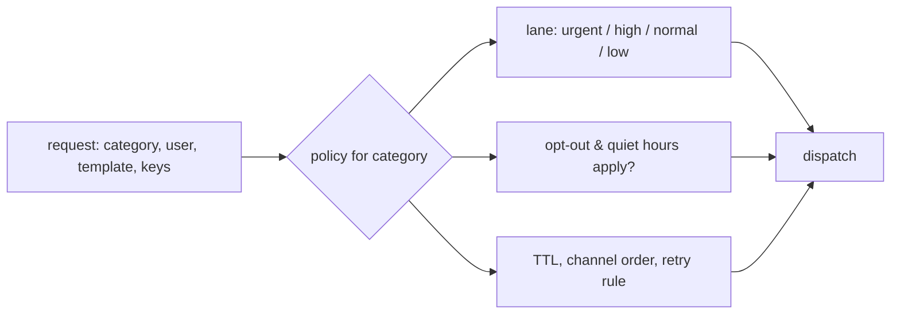
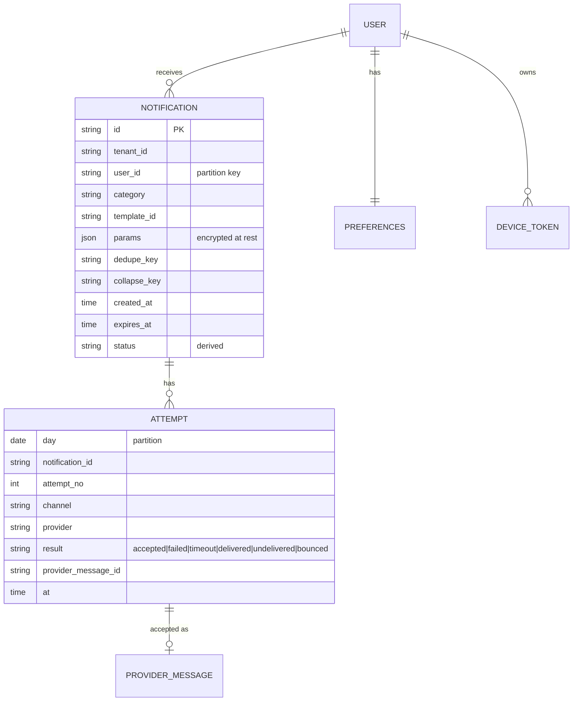
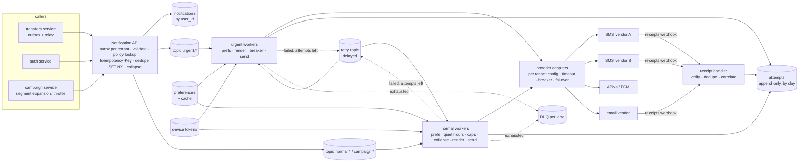

# C7 Unit 1 — Guided design: from the prompt to the high-level design

> Time: ~3 h · CORE: §1–§4 · STRETCH: the campaign arithmetic at the end of §2, the in-app inbox in §3 · Lab: none in
> this unit (Unit 2 builds `labs/c7/dispatch`)

"Design a notification service" sounds like the easiest case study in the course: no hard consistency, no hot keys, no
exotic storage. Candidates relax, draw an API, a queue and a worker pool, and get a mid-level score. The interesting
parts are elsewhere: the message leaves your system through a vendor you don't control; the same user must *not* be
told the same thing twice, or at 3 a.m., or after they said stop; a one-time passcode has a five-second budget while a
marketing blast to ten million people is fine an hour late; and every message costs money, so a retry bug has an
invoice. The senior signal in this interview is treating "don't send" as a first-class feature and the vendor as the
bottleneck.

This unit runs the 45-minute framework ([`docs/INTERVIEW_FRAMEWORK.md`](../../docs/INTERVIEW_FRAMEWORK.md)) phase by
phase on this problem. Each section is one phase. Commit to your answer at every predict block before opening the
reveal: the reveals are the walkthrough, and the gaps between your version and the reveal are what to study. Unit 2
does the deep dives and the lab.

## Before you start

You should have passed A6 ([async](../A6-async/README.md)) and A7 ([reliability](../A7-reliability/README.md)), and
you'll lean on A1's [webhooks](../A1-networking-api/unit-2-api-design.md#5-long-running-operations-and-webhooks) and
[idempotency keys](../A1-networking-api/unit-3-idempotency-auth.md#2-idempotency-keys-end-to-end). Warm-up, answer
first:

1. The transfers service commits a transfer, then publishes `transfer.posted` to a topic. What's lost, and roughly how
   often at 1 M transfers a day?
2. A call to the SMS vendor times out after 10 s. Was the message sent?
3. 200 worker goroutines each spend 12 s per vendor call during a brownout. What's the most messages per second the
   pool can hand to the vendor?

<details data-kind="answer">
<summary>Warm-up answers</summary>

1. Every event whose publish fails or whose process dies between commit and publish: deploys, crashes, broker
   hiccups. A6 Unit 2 §1 put it at the order of hundreds a day at that volume. The fix is the
   [transactional outbox](../A6-async/unit-2-outbox-consumers.md#1-the-dual-write-problem-and-the-transactional-outbox):
   the event row commits with the transfer and a relay publishes it at-least-once.
2. Unknown. A timeout is not a failure
   ([A7 Unit 1 §1](../A7-reliability/unit-1-timeouts-retries.md#1-timeouts-and-deadline-budgets)): the vendor may have
   accepted and sent it. Retrying blindly is how members get two passcodes; not retrying is how they get none. Which is
   worse depends on the category, and that decision is the heart of Unit 2 §5.
3. Little's law: 200 / 12 s ≈ 17 messages per second, down from ≈ 670/s at 300 ms. The vendor's latency, not your CPU,
   sets your throughput, which is why timeouts and breakers are capacity tools, not just error handling.

</details>

---

## §1 Requirements and the questions an interviewer expects

### The failure story

The platform's notifications began as a helper, `notify(memberID, channel, text)`, inside the transfers service. Three
years later fourteen services call it, it speaks SMS, email and push, and it has one queue and one worker pool.

One Monday at 09:00 marketing launches a "new savings rate" campaign: 2.1 M members, email and SMS, "as fast as
possible". The campaign is enqueued in twenty minutes (≈ 3.5k messages per second), ahead of every one-time passcode
that arrives after it. OTP wait time climbs from 4 s to 11 minutes; members can't log in; the contact centre takes
9,000 calls before noon. The SMS vendor starts returning 429 at 09:03 because the account is contracted for 100
messages per second. The worker retries any error five times, immediately, so 429s turn into five requests each. Some
members get the campaign text three times: the vendor had accepted the message, the HTTP response took longer than
the 2 s client timeout, and the retry sent it again. A member who opted out of marketing texts in the app gets the text
anyway: the opt-out lived in the marketing tool's list, not where the send happened, and they file a complaint that
legal has to answer. The vendor invoice for the month comes in at 2.4× budget. And when compliance asks, "Did we alert
member 4471 about the $2,400 external transfer on the 3rd, and when?", the answer takes two days and a grep across
fourteen services' logs.

Nothing in that story is a scale problem. Every failure is a missing requirement: no priority classes, no awareness of
the vendor's limits, no idempotency across the vendor boundary, preferences stored away from the sender, no audit
trail. Those are the things to pin down in the first six minutes.

### Predict

<!-- predict id="C7-U1-P01" -->
**Predict.** Write your answers down first.

1. The interviewer says only: "Design a notification service for a consumer app with about 100 M users." Write the
   eight clarifying questions you'd ask, and next to each the design decision its answer changes. (A question whose
   answer changes nothing is small talk.)
2. Draft the functional requirements (at most six) and the non-functional requirements *with numbers*: latency per
   class of message, availability, delivery semantics, retention.
3. A notification service has at least three requirements that are about *not* sending. Name them.
<!-- /predict -->

### Reveal

<details data-kind="reveal" data-for="C7-U1-P01">
<summary>Reveal</summary>

**1. The questions, and what each decides.**

| Question | Why it matters | Decision it changes |
|---|---|---|
| What *kinds* of messages? Security (OTP, fraud), transactional (payment posted), informational (digest), marketing? | Each kind has a different latency budget, legal status and user tolerance | Priority lanes; which messages honour opt-out and quiet hours; TTLs |
| Which channels, and does a message go to one channel, all, or the first that works? | Push is free and fast but unreliable; SMS is reliable and expensive; email is slow and cheap | Channel policy per category (e.g. OTP: push, then SMS fallback); cost model |
| Who triggers a notification: services calling an API, or events the service consumes with rules? | API callers own idempotency; event rules need an outbox and replay safety | Whether a rules engine is in scope; where the idempotency key comes from |
| Volume: per day, peak, and the biggest single burst (a campaign)? | Peak decides worker count; the burst decides whether campaigns need their own lane and throttle | Lane design, campaign throttling, provider capacity to contract |
| What may users control: per-category opt-out, quiet hours, frequency caps? Which messages can they *not* opt out of? | Preferences are a product and legal feature, not a nice-to-have | Preference model; the "service messages" exception; where preferences are evaluated |
| Delivery semantics: is a duplicate or a miss worse, per category? | Vendors are at-least-once at best; you must choose where duplicates are tolerable | Retry policy per category; dedupe windows; whether a timeout is retried |
| What must we be able to prove afterwards, and for how long? | Audit, disputes ("you never told me"), regulators | Append-only attempt log, retention tiers, receipts from providers |
| Multi-tenant? Do tenants bring their own sender IDs, provider accounts, branding, quotas? | A tenant's campaign must not consume another's capacity; per-tenant vendor accounts change the provider layer | Per-tenant configuration and fair-share throttling; tenant on every key |

Two more that are fine to ask if time allows: "Do we need an in-app inbox?" (a read model, STRETCH in §3) and "Do we
need open/click tracking?" (Unit 2 §6 STRETCH).

**2. Requirements for the consumer-scale version** (state these as assumptions if the interviewer says "you decide").

Functional:
- Services request a notification for a user by **category** and **template**; the service picks channels by policy.
- Users set **preferences**: per-category channel opt-out, quiet hours in their time zone. Security and regulatory
  messages are service messages and cannot be opted out of.
- **Campaigns**: a notification to a segment of users, throttled.
- **Delivery status** per notification, with provider receipts where the channel has them.
- Templates with parameters and localisation (authoring UI out of scope).

Non-functional, with numbers:
- **Urgent (OTP, fraud)**: handed to a provider within p99 ≤ 1 s of the request; end to end ≤ 5 s, of which the carrier
  is the part we don't control but must measure. Availability of this path 99.95%.
- **Transactional alerts**: within 1 minute. **Marketing**: within 1 hour, throttled; late is fine, duplicate is not.
- **Semantics**: at-least-once to the provider; no user sees two notifications for one event (dedupe), and a newer
  alert replaces an older unsent one on the same topic (collapse). "Exactly-once" is not available across a vendor
  boundary; say so.
- **Preferences**: a change takes effect within seconds; a regulatory opt-out (an SMS `STOP`) immediately.
- **Audit**: every attempt recorded with time, provider, result; 90 days queryable, aggregates for longer
  (`TODO-VERIFY: retention rules that apply to alert records in your jurisdiction and product`).
- **Volume** (assumed): ≈ 570 M notifications a day across channels, peak 3× average, campaigns up to 10 M recipients.
- **Tenancy** (if asked): per-tenant sender identities and quotas; no tenant can delay another's urgent messages.

Out of scope: template authoring UI, analytics and attribution, A/B testing, two-way messaging (replies, chat), the
in-app inbox (mention it as a read model you'd add).

**3. The three "don't send" requirements**: deduplication (same event, same user → one message), preferences
(opt-out, quiet hours, channel choice) and frequency caps (no more than N marketing messages per user per day). A fourth
is **expiry**: an OTP that would arrive 20 minutes late is worse than none, so notifications carry a TTL. Candidates
who list only "send to push/SMS/email" have described a vendor SDK, not a service.

The tempting wrong answer to question 1 is a list of features ("support rich push, emojis, attachments"). The senior
version asks about classes of messages, limits, legal constraints and proof, because those shape the design; features
are parameters.

</details>

### How it actually works

A notification service is a policy engine in front of vendors. The policy is indexed by **category**, so get the
category taxonomy on the board early; everything else hangs off it.

| Category (examples) | Priority | Opt-out? | Quiet hours? | Frequency cap? | TTL | Duplicate vs miss |
|---|---|---|---|---|---|---|
| Security: OTP, new-device login, fraud hold | urgent | no (service message) | no | no | minutes | a duplicate OTP is harmless; a miss locks the member out → retry, fail over fast |
| Transactional: payment posted, transfer received | high | per channel, not per category | no (money moved now) | no | hours | a duplicate confuses ("was I charged twice?"); a miss is a support ticket → dedupe strictly, retry carefully |
| Informational: low balance, statement ready, digest | normal | yes | yes, defer | yes, collapse | a day | a miss is fine; duplicates annoy → collapse by topic |
| Marketing: offers, campaigns | low | yes (and legally required) | yes | yes, strict | end of campaign | a duplicate costs money and goodwill; a miss costs nothing → never retry across a timeout |

Three more concepts the rest of the module uses:

- **Triggers.** Either a service calls `POST /v1/notifications` (it owns the idempotency key), or the service
  consumes domain events (`transfer.posted`) and a rules engine decides. The second is more decoupled and far more work
  (rules, replay, back-fills); in a 45-minute interview, offer it as evolution and design the API first.
- **Channels and what "delivered" means.** Push: the provider (APNs, FCM) accepted it; the device may be off for a
  week; no receipt unless the app reports one. SMS: the vendor accepted it, then a carrier receipt says delivered or
  undelivered, minutes later, sometimes never. Email: accepted by the vendor, then bounce/complaint feedback; "opened"
  is a guess (Unit 2 §6). Every "sent" counter in your dashboard is really "accepted by someone else".
- **Four different keys** (Unit 2 §6 goes deep): the request's *idempotency key* (a retried API call is one request),
  the business *dedupe key* (one notification per event per user per window), the *collapse key* (newer replaces older
  unsent on the same topic) and the *frequency cap* (at most N per user per category per day). Candidates who say
  "we deduplicate" without saying which of the four they mean get asked which.



### Build it

No lab for this section. The category policy becomes the `Priority` lanes and the preference rules of
`labs/c7/dispatch` in Unit 2 §6, where `Urgent` is the lab's compression of "service message".

### Break it

Change one requirement at a time and trace which decisions flip. Write your answer before opening the box.

(a) "OTP within 5 s" becomes "OTP within 60 s". (b) "At-least-once with dedupe" becomes "at-most-once: never send a
message twice, a miss is acceptable". (c) One tenant becomes forty credit unions, each with its own SMS vendor account.

<details data-kind="answer">
<summary>What flips</summary>

(a) The urgent lane could share workers with transactional messages, timeouts can be longer (one 10 s call instead of
two 2 s attempts with failover), and the "reserve vendor capacity for urgent" rule relaxes. It does *not* remove the
need for a separate lane from campaigns: 60 s is still far shorter than the hour a campaign may take to drain.
(b) Retries across a timeout disappear for every category, so the design needs *reconciliation* instead: a job that
asks the vendor "did you send message X?" (if the vendor has a lookup) or accepts the miss. Dedupe tables shrink to the
request-level idempotency key. Cheaper, and a worse product for OTPs; say that trade-off out loud.
(c) The provider layer becomes per-tenant configuration (credentials, sender IDs, rate limits), breakers and rate
limiters are keyed by tenant+provider, the campaign throttle is per tenant, lanes stay shared but with per-tenant fair
share so one credit union's campaign can't fill the normal lane. Tenant ID goes on every key, log row and metric.

</details>

### In the wild

- **Apple APNs** lets the sender set `apns-priority` (10 = immediately, 5 = power-considerate), `apns-expiration`
  (discard if undeliverable by then; 0 = try once) and `apns-collapse-id` (newer replaces older) — the TTL and collapse
  concepts exist at the vendor boundary too. **FCM** has `priority` (high/normal), `ttl` and `collapse_key`
  (`TODO-VERIFY: FCM's limit on distinct collapse keys per device, documented as four`).
- **US A2P SMS** requires sender registration (10DLC campaign registration through carriers) and handling `STOP`/`HELP`
  keywords; carriers filter unregistered traffic. Opt-out handling is a carrier and legal requirement, not a product
  choice (`TODO-VERIFY: current CTIA guidelines and the legal timelines that apply to you`).
- **Email**: CAN-SPAM requires honouring an opt-out request within a fixed number of business days
  (`TODO-VERIFY: the current limit, commonly cited as 10`); providers such as Amazon SES and SendGrid keep
  suppression lists for bounces and complaints and will stop sending to those addresses on your behalf.
- Notification platforms (Braze, OneSignal, Knock, Courier, Novu) expose this same taxonomy as products: workflows
  per category, preference centres, batching/digests, quiet hours, frequency capping (`TODO-VERIFY: feature names
  for the vendors you cite`). The existence of a product category is a hint that the "don't send" logic is where the
  work is.

### Trade-offs

| Option | Wins when | Loses when | When the answer flips |
|---|---|---|---|
| One notification service for all channels | Shared policy (preferences, dedupe, audit) in one place; one API for callers | Channel specifics (device tokens, carrier receipts, email reputation) make one team own everything | Flip to per-channel services behind one policy service when channel teams and release cadences diverge (email deliverability is a specialism) |
| API-triggered (callers decide) | Simple, callers own the idempotency key, no rules engine | Fourteen callers reimplement "when to notify" | Flip to event-driven rules when the same event drives many notifications and product wants to change rules without deploys |
| Preferences per channel only | Simple UI | Members want "no marketing texts, but keep fraud texts" | Flip to category × channel as soon as there is more than one category (always, in practice) |
| Everything opt-out-able | Simple compliance story | Members opt out of fraud alerts and then dispute transactions | Flip to a service-message exception for security and regulatory categories, documented in the terms |

### Senior bar

- **Failure modes of bad scoping**: no categories → policy can't be expressed; no urgent NFR → one queue; "exactly-once"
  promised → an impossible requirement in the notes; preferences owned by another system → the complaint in the story;
  no audit requirement → the two-day grep.
- **Capacity**: the numbers come in §2; the point here is that the *vendor's* limits are an NFR you must ask about.
- **Ops**: category policy is configuration reviewed by compliance, not code; preference changes propagate within
  seconds and the propagation lag is a metric.
- **Cost**: channel choice is a cost decision. Push ≈ free, email ≈ cents per thousand, SMS ≈ cents per message
  (`TODO-VERIFY: current list prices for your vendors`). An OTP policy of "push first, SMS if no push token or no
  delivery receipt within 10 s" is a cost feature.

Interviewer follow-up probes:

1. "Why categories? Isn't a priority flag enough?"

<details data-kind="answer">
<summary>Model answer</summary>

Priority orders the queue; category carries policy: can this be opted out of, does it respect quiet hours, is it
capped, how long is it worth sending, is a duplicate or a miss worse, how long must we keep the record. Two messages at
the same priority (a fraud alert and a statement-ready notice) need different policies. A category is a name for a
bundle of those decisions, which also makes compliance review possible: "marketing" is a thing legal can sign off on.

</details>

2. "Product says: just send everything to everyone, immediately. What breaks?"

<details data-kind="answer">
<summary>Model answer</summary>

Four things, in order of how fast they hurt: the vendor's rate limit (campaign traffic gets 429s and takes the
urgent path down with it), the member (duplicates and 3 a.m. pushes drive uninstalls and opt-outs of *everything*),
the law (SMS and email opt-outs are not optional) and the bill (SMS is the dominant cost line, and immediacy means
no collapsing of redundant alerts). So the design has lanes, throttles, preferences and collapse — the "don't send"
features — and I'd show product the uninstall and complaint numbers rather than argue.

</details>

3. "What does 'delivered' mean for an email?"

<details data-kind="answer">
<summary>Model answer</summary>

Three different things, and the data model must keep them apart: *accepted* by our email vendor (synchronous),
*delivered* to the recipient's mail server (an asynchronous event from the vendor), and *opened*, which is an estimate
from a tracking pixel that privacy features pre-fetch, so it over-counts. Bounces and complaints come back
asynchronously too and must feed a suppression list. I'd report "accepted" and "delivered" as separate SLIs and treat
"opened" as a product metric, not a delivery one.

</details>

### Check yourself

1. Name the four keys that each mean "don't send this twice" in a different sense.
2. Which categories should ignore quiet hours, and why is that a product and legal decision rather than a technical one?
3. What's the honest delivery guarantee you can promise across a vendor boundary?

<details data-kind="answer">
<summary>Answers</summary>

1. Idempotency key (one API request), dedupe key (one notification per business event per user per window), collapse
   key (newer replaces older unsent on a topic), frequency cap (at most N per user per category per period).
2. Security and regulatory messages: a fraud hold or a passcode is useless at 08:00 if the member needed it at 02:00.
   It's a product and legal decision because it defines what a user can and cannot refuse; engineering implements the
   exception, it doesn't invent it.
3. At-least-once to the provider, with deduplication on your side so a user doesn't see duplicates for the same event;
   never "exactly-once", because a timed-out vendor call has an unknown outcome.

</details>

---

## §2 Estimation: the numbers that decide the design

### The failure story

The v2 team sized the service from the average: 570 M notifications a day is ≈ 6,600 per second, so they provisioned
for 10,000 and felt generous. Three things they didn't compute. The campaign: 10 M recipients "in the 9 o'clock hour",
which marketing's tool sent in ten minutes, ≈ 17,000 per second on top of the Monday peak, so the queue backlog
reached 40 minutes and the OTPs were in it. The vendor: the SMS account was contracted for 1,000 messages per second,
so the campaign's SMS leg could not finish in under ≈ 2.8 hours no matter how many workers they added; they scaled the
pool to 500 workers and got 500 workers' worth of 429s. The storage: they budgeted 60 GB a day for "notifications";
the real write volume was attempts (≈ 1.3 per notification), receipts, and rendered bodies kept "for debugging",
≈ 220 GB a day, times three replicas. The disks filled in week six.

### Predict

<!-- predict id="C7-U1-P02" -->
**Predict.** Assumptions: 100 M users, 50 M daily active; per day ≈ 300 M push, 150 M email, 20 M SMS, 100 M in-app
(≈ 570 M total); peak ≈ 3× average; one marketing campaign to 10 M users must go out "in the 9 o'clock hour"; the SMS
vendor accepts ≈ 1,000 messages per second on our account, the email vendor ≈ 5,000/s, push vendors effectively more
than we'll send; a provider call takes ≈ 300 ms; each attempt record ≈ 300 B; attempts ≈ 1.3× notifications (retries
and failovers); retention 90 days; replication ×3; an SMS costs ≈ $0.008 (`TODO-VERIFY`: order of magnitude for a US
long code).

Compute, carrying units, and write the decision each number drives:

1. Average and peak notifications per second.
2. The campaign's send rate if it goes out in 10 minutes versus spread over the hour, and how long 10 M SMS would take
   at the vendor's cap.
3. The number of provider calls in flight at peak (Little's law), and what happens to it if the vendor's latency goes
   to 3 s.
4. Attempt-log bytes per day, and storage for 90 days with replication.
5. The monthly SMS bill, and what a 1% duplicate rate costs.
<!-- /predict -->

### Reveal

<details data-kind="reveal" data-for="C7-U1-P02">
<summary>Reveal</summary>

1. 570 M / 86,400 s ≈ **6,600/s average**; × 3 ≈ **20k/s peak**. Decision: stateless workers behind partitioned
   queues; 20k messages per second of ≈ 1 KB is ≈ 20 MB/s, a small log cluster. Our side is not the bottleneck, so
   don't spend interview time on sharding the notification store; spend it on the vendor boundary.
2. 10 M / 600 s ≈ **17k/s** (nearly another peak on top of the peak) versus 10 M / 3,600 s ≈ **2.8k/s**. Decision:
   campaigns are *throttled by design* (a token bucket per campaign, e.g. "3,000/s, finish by 10:00") and run in their
   own lane, never ahead of urgent traffic. For SMS: 10 M / 1,000 per s = 10,000 s ≈ **2.8 hours**. Decision: a 10 M
   SMS blast is not a thing this account can do in an hour; the design either reserves SMS capacity for urgent messages
   and lets campaigns take hours, routes campaigns to push/email, or contracts more throughput. Say which, with the
   number.
3. 20k/s × 0.3 s = **6,000 calls in flight** across the fleet (e.g. 30 workers × 200 goroutines). At 3 s latency the
   same arrival rate needs 60,000 in flight; with a fixed pool of 6,000 the throughput collapses to 6,000 / 3 s =
   2,000/s and the queue grows at 18k/s. Decision: per-call timeouts sized to the lane's budget (≈ 2 s for urgent),
   circuit breakers per provider, failover, and a bounded queue age so stale work is shed
   ([A6 Unit 3 §3](../A6-async/unit-3-sagas-backpressure.md#3-backpressure-and-load-shedding)). Unit 2 §5 builds it.
4. 570 M × 1.3 ≈ 740 M attempts/day × 300 B ≈ **220 GB/day**; × 90 days ≈ 20 TB; × 3 replicas ≈ **60 TB**. Decision:
   a time-partitioned, append-only attempt log (one partition per day, dropped after retention), bodies stored by
   reference (template id + params), not rendered text; a cheap tier after ≈ 7 days; aggregates for dashboards so
   nobody scans the raw log for a chart.
5. 20 M × $0.008 ≈ $160k/day ≈ **$4.8 M/month** for SMS alone; email at ≈ $0.10 per thousand is ≈ $450/day; push ≈ $0.
   A 1% duplicate rate on SMS is ≈ **$48k/month**. Decision: SMS is the channel to minimise (push first, SMS fallback
   for OTPs), dedupe is a feature with a dollar value, and "retry on timeout" for marketing SMS is never worth it.

The tempting wrong answers: sizing workers from the average (the campaign doubles the peak); assuming more workers
mean more throughput (the vendor cap is the ceiling, extra workers produce 429s); counting notifications instead of
attempts for storage; forgetting that a retry on SMS has a price.

</details>

### How it actually works

The estimate sheet for this system, in the order you'd write it on the board:

| Number | Arithmetic | Decision |
|---|---|---|
| Average rate | 570 M/day ÷ 86,400 ≈ 6.6k/s | Our infrastructure is not the bottleneck |
| Peak rate | × 3 ≈ 20k/s | Worker fleet ≈ 20k/s ÷ (per-worker rate); partitions ≈ peak ÷ per-partition rate |
| Campaign burst | 10 M in 10 min ≈ 17k/s | Separate lane, throttle to ≈ 3k/s, finish-by deadline |
| Vendor caps | SMS 1k/s, email 5k/s | Capacity reserved for urgent; campaigns can't use SMS at scale |
| In flight (Little) | 20k/s × 0.3 s ≈ 6k | Pool size, timeouts, breakers; what a 10× latency does |
| Urgent latency budget | 5 s end to end − carrier ≈ 1–3 s ≈ 1 s for us: API 50 ms + queue ≤ 200 ms + call ≤ 500 ms, one failover | Urgent lane with near-zero queueing, short timeouts, failover once |
| Attempt log | 740 M × 300 B ≈ 220 GB/day; 60 TB at 90 days replicated | Time-partitioned append-only store, tiering, aggregates |
| SMS bill | 20 M × $0.008 ≈ $4.8 M/month | Push-first policies, dedupe, no blind retries on paid channels |

The underlying idea is from A6: a queue between a producer rate and a consumer rate turns the gap into waiting time.
Here the consumer rate is capped by a contract you signed, so the only levers are *which messages* get the capacity
(lanes, reservation) and *when* (throttling campaigns across the hour instead of the first ten minutes).

**STRETCH — campaign arithmetic.** With SMS capacity reserved at 20% for urgent traffic, the campaign gets ≈ 800/s;
a 2 M-recipient SMS campaign then takes ≈ 42 minutes, so "start at 09:00, finish by 10:00" is feasible with a
throttle of ≈ 600/s, leaving headroom for transactional alerts. A campaign scheduler should compute this before
accepting a campaign ("this campaign cannot finish by your deadline on SMS; use push, or extend the deadline").

### Build it

No lab for this section. Run `sd estimate -kind qps -n 3` and `sd estimate -kind concurrency -n 3` before Unit 2; the
numbers above should come out of your head in the design exercise.

### Break it

Re-run the sheet with each change and note which decisions flip: (a) the SMS vendor caps the account at 100 messages
per second (a single long code; `TODO-VERIFY` the figure for your vendor); (b) 10× the users; (c) attempts stored with
the rendered body, ≈ 1 KB each.

<details data-kind="answer">
<summary>What flips</summary>

(a) 20 M SMS a day is ≈ 230/s on average and ≈ 700/s at peak, above a 100/s cap: the baseline doesn't fit, never mind
campaigns. The design must spread traffic over many sender numbers (a messaging pool), buy a short code, or move most
SMS to push. This is why the vendor-cap question belongs in requirements. (b) 200k/s peak and 2.2 TB/day of attempts:
now partitioning the notification store and the attempt log by user and by day is a real design item, and the campaign
throttle must be per tenant and per provider account. (c) 740 GB/day and ≈ 200 TB replicated at 90 days, plus PII (names,
amounts) sitting in logs: store template id and parameters, encrypt or drop sensitive parameters after delivery, and
render on demand for support.

</details>

### In the wild

- **Twilio** rate-limits by sender type and queues messages per sender; the published figures differ by number type
  (`TODO-VERIFY: current messages-per-second for long codes, toll-free and short codes, and the queue-overflow error
  when the queue exceeds its limit`). Messaging Services spread a campaign across a pool of numbers.
- **Amazon SES** has an account-level maximum send rate and daily quota that start low and are raised on request
  (`TODO-VERIFY: the current sandbox and default production values`): a campaign tool that ignores them gets throttled.
- **APNs** publishes no per-app throughput number and recommends keeping a few HTTP/2 connections open and multiplexing
  (`TODO-VERIFY`); the practical limit is your connection management, not a quota.
- **Kafka**: 20k messages per second at ≈ 1 KB is ≈ 20 MB/s, far below one broker's capacity
  ([`docs/NUMBERS.md`](../../docs/NUMBERS.md)); partition count follows consumer parallelism, not bytes.

### Trade-offs

| Option | Wins when | Loses when | When the answer flips |
|---|---|---|---|
| Contract more vendor throughput | Volume is steady and growing | Burst-only needs (campaigns) pay for idle capacity | Flip to throttling campaigns when bursts are rare and deadlines are soft |
| Throttle campaigns over the window | Protects urgent traffic and the vendor relationship | Campaigns that must land at a moment (a launch) | Flip to a second provider or account for campaigns when timing is a product requirement |
| Multi-provider pooling for capacity | Bursts beyond one account's cap; failover for free | Two integrations, two receipt formats, split reputation | Flip once a single account's cap is hit at baseline, or when failover is required for urgent |
| Store rendered bodies | Support can see exactly what was sent | PII in logs, 3–4× storage | Flip to template id + parameters (and render on demand) as soon as bodies carry personal data, which is always in banking |

### Senior bar

- **Failure modes**: sizing from averages; counting notifications, not attempts; ignoring vendor caps (the extra
  workers produce 429s, which the retry policy multiplies); no reserved capacity for urgent messages; storing bodies.
- **Capacity numbers**: ≈ 6.6k/s average, ≈ 20k/s peak, ≈ 6k calls in flight, ≈ 220 GB/day of attempts, SMS ≈ $4.8 M a
  month at this volume (`≈`, assumptions stated).
- **Ops**: alert on the vendor 429 rate and on queue age per lane, not on queue depth; a campaign scheduler that
  refuses deadlines it can't meet; capacity reviews before large campaigns.
- **Cost**: SMS dominates; every design choice that moves a message from SMS to push, or prevents a duplicate SMS, has a
  number attached. Say the number.

Interviewer follow-up probes:

1. "Your SMS vendor caps you at 1,000 per second. A tenant launches a 10 M campaign. What happens to OTPs?"

<details data-kind="answer">
<summary>Model answer</summary>

Nothing, if the design reserves capacity: urgent traffic has its own lane and a reserved share of the vendor budget
(say 200/s of the 1,000), and campaigns are throttled to the remainder. The campaign takes ≈ 3.5 hours on SMS, which
the scheduler tells the tenant up front, offering push or email instead. Without reservation, the campaign saturates
the account, every OTP gets 429 or queues behind the campaign, and login fails for everyone, which is the failure story
of §1.

</details>

2. "Which single number most changes this design?"

<details data-kind="answer">
<summary>Model answer</summary>

The vendor's throughput cap relative to the burst you must deliver. Everything on our side scales by adding workers
and partitions; the vendor cap doesn't. It decides whether campaigns need their own lane and throttle, whether you need
a second provider, and whether SMS can be a campaign channel at all. The second number is the SMS unit price, because
it turns retry policy into a cost decision.

</details>

3. "How much does a 1% duplicate rate cost, and how would you measure the rate?"

<details data-kind="answer">
<summary>Model answer</summary>

At 20 M SMS a day and ≈ $0.008 each, 1% is ≈ $1,600 a day, ≈ $48k a month, before the goodwill cost. Measure it from the
attempt log: attempts per (user, dedupe key) above one, and deliveries per notification above one from provider
receipts; sample support contacts for "I got this twice". The number justifies the dedupe table's Redis bill many
times over.

</details>

### Check yourself

1. Why does adding workers not help once the vendor cap is reached, and what does it produce instead?
2. What's in flight at 20k/s and 300 ms, and what happens to throughput at 3 s with a fixed pool of 6,000?
3. Why size storage from attempts rather than notifications?

<details data-kind="answer">
<summary>Answers</summary>

1. The vendor accepts a fixed rate; extra workers push requests above it and receive 429s, which retries multiply. The
   fix is to shape traffic (lanes, throttles) rather than add consumers.
2. ≈ 6,000 calls in flight. At 3 s the pool can complete ≈ 2,000 per second; the remaining 18k/s accumulate as backlog,
   which is why timeouts, breakers and shedding exist.
3. Each notification produces ≈ 1.3 attempts plus receipts and status changes; the log is append-only and these rows
   are what you keep for 90 days.

</details>

---

## §3 API and data model

### The failure story

The v1 API was `POST /notify {"member_id": …, "channel": "sms", "text": "…"}`, returning 200 after the vendor call.
Six consequences, all visible in one month of tickets:

- No idempotency key. The transfers service retried on timeouts, so ≈ 0.5% of alerts went out twice. At 20 M SMS a
  day that's 100k duplicate texts, ≈ $800 a day, and a steady stream of "was I charged twice?" calls.
- Callers rendered the text. Fourteen services had fourteen copies of "Your transfer of {amount} to {payee} posted",
  no localisation, and the amounts and payee names sat in every request log.
- No category. Preferences could not be applied at send time, because the service didn't know what kind of message it
  was handling.
- No status endpoint. Support's only tool was the vendor's console.
- One `notifications` row with a `status` column overwritten on every attempt. After a failover, the row said
  `delivered` and nothing recorded that the first vendor had timed out, so the duplicate investigation went nowhere.
- Delivery receipts from the SMS vendor were matched to rows by phone number. A member with two numbers had the wrong
  row marked delivered.

And one more from the "low balance" alert: it fired on every transaction while the balance stayed low, 47 pushes to
one member in an afternoon. There was no way to say "replace the pending one".

### Predict

<!-- predict id="C7-U1-P03" -->
**Predict.** Write your answers down first.

1. Design the create call: method, path, request fields (separate what the *caller* decides from what the *service*
   decides), the idempotency mechanism, the success status code, and the error cases. Then sketch how a caller reads
   status, how a user sets preferences, and how a provider reports delivery.
2. List the access patterns first. Then the entities, their keys and partition keys. Which table is append-only, and
   where do dedupe keys live?
<!-- /predict -->

### Reveal

<details data-kind="reveal" data-for="C7-U1-P03">
<summary>Reveal</summary>

**1. API.**

```
POST /v1/notifications
Idempotency-Key: 7c1e…                       # per request; a retry returns the same 202 and id
Authorization: Bearer …                      # the tenant comes from the principal, never from the body
{
  "recipient":    {"user_id": "m_4471"},
  "category":     "security.otp",            # the policy lookup: lane, opt-out rules, quiet hours, ttl
  "template":     {"id": "otp", "version": 3, "params": {"code": "482913"}},
  "channels":     ["push", "sms"],           # optional: override the category's channel policy
  "dedupe_key":   "otp:session_8812",        # optional: at most one notification per key per window
  "collapse_key": null,                      # optional: newer replaces older *unsent* on this key
  "ttl_seconds":  300,                       # not worth sending after this
  "scheduled_at": null
}
→ 202 Accepted   {"id": "ntf_01J…", "status": "accepted"}
→ 200 OK         {"id": "ntf_01H…", "status": "deduplicated"}   # dedupe_key seen within its window
→ 422            unknown category or template, invalid params, ttl out of range
→ 429            caller or tenant quota exceeded (+ Retry-After)

GET  /v1/notifications/{id}               → status + attempts [{at, channel, provider, result, provider_message_id}]
POST /v1/campaigns                        → 202; {segment_id, template, channels, throttle_per_second, start_at, end_by}
GET  /v1/users/{id}/preferences           → {categories: {marketing: {sms: false, email: true}, …},
PUT  /v1/users/{id}/preferences              quiet_hours: {start: "22:00", end: "08:00", tz: "America/Chicago"}}
POST /v1/providers/{name}/events          → provider receipts (signed; deduped by provider message id)
```

The caller decides *who*, *what category*, *which template and parameters* and the *keys*; the service decides
channels (unless overridden), priority, whether to send at all, and when. `202` because delivery is asynchronous and
the vendor is not in the request path; the response carries an id to poll. A dedupe hit is a success (`200` with the
existing id), not a `409`, because the caller did the right thing and a 409 invites it to retry with a new key — the
tempting wrong answer. The idempotency key covers the *request*; the dedupe key covers the *business event*
(A1 Unit 3 §2 is the mechanism; Unit 2 §6 is the semantics).

**2. Access patterns → data model.**

| Access pattern | Rate | Served by |
|---|---|---|
| Create; look up by notification id | 20k/s writes, low reads | `notifications` by id |
| A user's recent notifications (support, in-app inbox) | low | `notifications` partitioned by `user_id`, clustered by time |
| Is `dedupe_key` already used in its window? | 20k/s, must be atomic | Redis `SET NX EX` keyed `(tenant, dedupe_key)`; a unique index as the durable fallback |
| Pending notification for `collapse_key` | per collapse-key write | `pending_by_collapse_key` → notification id |
| Append an attempt; list attempts for a notification | 25k/s writes | `attempts` append-only, partitioned by day, clustered by `notification_id` |
| Receipt for `provider_message_id` → which attempt? | receipts/s ≈ sends/s | `provider_messages(provider, provider_message_id) → (notification_id, attempt_no)` |
| Preferences for a user at send time | 20k/s reads | `preferences(tenant, user)` document, cached with invalidation |
| Device tokens for a user | push sends/s | `device_tokens(user_id) → [{platform, token, last_seen}]` |
| Template by id, version, locale | cached | `templates` |

`attempts` is append-only: one row per provider call and one per receipt, never updated, dropped by partition after
retention. The notification's `status` is a *derived* summary (latest attempt outcome), recomputed, never the source
of truth. The tempting wrong answers: a `status` column you overwrite; matching receipts by phone number instead of
the vendor's message id; putting the tenant in the body.

</details>

### How it actually works



**Keys and their semantics** (Unit 2 §6 has the mechanics):

| Key | Scope | Who sets it | Enforced where | Outcome on hit |
|---|---|---|---|---|
| `Idempotency-Key` | one HTTP request | caller, per attempt of the same request | API, atomic reservation | same response replayed |
| `dedupe_key` | one business event per user, within a window (e.g. 24 h) | caller, from the event (`transfer:tr_8f2k`) | API, `SET NX EX` | 200 with the existing id; nothing new sent |
| `collapse_key` | a topic per user (`balance-low:acct_9`) | caller | dispatcher, at send time | the older *unsent* notification is superseded |
| frequency cap | category per user per period | policy | dispatcher, at send time | suppressed and recorded |

**TTL.** `expires_at = created_at + ttl`; the dispatcher checks it before every provider call and the API refuses
TTLs that don't fit the category (an OTP with a day-long TTL is a bug). Expired notifications are recorded as
`expired`, not dead-lettered: nobody should replay them.

**Templates by reference.** The request carries `template.id`, `version` and `params`; rendering happens in the
worker, per channel and locale. Parameters are the only personal data in the row; encrypt them at rest and drop or
tokenise them after delivery plus the dispute window if policy allows.

**Receipts.** The worker writes the attempt row *before* the vendor call with a client reference (our attempt id)
where the vendor accepts one, and stores the vendor's message id after. The receipt webhook maps
`provider_message_id → (notification, attempt)` and appends a receipt row. A receipt can arrive before the attempt row
is committed (the vendor is fast, your commit is slow): the handler parks unknown ids and retries them for a few
minutes instead of dropping them.

**Preferences.** A document per `(tenant, user)`: categories × channels, quiet hours with a time zone, a regulatory
opt-out flag per channel that only the carrier `STOP` path or support can clear. Read at *send* time through a cache
that is invalidated on write (A3), so a change is honoured within seconds.

**STRETCH — the in-app inbox.** An inbox is a read model: `inbox(user_id, created_at desc)` with keyset pagination
(A1 Unit 2 §2), an unread counter maintained on write, and "mark read" as a separate write. It is a small news feed
(C5) with one author per user; don't put it on the critical path of the dispatcher.

### Build it

No lab for this section. The `Notification` and `Record` types in `labs/c7/dispatch` are the in-memory versions of
`notifications` and `attempts`; `Notification.ID` plays the dedupe key and `Record.Attempts` is the append-only
history.

### Break it

For each change, say what breaks and which lab test in Unit 2 would catch the equivalent: (a) remove `Idempotency-Key`
and replay the transfers service's retry; (b) match receipts by phone number; (c) overwrite `status` per attempt
instead of appending.

<details data-kind="answer">
<summary>What breaks</summary>

(a) A timed-out create is retried and two notifications exist for one transfer; both are sent. The lab's
`TestEnqueue_ConcurrentDuplicatesAreAcceptedOnce` is the same bug in miniature. (b) Receipts land on the wrong
notification for anyone with two numbers, or on the wrong *attempt* after a failover; the audit trail lies. No lab
test; it's a data-model decision. (c) After a failover the record says "delivered by B" and nothing says A timed out
first; the duplicate investigation and the vendor dispute have no evidence. `TestProcess_FailsOverToNextProvider`
checks that the delivered record keeps both attempts, and `TestProcess_ExhaustedAttemptsGoToDeadLettersWithHistory`
that a dead letter carries the full history.

</details>

### In the wild

- **Stripe** popularised `Idempotency-Key` on creates; its webhooks carry an event id for receiver-side dedupe
  ([A1 Unit 2 §5](../A1-networking-api/unit-2-api-design.md#5-long-running-operations-and-webhooks)).
- **Twilio** returns a `MessageSid` on accept and posts status callbacks (`queued`, `sent`, `delivered`,
  `undelivered`, `failed`) keyed by that sid; the receipt table above is what makes those callbacks land on the right
  attempt.
- **Amazon SES** publishes delivery, bounce and complaint notifications through SNS, each carrying the message id;
  bounces and complaints must feed a suppression list.
- **APNs** returns `410 Unregistered` with a timestamp for a dead device token and **FCM** returns `UNREGISTERED`;
  the device-token table must consume that feedback, or you keep "sending" to phones that were wiped a year ago.
- **Google AIP-155** standardises request idempotency as a `request_id` field for RPC APIs; the same idea as the header.

### Trade-offs

| Option | Wins when | Loses when | When the answer flips |
|---|---|---|---|
| `202` + status endpoint | Vendors out of the request path; retries safe | Callers that need a synchronous "sent" | Never flip to a synchronous vendor call in the API; offer a webhook or polling for status |
| Template by reference | Localisation, consistency, no PII in requests | Callers wanting ad-hoc text | Flip to allowing raw text only for internal ops tooling, never for member-facing categories |
| Dedupe at the API | One place, atomic, early | Needs Redis in the write path | Flip to dispatcher-time dedupe only for keys that depend on send-time state (collapse) |
| Append-only attempts | Audit, disputes, debugging | More rows, derived status | Never flip; the derived status column is the compromise |
| Preferences in this service | Evaluated at send time, consistent | Other products need the same preferences | Flip to a separate preference service with a cache in the dispatcher when more than one product consumes them |

### Senior bar

- **Failure modes**: tenant in the body (cross-tenant sends); personal data in `params` logged in plain text;
  unbounded `params`; a dedupe window shorter than the caller's retry horizon (duplicates) or longer than the business
  cadence (a daily digest deduped against yesterday's); `409` on dedupe hits; receipts that arrive before the attempt
  commits and get dropped; `status` as the source of truth.
- **Capacity**: ≈ 20k/s creates with one Redis `SET NX` each (one Redis node does ≈ 100k+ ops/s,
  [`docs/NUMBERS.md`](../../docs/NUMBERS.md), so shard by tenant for headroom); ≈ 220 GB/day of attempts.
- **Ops**: template versions are immutable (a campaign in flight must not change text mid-way); preference changes are
  audited (who opted whom out, when); schema evolution for `params` is additive only (A1 Unit 2 §3).
- **Cost**: the attempt log's retention tiering; the Redis dedupe tier is cheap next to one day of duplicate SMS.

Interviewer follow-up probes:

1. "Why not return 200 after the vendor accepts the message? Callers would know it was sent."

<details data-kind="answer">
<summary>Model answer</summary>

Because then the vendor's latency and availability become the caller's. The transfers API would inherit the SMS
vendor's p99 (seconds during brownouts) and its outages, and a caller timeout during a slow vendor call creates exactly
the duplicate we're trying to prevent. `202` with an id, plus a status endpoint or a callback for the few callers that
care, keeps the vendor out of every other service's request path. "Accepted by the vendor" isn't "received" anyway.

</details>

2. "A receipt arrives for a provider message id you've never seen. What do you do?"

<details data-kind="answer">
<summary>Model answer</summary>

Don't drop it. Most likely the worker's attempt row hasn't committed yet (the vendor answered faster than our write),
so park the receipt in a short-retry queue and re-match for a few minutes; if it still doesn't match, store it in an
"orphan receipts" table and alert at a rate threshold, because a sustained stream of orphans means the correlation
is broken (wrong account, a second environment sharing the webhook URL). The vendor retries receipts too, so the
handler dedupes by the vendor's event id.

</details>

3. "Where does the tenant id come from, and why does it matter?"

<details data-kind="answer">
<summary>Model answer</summary>

From the authenticated principal (the caller's token), never from the request body. Every key — idempotency, dedupe,
collapse, rate limits — and every row and metric is scoped by that tenant id. A caller that could name the tenant
could send on another credit union's behalf or dedupe against its keys. Same rule as A1's 404-for-other-tenants.

</details>

### Check yourself

1. What's the difference between the idempotency key and the dedupe key, in one sentence each?
2. Why is `status` on the notification a derived field?
3. Which identifier do provider receipts correlate on, and why not the phone number?

<details data-kind="answer">
<summary>Answers</summary>

1. The idempotency key makes a retried *request* a no-op; the dedupe key makes a second *notification for the same
   business event* a no-op even when it comes from a different request.
2. The attempt log is the truth (append-only, one row per call or receipt); `status` summarises its latest entry for
   cheap reads and can always be recomputed.
3. The vendor's message id, stored when the vendor accepted the attempt. A phone number identifies neither the
   notification nor the attempt.

</details>

---

## §4 High-level design: both paths traced

### The failure story

The service's first "real" architecture: an API, one queue, one worker pool, three vendor clients. Three problems
showed up in the first quarter:

- The auth service called the notification API *synchronously* to send login passcodes, and the API called the SMS
  vendor before answering. When the vendor's p99 went from 300 ms to 8 s one afternoon, login p99 went to 8 s too,
  and the auth service's thread pool filled with calls waiting on a texting vendor.
- One queue. The 9:00 campaign (§1) was ahead of every passcode. "Add workers" didn't help, because the SMS vendor's
  cap, not the workers, was the limit.
- Receipts were ignored: "sent" meant "the vendor returned 200". Push sends to dead device tokens were 30% of
  volume and counted as success; nobody noticed that a third of the "delivered" pushes went nowhere.

### Predict

<!-- predict id="C7-U1-P04" -->
**Predict.** Draw the high-level design before opening the reveal. Then decide, in writing:

1. Where does dedupe happen, and where are preferences evaluated? (They are not the same place.)
2. How many queues or topics, and what is the partition key?
3. What does the transfers service do when the notification service is down?
4. What happens, box by box, when the SMS vendor is slow?
<!-- /predict -->

### Reveal

<details data-kind="reveal" data-for="C7-U1-P04">
<summary>Reveal</summary>

1. **Dedupe at the API** (early, atomic, before anything is stored or queued) for the request and dedupe keys.
   **Preferences at send time** in the worker, because a preference set while the message was queued must be honoured,
   and because quiet hours depend on *when* the send happens. Collapse is also decided at send time (the newer
   notification has arrived by then). The tempting wrong answer is "check preferences at the API"; it's simpler and
   wrong for anything that waits in a queue.
2. **One topic per lane × channel** (`urgent.sms`, `urgent.push`, `high.*`, `normal.*`, `campaign.*`), partitioned by
   `user_id` so a user's notifications are ordered and a per-user cap can be enforced by one consumer. Lanes are
   separate topics with separate consumer groups because that is what isolates them: a priority *field* inside one
   topic does nothing for a backlog ([A6 Unit 1 §2](../A6-async/unit-1-queues-logs.md#2-queues-versus-logs-and-partitions)).
   A delayed-retry topic (or a scheduler) per lane, and a DLQ per lane.
3. It doesn't call us synchronously at all: it writes `transfer.posted` to its **outbox** in the same transaction as
   the transfer, and a relay delivers the event (to our API, or to a topic we consume) at-least-once with the event id
   as the idempotency key. If we're down, events wait in its outbox; nothing is lost and nothing blocks the transfer.
4. The urgent SMS workers' calls take longer; their per-call timeout (≈ 2 s) fires; the breaker for that provider
   opens after N consecutive failures; subsequent sends fail over to the second SMS provider in the same pass; the
   lane's queue age rises briefly, then recovers. Campaign SMS workers see the same breaker (health is per provider),
   their lane's backlog grows, which is acceptable; the campaign throttle keeps them from piling retries onto the
   recovering vendor. Login never notices, because the auth service never waited on us.

</details>

### How it actually works



**The urgent path, with the budget.** Auth service → `POST /v1/notifications` (authz, policy, idempotency, dedupe,
insert, publish: ≈ 20–50 ms) → `urgent.sms` topic (queue wait ≈ 0 when the lane is healthy; alert if the age of the
oldest message exceeds 500 ms) → urgent worker: preferences from cache (urgent ignores opt-out but still needs the
device token or phone number), render, pick the first healthy provider, call with a 2 s timeout (one failover allowed
inside the lane's 5 s budget), write the attempt → vendor → carrier → phone. Our part is ≈ 100–600 ms; the carrier is
the rest, measured from receipts.

**The campaign path.** Campaign service expands a segment into notifications at the throttle rate (3,000/s, say),
each with `dedupe_key = campaign:<id>:<user>` so a restarted expansion can't double-send, into `campaign.<channel>`
topics. Workers evaluate preferences, quiet hours (defer to a per-user local time), frequency caps and collapse at
send time, so a member who opted out at 09:05 is skipped at 09:20. The campaign lane has its own worker pool and its
own share of each vendor's capacity (A7 Unit 3 §1 bulkheads).

**The receipt path.** Vendors post receipts to `POST /v1/providers/{name}/events`: verify the signature over the raw
body, dedupe by the vendor's event id, map `provider_message_id` to the attempt, append a receipt row, update the
derived status, and feed vendor feedback back: `undelivered` with a "number unreachable" code increments a per-number
failure count; `410 Unregistered` from APNs deletes the token; email complaints go to the suppression list.

**Event-driven triggers (evolution).** Instead of the transfers service calling the API, a rules consumer reads
`transfer.posted` from the event log and creates notifications. Same API underneath, with `Idempotency-Key = event id`,
so replaying the log is safe.

Why each box exists:

| Box | Justified by |
|---|---|
| API with policy lookup and dedupe | Requirements §1: categories; dedupe must be atomic and early |
| Topic per lane × channel | The campaign burst (§2) must not delay urgent traffic; channels have different vendor caps |
| Worker pools per lane | Bulkheads: a slow vendor fills one pool's goroutines, not all |
| Provider adapters with timeouts, breakers, failover | Little's law at 3 s latency (§2); the urgent 5 s budget |
| Append-only attempts + receipt handler | Audit (§1); "delivered" differs from "accepted" |
| Retry topic and DLQ per lane | At-least-once with bounded attempts; stale urgent messages must expire, not replay |
| Preference cache, device-token store | 20k/s reads at send time; dead-token feedback |

### Build it

No lab for this section; Unit 2's `labs/c7/dispatch` is the core of the worker box: lanes, preferences, caps,
breakers, failover, retries and the attempt log, in one type.

### Break it

Trace each failure through your diagram, box by box, writing what each lane's users experience: (a) the SMS vendor
is down (not slow: connection refused) for 30 minutes at 09:00 during a campaign; (b) the preference service is down
for 10 minutes; (c) the receipt endpoint is down for 2 hours.

<details data-kind="answer">
<summary>What happens</summary>

(a) Urgent SMS: the first few calls fail fast, the breaker opens, everything fails over to vendor B; OTP latency
barely moves; the breaker probes A every cooldown. Campaign SMS: same breaker, same failover, but B's capacity is
shared, so the campaign throttle must be per *provider*, not per campaign, or the campaign now saturates B; the
campaign lane's backlog grows and drains later. Alerts: provider A error rate, breaker state, campaign lane age. If
there's no vendor B, urgent SMS fall back to voice or push where policy allows, and OTP delivery degrades honestly
(the login page can say "we're having trouble sending codes" rather than spin).
(b) Workers serve preferences from the cache; cache misses (new users, expired entries) must fail *closed* for
Normal categories (don't send if you can't check opt-out) and *open* for urgent (send; service messages don't depend
on preferences). The notification waits in the retry topic, not the DLQ. A metric for "sends blocked on preference
lookups" tells you when it's happening.
(c) Vendors retry receipts for a while (`TODO-VERIFY: per vendor, how long and with what backoff`), so most arrive
late rather than never; the derived statuses lag; dashboards show "accepted" climbing and "delivered" flat, which the
receipt-lag alert explains. For the gap beyond the vendor's retry window, a reconciliation job queries the vendor's
status API by message id for attempts stuck in `accepted`.

</details>

### In the wild

- **Topic per priority** is the common Kafka pattern for exactly this reason; Kafka has no priority field, and
  consumer groups per topic give you independent backlogs and worker pools.
- **AWS SNS** fans one message out to many subscriptions, retries HTTP endpoints with a configurable policy and can
  send failures to a per-subscription dead-letter queue; it's a reasonable "receipt handler" and fan-out building
  block, but the policy layer (preferences, dedupe, lanes) is yours.
- LinkedIn has written about an "Air Traffic Controller" that decides *whether and when* to send a notification
  (relevance, frequency, channel) separately from the delivery pipeline (`TODO-VERIFY: current name and scope`), the
  same decide-versus-deliver split as the policy box here.
- **Envoy** outlier detection and **resilience4j**-style breakers are the per-provider breaker box in off-the-shelf
  form (A7 Unit 2 §1).

### Trade-offs

| Option | Wins when | Loses when | When the answer flips |
|---|---|---|---|
| Topic per lane × channel | True isolation; per-lane scaling, alerts, DLQs | More topics to operate; cross-lane ordering is gone (fine) | Flip to a single topic with a priority field never; flip to fewer lanes when volume is tiny and one pool suffices |
| Workers pull from topics | Natural backpressure; vendor caps enforced by consumer count × rate | Latency floor of a poll loop (ms) | Flip to push (API → worker RPC) never for the main path; the urgent lane tolerates the ms |
| Preferences evaluated in the worker | Honours late changes, quiet hours by send time | Needs a 20k/s cache | Flip to API-time evaluation only for categories that send within seconds and ignore preferences (urgent) |
| Static provider order per channel | Simple, predictable, auditable | Can't route on cost or health | Flip to dynamic selection (health, cost, tenant contract) once there are two providers per channel; keep the order auditable |
| Receipts via webhook | Near-real-time status | Endpoint availability; vendor retry windows | Keep webhooks and add a reconciliation poll for stuck attempts; flip to poll-only for vendors without webhooks |

### Senior bar

- **Failure modes by box**: API down → callers' outboxes hold events, nothing lost; store down → creates return 503,
  callers retry with the same key; broker down → same, bounded by callers' outbox retention; workers down → backlog,
  bounded by TTL (urgent expires rather than arriving an hour late); vendor slow → timeouts, breaker, failover;
  receipts down → lag, reconciliation.
- **Capacity**: ≈ 20k/s creates and sends, ≈ 6k calls in flight, per-lane consumer counts sized from the vendor caps
  (an urgent SMS lane with a 200/s reservation needs ≈ 200 × 0.3 s ≈ 60 in flight, so a handful of workers).
- **Ops**: dashboards per lane (age of oldest message, sends/s, accept rate) and per provider (latency, error rate,
  breaker state, receipt lag); deploys drain workers (finish in-flight calls, then stop consuming); a kill switch per
  category and per tenant; runbook for "fail over manually to vendor B"; migration from the in-service helper via a
  strangler: route one category at a time through the service with the same idempotency keys.
- **Cost**: vendor spend per channel per tenant as a first-class metric; the second SMS provider's standing cost versus
  the outage cost; retention tiers for attempts.

Interviewer follow-up probes:

1. "Why a topic per lane? Kafka is fast; one topic with a priority field would be simpler."

<details data-kind="answer">
<summary>Model answer</summary>

A priority field doesn't change the order of a partition: once 10 M campaign messages are ahead of a passcode in the
same partition, the passcode waits. Separate topics give separate consumer groups, separate worker pools, separate
backlogs, separate alerts and separate DLQs: that's isolation, and isolation is the requirement (OTP p99 ≤ 5 s during
a campaign). The cost is a few more topics and losing cross-lane ordering, which nobody needs.

</details>

2. "The auth service wants a synchronous answer: 'was the OTP sent?' What do you give them?"

<details data-kind="answer">
<summary>Model answer</summary>

`202` with an id, and the honest explanation that "sent" means "a vendor accepted it", which arrives ≈ 300 ms later
and still isn't "received". If they need to show the user something, they poll the status endpoint for up to a second
or subscribe to a status callback; the login page can then say "code sent to ***-1234" on `accepted` and "we're
having trouble, try again" on `failed`. What I won't do is put the vendor call in their request path, because then
their availability is the vendor's.

</details>

3. "How do you migrate fourteen services off the in-process helper without a big bang?"

<details data-kind="answer">
<summary>Model answer</summary>

Strangler pattern per category: the helper gains a feature flag that routes a category to the new API, with the same
idempotency key derived from the caller's event id, so during the overlap a message can't go out both ways. Start
with a low-risk informational category, compare the attempt log against the old logs for a week, then move
transactional, then security last, with a kill switch to route back. Preferences migrate first, because the new
service must honour them from day one.

</details>

### Check yourself

1. Why must the transfers service never call the notification API synchronously inside its own request?
2. Name the two places "don't send" decisions are made and what each decides.
3. What bounds the backlog when workers are down for an hour?

<details data-kind="answer">
<summary>Answers</summary>

1. It would inherit the vendor's latency and availability, and a timeout mid-call would create duplicates; it writes
   to its outbox and a relay delivers the event at-least-once with the event id as the idempotency key.
2. The API (request idempotency, business dedupe, early and atomic) and the worker at send time (preferences, quiet
   hours, frequency caps, collapse, TTL).
3. TTL per category: urgent messages expire instead of being delivered an hour late; campaign messages may wait; the
   retention of the topics and callers' outboxes bounds the rest.

</details>

---

## Unit wrap-up

| Decision | Default | Flip when… |
|---|---|---|
| Scope | Categories with a policy each (lane, opt-out, quiet hours, cap, TTL, duplicate-vs-miss); "don't send" is a feature | — |
| Estimation | Peak ≈ 3× average plus the campaign burst; vendor caps are the ceiling; attempts, not notifications, size storage; SMS cost drives policy | A vendor cap below baseline → pooling or a second provider; 10× users → partition the stores |
| API | `202` + id, `Idempotency-Key` per request, `dedupe_key` per event, `collapse_key` per topic, TTL, template by reference, tenant from the principal | — |
| Data model | `notifications` by user; `attempts` append-only by day; receipts correlated by provider message id; preferences cached, evaluated at send time | — |
| HLD | Topic per lane × channel, worker pool per lane, provider adapters with timeout + breaker + failover, retry topic and DLQ per lane, receipt handler | One topic with a priority field: never |
| Triggers | Callers' outboxes → API, event id as idempotency key | Rules engine over the event log when many notifications derive from the same events |

Next: [Unit 2](unit-2-deep-dives.md) does the two deep dives an interviewer will pick (the vendor boundary; dedupe,
preferences and lanes), lists the common mistakes, and builds the dispatcher in `labs/c7/dispatch`.
