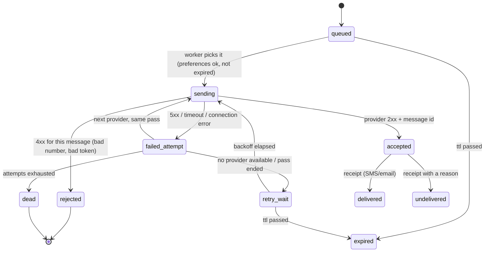
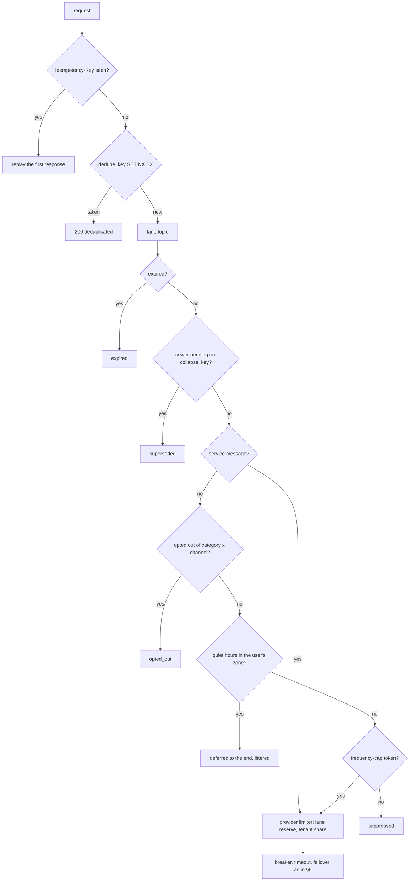

# C7 Unit 2 — Deep dives: the vendor boundary, and the four ways to not send

> Time: ~3 h · CORE: §5–§6, Common mistakes · STRETCH: the templates, localisation and tracking part of §6 · Lab:
> `labs/c7/dispatch`

Unit 1 ended at 0:25 with an end-to-end design. The deep dives an interviewer picks for a notification service are
almost always the same two: **what happens at the vendor boundary** (a vendor that is slow, down, lying, or
rate-limiting you, and what a retry costs) and **how you decide not to send** (dedupe, preferences, caps, lanes, and
why those decisions happen at send time). This unit does both, then lists the mistakes that cost candidates the
senior score, and builds the worker's core in Go.

## Before you start

You should have finished [Unit 1](unit-1-guided-design.md). Warm-up, answer first:

1. Why is a topic per lane better than one topic with a priority field?
2. Where is dedupe enforced, and where are preferences evaluated? Why not the same place?
3. Your SMS vendor accepts 1,000 messages per second. At 300 ms per call, how many calls are in flight at that rate,
   and what happens to throughput if latency rises to 3 s with the same pool?

Warm-up answers

1. A field doesn't reorder a partition; separate topics give separate consumer groups, pools, backlogs, alerts and
   DLQs, which is what isolates an OTP from a campaign (Unit 1 §4).
2. Dedupe at the API, atomically and early (the keys are known at request time); preferences in the worker at send
   time, because they can change while a message waits and quiet hours depend on the send time (Unit 1 §3–§4).
3. 1,000 × 0.3 ≈ 300 in flight; at 3 s the same 300 slots complete ≈ 100 per second, so the lane falls to a tenth of
   its throughput and the backlog grows at ≈ 900/s (Unit 1 §2).

---

## §5 Provider failover, timeouts and retries

### The failure story

Tuesday, 14:10. SMS vendor A has a brownout: p99 latency 12 s, 30% of calls fail with 503, for 25 minutes. The urgent
SMS workers are a pool of 200 goroutines with a 10 s client timeout and a policy of "retry up to 3 times, immediately,
on any error".

- Throughput collapses first. 200 slots, ≈ 12 s per call: ≈ 17 messages per second reach the vendor, against ≈ 50
  OTPs per second arriving. The backlog grows by ≈ 33 per second, ≈ 50,000 passcodes in 25 minutes. Members tap
  "resend code" (another 50,000).
- Then the duplicates. Of the calls that time out at 10 s, roughly 40% had actually been accepted by the vendor; the
  immediate retry sends the code again. 9% of members get two or three codes within a minute, some with different
  values, and don't know which to type.
- Then the recovery. At 14:35 the vendor is healthy. 100,000 queued sends and their retries hit it at once; the account
  is contracted for 1,000 per second, so the vendor returns 429 for 100 seconds, which the policy retries three times
  immediately. The vendor's dashboard shows a second outage, caused by the customer.
- Then the invoice: ≈ 60,000 extra SMS at ≈ $0.008 is ≈ $500, trivial; the 25-minute login outage during which members
  couldn't move money is not.

Vendor B was configured all along. Nothing used it, because "failover" was a manual runbook step.

### Predict

<!-- predict id="C7-U2-P01" -->
**Predict.** Write your answers down first.

1. With 200 workers and 12 s per call, what is the pool's throughput? Given an urgent end-to-end budget of 5 s of which
   the carrier takes ≈ 2 s, what per-call timeout would you set for an urgent SMS, allowing one failover?
2. Vendor A returns its first 503 of the day. Do you fail over to B for that message, retry A, or open a breaker?
   State the rule with numbers (threshold, cooldown, probe).
3. A call to vendor A *times out*. For an OTP: retry? On A or on B? For a marketing SMS? Explain why the answers differ.
4. The vendor recovers with 100,000 sends queued. How do you keep the recovery from becoming the second outage?
<!-- /predict -->

### Reveal

Reveal

1. Little's law: 200 / 12 s ≈ **17 per second** (from ≈ 670/s at 300 ms). The timeout must come from the budget, not
   from the vendor's worst day: 5 s − 2 s carrier − ≈ 0.3 s for API and queueing ≈ 2.7 s for provider calls; with one
   failover that's **≈ 1.2 s per call**, say 1.5 s if the second call is to a vendor known to be healthy. A 10 s timeout
   means a single slow vendor consumes the whole budget twice over and the pool's throughput with it. (The tempting
   wrong answer: "set the timeout to the vendor's p99"; the vendor's p99 during a brownout is the problem, not the
   target.)
2. For *that message*, fail over to B in the same pass: one error is enough to try the next provider when the lane is
   urgent, because the member is waiting. For *the provider*, count consecutive failures (5xx, timeouts, connection
   errors; not 4xx caused by the message) in a breaker: after ≈ 5 consecutive failures, open for ≈ 30 s, then let one
   probe through; a successful probe closes it, a failed one re-opens it. While open, every send skips A and goes to B
   at zero cost. Opening on the *first* error is wrong (one 503 in a thousand is normal); never opening is the story
   above (every send pays a timeout to a dead vendor).
3. A timeout is an **unknown outcome**: the vendor may have accepted it. For an **OTP**, retry on **B** immediately: a
   duplicate passcode is harmless if both carry the same code (design the OTP so a resend repeats the code within its
   validity window), while a missing one locks the member out. For a **marketing SMS**, do not retry across a timeout:
   a duplicate costs money and goodwill, a miss costs nothing. For a **transactional** alert, retry only with a
   provider-side idempotency key, or after a lookup by your client reference if the vendor offers one; otherwise treat
   it like marketing and reconcile from receipts. The answer differs because "is a duplicate or a miss worse?" is a
   property of the category, which is why the category is on the notification.
4. The backlog drains at the vendor's rate, not the pool's: a per-provider rate limiter at ≈ 90% of the contracted cap
   (so the pool never generates 429s), exponential backoff with jitter on retries so they don't align, a retry
   *budget* per provider ([A7 Unit 1 §3](../A7-reliability/unit-1-timeouts-retries.md#3-retry-budgets-amplification-and-metastable-failures))
   so retries are at most ≈ 10% of calls, honouring `Retry-After` on 429, and **expiry**: a passcode queued 25 minutes
   ago is worthless; drop it (recorded as expired) instead of delivering it at 14:36 to a member who has long since
   requested a new one. Urgent first, then high, then the campaign lane, each with its reserved share.

### How it actually works

**One attempt is a state machine, and the delivery log is its history.**

**What counts as a provider failure.** Breakers and retries react to the *provider's* health: 5xx, timeouts,
connection resets, 429 (the account, not the message). They must not react to the *message's* problems: a 4xx for an
invalid number, a dead device token, a recipient on the vendor's suppression list. Those are rejections: record
them, feed them back (delete the token, mark the number, suppress the address) and don't retry anywhere. Mixing the two
is how a batch of bad numbers opens a breaker on a healthy vendor.

**The breaker, per provider.** Closed: count consecutive failures, reset on success. Open: skip the provider for a
cooldown; the lane's sends go to the next provider at no cost. Half-open: admit exactly one probe; success closes,
failure re-opens for another cooldown. Thresholds: ≈ 5 consecutive failures (or ≈ 50% errors over a window for
high-volume lanes), cooldown ≈ 30 s, one probe. The breaker is keyed by provider, not by provider × channel: a
vendor that is down for SMS is down for voice. Per tenant × provider when tenants bring their own accounts (an
account rate-limited at 429 is that tenant's problem, not the vendor's). The lab's `breaker` is exactly this, with
no goroutines: state is evaluated from the clock when a call is attempted
([A7 Unit 2 §1](../A7-reliability/unit-2-breakers-rate-limits.md#1-circuit-breakers)).

**Failover.** An ordered provider list per channel per tenant: for urgent lanes, try the next provider in the same
pass (the member is waiting; two calls within the budget); for normal lanes, fail over too, but with the per-category
timeout rule below, and let the breaker decide whether the next thousand sends even try A. Failover means two
integrations, two receipt formats and two sender identities; it's the price of an urgent SLO you control.

**Timeouts are unknown outcomes.** The retry decision is per category:

| Category | On a timeout | Why |
|---|---|---|
| OTP, security | retry on the next provider now; resend repeats the same code within its validity window | a duplicate is harmless, a miss locks the member out |
| Transactional | retry only with a provider idempotency key or after a lookup by client reference; otherwise wait for the receipt | a duplicate confuses ("charged twice?"), a miss is a ticket |
| Informational | no retry across a timeout; next collapse will carry the news | neither outcome matters much |
| Marketing | never; count it as sent-unknown, reconcile from receipts | a duplicate costs money and complaints, a miss costs nothing |

Provider-side idempotency is rarer than you'd hope: most SMS and email APIs do not deduplicate on a client key
(`TODO-VERIFY: for each vendor you cite, whether messages accept a client reference and whether a status lookup by
that reference exists`). Pass your attempt id as the client reference wherever a field exists, so support and
reconciliation can correlate even without dedupe.

**Retries, bounded and shaped.** Attempts ≤ 3 per notification (two providers plus one retry), exponential backoff with
full jitter between passes ([A7 Unit 1 §2](../A7-reliability/unit-1-timeouts-retries.md#2-retries-backoff-jitter-and-when-retrying-is-safe)),
a retry budget per provider so retries can't exceed ≈ 10% of its traffic, `Retry-After` honoured, and a rate limiter
per provider at ≈ 90% of the contracted cap, so the recovery drains at the vendor's pace. Expired notifications are
dropped before every attempt. Exhausted ones go to the lane's DLQ with their full attempt history (§6 covers replay).

**"Accepted" is not "delivered".** The provider's 2xx means it queued the message. SMS and email vendors then send
receipts (delivered, undelivered with a code, bounced, complained); push vendors don't say anything about the device
unless your app reports back. Receipt codes feed the breaker and the suppression lists: a sudden rise in `undelivered`
with carrier-side reasons is a vendor problem (fail over) even while the vendor's API returns 200; a `410 Unregistered`
from APNs deletes the token. Receipt *lag* (time from accepted to receipt) is a vendor SLI you should graph.

**Picking a provider (STRETCH).** Static order per tenant is auditable and enough for two providers. Dynamic
selection scores each provider on a moving window of accept rate, latency and receipt-delivered rate, with cost as a
tiebreaker, and keeps a minimum share on the secondary so it is warm when you need it. Log the choice per attempt
either way.

### Build it

Lab `labs/c7/dispatch`, part 3 (parts 1–2 are in §6; do them first, the provider loop builds on them):

- `call`: `context.WithTimeout(ctx, SendTimeout)` around `Provider.Send`, and `recover` so a panicking SDK is a failed
  attempt.
- `breaker.allow`, `availableAt`, `success`, `failure`: the closed → open → half-open machine evaluated from the clock,
  exactly one probe at a time, `threshold <= 0` disables it.
- The provider loop in `handle`: skip providers whose breaker refuses, call the rest in order until one accepts, append
  an `Attempt` per call, stop at `MaxAttempts`; when the pass ends without delivery, requeue at `now + Backoff(retries)`
  (or at the earliest breaker reopen time when nothing could be called); dead-letter with history when attempts are
  exhausted or the channel has no provider.
- `DefaultBackoff`: exponential, capped at `MaxBackoff`.

Acceptance tests: `TestProcess_FailsOverToNextProvider`, `TestProcess_SendTimeoutCountsAsFailureAndFailsOver`,
`TestProcess_ProviderPanicIsContainedAsFailure`, `TestBreaker_OpensAfterThresholdAndHalfOpensAfterCooldown`,
`TestProcess_ExhaustedAttemptsGoToDeadLettersWithHistory`, `TestProcess_NoProviderForChannelDeadLettersImmediately`,
`TestProcess_RetryWaitsForBreakerCooldownWhenAllProvidersAreOpen`, `TestDefaultBackoff_GrowsExponentiallyAndCaps`.
Run `go test -race ./labs/c7/dispatch/`.

### Break it

Two measurements behind the `breakit` build tag (commands in [`labs/c7/README.md`](../../labs/c7/README.md)). Predict
the numbers before running each.

1. `TestBreakIt_DeadProviderWithAndWithoutBreaker`: 1,000 urgent sends through `[dead, backup]`, with
   `FailureThreshold: 0` and then `3`. How many calls reach the dead provider in each run? With a 2 s timeout per call,
   how much worker time does each run burn, and what does that do to a 200-goroutine pool's throughput?
2. `TestBreakIt_ZeroBackoffRetryStorm`: 100 notifications, a provider that always fails, `MaxAttempts: 5`,
   `Backoff: 0`. How many provider calls happen in one pass, and over what time span?

What you should see, and why

1. 1,000 versus 3 calls to the dead provider (the breaker opens after three and nothing advances the clock, so no
   probe). At 2 s each, 1,000 dead calls are ≈ 33 minutes of worker time; a 200-goroutine pool spends 2 s per message
   on the dead vendor before each failover, so its throughput is ≈ 100/s instead of ≈ 670/s, and the urgent lane's
   backlog grows. With the breaker, the three failures cost 6 s once, and every later send goes straight to the backup.
2. 500 calls in one pass, all at the same timestamp: every attempt of every notification lands in the same instant,
   which in production is the wave that hits a vendor the moment it answers again. With `DefaultBackoff` the second
   attempts are due a second later, the third two seconds after that, and the wave spreads; add jitter and it
   flattens. Then dead letters: 100 entries, each with five attempts and the error for each.

### In the wild

- **Twilio** posts status callbacks per message (`queued`, `sent`, `delivered`, `undelivered`, `failed`) with error
  codes that distinguish the recipient's problem (unreachable, unknown destination, unsubscribed) from the carrier's
  (`TODO-VERIFY: the specific error codes and their meanings for the vendor you cite`); the breaker must only count the
  latter. Its API returns 429 with a queue-based rate limit per sender (`TODO-VERIFY`).
- **APNs** answers each push with a status: `410 Unregistered` plus a timestamp (delete the token if it is older than
  the device's last registration) and `429 TooManyRequests` for the same token being hammered; **FCM** returns
  `UNREGISTERED` and `QUOTA_EXCEEDED`. Both are per-message or per-token signals, not vendor health.
- **Amazon SES** throttles above the account's max send rate with a `Throttling` error; the fix is the per-provider
  rate limiter, not retries.
- **Envoy** outlier detection and **resilience4j** breakers implement the consecutive-failure / half-open machine in
  the lab (A7 Unit 2 §1); Google's SRE book describes retry budgets and the "retry amplification" that turned this
  story's recovery into a second outage (A7 Unit 1 §3).

### Trade-offs

| Option | Wins when | Loses when | When the answer flips |
|---|---|---|---|
| Fail over on the first error (per message) | Urgent lanes with a latency budget | Vendors with routine transient errors; a second integration to maintain | Flip to "retry the same provider once" for normal lanes when the secondary is costlier or less reliable |
| Breaker per provider | Shared vendor health across channels and lanes | Tenants with their own accounts (one tenant's 429 opens it for all) | Flip to per tenant × provider when accounts are per tenant |
| Short timeouts (≈ 1–2 s) for urgent | Budget protected, pool throughput protected | More unknown outcomes (duplicates) | Flip to longer timeouts for categories where a duplicate is worse than latency (marketing, transactional) |
| Retry across a timeout | OTP (duplicate harmless) | Paid, user-visible categories (duplicate costly) | Flip per category; with a provider idempotency key, retry everything |
| Second provider always warm (minimum share) | Failover works the day you need it | Pays for a second contract and split reputation | Flip to cold standby for low-volume channels; never for urgent SMS |

### Senior bar

- **Failure modes**: timeouts sized to the vendor's p99 instead of the budget; retries that count 4xx as provider
  failures; breakers that never open (every send pays the timeout) or open on one error; retries without jitter or a
  budget (the recovery wave); no expiry (stale OTPs delivered at 14:36); a secondary provider that was never exercised;
  "sent" dashboards that hide a vendor that accepts and never delivers.
- **Capacity**: throughput = concurrency ÷ latency; a breaker bounds the time wasted on a dead vendor to threshold +
  one probe per cooldown (≈ 5 + 20 calls in a 10-minute outage with a 30 s cooldown) instead of one timeout per send.
- **Ops**: per-provider SLIs (accept rate, latency p99, receipt lag, undelivered rate by reason, breaker state) with
  alerts on each; a manual failover switch and a "disable provider" switch; a reconciliation job for attempts stuck in
  `accepted`; vendor status pages in the runbook; a game day that fails over for real every quarter.
- **Cost**: ≈ $0.008 per SMS (`TODO-VERIFY`) makes "retry on timeout" a dollar decision per category; a warm secondary
  provider's minimum commitment versus an hour of OTP outage; the attempt log is the evidence in a vendor dispute.

Interviewer follow-up probes:

1. "Vendor A returns 200 for every send, but receipts have stopped. How do you notice, and what do you do?"

Model answer

Receipt lag and delivered-rate SLIs per provider: accepted climbing, delivered flat, receipt age growing. Alert on
delivered-rate drop over a 5-minute window, not on API errors, which are green. Response: fail over the urgent lane to
B by flipping the provider order (a config change, not a deploy), open a vendor ticket with message ids from the
attempt log, and keep A in the chain for the campaign lane only if its receipts recover. This is why "sent" and
"delivered" are separate columns and separate graphs.

2. "Why not retry the same provider three times before failing over? That's what our HTTP client does by default."

Model answer

Because the budget is per message and the pool's throughput is per call. Three retries on a slow vendor spend three
timeouts before the member hears anything, and each one occupies a worker slot. One attempt, then the next provider,
then at most one more pass, with the breaker making the first attempt free once the vendor is known-bad. The HTTP
client's default is tuned for transient blips on a single backend, not for a vendor boundary with an alternative.

3. "An OTP call times out. Retry or not?"

Model answer

Retry on the other provider immediately, and make the OTP itself tolerate it: the code is generated once per
challenge and any resend within its validity window repeats the same code, so two texts carry the same six digits.
The miss is the expensive outcome here (a locked-out member), the duplicate is harmless. I'd give the opposite answer
for a marketing message, and for a transactional alert I'd want a provider idempotency key or a receipt before
deciding.

4. "What breaker threshold would you pick, and why not 1?"

Model answer

Consecutive failures ≈ 5, cooldown ≈ 30 s, one probe; or an error rate over a sliding window (≈ 50% of ≥ 20 calls)
for high-volume lanes, because consecutive counts are noisy at thousands of calls per second. Not 1: one 503 in a
thousand is normal for any vendor, and opening on it would fail over on noise and starve the primary of traffic it
needs to prove it's healthy. Not 100: that's a hundred timeouts' worth of worker time per outage.

### Check yourself

1. Which responses should a breaker count as provider failures, and which must it ignore?
2. Why is the retry-on-timeout decision a property of the category?
3. What bounds the recovery wave after a 25-minute vendor outage?

Answers

1. Count 5xx, timeouts, connection errors and 429 for the account; ignore 4xx caused by the message (invalid number,
   dead token, suppressed address), which are rejections to feed back, not retry.
2. Because the only question that matters after an unknown outcome is whether a duplicate or a miss is worse, and
   that depends on what the message is: harmless duplicate for OTP, costly duplicate for marketing.
3. Per-provider rate limiting at ≈ 90% of the cap, backoff with jitter, a retry budget, `Retry-After`, and expiry of
   stale messages before each attempt.

---

## §6 Deciding not to send: dedupe, preferences, caps and lanes

### The failure story

Friday, the week after §5's brownout. Every vendor is healthy, every dashboard is green, and the complaints arrive
anyway.

- **16:00.** Credit union 12 launches a 1.5 M-member SMS campaign, throttled to its fair share of ≈ 150/s, so it drains
  over ≈ 2.8 hours. The campaign service filtered opted-out members when it expanded the segment at 16:00 and stamped
  each message "preferences checked". Between 16:00 and 18:48, ≈ 4,000 members reply `STOP` to an earlier text or flip
  the toggle in the app. Their messages are already queued, already "checked", and they get the text anyway. Each one
  is a complaint, and under US telemarketing rules potentially a per-message statutory damages claim
  (`TODO-VERIFY: TCPA damages per message and how they apply to texts sent after a revocation of consent`).
- **16:20.** The low-balance rule fires on every card authorisation while the balance is under $50. A member buys
  groceries, fuel, coffee and lunch for a colleague and gets 9 pushes in 40 minutes. They turn off all notifications
  for the app, fraud alerts included.
- **17:05.** A broker failover makes the transfers service's outbox relay re-send 6 hours of events. The relay
  generates a fresh `Idempotency-Key` per HTTP call (a UUID per request, not the event id) and sends no `dedupe_key`:
  ≈ 180,000 "transfer received" alerts go out twice, ≈ 40,000 of them as SMS (≈ $320, and a contact-centre queue of
  "was I paid twice?").
- **17:10.** Credit union 3's members wait 9 s at p99 for login codes. The urgent lane has its own topic and its own
  workers, exactly as Unit 1 drew it. But every lane's workers take tokens from *one* rate limiter in front of SMS
  vendor A, set to the 1,000/s contract, first come first served. The replayed alerts (high lane) and the campaign
  together want ≈ 1,400/s; urgent workers wait for tokens behind them.
- **Saturday 01:00.** Quiet hours are stored as "22:00–08:00" with no time zone and evaluated against the server's UTC
  clock. A digest deferred "until 08:00" is released at 08:00 UTC, which is 01:00 in Seattle.

Five incidents, no outage, and nothing wrong at the vendor boundary. Each one is a decision *not to send*, made with
the wrong key, at the wrong time, in the wrong place, or not at all.

### Predict

<!-- predict id="C7-U2-P02" -->
**Predict.** Write your answers down first.

1. The 17:05 replay. Which key should have caught it, the idempotency key, the dedupe key or both, and what *value*
   should each have had? What window does the dedupe key need, and roughly how much memory is that at 570 M
   notifications a day?
2. The member who replies `STOP` at 16:30 to a campaign expanded at 16:00. Where must the opt-out be checked so they
   aren't texted at 18:00? Then: the preference cache is unreachable for five minutes. What do you do with a marketing
   SMS, a transactional alert and an OTP?
3. The low-balance member. Collapse key, frequency cap, or something else? Write the rule. Separately, for "at most 3
   marketing messages per member per day", compare a per-calendar-day counter with a token bucket: what is the worst
   burst each allows?
4. Credit union 3's OTPs had their own topic and workers and still waited 9 s. What was shared, and how would you
   split it for a 1,000/s vendor contract, with numbers?
<!-- /predict -->

### Reveal

Reveal

1. **Both, with different values.** `Idempotency-Key = event id`: the relay's second send of the same event is the
   same *request*, and the API replays the first response. `dedupe_key = transfer-received:{transfer_id}:{user}`: a
   second *producer* of the same business fact (the core's event stream, a back-fill script) is still one
   notification. Either one, derived from the event rather than generated per call, would have stopped this replay.
   The window must be at least the longest horizon over which a duplicate can arrive (here, the relay's replay
   window; outbox retention is commonly ≈ 1–7 days) and shorter than the cadence at which the same key legitimately
   recurs (a daily digest's key includes the date). Memory: 570 M keys a day × ≈ 100 B per key in Redis (key, value,
   expiry and per-key overhead, `≈`) ≈ **57 GB** for a 24 h window: a few shards, split by tenant, with a unique
   index on `(tenant, dedupe_key)` in `notifications` as the durable backstop. The tempting wrong answer is "Kafka's
   exactly-once handles it": the idempotent producer dedupes one producer's retries into a partition within a
   session, not a relay re-reading its outbox after a failover.
2. **At send time, in the worker, immediately before the provider call, and again on every retry pass.** The
   expansion-time filter is an optimisation (don't enqueue people you already know have opted out), not the check.
   The inbound `STOP` handler writes the regulatory opt-out synchronously and invalidates the cache, so the next send
   attempt sees it within seconds. When the cache is unreachable: **marketing fails closed** (don't send what you
   can't check; push it to the retry topic, it can wait an hour); **transactional** uses the last known preferences
   if a copy is cached (a channel choice that is minutes stale is acceptable) and otherwise defers within its TTL;
   **OTP fails open**, because service messages don't consult opt-out at all and need only the phone number or
   device token. The wrong answer is one global policy: fail-open everywhere texts people who said stop, fail-closed
   everywhere locks members out of their accounts.
3. **Neither key alone; fix the trigger first.** The rule is *level-triggered* (fires on every event while the balance
   is low); make it *edge-triggered* (fire when the balance crosses below $50, re-arm when it goes back above) and add a
   per-topic cooldown ("at most one low-balance alert per account per 24 h"). Then a `collapse_key =
   low-balance:{account}` makes any alerts still queued collapse to the newest one, and the vendor's collapse id
   (`apns-collapse-id`) replaces an unread one on the lock screen. Caps: a **fixed calendar-day counter** allows 2N in a
   few minutes (3 at 23:50, 3 more at 00:10), and "midnight" needs a time zone. A **token bucket** with burst 3 and
   refill 3 per 24 h never allows more than 3 back to back, then one every 8 h; any 24 h window can still see up to
   5, spread out. If the cap must be exact ("never more than 3 in any 24 h"), a **sliding log** of send times does
   it, and at N = 3 it costs three timestamps per member.
4. **The downstream token bucket.** Topics and worker pools isolated the queue and the threads; the provider rate
   limiter was a third shared resource, and first-come-first-served gave it to whoever asked most. Split it like the
   lanes: reserve ≈ 200/s for urgent and ≈ 300/s for high, leave ≈ 500/s for normal and campaign, and let a lane
   *borrow* another's idle tokens second by second without ever making an urgent request wait for a token a lower
   lane holds. Inside the campaign share, give each tenant a weighted fair share, so credit union 12 can use the whole
   500/s at 03:00 but only its share when others are waiting. And shape the replay at the door: a per-tenant API quota
   returns 429 with `Retry-After`, and the transfers service's outbox, which is durable, holds the rest.

### How it actually works

**The decision pipeline.** Every "no" in this picture is a recorded outcome with a reason, not a silent drop.

**The order is a design decision.** Dedupe first, at the API, because it is atomic, cheap and needs nothing but the
request, and because a duplicate must not consume a cap token, appear in metrics, or reach a worker. Expiry before
everything at send time: an expired OTP needs no preference lookup. Preferences before the cap, so a message the
member opted out of doesn't burn one of their three marketing slots. The provider limiter last, because it is the
only shared resource and should be spent only on messages that will actually be sent.

**The four keys, mechanically.** Unit 1 §3 introduced them; this is what each costs and where it lives at the module's
scale.

| Key | Example value | Window | Store, and cost at ≈ 570 M/day | On a hit |
|---|---|---|---|---|
| `Idempotency-Key` | the caller's event id, `evt_9f2c` | the caller's retry horizon, ≈ 24 h | the API's idempotency table ([A1 Unit 3 §2](../A1-networking-api/unit-3-idempotency-auth.md#2-idempotency-keys-end-to-end)) | replay the stored response |
| `dedupe_key` | `transfer-received:tr_8f2k:m_4471` | the business horizon, ≈ 24 h–7 d; include the date for anything recurring | Redis `SET NX EX`, ≈ 57 GB per 24 h of keys; unique index as backstop | `200`, status `deduplicated`, nothing sent |
| `collapse_key` | `low-balance:acct_9` | while a notification on that key is unsent | `pending_by_collapse_key → latest id`, checked by the worker | the older one is recorded `superseded`; the vendor's collapse id replaces it on the device |
| frequency cap | `(tenant, user, marketing, sms)` | a rolling period | token bucket per key, ≈ 16 B of state; ≈ 50 M members × ≈ 100 B with key overhead ≈ 5 GB per category × channel | `suppressed` (marketing) or folded into the next digest (informational) |

Two details decide whether dedupe works in production. The key comes from the **business fact**, never from the
request (a UUID per HTTP call dedupes nothing). And `SET NX` is a *reservation*: if the insert or publish that
follows fails, either delete the key or store it with a `pending` value that a retry carrying the same key may
complete, or the caller's legitimate retry is answered "deduplicated" for a notification that was never queued
(the same reservation pattern as A1 Unit 3 §2).

**Preferences at send time.** One document per `(tenant, user)`: category × channel opt-outs, quiet hours with an IANA
time zone, and a regulatory per-channel flag that only the carrier `STOP`/`START` path or support can change. Workers
read it from a local cache invalidated on write (pub/sub), with a ≈ 60 s TTL as a backstop for a lost invalidation;
the lag between a preference write and the first send that honours it is a metric with an alert. The lab's
`Preferences` interface is called inside `handle`, on every pass, so an opt-out that lands while a notification
waits in backoff is honoured on the retry. Failure policy per category, as in the reveal: marketing closed,
transactional last-known-then-defer, urgent open.

**Quiet hours defer; they don't drop.** Evaluated in the member's zone (an IANA name, not an offset, or every DST change
moves the window by an hour), and the notification is requeued for the end of the window. Two production details the
lab leaves out: if the end of quiet hours is after the notification's `expires_at`, record it `expired` instead of
deferring; and jitter the release (≈ 30–60 min), because 2 M members in one zone all become due at 08:00. Behind a
3,000/s campaign throttle that is ≈ 11 minutes of drain anyway; behind no throttle it is a 2 M spike at the vendor.

**Frequency caps are rate limiting per member.** The lab's `limiter.allow` is a token bucket per
`(tenant, user, channel)`: `Burst` tokens, refilled continuously at `Burst` per `Window`, one token per send; production
keys it by category as well, because "3 marketing texts a day" must not block a statement-ready email. The algorithm
choice is A7's ([A7 Unit 2 §2](../A7-reliability/unit-2-breakers-rate-limits.md#2-rate-limiting-algorithms)): a fixed
window is cheapest and allows 2N across the boundary; a sliding log is exact and costs N timestamps per member (cheap at
N = 3); a token bucket bounds the burst and the long-run rate and is the usual default. *Where* the state lives follows
from Unit 1 §4: lane topics are partitioned by `user_id`, so one consumer owns a member's buckets and can keep them in
memory, rebuilt from the attempt log after a rebalance; without that partitioning you need a shared counter with an
atomic update (a Redis script), at one round trip per send. One more thing to notice in the lab: `handle` runs the
rules on every pass, so a notification that fails at the provider and is retried takes a second token. Production
marks the token as spent on the notification, or refunds it on a definite failure.

**Lanes and tenants: isolate all three layers.** Unit 1 §4 isolated the queue (a topic per lane) and the workers (a pool
per lane, the bulkhead of [A7 Unit 3 §1](../A7-reliability/unit-3-isolation-degradation-dr.md#1-bulkheads-cells-and-shuffle-sharding)).
The third shared layer is the provider's capacity. With a 1,000/s contract: urgent reserved ≈ 200/s (Unit 1 §4 sized
that lane at ≈ 60 calls in flight), high ≈ 300/s, normal and campaign ≈ 500/s; unused reservation is lent downward one
interval at a time, and an urgent send never waits for a token held by a lower lane. Inside the shared lanes, tenants
get weighted fair shares ([A9 Unit 1 §5](../A9-security-multitenancy/unit-1-authorization-tenancy.md#5-noisy-neighbours-and-fair-sharing)):
a per-tenant token bucket sized from its contract, or weighted fair queuing across per-tenant sub-queues, so one credit
union's campaign can't take more than its share while others are waiting. At the door, a per-tenant API quota turns a
replay storm into `429` + `Retry-After`, and the caller's outbox becomes the buffer. Tenant id is on every key, every
bucket and every metric.

**Every non-send is a record.** The attempt log holds `deduplicated`, `superseded`, `expired`, `opted_out`, `deferred`,
`suppressed` and `failed` alongside `accepted`, `delivered` and `undelivered`, each with a reason (the lab's
`Record.Reason`). That is what makes "did we alert member 4471 about the transfer, and if not, why not?" a single
query instead of Unit 1's two-day grep, and it is the evidence when a member disputes a transaction they say they
were never told about. Together with the receipts from §5, one notification's history reads from request to handset:
accepted by the API, deferred by quiet hours, accepted by vendor B after A timed out, delivered per the carrier.

**Replaying a dead-letter queue.** §5 sends exhausted notifications to the lane's DLQ with their attempts. A replay
re-publishes them to the lane's retry topic with the *same* notification id (so receipts and the audit trail
correlate), which means it bypasses the API's dedupe (which would rightly reject the id) but **not** the send-time
rules: expired notifications are never replayed (a passcode from yesterday is a security incident, not a delivery),
preferences and caps are evaluated again, and the replay draws from a limited share of the lane's provider tokens.
Replay by reason: `provider_unavailable` yes, `invalid_number` never.

**STRETCH — templates, localisation and tracking (≈ 0.5 h).**

*Templates.* Requests carry `template.id`, `version` and typed `params`; versions are immutable, so a campaign in flight
can't change text mid-way. Rendering happens in the worker, per channel: push has a title and a body with a
platform payload limit, email has a subject, HTML and a text part, and SMS has segments. A single SMS segment holds 160
characters in the GSM-7 alphabet but only 70 in UCS-2, which is what one emoji or one character outside GSM-7 switches
the whole message to; concatenated segments hold 153 and 67. A 120-character alert with a "✓" in it is two segments
and costs twice as much, so length and encoding per locale are checked when a template version is published, not
discovered on the invoice.

*Localisation.* The member's locale comes from their profile at send time, with a fallback chain (`fr-CA` → `fr` → the
tenant's default) and never a blank message. Params are typed (`{"amount": {"value": "2400.00", "currency": "USD"}}`,
not a pre-formatted string) so the worker formats numbers, currencies, dates and plurals per locale using CLDR rules,
and a publish-time check renders every locale with sample params. Right-to-left scripts and the SMS encoding rule above
interact: a message in Arabic is UCS-2, so 70 characters a segment.

*Tracking without leaking PII.* Email opens come from a tracking pixel, clicks from a redirect through your domain. The
tracking URL carries an opaque, random token that the tracking service maps to `(notification, link)` server-side; it
never carries the email address, member id or account number in the query string, where it would land in proxy logs,
browser history and the recipient's mail provider. The redirect goes only to the URL stored for that token (never to a
target taken from the request, which would be an open redirect usable for phishing under your domain). Logs and
traces carry notification id, template id and version, never rendered bodies or params, and never an OTP, which is a
credential ([A8 Unit 1 §6](../A8-observability-slo/unit-1-seeing-the-system.md#6-telemetry-pipelines-sampling-and-sensitive-data-stretch)).
Params are encrypted at rest and dropped or tokenised after the dispute window
([A9 Unit 2 §5](../A9-security-multitenancy/unit-2-data-protection-audit.md#5-compliance-data-lifecycle-and-separation-of-duties)).
Security and regulatory messages carry no tracking at all.

*What the numbers measure.* "Opened" over-counts: Apple's Mail Privacy Protection fetches remote images on the user's
behalf, so the pixel fires whether or not anyone read the message (`TODO-VERIFY: current behaviour and the share of
opens it affects`). "Clicked" over-counts too: corporate mail gateways and link scanners follow links before the
recipient sees them; filter clicks that arrive within seconds of delivery or from known scanner ranges. Push "opened"
is what your app reports when the user taps, and nothing else. Report these as product metrics with their caveats,
never as delivery SLIs.

### Build it

Lab `labs/c7/dispatch`, parts 1 and 2 (see [`labs/c7/README.md`](../../labs/c7/README.md)); do these before §5's part 3.

- **Part 1, accept and order.** `New` (validate: `Now` required; a `RateLimit` or `Breaker` without its window, or a
  nil or unnamed provider, is `ErrConfig`; defaults for `MaxAttempts`, `SendTimeout`, `Backoff`; one breaker per provider *name*; the limiter),
  `Enqueue` (validate, then check-and-insert into the dedupe set under the lock as one step, push onto the lane),
  `popDue` (the oldest due `Urgent`, else the oldest due `Normal`), `Process`, `Pending`, `NextDue`, `Log`,
  `DeadLetters`, `Counts`, and `limiter.allow` (refill from elapsed time, cap at `Burst`, take a token).
- **Part 2, suppression rules.** The first half of `handle`, for `Normal` only: opt-out (record `opted_out`, drop),
  quiet hours (record `deferred` with `NextAt`, requeue at the end), rate limit (record `suppressed`, drop). `Urgent`
  skips all three.

Acceptance tests: `TestNew_RejectsInvalidConfig`, `TestEnqueue_RejectsInvalidAndDuplicateIDs`,
`TestEnqueue_ConcurrentDuplicatesAreAcceptedOnce`, `TestProcess_UrgentBeforeNormalThenFIFO`,
`TestProcess_OptedOutChannelIsRecordedNotSent`, `TestProcess_QuietHoursDeferNormalAndPassUrgent`,
`TestProcess_RateLimitSuppressesBeyondBurstAndRefills`, and, once part 3 records attempts, `TestLog_ReturnsCopies`
and `TestProcess_ConcurrentEnqueueAndProcessDeliverEachOnce` (8 producers, 2 `Process` loops). Run
`go test -race ./labs/c7/dispatch/` (or `-run 'Enqueue|Backoff|New'` while on part 1). Never hold `d.mu` across a
provider call.

The lab compresses the production design in two places: `Notification.ID` plays both the idempotency key and the
dedupe key, and there are no collapse keys or TTLs. If you want more, add an `ExpiresAt` field in a scratch copy and
make `handle` record expiry before the suppression rules; the existing tests should still pass.

### Break it

Break-it exercises 3–5 from [`labs/c7/README.md`](../../labs/c7/README.md). Predict each result before running it.

1. **Preferences at the wrong time.** Move the opt-out check from `handle` into `Enqueue` and run
   `go test -race -run OptedOut ./labs/c7/dispatch/`. Which assertion fails first, and what does the member see?
2. **Lose the lock.** Comment out the `d.mu.Lock()`/`Unlock()` pair in `Enqueue` and run
   `go test -race -run Concurrent ./labs/c7/dispatch/`. Read the race report, then count how many times the passcode
   was delivered.
3. **A breaker per channel** (a §5 thought experiment the tests can't catch). Key `d.breakers` by channel + name and
   give the same provider to `SMS` and `Push`. What changes during a vendor outage?

What you should see, and why

1. The test enqueues `promo` and then flips the preference, so an enqueue-time check passes it. The provider sees
   `[otp promo]` instead of `[otp]`, and the log records `delivered` for `promo`, not `opted_out`. In production that is
   the 16:30 `STOP` from the failure story: everyone who opts out while a campaign is queued gets it anyway. The
   expansion-time filter is an optimisation; the send-time check is the guarantee.
2. `-race` reports a data race on the dedupe map (and on the heap) between the 50 concurrent `Enqueue` calls; some runs
   die with `fatal error: concurrent map writes` before the race report is even printed. When a run survives, more
   than one caller is accepted and the provider is called more than once for `otp-77`: the member gets the same
   passcode two or more times. The fix is the atomic check-and-insert, which in production is `SET NX` (one atomic
   operation in Redis) or a unique index, never "read, then write".
3. Two breakers now track one vendor. Each must see `FailureThreshold` failures on its own before it opens, so an
   outage costs twice the failed calls, each a full timeout; each sends its own probe per cooldown, so the recovering
   vendor gets two probes instead of one; and the push channel keeps paying timeouts to a vendor the SMS breaker
   already knows is down. Health is a property of the vendor, so the breaker is keyed by the vendor (per tenant ×
   vendor when tenants bring their own accounts).

### In the wild

- **Redis** `SET key value NX EX seconds` is the standard atomic dedupe reservation with a window; a unique index in
  the relational store is the durable version. **Kafka's idempotent producer** dedupes a producer's retries to a
  partition within its session, which is not business-level dedupe.
- **APNs** `apns-collapse-id` and **FCM** `collapse_key` replace an undelivered or unread notification on the device
  (`TODO-VERIFY: APNs collapse-id size limit, documented as 64 bytes, and FCM's limit on distinct collapse keys per
  device`); **APNs** `apns-expiration` and **FCM** `ttl` are the vendor-side expiry.
- **Twilio** Messaging Services can handle `STOP`/`START`/`HELP` keywords for you and block further sends to a number
  that opted out (`TODO-VERIFY: current "Advanced Opt-Out" behaviour and error code for a blocked send`); your own
  regulatory flag must still be updated from the inbound webhook, or your audit trail and the vendor's disagree.
- **Email**: Gmail and Yahoo require bulk senders to support one-click unsubscribe (`List-Unsubscribe-Post`,
  RFC 8058) and to honour it promptly (`TODO-VERIFY: the current threshold for "bulk sender" and the processing
  deadline, commonly cited as 2 days`); **SendGrid** unsubscribe groups and **Amazon SES** suppression lists are the
  per-category opt-out and the bounce/complaint feedback as products.
- **Braze**, **Iterable** and **OneSignal** sell frequency capping, quiet hours and per-user send-time selection as
  features (`TODO-VERIFY: feature names and semantics for the vendor you cite`), and LinkedIn's notification
  "Air Traffic Controller" (Unit 1 §4) is the in-house version of the decision pipeline above.
- **SMS encoding**: GSM-7 (160 characters a segment, 153 concatenated) versus UCS-2 (70, 67) is from the GSM
  standards (3GPP TS 23.038) and shows up directly on every vendor's invoice as segments.

### Trade-offs

| Option | Wins when | Loses when | When the answer flips |
|---|---|---|---|
| Dedupe at the API with `SET NX EX` (24 h window) | Atomic, early, cheap; duplicates never reach a worker or a cap | Redis in the write path; ≈ 57 GB per day of window; reservation must be released on failure | Flip to a unique index only (no Redis) at low volume; lengthen the window to the caller's longest replay horizon |
| Preferences evaluated at send time | Late opt-outs honoured; quiet hours computed for the actual send time | A 20k/s cached read path and a failure policy | Flip to enqueue-time only for categories that send within seconds and ignore preferences (urgent) |
| Fail closed on a preference outage | Never texts someone who said stop | Marketing and digests wait | Flip to fail open for service messages, always; last-known-good for transactional |
| Quiet hours defer (jittered) | Nothing lost; respects the member | Morning herd at 08:00; stale content | Flip to drop (record `expired`) when the window ends after the TTL, or for content that is worthless by morning |
| Token-bucket frequency cap | Bounded burst and rate, ≈ 16 B per key, in-memory per partition | Not an exact "N in any 24 h" | Flip to a sliding log when the cap must be exact and N is small; to a fixed window only when cheapness beats a 2N edge |
| Collapse at send time | The member sees only the newest state of a topic | Needs a pending-by-key index and a lookup per send | Flip to vendor collapse ids only, when messages are sent immediately and never queue |
| Reserved provider share per lane | Urgent latency independent of other lanes' load | Idle reservation unless lent downward | Flip to a separate provider account (or number pool) for urgent traffic when contracts allow; it is stronger isolation |
| Weighted fair share per tenant | One tenant's campaign can't starve another's | Per-tenant state and tuning | Flip to per-tenant provider accounts (and per tenant × provider breakers) when tenants bring their own |

### Senior bar

- **Failure modes**: keys generated per request instead of from the business fact; a dedupe reservation never released
  after a failed enqueue; preferences checked only at enqueue; one fail-open or fail-closed policy for every category;
  quiet hours in server time or with fixed offsets; level-triggered alerts mistaken for a cap problem; cap tokens
  burned by opted-out or retried messages; lanes isolated in the queue but sharing one provider limiter; DLQ replays
  that resend expired passcodes; non-sends that leave no record.
- **Capacity**: dedupe keys ≈ 570 M/day × ≈ 100 B ≈ 57 GB per 24 h of window; preference reads ≈ 20k/s at peak, served
  from worker caches; cap state ≈ 5 GB per category × channel at 50 M members, held per consumer partition; the 08:00
  release of ≈ 2 M deferred messages drains in ≈ 11 minutes behind a 3k/s throttle; provider shares of ≈ 200 / 300 /
  500 per second on a 1,000/s contract.
- **Ops**: a dashboard of non-send outcomes by reason, per category and tenant (a drop of `deduplicated` to zero means
  the keys broke; a spike of `opted_out` after a campaign is a product signal, and a spike of complaints with no
  `opted_out` means the check isn't running); preference-propagation lag; per-lane, per-tenant queue age and token
  utilisation; a kill switch per campaign and per category; a load test that floods one tenant's campaign lane and
  measures another tenant's OTP p99.
- **Cost**: every suppressed duplicate SMS is ≈ $0.008 (`TODO-VERIFY`); a 1% duplicate rate is ≈ $48k a month (Unit 1
  §2), which pays for the dedupe tier many times over; a UCS-2 character doubles a segment's price; and an uninstall
  or a blanket opt-out caused by 9 low-balance pushes costs every future fraud alert to that member.

If you've built adapters for a banking core's alert feed, you've met the failure story's 17:05 incident in another
form: a vendor re-sends a day of webhooks after its own outage, and only an idempotent consumer keyed by the vendor's
event id keeps the member from being told twice.

Interviewer follow-up probes:

1. "Your dedupe window is 24 hours. Why not forever? Why not five minutes?"

Model answer

Five minutes is shorter than the horizons duplicates actually arrive on: a relay replaying its outbox after a failover,
a consumer re-reading a topic after a rebalance, a back-fill run the next morning. Forever costs memory without
bound and blocks legitimate repeats (two transfers from the same payee with the same reference, a daily digest). The
window comes from the longest replay horizon of the callers (outbox retention, topic retention) and the shortest
legitimate recurrence; keys for recurring things include the period (`statement-ready:acct_9:2026-10`). Beyond the
Redis window, a unique index on `(tenant, dedupe_key)` in the durable store is the backstop.

2. "The preference service is down for ten minutes. What do you send?"

Model answer

Workers read preferences from a local cache, so most sends don't notice. For cache misses the answer is per category:
marketing and digests fail closed and wait in the retry topic, because sending to someone who said stop is a legal
problem and a late promo isn't; transactional alerts use the last known copy if there is one, otherwise wait within
their TTL; OTPs and fraud alerts fail open, because service messages don't consult opt-out. The metric is "sends
blocked on preference lookups" per category, and the regulatory `STOP` flag is replicated to the workers' cache with
priority, because it is the one preference that can never be stale.

3. "Product wants 'at most three marketing pushes per member per day'. Implement it across 30 workers."

Model answer

The campaign topic is partitioned by `user_id`, so exactly one consumer owns a member at a time and can keep the
member's bucket in memory: a token bucket with burst 3 and refill 3 per 24 h, keyed by `(tenant, user, marketing,
push)`, rebuilt after a rebalance from the last day of the attempt log. No distributed counter needed. If the topic
weren't partitioned by user I'd use Redis with an atomic script, at one round trip per send. Suppressed sends are
recorded with the reason. If product means "never more than three in any 24 h", the bucket can't promise that; a
sliding log of three timestamps can, and at N = 3 it is just as cheap.

4. "How do you prove an OTP can't be delayed by another tenant's campaign?"

Model answer

Show isolation at all three layers (topic, worker pool, provider tokens with a reserved urgent share and per-tenant
fair shares in the bulk lanes), then measure it: a load test or game day that floods one tenant's campaign lane at
several times its share while synthetic OTPs for another tenant are sent every second, with the OTP lane's p99 and
queue age as the pass criterion (≤ 1 s to provider hand-off). In production, an SLO on urgent queue age per tenant,
alerting on the burn rate, so a regression shows up before a member calls.

### Check yourself

1. Give the right key, with an example value, for: a relay re-sending the same event; two services announcing the same
   transfer; "driver is 2 minutes away" updates; "no more than three promos a day".
2. Why must the opt-out check run in the worker, and run again on every retry pass?
3. Lanes have separate topics and worker pools. Name the third shared resource and how you split it.

Answers

1. Idempotency key = the event id; dedupe key = `transfer-received:{transfer_id}:{user}`; collapse key =
   `eta:{order_id}`; a frequency cap (token bucket or sliding log) keyed by `(tenant, user, marketing, channel)`.
2. Because preferences change while the notification waits (in the queue, in quiet hours, in backoff), and only the
   check closest to the provider call sees the change; an enqueue-time check is an optimisation.
3. The provider's capacity (the per-provider rate limiter): reserve a share per lane, lend unused reservation downward,
   never make urgent wait for a lower lane's token, and give tenants weighted fair shares inside the bulk lanes.

---

## Common mistakes

The ones that cost candidates the "senior" mark on this problem, with the sentence that fixes each:

| Mistake | Why it fails | The senior move |
|---|---|---|
| Calling the vendor inside the create request | The caller inherits the vendor's latency and outages; a caller timeout creates a duplicate | `202` with an id; the vendor is called by a worker; status by polling or callback |
| One queue with a priority field | A field doesn't reorder a partition; the 09:00 campaign is ahead of every OTP | A topic and a worker pool per lane, and a reserved share of each provider |
| "Add workers" when the backlog grows | The vendor's contract is the ceiling; extra workers produce 429s that retries multiply | Shape traffic: lanes, campaign throttles, a per-provider limiter at ≈ 90% of the cap |
| "Exactly-once delivery" | Impossible across a vendor boundary: a timeout is an unknown outcome | At-least-once to the provider, dedupe on your side, a per-category answer to "duplicate or miss?" |
| Timeouts sized to the vendor's p99 | During a brownout the p99 is the problem; the pool's throughput collapses | Timeouts from the latency budget (≈ 1–2 s for urgent), one failover inside it |
| Retrying every error, immediately, three times | Retries count 4xx rejections, align into waves, and hit a recovering vendor | Classify (provider failure vs message rejection), backoff with jitter, a retry budget, `Retry-After` |
| No breaker, or failover as a runbook step | Every send pays a timeout to a dead vendor; the secondary is never used | A breaker per provider (≈ 5 failures, ≈ 30 s cooldown, one probe) and automatic failover |
| Retrying marketing across a timeout | A duplicate costs money and complaints; a miss costs nothing | Retry policy per category: OTP yes (same code), marketing never |
| "We deduplicate" without saying which key | The interviewer asks which of the four, and the keys have different scopes | Idempotency key per request, dedupe key per business event, collapse key per topic, caps per member |
| Keys generated per request | A UUID per call dedupes nothing; replays send twice | Derive keys from the business fact (event id, transfer id) |
| Preferences checked at enqueue | Opt-outs and quiet hours change while messages wait | Evaluate at send time, on every pass; enqueue-time filtering is only an optimisation |
| Quiet hours in server time, or dropping deferred messages | 01:00 texts in Seattle; digests silently lost | IANA time zone per member; defer to the end with jitter; expire if past the TTL |
| Level-triggered alerts "fixed" with a cap | Nine low-balance pushes in 40 minutes, then a blanket opt-out | Edge-triggered rules, a per-topic cooldown, collapse keys for anything queued |
| Lanes that share one provider limiter | OTPs wait for tokens behind a campaign | Reserved share per lane, lending downward, per-tenant fair share |
| Overwriting a `status` column | No evidence after a failover or in a dispute | Append-only attempt log with every send *and* every non-send, plus receipts; status is derived |
| Treating "accepted" as "delivered" | Dead tokens and silent vendor failures look like success | Receipts per channel, receipt lag and delivered-rate SLIs per provider, reconciliation for stuck attempts |
| Rendered bodies and OTPs in logs | PII and credentials in every log pipeline; 3–4× storage | Template id + typed params, encrypted at rest, redacted from telemetry |

---

## Unit wrap-up

| Decision | Use this by default | Flip when… |
|---|---|---|
| Vendor calls | Per-call timeout from the lane's budget (≈ 1.2–2 s urgent); failover to the next provider in the same pass | Longer timeouts for categories where a duplicate is worse than latency |
| Provider health | A breaker per provider (≈ 5 consecutive failures, ≈ 30 s cooldown, one probe), counting 5xx, timeouts and account 429s only | Error-rate breakers over a window for high-volume lanes; per tenant × provider when tenants bring their own accounts |
| Retries | ≤ 3 attempts, exponential backoff with jitter, retry budget ≈ 10%, `Retry-After`, expiry before every attempt | Retry across a timeout only where a duplicate is harmless (OTP) or a provider idempotency key exists |
| Recovery | Per-provider limiter at ≈ 90% of the contract; urgent drains first | — |
| Duplicates | `Idempotency-Key` = event id; `dedupe_key` from the business fact, `SET NX EX` with a window ≥ the replay horizon; unique index backstop | Unique index only at low volume |
| Topics that update | Edge-triggered rules, a per-topic cooldown, collapse keys at send time, vendor collapse ids | Vendor collapse only when nothing queues |
| Preferences | Evaluated at send time on every pass; cached with invalidation; marketing fails closed, urgent open, transactional last-known | Enqueue-time evaluation only for urgent categories that ignore preferences |
| Quiet hours | IANA zone, defer to the end with jitter, expire if past the TTL | Drop for content that is worthless by morning |
| Frequency caps | Token bucket per (tenant, user, category, channel), in memory per user partition | Sliding log for an exact "N in any 24 h"; Redis script when not partitioned by user |
| Isolation | Topic, worker pool and provider share per lane; weighted fair share per tenant; per-tenant API quota | Separate provider accounts for urgent traffic or per tenant |
| Audit | Append-only log of every send, non-send (with reason) and receipt; status derived | — |
| Templates (STRETCH) | Immutable versions, typed params, render per channel and locale, SMS encoding checked at publish | Raw text only for internal ops tooling |
| Tracking (STRETCH) | Opaque tokens, server-side redirect targets, no PII in URLs or logs, none on security messages; opens and clicks as caveated product metrics | — |

Gate work from here: make `go test -race ./labs/c7/dispatch/` pass and run `sd lab C7`; `sd quiz C7` (twice, on
different days); the [design exercise](design-exercise.md) in 45 minutes; the [teach-back](teachback.md). Then
`sd review` until the C7 cards are gone.
