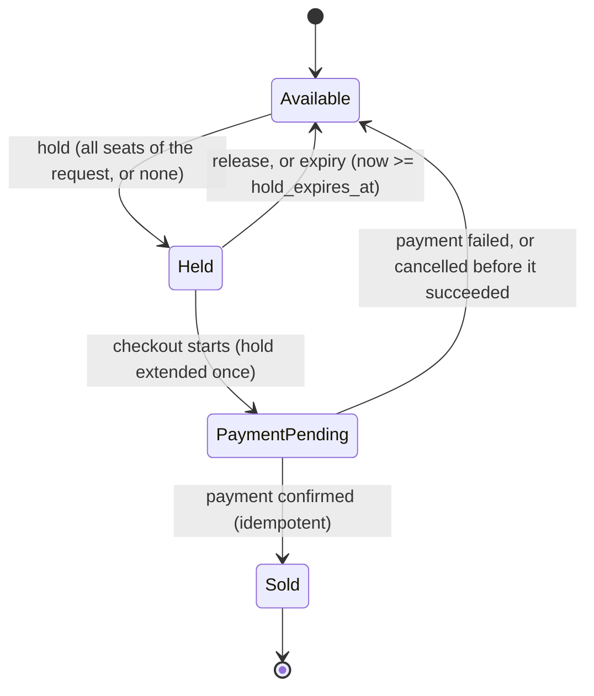
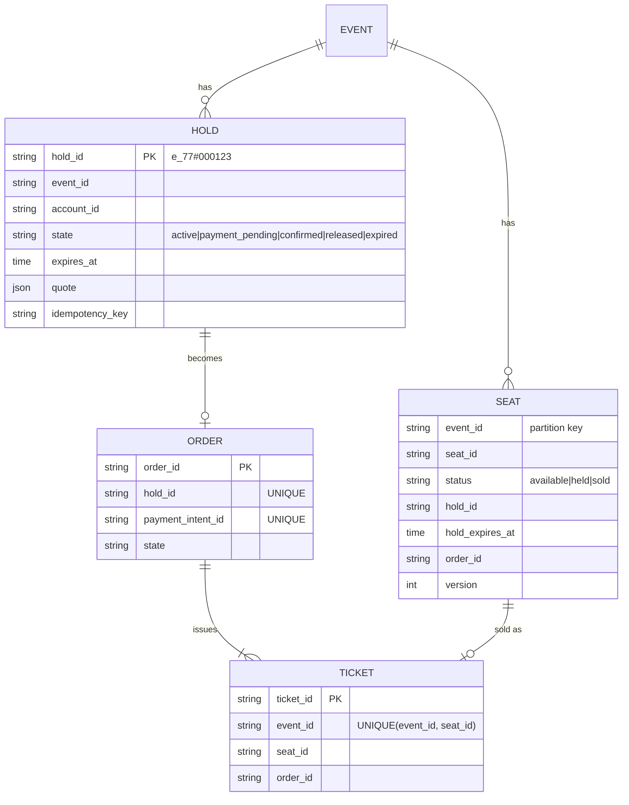
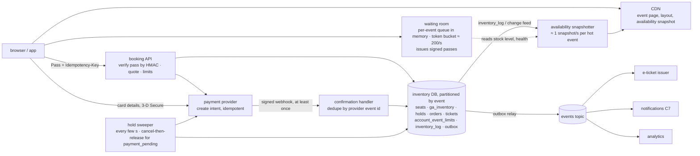

# C8 Unit 1 — Guided design: from the prompt to the high-level design

> Time: ~3 h · CORE: §1–§4 · STRETCH: the tour on-sale arithmetic at the end of §2, "best available" seat picking
> in §3 · Lab: none in this unit (Unit 2 builds `labs/c8/waitroom`)

"Design Ticketmaster" sounds like a CRUD app with a seat map, and on a quiet Tuesday it is one: a few orders a second,
a table of seats, a payment form. The interview is about the other day. At 10:00 an arena with 18,000 seats goes on
sale and half a million people press the button in the same minute. Every one of them wants one of a few hundred
"good" seats, nobody accepts "you were charged but the seat went to someone else", and the people who don't get in
want to know quickly and believe it was fair. The senior signal is seeing that this is a *contention* problem, not a
data-volume problem: the whole system is built around one small, fiercely contended inventory, a hold with a clock on
it, and a payment whose outcome arrives late.

This unit runs the 45-minute framework ([`docs/INTERVIEW_FRAMEWORK.md`](../../docs/INTERVIEW_FRAMEWORK.md)) phase by
phase on this problem. Each section is one phase. Commit to an answer at every predict block before opening the
reveal: the reveals are the walkthrough, and the gap between your version and the reveal is what to study. Unit 2
does the deep dives and the lab.

## Before you start

You should have passed A2 ([storage](../A2-storage/README.md)) and A5 ([consistency](../A5-consistency/README.md)).
You'll lean on A2's [isolation anomalies](../A2-storage/unit-3-transactions-schema.md#7-acid-in-practice-and-the-isolation-anomalies),
A5's [leases and fencing tokens](../A5-consistency/unit-3-consensus-leases.md#3-leases-and-fencing-tokens) and, if you
have done it, B3's [seat-hold problem](../B3-machine-coding/unit-4-algorithms-and-contention.md#3-ticket-booking-with-concurrent-seat-holds).
Warm-up, answer first:

1. Two transactions under PostgreSQL READ COMMITTED each run `SELECT status FROM seats WHERE id = 'A1'`, see
   `available`, and then `UPDATE seats SET status = 'held' WHERE id = 'A1'`. How many holds exist afterwards, and what
   one-statement change makes the second one fail?
2. A hold-expiry job holds a 10 s lease. It checks its lease, is paused for 15 s, then releases a hold that a payment
   callback confirmed in the meantime. What lets the *database* refuse that write?
3. A token bucket refills at 200 tokens per second with a burst of 200. Nobody has used it for an hour. How many
   requests can pass in the next second?

<details data-kind="answer">
<summary>Warm-up answers</summary>

1. Two, and both users think they have A1: a check-then-act race (a lost update, A2 Unit 3 §7). Put the check in the
   write: `UPDATE seats SET status = 'held' WHERE id = 'A1' AND status = 'available'` and look at the affected-row
   count. Under READ COMMITTED PostgreSQL makes the second updater wait for the first, re-evaluates the `WHERE` on the
   new row version, and updates zero rows.
2. A fencing check at the resource: a token that the database compares atomically with the write
   ([A5 Unit 3 §3](../A5-consistency/unit-3-consensus-leases.md#3-leases-and-fencing-tokens)). In this system the
   cheapest fence is the state itself: `UPDATE … SET status = 'available' WHERE hold_id = $1 AND status = 'held' AND
   hold_expires_at <= now()`. A confirmed hold no longer matches, so the stale job changes nothing.
3. 200 in the first instant (the burst), then 200 per second. The bucket caps saved-up capacity, which is exactly
   what a flash sale needs: an idle hour must not turn into an unlimited stampede at 10:00
   ([A7 Unit 2 §2](../A7-reliability/unit-2-breakers-rate-limits.md#2-rate-limiting-algorithms)).

</details>

---

## §1 Requirements and the questions an interviewer expects

### The failure story

A regional ticketing company sells concerts and cricket matches. Version 1 is a monolith with a `seats` table and a
checkout page; it has sold millions of tickets without incident. Then it wins the contract for a stadium tour:
18,000 seats per night, on sale Saturday at 10:00.

At 09:59 there are ≈ 500,000 people on the event page, refreshing. At 10:00:00 the "Buy" button appears and the site
receives ≈ 250,000 seat-map requests per second (every open tab refreshes every two seconds) and ≈ 40,000 per second
for "hold these seats" (people double click, scripts retry). The seat map query is an 18,000-row read against the
primary; the database is at 100% CPU by 10:00:04. Holds use `SELECT` then `UPDATE`, so 212 seats are sold twice before anyone notices. The connection pool
fills, the load balancer times out, the browser retries, and the retries are the new traffic. When the site comes back
at 10:40 the tickets are gone, mostly to accounts that hammered the hold endpoint from scripts, while fans who waited
politely saw an error page for 40 minutes. Customer support spends a week on 212 "you charged me for a seat someone
else has" cases and another on ≈ 3,000 "I paid and got nothing": the payment provider's webhook had arrived after the
seat's 5-minute hold expired, and the seat had been resold.

Nothing in that story is about storage size: the whole tour's inventory fits in a few megabytes. Every failure is a
missing requirement: no notion of a hold with an owner and a clock, no oversell guarantee stated, no plan for
the on-sale peak, no fairness requirement, no rule for a payment that lands after the hold. Those get pinned in the
first six minutes.

### Predict

<!-- predict id="C8-U1-P01" -->
**Predict.** Write your answers down first.

1. The interviewer says only: "Design a ticket booking system like Ticketmaster." Write the eight clarifying questions
   you'd ask, and next to each the design decision its answer changes. (A question whose answer changes nothing is
   small talk.)
2. Draft the functional requirements (at most six) and the non-functional requirements *with numbers*: correctness,
   the on-sale peak, latency, hold duration, availability.
3. Which single requirement, if you get it wrong, makes the company liable rather than merely slow? And which
   requirement do most candidates forget entirely?
<!-- /predict -->

### Reveal

<details data-kind="reveal" data-for="C8-U1-P01">
<summary>Reveal</summary>

**1. The questions, and what each decides.**

| Question | Why it matters | Decision it changes |
|---|---|---|
| Assigned seats, general admission (GA), or both? | A seat is a row you claim; GA is a counter you decrement | Data model (seat rows vs counters), where contention lands (many rows vs one hot row), seat map or not |
| What does the biggest on-sale look like: seats, people, how fast? | 18,000 seats and 500,000 people in a minute is 28:1 demand compressed into seconds | Whether a waiting room exists; the admission rate; whether the seat map is served from the database |
| Does a customer hold seats while paying? For how long? | The hold is the core entity; its TTL is a trade between abandoned inventory and failed payments | Hold TTL, expiry mechanism, what happens when payment outlives the hold |
| How is payment done, and how does its outcome reach us? | Cards with 3-D Secure, wallets and bank transfers confirm asynchronously, sometimes minutes later | Authorise-then-capture, webhook idempotency, the late-payment path, reconciliation |
| Limits per customer (tickets per account, per card)? | A limit is an invariant across several holds, the classic write-skew shape | Where the limit is enforced and with what lock |
| What does "fair" mean to the business? First come first served, a lottery, verified fans? | Fairness is a product requirement that becomes queue design | FIFO vs randomised pre-queue, presale registration, bot controls |
| Who else sells the same inventory: box office, partners, resale? | A second seller means a second writer to the same seat | One authority per seat; partner holds through the same API; resale as a separate inventory |
| What must we prove afterwards? | Disputes ("I paid, where are my tickets?"), chargebacks, regulators | Append-only inventory log, order and payment records, retention |

Two more that are fine to ask if there is time: "Is pricing dynamic during the sale?" (prices must be quoted with the
hold and honoured at checkout) and "Is there a resale marketplace?" (usually out of scope; it is a second inventory
with transfers, not more seats).

**2. Requirements** (state them as assumptions if the interviewer says "you decide").

Functional:
- Browse events; view a seat map with near-real-time availability.
- **Hold** chosen seats (or a GA quantity) for a limited time; all seats of a request or none.
- **Check out and pay**; on success the seats become **sold** and tickets are issued; on failure or timeout they
  return to sale.
- **Waiting room** for high-demand on-sales: a fair queue with a position and an estimate, admission at the rate the
  system can sell.
- Per-customer limits (for example 6 tickets per event). Order history and e-tickets.

Non-functional, with numbers:
- **Correctness: never sell a seat twice; never take money without either issuing the ticket or returning the
  money.** These are hard invariants, not SLOs. Holds may be lost in an outage; sales may not.
- **On-sale peak** (assumed): ≈ 500,000 users in the first minute for ≈ 18,000 seats; everyone who will not get a
  ticket should learn that within minutes, not after an hour of waiting.
- **Latency**: hold p99 ≤ 500 ms once admitted; seat map availability ≤ ≈ 2 s stale; queue position updated every
  few seconds.
- **Hold TTL** ≈ 8–10 minutes, long enough for a payment with a 3-D Secure challenge, short enough that abandoned
  seats come back during the sale (§2 does the arithmetic).
- **Availability**: browsing 99.9%; the booking path 99.95% during announced on-sales. Degrade by queueing people,
  never by overselling.
- **Normal day** (assumed): ≈ 1 M orders a day across ≈ 20,000 live events.

Out of scope unless asked: pricing strategy, resale, venue layout authoring, promoter dashboards, the e-ticket
scanner at the gate.

**3.** The liability requirement is **no oversell, and no charge without a ticket or a refund**. A slow site is an
apology; a seat sold twice or money taken for nothing is a refund, a chargeback, a regulator's letter and a news story.
The forgotten one is **what happens when payment outlives the hold**: almost every candidate says "hold for 10 minutes,
then release", and the failure story's ≈ 3,000 "I paid and got nothing" cases live in that gap. A close second is
fairness: nobody asks what "fair" means until the bots have the tickets.

The tempting wrong answer to question 1 is a feature list ("search by artist, filters, recommendations"). Those are
parameters. The senior questions are about the contended resource (seats vs counters), the peak, the hold, the
payment and who else writes.

</details>

### How it actually works

A booking system is an inventory with a state machine on every unit, plus a front door that decides who may touch
the inventory and when. Get the state machine on the board early; everything else hangs off it.



Four concepts carry the rest of the module:

- **Assigned seats vs general admission.** An assigned seat is a row with an owner; contention is per seat, and many
  requests for different seats run in parallel. GA is a quantity: "2 floor tickets" decrements one counter, so every
  request in that section contends on one row. The same venue often has both (seated stands, a GA floor). Unit 2 §5
  treats them separately because they fail differently.
- **A hold is a lease on inventory.** It has an owner, an expiry, and it can be released, expire, or be converted into
  a sale. The analogy you already know: a card **authorisation** reduces the available balance without moving the
  ledger balance, and a capture or the authorisation's expiry settles it. A hold is an authorisation on seats.
- **Sold is the only durable promise.** Holds are cheap and may be lost (an outage, a crash before persistence); a
  sold seat must survive anything. That asymmetry decides what lives where in §4.
- **The waiting room is not the lock.** The room shapes load so the inventory sees hundreds of requests a second
  instead of tens of thousands; it never decides who owns a seat. Oversell prevention lives at the inventory, behind
  any number of queues.

### Build it

No lab for this section. The state machine above is the B3 [`labs/b3/ticketing`](../../labs/b3/ticketing/) package
if you've done it (`Hold`, `Confirm`, `Release`, expiry); Unit 2 §5–§6 discuss it at system scale and §7 builds the
waiting room in `labs/c8/waitroom`.

### Break it

Change one requirement at a time and trace which decisions flip. Write your answer before opening the box.

(a) "Assigned seats" becomes "GA only: 18,000 standing tickets". (b) "Hold for 10 minutes" becomes "no holds: pay
first, then we allocate seats". (c) The venue's box office sells the same seats from its own system, and you must
not double-sell against it.

<details data-kind="answer">
<summary>What flips</summary>

(a) No seat map, no seat rows: the inventory becomes a counter per section, and the counter is a single hot row.
Contention moves from "many seats, a few winners each" to "one row, every request". Unit 2 §5 shows the counter tops
out at ≈ 500 updates per second on one row, so you split it into buckets or allocate blocks to holders. Holds
remain (a hold of quantity 2), and the waiting room matters more, not less.
(b) "Pay then allocate" removes the hold, so it removes hold expiry, but you now take money before knowing you have a
seat: on a sold-out event you charge people and then refund them, at volume. It works for GA with a known quantity
(sell exactly N payments, refund the rest) and is how some lotteries work, but customers hate refunds and the payment
provider charges fees on them. Most designs keep a short hold and authorise-then-capture instead (Unit 2 §6).
(c) There are now two writers. Either the box office uses your API (one authority per seat, which is the only clean
answer), or you integrate with its system as the authority: every hold becomes a call to someone else's API, with
timeouts as unknown outcomes and a reconciliation job. That is the vendor-adapter problem from C7 applied to
inventory, and it is the design exercise's twist.

</details>

### In the wild

- **Ticketmaster** runs "Smart Queue" waiting rooms and a "Verified Fan" presale registration for high-demand tours
  (`TODO-VERIFY: current product names and how Verified Fan selects buyers`). Its November 2022 presale for a major
  stadium tour became a public example of demand exceeding plans (`TODO-VERIFY: the request and user figures the company
  published afterwards`).
- **Airline reservations** separate booking from ticketing: a reservation (PNR) can hold a seat with a ticketing time
  limit, after which the airline cancels it if it isn't paid (`TODO-VERIFY: typical time limits and how GDSs enforce
  them`). The hold-with-a-deadline is decades old.
- **Card payments** work the same way at the bank: an authorisation is a hold on funds that expires if not captured
  (`TODO-VERIFY: authorisation validity periods by card network and merchant category`).
- **Movie-ticket and stadium apps** show a countdown timer at checkout: that is the hold's TTL made visible, and the
  product's way of telling the user the hold is a lease, not a purchase.

### Trade-offs

| Option | Wins when | Loses when | When the answer flips |
|---|---|---|---|
| Hold then pay | Assigned seats; users must see what they're buying; payments are interactive | Holds need expiry, and payment can outlive them | Flip to pay-then-allocate for GA lotteries where the quantity is fixed and refunds are acceptable |
| Short holds (≈ 5 min) | Inventory returns quickly during a sell-out | More payments outlive the hold (3-D Secure, wallets) | Flip to longer holds plus an explicit "payment pending" state once payments are asynchronous |
| First come, first served | Simple to explain; matches "be there at 10:00" | Rewards bots and fast connections; the first second decides everything | Flip to a randomised pre-queue or a registration lottery when demand ≫ supply |
| One seller (your API) for all channels | One authority per seat; oversell impossible by construction | Box offices and partners must integrate with you | Flip to an adapter over the venue's system only when the venue owns the inventory contractually |

### Senior bar

- **Failure modes of bad scoping**: no hold concept → users pay and lose seats; "eventual consistency is fine" applied
  to seats → oversell; no on-sale numbers → a design that works at 12 orders a second; no fairness requirement → bots;
  no late-payment rule → charges without tickets; GA treated as seats or seats as GA.
- **Capacity**: numbers come in §2. The point here is that the *peak*, not the average, is the requirement: a normal
  day is ≈ 12 orders per second; the on-sale is a thousand times that in arrivals, compressed into a minute.
- **Ops**: on-sales are scheduled, so capacity is planned and rehearsed (a load test at expected peak a week
  before), and every on-sale has a runbook: who can pause the sale, who can change the admission rate.
- **Cost**: the expensive outcomes are refunds, chargebacks and support contacts, not servers. One oversold seat costs
  a refund, a goodwill credit and a support hour; 212 of them is a bad week.

Interviewer follow-up probes:

1. "Why not just let everyone in and scale the servers?"

<details data-kind="answer">
<summary>Model answer</summary>

Because the bottleneck isn't the stateless tier: it's a few thousand rows that everyone wants at once, and a payment
provider with its own limits. Autoscaling the web tier sends more concurrent writers at the same rows, which raises
lock waits and conflicts, not sales; the number of seats sold per second is fixed by the inventory, and 96% of the
crowd won't get a ticket however fast we are. What scales is admission control: let people in at the rate the
inventory sells, and tell the rest early and honestly.

</details>

2. "What does 'never oversell' cost us?"

<details data-kind="answer">
<summary>Model answer</summary>

It means seat ownership needs a single authority with an atomic check-and-claim: a database row with a conditional
write or a unique constraint, or one owner process per event. We give up "any replica can accept a hold" and multi-
leader writes for the inventory, so a region failure can pause sales (holds wait or fail) rather than allow two sales.
That's the right trade here: an outage is an apology, an oversell is a refund and a liability. Browsing can be
eventually consistent; claiming cannot.

</details>

3. "Is a hold the same as a reservation in a hotel system?"

<details data-kind="answer">
<summary>Model answer</summary>

Similar shape, different policy. Hotels deliberately overbook, because no-show rates are predictable and an empty room
is lost revenue; they settle the excess by walking guests to another hotel. Tickets can't do that: two people
can't sit in one seat, and there is no "another hotel". Hotels also hold multi-night ranges, so a booking is several
inventory units at once, which is the all-or-nothing hold. So: same hold mechanics, but the oversell invariant is a
business choice, and here it is absolute.

</details>

### Check yourself

1. Name the two hard invariants of a ticketing system.
2. Why is GA vs assigned seating a clarifying question rather than a detail?
3. What's the difference between a hold and a sale, in terms of what you may lose in an outage?

<details data-kind="answer">
<summary>Answers</summary>

1. Never sell a seat twice; never take money without either issuing the ticket or returning the money.
2. It decides the data model and where contention lands: many seat rows with a few contenders each, or one counter
   that every request updates.
3. Holds are leases and may be lost (users re-select, which is annoying but harmless); sales are durable promises and
   must survive anything.

</details>

---

## §2 Estimation: the numbers that decide the design

### The failure story

The v2 team sized the system from the normal day: ≈ 1 M orders a day is ≈ 12 per second, peak 3× ≈ 35 per second; a
single database primary handles that with room to spare, so they added two read replicas for the seat map and felt
generous. They did not compute the on-sale. 500,000 people arriving in the first minute is ≈ 8,300 per second, and
each one's browser refreshes the seat map every 2 seconds: ≈ 250,000 seat-map reads per second against an event whose
map is 18,000 rows. The replicas fell over at 10:00:03; the application then read from the primary "as a fallback",
and the primary followed. Meanwhile every refreshed page fired hold attempts at the same few hundred seats in the
lower bowl; the holds that did get through queued on row locks. And the 40-minute outage hid a quieter number: with a
5-minute hold, ≈ 15% of card payments (the ones with a 3-D Secure challenge) finished after the hold had expired.

### Predict

<!-- predict id="C8-U1-P02" -->
**Predict.** Assumptions: one on-sale with ≈ 18,000 seats, ≈ 2.5 seats per order; ≈ 500,000 people arrive in the
first ≈ 60 s; without a waiting room each browser refreshes the seat map every ≈ 2 s; a seat-availability snapshot is
≈ 2 bits per seat; once admitted, a buyer takes ≈ 30 s to choose seats and ≈ 3 minutes to pay, and ≈ 70% of holds
end in a purchase; queued users poll their position every ≈ 10 s; a contended row lock is held ≈ 2 ms per
transaction; normal day ≈ 1 M orders across ≈ 20,000 live events of ≈ 20,000 seats each.

Compute, carrying units, and write the decision each number drives:

1. Orders available in the on-sale, arrivals per second, and the demand ratio.
2. Seat-map reads per second and the bandwidth they need if the room does not exist.
3. An admission rate that keeps the people choosing seats at once roughly equal to the orders available, and the
   wait for the 500,000th person at that rate. When does the event sell out, and what should most of the queue be
   told?
4. The queue's status-poll rate, and the hold write rate at your admission rate. Can one database primary take it?
5. The maximum update rate of a single GA counter row, and the storage for seats and orders.
<!-- /predict -->

### Reveal

<details data-kind="reveal" data-for="C8-U1-P02">
<summary>Reveal</summary>

1. 18,000 / 2.5 ≈ **7,200 orders**. 500,000 / 60 s ≈ **8,300 arrivals per second**. Demand ≈ 500,000 / 18,000 ≈
   **28 people per seat** (≈ 70 per order). Decision: the outcome for ≈ 96% of the crowd is "no ticket" no matter
   what we build; the design must deliver that answer quickly and fairly, and must protect the inventory from the
   other 96%.
2. 500,000 / 2 s ≈ **250,000 reads per second** of one event's map. A snapshot is 18,000 × 2 bits ≈ 36,000 bits ≈
   **4.5 KB**, so ≈ 250,000 × 4.5 KB ≈ 1.1 GB/s ≈ **9 Gbps**. Decision: the seat map never comes from the database
   on the hot path. A snapshotter builds the 4.5 KB blob about once a second and a CDN serves it; the static layout
   (geometry, ≈ 1 MB) is cached forever under a versioned URL. 9 Gbps is routine for a CDN and fatal for a primary.
3. Choosing takes ≈ 30 s, so by Little's law the people choosing at once = admission rate × 30 s. Setting that ≈ 7,200
   gives ≈ 240 per second; round to **≈ 200 admissions per second**. The 500,000th person waits 500,000 / 200 ≈ 2,500 s
   ≈ **42 minutes**. Sell-out: ≈ 7,200 orders ÷ (200/s × 0.7) ≈ 51 s for the first pass, then a few more minutes as
   abandoned holds expire and are re-offered, so **sold out within ≈ 5–15 minutes, after ≈ 10,000–20,000 admissions**.
   Decision: everyone beyond position ≈ 20,000 will never be admitted; the room should say so (an honest "very
   unlikely" banner early, "sold out" the moment it is) instead of letting 480,000 people wait 42 minutes for nothing.
4. Status polls: 500,000 / 10 s ≈ **50,000 per second**. Decision: position must be computable without a database
   read (a sequence number minus a published "now serving" watermark, Unit 2 §7), served from memory or the edge.
   Holds: ≈ 200/s × ≈ 1.5 attempts (some fail on a conflict and retry) ≈ **300 hold transactions per second**, plus ≈
   140 confirmations. A primary does ≈ 1k–10k small transactions per second ([`docs/NUMBERS.md`](../../docs/NUMBERS.md)),
   so **yes, one primary per hot event**, as long as no single row is touched by every transaction.
5. One row, one lock, ≈ 2 ms each: **≈ 500 updates per second**, the ceiling for a GA counter that every purchase
   decrements; 300/s fits, the 40,000/s of the failure story does not (A4's
   [hot-key arithmetic](../A4-replication-partitioning/unit-3-hot-keys-indexes-sizing.md#8-skew-hot-keys-and-celebrity-problems)).
   Storage: 20,000 events × 20,000 seats ≈ 400 M seat rows × ≈ 100 B ≈ **40 GB**, ≈ 120 GB with three replicas;
   orders ≈ 1 M/day × ≈ 1 KB ≈ **1 GB/day**, ≈ 365 GB a year. Decision: nothing here needs sharding by bytes. Partition
   by event for *contention isolation* (one hot event must not slow the other 19,999), not for size.

The tempting wrong answers: sizing from the daily average (the on-sale is a thousand times the average in arrivals);
"add read replicas" for the seat map (replicas are databases, and 250k/s of one query is a CDN job); "admit as fast
as the servers allow" (admission is set by the inventory, not by the web tier); and counting bytes to decide on
sharding (the data is small; the contention is not).

</details>

### How it actually works

The estimate sheet, in the order you'd write it on the board:

| Number | Arithmetic | Decision |
|---|---|---|
| Orders available | 18,000 seats ÷ 2.5 ≈ 7,200 | Sets the admission target and the sell-out time |
| Arrivals | 500,000 in 60 s ≈ 8,300/s; demand ≈ 28:1 | A waiting room; most of the answer is "no ticket", delivered fast |
| Seat-map reads (no room) | 500,000 ÷ 2 s ≈ 250k/s × 4.5 KB ≈ 9 Gbps | Snapshot ≈ 1/s, served by a CDN; layout cached forever |
| Admission rate | Little: 200/s × 30 s ≈ 6,000 choosing ≈ orders available | Token bucket at ≈ 200/s, adjusted to downstream health and remaining stock |
| Queue wait | 500,000 ÷ 200/s ≈ 42 min | Honest ETA; "sold out" broadcast; stop admitting when stock is gone |
| Status polls | 500,000 ÷ 10 s ≈ 50k/s | Position = sequence − watermark; no database on the poll path |
| Hold writes | 200/s × 1.5 ≈ 300 tx/s (+ ≈ 140 confirms) | One primary per hot event; partition by event |
| GA counter | one row, ≈ 2 ms lock ≈ 500/s | Bucketed counters or block allocation when a section is GA |
| Hold TTL | choose ≈ 30 s + pay ≈ 3 min p50, p99 with a 3-D Secure challenge ≈ several min | Hold ≈ 8–10 min, extended once at checkout; pass TTL ≥ hold + choosing time |
| Storage | 400 M seats × 100 B ≈ 40 GB; orders ≈ 1 GB/day | Not the problem; say so and move on |

The underlying idea is A6's queue arithmetic applied twice. The waiting room is a queue in front of the inventory:
its drain rate is the admission rate, so position ÷ rate is the wait. The admitted shoppers are a second, invisible
queue: by Little's law, admission rate × time in checkout is how many people compete for seats at once. If that
number is far above the orders available, most hold attempts conflict and users see "seat taken" again and again; if
it is far below, seats sit unsold while people wait. Admission is tuned to keep it near the remaining inventory.

**The hold-TTL number.** Abandonment and late payments pull in opposite directions. Suppose 30% of holds are
abandoned. With a 10-minute TTL, ≈ 5,400 of the 18,000 seats are tied up by people who will never pay, for up to 10
minutes at the peak of the sale; with 3 minutes, they return fast, but every payment with a 3-D Secure challenge or a
slow wallet (≈ 10–20% of card payments in some markets, `TODO-VERIFY` for yours) risks finishing after the hold. The
answer in Unit 2 §6 is a short selection hold, extended once into a payment-pending state when checkout starts.

**STRETCH — the tour on-sale.** A 40-date tour opens all dates at 10:00: 40 × 18,000 = 720,000 seats and maybe 3 M
people. Per event the numbers above still hold, but the waiting room now has 40 queues or one queue in front of
all 40 (people want "any date"). One queue with admission ≈ 40 × 200 = 8,000/s keeps the inventory busy but makes
the database tier see 40 hot events at once: ≈ 12,000 hold transactions per second, more than one primary, so the
events must spread across shards (place hot events on separate primaries ahead of time; the on-sale calendar is known).

### Build it

No lab for this section. Run `sd estimate -kind qps -n 3` and `sd estimate -kind concurrency -n 3` before Unit 2;
the on-sale numbers above (arrivals, map reads, admission by Little's law, queue wait) should come out of your head
in the design exercise.

### Break it

Re-run the sheet with each change and note which decisions flip: (a) 5,000 seats (a theatre) and the same 500,000
people; (b) buyers take 3 minutes to choose seats, not 30 s; (c) the payment provider accepts at most 50 payment
authorisations per second on your account (`TODO-VERIFY` the limits for your provider).

<details data-kind="answer">
<summary>What flips</summary>

(a) ≈ 2,000 orders: demand ≈ 100 people per seat. Admission falls to ≈ 2,000 / 30 s ≈ 70/s and the event sells out
after ≈ 4,000 admissions; the queue's real job is to tell ≈ 496,000 people "sold out" within a minute or two. A
registration lottery before the sale (STRETCH, Unit 2 §7) starts to look better than a queue.
(b) Choosing time ×6 means the people choosing at once at 200/s is 36,000, five times the orders: conflicts
everywhere. Admission must drop to ≈ 7,200 / 180 s ≈ 40/s, or the seat-selection step must shrink ("best available"
picks seats for you in one click; STRETCH in §3).
(c) ≈ 0.7 × 200 ≈ 140 payments per second exceeds 50: payments queue, checkouts stall, and holds expire while users
wait for the payment step. Admission is now bounded by the payment provider: 50 / 0.7 ≈ 70/s, or a second provider
account, or a longer payment-pending window. The admission rate is set by the *slowest* downstream stage, which is
why it must be adjustable during the sale.

</details>

### In the wild

- **CDNs** cache objects with very short TTLs and collapse concurrent misses into one origin request, which is what
  makes a 1-second availability snapshot cheap (`TODO-VERIFY: the feature names, such as request collapsing or
  origin shielding, for the CDN you cite`). `stale-while-revalidate` (RFC 5861) lets the edge serve the previous
  snapshot while it fetches the next.
- **PostgreSQL** row locks serialise updates to one row; at a few milliseconds per transaction one row tops out at
  hundreds of updates per second, which is the A4 hot-row ceiling (A4 Unit 3 §8 measured it with a GL row).
- **Payment providers** rate-limit API calls per account and return 429 above the limit (`TODO-VERIFY: the published
  limits for your provider, live and test mode`). An on-sale plan includes the provider's limit as a number.
- **Load tests before on-sales** are standard practice for ticketing and retail flash sales; the on-sale calendar is
  public, so capacity is planned, not reactive (`TODO-VERIFY: a named company's published practice, if you cite one`).

### Trade-offs

| Option | Wins when | Loses when | When the answer flips |
|---|---|---|---|
| Seat map from database replicas | Normal days; a few hundred reads per second per event | On-sales: 250k/s of one query, replica lag shown as truth | Flip to a published snapshot on a CDN as soon as one event can draw more than a few thousand readers |
| High admission rate (≈ 1,000/s) | Inventory sells in seconds; fewer people wait | Admitted users collide on the same seats; the payment provider throttles | Flip down when the conflict rate or payment latency rises; up when seats sit unsold |
| Long hold TTL (≈ 15 min) | Slow payments complete | Abandoned holds lock up ≈ 30% of inventory during the peak | Flip to a short selection hold + a payment-pending extension |
| Dedicated shard per hot event | One on-sale cannot slow every other event | Placement must be planned; a surprise viral event lands on a shared shard | Flip to dynamic placement only if the on-sale calendar is unknown |

### Senior bar

- **Failure modes**: sizing from averages; serving the seat map from the primary "as a fallback"; letting the web
  tier's autoscaler set the inventory's load; ignoring the payment provider's rate limit; a hold TTL chosen without
  looking at payment latency; a queue that lets 480,000 people wait 42 minutes for a sold-out show.
- **Capacity numbers (≈)**: 8,300 arrivals/s, 250k map reads/s and ≈ 9 Gbps without a room, admission ≈ 200/s,
  ≈ 300 hold tx/s, ≈ 50k status polls/s, one GA row ≈ 500 updates/s, ≈ 40 GB of seats.
- **Ops**: the admission rate is a runtime control with a dashboard (holds per second, conflict rate, lock wait,
  payment p99) and an owner during the sale; capacity rehearsal at expected peak before each big on-sale.
- **Cost**: the CDN egress for the seat map (≈ 9 Gbps for a few minutes is cheap); idle reserved capacity for planned
  on-sales; refunds and chargebacks dominate everything else.

Interviewer follow-up probes:

1. "Where did 200 per second come from? Defend it."

<details data-kind="answer">
<summary>Model answer</summary>

Little's law on the admitted shoppers: people choosing at once = admission rate × time to choose. I want that near the
orders available (≈ 7,200), so ≈ 7,200 / 30 s ≈ 240/s, rounded down. Then I check it against the downstream limits:
≈ 300 hold transactions per second is well inside one primary, ≈ 140 payments per second must be inside the
provider's limit. It's a starting point, not a constant: during the sale I'd lower it if the conflict rate or payment
p99 climbs and raise it if seats sit unsold, and I'd taper it as stock runs out.

</details>

2. "Which single number most changes this design?"

<details data-kind="answer">
<summary>Model answer</summary>

The demand ratio, people per seat, together with how fast they arrive. At 2:1 spread over an hour you need nothing
special: a conditional update and a database. At 28:1 in a minute you need a waiting room, a CDN-served seat map and
an early sold-out message. At 100:1 a queue is mostly a slow way of saying no, and a registration lottery becomes the
better product. Storage size changes nothing here.

</details>

3. "The 500,000th person waits 42 minutes. Is that acceptable?"

<details data-kind="answer">
<summary>Model answer</summary>

Only if they might get a ticket, and at 28:1 they won't. The event sells out after ≈ 10,000–20,000 admissions, so I'd
show an honest estimate early ("tickets are likely to sell out before your turn"), broadcast "sold out" the moment
remaining stock plus expiring holds can't cover the next orders, and offer a waitlist for returns. A fast, fair "no"
is part of the product.

</details>

### Check yourself

1. Why is the seat-map read rate a CDN problem, and roughly how big is the object?
2. How does Little's law set the admission rate?
3. Why partition by event if the data is only ≈ 40 GB?

<details data-kind="answer">
<summary>Answers</summary>

1. ≈ 250k/s of the same 4.5 KB snapshot (≈ 9 Gbps) without a room: one identical object read by everyone, which is
   exactly what a CDN with a short TTL serves well and a database serves badly.
2. Shoppers choosing at once = rate × choosing time; set the rate so that number is near the orders available
   (≈ 7,200 / 30 s ≈ 240/s), then check holds/s and payments/s against downstream limits.
3. For contention isolation: a hot event's locks and transactions must not slow the other events, and a hot event
   may need its own primary.

</details>

---

## §3 API and data model

### The failure story

The v1 API had three endpoints: `GET /events/{id}/seats` (all 18,000 rows as JSON, from the primary),
`POST /book {seat_ids, card}` (hold, charge and sell in one request) and nothing else. One on-sale produced every
failure an API can have:

- `POST /book` called the payment provider inside the request while holding row locks on the seats. When the
  provider's p99 went to 6 s, the seats stayed locked for 6 s, every other request for those seats waited behind
  them, and the connection pool emptied.
- No idempotency key. Users double-clicked "Pay"; the browser retried on timeout; ≈ 0.4% of orders were charged twice.
- The client sent the price. A script sent `price: 1`.
- The seat list came back as a 1.8 MB JSON document per request, from the primary, with no cache headers.
- "Sold" was a boolean on the seat. When a payment was refunded, someone set it back to `false` by hand, and nothing
  recorded who had owned the seat or why it was free again. The dispute three weeks later had no evidence.
- The per-account limit ("6 tickets per event") was checked by counting orders before inserting a new one. Two tabs
  each counted 4 tickets, each bought 2 more: 8.

### Predict

<!-- predict id="C8-U1-P03" -->
**Predict.** Write your answers down first.

1. Design the booking API: the calls from opening the event page to holding ticket, with methods, paths, the important
   request and response fields, status codes and the idempotency mechanism for each write. Separate what the *client*
   decides from what the *server* decides. Where do the payment provider and its webhook fit?
2. List the access patterns first. Then the entities, keys, partition keys and the constraints that make oversell
   impossible even if application code has a bug. Where does the per-account limit live?
<!-- /predict -->

### Reveal

<details data-kind="reveal" data-for="C8-U1-P03">
<summary>Reveal</summary>

**1. API.**

```
GET  /v1/events/{id}                          → event, venue, layout_version, sale state, on_sale_at
GET  /v1/venues/{v}/layouts/{layout_version}  → static seat geometry (immutable; cached forever)
GET  /v1/events/{id}/availability             → {snapshot_version, generated_at, seats: <2-bit bitmap>,
                                                 sections: {GA-floor: {remaining_hint: 340}}}  (max-age 1 s)

POST /v1/events/{id}/queue                    → join the waiting room (idempotent per user and event)
                                                 → 202 {position, estimated_wait, poll_after}
GET  /v1/events/{id}/queue/me                 → {position, estimated_wait} | {pass, pass_expires_at} | 410 sold_out

POST /v1/holds                                # Pass: <signed pass>   Idempotency-Key: <uuid per click>
  {"event_id": "e_77", "seats": ["114-F-12", "114-F-13"]}        # or {"section": "GA-floor", "quantity": 2}
  → 201 {"hold_id": "h_9c…", "seats": […], "expires_at": "…", "quote": {"total": 9600, "currency": "INR"}}
  → 409 seats_unavailable {"seats": ["114-F-13"]}                # names the seat; the client updates the map
  → 403 pass missing, forged or expired                          → 422 limit exceeded (6 per account)
DELETE /v1/holds/{id}                         → release (idempotent: releasing twice is 204)

POST /v1/holds/{id}/checkout                  # Idempotency-Key
  → 201 {"order_id": "o_31…", "payment": {"client_secret": "…"}, "pay_by": "…"}   # extends the hold once
POST /v1/payments/webhook                     # signed by the provider; deduped by provider event id
GET  /v1/orders/{id}                          → pending_payment | confirmed | expired_refunding | refunded
```

The client decides *which seats* (or which section and how many) and *when to pay*. The server decides price (the
quote is computed and stored with the hold, never taken from the client), the hold's expiry, whether the pass is
valid, and whether the limit allows it. `409` on a conflict names the seat so the client can grey it out without a
full reload. The `Idempotency-Key` on `POST /v1/holds` makes a double click one hold; on checkout it makes a retried
"Pay" one order and one payment intent. The payment itself goes browser → provider (card details never touch us);
the provider tells us the outcome by a **signed webhook**, which may arrive twice, late, or before the browser
returns. The tempting wrong answer is "`POST /book` charges the card and sells the seat in one request": it puts a
slow third party inside your locks and makes every timeout an unknown outcome.

**2. Access patterns → data model.**

| Access pattern | Rate (on-sale) | Served by |
|---|---|---|
| Availability for one event | 250k/s without a room, ≈ 3k/s with | Snapshot blob built from `seats`, on a CDN |
| Claim seats atomically, all or none | ≈ 300 tx/s per hot event | `seats` partitioned by `event_id`, conditional update |
| Claim GA quantity | same | `ga_inventory(event_id, section_id, bucket)` |
| Expire holds lazily and by sweep | continuous | `seats.hold_expires_at` in the claim predicate; index on `(event_id, hold_expires_at)` for the sweeper |
| Hold by id (checkout, release) | ≈ 300/s | `holds` by `hold_id` (the id embeds the event, so it routes to the right partition) |
| Confirm on webhook, exactly once | ≈ 140/s | `payment_events(provider, event_id)` PK, then `orders`, `tickets` |
| Per-account limit | per hold | `account_event_limits(event_id, account_id)` row, locked or conditionally updated |
| Order history for a user | low | `orders` by `account_id`, by time |
| Audit: who owned seat X, when | low | `inventory_log` append-only |



Three constraints are the backstop, so that a bug in the application produces an error, not an oversell:
`tickets UNIQUE (event_id, seat_id)` (a seat can be sold once, ever); `orders UNIQUE (hold_id)` (a hold becomes at
most one order, so a retried confirmation can't create two); `payment_events PRIMARY KEY (provider, provider_event_id)`
(a webhook is processed once). The per-account limit lives in its **own row** per (event, account) that every hold for
that account must update (`UPDATE … SET held = held + 2 WHERE held + 2 <= 6`), which turns A2's phantom write skew
(two transactions counting rows and inserting different ones) into a conflict on one row. The tempting wrong answers:
a `sold` boolean you flip back and forth; counting orders to enforce a limit; storing the price the client sent.

</details>

### How it actually works

**Seat state lives in one place.** The `seats` row is the authority for "who owns this seat right now": available,
held by hold H until T, or sold to order O. Every transition is a conditional write on that row (Unit 2 §5 compares
the ways to write it). `holds` and `orders` are the records of intent and outcome; `tickets` is the durable sale with
the unique constraint. The append-only `inventory_log` (event, seat, from, to, hold or order, actor, at) is the audit
trail and the change feed for the availability snapshotter.

**Expiry is part of the predicate, not a job.** A seat whose hold has expired is free *now*, whether or not a sweeper
has run: the claim statement treats `status = 'held' AND hold_expires_at <= now()` exactly like `available`. The
sweeper exists only to tidy rows and to tell the snapshot that seats came back. That is B3's "lazy expiry, and a
reaper as an optimisation" moved into SQL, and it means the definition of "expired" uses one clock: the database's
`now()`, not each app server's.

**Hold ids route themselves.** `hold_id = "<event_id>#<sequence>"` (or any id with the event embedded) lets checkout,
release and confirmation find the event's partition without a global index, the same trick as B3's self-routing hold
ids and C3's shard-prefixed ids.

**The pass.** Once admitted, the client carries a short signed string (user, expiry, HMAC). The booking API verifies
it with a shared secret and no database read, so 300 holds per second don't become 300 extra lookups. Unit 2 §7 and
the lab build it.

**Price and limits are server-side.** The quote is computed at hold time from the seat's price tier and stored on
the hold; checkout charges the stored quote. Limits are rows, not counts.

**STRETCH — "best available".** Many buyers don't pick seats: they ask for "2 best available in price tier B". The
server chooses, which also shortens the 30 s choosing time from §2. A SQL shape that doesn't serialise everyone on
the same "best" seats: `SELECT seat_id FROM seats WHERE event_id = $1 AND tier = 'B' AND status = 'available' ORDER BY
quality_rank LIMIT 20 FOR UPDATE SKIP LOCKED`, then pick two adjacent seats from the 20 and hold them. `SKIP LOCKED`
lets concurrent pickers take different candidates instead of queueing on the same rows; adjacency (two seats
together) is the hard part, and is usually solved by precomputing seat blocks per row. It's acceptable here precisely
because the user didn't choose a specific seat.

### Build it

No lab for this section. If you did B3, `Hold`, `Confirm`, `ConfirmWithKey` and the `Clock` seam in
[`labs/b3/ticketing`](../../labs/b3/ticketing/) are the in-memory versions of this API: the B3 tests
`TestStage1_HoldIsAllOrNothing` and `TestStage3_SameKeyDifferentHoldIsRejected` are the API's all-or-nothing and
idempotency rules in miniature. The `Pass` string in `labs/c8/waitroom` (Unit 2 §7) is the `Pass:` header above.

### Break it

For each change, say what breaks and what catches it: (a) drop `UNIQUE (event_id, seat_id)` from `tickets` and ship a
confirmation bug that ignores the seat's current status; (b) accept `price` from the client; (c) enforce the account
limit by `SELECT count(*) FROM tickets WHERE account_id = $1 AND event_id = $2` and then insert.

<details data-kind="answer">
<summary>What breaks</summary>

(a) The bug sells a seat that another order already owns, and nothing stops it: you find out at the stadium gate when
two people scan the same seat. With the constraint, the second insert fails, the transaction rolls back, the bad path
surfaces as an error and an alert, and the customer is refunded by the late-payment path. Constraints are how you
make bugs loud.
(b) Anyone can buy a ₹4,800 seat for ₹1. Price is a server-side function of (event, seat tier, time); the hold stores
the quote so the user is charged what they were shown even if prices change during the sale.
(c) Two concurrent holds each count 4, each insert 2 different tickets: 8 tickets, limit 6. That is A2's phantom
write skew (T3b): no row is written twice, so no lock conflicts under READ COMMITTED or snapshot isolation. Fix with
a per-(event, account) row updated conditionally, or SERIALIZABLE with retries.

</details>

### In the wild

- **Stripe** PaymentIntents model a payment as an object created server-side (with an `Idempotency-Key`), confirmed
  client-side, and reported back by webhooks that the receiver must verify and deduplicate by event id; manual
  capture lets you authorise first and capture later (`TODO-VERIFY: current API names and how long an uncaptured
  authorisation stays valid`).
- **PostgreSQL** offers `SELECT … FOR UPDATE SKIP LOCKED` (since 9.5) for "any N rows" allocation and `NOWAIT` to fail
  instead of waiting; unique constraints are enforced with an index, so they hold under every isolation level.
- **DynamoDB** expresses the same claims as conditional writes (`ConditionExpression: status = :available`) and
  all-or-nothing multi-item claims as `TransactWriteItems` (`TODO-VERIFY: the current item limit per transaction`).
- **Seat maps** are usually a static vector layout plus a separate availability overlay, so the expensive part (the
  geometry) is cached for months and only the small overlay changes (`TODO-VERIFY` for any named vendor).

### Trade-offs

| Option | Wins when | Loses when | When the answer flips |
|---|---|---|---|
| Separate hold, checkout and webhook steps | Payments are slow and asynchronous; retries are safe | More states and more endpoints | Never flip to one synchronous "book" call that wraps a payment |
| Availability as a snapshot blob | Hot events; one object for everyone; CDN-friendly | Up to ≈ 1–2 s stale; a 409 tells the truth | Flip to per-request queries only for low-traffic events and back-office tools |
| Seat rows | Assigned seating; per-seat audit | 20,000 rows per event; seat-level contention | Flip to counters for GA sections |
| Limit as a row | Concurrent holds by one account (two tabs, scripts) | One more row to update per hold | Flip to SERIALIZABLE with retries if limits are rare and complex (per household, per card) |
| Unique constraints as backstop | Always, for sales | A unique index costs a little write latency | Never flip; this is the line between a bug and an oversell |

### Senior bar

- **Failure modes**: a payment call inside a transaction holding seat locks; no idempotency on hold or checkout;
  client-supplied prices; seat state duplicated in two stores; a `sold` boolean without history; limits enforced by
  counting; hold ids that need a global lookup; the seat map as a giant uncached JSON from the primary.
- **Capacity**: ≈ 300 hold tx/s and ≈ 140 confirmations/s on the hot event's partition; the availability blob
  ≈ 4.5 KB; `inventory_log` ≈ a few rows per order (≈ 5 M rows/day on a normal day, small).
- **Ops**: the seat-state transitions are the audit trail and the reconciliation input; hold and order states have
  dashboards (active holds, payment-pending, confirm-after-expiry); schema changes to `seats` happen between on-sales,
  never during.
- **Cost**: a unique index and an extra row per account are cheap next to one oversold seat.

Interviewer follow-up probes:

1. "Why does the hold return 201 instead of 202? Your notification service returned 202."

<details data-kind="answer">
<summary>Model answer</summary>

Because the hold is decided synchronously, in one short transaction on our own database: when we answer, the seats
are held or they aren't. 202 means "accepted, outcome later", which is right when a slow third party decides (a
vendor, a payment). Here the slow part, payment, is a separate step whose outcome does arrive later, so the order is
`pending_payment` until the webhook. Keeping the fast, local decision synchronous and the slow, external one
asynchronous is the point of splitting the API.

</details>

2. "The webhook arrives before the browser comes back from the payment page. Problem?"

<details data-kind="answer">
<summary>Model answer</summary>

No, if the webhook is the source of truth and the browser's return is only a hint. The webhook handler verifies the
signature, records the provider event id (dedupe), and confirms the order in one transaction; the browser polls
`GET /v1/orders/{id}` and shows whatever state it finds. If the browser returns first, it shows "processing" until the
webhook lands. Never confirm on the browser redirect alone: it can be forged, lost, or replayed.

</details>

3. "Why put the event id inside the hold id?"

<details data-kind="answer">
<summary>Model answer</summary>

So any request carrying a hold id routes to the event's partition without a global hold index. Checkout, release
and the payment webhook each carry only the hold or order id; with the event embedded, the service knows which shard
and which lock domain to use. A global `hold_id → event` table would be one more hot, shared structure on the on-sale
path, and one more thing to keep consistent.

</details>

### Check yourself

1. Which three constraints make oversell and double processing impossible even with buggy application code?
2. Where do the price and the hold expiry come from, and why not from the client?
3. Why does the per-account limit need its own row?

<details data-kind="answer">
<summary>Answers</summary>

1. `tickets UNIQUE (event_id, seat_id)`, `orders UNIQUE (hold_id)`, `payment_events PRIMARY KEY (provider,
   provider_event_id)`.
2. The server: the quote is computed from the seat's tier and stored on the hold; the expiry uses the database's
   clock. A client can lie about both.
3. Counting existing rows and inserting new ones is a phantom write skew: concurrent holds conflict on nothing. A
   single row that every hold for the account must update conditionally turns it into a real conflict.

</details>

---

## §4 High-level design: the on-sale path, the booking path and the payment path

### The failure story

The v2 architecture was a reasonable picture: CDN, load balancer, booking service, Postgres with replicas, a payment
provider. On the first big on-sale:

- The "queue" was a `queue_entries` table in the same Postgres. 500,000 inserts in a minute and 50,000 position
  queries per second (`SELECT count(*) WHERE created_at < mine`) made the queue the hottest table in the building; the
  thing meant to protect the database was taking it down.
- Admitted users were tracked by a row per user; every hold request looked the row up. One more read per write on
  the primary, at the worst moment.
- Expired holds were freed by a cron job every minute. Seats sat "held" for up to 60 s after expiry while users
  were told "sold out", then reappeared in bursts; the seat map looked broken.
- The payment webhook handler confirmed the order but sent the e-ticket email inline. The email provider was slow, the
  handler timed out, the payment provider retried the webhook, and the retry created a second order (no dedupe).
  Some customers had two orders for the same seats; one failed on a constraint, the other was half-written.

### Predict

<!-- predict id="C8-U1-P04" -->
**Predict.** Draw the high-level design before opening the reveal. Then decide, in writing:

1. Where does the waiting room run, and what state does it keep? How does the booking API know a request was admitted
   without a database read?
2. Where is oversell prevented, and where is it *not* prevented (name two components people wrongly rely on)?
3. How do expired holds come back to sale within a second, without a job that runs every second?
4. Trace a payment webhook that arrives twice, 20 minutes apart. What happens to orders, tickets and emails?
<!-- /predict -->

### Reveal

<details data-kind="reveal" data-for="C8-U1-P04">
<summary>Reveal</summary>

1. **In front of the booking service, as its own small service** (often at the edge), with state in memory per event:
   the FIFO of waiting users (or just a sequence counter and a "now serving" watermark, Unit 2 §7), the token bucket,
   and the set of admitted users. It is never in the inventory database. Admission hands the client a **signed pass**
   (user, expiry, HMAC); the booking API verifies the signature with a shared secret, so admission costs zero
   database reads per hold. The lab builds exactly this.
2. **Prevented only at the inventory**: the conditional write on `seats` (or the GA counter) plus the unique
   constraint on `tickets`. **Not** prevented by the waiting room (it limits *how many* people are inside, not *which
   seat* each gets: two admitted users can still click the same seat), and **not** by the cache or snapshot (the
   seat map is a hint up to a second stale; the 409 is the truth). A Redis "hold" in front of the database is a third
   wrong answer unless the database still enforces it (Unit 2 §5).
3. **Lazy expiry in the claim predicate**: a seat whose `hold_expires_at <= now()` is claimable now, by the next hold
   request, sweeper or not. A sweeper running every few seconds (or a delayed-message per hold) tidies rows and writes
   the change to `inventory_log`, which the snapshotter reads, so the map shows the seat as available on its next
   snapshot. Correctness never waits for the sweeper.
4. First delivery: verify signature, `INSERT INTO payment_events` (new), confirm in one transaction: hold →
   `confirmed`, `orders` row → `confirmed`, `tickets` rows inserted (unique per seat), seats → `sold`, and an outbox row
   for "issue e-tickets and email". Commit, return 200 fast. A relay sends the outbox event; the email worker is
   idempotent by order id. Second delivery 20 minutes later: the `payment_events` insert conflicts, the handler
   returns 200 without doing anything. One order, one set of tickets, one email
   ([A6 Unit 2 §1–§2](../A6-async/unit-2-outbox-consumers.md#2-idempotent-consumers-and-dedupe)).

</details>

### How it actually works



**The on-sale path.** At 09:50 the event page (static, CDN) shows a countdown. At 10:00 everyone who is on the page
joins the queue: the room gives each a position (users who arrived before 10:00 can be shuffled, STRETCH in Unit 2
§7) and an estimated wait. Clients poll every ≈ 10 s; the room answers from memory. A token bucket refilling at
≈ 200/s admits users in order and hands each a pass valid for ≈ 15 minutes. The room watches two signals: remaining
stock from the snapshotter (stop admitting and broadcast "sold out" when nothing is left to sell) and downstream health
(holds p99, conflict rate, payment latency), to lower or raise the rate.

**The booking path.** The admitted client loads the layout (cached for months) and the availability snapshot (cached
≈ 1 s), picks seats, and calls `POST /v1/holds` with the pass and an idempotency key. The API checks the pass's MAC and
expiry, checks the user matches the pass, computes the quote, and runs one short transaction: update the account's
limit row, claim the seats conditionally (expired holds count as free), insert the hold, append to `inventory_log`.
≈ 5–20 ms. A conflict returns 409 naming the seat. No call leaves the data centre while the transaction is open.

**The payment path.** `POST /v1/holds/{id}/checkout` moves the hold to `payment_pending`, extends its expiry once (say
to 15 minutes from now), creates the order and a payment intent with the order id as the provider's idempotency key,
and returns the client secret. The browser pays with the provider directly (3-D Secure included). The provider's
webhook confirms the order through the dedupe table; the outbox carries the result to e-tickets and notifications.
If the pay-by deadline passes, the sweeper **cancels the payment intent first** and releases the seats only if the
cancel succeeded; if the cancel fails because the payment already succeeded, it confirms instead. Unit 2 §6 is this
path in detail.

**Partitioning.** Everything about an event (seats, holds, orders in flight, its limit rows) lives on one partition
keyed by `event_id`, so a hold is a single-partition transaction. Hot on-sales are placed on a dedicated primary ahead
of time. Read replicas serve order history and back-office queries, never claims.

### Build it

No lab for this section. The waiting room box is `labs/c8/waitroom` (Unit 2 §7); the inventory box, in memory, is
B3's `labs/b3/ticketing`.

### Break it

Trace each failure through the diagram and say what users see: (a) the waiting room's process restarts at 10:03 with
its queue in memory; (b) the snapshotter stops publishing at 10:05; (c) the inventory primary fails over at 10:06 and
the new primary is ≈ 1 s behind (asynchronous replication).

<details data-kind="answer">
<summary>What happens</summary>

(a) Waiting users lose their positions unless the position lives somewhere durable. Passes already issued stay valid
(they are signed, not stored), so admitted users keep shopping. Mitigations: store the queue's sequence counter and
watermark durably (a few writes per second), or give each joined user a signed queue ticket carrying their sequence
number, so a restarted room can recognise them and keep their place. The inventory is unaffected either way: the room
is not the lock.
(b) The map goes stale: seats sold after 10:05 still look available, and users get more 409s. Correctness is intact
(the claim is checked at the database). Alert on snapshot age, show "availability may be delayed", and have the room
lower admission because the conflict rate rises.
(c) Holds and confirmations committed in the last second may be lost. A lost *hold* is tolerable (the user is told
their hold is gone or re-selects). A lost *sale* is not: that is why the confirmation path either uses synchronous
replication for commits (or a quorum-commit store), or reconciles against the payment provider after failover and
re-confirms or refunds every payment whose order is missing. Say which, out loud; "the database handles it" is the
wrong answer ([A4 Unit 1 §2](../A4-replication-partitioning/unit-1-replication.md#2-synchronous-asynchronous-and-semi-synchronous-replication-failover)).

</details>

### In the wild

- **Virtual waiting rooms** are a product category: Queue-it, Cloudflare Waiting Room and an AWS reference solution
  ("Virtual Waiting Room on AWS") all put a queue at the edge and hand admitted users a token the origin checks
  (`TODO-VERIFY: each product's token format, queueing modes and how origins validate admission`).
- **Transactional outbox** (A6 Unit 2 §1) is how the confirmation transaction hands work to e-ticketing and email
  without a dual write; Debezium-style change data capture is the alternative relay.
- **Payment webhooks** are delivered at least once with retries over hours or days (`TODO-VERIFY: the retry schedule
  of your provider`), which is why the dedupe table is keyed by the provider's event id.
- **Edge-verified signed tokens** (signed cookies or URLs on CDNs, JWTs at API gateways) are the general form of the
  pass: the issuer signs once, every verifier checks without a lookup.

### Trade-offs

| Option | Wins when | Loses when | When the answer flips |
|---|---|---|---|
| Waiting room as a separate in-memory service | On-sales; position and admission without touching the inventory DB | Its state can be lost on restart | Flip to a durable queue (a stream or a sequence counter in a store) when losing positions is unacceptable |
| Signed pass verified by HMAC | Zero DB reads per request; works at the edge | Revocation before expiry needs a denylist; key rotation | Flip to a server-side session lookup when passes must be revocable instantly (fraud) |
| Synchronous replication for confirmations | A sale must survive a primary failure | Commit latency +1 RTT to a replica | Flip to async + reconciliation against the payment provider if latency matters more and reconciliation is solid |
| Outbox for downstream work | Webhook handler stays fast; no lost emails | A relay to operate | Never flip to inline calls from the webhook handler |

### Senior bar

- **Failure modes**: a queue stored in the inventory database; a database read per request to check admission; expiry
  only by cron; a webhook handler that does slow work inline and gets retried into duplicates; read replicas used for
  claims; a failover that silently loses confirmed sales; the snapshot treated as truth.
- **Capacity**: room ≈ 8,300 joins/s and ≈ 50k polls/s in memory (a few small instances, or the edge); booking API
  ≈ 300 holds/s; DB ≈ 500 tx/s on one partition; snapshotter ≈ 1 query of 18,000 rows per second per hot event (a few
  milliseconds); webhooks ≈ 140/s.
- **Ops**: dashboards per on-sale (queue length, admission rate, pass verifications, hold rate, conflict rate, active
  and payment-pending holds, snapshot age, confirm-after-expiry count); runbook levers: pause admission, change the
  rate, extend all holds by N minutes during a payment-provider incident, flip the event to "sold out".
- **Cost**: the waiting room and CDN cost little; the dedicated primary for an on-sale is reserved capacity for a few
  hours; a second payment provider for failover is a contract decision.

Interviewer follow-up probes:

1. "Why not put the queue in Kafka?"

<details data-kind="answer">
<summary>Model answer</summary>

A log is good at durable ordered delivery to consumers, but a waiting room needs fast answers to "what's my position"
and "am I admitted", 50,000 times a second, plus idempotent joins and removals. You can't ask Kafka for one user's
offset among 500,000 cheaply. What does work is a monotonic sequence number per join (from a counter) and a published
"now serving" watermark: position = my sequence − watermark, computed anywhere. If I want durability, I'd persist
the counter and the watermark, not every user.

</details>

2. "Your waiting room admits me. Can I share my pass with a friend, or with a bot farm?"

<details data-kind="answer">
<summary>Model answer</summary>

The pass carries the user id inside the signed part, so the booking API checks the authenticated user equals the
pass's user: a copied pass is useless to another account. Within one account, the per-account limit row and one
active hold set per account stop the pass being used to grab more than the limit. Against many accounts, the room
alone can't help; that's the bots discussion (Unit 2 §7, STRETCH).

</details>

3. "The payment provider is down for 20 minutes during the on-sale. What do you do?"

<details data-kind="answer">
<summary>Model answer</summary>

Stop admitting new users (they'd hold seats they can't pay for), keep the queue, and extend payment-pending holds by
the outage length so people mid-payment don't lose their seats, with a cap. If we have a second provider, fail over
checkout to it for new payment intents only (in-flight intents stay with the first provider and are reconciled). Tell
users honestly. When it recovers, resume admission gradually so payments don't arrive as one burst. The inventory
itself is fine: nothing is sold without a payment.

</details>

### Check yourself

1. Why must the waiting room never be the place oversell is prevented?
2. How does a booking request prove admission without a database read?
3. What does the sweeper do that lazy expiry doesn't, and what does it not need to do?

<details data-kind="answer">
<summary>Answers</summary>

1. It controls how many people are inside, not which seat each gets; two admitted users can click the same seat, and
   only a conditional write at the inventory resolves that.
2. A signed pass (user, expiry, HMAC with a shared secret) verified locally by the API, with the user checked against
   the authenticated principal.
3. It tidies expired rows and tells the snapshot the seats are back (and cancels payment-pending intents past their
   deadline); it doesn't need to run for correctness, because the claim predicate already treats expired holds as free.

</details>

---

## Unit wrap-up

| Decision | Default | Flip when… |
|---|---|---|
| Scope | Assigned vs GA, the on-sale peak, holds and their TTL, payment and its asynchronous outcome, limits, fairness, other sellers; "never oversell, never charge without a ticket or refund" as hard invariants | — |
| Estimation | Demand ratio and arrival rate decide everything; seat map ≈ 250k/s without a room → CDN snapshot; admission ≈ orders ÷ choosing time; ≈ 300 hold tx/s fits one primary; one GA row ≈ 500/s | Demand ≫ 100:1 → registration lottery; a slow payment provider → admission bound by it |
| API | Hold (201, idempotent, 409 names the seat) → checkout (extends once, payment intent) → signed webhook → order; price and expiry from the server; pass header | — |
| Data model | `seats` by event with conditional writes; holds with self-routing ids; unique constraints on tickets, orders and webhook events; limit rows; append-only inventory log | Counters instead of seat rows for GA sections |
| HLD | CDN for page, layout and snapshot; in-memory waiting room with signed passes; booking API; inventory DB partitioned by event; confirmation handler with dedupe and outbox; sweeper; snapshotter | Synchronous replication for confirmations when losing a sale on failover is unacceptable |

Next: [Unit 2](unit-2-deep-dives.md) does the three deep dives an interviewer will pick (oversell prevention and
holds; payment in flight; the flash sale itself), lists the common mistakes, and builds the waiting room in
`labs/c8/waitroom`.
