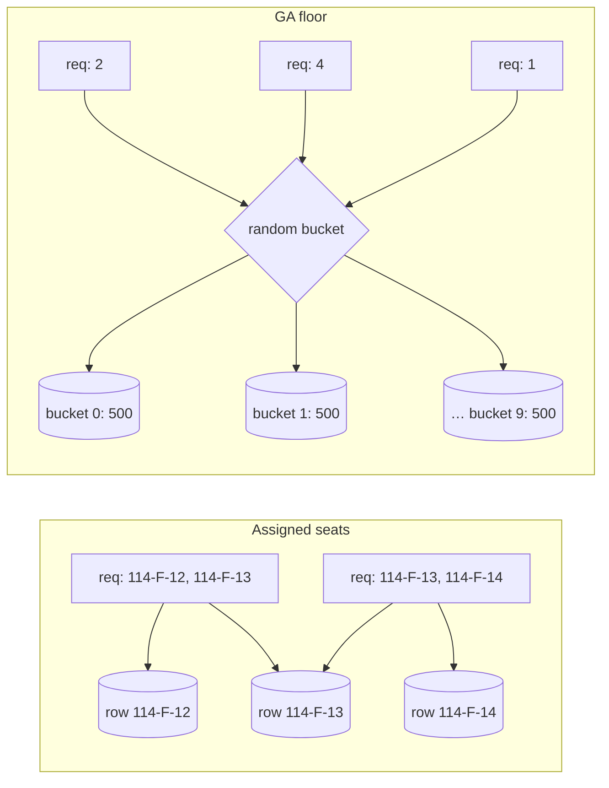
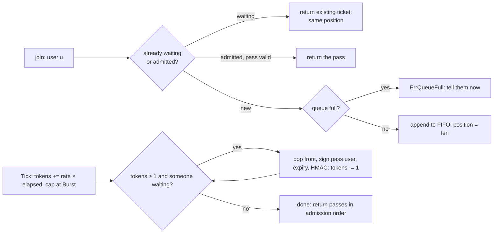

# C8 Unit 2 — Deep dives: oversell, payment in flight, and the flash sale

> Time: ~3 h · CORE: §5–§7, Common mistakes · STRETCH: bots, fairness and presale lotteries at the end of §7 ·
> Lab: `labs/c8/waitroom`

Unit 1 ended at 0:25 with an end-to-end design. The deep dives an interviewer picks for ticket booking are almost
always these three: **how exactly you stop two people buying one seat** (and which isolation level, lock or
constraint does it), **what happens when the payment outlives the hold** (the part most candidates skip), and **what
you put in front of the inventory when half a million people arrive at once**. This unit does all three, lists the
mistakes that cost candidates the senior score, and builds the waiting room in Go.

## Before you start

You should have finished [Unit 1](unit-1-guided-design.md). Warm-up, answer first:

1. Why is the seat map served from a snapshot on a CDN rather than from database replicas?
2. Which three unique constraints are the backstop against oversell and double processing?
3. Admission is ≈ 200 per second and choosing seats takes ≈ 30 s. How many people are choosing at once, and why do
   you want that number near the orders available?

<details data-kind="answer">
<summary>Warm-up answers</summary>

1. Without a room it is ≈ 250k reads per second of one identical ≈ 4.5 KB object (≈ 9 Gbps): a CDN job. Replicas are
   databases, lag behind, and fall over at that rate (Unit 1 §2).
2. `tickets UNIQUE (event_id, seat_id)`, `orders UNIQUE (hold_id)`, `payment_events PRIMARY KEY (provider,
   provider_event_id)` (Unit 1 §3).
3. ≈ 200 × 30 ≈ 6,000 (Little's law). Far above the ≈ 7,200 orders and most hold attempts collide; far below and
   seats sit unsold while people queue (Unit 1 §2).

</details>

---

## §5 Holds and oversell prevention

### The failure story

After the first on-sale, the team rewrote the hold path for speed. Seats were held in Redis with
`SET hold:e77:114-F-12 <hold_id> NX EX 600`, one key per seat, in a loop; Postgres was written only at confirmation.

- **Partial holds.** A request for four seats acquired two keys, failed on the third (someone else had it) and
  returned an error, leaving two seats held by nobody for ten minutes. At peak ≈ 6% of seats were stranded this way.
- **Failover.** At 10:04 the Redis primary failed over. Replication is asynchronous, so the last ≈ 1 s of `SET`s never
  reached the replica: 37 seats that were held became free and were held again by other people. Confirmation trusted
  Redis and wrote `UPDATE seats SET status = 'sold'` with no condition. 37 seats were sold twice.
- **The GA floor.** 5,000 standing tickets, one row: `SELECT remaining` then `UPDATE … SET remaining = $computed`.
  At ≈ 1,200 attempts per second, lost updates sold **5,140** floor tickets. The fix, `UPDATE … SET remaining =
  remaining - $q WHERE remaining >= $q`, was correct, and its p99 went to 2 s: every purchase in the section queued on
  one row lock.
- **The per-account limit** was a count of the account's tickets before insert; scripted accounts with two sessions
  bought 8 tickets against a limit of 6.

Every failure is a choice of *where* "this seat is mine" is decided and *how atomically*. Speed was never the problem:
the hold path needed ≈ 300 transactions per second (Unit 1 §2).

### Predict

<!-- predict id="C8-U2-P01" -->
**Predict.** Five implementations of `Hold(event, seats)` run on PostgreSQL at READ COMMITTED while 300 goroutines
request random overlapping sets of 2–4 seats from the same 40 seats. For each, answer: can it oversell (two holders
of one seat)? Can it deadlock? What does heavy contention do to it? Would a stricter isolation level change your
answer? Write your answers down first.

- (A) `SELECT status … WHERE seat_id IN (…)`; if all are available, `UPDATE … SET status = 'held'`.
- (B) One `UPDATE … SET status = 'held', hold_id = $h WHERE seat_id IN (…) AND (status = 'available' OR
  hold_expires_at <= now())`, then commit only if the affected-row count equals the number of seats requested.
- (C) `SELECT … WHERE seat_id IN (…) FOR UPDATE` with the seats in the order the user clicked, check, then `UPDATE`.
- (D) Read each seat's `version`; `UPDATE … SET status = 'held', version = version + 1 WHERE seat_id = $s AND version =
  $v` per seat; roll back if any updates zero rows.
- (E) `INSERT INTO seat_claims (event_id, seat_id, hold_id, expires_at)` with `PRIMARY KEY (event_id, seat_id)`, after
  deleting expired claims for those seats; roll back on a unique violation.
<!-- /predict -->

<!-- predict id="C8-U2-P02" -->
**Predict.** The GA floor has 5,000 tickets. At the on-sale peak ≈ 1,200 purchase attempts per second arrive for it,
each for 1–4 tickets. The correct one-row conditional decrement holds the row lock ≈ 2 ms. (1) What throughput and
latency do you get? (2) Design two alternatives that keep "never more than 5,000" true, and say what each costs,
including what happens when only a handful of tickets remain. Write your answers down first.
<!-- /predict -->

### Reveal

<details data-kind="reveal" data-for="C8-U2-P01">
<summary>Reveal</summary>

| | Oversell at READ COMMITTED? | Deadlock? | Under heavy contention | Stricter isolation? |
|---|---|---|---|---|
| (A) read then write | **Yes**: check-then-act; both readers see `available`, both update | No (no locks while checking) | Oversells more | PG REPEATABLE READ: the second updater of a row aborts (first-committer-wins), so it becomes safe with retries; MySQL REPEATABLE READ: **still unsafe** (writes use current reads, A2 §7). SERIALIZABLE: safe, with retries |
| (B) conditional UPDATE + row count | **No**: the second updater waits for the row lock, PG re-evaluates the `WHERE` on the new version, the seat no longer matches, the count is short, roll back | **Possible**: a multi-row `UPDATE` locks rows in plan order; overlapping requests can lock in different orders. PG detects it after `deadlock_timeout` (1 s by default) and aborts one | Correct; conflicts are fast failures (409); deadlocks cost ≈ 1 s each unless you sort | Not needed |
| (C) `FOR UPDATE` in click order | No | **Yes**: R1 locks A1 then waits for A2; R2 locks A2 then waits for A1 | Correct but convoys: every request waits for the slowest holder of its seats | Not needed; sort the seat ids (`ORDER BY seat_id`) to remove the deadlock |
| (D) optimistic version | No: a stale version updates zero rows | No (no waiting on reads) | **Retry storms**: on a hot event almost every attempt conflicts, retries pile up | Not needed |
| (E) insert-to-claim | No: the primary key admits one claim per seat, under any isolation level | Possible on overlapping inserts (unique-index waits), detected and aborted | Correct; conflicts are unique violations; expired claims must be deleted first (in the same transaction) | Not needed |

(B) is the default answer in an interview: one statement, safe at the default isolation level, cheap. Sort the seat
ids, or lock them in a sorted `SELECT … ORDER BY seat_id FOR UPDATE` first, so overlapping multi-seat requests can't
deadlock. (E) is the strongest backstop, which is why the `tickets UNIQUE (event_id, seat_id)` constraint exists even
when (B) is the claim mechanism. (D) is a good answer for low-contention inventories (a hotel room on a Tuesday) and
a bad one for an on-sale.

The tempting wrong answers: "(A) is fine because we use transactions" (a transaction is not a lock; READ COMMITTED
takes a new snapshot per statement); "REPEATABLE READ fixes it" (only on some engines, and A2 showed the names are not
portable); "(C) is safest because it locks" (it locks in the wrong order); and "any of them, plus Redis in front"
(Redis in front is the failure story).

</details>

<details data-kind="reveal" data-for="C8-U2-P02">
<summary>Reveal</summary>

(1) One row, one lock, ≈ 2 ms: at most **≈ 500 decrements per second**. At 1,200 attempts per second the queue on
that lock grows by ≈ 700 per second, latency climbs into seconds, connections fill, and the whole partition suffers.
Correct, and unusable at peak.

(2) Two designs that keep the invariant:

- **Bucketed counter.** Split the 5,000 into, say, 10 rows of 500 (`ga_inventory(event, section, bucket)`). A purchase
  picks a random bucket and runs the conditional decrement there; on "not enough in this bucket" it tries another.
  Throughput ≈ 10 × 500/s ≈ 5,000/s. Cost: the end game. With 7 tickets left spread as 1, 0, 2, 0, 1, 0, 3, 0, 0, 0,
  a request for 4 fails in every bucket although 7 remain. Fix it by merging buckets when stock is low (a single
  transaction moves the remainders into one bucket) or by letting a request take from two buckets in one transaction,
  sorted to avoid deadlock. The sum of buckets is the truth; any single bucket is not.
- **Block allocation (leases on quantity).** A coordinator hands each booking-service instance a block ("you may sell
  200") with one decrement of the main row; the instance then sells from its block in memory (with its own lock) and
  returns unsold units when its block expires or at the end. ≈ 1 main-row update per 200 tickets. Cost: unsold blocks
  stranded on a crashed instance until their lease expires; the "last few" again need a fallback to the main row;
  every sale is still recorded durably (a ticket row per sale) so the block is a rate device, not the truth.

A third answer, **Redis `DECRBY` with a Lua check** (≈ 100k+ ops/s on one instance), is fine as a *gate* if the
durable record (ticket rows, sum ≤ 5,000 enforced in the database at confirmation) remains the authority; on a Redis
failover the counter can go back up, which must never translate into a sale.

The tempting wrong answer is "it's GA, so just use a counter": a counter is exactly the hot row. The other is
`SELECT … FOR UPDATE SKIP LOCKED` on a counter row (there's one row; skipping it means failing).

</details>

### How it actually works

**The claim, in one statement.** The default implementation of a hold is (B): one conditional update per request,
seats sorted, expiry folded into the predicate, the database's clock defining "expired", and the affected-row count
deciding success. Everything else (the hold row, the log row, the limit row) goes in the same short transaction.

```go
package booking

import (
	"context"
	"database/sql"
	"errors"
	"fmt"
	"sort"
	"strings"
	"time"
)

var ErrSeatsUnavailable = errors.New("booking: one or more seats are not available")

// HoldSeats claims every seat in seatIDs for holdID, or none. The WHERE clause
// is the check; the row locks the UPDATE takes are the act; PostgreSQL
// re-evaluates the predicate on rows that changed while it waited, so READ
// COMMITTED is enough. Sorting the ids keeps overlapping requests from
// locking rows in opposite orders. now() is the database's clock: one
// definition of "expired" for every app server.
func HoldSeats(ctx context.Context, db *sql.DB, eventID, holdID string, seatIDs []string, ttl time.Duration) error {
	ids := append([]string(nil), seatIDs...)
	sort.Strings(ids)
	// placeholders builds "$first, $first+1, ..." and the matching args.
	placeholders := func(first int, lead ...any) (string, []any) {
		ph := make([]string, len(ids))
		args := append([]any(nil), lead...)
		for i, id := range ids {
			ph[i] = fmt.Sprintf("$%d", first+i)
			args = append(args, id)
		}
		return strings.Join(ph, ","), args
	}
	tx, err := db.BeginTx(ctx, nil)
	if err != nil {
		return err
	}
	defer tx.Rollback() // no-op after a successful Commit

	// Lock the rows in a fixed order first, so the UPDATE below never waits
	// on a row while holding another that a different request needs.
	in, args := placeholders(2, eventID)
	rows, err := tx.QueryContext(ctx, `SELECT seat_id FROM seats
		WHERE event_id = $1 AND seat_id IN (`+in+`) ORDER BY seat_id FOR UPDATE`, args...)
	if err != nil {
		return err
	}
	if err := rows.Close(); err != nil {
		return err
	}

	in, args = placeholders(4, holdID, ttl.Seconds(), eventID)
	res, err := tx.ExecContext(ctx, `
		UPDATE seats
		   SET status = 'held', hold_id = $1,
		       hold_expires_at = now() + make_interval(secs => $2)
		 WHERE event_id = $3
		   AND seat_id IN (`+in+`)
		   AND (status = 'available' OR (status = 'held' AND hold_expires_at <= now()))`, args...)
	if err != nil {
		return err
	}
	n, err := res.RowsAffected()
	if err != nil {
		return err
	}
	if int(n) != len(ids) {
		return ErrSeatsUnavailable // deferred Rollback undoes the seats we did claim
	}
	// Same transaction: insert the hold row, update the account's limit row,
	// append to inventory_log. Then commit.
	return tx.Commit()
}
```

The `SELECT … FOR UPDATE` with `ORDER BY` is there only to fix the lock order; without it, (B) is still correct but
can deadlock under overlapping requests. In production the 409 should name the unavailable seats (a second `SELECT`
after the short count, inside the same transaction, before rolling back).

**What each isolation level buys here** (A2's [§7](../A2-storage/unit-3-transactions-schema.md#7-acid-in-practice-and-the-isolation-anomalies)
and [§8](../A2-storage/unit-3-transactions-schema.md#8-mvcc-snapshot-isolation-locks-and-serializable) in one table):

| Shape of the code | Anomaly it invites | READ COMMITTED | PG REPEATABLE READ (snapshot) | SERIALIZABLE |
|---|---|---|---|---|
| Read seat status, then write | Lost update / check-then-act on one row | **Oversells** | Second writer aborts (retry) | Safe (retry) |
| Conditional write on the row (`WHERE status = 'available'`) | — | Safe | Safe (may abort and retry) | Safe |
| Count tickets for the account, then insert | Phantom write skew across rows (A2 T3b) | **Breaks the limit** | **Breaks the limit** | Safe (retry) |
| Update a per-account limit row conditionally | — | Safe | Safe | Safe |
| Read GA remaining, write computed value | Lost update | **Oversells** | Second writer aborts | Safe |
| Conditional decrement (`remaining >= $q`) | — | Safe | Safe | Safe |

The pattern: make the invariant a condition on **the rows you write**, and READ COMMITTED is enough. Reach for
SERIALIZABLE when the invariant spans rows you only read (limits per household, "no more than 2 wheelchair spaces per
row"), and accept retries.

**Holds live on the seat row; expiry is lazy.** A seat with `status = 'held' AND hold_expires_at <= now()` is
claimable by the next request. A sweeper runs every few seconds with the same predicate (`UPDATE seats SET status =
'available', hold_id = NULL WHERE event_id = $1 AND status = 'held' AND hold_expires_at <= now()`, using an index on
`(event_id, hold_expires_at)`), marks the hold rows `expired`, and appends to `inventory_log` so the snapshot shows the
seats again. Because the sweeper's write is conditional on the state it expects, a sweeper that was paused for
15 s and wakes up after a confirmation changes nothing: **the conditional write is the fencing check**
([A5 Unit 3 §3](../A5-consistency/unit-3-consensus-leases.md#3-leases-and-fencing-tokens)). Per-hold timers
(`time.AfterFunc`, a delayed message per hold) are an optimisation for prompt map updates, never the source of truth.

**Assigned seats vs GA.** Assigned seats spread contention across many rows: 300 requests for 40 seats contend in
small groups, and different sections never contend. GA concentrates it on one row per section, so GA needs the
bucket or block designs above. Mixed venues use both, and a single checkout may hold seats *and* GA quantity; keep
them in one transaction on one partition (the event's).



**Redis as the hold store.** Holds in Redis are fast and give expiry for free, and they are a legitimate design *if*
the database stays the authority for sales. Requirements: all-or-nothing in one atomic step (a Lua script that checks
every key and then sets them all with `PX`, never a loop of `SET NX`); confirmation in the database is still a
conditional write (`WHERE status IN ('available', 'held_by_me')` or insert-to-claim), so a hold that Redis lost on
failover can produce a *failed confirmation* (refund path, §6) but never a second sale. You trade one more system
and a worse failover experience for speed you probably don't need at 300 holds per second.

**One owner per event (the B3 shape at scale).** The alternative to row-level claims: route every request for an
event to one process (shard by event id) that holds the seats in memory with one lock, exactly B3's
`labs/b3/ticketing`, and persists sales. It sustains ≈ 10⁵–10⁶ holds per second per event and makes the hold path a
map lookup. The price: ownership must move on failure, which needs a lease, and a lease needs a **fencing token** on
every write the owner makes to the durable store (`UPDATE … WHERE owner_epoch = $mine`), because a paused old owner
will wake up and write. Worth it for very hot events or exotic rules; overkill for most.

### Build it

No C8 lab code for this section: the in-memory hold path is B3 problem 9,
[`labs/b3/ticketing`](../../labs/b3/ticketing/) (taught in
[B3 Unit 4 §3](../B3-machine-coding/unit-4-algorithms-and-contention.md#3-ticket-booking-with-concurrent-seat-holds)).
If you have done it, re-read your solution against this section: its one lock per event is the "one owner per event"
design; its validate-then-commit is statement (B); its `reap(now)` is the lazy-expiry predicate. The tests that pin
the ideas here are `TestStage1_HoldIsAllOrNothing`, `TestStage1_ConcurrentSingleSeatHasExactlyOneWinner`,
`TestStage3_OppositeOrderRequestsDoNotDeadlock` and `TestStage2_ExpiryIsLazy_NoSweepNeeded`. For quantity holds
(GA), B3 problem 14, [`labs/b3/inventory`](../../labs/b3/inventory/), is the same model with counters
(`TestStage3_ConcurrentReservesNeverOversell`). If you haven't done B3, the A2 lab
[`labs/a2/isolation`](../../labs/a2/isolation/) shows the anomalies in the table above:
`TestLostUpdate_HappensUnderReadCommitted`, `TestWriteSkew_IsPossibleUnderSnapshotIsolation`,
`TestPhantom_InvariantBreaksUnderSnapshotIsolation`.

### Break it

Two options; do whichever matches what you've built.

1. **With B3's ticketing solution:** in `Hold`, unlock after the validation loop, call `runtime.Gosched()`, and relock
   before the commit. Run `go test -race -run TestStage1_ConcurrentSingleSeatHasExactlyOneWinner ./labs/b3/ticketing/`.
   Predict the number of winners for one seat out of 200 goroutines.
2. **With a local PostgreSQL (optional):** create `seats(event_id, seat_id, status, hold_id, hold_expires_at)` with
   two available seats. In two `psql` sessions at READ COMMITTED, interleave by hand: session 1 runs
   `BEGIN; SELECT status … WHERE seat_id = 'A1';`, session 2 does the same, then each runs an unconditional
   `UPDATE … SET status = 'held', hold_id = '<its id>' WHERE seat_id = 'A1'; COMMIT;`. Then repeat with the
   conditional `UPDATE` from (B). Then make session 1 lock `A1, A2` and session 2 lock `A2, A1` with `FOR UPDATE`.

<details data-kind="answer">
<summary>What you should see, and why</summary>

1. Many winners for one seat: B3's own run of this mutation reported 28 winners and 172 `ErrSeatUnavailable` in round
   0 (your number will vary with the schedule). The window between the check and the act is microseconds, and 200
   goroutines fall into it. `-race` may report nothing, because every access is still under a lock: this is a logic
   race, not a data race, which is exactly why the conditional write matters.
2. Unconditional: both commit; the second `UPDATE` waits for the first's row lock, then overwrites it. `hold_id` ends as
   session 2's, and session 1's client believes it holds A1: an oversell with no error anywhere. Conditional: session 2's
   `UPDATE` waits, then reports `UPDATE 0` after session 1 commits (PostgreSQL re-checked the `WHERE`), so it rolls back
   and returns 409. Opposite-order `FOR UPDATE`: after ≈ 1 s one session gets `ERROR: deadlock detected` (SQLSTATE
   `40P01`) and is rolled back; sorting the ids makes the second session simply wait.

</details>

### In the wild

- **PostgreSQL** re-evaluates an `UPDATE`'s `WHERE` against the newest row version after waiting for a lock at READ
  COMMITTED (A2 §7); it detects deadlocks after `deadlock_timeout` (1 s by default) and aborts one transaction with
  SQLSTATE `40P01`; serialization failures are `40001`. `SKIP LOCKED` and `NOWAIT` change waiting behaviour for
  `FOR UPDATE`.
- **MySQL/InnoDB** at its default REPEATABLE READ uses current reads for `UPDATE` and locking reads, so the conditional
  update (B) is safe there too, while read-then-write (A) can still lose updates (A2 §7).
- **Redis** `SET key value NX PX ms` is an atomic create-with-expiry; Lua scripts run atomically on one instance;
  replication is asynchronous, so a failover can lose acknowledged writes (the `WAIT` command narrows but does not
  close the window).
- **DynamoDB** conditional writes and `TransactWriteItems` give all-or-nothing claims across items
  (`TODO-VERIFY: current item and size limits per transaction`); **Spanner** and **CockroachDB** default to
  serializable transactions, so read-then-write is safe there at the price of retries.
- **Hot counters** split into sub-keys are the A4 Unit 3 §8 technique; Amazon's DynamoDB guidance on write sharding
  for hot partition keys describes the same idea (`TODO-VERIFY` the current page if you cite it).

### Trade-offs

| Option | Wins when | Loses when | When the answer flips |
|---|---|---|---|
| Conditional UPDATE + row count (sorted) | The default: one statement, READ COMMITTED, ≈ hundreds to thousands of tx/s per partition | One row is touched by everyone (GA counter) | Flip to buckets or blocks for GA; to an in-memory owner when one event needs ≫ 10³ tx/s |
| `SELECT … FOR UPDATE` (sorted) then write | You must read and decide in application code (complex rules) | Locks held longer; easy to forget the order or to call out while locked | Flip to a single conditional statement when the rule fits in SQL |
| Optimistic version column | Low contention (most events, most days) | On-sale contention: retry storms | Flip to pessimistic or conditional writes for hot events, or put an admission queue in front so conflicts become rare |
| Insert-to-claim (unique key) | Any isolation level; the strongest guarantee | Expired claims must be cleared in the same transaction | Use it as the backstop (`tickets`) even when another mechanism claims |
| Redis holds + DB authority at confirm | Very high hold rates; built-in TTL | Failover loses holds; double holds become failed confirmations | Flip back to DB holds when ≈ 300 tx/s is all you need (usually) |
| One in-memory owner per event | Extreme per-event rates; complex seat rules | Failover needs leases + fencing tokens; one more stateful tier | Flip to row-level claims unless a measured hot event saturates the database |
| SERIALIZABLE | Invariants over rows you only read (limits per household) | Retries under contention; every caller needs a retry loop | Flip to a dedicated row with a conditional update when the invariant can be materialised |

### Senior bar

- **Failure modes**: read-then-write at READ COMMITTED; multi-seat holds that are not atomic (a loop of `SET NX`);
  locks taken in click order; payment or email calls inside the transaction; expiry only by job; two definitions of
  "expired" (app clock vs database clock); limits by counting; a cache or Redis treated as the authority for sales;
  a GA counter on one row at on-sale rates; buckets without an end-game merge.
- **Capacity (≈)**: conditional update ≈ 1–5 ms per transaction; ≈ 300 hold tx/s per hot event fits one primary;
  one hot row ≈ 500/s; 10 buckets ≈ 5,000/s; an in-memory owner ≈ 10⁶ holds/s per event core (B3); Redis ≈ 100k+
  ops/s ([`docs/NUMBERS.md`](../../docs/NUMBERS.md)).
- **Ops**: metrics for hold attempts, conflicts (409 rate), deadlocks (`40P01` count), serialization failures, lock
  wait time, active holds, expiries per minute, sweeper lag; a periodic invariant check (per event: available + held +
  sold = capacity; no seat in two tickets) run during and after each on-sale.
- **Cost**: a unique index and a few extra rows per order are negligible; a separate Redis tier for holds is a system
  to run and fail over; buckets add code for the end game.

Interviewer follow-up probes:

1. "Why not run everything at SERIALIZABLE and stop thinking about it?"

<details data-kind="answer">
<summary>Model answer</summary>

It's correct, and at on-sale contention it converts conflicts into aborts that every caller must retry, which adds
latency and load exactly when the partition is busiest. The conditional update gets the same guarantee for the seat
invariant at READ COMMITTED with no retries: the losers simply update zero rows and get a 409. I'd use SERIALIZABLE
for the rare invariant I can't express as a condition on a row I write, with a bounded retry loop, and keep the hot
path on conditional writes.

</details>

2. "Redis is faster. Why not hold seats in Redis?"

<details data-kind="answer">
<summary>Model answer</summary>

Speed isn't the constraint: ≈ 300 holds per second fit one database primary. Redis adds a second source of truth
with asynchronous replication, so a failover loses holds and can grant the same seat twice; multi-seat holds need a
Lua script to be atomic. If I did use it (say, an event so hot the database can't keep up), Redis would be a hold
cache and the database would still decide sales with a conditional write or unique key at confirmation, so the worst
case is a failed confirmation and a refund, never an oversell.

</details>

3. "One event has 100,000 seats and the primary is saturated even behind the waiting room. Now what?"

<details data-kind="answer">
<summary>Model answer</summary>

First check the cause: usually it's a hot row I didn't notice (an event-level `sold_count`, a GA counter), or long
transactions. Fix those (buckets, derive counts from the snapshot, keep transactions short). If it's genuinely the
volume, split the event's inventory by section across partitions: a hold rarely spans sections, and one that does
becomes a cross-partition transaction (rare, slower, still atomic) or is disallowed. Beyond that, one in-memory owner
per section with fencing tokens. And I'd lower the admission rate, because the room exists exactly so the inventory
never has to absorb the crowd.

</details>

4. "How do you know you never oversold?"

<details data-kind="answer">
<summary>Model answer</summary>

By construction (conditional writes, `tickets UNIQUE (event_id, seat_id)`) and by checking: a job that verifies per
event that available + held + sold equals capacity, that no seat has two tickets and that every ticket has a
confirmed order with a captured payment, run during the on-sale and after it. A violation pages. The unique constraint
means a bug shows up as a failed transaction and an alert, not as two people at the gate.

</details>

### Check yourself

1. Why is the conditional `UPDATE` safe at READ COMMITTED while read-then-write isn't?
2. Why does a GA section need a different design from assigned seats?
3. What makes a paused sweeper harmless?

<details data-kind="answer">
<summary>Answers</summary>

1. The check is part of the write: the second updater waits for the row lock and the database re-evaluates the
   predicate on the committed row, so it updates zero rows. Read-then-write checks on one snapshot and writes on
   another statement.
2. All GA purchases decrement one counter row, which serialises at ≈ 500/s; assigned seats spread contention over
   many rows. GA needs bucketed counters or block allocation with an end-game merge.
3. Its write is conditional on the state it expects (`status = 'held' AND hold_expires_at <= now()` for that hold):
   if a confirmation happened in the meantime, the row doesn't match and nothing changes.

</details>

---

## §6 Payment in flight: hold expiry, idempotent confirmation, reconciliation

### The failure story

With the hold path fixed, the next on-sale had zero oversells and 115 angry customers. Holds lasted 8 minutes. A
typical victim selected seats at 10:02:00, reached checkout at 10:08:10 (they'd hesitated over the price), started
paying, and got a 3-D Secure challenge: their bank sends a one-time passcode by SMS, which took 70 s to arrive that
morning. The provider's `payment_succeeded` webhook reached the platform at 10:11:40. The hold had expired at
10:10:00; the seats were held by someone else at 10:10:05 and sold at 10:13. The confirmation handler found the hold
expired and returned an error; the provider retried the webhook for hours; the customer's card was charged and they
had no tickets.

The team's first fix made confirmation unconditional ("the customer paid, so they get the seats"): 61 seats were sold
twice the next weekend. The second fix extended every hold to 20 minutes: abandoned holds now locked ≈ 30% of the
inventory through the peak, the event showed "sold out" while thousands of seats were held by people who had walked
away, and they came back in waves that the queue had already given up on. Reconciliation then found 23 captured
payments with no order at all: their webhooks had failed signature checks during a key rotation and been dropped.

### Predict

<!-- predict id="C8-U2-P03" -->
**Predict.** Write your answers down first.

1. Which states and deadlines make "the customer paid after the hold expired and the seat was resold" impossible,
   without making abandoned holds last 20 minutes?
2. At the payment-pending deadline the sweeper wants to release the seats, and at the same instant the provider's
   success webhook arrives. Give a sequence of calls that makes the outcome the same however the two interleave.
3. Authorise-then-capture versus capture immediately: what changes for the customer and for you when the seats are
   lost after payment?
4. The webhook for payment `pi_88` arrives three times (two concurrently, one 6 hours later), and a buggy upstream also
   sends `pi_88` with a different order id. What should happen to orders, tickets, charges and emails?
<!-- /predict -->

### Reveal

<details data-kind="reveal" data-for="C8-U2-P03">
<summary>Reveal</summary>

1. **Two deadlines, one extension, and an explicit payment-pending state.** A short *selection* hold (≈ 8 minutes)
   covers choosing and reaching checkout; abandoned carts free seats quickly. Starting checkout moves the hold to
   `payment_pending` and extends it **once** to a *payment window* (≈ 15 minutes from checkout) sized from the payment
   p99 including 3-D Secure, plus margin; the payment intent is created with the same deadline. The sweeper never
   releases a `payment_pending` hold just because its time is up; it must settle the payment first (2). Checkout is
   refused if the hold has less than ≈ 1 minute left and can't be extended (the user re-selects).
2. **Cancel first, then release.** At the deadline the sweeper calls the provider's cancel (or void) for the intent.
   If the cancel succeeds, the payment can no longer succeed, and the sweeper releases the seats with a conditional
   write (`WHERE hold_id = $h AND state = 'payment_pending'`). If the cancel fails because the payment already
   succeeded, the sweeper *confirms* the order itself, exactly as the webhook would. The webhook handler's confirm is a
   conditional write on the same hold state. Whichever runs first wins the hold's state transition; the other finds the
   hold no longer `payment_pending` and does nothing (or returns the existing order). The provider's state machine
   (an intent can be cancelled or succeed, never both) is the tie-breaker, and the database's conditional write is
   the lock.
3. **Authorise-then-capture**: checkout authorises the card (funds reserved, nothing moved); the webhook confirms the
   seats; *then* you capture. If the seats are lost, you **void** the authorisation: the customer sees a pending
   amount disappear, there's no refund to process, and providers typically charge less for a void than for a refund
   (`TODO-VERIFY` for your provider). Capture immediately is simpler, but every lost seat becomes a refund that takes
   days to reach the customer. It's the same pattern as a card authorisation hold at your bank.
4. One order, one set of tickets, one charge, one email. The webhook handler inserts `(provider, provider_event_id)`
   into `payment_events` first; the concurrent duplicate hits the primary key and returns 200; the 6-hour replay does
   the same. The `pi_88` with a different order id is rejected: the payment intent id is `UNIQUE` on `orders`, and
   the intent was created with our order id in its metadata, so a mismatch is a bug to alert on, never a second order.
   Bind the key before doing the work, under the same transaction (B3 Unit 4 §3, A6 Unit 2 §2).

The tempting wrong answers: "make the hold long enough" (inventory locked by abandoned carts); "confirm whenever
payment succeeds" (oversell); "release at the deadline and refund if a payment arrives later" (works, but turns a
race you could avoid into refunds at volume); "dedupe on the order id" (a retried webhook for a *different* event on
the same order, such as a refund event, must not be swallowed; dedupe on the provider's event id).

</details>

### How it actually works

```mermaid
sequenceDiagram
    participant C as Customer
    participant API as Booking API
    participant DB as Inventory DB
    participant P as Payment provider
    participant SW as Sweeper
    C->>API: POST /holds (pass, key)
    API->>DB: claim seats, hold expires T+8m
    C->>API: POST /holds/h/checkout (key)
    API->>DB: hold → payment_pending, expires T+15m (once); order pending
    API->>P: create intent (idempotency key = order id, capture = manual)
    P-->>C: 3-D Secure challenge
    alt payment succeeds before the deadline
        P->>API: webhook payment_authorised (event id e1)
        API->>DB: insert payment_events(e1); hold payment_pending → confirmed; tickets; seats sold; outbox
        API->>P: capture
    else deadline reached first
        SW->>P: cancel intent
        alt cancel succeeds
            SW->>DB: hold payment_pending → released; seats available (conditional)
        else already authorised
            SW->>DB: confirm exactly as the webhook would
        end
    end
```

**The hold's states and deadlines.**

| State | Deadline | Who may move it | To |
|---|---|---|---|
| `active` | selection TTL (≈ 8 min) | user (checkout, release), anyone (lazy expiry) | `payment_pending`, `released`, `expired` |
| `payment_pending` | payment window (≈ 15 min from checkout, set once) | webhook (confirm), sweeper (cancel-then-release or confirm) | `confirmed`, `released` |
| `confirmed` | none: a sale never expires | nobody (refunds are a separate flow that creates new records) | — |

**Confirmation is one transaction, bound before it looks.** The webhook handler: verify the signature (with every
currently valid key, so a rotation can't drop events); `INSERT INTO payment_events (provider, event_id)` (conflict →
return 200, done); `UPDATE holds SET state = 'confirmed' WHERE hold_id = $h AND state = 'payment_pending'`; if one row,
insert the order's tickets (`UNIQUE (event_id, seat_id)`), mark seats `sold`, write an outbox row; commit; return 200
fast. If zero rows: the hold is already confirmed (return success: the sweeper got there first) or released (the late
payment path). Slow work (e-tickets, email, analytics) goes through the outbox.

**The late-payment path** (should be rare once the payment window exists, and must exist anyway):

1. Try to re-claim the *same* seats with the normal conditional write; if they are still free, confirm with them.
2. Otherwise void the authorisation (or refund a capture), mark the order `expired_refunding`, tell the customer
   ("your payment was not taken" or "refunded"), and count it: `confirm_after_expiry` is a metric with an alert.
3. Never sell the seats anyway, and never leave the money without a matching order or refund.

**Idempotency at each hop.** The browser's checkout click carries an `Idempotency-Key` → one order. The order id is
the provider's idempotency key for creating the intent → one payment per order, however often checkout is retried.
The provider's event id dedupes webhooks. The order id dedupes downstream consumers (e-ticket issuer, email). Four
keys, four scopes, the same lesson as C7's four ways not to send twice.

**Reconciliation.** Every hour during an on-sale and daily otherwise, compare the provider's record (authorised and
captured payments, from its API or settlement report) with orders: a payment with no confirmed order → run the
confirmation (idempotent) or void/refund; an authorisation older than N hours that was never captured → capture or
void; an order confirmed with no payment → page (it should be impossible). The 23 dropped webhooks in the failure
story are found here, not by customers.

A compact way to keep the decision in one place, used by both the webhook handler and the sweeper:

```go
package booking

// HoldState is the state of a hold as stored in the database.
type HoldState string

const (
	Active         HoldState = "active"
	PaymentPending HoldState = "payment_pending"
	Confirmed      HoldState = "confirmed"
	Released       HoldState = "released"
	Expired        HoldState = "expired"
)

// Outcome is what a successful payment for a hold leads to.
type Outcome int

const (
	ConfirmNow       Outcome = iota // move payment_pending → confirmed, issue tickets
	AlreadyConfirmed                // replay: return the existing order
	LatePayment                     // try to re-claim the same seats, else void or refund
)

// OnPaymentSucceeded decides what a success signal (webhook, or a failed
// cancel at the deadline) does. The caller applies it with a conditional
// write on the state it read, so two callers can't both act.
func OnPaymentSucceeded(s HoldState) Outcome {
	switch s {
	case PaymentPending:
		return ConfirmNow
	case Confirmed:
		return AlreadyConfirmed
	default: // active (checkout never recorded), released, expired
		return LatePayment
	}
}
```

### Build it

No C8 lab code for this section. The confirmation rules are B3 stage 2 and 3 in
[`labs/b3/ticketing`](../../labs/b3/ticketing/): `TestStage2_ConfirmRacingSweepAtTheBoundary` (one outcome at the
exact deadline, whoever runs first), `TestStage2_ExtendOnce` (the payment-window extension),
`TestStage3_ConfirmWithKeyReplayReturnsTheSameBooking` (a replay after the TTL returns the booking, not an error),
`TestStage3_ConcurrentDuplicateCallbacksChargeOnce` and `TestStage3_SameKeyDifferentHoldIsRejected` (bind the key
before looking at the hold), and `TestStage3_ConfirmHookRunsOutsideLocks` (the "charge" runs outside the lock, like
the outbox). In `labs/c8/waitroom` the related number is `PassTTL`: an admitted user's pass must outlive choosing
plus the payment window, or they are sent to the back of the queue mid-checkout (lab break-it 3, §7).

### Break it

Trace each timeline on paper with the states table above and write the final state of seats, order and money:

1. Selection hold 8 min, no payment-pending state; checkout at 7:30; webhook at 9:10.
2. With the payment window: checkout at 7:30 (window to 22:30); the sweeper cancels at 22:30:00.000; the webhook for a
   success at 22:29:59.900 arrives at 22:30:00.400.
3. With the payment window, but the sweeper releases first and cancels after ("release, then cancel").
4. The provider rotates its webhook signing secret at 10:05; your handler only knows the new one from 10:05:30.

<details data-kind="answer">
<summary>What happens</summary>

1. The hold expired at 8:00; the seats may be held or sold by someone else by 9:10. The confirmation finds the hold
   `expired`: late-payment path. If the seats are still free, re-claim and confirm; if not, void or refund. The fix is
   the payment-pending state, not a longer TTL.
2. The payment succeeded first at the provider, so the sweeper's cancel fails ("already succeeded" or "already
   authorised"); the sweeper confirms the order. The webhook arrives 400 ms later, finds the hold `confirmed`, and
   returns 200 (replay). One sale, one charge. Had the cancel won at the provider, the success could not have happened.
   The provider is the referee; your two code paths agree because both apply a conditional write.
3. Release-then-cancel reopens the race: between the release and the cancel, the seats can be held by someone else
   and the payment can still succeed. Now you have money for seats you no longer hold: late-payment path, refund.
   Order matters: settle the money, then free the seats.
4. Webhooks from 10:05:00 to 10:05:30 fail verification; if the handler returns 4xx the provider retries later (good),
   if it drops them silently they are lost until reconciliation (the 23 orphan payments). Accept both secrets during
   a rotation window, return a retryable status on verification failure, alert on the failure rate, and let hourly
   reconciliation catch whatever slips through.

</details>

### In the wild

- **Card networks and banks** separate authorisation (a hold on funds that expires if not captured) from capture;
  PSP APIs expose this as manual capture or "authorise only" (`TODO-VERIFY: authorisation validity windows by network
  and merchant category, and your PSP's API names`).
- **Stripe** PaymentIntents can be cancelled while not yet succeeded and accept an `Idempotency-Key` on creation; its
  webhooks are retried for days and should be deduplicated by event id (`TODO-VERIFY: current retry schedule and the
  cancel semantics for each intent status`).
- **3-D Secure 2** adds an interactive challenge for some payments, often an OTP or an app approval from the issuing
  bank, which is where payment latency in minutes comes from (`TODO-VERIFY: challenge rates and timeouts in your
  markets`).
- **Real-time bank payments** such as UPI collect requests or pay-by-bank flows confirm asynchronously after the payer
  approves in another app, sometimes minutes later (`TODO-VERIFY: the expiry of a collect request and how the
  outcome is notified`). Any of these makes the payment-pending state mandatory.

### Trade-offs

| Option | Wins when | Loses when | When the answer flips |
|---|---|---|---|
| Short selection hold + one payment-window extension | Abandoned carts free seats fast; slow payments complete | Two deadlines and a sweeper that talks to the provider | Flip to a single TTL only when payments are synchronous and fast |
| Authorise-then-capture | Lost seats become voids, not refunds; matches card rails | Two provider calls; an authorisation can expire before capture | Flip to immediate capture for instant-confirmation methods that don't support authorisation |
| Cancel-then-release at the deadline | The provider's state machine breaks the tie; no refunds for races | A provider call in the sweeper; provider outages delay releases | Flip to release-and-refund only for providers with no cancel |
| Webhook as the source of truth | Works when the browser never returns; can't be forged | Webhooks can be late, duplicated or dropped | Add polling of the provider for orders stuck in `payment_pending` beyond the window, and reconciliation |
| Hourly reconciliation during on-sales | Finds dropped webhooks and stuck authorisations the same day | A job to run and alert on | Daily is enough outside on-sales |

### Senior bar

- **Failure modes**: one TTL for selection and payment; confirmation that ignores the hold state (oversell) or rejects
  late payments without refunding (charge without ticket); release-then-cancel; dedupe on the wrong key; slow work in
  the webhook handler (timeouts → retries); dropped webhooks on signature rotation; no reconciliation; a payment call
  inside the claim transaction.
- **Capacity (≈)**: ≈ 140 confirmations/s per hot event; webhooks retried for hours; payment window ≈ 15 min;
  payment-pending holds at peak ≈ 140/s × ≈ 3 min ≈ 25,000 seats' worth of orders across a tour on-sale, which the
  snapshot must show as unavailable but not sold.
- **Ops**: metrics for payment-pending count and age, confirm-after-expiry, voids and refunds per on-sale, webhook
  verification failures, reconciliation mismatches; runbook levers: extend all payment windows during a provider
  incident; pause admission when payment latency climbs.
- **Cost**: each refund costs a fee and a support contact; voids are cheaper; the reconciliation job is cheap next to
  one week of "I paid and got nothing".

Interviewer follow-up probes:

1. "Payment succeeded but the seats are gone. What exactly happens, and how often?"

<details data-kind="answer">
<summary>Model answer</summary>

With the payment window and cancel-then-release, only when a payment succeeds without our knowledge after we
cancelled (a provider bug) or after a failover lost the confirmation. The handler finds the hold not
`payment_pending`, tries to re-claim the same seats, and if they're gone voids the authorisation (or refunds), marks
the order `expired_refunding`, tells the customer, and increments `confirm_after_expiry`, which alerts above a small
threshold. It should be a handful per big on-sale, not hundreds.

</details>

2. "Why not just make the hold 30 minutes?"

<details data-kind="answer">
<summary>Model answer</summary>

Because ≈ 30% of holds are abandoned, and a 30-minute hold keeps those seats off sale for the entire peak: the event
looks sold out while thousands of seats are parked in dead carts, then they reappear after the crowd has left. A short
selection hold returns abandoned seats quickly; only customers who actually start paying get the long window, once.

</details>

3. "Your webhook handler is down for an hour. What happens?"

<details data-kind="answer">
<summary>Model answer</summary>

The provider retries with backoff, so events arrive when it recovers. Meanwhile payment-pending holds reach their
deadline; the sweeper's cancel fails for the ones that succeeded and it confirms them itself, so customers aren't
lost. Orders stuck in `payment_pending` can also be resolved by polling the provider. When the handler returns, the
backlog of webhooks finds those orders already confirmed and returns 200. Reconciliation afterwards proves every
captured payment has an order.

</details>

### Check yourself

1. What are the two deadlines on a hold, and who may act at each?
2. Why "cancel, then release" and not the other way round?
3. Which key dedupes webhooks, and why not the order id?

<details data-kind="answer">
<summary>Answers</summary>

1. The selection TTL (≈ 8 min; lazy expiry frees the seats) and the payment window (≈ 15 min from checkout, set once;
   only the webhook or the sweeper's cancel-then-release-or-confirm can settle it).
2. Cancelling first means the payment can no longer succeed once the seats are free; releasing first leaves a window
   where the seats are resold and the payment still succeeds, which forces a refund.
3. The provider's event id. One order can legitimately produce several events (authorised, captured, refunded);
   deduping on the order id would swallow the later ones.

</details>

---

## §7 The flash sale: waiting room, the hot event and seat-map reads

### The failure story

The platform bought time with a "queue". It was a page that refreshed every 5 s, a `queue_entries` table, and a
cookie `admitted=true` set when your row's turn came. Admission was fixed at 2,000 per second, the number the web tier
had handled in a load test.

- **Position by counting.** Each refresh ran `SELECT count(*) FROM queue_entries WHERE event_id = $1 AND joined_at <
  $mine`. At 500,000 users and one refresh per 5 s that was ≈ 100,000 counts per second over a growing table. The queue
  table became the hottest table in the database.
- **Admitting for the wrong bottleneck.** 2,000 per second × 30 s of choosing ≈ 60,000 people choosing seats for ≈
  7,200 orders. 87% of hold attempts returned 409 "seat taken"; users clicked again; hold attempts reached ≈ 15,000
  per second; lock waits and deadlocks rose. The map showed seats as available that had been taken a second earlier.
- **An unsigned pass.** `admitted=true` was copied between browsers within minutes, then sold on a forum.
- **First come, first served by the millisecond.** The queue opened at 10:00:00 and ordered by `joined_at`. Scripts
  that started hammering at 09:59:59.9 from thousands of accounts took most of the first 10,000 places.
- **Double taps.** Each tap on "join" inserted a new row; impatient users held five places and admitted themselves
  five times.

### Predict

<!-- predict id="C8-U2-P04" -->
**Predict.** Design the waiting room. Write your answers down first.

1. How do you compute a user's position and estimated wait for ≈ 50,000 polls per second without a database?
2. Which algorithm admits users, at what rate, and what does it do after an idle hour, when stock runs out, and when
   the hold path slows down?
3. What does the pass contain, how does the booking API verify it, and what happens to a user who double-taps
   "join", leaves, or goes idle after admission?
4. Should the queue be bounded? If so, by what?
<!-- /predict -->

<!-- predict id="C8-U2-P05" -->
**Predict.** The hot event, past the room. Write your answers down first.

1. Everything for the event is on one partition. Which rows become hot, and how do you keep any single row from being
   touched by every transaction?
2. The seat map: what exactly do you serve, how stale may it be, how is it built, and what does a user see when the
   map was wrong?
3. Read replicas for availability: yes or no, and for what?
<!-- /predict -->

### Reveal

<details data-kind="reveal" data-for="C8-U2-P04">
<summary>Reveal</summary>

1. **A sequence number and a watermark.** Each join gets a monotonically increasing sequence number for the event
   (the deli-counter ticket). The admission controller publishes one number per event, "now serving up to N". A
   user's position ≈ their sequence − N; the estimated wait ≈ position ÷ the *observed* admission rate. Both numbers
   fit in memory or at the edge, so a poll is arithmetic, not a query. Leaving makes positions slightly pessimistic
   (people ahead who left still count until the watermark passes them); that's acceptable, and the estimate improves
   as it moves. The lab keeps the exact FIFO (`container/list` plus a map) and walks the list to count, which is
   correct and fine for a test, and O(n) per poll at 500,000 users: the Senior bar and break-it 6 quantify it.
2. **A token bucket** refilling at the admission rate (≈ 200/s from Unit 1 §2), **capped at a burst** so an idle hour
   doesn't let the whole crowd in at once, admitting in FIFO order and spending one token per admission. The rate is a
   control: lower it when hold p99, the conflict rate or payment latency climbs; taper it as remaining stock (from the
   snapshot) falls; **stop admitting and broadcast "sold out"** when available + soon-to-expire holds can't cover
   another order. This is A7's token bucket used for admission
   ([A7 Unit 2 §2](../A7-reliability/unit-2-breakers-rate-limits.md#2-rate-limiting-algorithms)) and A6's
   backpressure ([A6 Unit 3 §3](../A6-async/unit-3-sagas-backpressure.md#3-backpressure-and-load-shedding)) applied at
   the front door.
3. The pass is `user|expiry|HMAC-SHA256(secret, user|expiry)` (plus a key id in production). The API recomputes the
   MAC with the shared secret, compares in constant time (`hmac.Equal`), checks the expiry, and checks that the user in
   the pass is the authenticated user: no database read, and a copied pass is useless to anyone else. A double tap
   returns the user's existing ticket (same position); a waiting user who leaves is removed and everyone behind moves
   up; an admitted user who goes idle past the pass TTL is forgotten and goes to the back if they rejoin. The pass
   TTL must cover choosing plus the payment window (§6).
4. **Yes, bounded by usefulness more than memory.** One million waiting users at ≈ 100 B each is ≈ 100 MB, which fits.
   The real bound is "can this person plausibly be admitted before stock runs out?": ≈ orders remaining ÷ conversion
   × a safety factor. Beyond it, tell them now ("this sale is at capacity; join the waitlist") rather than letting
   them wait 42 minutes for nothing. The lab's `MaxQueue` and `ErrQueueFull` are the mechanism.

The tempting wrong answers: position by `count(*)` or a sorted set lookup on every poll; admitting at "what the servers
can handle" (the inventory decides); a cookie that says `admitted=true`; ordering by millisecond arrival with no
plan for bots; an unbounded queue that promises everyone a turn.

</details>

<details data-kind="reveal" data-for="C8-U2-P05">
<summary>Reveal</summary>

1. Hot rows are anything *every* transaction touches: a GA counter (buckets, §5), an event-level `tickets_sold` or
   `remaining` column updated per order (derive it from the snapshot instead, or bucket it), a per-event sequence
   for hold ids taken from a table row (use a database sequence or embed a random component). Seat rows are fine: each
   is touched by a few contenders. Put the hot event on its own primary, planned from the on-sale calendar, so its
   lock waits can't slow other events.
2. Serve two objects: the **layout** (geometry, immutable per venue version, cached for months) and an
   **availability snapshot** (≈ 4.5 KB: 2 bits per seat, plus per-section counts for GA), rebuilt ≈ once a second by
   one snapshotter per event from the `seats` table or the `inventory_log` change feed, published to the CDN with a
   ≈ 1 s TTL and `stale-while-revalidate`. It may be ≈ 1–2 s stale. When it was wrong, the hold returns 409 naming the
   seats, and the client greys them out and suggests nearby seats; the snapshot is a hint, the claim is the truth.
   Admitted users (≈ 6,000 at a time) can also get pushed deltas over a WebSocket or SSE stream; the crowd never needs
   them.
3. **Not for claims, ever**: a replica lags, and a claim must see the latest committed state. For the snapshotter, a
   replica is acceptable if its lag is small and monitored (the snapshot is a hint anyway), which takes the
   one-query-per-second load off the primary. Order history and back-office reports belong on replicas.

</details>

### How it actually works



**The room's state, in the lab and in production.** The lab (`labs/c8/waitroom`) keeps, behind one mutex: a
`container/list` FIFO of waiting users, a map from user id to list element (O(1) join, leave and lookup), a map of
admitted users to their pass and expiry, the token level (a `float64`, because a tick 5 ms after the last one at 100/s
has earned half a token that must not be lost) and the time of the last tick. One mutex is the right call: each
operation is microseconds, the room is not the bottleneck, and the tests race many joiners and several tickers against
it. Nothing in the package starts a goroutine; the caller drives `Tick` from a ticker, and time comes from an injected
clock so tests never sleep.

Production keeps the same semantics at a larger scale: a per-event sequence counter instead of a list (position by
subtraction), the watermark published to the edge each second, admitted users recorded only as "sequence numbers ≤
watermark that have exchanged their queue ticket for a pass" (so the exchange is idempotent), and the counter and
watermark persisted every second so a restart keeps everyone's place.

**Token bucket admission.** `tokens = min(Burst, tokens + Rate × elapsed)`; admit while `tokens ≥ 1`. The cap is the
point: without it, an hour with nobody waiting banks 720,000 tokens at 200/s and the first tick after 10:00 admits the
entire crowd, which is the stampede the room exists to prevent. With `Burst ≈ Rate`, at most one second's worth of
admissions can land at once. Tokens accrue while nobody waits (up to `Burst`), so the first second of the sale admits
promptly.

**Rate versus concurrency.** A token bucket admits *R per second* regardless of how many are inside; a concurrency
cap admits a new user when one leaves (purchase completed, pass expired). Little's law links them: inside = R ×
time inside. The rate form is simpler (no exit signal needed, which is why the lab uses it); the concurrency form
self-corrects when people take longer than expected. Many rooms combine them: a rate, adjusted by a controller that
watches how many are inside and how the hold path is doing (the adaptive-concurrency idea from
[A7 Unit 3 §2](../A7-reliability/unit-3-isolation-degradation-dr.md#2-load-shedding-adaptive-concurrency-and-graceful-degradation)).

**The pass.** Signing happens once at admission; verification happens on every booking request with no state. The
format in the lab is `"<userID>|<expiry unix seconds>|<hex HMAC-SHA256 over userID|expiry>"`. Rules that matter:
recompute and compare with `hmac.Equal` (constant time), parse strictly (exactly three fields, numeric expiry, a MAC
of the right length), check the expiry only after the MAC (so an attacker can't learn anything from timing on a
forged pass's expiry), and treat a tampered user, a later expiry or another secret's signature identically
(`ErrBadPass`). In production add a key id so you can rotate secrets with two keys valid at once, bind the pass to the
authenticated user, and keep the delimiter out of user ids (validate ids at join; the lab doesn't, so a user id
containing `|` could join but its pass would never verify: a canonical-encoding bug worth naming).

**Idempotency, leaving and expiry.** `Join` by a waiting user returns the same ticket; by an admitted user with a
valid pass returns the pass (position 0). `Leave` removes a waiting user and everyone behind moves up; leaving after
admission is an error. An admitted user whose pass expires is forgotten: `Status` says not in queue, `Admitted` no
longer counts them, and a new `Join` puts them at the back. That rule is what keeps "admitted" honest: people who
wander off stop counting against the inside capacity.

**The hot event, behind the room.** One partition per event, the hot event on a dedicated primary; no row that every
transaction touches (counters bucketed or derived); claims ≈ 300 tx/s and confirmations ≈ 140 tx/s. The snapshotter
is one process per hot event (a lease decides which), reading changes and publishing a 4.5 KB blob each second. The
CDN serves it with a 1 s TTL, collapsing concurrent misses into one origin fetch.

**STRETCH — bots, fairness and presale lotteries.** With 28 people per seat, whoever controls the most sessions at
10:00:00 wins a pure FIFO. Layered defences, each with a cost:

| Control | What it does | Cost |
|---|---|---|
| Randomised pre-queue | Everyone who arrives before the sale opens gets a random position at opening; FIFO after that | Arriving early no longer helps (some fans see that as unfair); latecomers still go to the back |
| Registration lottery (presale) | Fans register days before; invitations go out in waves with a code; demand is known in advance | A product with its own UX and comms; the sale feels less "live" |
| Account and payment-instrument limits | Limit rows per account, per card, per household | Needs strong identity; shared cards and families hit limits |
| Pass bound to account (and device) | A copied pass is useless | Users who switch devices mid-queue need a recovery path |
| Rate limits at join (per IP, per account, per device signal) | Raises the cost of thousands of sessions | Shared IPs (offices, mobile carriers) look like bots |
| Challenges at join (a CAPTCHA, as a product decision) | Raises the cost of automation | Friction and accessibility; not a guarantee |
| Delayed or non-transferable tickets | Makes resale harder, so bots earn less | Legitimate transfers need a supported flow |

Measure it: holds per account, the hold-to-purchase ratio per account, the share of first-minute admissions from new
accounts. Fairness is a product decision; the engineering is making the chosen definition true under load.

### Build it

Lab: [`labs/c8/waitroom`](../../labs/c8/waitroom/) (instructions in [`labs/c8/README.md`](../../labs/c8/README.md)).
Edit `labs/c8/waitroom/waitroom.go`; the errors, `Config` and `Ticket` are provided. Implement, in order:

1. `New` (validate `Rate > 0`, `PassTTL > 0`, a non-empty `Secret`, else `ErrInvalid`; default `Burst` to the larger
   of 1 and `Rate`, `Now` to `time.Now`; copy the secret), then `Join`, `Status`, `Leave`, `Len`: the FIFO with a map
   from user to list element. `Join` is idempotent, refuses with `ErrQueueFull` at `MaxQueue`, and rejects an empty
   user id with `ErrInvalid`. `EstimatedWait = Position / Rate`.
2. `Tick`: accrue fractional tokens from the injected clock since the last tick, cap at `Burst`, admit in FIFO order
   while a whole token is available, sign a pass per admission, return the passes in admission order.
3. `Verify`: split into exactly three fields, parse the expiry, recompute the MAC, compare with `hmac.Equal`, then
   check expiry (`ErrBadPass` for anything malformed, tampered or foreign; `ErrPassExpired` for a genuine pass past its
   expiry).
4. Expiry and `Admitted`: forget admitted users whose pass has expired, everywhere.

Acceptance tests: `TestNew_ValidatesConfig`, `TestJoin_PositionsAreFIFOAndStatusCountsDown`,
`TestJoin_IsIdempotentWhileWaiting`, `TestJoin_RefusesWhenQueueIsFull`, `TestTick_AdmitsAtRateInFIFOOrder`,
`TestTick_TokensCarryOverUpToBurstWhenNobodyWaits`, `TestTick_AdmittedUserJoiningAgainGetsPassNotNewSlot`,
`TestVerify_RejectsTamperedForeignAndExpiredPasses`, `TestExpiry_ExpiredUserIsForgottenAndRejoinsAtTheBack`,
`TestConcurrent_EveryUserAdmittedExactlyOnce` (1,000 concurrent joiners with double taps, then four tickers racing:
still exactly 200 admissions per second and nobody admitted twice) and
`TestConcurrent_JoinsAndLeavesKeepTheQueueConsistent`. Run `go test -race ./labs/c8/waitroom/`, then
`go test -race -count=20 ./labs/c8/waitroom/` before you call it done, and `sd lab C8` to record the gate run.

### Break it

Edit your passing solution, watch which test fails, then revert. Predict first.

1. Delete the mutex (or stop locking in `Tick`). Run `go test -race -run Concurrent ./labs/c8/waitroom/`.
2. Ignore `Burst` when accruing tokens. Which test fails, at which step, and what would it mean on sale day?
3. In a scratch copy of the tests, set `PassTTL` to 1 minute and advance the clock 2 minutes between admission and
   checkout. What does `Verify` return, and what must the TTL cover?
4. Replace `hmac.Equal` with `==` on the hex strings. What fails?
5. Remove the `MaxQueue` check and run `TestJoin_RefusesWhenQueueIsFull`. Then size the bound for this sale.
6. Estimate the cost of `Status` in your implementation with 500,000 users waiting and 50,000 polls per second.

<details data-kind="answer">
<summary>What you should see, and why</summary>

1. `WARNING: DATA RACE` reports, and `TestConcurrent_EveryUserAdmittedExactlyOnce` finds users admitted twice or more
   than 200 admissions in a second (two tickers read the same token level and both spend it). That is the oversell,
   one layer up: the room promised the inventory 200 per second and delivered more.
2. `TestTick_TokensCarryOverUpToBurstWhenNobodyWaits`, at its second tick: after 10 idle seconds at 10/s the tick
   admits all 60 waiting users instead of `Burst` = 30. On sale day the bucket fills overnight and the first tick after
   opening admits everyone: the stampede.
3. `ErrPassExpired`, and the user is forgotten and must rejoin at the back, mid-checkout. The pass TTL must exceed
   choosing time plus the payment window (≈ 30 s + ≈ 15 min, so ≈ 20 minutes), and stay comfortably above the hold
   TTLs in §6; otherwise the room evicts paying customers.
4. Nothing fails: the tests check results, not timing. It is still wrong: `==` on strings can return as soon as a byte
   differs, so response time leaks how much of a forged MAC was right, and an attacker can forge a valid pass byte by
   byte given enough attempts. A test can't easily show it because the timing difference is nanoseconds buried in
   noise on one machine; the defence is a rule (`hmac.Equal`) and a review, not a test.
5. The test fails at "Join into a full queue" (the fourth user is accepted). Memory: 1 M users × ≈ 100 B ≈ 100 MB, so
   memory is not the binding constraint. Usefulness is: ≈ 7,200 orders ÷ 0.7 conversion ≈ 10,000 admissions buy out
   the event; with a safety factor of 2–3 for conflicts and returns, ≈ 20,000–30,000 places. Beyond that, say "at
   capacity" now.
6. The lab walks the list to count the position: ≈ 250,000 steps on average, each a pointer chase that misses cache
   (≈ 100 ns per main-memory reference, [`docs/NUMBERS.md`](../../docs/NUMBERS.md)), so ≈ 25 ms per call under the
   room's single mutex. 50,000 polls per second would need ≈ 1,250 s of work per second: impossible. Production
   computes position as sequence − watermark (O(1)) and serves polls from a cached watermark.

</details>

### In the wild

- **Virtual waiting room products** (Queue-it, Cloudflare Waiting Room, the AWS "Virtual Waiting Room on AWS"
  solution) put the queue at the edge, show position and estimated wait, and admit users with a signed token or cookie
  that the origin verifies; several offer FIFO and random admission modes and randomise users who arrive before the
  sale starts (`TODO-VERIFY: each product's current queueing modes, token format and pre-queue behaviour`).
- **Ticketmaster Verified Fan** is a registration-based presale: fans register in advance and selected registrants
  receive codes (`TODO-VERIFY: current selection and invitation mechanics`).
- **Token buckets in proxies**: Envoy's local rate limit filter is a token bucket; NGINX `limit_req` is a leaky bucket
  with a `burst` parameter. Same shapes as admission control, applied per request instead of per user.
- **Signed tokens**: JWTs (RFC 7519) with HMAC (`HS256`) and CDN signed cookies or URLs are the same pattern as the
  pass: sign once, verify anywhere, rotate keys with a key id.
- **CDN caching of fast-changing objects**: a 1 s TTL plus `stale-while-revalidate` (RFC 5861) and request collapsing
  serves one object to hundreds of thousands of clients with one origin fetch per second per edge
  (`TODO-VERIFY` your CDN's collapsing behaviour).

### Trade-offs

| Option | Wins when | Loses when | When the answer flips |
|---|---|---|---|
| Exact FIFO in memory (the lab) | One node; exact positions; simple to reason about | O(n) position counting; state lost on restart | Flip to sequence numbers + watermark beyond tens of thousands of waiters or more than one node |
| Sequence number + watermark | Any scale; positions computed at the edge; tiny durable state | Positions approximate when people leave | Flip to exact positions only when users are few and positions are a contractual promise |
| Token bucket (rate) | No exit signal needed; predictable load on the inventory | Doesn't react if people take longer than expected | Flip to (or add) a concurrency cap when time inside varies a lot |
| Admission rate fixed for the sale | Simple; easy to rehearse | Wrong in both directions as conditions change | Flip to a controller on conflict rate, hold p99, payment latency and remaining stock |
| HMAC pass, stateless | Zero lookups; edge-verifiable | Revocation needs a denylist; key rotation work | Flip to a session lookup when instant revocation matters more than lookups |
| FIFO by arrival | Simple, intuitive | Bots and fast networks win the first second | Flip to a randomised pre-queue or a registration lottery when demand ≫ supply |
| Bounded queue with an honest "at capacity" | People learn early; memory bounded | Some people who might have got a return are turned away | Flip to a waitlist for returns rather than an unbounded queue |

### Senior bar

- **Failure modes**: a queue in the inventory database; position by `count(*)`; admission sized by the web tier;
  an uncapped bucket; unsigned or user-unbound passes; `==` on MACs; a pass TTL shorter than checkout; an unbounded
  queue with dishonest ETAs; the room treated as the oversell guard; the snapshot read from the primary; an
  event-level counter row updated on every order; FIFO by millisecond with no bot strategy; a room restart that loses
  every position.
- **Capacity (≈)**: joins ≈ 8,300/s and polls ≈ 50,000/s at the room (arithmetic in memory, or the edge); admission
  ≈ 200/s; the lab's O(n) `Status` ≈ 25 ms at 500,000 waiting, versus O(1) with sequence numbers; queue memory
  ≈ 100 B per user; snapshot ≈ 4.5 KB once a second per hot event, ≈ 9 Gbps of CDN egress at 250k readers/s.
- **Ops**: an on-sale dashboard (queue length, admission rate, passes issued and verified, `ErrBadPass` rate,
  conflict rate, hold p99, payment p99, snapshot age, remaining stock) and an owner with levers (rate, pause, sold
  out, extend payment windows); key rotation with two active keys; a dry run of the room before every major on-sale.
- **Cost**: the room is a few small instances or an edge product; the CDN egress for a few minutes is small; the
  expensive things it prevents are an outage, an oversell and a bot-dominated sale.

Interviewer follow-up probes:

1. "Why does the waiting room need a burst cap? Just admit 200 per second."

<details data-kind="answer">
<summary>Model answer</summary>

"200 per second" implemented as a token bucket without a cap banks tokens while nobody is waiting. Overnight it
saves millions; the first tick after opening spends them all and admits the entire queue at once, which is exactly the
stampede the room exists to stop. The cap bounds the worst burst to about a second's worth of admissions. Tokens still
accrue up to the cap while the room is idle, so the first second of the sale isn't wasted.

</details>

2. "How do you choose the admission rate during the sale?"

<details data-kind="answer">
<summary>Model answer</summary>

Start from Little's law (orders available ÷ choosing time ≈ 240/s, checked against the hold path and the payment
provider's limits), then let a controller adjust it: lower it when the 409 rate, hold p99 or payment p99 rise, raise
it when seats sit unsold and downstream is healthy, taper it as stock runs out, and stop at sold out. Changes are
gradual (additive increase, multiplicative decrease) so the controller doesn't oscillate, and a human can override it.

</details>

3. "The waiting room node dies at 10:03. What happens to the people in it?"

<details data-kind="answer">
<summary>Model answer</summary>

Passes already issued keep working, because they're signed, not stored. For waiting users, it depends on what was
durable: with the lab's in-memory FIFO, positions are lost, and the honest recovery is to re-queue everyone who
reconnects in their original order if their client holds a signed queue ticket with their sequence number. That's
why the production design keeps only a counter and a watermark durable (a few writes per second) and gives each
joiner a signed ticket: a restarted room can rebuild everyone's position from what clients present.

</details>

4. "Isn't a randomised queue less fair than first come, first served?"

<details data-kind="answer">
<summary>Model answer</summary>

It depends on what the business calls fair, which is why it's a clarifying question. Pure FIFO at 10:00:00 rewards
whoever controls the most sessions and the lowest latency in the first second, which is mostly bots and people near
the data centre. Randomising everyone who arrived before opening makes the first second a lottery among people who
showed up on time, and keeps FIFO for later arrivals. A registration lottery goes further. I'd present the options
with their costs and let product choose; the system's job is to make the chosen rule true under load.

</details>

### Check yourself

1. Why is the waiting room's pass verified without a database read, and what three things does the API check?
2. What does the token bucket's burst cap prevent?
3. Why is the lab's position calculation fine for the lab and wrong for production?

<details data-kind="answer">
<summary>Answers</summary>

1. It's signed with a secret the API shares, so verification is a local HMAC computation. The API checks the MAC (in
   constant time), the expiry, and that the pass's user is the authenticated user.
2. Saving up capacity while idle and releasing the whole crowd at once when the sale opens; with the cap, at most
   ≈ one second's worth of admissions can happen in one tick.
3. Walking the list is O(n): ≈ 25 ms per call at 500,000 waiting, under one mutex, against ≈ 50,000 polls per second.
   Production uses a sequence number per join and a published watermark, so position is a subtraction.

</details>

---

## Common mistakes

The ones that cost candidates the "senior" mark on this problem, with the move that fixes each:

| Mistake | Why it fails | The senior move |
|---|---|---|
| "Check the seat is available, then update it" | Check-then-act at READ COMMITTED: two holders, no error | One conditional `UPDATE … WHERE status = 'available'`, check the row count; unique constraint on tickets as the backstop |
| "Use SERIALIZABLE" as the whole answer | Correct, but retries pile up under on-sale contention | Conditional writes on the rows you write; SERIALIZABLE only for invariants over rows you read |
| Locking seats in the order the user clicked | Opposite-order requests deadlock | Sort seat ids; lock with `ORDER BY seat_id FOR UPDATE` or one statement |
| Multi-seat holds as a loop of `SET NX` | Partial holds strand seats; failover double-grants | All-or-nothing in one atomic step (one transaction, or one Lua script) and the database decides sales |
| Redis or the cache as the authority for sales | Asynchronous replication loses writes on failover | Redis as a hold gate at most; conditional write or unique key in the database at confirmation |
| A GA section as one counter row | ≈ 500 updates/s ceiling; seconds of lock wait at peak | Bucketed counters (with an end-game merge) or block allocation; tickets as the durable record |
| Expiry by cron | Seats stay "held" after expiry; map flickers; correctness depends on a job | Expiry in the claim predicate (lazy), sweeper only to tidy and to update the snapshot |
| One hold TTL for choosing and paying | Short: payments outlive holds; long: abandoned carts lock inventory | Short selection hold, one extension into `payment_pending` at checkout |
| Confirming whenever payment succeeds | Oversell when the seat was resold | Confirm only from `payment_pending` (conditional); otherwise the late-payment path (re-claim or void/refund) |
| Releasing seats, then cancelling the payment | The payment can still succeed for seats you resold | Cancel first; release only if the cancel succeeded; confirm if it failed because the payment succeeded |
| Calling the payment provider inside the claim transaction | Its latency becomes your lock hold time | Short local transaction for the claim; payment as a separate asynchronous step |
| Deduping webhooks on the order id, or not at all | Duplicate orders, or swallowed refund events | Provider event id as the key, bound before the work; order id for downstream consumers |
| No reconciliation | Dropped webhooks become "I paid and got nothing" | Hourly during on-sales: provider payments vs orders, both directions |
| "Autoscale for the on-sale" | The inventory, not the web tier, sets throughput; more writers mean more conflicts | A waiting room admitting at the rate the inventory sells |
| Position by `count(*)` per poll | The queue becomes the hottest table | Sequence number per join, published watermark, position by subtraction |
| An unsigned "admitted" flag | Copied and resold within minutes | HMAC-signed pass with expiry, bound to the user, verified with `hmac.Equal` |
| An uncapped token bucket | An idle hour admits the whole crowd at once | Cap at `Burst ≈ Rate` |
| Telling 480,000 people to wait 42 minutes for a sold-out show | Anger, support load, distrust | Bounded queue, honest ETA, "sold out" broadcast the moment stock can't cover another order |
| Seat map from the primary or replicas | 250k/s of one query | Layout cached forever + ≈ 4.5 KB snapshot ≈ once a second on a CDN; 409 is the truth |
| Per-account limit by counting existing tickets | Phantom write skew: two tabs exceed the limit | A limit row per (event, account), updated conditionally in the hold transaction |

---

## Unit wrap-up

| Decision | Use this by default | Flip when… |
|---|---|---|
| Claiming seats | One conditional `UPDATE` (sorted ids, expiry in the predicate, database clock), row count decides; READ COMMITTED | Invariant over rows you only read → SERIALIZABLE with retries; extreme per-event rate → in-memory owner per event with fencing tokens |
| Backstop | `tickets UNIQUE (event_id, seat_id)`, `orders UNIQUE (hold_id)`, webhook events by provider event id | Never |
| GA | Bucketed counters with an end-game merge, or block allocation; ticket rows as the record | One row is fine below ≈ 500 purchases/s per section |
| Hold expiry | Lazy in the predicate; sweeper every few seconds to tidy and publish | Per-hold timers only for prompt notifications, never for correctness |
| Payment | Short selection hold → one extension into `payment_pending`; authorise, confirm, capture; cancel-then-release at the deadline | Immediate capture for methods without authorisation; single TTL only when payments are synchronous |
| Confirmation | Webhook verified with all valid keys; dedupe by provider event id; conditional transition from `payment_pending`; outbox for slow work | Add provider polling for orders stuck past the window |
| Late payment | Re-claim the same seats if free, else void or refund; count and alert | — |
| Reconciliation | Hourly during on-sales, daily otherwise, both directions | — |
| Waiting room | Token bucket ≈ 200/s capped at `Burst`, FIFO, idempotent joins, bounded queue, signed passes with a TTL covering checkout | Controller-adjusted rate; concurrency cap when time inside varies; randomised pre-queue or lottery when demand ≫ supply |
| Position | Sequence − watermark at scale (the lab's exact list for one node) | Exact positions only for small queues |
| Hot event | Dedicated primary per planned on-sale; no row touched by every transaction | Split inventory by section across partitions if one primary saturates behind the room |
| Seat map | Immutable layout + ≈ 1 s snapshot on a CDN; deltas to admitted users optional | Direct queries only for low-traffic events |
| Bots (STRETCH) | Limits per account and card, passes bound to the account, rate limits at join, randomised pre-queue | Registration lottery for the highest-demand sales |

Gate work from here: make `go test -race ./labs/c8/waitroom/` pass and run `sd lab C8`; `sd quiz C8` (twice, on
different days); the [design exercise](design-exercise.md) in 45 minutes; the [teach-back](teachback.md). Then
`sd review` until the C8 cards are gone.
