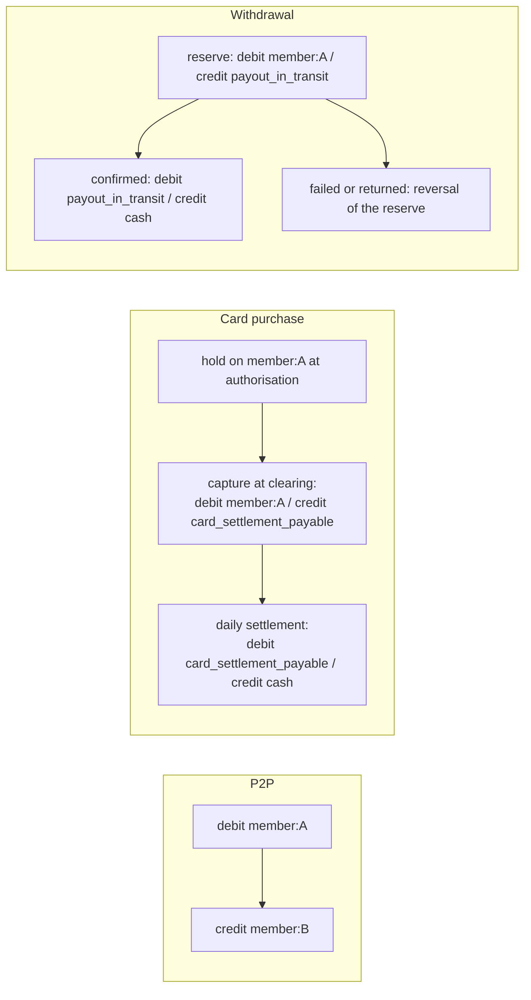
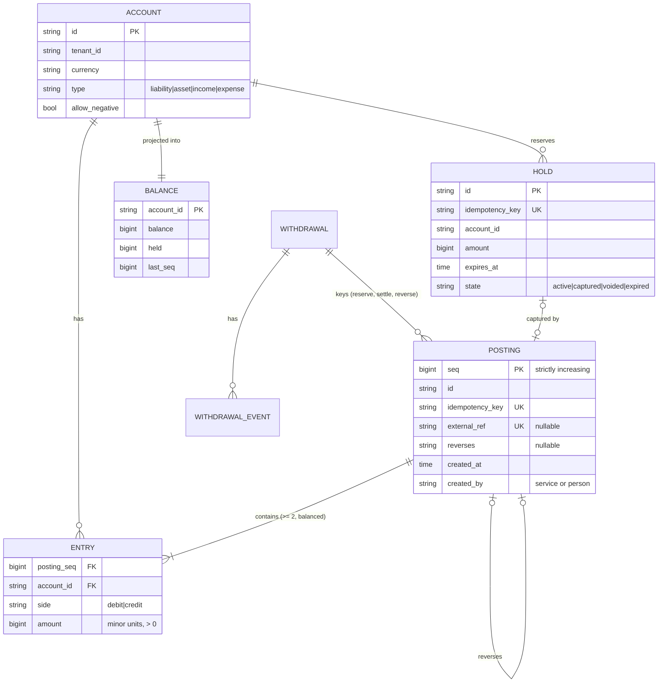
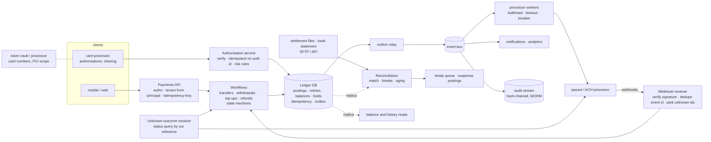
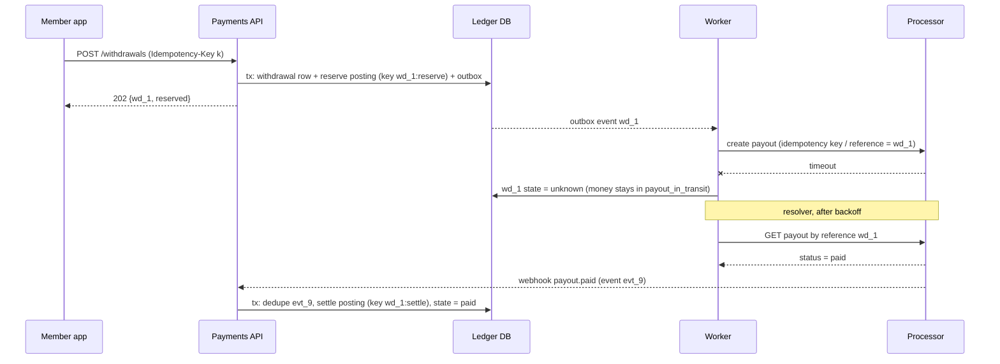

# C9 Unit 1 — Guided design: from the prompt to the high-level design

> Time: ~4 h · CORE: §1–§4 · STRETCH: the payday-file and hot-account arithmetic at the end of §2, the card
> lifecycle detail (clearing that differs from the authorisation, chargebacks) in §3 · Lab: none in this unit (Unit 2
> builds `labs/c9/ledger`)

"Design a payment system" is the case study where a mid-level answer and a senior answer look most alike on the
whiteboard and differ most underneath. Both draw an API, a payments service, a database and a box labelled
"processor". The mid-level design stores a `balance` column and updates it; calls the processor inside the request;
retries on timeout; and treats the processor's 200 as the end of the story. The senior design keeps an append-only,
double-entry journal and derives every balance from it; makes every hop idempotent on a key that comes from the
business fact; treats a processor timeout as an *unknown outcome* that is resolved, never guessed; parks money it
can't explain in a suspense account; and reconciles every day against the processor's settlement file, because every
mechanism above has a failure window and reconciliation is how you find what fell through it.

This unit runs the 45-minute framework ([`docs/INTERVIEW_FRAMEWORK.md`](../../docs/INTERVIEW_FRAMEWORK.md)) phase by
phase on this problem. Each section is one phase. Commit to your answer at every predict block before opening the
reveal: the reveals are the walkthrough, and the gaps between your version and the reveal are what to study. Unit 2
does the deep dives (the ledger core, idempotency across the processor boundary, reconciliation and audit) and the
lab.

## Before you start

You should have passed A2 ([storage](../A2-storage/README.md)), A5 ([consistency](../A5-consistency/README.md)), A6
([async](../A6-async/README.md)), A7 ([reliability](../A7-reliability/README.md)) and A9
([security and multi-tenancy](../A9-security-multitenancy/README.md)). This module applies all five to money. Warm-up,
answer first:

1. Two requests each withdraw $700 from an account holding $1,000, concurrently, under READ COMMITTED. Each does
   `SELECT balance`, checks `balance >= 700`, then `UPDATE accounts SET balance = balance - 700`. What's the final
   balance, and what's the smallest change that prevents it?
2. Where must an idempotency key be stored for a money-moving endpoint, and why not in a Redis cache next to the API?
3. A consumer reads `payout.requested` from Kafka with exactly-once semantics enabled and calls the processor's
   payout API. Is the payout exactly-once?

<details data-kind="answer">
<summary>Warm-up answers</summary>

1. −$400. Both reads see $1,000, both checks pass, both updates apply: the double-spend from
   [A2 Unit 3 §7](../A2-storage/unit-3-transactions-schema.md#7-acid-in-practice-and-the-isolation-anomalies). The
   smallest fix is to make the check and the write one atomic step: a conditional update
   (`UPDATE … SET balance = balance - 700 WHERE id = ? AND balance >= 700`, then check the row count), or
   `SELECT … FOR UPDATE` before the check
   ([A2 Unit 3 §8](../A2-storage/unit-3-transactions-schema.md#8-mvcc-snapshot-isolation-locks-and-serializable)).
2. In the same database as the effect, inserted in the same transaction, behind a unique constraint
   ([A1 Unit 3 §2](../A1-networking-api/unit-3-idempotency-auth.md#2-idempotency-keys-end-to-end)). A cache with
   asynchronous replication can lose the most recent keys on failover, and a retry after promotion executes again;
   a cache write that is not atomic with the effect leaves a window where the effect committed and the key didn't.
   For money, fail closed (503) rather than run without the key store.
3. No. Kafka's guarantee ends at Kafka's boundary
   ([A5 Unit 2 §4](../A5-consistency/unit-2-time-ordering.md#4-exactly-once-is-an-end-to-end-property)). A crash after
   the processor call and before the offset commit repeats the call. The effect is exactly-once only if the processor
   call carries an idempotency key derived from the payout id and the processor honours it, and if reconciliation
   catches the residue.

</details>

---

## §1 Requirements and the clarifying questions that change the design

### The failure story

A digital-banking platform launches a wallet: members top up from an external bank account, pay each other, pay with
a debit card, and withdraw to their bank. v1 is one `wallets` table with a `balance NUMERIC` column, a transfers
endpoint that runs `UPDATE wallets SET balance = balance - :amt` and then `+ :amt` in two statements, and a payouts
endpoint that calls the processor synchronously with a 5 s timeout and retries twice.

Eighteen months and 4 M members later, finance closes the quarter and the books don't balance by $312,418.27. The
investigation takes six weeks and finds, in order of size:

- **Duplicate payouts, ≈ $190k.** The processor's p99 crossed 5 s during a brownout. The endpoint timed out, retried,
  and the processor paid twice: it had accepted the first request. Nothing recorded which requests had timed out.
- **Money created by a deploy, ≈ $64k.** A pod was killed between the debit and the credit statements of a transfer;
  the debit had committed in autocommit mode, the credit never ran. Other times the order was reversed and money
  appeared.
- **Overdrafts, ≈ $31k.** Double-tapped "Send" buttons and concurrent card authorisations both passed the balance check
  under READ COMMITTED.
- **A "quick fix", ≈ $18k.** Support had a tool that set a balance directly. It had been used 1,140 times. There was no
  record of the previous values.
- **Unexplained, ≈ $9k.** Card settlements from the processor that matched nothing on the platform, written off.

And the auditors' first question, "show us how this member's balance came to be $41.07 on 30 June", has no answer,
because the balance is a number that has been overwritten 600 times.

Nothing in that list is a scale problem. Every item is a missing requirement: no invariant that money is conserved, no
idempotency across the processor boundary, no atomicity across the legs of a transfer, no concurrency rule for the
balance check, no immutability, no reconciliation. Those are what to pin down in the first six minutes.

### Predict

<!-- predict id="C9-U1-P01" -->
**Predict.** Write your answers down first.

1. The interviewer says only: "Design the payments and ledger system for a digital wallet with about 10 million
   active members." Write the eight clarifying questions you'd ask, and next to each the design decision its answer
   changes.
2. Draft the functional requirements (at most six) and the non-functional requirements *with numbers*: latency for a
   card authorisation and for a transfer, availability, durability, and what "correct" means.
3. Write the invariants the system must never violate, as statements a nightly job could check.
<!-- /predict -->

### Reveal

<details data-kind="reveal" data-for="C9-U1-P01">
<summary>Reveal</summary>

**1. The questions, and what each decides.**

| Question | Why it matters | Decision it changes |
|---|---|---|
| Which money movements? P2P, card purchases, top-ups (pay-in), withdrawals (pay-out), refunds, chargebacks, fees, interest? | Each movement is a different set of postings and a different external party | The chart of accounts and the posting templates; which flows touch a processor |
| Are we the **system of record** for balances, or is there a core banking system behind us? | A credit-union core may own the official balance; we may keep a sub-ledger that must agree with it | Our ledger as source of truth vs a shadow ledger reconciled with the core; who answers card authorisations |
| Which external parties, how do they settle, and how do they tell us? Card processor, ACH or payments processor, our settlement bank | Settlement is batch and delayed; outcomes come by webhook, file and statement | Suspense and in-transit accounts; the reconciliation design; webhook handling |
| Can a member balance go negative? Overdraft lines? Can the card network force a debit without an authorisation? | The no-negative rule is the one invariant that needs a strongly consistent read-then-write | Concurrency control on member accounts; which accounts may go negative |
| Latency budget for a card authorisation, and what happens if we don't answer in time? | The network has a timeout and a stand-in policy; a slow ledger means declines or stand-in approvals we didn't make | Authorisation path design (holds, no remote calls), availability target |
| Volume: per day, peak, and the biggest batch (payroll day, a holiday shopping peak)? | Average rate is small; bursts and **hot accounts** are not | Whether one database primary suffices; how house accounts are written |
| Currencies? | Multi-currency means FX, rounding and per-currency accounts | Account currency rule; FX as postings through an FX account (STRETCH, Unit 2 §8) |
| What must we prove afterwards, to whom, for how long? Who may correct an error? | Auditors, regulators, disputes | Append-only journal, reversals not edits, maker-checker on manual postings, hash-chained audit stream, retention |

Two more that are fine to ask if time allows: "Multi-tenant (one platform, many credit unions)?" (tenant on every
account, per-tenant settlement accounts and processor credentials; §4) and "Do we store card numbers?" (PCI scope;
tokenise; Unit 2 §8).

**2. Requirements for the wallet version** (state them as assumptions if the interviewer says "you decide").

Functional:
- **Move money** between member accounts (P2P), from external banks (top-up) and to external banks (withdrawal),
  each as an idempotent request with a status.
- **Card authorisations**: approve or decline in real time against the *available* balance, placing a hold; clearing
  later captures (all or part of) the hold; unused holds expire.
- **Refunds and reversals** as new postings that undo earlier ones; nothing is edited or deleted.
- **Balances and history**: current and available balance per account, statement history, the posting behind every
  change.
- **Reconciliation** with every external party's settlement data, daily, with a break queue for humans.
- **Audit**: every posting and every manual action traceable to who, when and why.

Non-functional, with numbers:
- **Correctness first**: money is conserved (every posting balances), no request moves money twice, no member account
  goes below its available balance unless policy says so. These are not "five nines"; they are always.
- **Card authorisation**: our decision in p99 ≤ ≈ 100 ms; the network's overall timeout is a few seconds and is the
  processor's to manage (`TODO-VERIFY: authorisation response time limits and stand-in rules for your network and
  processor`). Availability of this path ≈ 99.99%, because a down ledger means declined cards at checkout.
- **Transfers**: p99 ≤ 500 ms for P2P (internal, one database transaction); withdrawals are asynchronous (202 + status)
  because the processor is in the path.
- **Durability**: RPO 0 for acknowledged postings within a region (synchronous replica in a second zone); the
  cross-region RPO is stated, not zero ([A5 Unit 3 §4](../A5-consistency/unit-3-consensus-leases.md#4-choosing-a-model-for-money-movement)).
- **Volume** (assumed): ≈ 10 M operations a day (5 M card authorisations, 2 M P2P, 1 M top-ups, 1 M withdrawals,
  the rest refunds, fees and adjustments), peak hour ≈ 5× average.
- **Audit and retention**: journal kept ≈ 7 years (`TODO-VERIFY: the record-retention rules that apply to your
  institution and jurisdiction`); reconciliation breaks resolved or explained within ≈ 2 business days.

Out of scope: fraud scoring and risk models (a box that answers approve/decline), the card-issuing programme setup,
KYC and onboarding, interest calculation, the mobile UI.

**3. The invariants**, each checkable from the journal alone:

1. Every posting balances: Σ debits = Σ credits, per currency.
2. Every balance equals the sum of its journal entries (balances are derived, never set).
3. The sum of all balances in a currency is zero (a closed double-entry system).
4. One idempotency key produces at most one posting; one external reference is posted at most once.
5. No account opened as "may not go negative" has available balance < 0.
6. The journal is append-only: sequence numbers strictly increase, nothing is updated or deleted, and every
   correction is a reversal linked to what it reverses.

The tempting wrong answers: "strong consistency" as a requirement with no invariant behind it; "exactly-once" as a
requirement (it is an end-to-end property you build, not one you buy); "the ledger must be fast" with no number; and
leaving out reconciliation, which is the requirement that admits the other mechanisms can fail.

</details>

### How it actually works

A payments system is two different things that candidates blur: a **ledger** (an accounting record of who owns what,
which only ever appends balanced postings) and a set of **money-movement workflows** (a payout, a card purchase, a
top-up) that talk to the outside world and, at each step, ask the ledger to record what happened. Keep them apart on
the board. The workflows have state machines, timeouts and retries; the ledger has invariants.

**Double entry in one paragraph.** Every movement is recorded as at least two *entries* that sum to zero: something
is debited and something is credited, by equal amounts. Each account has a *normal side*: for the platform's own books,
a member's wallet is a **liability** (money the platform owes the member), so a credit increases it; the platform's cash
at its settlement bank is an **asset**, so a debit increases it. A member paying $40 with their card is
`debit member:4471 40.00 / credit card_settlement_payable 40.00`: the platform owes the member $40 less and owes the
card network $40 more. Nothing is created or destroyed, so the sum over all accounts is always zero, and an error
shows up as an imbalance instead of hiding in a number.

**The chart of accounts for the wallet** (per tenant and per currency, if those apply):

| Account | Type (platform's view) | Normal side | May go negative? | Used by |
|---|---|---|---|---|
| `member:<id>` | liability | credit | no (unless an overdraft product) | every flow |
| `card_settlement_payable:<processor>` | liability | credit | yes | card clearing (credit), daily network settlement (debit) |
| `cash:<settlement bank>` | asset | debit | yes (it's the platform's money) | settlements in and out |
| `topup_in_transit:<processor>` | asset (receivable) | debit | yes | top-up initiated → funds arrive |
| `payout_in_transit:<processor>` | liability (clearing) | credit | yes | withdrawal reserved → processor confirms |
| `suspense:<processor>` | clearing | either | yes | money that arrived or left and isn't explained yet |
| `fee_revenue`, `interchange_revenue` | income | credit | yes | fees, card interchange |
| `chargeback_losses`, `fraud_losses` | expense | debit | yes | disputes lost, write-offs |

The lab ([`labs/c9/ledger`](../../labs/c9/ledger/)) simplifies the sign convention: every account's balance is
credits − debits, member accounts are opened with `allowNegative = false`, and house accounts (settlement, suspense)
with `allowNegative = true`. Asset accounts therefore show negative numbers in the lab; the arithmetic, and the
"sum of all balances is zero" invariant, are the same.

**The money movements as posting templates** (Unit 2 §5 implements them):



### Build it

No lab for this section. The invariants become `Audit` and the no-negative rule in `labs/c9/ledger` (Unit 2 §5); the
chart of accounts is the set of `OpenAccount` calls in the lab's tests (`settlement` may go negative, members may not).

### Break it

Change one requirement at a time and trace which decisions flip. Write your answer before opening the box.

(a) "We are the system of record" becomes "the credit union's core banking system is the system of record; we show
balances and initiate transfers". (b) "No member account may go negative" becomes "members have a $500 overdraft
line". (c) One platform becomes forty credit unions, each with its own settlement bank account and processor
credentials.

<details data-kind="answer">
<summary>What flips</summary>

(a) Our ledger becomes a **sub-ledger** (or shadow ledger): it records what we initiated and what we believe, the core
posts the real entries, and the core's daily file becomes a third reconciliation source next to the processor's
(three-way recon, Unit 2 §7). Card authorisations may be answered by the core or by the processor's stand-in, not by
us; the "available balance" we show is a cache with an "as of" time. Every transfer becomes a saga across our
ledger and the core's API, with the core call carrying our idempotency key and an unknown-outcome path. This is the
integration work you have done; say it.
(b) The invariant becomes `available ≥ −overdraft_limit` per account, a per-account parameter, plus fee and interest
postings. The concurrency rule is unchanged: still a read-then-write that must be atomic per account.
(c) Every account carries `tenant_id`; each tenant gets its own `cash`, `card_settlement_payable`, `suspense` and
revenue accounts; postings must not mix tenants (a validation rule, like the currency rule); reconciliation runs per
tenant per processor; and cross-tenant P2P goes through explicit inter-tenant settlement accounts, so each credit
union's books still balance on their own.

</details>

### In the wild

- **Stripe** describes an internal double-entry system ("Ledger") that models money movement as balanced
  transactions and is used to validate that every flow nets out (`TODO-VERIFY: the name, scope and published details
  of Stripe's Ledger engineering post`).
- **Square's "Books"** was described as an immutable double-entry accounting database service (`TODO-VERIFY: the
  engineering-blog details`); **Modern Treasury** and **Formance** sell ledgers as a product with accounts, balanced
  transactions and idempotency keys (`TODO-VERIFY: current API concepts`).
- **TigerBeetle** is a database built for this: accounts and transfers are first-class, every transfer is a debit and
  a credit, and "pending" (two-phase) transfers reserve funds the way a card hold does (`TODO-VERIFY: current
  feature set and naming`).
- **Card networks** run on an authorisation message in real time and clearing and settlement in batches; ISO 8583
  is the classic message standard for authorisations and reversals (`TODO-VERIFY: which message types and formats
  your processor exposes, often as JSON over HTTPS rather than raw ISO 8583`).

### Trade-offs

| Option | Wins when | Loses when | When the answer flips |
|---|---|---|---|
| We are the system of record (our ledger is the books) | Wallets, neobanks, e-money and marketplace platforms that hold customer funds in their own books | A licensed core already owns balances and regulatory reporting | Flip to a sub-ledger reconciled with the core when a core banking system is the institution's book of record |
| Single-entry balances (one number per account) | Toy apps, loyalty points with no external money | Any real money: errors are invisible, nothing proves conservation | Flip to double entry the moment money leaves or enters through an external party (always, for payments) |
| Ledger and workflows in one service | Small team, one database, transactions span both | Workflows need their own scaling, deploys and integrations | Split when processor integrations multiply; keep the ledger as a small, boring service with a narrow API |
| Real-time authorisation by us | We hold the balances and want control | We can't meet the latency and availability budget | Flip to processor stand-in with limits we push to the processor, reconciled afterwards |

### Senior bar

- **Failure modes of bad scoping**: no chart of accounts (postings can't be expressed, only balances updated); no
  invariants (nothing for the audit job to check); "exactly-once" in the requirements; no system-of-record question
  (two systems both believe they own the balance); no reconciliation requirement (the $9k written off in the story).
- **Capacity**: comes in §2; the point here is that correctness invariants are requirements with no tolerance, while
  latency and availability have numbers.
- **Ops**: posting templates are reviewed by finance, not invented per feature; manual postings need a second person
  (maker-checker, [A9 Unit 2 §5](../A9-security-multitenancy/unit-2-data-protection-audit.md#5-compliance-data-lifecycle-and-separation-of-duties));
  every account has an owner who answers for its breaks.
- **Cost**: the expensive outcomes are duplicates (money paid out twice, recovered slowly or not at all), write-offs
  of unexplained differences, and audit findings. Engineering for correctness is cheap next to any of them.

Interviewer follow-up probes:

1. "Why double entry? Isn't a balance column per account simpler?"

<details data-kind="answer">
<summary>Model answer</summary>

A balance column records a result and loses the cause. Double entry records every movement as balanced entries, so
three things become checkable: every posting nets to zero, every balance equals the sum of its entries, and all
balances sum to zero. A bug that creates or destroys money breaks one of those and is caught by a job, not by a
quarter-end investigation. It also answers "how did this balance come to be?" by listing entries, which is the first
question in any dispute or audit. The balance column survives, as a cached projection of the journal, maintained in
the same transaction and recomputable.

</details>

2. "Who's the system of record here: you or the core banking system? Why does it matter?"

<details data-kind="answer">
<summary>Model answer</summary>

Whoever's books the regulator and the auditors treat as official. If it's us, our journal is authoritative and the
core (if any) is fed from it. If it's the core, our ledger is a sub-ledger: we record intent and our view of
outcomes, the core posts the real entries, and every transfer is a saga with an idempotent call to the core and
reconciliation against its daily file. The design question that follows is who answers card authorisations, because
whoever answers must hold the authoritative available balance.

</details>

3. "Which of your requirements has no tolerance at all?"

<details data-kind="answer">
<summary>Model answer</summary>

Conservation (every posting balances, balances sum to zero), at-most-once effect per idempotency key, and the
no-negative rule on member accounts. Latency, availability and even reconciliation timeliness have targets; those
three are invariants. They drive the hardest decisions: atomic postings, the idempotency key in the same transaction
as the effect, and a strongly consistent read-then-write on the member's available balance.

</details>

### Check yourself

1. What's the difference between the ledger and a payment workflow?
2. Why is a member's wallet a liability in the platform's books, and what does that make its normal side?
3. Name four invariants a nightly job can check from the journal alone.

<details data-kind="answer">
<summary>Answers</summary>

1. The ledger appends balanced postings and enforces invariants; a workflow (payout, card purchase) has a state
   machine, talks to external parties, and asks the ledger to record each step.
2. The platform owes that money to the member; liabilities are credit-normal, so a credit increases the wallet.
3. Any four of: every posting balances; each balance equals the sum of its entries; all balances sum to zero; one
   posting per idempotency key and per external reference; no restricted account below zero available; sequence
   numbers strictly increase and reversals link to what they reverse.

</details>

---

## §2 Estimation: the numbers that decide the design

### The failure story

The v2 team did the arithmetic on averages: 10 M operations a day is ≈ 116 a second; one Postgres primary does
thousands of small transactions a second; done. Three numbers they didn't compute. The **hot account**: every card
capture credited `card_settlement_payable`, every fee credited `fee_revenue`, and each posting locked that account's
balance row. At the Black Friday peak the payable account took ≈ 600 postings a second, the row lock serialised them
at ≈ 300 a second, and authorisation latency went from 15 ms to 4 s while the database sat at 20% CPU. The
**unknown outcomes**: 0.2% of processor calls timed out, which sounded small until it was ≈ 4,000 payments a day,
each needing someone to decide whether the money had moved. The team had planned for "a few". The **journal**: they
sized storage from "transfers", not from entries with indexes, kept forever, replicated three times.

### Predict

<!-- predict id="C9-U1-P02" -->
**Predict.** Assumptions: ≈ 10 M operations a day (5 M card authorisations, 2 M P2P transfers, 1 M top-ups, 1 M
withdrawals, ≈ 1 M refunds, fees and adjustments); peak hour ≈ 5× average; the ledger writes ≈ 12 M postings a day
with ≈ 2.5 entries each; a posting stored with its entries and indexes ≈ 700 B; replication ×3; retention ≈ 7 years;
≈ 2 M processor calls a day (top-ups and withdrawals), ≈ 0.2% of which time out or fail ambiguously; a posting that
touches a row holds that row's lock for ≈ 2–4 ms (statement work plus commit).

Compute, carrying units, and write the decision each number drives:

1. Average and peak-hour postings per second. Does one relational primary carry it?
2. The rate at which `card_settlement_payable` is written in the peak hour (assume ≈ 60% of postings are card
   captures or reference that account), and the most postings per second one row lock allows.
3. Unknown outcomes per day.
4. Journal storage per day, per year, and for the retention period with replication.
5. The daily reconciliation volume (one line per card clearing and per processor payment) and whether it needs a
   cluster.
<!-- /predict -->

### Reveal

<details data-kind="reveal" data-for="C9-U1-P02">
<summary>Reveal</summary>

1. 12 M / 86,400 s ≈ **140 postings/s average**; × 5 ≈ **700/s in the peak hour**. Each posting is one transaction of
   ≈ 8 row writes (header, ≈ 2.5 entries, ≈ 2.5 balance updates, the idempotency key, an outbox row). A relational
   primary does ≈ 1k–10k small transactions per second ([`docs/NUMBERS.md`](../../docs/NUMBERS.md)). Decision: **one
   primary per region carries this scale**, with a synchronous standby in a second zone. Don't spend interview time
   sharding the ledger by default; say when you would (≈ 10× growth, or per-tenant isolation, A4).
2. ≈ 60% × 700 ≈ **420 writes/s** to one account. One row lock held ≈ 2–4 ms allows ≈ **250–500/s**, so the peak
   hour is at the edge and any holiday spike crosses it. Decision: **house accounts must not be a single hot row**.
   Accounts that may go negative need no balance check, so their entries can be appended without locking a balance
   row and their balance derived asynchronously, or the account split into N sub-accounts summed on read
   (Unit 2 §5). This is the number that decides the ledger's write path.
3. 2 M × 0.2% ≈ **4,000 unknown outcomes a day**. Decision: resolution is a **system**, not a person: a payment
   state machine with an `unknown` state, automated status queries keyed by our reference, money parked in an
   in-transit or suspense account, reconciliation as the final word, and a human queue only for the residue (Unit 2
   §6). "Retry on timeout" would turn a fraction of these into duplicate payouts.
4. 12 M × 700 B ≈ **8.4 GB/day** ≈ 3 TB/year; × 3 replicas ≈ 9 TB/year; × 7 years ≈ **≈ 64 TB**. Decision: a journal
   partitioned by month, ≈ 13 months hot on the primary for statements and disputes, older partitions moved to cheaper
   storage (and a columnar copy for audit queries); the **balances table** is tiny (≈ 10 M accounts × ≈ 100 B ≈ 1 GB)
   and lives in memory.
5. ≈ 5 M card clearing lines + ≈ 2 M processor payments ≈ **7 M lines/day**; at ≈ 100 B per in-memory record that's
   ≈ 700 MB for a hash join on the reference. Decision: **one machine matches a day's file in minutes**; the hard
   part is the break rules and the people process, not compute. At a 0.1% break rate that is ≈ 7,000 breaks a day,
   most of them timing differences that clear in the next cycle, so auto-clearing rules and aging matter more than
   speed.

The tempting wrong answers: sharding on day one ("payments are big"); sizing from operations instead of entries with
indexes; missing the hot account entirely (it's the bottleneck at an average rate one primary handles easily); and
treating 0.2% as negligible.

</details>

### How it actually works

The estimate sheet, in the order you'd write it on the board:

| Number | Arithmetic | Decision |
|---|---|---|
| Postings, average | 12 M/day ÷ 86,400 ≈ 140/s | One primary per region; not a sharding problem |
| Postings, peak hour | × 5 ≈ 700/s, ≈ 5.6k row writes/s | Synchronous standby in-zone, batched commits, a connection pool sized by Little's law |
| Hot house account | ≈ 420/s against ≈ 250–500/s per row lock | Append-only entries for house accounts, async balance or sub-accounts |
| Card authorisation budget | ≈ 100 ms p99 ours: API ≈ 10 ms + one ledger transaction ≈ 5–20 ms + risk check | No remote calls in the authorisation path; holds, not postings |
| Processor calls in flight | ≈ 70/s peak × ≈ 0.5 s ≈ 35; at a 10 s brownout ≈ 700 | A bulkhead and breaker per processor (A7); withdrawals asynchronous |
| Unknown outcomes | 2 M × 0.2% ≈ 4,000/day | State machine with `unknown`, automated status query, suspense, recon |
| Journal | ≈ 8.4 GB/day, ≈ 64 TB at 7 years replicated | Monthly partitions, tiering, balances in memory |
| Reconciliation | ≈ 7 M lines/day, ≈ 700 MB to match | One batch job; invest in break rules and aging |

The single-writer-per-account bound from [A5 Unit 3 §4](../A5-consistency/unit-3-consensus-leases.md#4-choosing-a-model-for-money-movement)
is the reason the hot account matters: postings to one account serialise through its row (or its leader), so one
account's rate is ≈ 1 / (lock hold time). Every member account is far below that (a member posts a few times a day);
three or four house accounts are far above it. The design treats those two populations differently.

**STRETCH — payday and the processor's batch.** On payday, 1 M payroll top-ups arrive as one settlement file at
06:00 and the platform wants them credited before members wake up. One posting each, all debiting
`topup_in_transit` and crediting a member: 1 M postings in an hour is ≈ 280/s, on top of the morning's card traffic,
and every one of them debits the same house account. Two tools: post the batch with the house leg **aggregated**
(one posting per file chunk with thousands of member legs and one house leg), and make the job resumable and
idempotent per line (key = `topup:<file id>:<line>`), so a crash at line 600,000 restarts there. A 1,000-leg posting
is one transaction touching 1,000 member rows and one house row instead of 1,000 transactions fighting for the house
row.

### Build it

No lab for this section. Run `sd estimate -kind qps -n 3` and `sd estimate -kind concurrency -n 3` before Unit 2; the
numbers above should come out of your head in the design exercise.

### Break it

Re-run the sheet with each change and note which decisions flip: (a) 10× the members; (b) the ledger runs in two
regions with synchronous cross-region commits (≈ 70 ms per commit); (c) the processor's timeout rate goes from 0.2% to
2% during a week-long incident.

<details data-kind="answer">
<summary>What flips</summary>

(a) ≈ 7,000 postings/s in the peak hour is past one primary's comfortable range: shard member accounts by account id
or by tenant (A4), keep each posting inside one shard where possible (both members of most P2P transfers are not on
the same shard, so cross-shard transfers become a two-step saga through a clearing account, Unit 2 §8), and the hot
account problem is 10× worse. ≈ 640 TB of journal at 7 years: tiering is no longer optional.
(b) A hot account's throughput falls to ≈ 1/0.07 s ≈ **14 postings/s**, and any member's postings serialise at that
rate too. The card budget (≈ 100 ms) can't afford a 70 ms commit plus anything else. Keep each account's writes in a
home region with a synchronous standby nearby, replicate asynchronously elsewhere, and state the cross-region RPO
([A5 Unit 3 §4](../A5-consistency/unit-3-consensus-leases.md#4-choosing-a-model-for-money-movement)).
(c) ≈ 40,000 unknown outcomes a day, ≈ $ millions in in-transit: the automated resolver and its status-query rate
matter (a resolver that queries every unknown every minute is its own load on a struggling processor), the
in-transit balance needs an alert and a treasury conversation, and a manual queue is hopeless. This is when the
breaker should stop new withdrawals rather than add to the unknown pile.

</details>

### In the wild

- **Relational ledgers at this scale** (Postgres, MySQL, Oracle in core banking) commonly run one primary per shard
  with synchronous standbys; a few thousand postings per second on one primary is ordinary for small transactions
  ([`docs/NUMBERS.md`](../../docs/NUMBERS.md); `TODO-VERIFY` against your hardware and schema).
- **Hot accounts** are a known problem in ledger engineering: published designs batch postings to them, split them
  into sub-accounts, or compute their balances asynchronously because no check reads them (`TODO-VERIFY: specific
  published examples, e.g. engineering posts on ledger hot accounts`).
- **Card clearing files** arrive daily from the processor or network (`TODO-VERIFY: the formats your processor uses,
  e.g. network clearing files or a processor-specific CSV/JSON export`); **ACH** settles in batches through
  scheduled windows (`TODO-VERIFY: current same-day and next-day ACH settlement windows`).

### Trade-offs

| Option | Wins when | Loses when | When the answer flips |
|---|---|---|---|
| One primary per region (+ sync standby) | Up to ≈ a few thousand postings/s; simplest correct design | Growth past one box; tenant isolation requirements | Flip to sharding by account or tenant at ≈ 5–10× growth, or when a regulator wants per-tenant data isolation |
| House-account balance row updated per posting | Low volume; one simple code path | The row lock caps the whole platform at ≈ 1/lock-time | Flip to append-only house legs with async balances (or N sub-accounts) once any account exceeds ≈ 100 postings/s |
| Keep the whole journal hot | Small history, simple queries | Tens of TB on primary storage; backups and restores slow | Flip to monthly partitions with tiering once the journal outgrows the hot window you actually query |
| Human resolution of unknown outcomes | A handful a week | Thousands a day | Flip to an automated resolver with a human queue for the residue as soon as volume is above a few dozen a day |

### Senior bar

- **Failure modes**: sizing from averages; sharding before the numbers ask for it; missing the hot account; treating
  a small failure percentage as a small count; storage without indexes, retention or replication.
- **Capacity numbers**: ≈ 140 postings/s average, ≈ 700/s peak hour; ≈ 250–500 postings/s per hot row; ≈ 4,000
  unknown outcomes a day; ≈ 8.4 GB/day of journal; ≈ 7 M reconciliation lines a day (all `≈`, assumptions stated).
- **Ops**: dashboards for postings per account (the top ten accounts by write rate *are* the hot accounts), lock wait
  time, in-transit and suspense balances and their age, unknown-outcome count by age.
- **Cost**: the database is not the cost line; the cost lines are duplicate payouts, write-offs and the operations
  team working breaks. An automated resolver or one rule that auto-clears timing differences pays for itself in a week.

Interviewer follow-up probes:

1. "Your peak is 700 postings a second. Why not shard from day one?"

<details data-kind="answer">
<summary>Model answer</summary>

Because one primary does several thousand small transactions a second, and sharding makes the most common operation,
a transfer between two members, a cross-shard workflow with a clearing account and a saga, where it was one
transaction. I'd design the schema so sharding by account or tenant is possible (no cross-account joins in the hot
path, tenant and account on every row), and shard when the numbers say so (≈ 5–10× growth) or when tenants require
isolation. Meanwhile the real limit is the hot house account, which sharding members doesn't fix anyway.

</details>

2. "What's the throughput of a single account, and which accounts hit it?"

<details data-kind="answer">
<summary>Model answer</summary>

Postings to one account serialise on its balance row or its single writer, so ≈ 1 / lock hold time: ≈ 250–500 per
second at 2–4 ms, ≈ 14 per second if each commit waits on a cross-region round trip. Members never hit it; the
platform's house accounts do: the card settlement payable, fee revenue, the processor in-transit accounts, a big
merchant's settlement account. Those accounts allow negative balances, so nothing needs to read their balance before
writing, and that's what lets us append their legs without the lock.

</details>

3. "0.2% of processor calls time out. Why is that a design problem rather than an ops problem?"

<details data-kind="answer">
<summary>Model answer</summary>

Because at 2 M calls a day it's ≈ 4,000 payments a day whose outcome we don't know, and each one is either a
potential duplicate (if we retry blindly) or a potential loss (if we assume failure and let the member retry). The
design must hold the money somewhere explicit while the outcome is unknown (in-transit), resolve it automatically by
querying the processor with our reference, and fall back to the settlement file. A team of humans can't decide 4,000
a day, and a wrong guess is money.

</details>

### Check yourself

1. Why does one primary carry this ledger, and what number would make you shard?
2. Why can a house account skip the balance-row lock, and a member account can't?
3. How many unknown outcomes a day at 2 M processor calls and 0.2%, and where does their money sit meanwhile?

<details data-kind="answer">
<summary>Answers</summary>

1. ≈ 700 postings/s at peak against ≈ 1k–10k small transactions/s per primary. Shard at ≈ 5–10× growth, or when a
   tenant isolation requirement says so.
2. A member account has a no-negative rule, so its balance must be read and checked atomically with the write; a
   house account may go negative, so nothing reads its balance before writing and its legs can be appended without
   locking a balance row.
3. ≈ 4,000; in an in-transit (or suspense) account, visible on a dashboard, until a status query, a webhook or the
   settlement file resolves each one.

</details>

---

## §3 API and data model

### The failure story

The v1 transfer API was `POST /transfer {"from": …, "to": …, "amount": 25.10}`. One quarter of tickets traced back to
its shape:

- **No idempotency key.** The mobile app retried on network errors; ≈ 0.3% of transfers executed twice.
- **A float amount.** `25.10` arrived as `25.099999999999998`; a rounding step in one service and not another left
  sub-cent differences that summed to $1,900 by quarter end, and a currency field didn't exist.
- **The response was the new balance**, computed from a replica, so a member saw the old balance after a successful
  transfer and sent it again.
- **One `payments` row per payout with a `status` column** overwritten on every processor callback. After a
  `paid` → `returned` → `paid` sequence of out-of-order webhooks, the row said `paid` and the money had come back.
- **The processor's webhook was trusted as received**: no signature check, no dedupe. A replayed webhook credited a
  top-up twice.
- **Card numbers in the `payments` table** "for support", which put the whole database, its backups and every engineer
  with read access into PCI scope.

### Predict

<!-- predict id="C9-U1-P03" -->
**Predict.** Write your answers down first.

1. Design the API: a P2P transfer, a withdrawal, the card authorisation and clearing calls the processor makes to you,
   the processor's webhooks, and reads (balance, history). For each write: the idempotency mechanism, the success
   status code, and the error cases. How is an amount represented?
2. List the access patterns, then the tables, their keys and their unique constraints. Which tables are append-only?
   Where does a withdrawal's state live, and where do its ledger effects live?
<!-- /predict -->

### Reveal

<details data-kind="reveal" data-for="C9-U1-P03">
<summary>Reveal</summary>

**1. API.**

```
POST /v1/transfers                              # P2P, synchronous: one ledger transaction
Idempotency-Key: 2f6c…                          # generated once per member intent (the tap), reused on retries
Authorization: Bearer …                         # tenant and member come from the principal, never the body
{"from_account": "acc_4471", "to_account": "acc_9120",
 "amount": {"value": 2510, "currency": "USD"},  # integer minor units + ISO 4217 code; never a float
 "memo": "rent share"}
→ 201 Created   {"id": "tr_01J…", "status": "posted", "posting_id": "tx_000812",
                 "balance_after": {"value": 4107, "currency": "USD"}}   # from the write, not a replica
→ 201 (replay)  same body, header Idempotent-Replayed: true
→ 409           same key still in flight (Retry-After: 1)
→ 422           idempotency_key_reused (same key, different body) · insufficient_funds · currency_mismatch
→ 404           account not visible to this principal

POST /v1/withdrawals                            # pay-out: asynchronous, the processor is in the path
Idempotency-Key: 8a1d…
{"from_account": "acc_4471", "destination": {"bank_account_token": "ba_tok_…"},
 "amount": {"value": 50000, "currency": "USD"}}
→ 202 Accepted  {"id": "wd_01J…", "status": "reserved"}           # funds already moved to payout_in_transit
GET  /v1/withdrawals/{id}  → {"status": "reserved|submitted|unknown|paid|failed|returned", "events": […]}

POST /v1/card/authorizations                    # called by the card processor; mTLS or signed requests
{"processor_auth_id": "auth_77…", "card_token": "ct_…", "amount": {...}, "merchant": {...}}
→ 200 {"decision": "approve", "hold_id": "hold_000311"} | {"decision": "decline", "reason": "insufficient_funds"}
POST /v1/card/authorizations/{processor_auth_id}/reversal   → releases the hold (void)
(clearing: a daily file or per-item calls; each item → capture of the matching hold, keyed by the clearing id)

POST /v1/webhooks/{processor}                   # payout.paid, payout.failed, payout.returned, topup.settled …
→ 2xx only after the event is durably recorded; signature verified; deduped by the processor's event id

GET  /v1/accounts/{id}/balance   → {"balance": …, "available": …, "as_of_seq": 918273}
GET  /v1/accounts/{id}/entries?cursor=…   → keyset-paginated history, each row with its posting id
```

The points that score:
- **Amounts are integer minor units with a currency code.** Not floats, not decimal strings parsed differently by
  each service. Currencies have different exponents (JPY has 0 decimal places, most have 2, a few have 3), so the
  exponent comes from the currency (`TODO-VERIFY: ISO 4217 minor-unit table for the currencies you support`).
- **The key is generated per member intent**, before the first attempt, and reused on every retry. A key generated
  per HTTP attempt dedupes nothing.
- **P2P is synchronous and returns 201** because it is one local transaction; **withdrawals return 202** because the
  processor is in the path and its outcome may take hours (or come back days later as a return).
- **Inbound calls from the processor are idempotent too**, keyed by the processor's identifiers
  (`processor_auth_id`, the clearing id, the webhook event id): the processor retries, and its retries are exactly as
  dangerous as a member's double tap.
- **Card numbers never enter this API**: the processor and a token vault hold them; we see tokens.

**2. Access patterns → data model.**

| Access pattern | Rate | Served by |
|---|---|---|
| Post a balanced set of entries atomically | ≈ 700/s peak | `postings` + `entries` in one transaction, `balances` updated in the same transaction |
| Has this idempotency key been used, with what request? | every write | `postings.idempotency_key` UNIQUE (or an `idempotency_keys` table in the same database) with a request fingerprint |
| Has this external reference been posted? | every processor-driven posting | `postings.external_ref` UNIQUE (where not null) |
| Current and available balance of an account | every authorisation and transfer | `balances(account_id)` row, read `FOR UPDATE` when deciding; `holds` summed (or a maintained `held` column) |
| History of an account | statements, support | `entries(account_id, seq)` index, keyset pagination |
| Active holds of an account; a hold by processor auth id | authorisations, clearing | `holds(account_id, state)`, `holds.processor_auth_id` UNIQUE |
| A withdrawal's state and its events | status reads, resolver | `withdrawals(id)` with `state` + `withdrawal_events` append-only |
| Unknown or stale withdrawals | resolver, every minute | index on `withdrawals(state, updated_at)` |
| Webhook already processed? | per webhook | `inbound_events(processor, event_id)` UNIQUE |
| Events to publish | relay | `outbox` rows written in the posting transaction ([A6 Unit 2 §1](../A6-async/unit-2-outbox-consumers.md#1-the-dual-write-problem-and-the-transactional-outbox)) |

**Append-only**: `postings`, `entries`, `withdrawal_events`, `inbound_events`, the audit stream. **Mutable but
derived**: `balances` (a projection of `entries`, maintained in the same transaction, recomputable), `holds.state`
(active → captured / voided / expired, a one-way state machine), `withdrawals.state` (a summary of its events).

**The withdrawal's state lives in the payments workflow** (`withdrawals` and its events); **its money lives in the
ledger** as postings keyed `wd_01J…:reserve`, `wd_01J…:settle` and, if it fails, `wd_01J…:reverse`. The workflow can
retry any step, because each ledger call carries a key derived from the withdrawal id and the step name.

The tempting wrong answers: a `status` column overwritten by webhooks; a balance column with no journal; idempotency
keys in Redis; one `payments` table holding both business state and money; card numbers anywhere.

</details>

### How it actually works



**One posting is one database transaction.** In SQL terms, for a P2P transfer of 2,510 from A to B:

```sql
BEGIN;
-- 1. idempotency: a unique insert is the atomic "first one wins" (A1 Unit 3 §2)
INSERT INTO postings (idempotency_key, fingerprint, external_ref, created_by)
     VALUES ('member:4471:2f6c…', 'sha256:…', NULL, 'transfers-api') RETURNING seq;
-- on unique violation: SELECT the existing posting; same fingerprint → replay, different → 422
-- 2. lock the member rows that have a no-negative rule, in a fixed order (deadlock avoidance)
SELECT balance, held FROM balances WHERE account_id IN ('acc_4471','acc_9120') ORDER BY account_id FOR UPDATE;
-- 3. check available = balance - held >= 2510 for acc_4471 in application code; ROLLBACK on failure
INSERT INTO entries VALUES (:seq, 'acc_4471', 'debit', 2510), (:seq, 'acc_9120', 'credit', 2510);
UPDATE balances SET balance = balance - 2510, last_seq = :seq WHERE account_id = 'acc_4471';
UPDATE balances SET balance = balance + 2510, last_seq = :seq WHERE account_id = 'acc_9120';
INSERT INTO outbox (topic, key, payload) VALUES ('ledger.posted', 'acc_4471', '…');
COMMIT;
```

The idempotency check, the balance check, the entries, the balance projection and the outbox event commit or vanish
together. That is the production shape of the lab's single mutex: the lab holds one lock for the whole `Post`; a
database holds row locks on exactly the accounts involved, so unrelated postings run in parallel.

**Holds.** A card authorisation inserts a hold (keyed by `processor_auth_id`) and raises `balances.held` in the same
transaction as the available-balance check; it moves no money. Clearing captures it: one posting debiting the member
and crediting `card_settlement_payable`, plus closing the hold, atomically. An authorisation reversal voids it.
Expiry is evaluated lazily: a hold past `expires_at` stops counting against available balance even before a sweeper
marks it expired, so the member gets their money back on time even if the sweeper is late.

**STRETCH — when clearing doesn't match the authorisation.** Real card flows break the simple "capture ≤ hold"
model the lab uses. A restaurant authorises $40 and clears $48 with the tip; a fuel pump authorises a fixed amount
and clears the actual fill; a hotel authorises, then increments; some clearings arrive with no authorisation at all
or after the hold expired, and the issuer generally has to accept them (`TODO-VERIFY: network rules on
over-clearing tolerances, incremental authorisations and force posts`). So the capture path must handle: capture
less (release the remainder; the lab's partial capture), capture more (capture the hold plus a second posting for the
difference that *may* take the member negative, because refusing isn't an option once the network has settled), and
capture with no hold (a posting with policy `allowNegative` for that one leg, then collections). **Refunds** arrive
as new credit clearings from the merchant, not as reversals of the original posting. **Chargebacks** are a separate
workflow: the member disputes, the issuer may give provisional credit (`debit chargeback_receivable / credit member`),
the dispute goes to the network, and the outcome either settles the receivable or reverses the provisional credit
(`TODO-VERIFY: dispute timelines and provisional-credit rules, e.g. Regulation E in the US`).

### Build it

No lab for this section. In `labs/c9/ledger`, `Request` (`Key`, `Entries`, `ExternalRef`) is the posting request,
`Posting` (with `Seq`, `Reverses`) the journal row, `Hold` the holds table, and the unique constraints are the
`keys` and `refs` maps; `Post` is the transaction above, under one mutex.

### Break it

For each change, say what breaks and which lab test in Unit 2 catches the equivalent: (a) drop the unique constraint
on `idempotency_key` and check for the key with a `SELECT` before inserting; (b) store amounts as `float64`;
(c) update `balances` in a separate transaction after the entries commit.

<details data-kind="answer">
<summary>What breaks</summary>

(a) Two concurrent duplicates both see "no such key" and both post: check-then-act without atomicity. The lab's
`TestPost_ConcurrentDuplicatesExecuteOnce` fires 100 identical requests at once and demands exactly one execution.
(b) `0.1 + 0.2 != 0.3` in binary floating point; sums drift by fractions of a cent and different services round
differently, so postings stop balancing exactly and reconciliation reports mismatches of $0.01 forever. The lab uses
`int64` minor units throughout; Unit 2 §8 covers splitting and rounding.
(c) A crash between the two transactions leaves entries without balance updates: balances no longer equal the
journal sum. `TestAudit_PassesOnEmptyAndAfterWorkload` and the Audit break-it in Unit 2 §7 are exactly this check.

</details>

### In the wild

- **Stripe** amounts are integers in the currency's smallest unit (`amount: 2510` for $25.10), with a currency code
  and per-currency handling of zero-decimal currencies; requests take an `Idempotency-Key` header (`TODO-VERIFY:
  how long Stripe retains keys; documented as eligible for removal after 24 hours`).
- **Adyen** uses minor units with a currency in its amount objects, and an `Idempotency-Key` header on its APIs
  (`TODO-VERIFY`); **PayPal** uses a `PayPal-Request-Id` header for idempotency.
- **Webhook signatures**: Stripe signs webhooks with an HMAC in a `Stripe-Signature` header including a timestamp to
  limit replays; most processors offer an equivalent (`TODO-VERIFY` per processor).
- **PCI DSS** applies to systems that store, process or transmit cardholder data; tokenisation through the processor
  or a vault is the standard way to keep the rest of the platform out of scope (`TODO-VERIFY: current PCI DSS
  version and scoping guidance`).

### Trade-offs

| Option | Wins when | Loses when | When the answer flips |
|---|---|---|---|
| Integer minor units + currency code | Always for stored and transmitted amounts | Sub-minor-unit rates (FX, interest accrual) need more precision | Use a decimal type or scaled integer with more places for rates and accruals, rounding to minor units only at posting time |
| Balance projection updated in the posting transaction | Every read of a balance is cheap and consistent | Hot accounts serialise on the row | Flip to async balances (or sub-accounts) for house accounts that may go negative |
| Idempotency key as a column on `postings` | One insert, one constraint, no extra table | You want to cache non-posting responses (declines) | Flip to a separate `idempotency_keys` table in the same database when declines and validation errors must replay too |
| Workflow state separate from ledger postings | Retries per step are safe; the ledger stays small and auditable | Two places to look | Never merge them; link them by deriving posting keys from the workflow id and step |
| Synchronous withdrawal API | Never | — | Always `202` + status: processor latency and outcomes don't belong in the member's request |

### Senior bar

- **Failure modes**: floats; keys generated per attempt; idempotency keys outside the database of the effect; a key
  reused with a different body replayed silently instead of rejected; tenant or member id from the body; webhook
  handlers that return 200 before recording; status columns overwritten by out-of-order events; PANs in tables or logs.
- **Capacity**: ≈ 700 postings/s × ≈ 8 row writes ≈ 5.6k row writes/s; the unique index on `idempotency_key` grows by
  ≈ 12 M rows a day, so keys older than the longest client retry horizon plus a margin (≈ 30–90 days) are archived with
  their partition.
- **Ops**: schema changes to `entries` and `postings` are additive only; posting templates are versioned; the
  `inbound_events` table is the first place to look in a "did the processor tell us?" incident.
- **Cost**: storing the request fingerprint (≈ 32 B) per posting is what turns key reuse from a silent wrong replay
  into a 422; it costs ≈ 400 MB a day at this volume.

Interviewer follow-up probes:

1. "The client retries with the same key but a different amount. What do you return?"

<details data-kind="answer">
<summary>Model answer</summary>

422 `idempotency_key_reused`, and nothing is posted or replayed. The key identifies one intent; a different body under
the same key is a client bug (or an attack), and replaying the first response would tell the client its new request
succeeded when it didn't. I store a fingerprint of the canonical request (accounts, sides, amounts, currency, external
reference) with the key so this check is exact. The lab's `ErrKeyReused` is that rule.

</details>

2. "Why return the new balance from the write, not from a read after?"

<details data-kind="answer">
<summary>Model answer</summary>

Because a read after the write may hit a replica that hasn't applied it, and a member who sees their old balance
after "success" taps Send again, now with a fresh key if the app thinks the first one finished. The write transaction
knows the new balance exactly; returning it gives read-your-writes for free. For later reads I'd return `as_of_seq` so
the client can ask for at least that version.

</details>

3. "Where does a withdrawal's status live, and why not on the posting?"

<details data-kind="answer">
<summary>Model answer</summary>

In the withdrawal workflow: a row with a state machine and an append-only event list, because it changes many times
(reserved, submitted, unknown, paid, returned) and is driven by an external party. Postings are immutable accounting
facts, one per money movement: reserve, settle, reverse. The workflow keys each ledger call by `withdrawal id + step`,
so a retried step can't post twice, and a status change never edits the books.

</details>

### Check yourself

1. Why must an inbound processor call (an authorisation, a webhook) be idempotent, and on which key?
2. What are the two unique constraints on `postings`, and what does each prevent?
3. What's derived and what's the source of truth among `entries`, `balances` and `holds.state`?

<details data-kind="answer">
<summary>Answers</summary>

1. Processors retry on timeouts exactly like clients do; key on the processor's own identifier (`processor_auth_id`,
   the clearing id, the webhook event id), plus a ledger key derived from the business fact.
2. `idempotency_key` (one intent posts once) and `external_ref` (one processor reference posts once, and is what
   reconciliation matches on).
3. `entries` are the truth; `balances` is a projection maintained in the same transaction and recomputable;
   `holds.state` is a one-way state machine whose transitions happen in the same transaction as the related posting.

</details>

---

## §4 High-level design: the money paths traced

### The failure story

The first "real" architecture: an API, a payments service, a database, and a processor client called from the
request path. In the first quarter:

- The processor's payout API went from 400 ms to 12 s during an incident. Withdrawals were synchronous, the API's
  thread pool filled, and P2P transfers (which never touch the processor) timed out too.
- The card authorisation endpoint called the fraud vendor synchronously with a 3 s timeout. When the vendor slowed
  down, the processor's own timeout fired first and it approved on stand-in, up to limits nobody had configured.
- A webhook arrived for a payout before the payout row had committed (the processor was faster than our database).
  The handler returned 404, the processor gave up after its retry schedule, and the payout stayed `submitted` for
  three weeks until reconciliation found it.
- The nightly settlement import ran inside the primary, scanning `entries` with no index on `external_ref`, and took
  locks that stalled authorisations at 02:00.

### Predict

<!-- predict id="C9-U1-P04" -->
**Predict.** Draw the high-level design before opening the reveal. Then trace, in writing, box by box:

1. A card purchase: the authorisation, the clearing two days later, the network settlement.
2. A withdrawal: from the member's tap to the money in their bank, including what happens if the processor call
   times out.
3. Which boxes must be strongly consistent, which may be eventually consistent, and why.
4. What a P2P transfer depends on, and what happens to it when the processor is down.
<!-- /predict -->

### Reveal

<details data-kind="reveal" data-for="C9-U1-P04">
<summary>Reveal</summary>

1. **Card purchase.** *Authorisation*: processor → `POST /card/authorizations` (verified, idempotent on
   `processor_auth_id`) → risk check (local rules, cached; any remote scorer has a ≈ 30 ms budget and a fail-open or
   fail-closed rule decided in advance) → ledger `Hold(key = auth id, member, amount, ttl)` in one transaction: lock the
   member's balance row, check available, insert the hold → approve with the hold id. No processor call, no remote
   ledger, ≈ 20–50 ms. *Clearing*: the processor's clearing item (file or call) → match to the hold by auth id →
   ledger `Capture(key = clearing id, hold, amount, to = card_settlement_payable)`: one posting, hold closed, remainder
   released. *Settlement*: the daily net settlement with the network → one posting
   `debit card_settlement_payable / credit cash`, then reconciliation against the processor's settlement report and
   the bank statement.
2. **Withdrawal.** Member → `POST /withdrawals` (key from the tap) → payments service writes the withdrawal row and
   calls ledger `Post(key = wd:reserve, debit member / credit payout_in_transit)` — both in one database transaction if
   the services share the database, otherwise the workflow retries the ledger call with the same key → `202` →
   a worker (picking up the outbox event) calls the processor with **our withdrawal id as the processor's idempotency
   key and reference** → success: state `submitted`, wait for the webhook; **timeout: state `unknown`**, *not* failed,
   *not* retried with a new reference → the resolver queries the processor by our reference after a backoff → webhook
   `payout.paid` (signed, deduped by event id): `Post(key = wd:settle, debit payout_in_transit / credit cash)`, or
   `payout.failed`/`returned`: `Reverse(key = wd:reverse, the reserve posting)` → the bank statement and the
   processor's report confirm it in reconciliation.
3. **Strongly consistent**: the member's available balance (a decision reads it and writes), idempotency keys,
   `external_ref` uniqueness, hold state transitions. All of these live in the ledger database's transactions.
   **Eventually consistent**: balance displays and history from replicas (with `as_of_seq`), the event stream to
   notifications and analytics, the audit stream (append-only, ordered by sequence), house-account balances if derived
   asynchronously, reconciliation (daily by nature)
   ([A5 Unit 3 §4](../A5-consistency/unit-3-consensus-leases.md#4-choosing-a-model-for-money-movement)).
4. Only the ledger database. P2P is internal: one transaction between two member accounts. A processor outage must
   not touch it, which is why processor calls happen in workers behind a bulkhead, never in the API's request path.

</details>

### How it actually works



Why each box exists:

| Box | Exists because |
|---|---|
| Payments API | Authn, tenant scoping, request idempotency, validation; never calls a processor |
| Authorisation service | A ≈ 100 ms budget and ≈ 99.99% availability: local rules and one ledger transaction only |
| Workflows | Each money movement has states and external steps; the ledger shouldn't know about processors |
| Ledger DB | The invariants live in its transactions: balanced postings, no-negative, idempotency, unique refs |
| Outbox + relay | Events (to workers, notifications, audit) without a dual write ([A6 Unit 2 §1](../A6-async/unit-2-outbox-consumers.md#1-the-dual-write-problem-and-the-transactional-outbox)) |
| Processor workers | Timeouts, breakers and a bulkhead per processor ([A7 Unit 3 §5](../A7-reliability/unit-3-isolation-degradation-dr.md#5-capstone-the-resilient-vendor-adapter)); outages stay contained |
| Webhook receiver | Verify, dedupe, record, then acknowledge; park events for objects we haven't committed yet |
| Resolver | Turns `unknown` into `paid` or `failed` by asking, not guessing |
| Reconciliation | The backstop: compares our journal with what the processor and the bank say happened |
| Audit stream | Tamper-evident record of postings and manual actions ([A9 Unit 2 §4](../A9-security-multitenancy/unit-2-data-protection-audit.md#4-audit-trails-and-tamper-evidence)) |
| Token vault | Card data stays in PCI scope there (or at the processor); everything else sees tokens |

**The withdrawal path as a sequence**, with the unknown outcome drawn in:



Whichever arrives first (the resolver's answer or the webhook) posts the settlement; the second finds the key
`wd_1:settle` already used and replays. That is idempotency end to end: the member's key protects the request, the
withdrawal id protects the processor call, the step key protects each posting, and the event id protects the webhook.

**Tenancy.** For a platform serving credit unions, `tenant_id` is on every account and key, each tenant has its own
house accounts and processor credentials, the ledger rejects postings that span tenants (as it rejects mixed
currencies), and reconciliation runs per tenant per processor.

### Build it

No lab for this section. The lab in Unit 2 is the Ledger DB box: `Post`, `Hold`, `Capture`, `Void`, `Reverse`,
`Audit` and `Reconcile` are the operations every other box calls.

### Break it

Trace each failure through the diagram and say what the member sees: (a) the processor's payout API is down for 40
minutes; (b) the ledger primary fails over to its synchronous standby (≈ 30 s); (c) the webhook receiver acknowledges
before writing, then crashes.

<details data-kind="answer">
<summary>What happens</summary>

(a) Withdrawals are accepted (`202`, funds reserved into `payout_in_transit`) and queue in the workers; the breaker
opens after a few failures, so workers stop burning timeouts; when it closes, workers drain at a limited rate with the
same idempotency keys. Members see "processing". P2P and card authorisations are untouched. If the outage is long,
the product decision is whether to stop accepting withdrawals (and say so) rather than pile up reservations.
(b) ≈ 30 s of failed writes: card authorisations decline or fall to processor stand-in, P2P returns 503 and clients
retry with the same key after failover, which is safe. With a synchronous standby, no acknowledged posting is lost
(RPO 0 in-region). Holds placed during stand-in are reconstructed from the processor's advice messages afterwards
(`TODO-VERIFY: how your processor reports stand-in decisions`).
(c) The processor considers the event delivered and won't resend; we never recorded it. The payout stays `submitted`
until the resolver's stale-state sweep queries it, or reconciliation finds it. Fix: record (unique on event id), then
acknowledge; process from the recorded event.

</details>

### In the wild

- **Stripe, Adyen, PayPal** all deliver payment outcomes by webhook, at least once and not necessarily in order,
  and recommend deduplicating by event id and verifying signatures (`TODO-VERIFY` per provider's current docs).
- **Card processors and issuing platforms** (e.g. Marqeta, Lithic, Galileo) offer real-time authorisation webhooks
  ("just-in-time funding" or "auth stream") where the issuer's endpoint must decide within a short timeout, with a
  configured fallback if it doesn't (`TODO-VERIFY: product names, timeouts and fallback behaviour`).
- **Core banking integrations** for credit unions often expose transfers as API calls or batch files and the core's
  end-of-day file as the reconciliation source (`TODO-VERIFY` for the cores you integrate with).

### Trade-offs

| Option | Wins when | Loses when | When the answer flips |
|---|---|---|---|
| Reserve funds by posting to `payout_in_transit` | The outcome may take days; the member's history should show the pending debit | A failure needs a reversal posting | Use a hold instead only when an external party defines the expiry (card authorisations) |
| Reserve funds with a hold | The external party has a known lifetime (card auth) and releases on its own | A payout's outcome can arrive after any TTL; an expired hold frees money that's actually gone | Never use an expiring hold for an outbound payout |
| Workflow and ledger in one database | Reserve + workflow row in one transaction; simpler | One database for everything; coupled deploys | Split into services when teams and scale diverge; the step-key idempotency keeps the saga safe |
| Webhooks as the primary outcome signal | Fast, push-based | Lost, delayed, out of order | Always pair with a resolver that polls stale states, and reconciliation |
| Synchronous risk scoring in the authorisation | A strong model is worth the latency | The scorer's latency becomes the authorisation's | Flip to local rules plus async scoring that blocks the *next* authorisation when the scorer is slow or the budget is tight |

### Senior bar

- **Failure modes**: processor calls in the API request path (one vendor takes down P2P); `unknown` treated as
  `failed` (member retries, gets paid twice) or as `paid` (money lost if it failed); webhook acknowledged before
  recording; webhooks for objects not yet committed dropped; reconciliation running on the primary; holds used for
  payouts.
- **Capacity**: authorisations ≈ 60/s average, ≈ 300/s peak hour, each one transaction of ≈ 3 row writes; the event bus
  carries ≈ 700 events/s, trivial for a log; the reconciliation job reads a replica.
- **Ops**: dashboards for `payout_in_transit` and `suspense` balances by age, unknown count by age, webhook lag per
  processor, breaker state, authorisation p99 and decline rate by reason, stand-in approvals reported by the processor.
- **Cost**: a second processor for withdrawals is a contract and an integration; compare with the hours of
  withdrawals queued during each outage and the support load.

Interviewer follow-up probes:

1. "The processor call for a withdrawal times out. What do you do, step by step?"

<details data-kind="answer">
<summary>Model answer</summary>

Nothing irreversible. The withdrawal goes to `unknown`; the money stays in `payout_in_transit` (the member can't spend
it, and it isn't counted as paid out). The resolver waits a backoff, then queries the processor by our reference (the
withdrawal id we sent as its idempotency key). Found and paid → settle posting; found and failed → reversal; not found
after the processor's own processing window → resubmit with the *same* idempotency key (safe if the processor honours
it), or escalate if it doesn't. A webhook that arrives in the meantime does the same thing; both paths use the step
key `wd:settle`, so whichever is second replays. Reconciliation against the settlement report is the final check.

</details>

2. "Why does P2P not go through the event bus or the workers?"

<details data-kind="answer">
<summary>Model answer</summary>

Because it needs nothing outside the ledger: one transaction debits A and credits B with the no-negative check. Adding
a queue would make a synchronous, atomic operation asynchronous and introduce an in-between state for no benefit. The
event bus still gets a `ledger.posted` event from the outbox for notifications and the audit stream, after the fact.

</details>

3. "A webhook arrives for a payout id you don't have yet. What do you do?"

<details data-kind="answer">
<summary>Model answer</summary>

Record it (unique on the processor's event id), acknowledge, and park it as unmatched with a retry for a few minutes:
most likely our transaction hasn't committed yet. If it still doesn't match, it's a real break (a payout we didn't
initiate, a second environment sharing the webhook URL, or a tenant mix-up) and it goes to the break queue with an
alert. Returning 404 and relying on the processor's retries loses events when their schedule runs out.

</details>

### Check yourself

1. Which keys protect each hop of a withdrawal, from the tap to the settlement posting?
2. Why does the authorisation path avoid remote calls, and what does it do instead of moving money?
3. What does the member see during a 40-minute processor outage, and what keeps P2P working?

<details data-kind="answer">
<summary>Answers</summary>

1. The member's `Idempotency-Key` (the request), the withdrawal id as the processor's idempotency key and reference
   (the external call), the step keys `wd:reserve`, `wd:settle`, `wd:reverse` (each posting), and the processor's
   event id (each webhook).
2. Its budget is ≈ 100 ms with ≈ 99.99% availability, and the processor approves on stand-in if we're slow; it places
   a hold (reserves available balance) and lets clearing move the money later.
3. Withdrawals accepted and shown as processing, funds reserved; workers retry with the same keys behind a breaker
   when the processor recovers. P2P only needs the ledger database, and processor calls never happen in the API's
   request path.

</details>

---

## Unit wrap-up

| Decision | Default | Flip when… |
|---|---|---|
| Scope | Ledger (invariants) separate from workflows (state machines, processors); chart of accounts on the board early | We're a sub-ledger of a core: three-way recon, sagas to the core |
| Invariants | Postings balance; balances derived; Σ balances = 0; one posting per key and per external ref; no-negative on member accounts; append-only | Overdraft products change the floor, not the rule |
| Estimation | ≈ 140 postings/s average, ≈ 700/s peak: one primary per region; the hot house account and unknown outcomes are the numbers that shape the design | Shard at ≈ 5–10× or for tenant isolation |
| Money | Integer minor units + ISO 4217 currency, exponent from the currency | Higher precision for rates and accruals, rounded at posting time |
| API | `Idempotency-Key` per intent; 201 for P2P, 202 for withdrawals; 422 on key reuse; processor calls inbound are idempotent on their ids; tenant from the principal | — |
| Data model | `postings` + `entries` append-only; `balances` projection in the same transaction; holds with lazy expiry; workflow state separate, posting keys derived from workflow id + step | Async balances for hot house accounts |
| HLD | Authorisation: local rules + one ledger transaction; withdrawals: outbox → worker → processor with our id as its key, `unknown` state, resolver, webhooks, reconciliation | — |
| Consistency | Strong for decisions on money (available balance, keys, holds); eventual for displays, events, audit, recon | — |

Next: [Unit 2](unit-2-deep-dives.md) does the three deep dives an interviewer picks (the ledger core and its
concurrency; idempotency across the processor boundary; reconciliation and audit), lists the common mistakes, and
builds the ledger in `labs/c9/ledger`.
