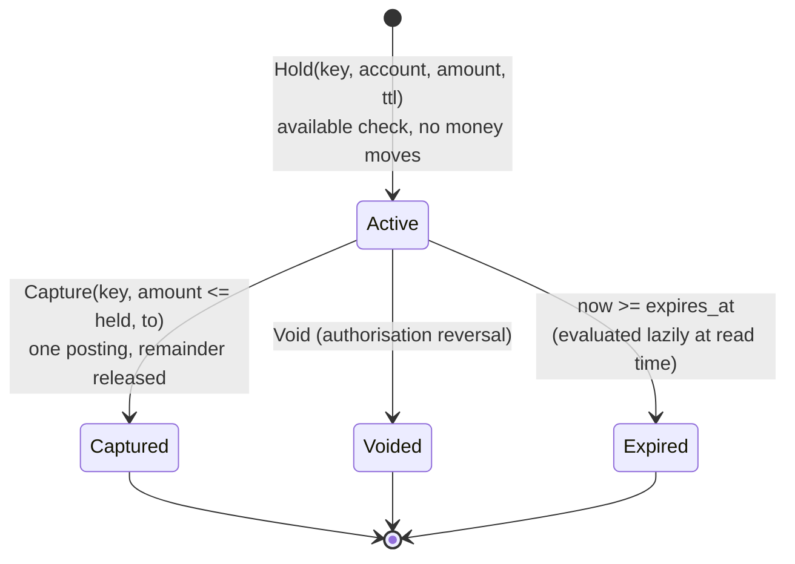
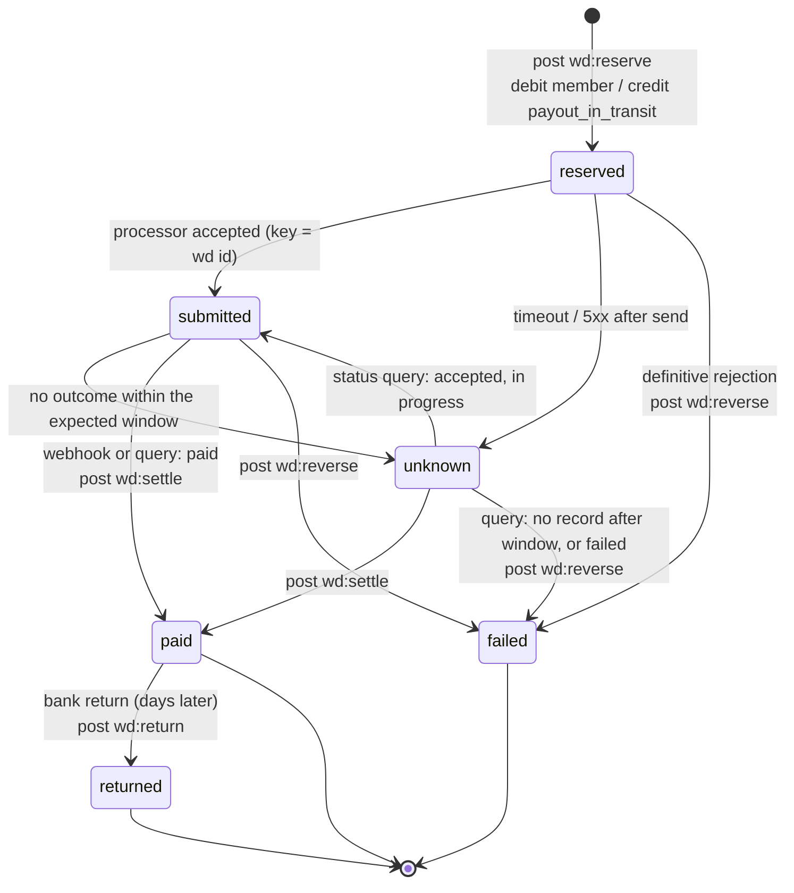
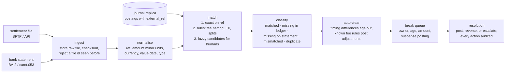

# C9 Unit 2 — Deep dives: the ledger core, the processor boundary, reconciliation and audit

> Time: ~5 h · CORE: §5–§7, Common mistakes · STRETCH: §8 (money representation, multi-currency, PCI scope, scaling
> past one primary) and the extra break-it questions · Lab: `labs/c9/ledger`

Unit 1 ended with an end-to-end design. The deep dives an interviewer picks for a payments system are almost always
these three: **the ledger itself** (how a posting stays balanced, atomic and correct under concurrency, how holds and
reversals work, and what a hot account does to it), **idempotency across the processor boundary** (every hop's key,
the unknown outcome, webhooks and sagas), and **reconciliation and audit** (how you find out that something went
wrong anyway, and how you prove to an auditor that nothing was edited). This unit does all three, builds the ledger
in Go, and lists the mistakes that cost candidates the senior score.

## Before you start

You should have finished [Unit 1](unit-1-guided-design.md). Warm-up, answer first:

1. Write the postings for a $40.00 card purchase from authorisation to the daily network settlement.
2. Why is a house account like `card_settlement_payable` a throughput problem, and why can it be written without
   locking its balance row?
3. A withdrawal's processor call times out. Which state does it go to, where is its money, and what happens next?

<details data-kind="answer">
<summary>Warm-up answers</summary>

1. Authorisation: a hold of 4,000 on the member's account (no posting). Clearing: capture, one posting
   `debit member 4,000 / credit card_settlement_payable 4,000`, hold closed. Settlement: one aggregated posting per
   day, `debit card_settlement_payable / credit cash` for the net amount (Unit 1 §1, §4).
2. Every capture credits it: ≈ 420 writes/s at peak against ≈ 250–500/s for one row lock (Unit 1 §2). It may go
   negative, so no decision reads its balance before writing; its legs can be appended and its balance derived.
3. `unknown`; in `payout_in_transit`; a resolver queries the processor by our reference, and a webhook or the
   settlement file can resolve it too. Never retried with a new reference, never assumed failed (Unit 1 §4).

</details>

---

## §5 The ledger core: balanced postings, holds, reversals and concurrency

### The failure story

The v2 ledger had `postings` and `entries` tables, which was progress, but three habits from v1 survived.

**Corrections were edits.** A merchant was overcharged $400 instead of $340; an engineer ran
`UPDATE entries SET amount = 34000 WHERE …` on both legs. Balanced, so the nightly check passed. Two weeks later the
member disputed the charge with the card network, which had settled $400, and the platform's records showed $340 with
no trace of the change. The dispute was lost and an auditor wrote a finding on the update grant.

**The no-negative check ran outside the lock.** The transfer handler read the member's available balance through the
ORM, checked it, then opened a transaction to insert the entries. Under a payday rush, two transfers of $700 from a
$1,000 balance both passed the check: ≈ 0.02% of transfers, ≈ 400 overdrafts a day at 2 M transfers, each a small
collections case.

**Holds expired by a cron job.** A sweeper ran hourly and marked holds older than seven days as expired. It failed
silently for a week after a credentials rotation. Members' available balances stayed reduced by authorisations that
merchants never cleared; the contact centre took 3,000 calls about "money missing from my account", and the money was
never missing, only reserved by holds that should have lapsed.

And at the November peak, every capture locked the `card_settlement_payable` balance row; authorisation p99 went from
20 ms to 3 s on a database at 25% CPU.

### Predict

<!-- predict id="C9-U2-P01" -->
**Predict.** Write your answers down first.

1. Write the entries (account, side, amount in cents) for: (a) a $25.00 P2P transfer with a $0.30 fee paid by the
   sender, as *one* posting; (b) a $60.00 card authorisation that clears at $45.00; (c) the correction of a posting
   that should have been $340 but was $400.
2. In a relational database, how do you guarantee the no-negative rule when 50 authorisations for the same member
   arrive at once? Name two mechanisms and the deadlock rule that comes with one of them.
3. What exactly does "available balance" mean, and how should an expired hold stop counting against it?
<!-- /predict -->

### Reveal

<details data-kind="reveal" data-for="C9-U2-P01">
<summary>Reveal</summary>

**1. Postings.**

(a) One posting, three legs, debits = credits = 2,530:

| Account | Side | Amount |
|---|---|---|
| `member:A` | debit | 2,530 |
| `member:B` | credit | 2,500 |
| `fee_revenue` | credit | 30 |

One posting, not two: if the fee were a separate posting, a crash between them would leave a transfer without its fee
(or a fee without its transfer), and a replay would need two keys to line up. Multi-leg postings are why the lab's
`Request` takes a slice of entries (`TestPost_MultiLegPostingAndDuplicateExternalRef`).

(b) Authorisation: `Hold(key = auth id, member:A, 6,000, ttl)`: balance unchanged, available −6,000. Clearing:
`Capture(key = clearing id, hold, 4,500, to = card_settlement_payable)`: one posting
`debit member:A 4,500 / credit card_settlement_payable 4,500`, the hold closes and the remaining 1,500 is released in
the same step. Nobody has to remember to release it (`TestHold_PartialCaptureReleasesRemainderAndIsIdempotent`).

(c) Never an edit. Either **reverse and re-post**: `Reverse(key, original)` posts the mirror image (every debit becomes
a credit, linked through `Reverses`) and a new posting of 34,000 follows; or **post the difference**: a 6,000 posting
in the opposite direction referencing the original. Reverse-and-repost keeps every posting meaning one real-world
event, which is what reconciliation and disputes want; the difference posting is fewer rows. Both leave the original
in the journal. The tempting wrong answer is "update both legs; it's still balanced": balanced, and unauditable.

**2. Concurrency.** The check (available ≥ amount) and the write must be one atomic step per account.
- **Row lock**: `SELECT … FROM balances WHERE account_id IN (…) ORDER BY account_id FOR UPDATE`, check, insert entries,
  update balances, commit. The 50 authorisations queue on the member's row; each sees the previous one's effect.
  **Deadlock rule**: lock accounts in a fixed global order (sorted ids), or two transfers A→B and B→A deadlock.
- **Conditional update**: `UPDATE balances SET held = held + :amt WHERE account_id = :a AND balance - held >= :amt`,
  then check the row count. One statement, the database's row lock makes it atomic; works under READ COMMITTED
  ([A2 Unit 3 §7](../A2-storage/unit-3-transactions-schema.md#7-acid-in-practice-and-the-isolation-anomalies)).
- **SERIALIZABLE** with retry on serialization failure: correct without thinking about locks, at the cost of aborts
  under contention ([A2 Unit 3 §8](../A2-storage/unit-3-transactions-schema.md#8-mvcc-snapshot-isolation-locks-and-serializable)).
- **Single writer per account**: route every posting for an account to one partition or actor that applies them in
  order (a log per shard). No locks, and the hot account is still one writer's throughput.

The tempting wrong answer is "REPEATABLE READ" (or "use a transaction") with the check as a separate `SELECT`: snapshot
isolation lets both transactions read the same snapshot and both pass; whether the second write then fails depends on
whether they write the same row, which a hold insert doesn't.

**3. Available balance** = balance − Σ(active holds whose `expires_at` is still in the future). Expiry is evaluated
**at read time** (lazily): a hold past its expiry simply stops being summed, whether or not a sweeper has marked it.
The sweeper is housekeeping that updates `state` and `held` for reporting; correctness doesn't depend on it running
(`TestHold_ExpiredHoldFreesFundsAndCannotBeCaptured`). And an expired hold can't be captured: a clearing that arrives
late takes the late-clearing path (a posting, possibly into negative, Unit 1 §3 STRETCH), not a capture.

</details>

### How it actually works

**A posting's validation rules**, in the order the lab checks them, all before anything is applied:

1. A key is present (no key, no posting: every money movement must be retry-safe).
2. At least two entries; every amount > 0; every side is debit or credit (the zero value is invalid on purpose).
3. Every account exists; all accounts share one currency (FX is two postings, §8).
4. Σ debits = Σ credits.
5. For every account that may not go negative: available + (net change) ≥ 0, where the net change sums all of that
   account's legs in this posting (an account can appear twice).
6. The external reference, if any, hasn't been posted before.

Then, atomically: assign the next sequence number, append the posting, apply each leg to the balance projection,
record the key and the reference. If any rule fails, nothing happened (`TestPost_RejectsInvalidRequestsWithoutPartialEffects`),
and the key is not consumed: the corrected request may reuse it.

**Holds** have a one-way life:



A capture is validated as if the hold being captured didn't exist (it's released in the same step), so capturing 450
of a 600 hold on an account with 1,000 balance checks `1,000 − (other holds) − 450 ≥ 0`, not `1,000 − 600 − 450`.
That is the `exceptHold` parameter in the reference solution's validation.

**Reversals** post the mirror image of a posting: same accounts, same amounts, every side flipped, linked by
`Reverses`, at most once per original. A reversal is an ordinary posting, so it obeys the no-negative rule: if Bob has
already spent the $400 that Alice sent him, reversing Alice's transfer must fail with insufficient funds
(`TestReverse_ObeysNoNegativeRule`). That's not a bug in the rule; it's the business telling you that a reversal of a
completed P2P transfer is a *recovery* (a new request to Bob, a collections case) and not a database operation. In a
refund flow, the account that's allowed to go negative is the platform's settlement or a merchant's receivable, never
the member's.

**Concurrency control, compared**:

| Mechanism | How it enforces no-negative | Throughput on one account | Notes |
|---|---|---|---|
| One mutex for the whole ledger (the lab) | Everything serialised | ≈ one posting at a time, globally | Correct, simple, the right first step; a model of what each row lock does locally |
| `SELECT … FOR UPDATE`, sorted lock order | Row lock on each restricted account; check then write | ≈ 1 / lock hold time (≈ 250–500/s) | The default for a relational ledger; deadlock-free with sorted order |
| Conditional `UPDATE … WHERE balance - held >= amt` | The predicate and the write are one statement | Same row-lock bound | Fewer round trips; the database's row lock is the mutex |
| SERIALIZABLE + retry | The database aborts one of two conflicting transactions | Lower under contention (aborts and retries) | Least reasoning, needs a retry loop with a bound and the same idempotency key |
| Single writer per account partition (log + actor) | One consumer applies postings for its accounts in order | One consumer's rate per partition | Natural for event-sourced ledgers; cross-partition postings need a protocol |
| Batch commit (group many postings per transaction) | Same rules, evaluated per item inside the batch | Many postings per commit; ≈ 10–100× per account | How purpose-built ledgers get high single-account rates (`TODO-VERIFY` for specific products) |

**Hot accounts.** The accounts that every posting touches are house accounts (`card_settlement_payable`,
`fee_revenue`, `payout_in_transit`) and they share one property: they may go negative, so no rule reads their balance.
Three ways to stop them serialising the platform:

1. **Append, don't update.** Insert the house leg as an entry but don't update a balance row for it in the posting
   transaction. A background job (or a query over entries since a checkpoint) maintains its balance. The Audit
   invariants still hold; the house balance is just a few seconds stale, and nothing decides on it.
2. **Sub-accounts.** `fee_revenue` becomes `fee_revenue#0` … `fee_revenue#15`, a posting picks one by hash of the
   posting id, and reports sum them. Sixteen rows, sixteen times the throughput (A4's sharded counter,
   [A4 Unit 3 §8](../A4-replication-partitioning/unit-3-hot-keys-indexes-sizing.md#8-skew-hot-keys-and-celebrity-problems)).
3. **Aggregate.** Post the house leg once per batch (the payroll file, the daily network settlement) with many member
   legs, so the house row is locked once per thousand members.

None of these work for a **hot member account** (a large merchant receiving every payment in a marketplace, a payroll
account debited 50,000 times): if it has a floor, every debit must see the previous one. Credits to it are safe to
append; debits must serialise, or the account gets an explicit budget split into sub-accounts with their own floors
(escrow, [A5 Unit 3 §4](../A5-consistency/unit-3-consensus-leases.md#4-choosing-a-model-for-money-movement)).

### Build it

Lab [`labs/c9/ledger`](../../labs/c9/ledger/), parts 1, 3 and the reversal half of part 4 (part 2 is idempotency,
taught in §6; the README's order does it between parts 1 and 3, and nothing breaks if you read §6 first):

- `OpenAccount`, `Balance`, `Get`, `History`; `Post` with the validation rules above, the no-negative rule on
  *available* balance, a strictly increasing `Seq`, and values copied in and out (no shared slices).
- `Hold`, `Available`, `GetHold`, `Capture` (≤ held, releases the remainder, closes the hold), `Void`, and lazy
  expiry from the injected clock.
- `Reverse`: mirror entries, `Reverses` link, once per posting (`ErrAlreadyReversed`), subject to the no-negative rule.

Acceptance tests: `TestOpenAccount_RejectsDuplicatesAndBlanks`, `TestPost_BalancedTransferMovesMoneyAndAppendsJournal`,
`TestPost_RejectsInvalidRequestsWithoutPartialEffects`, `TestPost_MultiLegPostingAndDuplicateExternalRef`,
`TestPost_NegativeBalanceOnlyWhereAllowed`, `TestPost_ConcurrentTransfersConserveMoneyAndNeverOverdraw`, every
`TestHold_*` (including `TestHold_ConcurrentHoldsNeverOverReserve`), `TestReverse_PostsMirrorEntriesOnce`,
`TestReverse_ObeysNoNegativeRule`. Run `go test -race ./labs/c9/ledger/`.

### Break it

Two edits to your passing solution (revert after each). Predict what fails before running.

1. Move the available-funds check outside the critical section: read the balance under the lock, unlock, lock
   again, write. Run `go test -race -count=5 -run 'Concurrent|NeverOverdraw' ./labs/c9/ledger/`.
2. Make `Reverse` skip the no-negative rule. Run `go test -run Reverse_ObeysNoNegativeRule ./labs/c9/ledger/`.

<details data-kind="answer">
<summary>What you should see, and why</summary>

1. `TestHold_ConcurrentHoldsNeverOverReserve` fails reliably: 4, 5, sometimes 10 holds of 300 succeed against
   1,000, because 50 goroutines start together and several pass the check before any of them writes.
   `TestPost_ConcurrentTransfersConserveMoneyAndNeverOverdraw` fails only sometimes ("a member account went negative
   under concurrency"): it checks balances at the *end*, and an overdraft in the middle of the run is usually refilled
   by later incoming transfers. That is a lesson in itself: an invariant that is only checked at the end misses
   violations that happened and healed, which is why production enforces the floor in every write's transaction and
   the audit job checks history, not just today's balances. The race detector may stay silent either way: every
   access is still under *a* lock, so there is no data race, only a broken invariant. That's the READ COMMITTED double-spend from
   [A2 Unit 3 §7](../A2-storage/unit-3-transactions-schema.md#7-acid-in-practice-and-the-isolation-anomalies) in Go,
   and the reason "we use a transaction" isn't an answer: the check and the write must be in the *same* critical
   section. Conservation still holds (every posting is balanced, so the members' total stays 8,000): money is not
   created, it is overdrawn, which is why the test checks the floor and the total separately.
2. The test fails: reversing Alice's 400 transfer succeeds after Bob spent it, taking Bob to −400. In production
   that's a member's account driven negative by an operator action. Which accounts may go negative in a refund flow?
   The platform's settlement and merchant receivable accounts, by design; never a member's, except through an
   explicit overdraft or collections product.

</details>

### In the wild

- **Postgres** offers `SELECT … FOR UPDATE` row locks, single-statement conditional updates, and SERIALIZABLE via
  serializable snapshot isolation (SSI), which aborts one of two conflicting transactions with SQLSTATE `40001`; the
  application must retry.
- **TigerBeetle** models holds as *pending* transfers that are later posted or voided, or expire after a timeout, and
  enforces "debits must not exceed credits" flags per account; it processes transfers in large batches, which is how
  it reaches high per-account rates (`TODO-VERIFY: current names of these flags and features`).
- **Core banking systems** distinguish memo posts (intraday, provisional, e.g. card authorisations) from hard posts
  made in the end-of-day batch (`TODO-VERIFY: terminology for the cores you know`). Holds in this module are memo
  posts; captures are hard posts.
- **Card authorisation holds** typically lapse after a network- and merchant-category-dependent period, often cited
  as about a week, longer for hotels and car rental (`TODO-VERIFY: network rules for authorisation validity`).

### Trade-offs

| Option | Wins when | Loses when | When the answer flips |
|---|---|---|---|
| Row locks with sorted order | Relational ledger, moderate per-account rates | One account above ≈ 250–500 postings/s | Flip to append-only house legs, sub-accounts or batching for hot accounts |
| SERIALIZABLE + retry | Small team, complex invariants across rows | High contention: aborts and retries | Flip to explicit locks or conditional updates on the hot paths |
| Single writer per partition (event-sourced) | Very high rates, natural ordering, replay | Cross-partition postings, queries, snapshots | Flip to a relational ledger when queries and cross-account atomicity dominate |
| Reverse and re-post | Every posting is one real event; disputes and recon stay simple | Twice the rows for a correction | Post the difference when corrections are frequent and small and policy allows |
| Holds evaluated lazily | Correct even if the sweeper is down | Each available-balance read sums holds (or trusts a maintained column) | Maintain `held` in the row and let the sweeper decrement it; the read still filters by expiry |
| House balance row updated per posting | Low volume, one code path | The hot row caps the platform | Flip to async house balances above ≈ 100 postings/s on one account |

### Senior bar

- **Failure modes**: the check outside the transaction; snapshot isolation assumed to prevent write skew; locks taken
  in request order (deadlocks under load); edits instead of reversals; holds that only expire when a job runs; a
  reversal that bypasses the floor; hot house rows; the fee as a separate posting.
- **Capacity**: ≈ 700 postings/s peak on one primary; ≈ 250–500 postings/s per locked row; ≈ 300 authorisations/s
  peak each locking one member row (members are cold: no contention); 16 sub-accounts take a ≈ 420/s house account
  to ≈ 26/s per row.
- **Ops**: lock-wait and deadlock metrics per table; the top accounts by write rate; a monthly "balances vs journal"
  full recompute in addition to the incremental audit; revoke `UPDATE` and `DELETE` on `postings` and `entries` from
  every role, including the application's.
- **Cost**: SERIALIZABLE's retries cost CPU and latency under contention; sub-accounts cost a little report
  complexity; every edit-instead-of-reversal costs a dispute or an audit finding.

Interviewer follow-up probes:

1. "Two transfers, A→B and B→A, run at the same time. What happens?"

<details data-kind="answer">
<summary>Model answer</summary>

With row locks taken in request order, a deadlock: one locks A, the other B, each waits for the other; the database
kills one and the client retries. I avoid it by locking in a fixed global order (sorted account ids) inside the
posting transaction, so both lock A first. The retry is safe anyway, because the posting carries its idempotency key,
but deadlocks under load cost latency and noise, so the sorted order is the fix.

</details>

2. "Fee revenue is credited on every transaction and the row is the bottleneck. Fix it."

<details data-kind="answer">
<summary>Model answer</summary>

Fee revenue may go negative and no decision reads it, so stop updating its balance row in the posting transaction:
append its entry and maintain its balance asynchronously from entries since a checkpoint. If reports must be
real-time, split it into N sub-accounts chosen by hash and sum them. The invariants still hold (every posting
balances; the sum of all balances, computed from entries, is zero); only the cached house balance is slightly stale.

</details>

3. "A member disputes a charge you reversed and re-posted. What does the journal show?"

<details data-kind="answer">
<summary>Model answer</summary>

Three postings: the original 40,000, its reversal (linked by `Reverses`, with who and why), and the corrected 34,000,
each with its sequence number, time and key. The member's history shows the charge, the reversal and the new charge;
support and the network can see exactly what we did and when. With an edit, the journal would show only 34,000 and
contradict the network's settled amount.

</details>

4. "Why does the lab's capture check available balance as if the hold weren't there?"

<details data-kind="answer">
<summary>Model answer</summary>

Because the capture releases that hold in the same atomic step. Counting both the hold and the debit would require
the member to have the money twice and would decline a legitimate clearing. The rule is: available excluding this
hold, minus the capture amount, must stay ≥ 0; other holds still count.

</details>

### Check yourself

1. List the six validation rules for a posting.
2. Why is a reversal subject to the no-negative rule, and what does it mean when it fails?
3. Name three ways to relieve a hot house account, and say why none of them works for a hot member account's debits.

<details data-kind="answer">
<summary>Answers</summary>

1. Key present; ≥ 2 entries with positive amounts and valid sides; known accounts in one currency; debits = credits;
   no restricted account below zero available after its net change; external reference not yet posted.
2. Because it's an ordinary posting; failing means the money has moved on, so undoing it is a recovery workflow (ask,
   collect), not a ledger operation.
3. Append-only legs with async balances, sub-accounts summed on read, aggregated batch postings. A member account
   with a floor needs each debit to see the previous one's effect, so its debits must serialise (or the floor must be
   split into budgets).

</details>

---

## §6 Idempotency end to end and the processor boundary

### The failure story

Four incidents, one root cause.

- **The double payout.** A withdrawal worker called the processor with a fresh UUID as the request id on every attempt.
  The first attempt timed out after 10 s; the processor had accepted it. The retry got a new UUID and a second payout.
  ≈ 0.05% of withdrawals during a brownout week, ≈ 3,500 members paid twice, ≈ $1.2 M to claw back, ≈ 30% of it never
  recovered.
- **The replayed webhook.** The processor re-sent three hours of `topup.settled` webhooks after an incident on its
  side. The handler credited each one. Dedupe was on the webhook's delivery id, which was new for each re-send; the
  processor's *event* id was the same.
- **The payroll file imported twice.** An operator re-ran a failed import job; the first run had actually completed
  60% before crashing. 400,000 members were credited twice for 60% of the file.
- **The compensation that ran twice.** A withdrawal saga failed after the reserve; the compensation reversed the
  reserve, the orchestrator crashed before recording that, restarted, and reversed again. The second reversal was a
  new posting with a new key, crediting the member a second time.

Each hop had *a* key. None had the *right* key: one derived from the business fact, stable across retries, and
enforced atomically with the effect.

### Predict

<!-- predict id="C9-U2-P02" -->
**Predict.** Write your answers down first.

1. List every hop a withdrawal crosses, from the member's tap to the settlement posting, including inbound webhooks
   and the file import. For each, name the key, who generates it, and where it's enforced.
2. Draw the withdrawal's state machine. What are the allowed transitions when the processor times out, when a webhook
   says `paid` twice, and when a `failed` arrives after `paid`?
3. The processor does *not* support idempotency keys on its payout API. What do you do differently?
<!-- /predict -->

### Reveal

<details data-kind="reveal" data-for="C9-U2-P02">
<summary>Reveal</summary>

**1. The chain of keys.**

| Hop | Key | Generated by | Enforced where |
|---|---|---|---|
| Member → API | `Idempotency-Key` (one per tap, reused on retries) | the app, before the first attempt | API: atomic reservation scoped by principal; same body → replay, different → 422 ([A1 Unit 3 §2](../A1-networking-api/unit-3-idempotency-auth.md#2-idempotency-keys-end-to-end)) |
| API → workflow | the withdrawal id, created once for that key | the API, inside the reservation | unique on `withdrawals.request_key` |
| Workflow → ledger | `wd_123:reserve`, `wd_123:settle`, `wd_123:reverse` | derived from withdrawal id + step | ledger: unique `idempotency_key` + request fingerprint, same transaction as the posting |
| Worker → processor | `wd_123` as the processor's idempotency key *and* our reference on the payout | derived | the processor (if it honours keys); our `unknown` state if it doesn't |
| Processor → webhook | the processor's **event id** (not the delivery attempt id) | processor | `inbound_events(processor, event_id)` unique, recorded before acknowledging |
| Webhook → ledger | the same step key `wd_123:settle` | derived | ledger: the webhook and the resolver can't both post |
| Settlement file → ledger | `file_id:line_no` for imports; `external_ref` unique for matching | derived from the file | ledger: unique key and unique external ref; import resumable from the last committed line |

The principle: **a key is a name for a business fact, not for an attempt**. A UUID per attempt dedupes nothing; a key
derived from "withdrawal 123, step settle" dedupes every path that could post it.

**2. The state machine** (drawn below in "How it actually works"). A timeout goes to `unknown`, never to `failed`.
A second `paid` is a no-op (the step key replays). `failed` after `paid` is not a transition at all: it's a
contradiction and goes to the break queue for a human (and the processor's support). `returned` after `paid` *is*
legitimate (an ACH return days later): it posts a reversal of the payout with its own step key.

**3. No processor idempotency.** Then a retry is a new payout, so you never retry blindly. Send a unique reference
(`wd_123`) on the payout; on timeout, go to `unknown` and **query by reference** before doing anything; resubmit only
when the processor definitively has no record and its processing window has passed, and even then accept a small
residual risk that reconciliation catches. Many teams also add a pre-submit record ("about to submit wd_123 at T") so
that after a crash they know which payouts might be in flight. If the processor's lookup is unreliable, the honest
answer is that some outcomes are only known from the next settlement file, and the money waits in
`payout_in_transit` until then.

</details>

### How it actually works

**The withdrawal state machine** (a workflow concern; the ledger only sees postings with step keys):



In code, the transition function makes the rules explicit and keeps contradictions out of the books:

```go
package main

import "fmt"

// State of a withdrawal. The ledger never sees these; it sees postings keyed
// by withdrawal id + step.
type State string

const (
	Reserved  State = "reserved"  // posted: debit member / credit payout_in_transit
	Submitted State = "submitted" // processor accepted our request (key = withdrawal id)
	Unknown   State = "unknown"   // timeout or ambiguous error: outcome not known
	Paid      State = "paid"      // posted: debit payout_in_transit / credit cash
	Failed    State = "failed"    // posted: reversal of the reserve
	Returned  State = "returned"  // paid, then returned by the receiving bank: reversal
)

// Event is what we learned, from the processor call, a status query or a webhook.
type Event string

const (
	Accepted Event = "accepted"
	TimedOut Event = "timed_out"
	PaidOK   Event = "paid"
	Rejected Event = "failed"
	Return   Event = "returned"
)

// next returns the new state and the ledger step to post (empty for none).
// ok is false for a transition that must go to the break queue, never be applied.
func next(s State, e Event) (State, string, bool) {
	switch {
	case e == Accepted && (s == Reserved || s == Unknown):
		return Submitted, "", true
	case e == TimedOut && (s == Reserved || s == Submitted):
		return Unknown, "", true
	case e == PaidOK && (s == Reserved || s == Submitted || s == Unknown):
		return Paid, "settle", true
	case e == Rejected && (s == Reserved || s == Submitted || s == Unknown):
		return Failed, "reverse", true
	case e == Return && s == Paid:
		return Returned, "return", true
	case (e == PaidOK && s == Paid) || (e == Rejected && s == Failed) || (e == Return && s == Returned):
		return s, "", true // duplicate signal: nothing to do
	}
	return s, "", false // e.g. "paid" after "failed": a break, not a state change
}

func main() {
	s := Reserved
	for _, e := range []Event{TimedOut, PaidOK, PaidOK, Return, Rejected} {
		ns, step, ok := next(s, e)
		fmt.Printf("%-9s + %-9s -> %-9s post=%q ok=%v\n", s, e, ns, step, ok)
		s = ns
	}
}
```

The step it returns becomes the ledger key `wd_<id>:<step>`, so even if two signals race (the resolver and a webhook
both see `paid`), the ledger posts once and the second caller gets a replay.

**The resolver**, for each withdrawal in `unknown` (or `submitted` for longer than the processor's normal window):

1. Wait a backoff with jitter (the processor may still be processing; [A7 Unit 1 §2](../A7-reliability/unit-1-timeouts-retries.md#2-retries-backoff-jitter-and-when-retrying-is-safe)).
2. Query the processor by our reference. Found: apply its status through `next`. Not found: wait until the
   processor's documented processing window has passed, then either resubmit **with the same idempotency key** (safe
   when keys are honoured) or mark failed and reverse (when the processor guarantees a request it has no record of was
   never accepted). Never a new key.
3. Bound the query rate per processor (a resolver hammering a struggling processor is part of the outage) and age the
   unknowns: an alert at ≈ 1 hour, a human at ≈ 1 day, reconciliation against the settlement file as the last word.

**The saga view** ([A6 Unit 3 §1](../A6-async/unit-3-sagas-backpressure.md#1-sagas-orchestration-versus-choreography),
[§2](../A6-async/unit-3-sagas-backpressure.md#2-compensations-pivots-and-isolation)). A withdrawal is a saga:
*reserve* is compensatable (by `wd:reverse`), *submit to the processor* is the **pivot** (once the processor has sent
the money, there's no compensating it, only a recovery: a return or a claim), and *settle* is retriable. The crash in
the failure story (the compensation that ran twice) is fixed by keying the compensation `wd_123:reverse`: the second
run replays the first reversal instead of posting another one. The lab enforces the same thing from the ledger side:
`Reverse` is idempotent per key and refuses a second reversal of one posting with a different key
(`ErrAlreadyReversed`).

**The outbox** ([A6 Unit 2 §1](../A6-async/unit-2-outbox-consumers.md#1-the-dual-write-problem-and-the-transactional-outbox)).
The reserve posting and the "submit wd_123" event commit in one transaction; the relay delivers the event at least
once; the worker is an idempotent consumer
([A6 Unit 2 §2](../A6-async/unit-2-outbox-consumers.md#2-idempotent-consumers-and-dedupe)) because the processor call
carries `wd_123` as its key. Without the outbox, a crash after the reserve commits and before the event is published
leaves money reserved forever with nothing to submit it (the resolver's stale-state sweep catches that too).

**Exactly-once, honestly** ([A5 Unit 2 §4](../A5-consistency/unit-2-time-ordering.md#4-exactly-once-is-an-end-to-end-property)).
No hop delivers exactly once. The effect is exactly once because every hop is at-least-once delivery plus an
idempotent apply keyed by the business fact, and reconciliation catches the cases where a hop's guarantee was weaker
than advertised (a processor that ignored the key, a webhook that never came).

**What the lab enforces, and where production differs.** `Post` checks the key and applies the posting under the
same lock; a duplicate with the same entries and reference replays the original posting with `replayed = true`; a
different request under a used key is `ErrKeyReused`; of 100 concurrent duplicates, exactly one executes. A
*rejected* request doesn't consume its key, so a corrected request can reuse it. That's the ledger's choice; the API
layer in front of it may instead cache the decline ("insufficient funds") and replay it for the same key, which is
A1's rule for HTTP. Both are defensible; what isn't defensible is a key that sometimes replays and sometimes
re-executes. In production the mutex becomes the unique constraint on `postings.idempotency_key` inside the posting
transaction (Unit 1 §3).

### Build it

Lab `labs/c9/ledger`, part 2 (do it right after part 1):

- The key check inside `Post`, under the same lock as the write: a fingerprint of the entries (accounts, sides,
  amounts, in order) and the external reference; same → return the original posting with `replayed = true`;
  different → `ErrKeyReused`; a rejected request records nothing.
- The same discipline in `Hold` (same key, same account and amount → the same hold; different → `ErrKeyReused`),
  `Capture` (a replayed capture returns the original posting, no second debit) and `Reverse` (replay by key,
  `ErrAlreadyReversed` for a new key on an already reversed posting).

Acceptance tests: `TestPost_SameKeySameRequestReplaysWithoutPostingAgain`,
`TestPost_SameKeyDifferentRequestIsRejected`, `TestPost_ConcurrentDuplicatesExecuteOnce`, and the idempotency halves
of `TestHold_ReducesAvailableButNotBalance`, `TestHold_PartialCaptureReleasesRemainderAndIsIdempotent` and
`TestReverse_PostsMirrorEntriesOnce`. Run `go test -race ./labs/c9/ledger/`.

### Break it

1. Record the idempotency key *after* applying the posting, outside the lock (unlock, then lock again to record it).
   Run `go test -race -count=5 -run ConcurrentDuplicates ./labs/c9/ledger/`. Predict the message.
2. Thought experiment: the withdrawal worker derives the processor's idempotency key as `wd_123:<attempt number>`.
   What happens on a timeout followed by a retry?

<details data-kind="answer">
<summary>What you should see, and why</summary>

1. `fresh=2 (or more) replays=… failures=0; want exactly 1 execution, 99 replays and no errors`: a double tap debits
   the member twice. Between "apply" and "record the key" there's a window in which
   a second request sees no key. It's the check-then-act bug in the A1 middleware, now at the ledger; compare with the
   atomic `Reserve` in [`labs/a1/idempotency`](../../labs/a1/idempotency/). The production equivalent is checking for
   the key with a `SELECT` and inserting it in a separate transaction.
2. Each attempt has a different key, so the processor treats the retry as a new payout: the timed-out first attempt
   (which the processor may have accepted) and the retry both pay. The key must name the fact (`wd_123`), not the
   attempt.

</details>

### In the wild

- **Stripe** documents idempotency keys on POST requests: the first result (including errors after execution began)
  is saved and replayed for the same key, and a different body with the same key is rejected (`TODO-VERIFY: current
  documented behaviour and retention`). Its webhooks carry an event id for receiver-side dedupe.
- **Airbnb** described "Orpheus", an idempotency library for its payments services, which splits a request into
  pre-RPC, RPC and post-RPC phases with the key recorded in the same database transaction as the local effects
  (`TODO-VERIFY: the engineering post's details`).
- **ACH returns** can arrive days after a payment settled (for example, insufficient funds or account closed), which
  is why `paid → returned` is a real transition (`TODO-VERIFY: Nacha return reason codes and return timeframes`).
- **Kafka** exactly-once semantics cover consume-transform-produce within Kafka; the processor call is outside that
  boundary ([A5 Unit 2 §4](../A5-consistency/unit-2-time-ordering.md#4-exactly-once-is-an-end-to-end-property)).

### Trade-offs

| Option | Wins when | Loses when | When the answer flips |
|---|---|---|---|
| Retry with the same processor idempotency key | The processor honours keys for longer than your retry horizon | Keys expire (a retry after the processor forgot it is a new payout) | Flip to query-first when retries can happen after the processor's key retention, or when keys aren't supported |
| Query by reference before any retry | No processor keys, or ambiguous errors | Slower resolution; lookups can lag | Flip to retry-with-key for fast, well-behaved processors |
| Webhooks as the outcome signal | Fast, push-based | Lost, delayed, out of order, re-sent | Always pair with a resolver for stale states and with reconciliation |
| Reserve via posting (in-transit account) | Outcome may take days; history shows the pending debit | Failure needs a reversal | Use a hold only when an external party defines the lifetime (card auths) |
| Orchestrated saga for withdrawals | Explicit state, one place to see stuck flows | One more service | Choreography only for simple two-step flows with no pivot |

### Senior bar

- **Failure modes**: per-attempt keys; keys in a cache, or checked outside the transaction; dedupe on the webhook
  delivery id instead of the event id; acknowledging webhooks before recording; `unknown` treated as `failed` or
  `paid`; compensations without keys; a resolver that hammers the processor; re-running an import without a
  per-line key.
- **Capacity**: ≈ 4,000 unknowns a day at 0.2% of 2 M calls; a resolver querying each at most every few minutes with
  backoff stays ≈ 10–20 queries/s, well under any processor's lookup limit (`TODO-VERIFY` your processor's limits);
  `inbound_events` ≈ 2–3 rows per processor payment.
- **Ops**: dashboards for unknowns by age, `payout_in_transit` balance by age bucket, webhook lag and signature
  failures per processor, contradictory signals (the break queue); a runbook for "processor re-sent N hours of
  webhooks" (answer: nothing to do, dedupe holds) and for "processor lost our requests" (answer: query, then
  resubmit with the same keys).
- **Cost**: one double payout costs its full amount until clawed back, and a share is never recovered; the resolver
  and the keys are cheap. Compare the clawback in the failure story with a sprint of engineering.

Interviewer follow-up probes:

1. "Your processor's idempotency keys expire after 24 hours. Your resolver retries a stuck withdrawal after 30 hours.
   What happens?"

<details data-kind="answer">
<summary>Model answer</summary>

The processor has forgotten the key, so a retry is a new payout, possibly a duplicate of one that was accepted and is
still in flight. So retries with the key are only allowed within the key's retention minus a margin; after that the
resolver must query by our reference and, if the processor has no record, decide with the settlement file in hand.
The general rule: the key's retention on the far side bounds how long blind retries are safe.

</details>

2. "The webhook says `failed`, then an hour later another says `paid`. What do you do?"

<details data-kind="answer">
<summary>Model answer</summary>

If we already posted the reversal on `failed`, `paid` contradicts it: don't apply it automatically. Put it in the
break queue, query the processor for the authoritative status, and check the settlement report. If the money did
leave, post a new step (`wd:repay`, re-debiting the member, which may need a collections path) or recover it from the
receiving bank; record the incident with the processor. The state machine rejects the transition rather than letting
the last webhook win.

</details>

3. "Where is the idempotency key stored, and what happens when that store is down?"

<details data-kind="answer">
<summary>Model answer</summary>

In the ledger database, as a unique column (or table) written in the posting's transaction, so the key and the
effect commit together. If that database is down, nothing posts anyway. If someone proposes an external key store,
the rule is fail closed: return 503 rather than run without the check, because a duplicate is money and an outage
minute isn't.

</details>

### Check yourself

1. What's the difference between a webhook's delivery id and its event id, and which one do you dedupe on?
2. Why is "submit to the processor" the pivot of a withdrawal saga?
3. What three things make a payout's effect exactly once when no hop is?

<details data-kind="answer">
<summary>Answers</summary>

1. The delivery id names one attempt to deliver; the event id names the fact. Re-sends have new delivery ids and the
   same event id, so dedupe on the event id.
2. After the processor sends money it can't be compensated by our system, only recovered (a return, a claim); steps
   before it are compensatable, steps after it must be retriable.
3. At-least-once delivery at each hop, an idempotent apply keyed by the business fact at each hop, and reconciliation
   to catch hops whose guarantee was weaker than advertised.

</details>

---

## §7 Reconciliation and audit

### The failure story

The platform's reconciliation was a spreadsheet. Each morning someone downloaded the processor's settlement report,
VLOOKUP'd it against an export of the day's postings, and investigated the differences "when there was time".

- The settlement report one Tuesday contained Monday's file twice (the processor's SFTP job re-ran). The spreadsheet
  matched both copies to the same postings; nobody noticed that the processor's net settlement figure, and the money
  that actually left the bank account, were twice the expected amount until the bank statement arrived two days later.
- Differences nobody had time for went to a "misc" account. After a year it held $2.1 M of unexplained items in both
  directions that netted to $47k, which made it look small. It was 9,000 individual breaks, some of them members owed
  money.
- A database administrator fixed a "stuck" balance during an incident with a direct update. The nightly job compared
  totals of postings, not balances against postings, and passed.
- The auditors asked for evidence that the journal hadn't been modified since the quarter close. The team had none.

### Predict

<!-- predict id="C9-U2-P03" -->
**Predict.** Write your answers down first.

1. Today's processor settlement file and today's journal (postings with an external reference) disagree in these
   ways. Classify each and say what you do:
   (a) `ref-9` is on the file for $900, no posting has it; (b) posting `tx_3` has `ref-3`, the file doesn't;
   (c) `ref-2` is $200 in the ledger, $250 on the file; (d) `ref-5` appears twice on the file; (e) `ref-1` matches
   in amount but the file says EUR and the account is USD.
2. What are the three sources in a three-way reconciliation, and what does a break between each pair tell you?
3. How do you prove to an auditor that no posting was edited or deleted since the quarter close?
<!-- /predict -->

### Reveal

<details data-kind="reveal" data-for="C9-U2-P03">
<summary>Reveal</summary>

**1. The break types** (the lab's `Report` fields in brackets):

| Break | Likely causes | Action |
|---|---|---|
| (a) on the file, not in the ledger [`MissingInLedger`] | A webhook we never processed; a clearing we didn't import; a force post; a payout initiated outside the platform; fraud | Post it from the file (with its ref) if it's a known flow, or to `suspense` pending investigation, so the books match the cash; open a break |
| (b) in the ledger, not on the file [`MissingOnStatement`] | Timing (posted after the file's cut-off); the processor never executed it; it's on a different file | Age it: expected to appear in the next cycle; after N days it's a real break: query the processor, consider reversal |
| (c) amounts differ [`Mismatched`] | Fees netted by the processor, FX, partial capture, a tip, a processor error | Rule-based: known fee schedules auto-explain the difference and post it to the fee account; otherwise a break |
| (d) duplicate ref on the file [`DuplicateRefs`] | The processor sent a line twice, or the same file twice | Never match both to one posting and never post both: flag, confirm with the processor, check what money actually moved |
| (e) currency differs [`Mismatched`] | Wrong account mapping, a cross-border transaction converted by the network | A mismatch, not a match: amount equality in different currencies means nothing |

The tempting wrong answer is matching by amount and date alone (many transactions share an amount) or treating a
duplicate line as a second match.

**2. Three-way reconciliation.** **Our ledger** (what we recorded), **the processor's report** (what the processor
says it did and what it will settle), and **the bank statement** (what money actually moved in our settlement
account). Ledger ↔ processor breaks are usually ours (missed webhooks, import bugs) or the processor's (unexecuted
requests); processor ↔ bank breaks mean the processor's net settlement didn't arrive or arrived different (fees,
holdbacks, its own errors); ledger ↔ bank breaks that the processor report doesn't explain are the dangerous ones
(money moved that nobody's records explain). For a credit union, the core's end-of-day file is often a fourth source.

**3. Proving immutability.** Layers, from cheapest: no role (including the application's) has `UPDATE` or `DELETE` on
`postings` and `entries`; every posting is also appended to a **hash-chained audit stream** where each record's hash
covers the previous record's hash, so an edit or deletion breaks the chain; the chain's head hash is **anchored**
periodically outside the operators' reach (a WORM bucket in another account, the auditor's own copy, a timestamping
service), so even a rewrite of the whole chain is detectable; and a nightly **audit job** recomputes every balance
from the journal, checks every posting balances and all balances sum to zero
([A9 Unit 2 §4](../A9-security-multitenancy/unit-2-data-protection-audit.md#4-audit-trails-and-tamper-evidence)).
The quarter-close evidence is "here is the head hash we gave you on 30 June; here is the chain from it to today; it
verifies".

</details>

### How it actually works

**The reconciliation pipeline**:



Design points that separate a real reconciliation system from a spreadsheet:

- **Files are inputs with identities.** Store the raw file, its checksum and its id; refuse to process a file id
  twice; reconcile the file's own control totals (count and sum) before matching anything.
- **Match on the external reference first.** That's why `external_ref` is unique on postings and why every processor
  call carries our reference (Unit 1 §3). Amount and date are for rules and candidate suggestions, never for an
  automatic match.
- **Timing differences are expected.** A posting at 23:58 may be on tomorrow's file; a settlement may arrive a banking
  day later. Each break carries an expected-resolution date; a break that clears on its own within its window is not
  an incident, one that doesn't becomes one.
- **Suspense keeps the books honest while you investigate.** Cash that arrived and isn't explained is posted to
  `suspense` (`debit cash / credit suspense`) so the cash account matches the bank, and the suspense balance is a
  visible, aged list of items with owners. Suspense is a to-do list, not a destination: an item older than its SLA is
  escalated, and a suspense balance that only grows is a process failure.
- **Breaks are worked, and the work is audited.** Each resolution is a posting (with a reason and an approver for
  anything manual) or a documented explanation; nobody "fixes" the ledger outside a posting.

**The audit job** is reconciliation of the ledger against itself. The lab's `Audit` recomputes every balance from the
journal and checks: sequence numbers strictly increase; every posting references known accounts and balances;
every account's balance equals its journal sum; all balances sum to zero. In production it runs incrementally (per
posting, from the last checkpoint) and in full monthly, on a replica, and its failures page someone.

**The audit stream** is separate from the journal and carries more: every posting, every manual action (who
approved what), every configuration change to posting templates and account rules. Hash-chained per tenant and
anchored ([`labs/a9/auditlog`](../../labs/a9/auditlog/) built exactly this), fed from the ledger's outbox so a posting
and its audit record can't diverge.

**Maker-checker for manual postings.** Operations needs to post adjustments (write-offs, goodwill credits, break
resolutions). These go through the same `Post` API with a key, by one person, approved by another, with a reason code,
and appear in the audit stream with both identities
([A9 Unit 2 §5](../A9-security-multitenancy/unit-2-data-protection-audit.md#5-compliance-data-lifecycle-and-separation-of-duties)).
There is no "set balance" tool.

### Build it

Lab `labs/c9/ledger`, the rest of part 4:

- `Audit`: recompute balances from the journal, check sequence order, balance per posting, balances = journal sums,
  sum of all balances = 0; return a descriptive error on the first violation.
- `Reconcile(lines)`: match by `ExternalRef`; report `Matched`, `MissingInLedger`, `MissingOnStatement` (postings
  with a ref the statement lacks; postings without a ref are internal and never reported), `Mismatched` (amount or
  currency), `DuplicateRefs` (a ref more than once on the statement; neither copy matched). Every slice sorted.

Acceptance tests: `TestAudit_PassesOnEmptyAndAfterWorkload`, `TestReconcile_ReportsEveryKindOfDiscrepancy`,
`TestReconcile_CurrencyMismatchIsReported`. Then the whole package under `-race` and `-count=20`, and `sd lab C9`.

### Break it

1. Add `+1` to an account's balance somewhere without a journal entry (a "quick fix" in `postLocked`, say for one
   account name). Run `go test -run Audit ./labs/c9/ledger/`.
2. In `Reconcile`, stop reporting `DuplicateRefs` and match the second copy like the first. Run
   `go test -run Reconcile ./labs/c9/ledger/`. Then answer: what does a processor that sends the settlement file twice
   do to a ledger that trusts it?

<details data-kind="answer">
<summary>What you should see, and why</summary>

1. `ledger audit: account … balance … but journal sums to …`. The posting-level checks all pass (every posting still
   balances); only recomputing balances from the journal catches it. That's the DBA's fix from the failure story, and
   why the nightly job must compare balances with journal sums, not totals with totals.
2. `TestReconcile_ReportsEveryKindOfDiscrepancy` fails on `DuplicateRefs` (and may report `ref-5` as missing in the
   ledger twice instead of once as a duplicate). A ledger that trusts a duplicated file either matches both lines to
   one posting (hiding that the processor will settle twice) or, worse, an import job posts both and pays or credits
   twice. Duplicates must be loud, and file-level ids must be checked before line-level matching even starts.

</details>

### In the wild

- **Bank statement formats**: BAI2 in the US and ISO 20022 `camt.053` (end-of-day statement) and `camt.054`
  (debit/credit notifications) internationally are the usual machine-readable sources for the bank leg of three-way
  reconciliation (`TODO-VERIFY: which formats your settlement bank provides`).
- **Processors** publish settlement or payout reconciliation reports that list each transaction, fee and adjustment
  included in a payout (Stripe's balance transactions and payout reconciliation report are one example;
  `TODO-VERIFY: current report names and fields`).
- **ACH** files follow the Nacha format, with batch and file control records carrying counts and totals that should
  be checked before processing lines (`TODO-VERIFY: Nacha record layouts`).
- **Tamper-evident logs**: hash chains with external anchoring are the A9 design; Certificate Transparency
  (RFC 6962) and Trillian-style Merkle logs are the industrial-strength version (A9 Unit 2 §6, STRETCH).

### Trade-offs

| Option | Wins when | Loses when | When the answer flips |
|---|---|---|---|
| Daily batch reconciliation | Matches how settlement files arrive; simple | Breaks found up to a day late | Add intraday matching of webhooks vs postings when same-day detection is worth it (high-value payouts) |
| Exact match on reference only | Unambiguous, automatable | Processors that don't echo your reference | Add rule-based and candidate matching (amount, date, last4) for humans, never auto-matched |
| Auto-clear rules (timing, known fees) | Thousands of benign breaks a day | A rule that's too broad hides real breaks | Tighten rules when a cleared category later produces a real loss; review rules quarterly |
| Suspense account for unexplained items | Books match the bank while you investigate | Becomes a dumping ground | Add aging SLAs, owners and escalation; a growing suspense balance is an incident |
| Hash-chained, anchored audit stream | Auditors, disputes, insider threat | Extra pipeline and storage | Anchoring frequency rises with the value at risk; daily is common, per-batch for high-value flows |

### Senior bar

- **Failure modes**: matching on amount and date; trusting files without file-level ids and control totals; treating
  duplicates as matches; a suspense account without aging; an audit job that compares totals instead of balances
  against the journal; manual fixes outside postings; no anchor for the audit chain.
- **Capacity**: ≈ 7 M lines a day in minutes on one machine; at a 0.1% break rate ≈ 7,000 breaks a day, ≈ 90% timing
  differences that auto-clear, leaving ≈ 700 for rules and ≈ tens for humans (all `≈`, depends on processor quality).
- **Ops**: the break queue is a product: owners, SLAs, aging buckets, amounts at risk, trends by processor and break
  type; reconciliation status is a daily sign-off before the books close; a "file not received by 08:00" alert.
- **Cost**: reconciliation is mostly people; every auto-clear rule and every reference you echo through a processor
  removes break-handling time. The cost of not doing it is the write-off in Unit 1 §1's story.

Interviewer follow-up probes:

1. "The settlement file is missing today. What happens?"

<details data-kind="answer">
<summary>Model answer</summary>

An alert when it isn't there by its expected time; the processor is contacted; meanwhile nothing in the ledger
changes (the ledger doesn't depend on the file to post), but every posting with a ref accumulates as "missing on
statement" with an expected date of tomorrow, and the bank statement leg still reconciles cash. When the file arrives
(or two arrive), file ids and control totals make the late processing safe. A missing file is a timing break, not a
reason to post anything.

</details>

2. "What's in your suspense account, and how do you keep it from growing?"

<details data-kind="answer">
<summary>Model answer</summary>

Money that moved and isn't explained yet: an incoming settlement line with no matching posting, a bank credit with no
reference. Each item has an owner, an age and an SLA; dashboards show the gross balance in both directions, not just
the net (two large opposite items can net to zero and hide both). Items are resolved by a posting that moves them out
(to the member, to fees, to a loss account with approval). A suspense balance that only grows is a process incident.

</details>

3. "How would you detect a DBA editing a ledger row?"

<details data-kind="answer">
<summary>Model answer</summary>

First, make it impossible without a break-glass role (no `UPDATE`/`DELETE` grants on the journal, and break-glass use
is itself audited and alerted). Then detect: the nightly audit recomputes balances from entries (an edited balance
fails), the hash-chained audit stream no longer verifies against the edited row (an edited entry fails), and the
anchored head hash catches a rewrite of the whole chain. Database audit logging of DDL and privileged sessions is a
fourth layer.

</details>

### Check yourself

1. Name the five break types `Reconcile` reports and one cause of each.
2. What does a ledger ↔ bank break that the processor report doesn't explain mean?
3. Why does `Audit` recompute balances from the journal rather than just check that each posting balances?

<details data-kind="answer">
<summary>Answers</summary>

1. Matched (the good case); missing in ledger (an unprocessed webhook or clearing); missing on statement (timing, or
   the processor never executed it); mismatched (netted fees, FX, a processor error, a wrong currency); duplicate refs
   (the processor sent a line or a file twice).
2. Money moved in the bank account that neither our records nor the processor's explain: the most urgent kind of
   break, possibly fraud or a misrouted settlement.
3. Because a balance can be changed without any posting (a direct update), and every posting would still balance;
   only comparing balances with journal sums catches it.

</details>

---

## §8 STRETCH: money representation, multi-currency, PCI scope and scaling past one primary

### The failure story

Four smaller stories from the platform's second and third years:

- A bill-splitting feature divided $100.00 three ways with `amount / 3` in floating point, rounded each share, and
  posted three debits of $33.33 against one credit of $100.00. The posting was rejected as unbalanced, so the team
  "fixed" it by rounding the credit too: $99.99. A cent disappeared per split, 40,000 times a month.
- A EUR wallet was added. A USD→EUR conversion was posted as one posting debiting the USD account $110.00 and
  crediting the EUR account €100.00. Debits ≠ credits in any meaningful sense, the "balances sum to zero" check became
  meaningless, and nobody could say what the platform's FX position was.
- Support asked for the last four digits of the card in transaction search. A developer logged the full card number
  "temporarily" to debug the processor integration. Six months later the log pipeline, its storage and every
  engineer with log access were in PCI scope.
- At 10× growth the ledger was sharded by account. The first cross-shard transfer implementation used a distributed
  transaction coordinator; a coordinator crash left both shards holding locks on two member rows for nine minutes.

### Predict

<!-- predict id="C9-U2-P04" -->
**Predict.** Write your answers down first.

1. Split $100.00 three ways so the legs balance exactly and a replay produces the same legs. Then $10.01 split 70/30.
2. Post a member's conversion of $110.00 to €100.00 so that every posting balances in its own currency.
3. Card numbers: which components need to see them, and how do you keep everything else out of PCI scope?
4. The ledger is sharded by account; A is on shard 1, B on shard 2. Design the transfer without a distributed
   transaction.
<!-- /predict -->

### Reveal

<details data-kind="reveal" data-for="C9-U2-P04">
<summary>Reveal</summary>

1. Work in minor units and allocate the remainder deterministically: 10,000 / 3 = 3,333 each with 1 left over, which
   goes to one leg chosen by a fixed rule (largest remainder, ties to the first): **3,334 + 3,333 + 3,333**. $10.01
   at 70/30: 700.7 and 300.3 floor to 700 and 300, the leftover cent goes to the larger remainder: **701 + 300**.
   The rule must be deterministic so a replayed request produces the same entries (and the same idempotency
   fingerprint).
2. **Two postings, one per currency, through FX accounts**, linked by a conversion id:
   `debit member:usd 11,000 / credit fx_position:usd 11,000` and
   `debit fx_position:eur 10,000 / credit member:eur 10,000`. Each balances in its own currency; the `fx_position`
   accounts hold the platform's open position (it received dollars and paid out euros), which treasury hedges and
   revalues. If the platform charges a spread, it's a third leg to `fx_revenue` in one of the currencies.
3. Only the components that must handle the primary account number: the card-acceptance or tokenisation endpoint,
   the token vault, and the processor link (often the processor itself is the vault, so the platform only ever sees
   tokens). Everything else (the ledger, the authorisation service, support tools, logs) handles tokens and the last
   four digits. Scope reduction is a network and data-flow design: segmented networks, no PANs in logs (redaction at
   the source), and an inventory of where cardholder data could appear (`TODO-VERIFY: PCI DSS scoping and
   segmentation guidance`).
4. **Two postings on two shards, through per-shard clearing accounts, as an idempotent saga**: on shard 1,
   `debit member:A / credit interbank_clearing#2` (key `tr_9:out`, with A's no-negative check); then, driven by an
   outbox event, on shard 2 `debit interbank_clearing#1 / credit member:B` (key `tr_9:in`). The money is "in flight"
   in the clearing accounts between the two steps, and an invariant (Σ of all clearing accounts across shards = 0 once
   nothing is in flight; or every `out` has a matching `in` within N seconds) is checked by the audit job. A failure
   after the first step retries the second with the same key; a permanent failure (B closed) runs a compensating
   `tr_9:back` on shard 1. No locks are held across shards.

</details>

### How it actually works

**Money as a type.** Integer minor units (`int64`) with a currency code; the currency determines the exponent; never
mix currencies in arithmetic; division only through an allocation function that returns parts summing to the whole.
`int64` holds ≈ 9.2 × 10^18 minor units, ≈ 9.2 × 10^16 dollars, so overflow isn't a concern for balances, but it is for
intermediate products (rate × amount, amount × weight): check or use `math/big` for those.

```go
package main

import (
	"errors"
	"fmt"
)

// Allocate splits total minor units by integer weights so the parts always sum
// to total: floor each share, then hand the leftover units, one each, to the
// largest remainders (ties to the earlier weight). Deterministic, so a replay
// produces the same legs.
func Allocate(total int64, weights []int64) ([]int64, error) {
	if total < 0 || len(weights) == 0 {
		return nil, errors.New("allocate: need a non-negative total and at least one weight")
	}
	var sum int64
	for _, w := range weights {
		if w <= 0 {
			return nil, errors.New("allocate: weights must be positive")
		}
		sum += w
	}
	parts := make([]int64, len(weights))
	rems := make([]int64, len(weights))
	var given int64
	for i, w := range weights {
		parts[i] = total * w / sum // overflow-safe only while total*w fits in int64; check in production
		rems[i] = total * w % sum
		given += parts[i]
	}
	for left := total - given; left > 0; left-- {
		best := 0
		for i := range rems {
			if rems[i] > rems[best] {
				best = i
			}
		}
		parts[best]++
		rems[best] = -1 // each part gets at most one extra unit
	}
	return parts, nil
}

func main() {
	p, _ := Allocate(10_000, []int64{1, 1, 1}) // $100.00 three ways
	fmt.Println(p)                             // [3334 3333 3333]
	p, _ = Allocate(1_001, []int64{70, 30})    // $10.01 split 70/30
	fmt.Println(p)                             // [701 300]
}
```

**Rates and accruals** (FX rates, interest, percentage fees) need more precision than minor units: compute in a
decimal or a scaled integer with extra places, and round to minor units once, at posting time, with a documented
rounding mode (half-even is common for financial calculations; the product and regulator may specify one:
`TODO-VERIFY` for your products). The rounding difference, if any, is a leg to a rounding account, never silently
dropped.

**Multi-currency.** Every account has one currency (the lab's `ErrCurrencyMismatch`); a posting balances per currency;
conversions are linked postings through `fx_position:<ccy>` accounts; the "sum of balances is zero" invariant holds
per currency. Reporting in a base currency is a revaluation (a report or periodic revaluation postings), not a
property of the journal.

**PCI scope.** Treat cardholder data like a radioactive material: one sealed room. The processor or a vault
tokenises at the edge; the platform stores tokens and the last four digits; network tokens (issued by the card
networks) are a further step for card-on-file (`TODO-VERIFY: network tokenisation programmes`). Logs and traces redact
at the source (A9's secrets and data-protection rules apply); CI checks for PAN-shaped strings in fixtures and logs.

**Scaling past one primary.** Shard by account (consistent hashing or ranges, A4) or by tenant (a credit union per
shard group gives isolation and keeps most transfers local, since members of one credit union mostly pay each other
or external parties). Keep each posting inside one shard; cross-shard movements become the clearing-account saga
above. House accounts get one sub-account per shard (`fee_revenue@shard7`), which also solves their hot-row problem.
Reconciliation and audit run per shard and then across shards (the clearing accounts must net out).

### Build it

No lab for this section. Optional extension, not graded: add an `Allocate`-based `Split(key, from, to []string,
total)` helper on top of your `Post` and test that a replay with the same key produces the same entries and replays
rather than posting again.

### Break it

Thought experiments; write your answers first.

1. A developer replaces the largest-remainder rule with "give the leftover cent to a random leg". What breaks?
2. The FX conversion is posted as two postings, but in two separate transactions with no link. What can go wrong, and
   how do you detect it?
3. The cross-shard transfer's second step fails permanently (B's account was closed between the two steps). What does
   the member see, and what's in the clearing accounts?

<details data-kind="answer">
<summary>What happens</summary>

1. Replays are no longer deterministic: a retried split request produces different entries, so the ledger's
   fingerprint check rejects it as `ErrKeyReused` (good, nothing posts twice, but the client sees an error for a
   legitimate retry), or, in a system without fingerprints, a second posting with different legs. Randomness has no
   place in posting construction.
2. A crash between them leaves the member debited in USD and not credited in EUR (or the reverse), and the
   `fx_position` accounts show an open position that doesn't exist. Detect it with an invariant per conversion id
   (both legs present within N seconds) in the audit job; prevent it by posting both in one transaction (same shard)
   or making the pair a keyed saga like the cross-shard transfer.
3. The member's debit stays visible as "in progress" until the compensation `tr_9:back` posts on shard 1, crediting
   A from `interbank_clearing#2`. Until then the clearing accounts hold the in-flight amount, the audit job's "every
   `out` has an `in` or a `back` within N seconds" check flags it if the compensation stalls, and the member is
   notified that the transfer failed.

</details>

### In the wild

- **ISO 4217** defines currency codes and their minor-unit exponents (JPY 0, USD 2, KWD 3, among others;
  `TODO-VERIFY` the current table for the currencies you support).
- **Martin Fowler's Money pattern** (in *Patterns of Enterprise Application Architecture*) describes money as an
  amount and a currency with allocation that never loses a cent; libraries in many languages implement it.
- **Processors as vaults**: Stripe, Adyen and Braintree tokenise card data so merchants can keep most systems out of
  PCI scope (`TODO-VERIFY: current SAQ types that apply to each integration style`).
- **Spanner and CockroachDB** offer distributed transactions across ranges for teams that want cross-shard atomicity
  instead of a saga, at the latency cost in [A5 Unit 3 §4](../A5-consistency/unit-3-consensus-leases.md#4-choosing-a-model-for-money-movement).

### Trade-offs

| Option | Wins when | Loses when | When the answer flips |
|---|---|---|---|
| `int64` minor units | Every stored amount and every posting | Rates, accruals, intermediate products | Use decimal or `math/big` for calculations; round once at posting |
| Decimal type everywhere | Uniform precision, no conversions | Slower, easy to forget the scale, still needs a rounding rule | Fine in SQL columns with a fixed scale; keep minor-unit integers on the wire |
| FX via `fx_position` accounts | Per-currency balance invariants hold; the position is visible | Two postings to link | Never post cross-currency in one balanced posting |
| Shard by tenant | Isolation per credit union, most transfers local | Uneven tenant sizes, a huge tenant on one shard | Shard large tenants by account within the tenant |
| Cross-shard saga via clearing accounts | No cross-shard locks, every step idempotent | In-flight state visible; compensation logic | Flip to a distributed SQL database when cross-shard atomicity is a hard requirement and latency allows |

### Senior bar

- **Failure modes**: floats; division without allocation; rounding the balancing leg to make it fit; cross-currency
  postings; PANs in logs; distributed transactions with a coordinator that can hold locks across shards; clearing
  accounts that nobody checks.
- **Capacity**: sharding by tenant at ≈ 10× (≈ 7,000 postings/s peak) with ≈ 8–16 shards keeps each shard at today's
  load; cross-shard transfers are a fraction (≈ the share of P2P between different credit unions) and each costs two
  local transactions plus an event.
- **Ops**: per-currency and per-shard audit; an FX position report for treasury; quarterly PCI scope review; a
  "clearing accounts net to zero" dashboard.
- **Cost**: PCI scope is priced in audit effort and controls on every in-scope system, so every system kept out of
  scope saves recurring cost; sharding costs operational complexity, so it waits for the numbers.

Interviewer follow-up probes:

1. "Why not store amounts as decimals in the database and be done with it?"

<details data-kind="answer">
<summary>Model answer</summary>

A fixed-scale decimal column is fine for storage; the problems are elsewhere: JSON and many languages turn decimals
into floats by default, different services pick different scales, and division still needs an allocation rule. I'd
store integer minor units with a currency (or a decimal with a fixed scale per currency), pass integers on the wire,
do rate calculations in a higher-precision type, and round once with a documented mode at posting time.

</details>

2. "How do you post a refund in a different currency from the original purchase?"

<details data-kind="answer">
<summary>Model answer</summary>

As its own conversion: the merchant's refund arrives in the transaction currency, the network converts at the
refund-day rate, and the member receives a different amount in their currency than they paid (`TODO-VERIFY: network
rules on refund conversion rates`). In the ledger it's the usual pair of postings through the `fx_position` accounts,
linked to the original purchase by reference. Whether the platform absorbs the FX difference is a product decision,
posted as a separate leg to an FX gain/loss account, never hidden in the member's amount.

</details>

### Check yourself

1. Why must the allocation of a remainder be deterministic?
2. How many postings does a currency conversion take, and why?
3. What keeps a cross-shard transfer from losing money if the process dies between its two steps?

<details data-kind="answer">
<summary>Answers</summary>

1. So a replayed request produces identical entries: the same idempotency fingerprint, a replay instead of a
   rejection or a second, different posting.
2. Two, one per currency through `fx_position` accounts, because a posting must balance in a single currency.
3. The first step's outbox event drives the second; both steps are keyed (`tr_9:out`, `tr_9:in`), so the retry is
   safe; the in-flight money is visible in the clearing accounts; and the audit job checks every `out` has an `in` or
   a compensation within N seconds.

</details>

---

## Common mistakes

The ones that cost candidates the "senior" mark on this problem, with the move that fixes each:

| Mistake | Why it fails | The senior move |
|---|---|---|
| A `balance` column updated in place, no journal | No proof of conservation; "how did this balance come to be?" has no answer | Append-only double-entry journal; balances are a projection maintained in the same transaction |
| Floats for money | Binary fractions drift; services round differently | Integer minor units + currency; allocation for division; one rounding step with a documented mode |
| The balance check outside the write's transaction | Concurrent requests both pass: the double-spend | Check and write atomically per account: `FOR UPDATE` in sorted order, a conditional update, or SERIALIZABLE |
| Corrections as edits | Balanced but unauditable; contradicts the network's records | Reversals linked to the original, then a new posting; revoke `UPDATE`/`DELETE` on the journal |
| A fee as a separate posting | A crash between them splits the transfer from its fee | One multi-leg posting |
| Idempotency keys per attempt, in a cache, or checked with a separate `SELECT` | Retries execute again; failover loses keys; races slip through | One key per business fact, unique-constrained in the ledger's transaction, fingerprinted against reuse |
| Processor calls in the API request path | A processor brownout takes down P2P and the API | `202` + workflow; workers behind a bulkhead and breaker; P2P touches only the ledger |
| Timeout treated as failure (or as success) | Duplicate payouts, or money lost | An `unknown` state, money in `payout_in_transit`, a resolver that queries by our reference, reconciliation |
| Retrying with a new processor reference | The retry is a second payout | The withdrawal id as the processor's idempotency key and reference on every attempt |
| Webhooks trusted, deduped on delivery id, or acknowledged before recording | Replays credit twice; lost events | Verify the signature, record unique on the event id, then acknowledge; park unknown object ids |
| Compensations without keys | A restarted saga reverses twice | Step keys (`wd:reverse`); the ledger refuses a second reversal |
| Holds for payouts, or holds that only expire when a job runs | Funds freed while money is still leaving; or reserved forever | Postings to in-transit for payouts; lazy expiry evaluated at read time for card holds |
| One hot house row | The platform's throughput is one row lock | Append-only house legs with async balances, sub-accounts, or aggregated batch postings |
| "Exactly-once" from a framework | The guarantee stops at the framework's boundary | At-least-once + idempotent apply per hop + reconciliation |
| Reconciliation by amount and date, or as a spreadsheet | False matches, duplicates hidden, breaks ignored | Match on external reference; file ids and control totals; classified breaks with owners and aging; suspense with SLAs |
| No audit evidence | "Prove nothing was edited" has no answer | Nightly audit job (balances vs journal), hash-chained anchored audit stream, maker-checker on manual postings |
| Card numbers in tables or logs | The whole platform enters PCI scope | Tokens from the processor or a vault; redaction at the source |
| Sharding on day one, or a distributed transaction across shards | Complexity without need; locks held across shards on a coordinator crash | One primary until the numbers say otherwise; then shard by tenant or account with a clearing-account saga |

---

## Unit wrap-up

| Decision | Use this by default | Flip when… |
|---|---|---|
| Postings | Multi-leg, balanced, all-or-nothing, keyed; one posting per real-world event | — |
| Concurrency | Row locks in sorted order (or a conditional update) on restricted accounts, in the posting transaction | SERIALIZABLE + retry for complex invariants at low contention; single writer per partition at very high rates |
| Hot accounts | Append-only house legs, async balances; sub-accounts or aggregated postings | A hot member account with a floor: serialise its debits or split its budget |
| Holds | Card authorisations only; lazy expiry; capture ≤ held releases the remainder | Over-capture and force posts take the late-clearing path (a posting, possibly negative) |
| Corrections | Reverse (linked, once, obeys the floor) and re-post | Post the difference when policy allows frequent small corrections |
| Idempotency | A key per business fact at every hop: request key, withdrawal id, step keys, event ids, file id + line | Query-first instead of retry-with-key when the processor lacks keys or forgets them |
| Processor boundary | `202`, workers with timeout + breaker + bulkhead, `unknown` state, resolver, webhooks recorded before ack | — |
| Sagas | Reserve (compensatable) → submit (pivot) → settle (retriable), each step keyed, orchestrated | Choreography for trivial two-step flows |
| Reconciliation | Daily three-way (ledger, processor, bank), exact match on ref, classified breaks, auto-clear rules, suspense with aging | Intraday matching for high-value flows |
| Audit | Nightly balances-vs-journal job, hash-chained anchored audit stream, maker-checker, no update grants | — |
| Money (STRETCH) | `int64` minor units + currency, deterministic allocation, one rounding step | Decimal/big for rates and accruals |
| Multi-currency (STRETCH) | One currency per account; conversions as linked postings through `fx_position` | — |
| Scale (STRETCH) | One primary per region; shard by tenant or account at ≈ 5–10×; cross-shard via clearing-account saga | Distributed SQL when cross-shard atomicity is required and the latency fits |

Gate work from here: make `go test -race ./labs/c9/ledger/` pass and run `sd lab C9`; `sd quiz C9` (twice, on
different days); the [design exercise](design-exercise.md) in 45 minutes; the [teach-back](teachback.md). Then
`sd review` until the C9 cards are gone.
