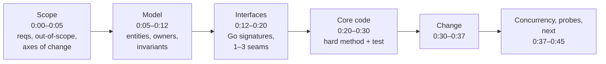
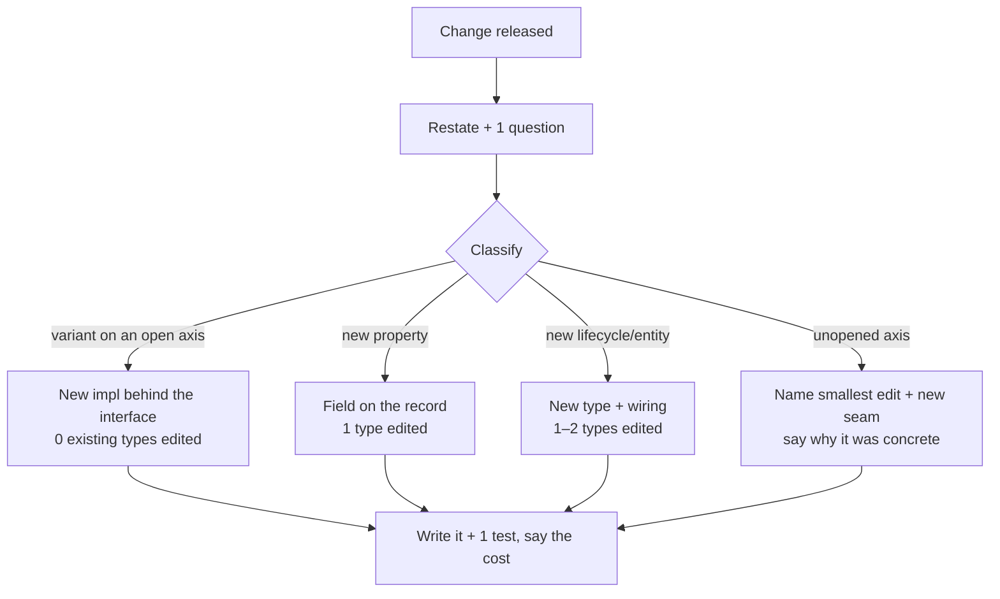

# D1 Unit 1 — The 45-minute LLD round under the clock

> Time: ~6 h (≈ 2 h reading and a dry run, ≈ 3 h for three mocks with debriefs, ≈ 1 h logging and revisiting) ·
> CORE: §1–§3 · Lab: none; mocks go in `_mocks/<YYYY-MM-DD>-lld-45-<slug>/` · Kit: [format](format.md) ·
> [rubric](rubric.md) · [probe bank](probe-bank.md) · [mock log](mock-log.md)

B1 and B2 taught you what to design. This unit is about delivering it in 45 minutes while someone watches, interrupts
and changes the requirements. There's no new mechanism here, only the performance: what has to be on the board by
which minute, how a requirement change is graded, and how to answer a probe so it scores. Then you run the mocks.

Keep a notes file open and answer every **Predict** block in writing before opening its reveal.

## Before you start

You should have passed B1 and B2, and ideally done a few B3 problems. Warm-up from those modules:

1. In B1's LLD round shape, at what minute did the requirement change arrive, and what was the measure of whether
   your design absorbed it well?
2. Name the two conditions under which a pattern from B2 (say, strategy) pays for itself in a 45-minute design.
3. "It's thread-safe." What's missing from that sentence for a senior interviewer?

<details data-kind="answer">
<summary>Warm-up answers</summary>

1. Minute 30 ([B1 Unit 2 §5](../B1-ood-go/unit-2-boundaries-errors.md#5-the-lld-interview-extension-without-a-rewrite)).
   The measure: it lands as an addition behind an existing seam, ≲ 5 minutes and ≲ 30 changed lines, with the
   existing types untouched.
2. The prompt (or a likely follow-up) says this axis will vary, *and* you need at least two implementations now (a
   real one and a test double counts). Without both, a function or a concrete type is enough.
3. Which state is shared, who owns it, which lock or goroutine guards it, and which invariant a test proves. "Thread-
   safe" names a property without the mechanism or the evidence.

</details>

**Session plan (3 × 2 h):** Session 1: §1–§2, [format.md](format.md), [rubric.md](rubric.md), then a self-timed dry run
on a B3 problem you've already solved (not recorded). Session 2: §3, skim [probe-bank.md](probe-bank.md), then mock 1
with the tutor. Session 3: mocks 2 and 3, on different days if possible.

---

## §1 The clock: what has to exist by which minute

### The failure story

The prompt is "design appointment scheduling for a hospital's outpatient clinics". The candidate is good. They ask
eleven clarifying questions, all reasonable, and it's 0:09. They draw `Patient`, `Doctor`, `Clinic`, `Department`,
`Room`, `Slot`, `Appointment`, `Insurance`, `Reminder` and an `AppointmentManager`, with arrows. It's 0:21. They
start on a `State` interface with one type per appointment state (seven types). At 0:30 the interviewer adds
"doctors want to run group sessions: one slot, up to six patients", and the candidate, who has no code and no
signatures, starts redrawing. At 0:40 the interviewer asks what happens when two patients book the same slot at the
same moment. "I'd add a lock." Where? "On the slot." Time's up.

Feedback: *"Thorough but slow. No API or code to evaluate. Requirement change not absorbed. Concurrency answer
vague. Not at senior bar."* Count what the interviewer had to grade: requirements (strong), a box diagram (eleven
boxes, four of them out of scope), and two sentences on concurrency. Five of the seven rubric dimensions had
nothing to stand on.

### Predict

<!-- predict id="D1-U1-P01" -->
**Predict.** Write these down before opening the reveal.

1. For a 45-minute LLD round, list the artefacts you think must exist by minute 15, by minute 30 and by minute 45 for
   an interviewer to score you at the senior bar.
2. Why would the interviewer release a requirement change at minute 30 and not at minute 10 or minute 40?
3. In the failure story, which single change to the candidate's first 20 minutes would have rescued the most rubric
   dimensions?
<!-- /predict -->

### Reveal

<details data-kind="reveal" data-for="D1-U1-P01">
<summary>Reveal</summary>

**1. The artefacts.** By ≈ 0:15: requirements with an out-of-scope list and the axes of change, entities with
responsibilities and state owners, and **the API as Go signatures**. By 0:30: the **hard method coded with a test**,
which is the evidence for correctness and testability. By 0:45: the requirement change absorbed, the concurrency
story said out loud, probe answers, and a "what's next" list. Each artefact is the input for a rubric dimension
([rubric.md](rubric.md)). If an artefact is missing, its dimension has no evidence, and an interviewer can't score
what isn't there.

A common wrong answer is "a complete class diagram by 0:15". A diagram without signatures can't show error values,
ownership or where the seams are, and it's what eats the clock: the failure-story candidate had one at 0:21 and
nothing scorable.

**2. Minute 30** is late enough that you have committed to a model, so the change tests the model rather than your
ability to listen. It's early enough that there are ≈ 7 minutes to land it and still discuss concurrency. At 0:10
it's just another requirement, and at 0:40 there's no time to show whether the seam was right.

**3. Signatures by 0:15.** Writing the API as Go signatures forces the candidate to cut the out-of-scope boxes, to
decide who owns slot and appointment state (the concurrency answer), and to show where variation lives. With those
in place, the group-session change has an obvious place to land: capacity becomes a field on `Slot` and `Book`
checks a count instead of a single occupant, or a `Session` type groups appointments.
Fewer clarifying questions would have helped less; the questions were good, there were just too many before
anything was committed. A sound default is to ask the three that change the model, state assumptions for the rest,
and move on.

</details>

### How it actually works

The [format](format.md) is the A0 dependency chain applied to objects instead of services: each phase consumes the
previous phase's output, and each checkpoint is the last moment an artefact can appear and still be graded.



| Checkpoint | Why it's there | What a slip costs |
|---|---|---|
| Signatures by 0:12–0:15 | Interfaces, error values and ownership become visible only in signatures | Every later phase compresses; the change has nowhere to land |
| Hard method + test by 0:30 | Correctness and testability need code as evidence | *Code & testability* capped at approaching; concurrency answers become hypothetical |
| Change landed by 0:37 | The extensibility signal needs code, not a promise | *Interfaces & extensibility* (gating) drops |
| Stop at 0:45 | Interviews end on time | Unfinished answers don't count |

**Three habits make the clock work:**

- **Name the axes of change in scope.** "Booking rules will vary by clinic; reminder channels will grow." Those two
  sentences justify every interface you write later, and they tell you where the minute-30 change is likely to land.
- **Write the hard method, not the easy ones.** The interviewer learns nothing from a constructor. Pick the method
  where the invariant can break (the state transition, the allocation, the rule evaluation) and code that.
- **Keep a parking lot.** Good questions you won't answer now go in a visible list. It shows you saw them and frees
  you to move on.

**Where D1 differs from B1's shape.** B1 Unit 2 §5 gives 20 minutes to code because its exercise was
code-weighted. D1 splits model and interfaces and gives code 10 minutes, matching rounds that are whiteboard-first
with partial code. If your interviewer wants working code, switch to the B1 shape. Ask at 0:00: "Would you like
working code, or design with code for the core?" (see [format.md](format.md#how-this-differs-from-the-b1-shape)).

### Build it

No lab. Instead, do a **dry run**: take a B3 problem you've already solved, copy
[mock-log.md](mock-log.md) to `_mocks/<date>-lld-45-dryrun-<slug>/log.md`, and run the 45 minutes against a timer
by yourself, writing the clock at every phase change. Acceptance: signatures on the page by 0:15, the hard method and
one test by 0:30, and an honest self-score on all seven rubric dimensions. Don't record it with `sd`.

### Break it

Run the first 20 minutes of a second dry run with one change: **no signatures until you've finished a full class
diagram**. Note the clock when the diagram is done and when the first signature appears.

<details data-kind="answer">
<summary>What you'll likely see</summary>

The diagram expands to fill the time (it has no natural end), and it usually includes entities that are out of
scope. When you write signatures afterwards, some boxes vanish (they were data, not types), some merge, and you
discover an ownership question the diagram hid ("who changes `Appointment.Status`: the scheduler or the front
desk?"). The
first signature typically appears 5–10 minutes later than in the signatures-first run. That delay is the 0:15
checkpoint slip from the failure story.

</details>

### In the wild

- **"Walking skeleton"** (Alistair Cockburn) and **"tracer bullets"** (Hunt and Thomas, *The Pragmatic Programmer*):
  both put a thin end-to-end path in place before breadth. The hard method + test by 0:30 is the LLD equivalent.
- **Go's own API reviews** focus on exported signatures and doc comments before implementation; proposals in the
  `golang/go` repository are discussed as API listings. It's the same idea: the signature is the design artefact.
- **Interview formats vary.** Some LLD rounds are pure whiteboard, some expect runnable code in 45–60 minutes, some
  are 60-minute "object-oriented design" sessions. TODO-VERIFY: format and length for the specific company; ask the
  recruiter, and adjust the code phase as [format.md](format.md) describes.

### Trade-offs

| Approach | Wins when | Loses when | When the answer flips |
|---|---|---|---|
| Signatures early (0:12–0:15), diagram minimal | Most LLD rounds; extensibility and ownership are graded | The interviewer explicitly wants a UML-style diagram first | They ask for "a class diagram": draw a small one, then go straight to signatures |
| Full class diagram first | Pure whiteboard rounds with no code at all | Any round where code or seams are scored | Never at the expense of signatures by ≈ 0:20 |
| Code the hard method only | Design-weighted rounds | "Working code" rounds | The interviewer says "make it run": switch to the B1 shape |
| Many clarifying questions | The prompt is genuinely ambiguous about the core | Questions don't change the model | After three, state assumptions and move on |

### Senior bar

- **Failure modes:** a diagram that grows until 0:20; coding the easy methods first; "I'll add a lock" without
  saying where; treating the requirement change as an interruption rather than the test it is; no stop at 0:45.
- **Numbers:** signatures by ≈ 0:15; first test by ≈ 0:30; change landed in ≲ 7 minutes with ≲ 30 changed lines;
  1–3 interfaces for a 45-minute design (more needs a stated reason each).
- **Ops view:** the same discipline in real work is the design doc that leads with the API and the ownership model,
  because that's what reviewers can actually check.

**Interviewer follow-up probes:**

<details data-kind="answer">
<summary>Probe: "You've spent 15 minutes and I haven't seen any code. Is that a problem?"</summary>

Answer by showing the plan, not apologising: "Signatures are on the board. The next ten minutes go on `Assign`,
which is where the 'no slot is double-booked' invariant can break, plus a test for the concurrent-booking case. If
you'd prefer me to code a different method, tell me." This shows you know what you're optimising for and that you
take steers.

</details>

<details data-kind="answer">
<summary>Probe: "Why didn't you model Department as a type with behaviour?"</summary>

"In scope, a department only groups doctors and has a name. That's an id and a field on `Doctor`, plus a filter in
the slot search. If departments get their own lifecycle (opening hours,
capacity throttling), it becomes an entity with state then. Modelling it now would add a type with no behaviour."

</details>

### Check yourself

1. Which artefact must exist by ≈ 0:15, and why that one?
2. You're at 0:24 with signatures done but no code. What do you code first?
3. What does "landed" mean for the requirement change?

<details data-kind="answer">
<summary>Answers</summary>

1. The API as Go signatures: ownership, seams and error values become visible only there, and every later phase
   (code, change, concurrency) builds on them.
2. The hard method, where the core invariant can break, plus one test for it. Skip the constructor and the easy
   getters.
3. You've said which seam it goes behind (or named the smallest edit if it hits an unopened axis) and written the new
   type or function. A promise doesn't count.

</details>

---

## §2 The minute-30 change: what's actually being graded

### The failure story

Mock 2, problem "gym membership and door access". At 0:29 the candidate has a clean design: a `Rule` interface,
five concrete rules built from per-location config (membership active, within opening hours, area allowed for the
plan, not suspended, guest pass valid), a `Policy` that denies entry if any rule denies, and a test. At 0:30 the
interviewer says: "Some locations want rules that combine others: deny entry after 22:00 *unless* the member has the
24/7 add-on. Also, every access decision must record which policy version was used."

The candidate says "OK, so I'll need to change things", then edits `Policy.Evaluate` to special-case a new `Unless`
field, adds a `version` parameter to every rule's `Evaluate`, and is still fixing call sites at 0:38. The design was
right. The response wasn't: a combinator is just another `Rule` that holds two rules, and the version belongs on the
decision record, not on every rule.

### Predict

<!-- predict id="D1-U1-P02" -->
**Predict.** Before opening the reveal:

1. Write the first two sentences you'd say out loud when the minute-30 change is released, before touching code.
2. In the story, how many existing types should the combinator change have edited? Sketch the new type in Go.
3. If the change lands on an axis you did *not* abstract, what earns credit, and what loses it?
<!-- /predict -->

### Reveal

<details data-kind="reveal" data-for="D1-U1-P02">
<summary>Reveal</summary>

**1. The first two sentences** classify the change and name where it lands: "That's a new kind of rule, so it goes
behind the existing `Rule` interface as a combinator. The version is a property of the decision, so it goes on the
`Decision` record, which `Policy` already returns." This takes ≈ 30 seconds, tells the interviewer you know your
own seams, and gives you a plan before the code. Starting with "I'll need to change things" signals the opposite.

**2. Zero existing types** for the combinator, and one field for the version:

```go
// Unless denies when Base denies, except when Override allows.
type Unless struct {
	Base, Override Rule
}

func (u Unless) Evaluate(req Request) Result {
	r := u.Base.Evaluate(req)
	if r.Outcome != Deny {
		return r
	}
	if o := u.Override.Evaluate(req); o.Outcome == Allow {
		return Result{Outcome: Allow, Reason: r.Reason + "; overridden: " + o.Reason}
	}
	return r
}
```

Plus registering `"unless"` in the config factory and adding `PolicyVersion` to `Decision`. The reason the
candidate edited `Policy` is that they treated "combine" as a property of the set rather than as a rule. That's the
composite pattern from B2's decorator family: a rule made of rules is still a rule.

**3. On an unopened axis**, credit comes from naming it calmly: "That's an axis I left concrete, because nothing in
the prompt said it varied. The smallest edit is X; that adds a seam here; existing callers don't change." Then write
the edit. You lose credit by pretending the design anticipated it, by rewriting the core, or by adding three
interfaces at once to "make it flexible". A design that survives every change was over-abstracted; one that survives
the likely changes and degrades gracefully on the rest is the senior answer.

</details>

### How it actually works

The interviewer is grading two things at once: **where your seams are** (dimension 3) and **how you respond under a
change you didn't choose** (dimensions 6 and 7). A protocol helps with both:

1. **Restate** the change in one sentence, and ask one clarifying question if it's ambiguous ("per credit union, or
   global?").
2. **Classify** it: a new variant on an open axis (lands behind an existing interface), a new property of an existing
   record (a field), a new lifecycle or entity (a new type plus wiring), or a new axis you didn't open.
3. **Say where it lands** before coding, including how many existing types change.
4. **Write it**, plus one test.
5. **Say what it costs** and what it doesn't cover ("the version is recorded but we don't keep old policies
   around to replay; that's next").



**Count edited types.** It's the cheapest objective measure of the [rubric](rubric.md)'s calibration anchor: 0–1
edited types behind a seam ≈ meets; 2–3 ≈ approaching; a rewrite ≈ below.

### Build it

No lab. In your dry run's log, add a section "my change": pick the requirement change you'd least like to hear for
that problem (the kind of thing to pick: on a car-rental desk, "customers can reserve a specific model in advance"),
and practise the five-step protocol out loud in ≤ 7 minutes, writing the code. Count the existing types you edited.

### Break it

Take your dry-run design and add three interfaces you didn't need "for flexibility". Then apply the same change.

<details data-kind="answer">
<summary>What you'll likely see</summary>

Unless you happened to guess the axis, the change still edits the same types, and now it also has to thread through
the extra interfaces (new methods on wide interfaces break every implementation). Speculative interfaces rarely sit
where the actual change lands, and they make the edit bigger, not smaller. This is the "over-engineering is a
dimension 3 problem" calibration anchor in practice.

</details>

### In the wild

- **Open/closed in practice:** `database/sql/driver` and `http.RoundTripper` absorb new databases and transports as
  additions; the standard library never edits `database/sql` to add a driver.
- **`log/slog`'s `Handler`** turned "add JSON output, levels, fan-out" into additions behind a four-method interface.
- **Feature work in your platform:** "the fourth payment provider took nine days" (B1's failure story) is the
  real-world cost of a change landing on an unopened axis without a protocol.

### Trade-offs

| Response | Wins when | Loses when | When the answer flips |
|---|---|---|---|
| Land behind an existing seam | The change is on a named axis | — | Always first choice when it fits |
| Smallest edit + new seam | The change hits an unopened axis | You pretend the seam was always there | When a second similar change is likely, the new seam is worth adding now |
| Rewrite the core | The model was actually wrong (e.g. one patient per slot hard-wired everywhere) | Almost always in 7 minutes | Say "the model needs X; here's the first step" and do that step |
| Add generic flexibility | Never in a mock | Always | — |

### Senior bar

- **Failure modes:** coding before classifying; threading a new parameter through every method; adding a field to an
  interface; silently ignoring half of a two-part change (the version in the story).
- **Numbers:** ≲ 30 seconds to classify and say where it lands; ≲ 7 minutes to land it; 0–1 existing types edited
  for a variant.
- **Ops view:** at work the same classification decides whether a feature is a config change, a new plug-in or a
  migration, which is what sets the estimate.

**Interviewer follow-up probes:**

<details data-kind="answer">
<summary>Probe: "Would your design survive a third change: a rule that asks the billing service whether the member is paid up?"</summary>

"Yes, as another `Rule` implementation that wraps a client interface. Two things change in how we evaluate: the call
can fail or be slow, so on timeout the rule needs an explicit fail-open or fail-closed choice (for a gym door I'd
fail open for members whose last known status is paid, and log it), and we'd want it evaluated last, so cheap denials
short-circuit it. That ordering is a property of `Policy`, so it's one change there."

</details>

<details data-kind="answer">
<summary>Probe: "You added a field to Decision. Isn't that a breaking change?"</summary>

"Adding a field to a struct is source-compatible for callers that use keyed fields. Adding a method to an interface
is the breaking one, because every implementation must change. That's why the version went on the record and not on
`Rule`."

</details>

### Check yourself

1. What are the five steps of the change protocol?
2. A change adds a new lifecycle (returns on a warehouse pick-list system that only handled picking). How many types
   do you expect to edit,
   and what does the interviewer look for?
3. Why is adding a method to an interface a worse way to absorb a change than adding a field to a struct?

<details data-kind="answer">
<summary>Answers</summary>

1. Restate (and ask one question), classify, say where it lands, write it plus a test, say the cost.
2. One or two (the state machine or a new `Return` type plus wiring). They look for a new type with its own
   lifecycle rather than a growing `if kind == return` inside picking code, and for the hard part to be named:
   a returned item must be inspected before it counts as pickable stock again.
3. Every implementation must add the method (a breaking change); a new struct field doesn't break keyed literals or
   existing callers.

</details>

---

## §3 Probes and self-scoring

### The failure story

Mock 3, problem "music playlists". The design is sound and on time. Then the probes:

"Why do playlist entries hold track ids rather than copies of the tracks?" — "It's more efficient." "What if the
catalogue service is down?" — "We'd
handle that gracefully." "Any locks on the hot path?" — "It's thread-safe; I used a sync.Map." The interviewer writes
*approaching* under trade-offs and probe handling, and because that's a gating dimension, the mock is *approaching*
overall. The learner self-scored *meets* on it ("I answered everything"). Each answer was fluent and none of them
said *how* or *at what cost*.

### Predict

<!-- predict id="D1-U1-P03" -->
**Predict.** Before opening the reveal:

1. Rewrite the answer to "what if the catalogue service is down?" so it would score *meets*. Keep it under 60
   words.
2. Why is "I answered every probe" weak evidence for a *meets* self-score on dimension 6?
3. The tutor asks for your self-score before giving any feedback. Why that order?
<!-- /predict -->

### Reveal

<details data-kind="reveal" data-for="D1-U1-P03">
<summary>Reveal</summary>

**1. A meets answer** (≈ 55 words): "Each playlist entry keeps the track id plus a cached display snapshot (title,
artist, duration), so playlists still render; lookups retry with backoff. I'd alert on catalogue error rate above
≈ 5% over 5 minutes and expose cache age. New additions are rejected until it's back. Cost: stale titles, and a
withdrawn track can look playable until refresh."
It has a mechanism, detection, the edge case and the cost. "Handle gracefully" has none of these.

**2. Answering isn't the bar; the shape of the answer is.** Dimension 6 asks for claim → why here → cost → when it
flips, with a concrete mechanism. The story's answers named no mechanism ("more efficient"), no detection, no cost.
Fluency without a cost is *approaching* by the rubric's calibration anchor, and it's the most common
over-rating (weak spot (d)).

**3. Self-score first** measures calibration, which is a skill in itself. Once you've heard the tutor's view, your
self-score just echoes it. A self-score more than one level off on any dimension is called out in the debrief and
recorded as a note, because an engineer who can't tell a fluent answer from a costed one will keep giving fluent
ones.

</details>

### How it actually works

**Answering a probe.** Every probe in the [probe bank](probe-bank.md) is one of eight kinds: scale-up, failure,
concurrency/consistency, extensibility, testing, cost/complexity, security/multi-tenancy, why not X. They all get the
same answer shape, in ≲ 2 minutes:

| Part | Example (music playlists, "any locks on the hot path?") |
|---|---|
| **Claim** | "No lock on reads: playback loads an immutable snapshot of the playlist through `atomic.Pointer`; edits take a per-playlist mutex, build a new slice and swap it." |
| **Why here** | "Playlists are read ≈ 1,000× more often than they're edited, and a playback session must see one consistent order." |
| **Mechanism / evidence** | "A `-race` test runs readers while goroutines append and reorder concurrently, then checks no entry was lost." |
| **Cost** | "A copy of the id slice per edit: ≈ 8 B × 10k tracks ≈ 80 KB worst case; editors of one playlist serialise." |
| **Flip** | "If collaborative playlists were edited constantly by dozens of people, I'd drop copy-on-write for a locked structure with versioned reads." |

If you don't know: say what you'd check and what each outcome would mean. "I'm not sure whether `sync.Map` is faster
here; it's optimised for keys written once and read many times, which fits, but I'd benchmark it against the atomic
snapshot" is a meets answer. "It's thread-safe" isn't.

**Self-scoring.** After 0:45 you score each of the seven dimensions with one line of evidence, using the
[rubric](rubric.md) descriptors, before the tutor says anything. Then apply the overall rule yourself:

- **meets** = meets or better on all four gating dimensions (2 Domain model, 3 Interfaces & extensibility, 6
  Trade-offs & probe handling, 7 Communication & time) and nothing at below;
- **exceeds** = meets everywhere and exceeds on at least three dimensions, including two gating ones;
- otherwise the lowest gating level, capped at approaching if anything is below.

The log ([mock-log.md](mock-log.md)) has a column for your level and the tutor's. A gap of more than one level on any
dimension becomes a `sd record note D1 --tags calibration,…`.

### Build it

No lab. Pick your dry-run problem and answer five probes from five different categories in the
[probe bank](probe-bank.md) out loud, timing each (≤ 2 minutes). Write each answer as the five-part table above, then
score each on dimension 6. Then do mock 1 with the tutor.

### Break it

Answer the same five probes again with one constraint: **no numbers and no names of specific mechanisms** (no "mutex",
"atomic", "idempotency key", "≈ 10k/s"). Then score both versions.

<details data-kind="answer">
<summary>What you'll likely see</summary>

The second set sounds almost as confident and is much shorter, and every answer drops to approaching or below: with
no mechanism and no number, there's nothing to check and no cost to state. That's the failure story's answers. When
you hear yourself giving an answer without a mechanism in a real mock, add one sentence: "Concretely, that's …".

</details>

### In the wild

- **Code review** asks the same questions as LLD probes ("what happens if this is called twice?", "who else holds
  this slice?") and expects the same answer shape: the mechanism and the evidence, not reassurance.
- **Incident postmortems** turn "it should handle that gracefully" into a timeline, a mechanism and a metric. A
  probe answer is a pre-mortem in miniature.
- **Calibration** in hiring: interviewers compare written evidence against a rubric, not impressions. TODO-VERIFY:
  practices differ by company; the course rubric deliberately requires evidence per dimension for the same reason.

### Trade-offs

| Approach | Wins when | Loses when | When the answer flips |
|---|---|---|---|
| Short costed answer (≲ 2 min) | Almost every probe | The interviewer wants a deep dive on it | They say "go deeper": then extend, still in the same shape |
| Long exhaustive answer | The probe is the main topic the interviewer cares about | Most probes: eats the clock, hides the claim | When asked to elaborate |
| "I don't know" + how you'd find out | Genuinely unknown facts | Used to dodge something you should know | Never bluff a number; give a range and say it's an assumption |
| Turning the probe into a design improvement | The probe exposes a real gap | You abandon the plan to chase it | Note it in the parking lot if it's big |

### Senior bar

- **Failure modes:** brand answers ("best practice"), reassurance ("gracefully", "thread-safe"), attacking the
  alternative instead of saying when it wins, rambling past two minutes, defending an obvious gap instead of
  conceding it.
- **Numbers:** ≲ 2 minutes per probe; 2–4 probes in the last 8 minutes; one number in at least half your answers
  where numbers apply (objects, ops/s, bytes).
- **Calibration target:** within one level of the tutor on every dimension by mock 3.

**Interviewer follow-up probes:**

<details data-kind="answer">
<summary>Probe: "Why not just use a mutex everywhere and stop worrying?"</summary>

"Often that's exactly right: one mutex per aggregate with µs critical sections is my default, and I'd only move off
it with a measurement. Here reads outnumber edits ≈ 1,000 to 1, and an RWMutex would work too. I chose the atomic
snapshot because a playback session can keep one consistent list across many reads without holding a lock. If edits
were constant, I'd go back to a lock."

</details>

<details data-kind="answer">
<summary>Probe: "You've self-scored meets on probe handling. Convince me."</summary>

Point to evidence, not effort: "Probe 2: I named the mechanism (cached display snapshot), the detection (catalogue
error-rate alert with a threshold), and the cost (stale titles). Probe 3: I gave the flip condition. Probe 1 I'd
score approaching: I said 'more efficient' before getting to one source of truth for track metadata." Conceding one is a calibration signal in
your favour.

</details>

### Check yourself

1. Name the five parts of a probe answer.
2. "We'd retry." What's missing?
3. You self-score meets on four gating dimensions and below on *Code & testability*. What's your overall?

<details data-kind="answer">
<summary>Answers</summary>

1. Claim, why here, mechanism/evidence, cost, flip condition.
2. What's retried and with what key (idempotency), how many times with what backoff, what happens when retries run
   out (state, detection), and the cost (latency, duplicate load).
3. Approaching: any dimension at below caps the overall at approaching, even with all gating dimensions at meets.

</details>

---

## Unit wrap-up

| Situation | Do this | Flip to this when… |
|---|---|---|
| 0:00 | Ask "working code or design with code for the core?"; scope with axes of change | The interviewer specifies the format → adopt it |
| Modelling | Entities with one-sentence responsibilities and one owner per mutable state | — |
| By ≈ 0:15 | API as Go signatures, 1–3 consumer-side interfaces tied to named axes | They ask for a diagram first → small one, then signatures |
| 0:20–0:30 | Code the hard method + one test | "Make it run" → B1 shape, code from 0:10 |
| 0:30 change | Restate, classify, say where it lands, write it, say the cost | Unopened axis → smallest edit + new seam, said calmly |
| Probes | Claim → why here → mechanism → cost → flip, ≲ 2 min | "Go deeper" → extend in the same shape |
| After 0:45 | Self-score every dimension with evidence, then the tutor scores | — |

**Next:** run mock 1 with the tutor ("mock me D1"). After three mocks at *meets* or better on distinct problems,
D1's gate passes. Each mock is logged in `_mocks/` and recorded with
`sd record mock D1 --format lld-45 --problem "<name>" --minutes <actual> --level <overall> --notes "<top gap>"`.
