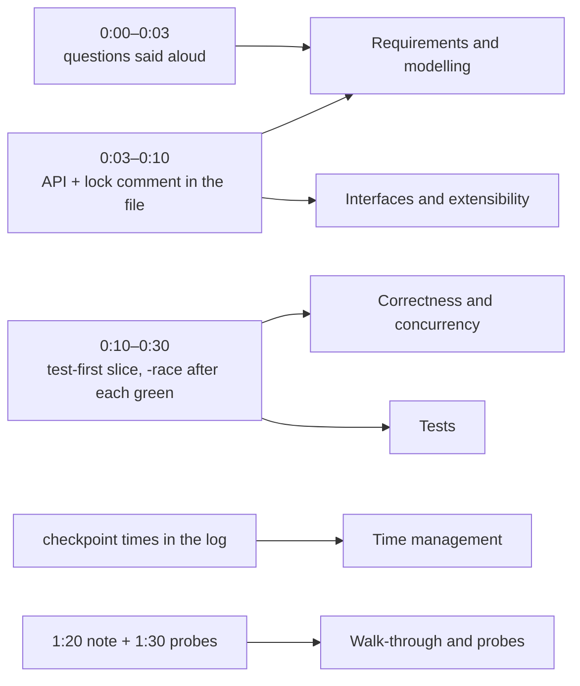
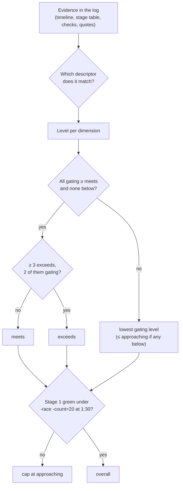

# D2 Unit 1 — Running the round under observation

> Time: ~5 h (including mock 1) · CORE: §1–§3 · Lab: none; mock 1 is built in `_mocks/<date>-mc-90-<slug>/` ·
> Kit: [format.md](format.md) · [rubric.md](rubric.md) · [mock-log.md](mock-log.md)

B3 taught you to solve machine-coding problems. This unit is about the difference between solving one alone and
solving one while an interviewer watches the clock, decides what you'll be asked next, and writes down what you say.
There's no new data structure here. There's a new failure mode: doing what you can do, too late or too quietly to
count.

Keep a notes file open. Every **Predict** block asks you to write your answer *before* the reveal. In this module,
prediction is calibration practice: the gap between what you predict about your own behaviour under the clock and
what the mock log shows is exactly the gap the rubric's self-score measures.

## Before you start

You need B3 passed. Warm up with three questions from B3 (answers below; no peeking until you've written yours):

1. In the B3 playbook, what are the five parts of the concurrency note?
2. Why do machine-coding tests take an injected `func() time.Time` rather than calling `time.Now()`?
3. At minute 50, the interviewer says "now make it safe for concurrent use". Name one thing you deliberately don't do.

<details data-kind="answer">
<summary>Warm-up answers</summary>

1. Shared state and owners; bounds; lifecycle; failure handling; evidence
   ([B3 unit 8 §3](../B3-machine-coding/unit-8-stretch-and-capstone.md#3-the-machine-coding-round-playbook-and-capstone)).
2. So expiry, backoff and window boundaries can be tested exactly (at `t` and `t-1ns`) and instantly, with no sleeps
   and no flakiness.
3. Redesign: no switch to channels, sharding or lock-free structures with 25 minutes left. One lock with a clear
   scope, no callbacks under it, check-then-act fixed, a concurrent test. Alternatives are mentioned, not built.

</details>

**Session plan (≈ 5 h).** Session 1 (1.5 h): §1 and §2, then a 20-minute out-loud dry run of the first ten minutes
on a B3 problem you've already solved. Session 2 (2 h): **mock 1** with the tutor. Session 3 (1.5 h): §3, then score
mock 1 yourself before you look at the tutor's scores again.

---

## §1 What changes when someone is watching

### The failure story

A learner passed B3 with every core problem at *meets*. Their first D2 mock is a cinema concession order queue: kiosks
submit orders, a few prep stations (behind a `Station` interface) make the items, and a pickup display calls the
order when it's ready. Here is their mock log's timeline:

| Clock | What happened |
|---|---|
| 0:00–0:02 | Asks one question ("how many stations?"). Starts typing a `Queue` struct. |
| 0:02–0:24 | Writes ≈ 180 lines: queue, station workers, the display call. Silent. No test file opened. |
| 0:24 | First `go test`: "no test files". Writes a happy-path test. Nil-map panic in `Submit`. |
| 0:30 | Stage 2 announced (combo orders: call an order only when all its items are ready, items made in parallel). Stage 1 not green. |
| 0:41 | Stage 1 green. Starts combos: needs per-order item tracking, so rewrites `Submit`, the station worker loop and the test helper. |
| 1:08 | Stage 2 green. Stage 3 announced at 0:55 was never started. |
| 1:28 | Adds a mutex to the order map. Runs `-race` for the first time: two races, in `Stats`. |
| 1:30 | Time. The tutor's mutation (send moved under the lock) isn't caught: no concurrent test exists. |

Overall: **approaching** (Time management and Correctness both *approaching*; Stage 1 green at 0:41). The learner's
self-score was *meets*: "I got Stage 2 done and the code is clean." The code *was* clean. None of the gaps was
knowledge. In B3 they'd have opened the test file first, because it was given. They'd have known Stage 2 was
"combos", because the stage file said so. They'd have run `-race` constantly, because `sd lab` does. With the
scaffolding gone, the habits went with it.

### Predict

<!-- predict id="D2-U1-P01" -->
**Predict.** Write these down before opening the reveal.

1. List three things from B3 practice that the D2 format takes away, and for each, the habit you'll need to supply
   yourself.
2. The interviewer is silent from 0:10 to 0:30. What are they writing down? Name at least three observations.
3. Your B3 attempts averaged Stage 1 green at ≈ 0:35. Estimate your first-mock Stage 1 time, and say why you think
   it'll be faster or slower.
<!-- /predict -->

### Reveal

<details data-kind="reveal" data-for="D2-U1-P01">
<summary>Reveal</summary>

**1. What's gone, and the habit that replaces it.**

| B3 gave you | D2 removes it | You supply |
|---|---|---|
| A test file defining "done" | You write every test | Open `_test.go` before the first function body; write the core-use-case test by ≈ 0:15 |
| Stage files you could read | Stages are announced at 0:30 and 0:55 | Ask "what's the most likely next requirement?" at 0:02 and leave a seam for it |
| `sd lab` running `-race` for you | Nobody runs it until 1:30, then the tutor does, with a mutation | Run `go test -race` after every green test; write the concurrent test in Stage 1, not Stage 3 |
| A known problem shape | Unseen problem | The six standard questions in the first three minutes, every time |
| No audience | An interviewer who can only score what they see or hear | Signpost each phase aloud; announce cuts |

**2. What a silent interviewer writes.** Typical notes from 0:10–0:30: when the first test was written; whether
something ran by ≈ 0:20; whether the API in the file matches what was said at 0:08; whether errors are values or
strings; whether time is injected; whether the learner re-ran tests after each change or wrote in a batch; whether
they talked through a decision or went silent for 15 minutes. Silence isn't neutral: a 15-minute silent stretch gets
written down as "hard to follow reasoning" even if the code is good.

**3. Your first mock is usually slower.** A reasonable expectation is 5–15 minutes slower to Stage 1 than your B3
average (≈, from the fact that B3 Stage 1 time included a provided test suite and a known problem; your own data in
the mock log will replace this guess). The reasons: writing tests from nothing, an unseen domain, and the cost of
narrating. If you predicted faster because "I've done 18 of these", that's the overconfidence the calibration line
in the mock log exists to catch.

</details>

### How it actually works

**The round is scored on evidence the interviewer can observe.** Every rubric dimension has observable evidence, and
most of it is produced in the first 30 minutes:



**Three things the format does on purpose.**

1. **Stages arrive on the clock, not on your progress.** At 0:30 Stage 2 is read out whether Stage 1 is green or
   not. In a real round the interviewer has a fixed plan for the hour; your job is to be ready for it, not to finish
   Stage 1 perfectly first.
2. **Your tests are on trial, not just your code.** The tutor's mutation check (remove a lock, reverse an order,
   move a send under the lock) asks: would your tests have told you? A clean `-race` run on tests that never share a
   key proves nothing.
3. **The walk-through is scored.** What you say at 1:20 and 1:30 is checked against the code. "It's thread-safe"
   with no owner, no invariant and no test is a *below* answer on dimension 7, even if the code happens to be safe.

**Narration that costs nothing.** You don't need to talk continuously. You need a sentence at each transition:
"Questions done; here's the API" · "Core path green, now the error table" · "Stage 2 means tracking items per
order; `Submit` changes, the station loop doesn't" · "I'm behind; skipping `Stats`." Four to eight such sentences per mock
make the timeline legible, and they're what the interviewer copies into their notes.

### Build it

No lab package. This section's build is the 20-minute dry run: take a B3 problem you've already solved (so the
domain is free), start a timer, and do only 0:00–0:10 aloud: the six questions (answer them yourself), the API in a
fresh file, the concurrency comment, the seam. Then write the first test and make it pass by 0:20. Acceptance: at
0:10 the file compiles with signatures and empty bodies, and at 0:20 one test is green under `-race`.

### Break it

Repeat the dry run, but this time don't open the test file until you think the core is "done". Note the minute of
the first green test in both runs.

<details data-kind="answer">
<summary>What you'll likely see</summary>

The test-last run reaches its first green test later, usually by more than the time "saved" by not writing it, because
the first run of untested code surfaces several bugs at once (nil maps, off-by-one boundaries, a wrong error) and you
debug them together. The test-first run has a smaller, earlier first failure. That gap is the difference between
Stage 1 at 0:30 and Stage 1 at 0:41 in the failure story.

</details>

### In the wild

- **Pair-programming and live-coding interviews** commonly ask candidates to "think aloud", and interviewer guides
  tend to score communication alongside correctness. Exact rubrics vary by company (TODO-VERIFY against the current
  guidance of the companies you target).
- **Go's own review culture** expects `gofmt`, `go vet` and race-clean tests before a human reads the code; the
  tutor's mechanical checks mirror that order.
- **Mutation testing** as a practice (tools exist for many languages; for Go, check the current state of community
  tools before relying on one: TODO-VERIFY) formalises the tutor's single hand-made mutation.

### Trade-offs

| Approach | Wins when | Loses when | When the answer flips |
|---|---|---|---|
| Talk at transitions only | Default: keeps focus, timeline legible | The interviewer wants continuous reasoning | They ask "what are you thinking?" twice → narrate more within phases |
| Continuous narration | Interviewer is actively pairing | Typing slows; you lose the thread | The problem is mechanical (parsing): fall back to transitions |
| Test-first for every method | Unseen problem, stages unknown | Trivial getters | Never skip the test of a method that changes state |
| Ask for the next requirement at 0:02 | Almost always: it places the seam | The interviewer refuses to say | They refuse → put the seam where *you'd* expect the product to change, and say so |

### Senior bar

- **Failure modes of the round:** silence for more than ≈ 10 minutes; Stage 1 perfectionism (gold-plating while 0:30
  passes); no concurrent test until Stage 3; claiming "done" without running `-race`.
- **Numbers:** a 90-minute round produces ≈ 250–400 lines of code and ≈ 150–250 lines of tests (≈, from the B3
  playbook). If you have 400 lines and 30 lines of tests at 0:55, you've already lost dimension 4.
- **Operations angle:** interviewers often close with "how would you run this in production?" Have two sentences
  ready: what you'd measure and what you'd bound.

**Interviewer follow-up probes:**

<details data-kind="answer">
<summary>Probe: "You were quiet for a long stretch there. Walk me through what you decided."</summary>

Give the decision and its reason in two sentences, then re-anchor: "I decided one worker goroutine per prep station
draining that station's queue, because a station makes one item at a time and that makes the limit structural
instead of something I'd check. The cost is a goroutine per station, which at 40 stations is ≈ 80 KB of stack,
nothing. I'll keep going with the display path." Then actually narrate the next transition.

</details>

<details data-kind="answer">
<summary>Probe: "Is this done?"</summary>

Answer with status per stage, not "yes": "Stage 1 green under `-race -count=20`. Stage 2 combos green; partial
cancellation done but only tested for one item. Stage 3: per-station queue cap done, `Close` not started. If I had ten more minutes
I'd do `Close` with a drain deadline." Precise status is itself a senior signal.

</details>

### Check yourself

1. Name the four D2 checkpoints and their times.
2. What does the tutor's mutation check measure, and which rubric dimension does a surviving mutation count against?
3. Why is a clean `-race` run not proof of correctness?

<details data-kind="answer">
<summary>Answers</summary>

1. API and lock model in the file by 0:10; Stage 1 green by 0:30; Stage 2 green by 0:55; feature freeze at 1:20.
2. Whether your tests would detect a realistic concurrency bug; a surviving mutation counts against Tests.
3. The detector reports data races in executions it observed. It doesn't check invariants or logical races
   (check-then-act across two critical sections), and it only sees schedules that actually happened.

</details>

---

## §2 The first ten minutes

### The failure story

An OAuth token-refresh cache, a different learner: the kind of cache your SSO and vendor adapters already have. At
0:08 the file contains `type Cache struct{ m map[string]string }` and a `Token(clientID string) string` that returns
the raw access token. No error return (a failed refresh returns `""`), no expiry, no clock. At 0:30 Stage 2 asks for
proactive refresh: a token with less than 60 seconds left is returned at once while one background refresh starts,
and callers must be able to see the expiry and whether a refresh is running. `Token` must now return a value, not a
string. Every test (11 of them) asserts on a string. At 0:43 they're still converting tests. Stage 2 lands at 1:02;
Stage 3 gets eight minutes.

The tutor's note on dimension 2: "`Token` returned `string`: no room for any information a caller would need
(expiry, refresh state, why it failed). Stage 2 forced a signature change across all tests." Ten minutes of better
API work would have bought back twenty.

### Predict

<!-- predict id="D2-U1-P02" -->
**Predict.** The prompt is: "Build the in-memory core of a token cache for our vendor API clients. Callers ask for a
valid OAuth access token for a client ID; the cache returns the cached one if it's still valid, and otherwise gets a
new one from the identity provider, which you get as a function. Many goroutines ask for the same client's token at
once. If the vendor rejects a token, callers tell the cache." Write, as you would at 0:10:

1. The six questions you'd ask (one line each).
2. The Go signatures for `Token` and `Invalidate`, the types they use, and the sentinel errors.
3. The concurrency decision as a one-line comment.
4. Where you'd leave a seam, and for what.
<!-- /predict -->

### Reveal

<details data-kind="reveal" data-for="D2-U1-P02">
<summary>Reveal</summary>

**1. Questions** (and the answers the tutor would give): scope (in-memory only; the identity provider is behind a
function) · scale (≈ 300 vendor clients, tokens live ≈ 1 h, ≈ 2k token requests/s) · concurrency (yes, many
goroutines; at most one refresh per client in flight, the others wait for it) · time (inject the clock; treat a token
as expired 30 s before its expiry to absorb skew) · failure (if a refresh fails while a still-valid token is cached,
return the cached one; callers need to tell "unknown client" from "refresh failed and nothing valid is cached") ·
next requirement (the tutor hints at refreshing *before* expiry without making callers wait).

**2–4. A 0:10 file that leaves room** (compiles; bodies are deliberately empty):

```go
package tokencache

import (
	"context"
	"errors"
	"sync"
	"time"
)

var (
	ErrUnknownClient = errors.New("tokencache: unknown client")
	ErrNoValidToken  = errors.New("tokencache: refresh failed and no valid token is cached")
)

// Token is what callers get. It is a value: callers can't mutate cache state through it.
type Token struct {
	ClientID string
	Access   string
	Expires  time.Time
}

// Refresher gets a new token from the identity provider.
type Refresher func(ctx context.Context, clientID string) (Token, error)

// Cache hands out valid access tokens per client.
// Concurrency: one mutex guards tokens and inflight; the Refresher is never called while it is held;
// at most one refresh per client is in flight, and other callers wait on its channel.
type Cache struct {
	mu       sync.Mutex
	now      func() time.Time
	refresh  Refresher
	tokens   map[string]Token
	inflight map[string]chan struct{}
}

func New(now func() time.Time, refresh Refresher) *Cache {
	return &Cache{
		now:      now,
		refresh:  refresh,
		tokens:   make(map[string]Token),
		inflight: make(map[string]chan struct{}),
	}
}

func (c *Cache) Token(ctx context.Context, clientID string) (Token, error) {
	return Token{}, nil // TODO
}

// Invalidate drops t if it is still the cached token for its client (the vendor rejected it).
func (c *Cache) Invalidate(t Token) error {
	return nil // TODO
}
```

The seam is the `Token` value: when Stage 2 adds proactive refresh, callers learn about it through one new field
(`Refreshing bool`) and `Token`'s body gains a branch; no signature changes. Compare the failure story's `string`.
Tempting wrong answers: (a) an interface for a persistent token store "in case we restart" (nobody asked; one more
type to wire); (b) a background goroutine per client refreshing on a timer (nobody asked yet; 300 goroutines with
lifecycles, and Stage 1 tests get harder); (c) handing callers `*Token` pointers into the map (callers can then
mutate state outside the lock).

</details>

### How it actually works

**The 0:10 file has five parts**, and each one feeds a rubric dimension:

| Part | Example | Why it pays |
|---|---|---|
| Sentinel errors | `ErrUnknownClient`, `ErrNoValidToken` | Tests assert with `errors.Is`; callers can branch; dimension 2 |
| Value types returned to callers | `Token` | Room for Stage 2 fields without signature changes; no aliasing of internal state |
| Injected nondeterminism | `now func() time.Time` | Exact boundary tests, no sleeps; dimension 4 |
| The concurrency comment | "one mutex … no callbacks under it" | The decision exists before the logic; the 1:20 note just repeats it |
| One seam for the hinted requirement | the `Token` value, an option, a 1-method interface | Stage 2 lands as an addition |

**What *not* to put in at 0:10:** interfaces for things that don't vary yet, generics, a goroutine-based design
"for scale", a config struct with ten fields. Each costs minutes now and makes Stage 2's change land in more places.

**The six questions, as a habit.** Scope · scale and shape · concurrency · time · failure (what may be lost, what
must not, what errors callers distinguish) · the likely next requirement. Ask them even when you think you know the
answers: the asking is evidence for dimension 1, and the answer to the last one is the cheapest design input you'll
get all day.

### Build it

No lab package. Do the Predict exercise again for two problems you haven't seen in this course (make up the prompt
from a system you know: a "member session manager", a "transfer-limit tracker"). Ten minutes each, timer on.
Acceptance: the file compiles (`go vet` on a scratch directory under `_mocks/`), has sentinel errors, an injected
clock if time matters, the concurrency comment, and one sentence naming the seam.

### Break it

Take your Predict answer and apply the real Stage 2 (proactive refresh: a token with less than 60 s left is
returned at once while exactly one background refresh starts for that client; callers can see the expiry and
whether a refresh is running). Count the lines of your 0:10 signatures that change.

<details data-kind="answer">
<summary>What you should see</summary>

With a `Token` value returned from `Token`, zero signatures change: one field, one branch, one background refresh
started outside the lock. With a `string` return, `Token`'s signature changes and every call site and test changes
with it.
That count is exactly what the tutor records in the log's "how each stage landed" table.

</details>

### In the wild

- **Go standard library APIs** return values with room to grow: `http.Response`, `os.FileInfo`, `sql.Result`.
  Adding a field to a returned struct is backward compatible; changing a return type isn't.
- **OAuth 2.0 token responses** (RFC 6749) carry `access_token`, `token_type`, `expires_in` and optionally
  `refresh_token` and `scope`, which is why client libraries return a struct: Go's `golang.org/x/oauth2` `Token` has
  `AccessToken`, `TokenType`, `RefreshToken` and `Expiry` fields, never a bare string.

### Trade-offs

| Choice at 0:10 | Wins when | Loses when | When the answer flips |
|---|---|---|---|
| Return a value struct | The result may grow (tokens, expiry, IDs) | The result is genuinely binary forever | Never in a staged round: assume it grows |
| Sentinel errors | Callers branch on the reason | Errors need data (which line failed) | Use a typed error (`*LineError`) and `errors.As` when data matters |
| One mutex, decided now | Default for in-memory cores | A measured hot lock | The interviewer gives a throughput target that one lock can't meet |
| Interface for a dependency now | The prompt names an external system (sender, store, ledger) | It's internal and doesn't vary | The prompt says "you get it as an interface": then yes, consumer-side, 1–3 methods |

### Senior bar

- **Failure modes:** API in your head rather than in the file; returning internal pointers; time from `time.Now()`
  deep in the logic; an interface for everything.
- **Numbers:** ≈ 10 minutes is the cap on up-front design for an unseen problem (B3 playbook); if the data structure
  *is* the problem (a matching engine, an order-statistic tree), ≈ 15 with the invariants written first.
- **Cost:** every abstraction added at 0:10 must be paid for in Stage 1 tests. Count them.

**Interviewer follow-up probes:**

<details data-kind="answer">
<summary>Probe: "Why does `Token` return a struct? A string would be simpler."</summary>

"A string can't carry anything else, and the caller needs at least the expiry, to avoid starting a long vendor call
with a token that lapses halfway. Returning a value also leaves room for what I expect next, refresh status, without
changing the signature. It's a value, not a pointer, so callers can't change cache state through it. If the result
really were a bare string forever, I'd return one, but in a staged round I assume it grows."

</details>

<details data-kind="answer">
<summary>Probe: "Why not inject an interface for the clock?"</summary>

"A one-method dependency reads better as a function, `func() time.Time`. Tests pass a closure over a variable they
advance. If I later needed timers as well (`After`, `NewTicker`), I'd switch to a small interface with exactly those
methods, defined here where it's consumed."

</details>

### Check yourself

1. Name the five parts of a good 0:10 file.
2. What's the cheapest design input you can get in a staged round, and how do you get it?
3. Why return `Token` and not `*Token`?

<details data-kind="answer">
<summary>Answers</summary>

1. Sentinel errors; value types returned to callers; injected nondeterminism (clock, IDs); the concurrency comment;
   one seam for the hinted requirement.
2. The likely next requirement: ask "what would you most likely add next?" in the first three minutes.
3. A pointer to internal state lets callers mutate it without the lock (a data race and an invariant leak); a value
   is a snapshot.

</details>

---

## §3 Stage seams and scoring yourself

### The failure story

Mock 1 is over. The learner writes their self-score: Requirements *meets*, Interfaces *meets*, Correctness *meets*,
Tests *meets*, Code quality *exceeds*, Time *meets*, Walk-through *meets*. Overall: *meets*.

The tutor's log: Stage 2 changed four existing functions and the test helper (Interfaces: *approaching*); the
mutation in the retry path survived (Tests: *approaching*); Stage 1 green at 0:38 (Time: *approaching*); everything
else *meets*. Overall: *approaching*. Three dimensions off by one level, all in the same direction. The learner's
reaction: "but it all worked in the end." It did. The rubric doesn't ask whether it worked in the end; the hard floor
covers that. It asks how it got there and whether the evidence would convince a reviewer.

### Predict

<!-- predict id="D2-U1-P03" -->
**Predict.** Using [rubric.md](rubric.md), score this mock yourself before opening the reveal: *Stage 1 green at
0:29; Stage 2 (combo orders) required splitting `Submit` into two functions and changing the station worker loop;
Stage 2 green at 0:58; Stage 3 half done (per-station cap and panic containment, no `Close`); `-race -count=20`
clean; the tutor's mutation (display send moved under the lock) caught by a test that stalls the pickup display and
checks that kiosks can still submit; the note at 1:20 covered state, bounds and evidence, but not lifecycle or failure handling.* Give a level
for dimensions 2, 3, 4, 6 and 7, and the overall level with the rule you applied.
<!-- /predict -->

### Reveal

<details data-kind="reveal" data-for="D2-U1-P03">
<summary>Reveal</summary>

- **2. Interfaces & extensibility: approaching.** Stage 2 landed, but by editing two existing functions rather than
  adding a type or method. The 0:30 question "what changes?" would have shown whether it was predicted; either way,
  the edits across existing code put it below *meets*.
- **3. Correctness & concurrency: meets.** `-race -count=20` clean, the send isn't under the lock (the mutation test
  proves the design depends on it), Stage 3 partial is honest.
- **4. Tests: meets.** The mutation was caught by a test that names a property (a stalled display never blocks submissions). That's
  the kind of test the dimension asks for.
- **6. Time management: meets.** 0:29 and 0:58 are both within ≈ 5 minutes of the checkpoints; partial Stage 3 is
  acceptable when the freeze and the note happened.
- **7. Walk-through: approaching.** Three of five parts of the note; lifecycle and failure handling missing.

**Overall: approaching.** The gating dimensions are 2, 3 and 6; dimension 2 is *approaching*, so overall = the lowest
gating level. No dimension is *below*, so no further cap. The hard floor (Stage 1 green under `-race -count=20`) is
met. The tempting wrong answer is *meets* "because most dimensions are at meets": the D2 rule is not a majority vote.
The gating dimensions are the ones a hiring panel would refuse to compromise on.

</details>

### How it actually works

**Scoring is evidence lookup, not impression.** For each dimension, find the evidence in the log first, then read the
descriptor that matches it:



**The stage seam is measured, not felt.** The log's "how each stage landed" table records the files and functions a
stage touched. "Mostly additive" means: new types, new methods or options, and at most small edits (≈ a few lines) to
existing function bodies, with no signature changes and no test rewrites. Your prediction at 0:30 ("`Submit` stays,
I add an `orderProgress` type") is compared against that table.

**Calibration is a skill with a number.** The log records the delta between your self-score and the tutor's per
dimension. More than one level off on any dimension is called out. Over three mocks, the goal is self-scores within
one level everywhere: if you can't tell *approaching* from *meets* in your own work, you can't fix it between mocks.

### Build it

No lab package. After mock 1: score yourself from the log alone (not from memory of how it felt), dimension by
dimension, with one line of evidence each, *before* re-reading the tutor's scores. Acceptance: every dimension has a
level and a piece of evidence that someone else could check in the log or code.

### Break it

Take mock 1's code and apply Stage 2 again from scratch on a copy (untimed), but this time decide the seam first and
write it down. Compare the "functions touched" count with the timed attempt.

<details data-kind="answer">
<summary>What you'll likely see</summary>

Untimed, with the requirement known, most people find a design where Stage 2 is one new type and a two-line change
to the existing path. The difference from the timed run is almost never skill; it's that the seam wasn't chosen at
0:10. Note in the log which question at 0:02 would have revealed it (usually the "next requirement" question, or a
question about grouping, duplicates or time).

</details>

### In the wild

- **Structured interview rubrics** (scoring each competency separately against written anchors, then combining by a
  rule) are a common practice for reducing interviewer bias; the combination rule differs between companies
  (TODO-VERIFY for any specific company before relying on it).
- **Code review checklists** (the "is it tested, is it safe, is it the smallest change" style used in many
  engineering orgs) are the same evidence-first scoring applied to every pull request.

### Trade-offs

| Scoring approach | Wins when | Loses when | When the answer flips |
|---|---|---|---|
| Overall by gating dimensions (D2 rule) | Some dimensions are non-negotiable for the role | It can feel harsh on otherwise strong mocks | Never for the gate; for practice you can also note the majority level |
| Overall by majority | Dimensions matter equally | A strong-coding mock with no concurrency story passes | — |
| Hard floor on Stage 1 | The core must work | A problem where Stage 1 is unusually large | The tutor sized the problem wrong: note it, and don't use that problem again |

### Senior bar

- **Failure modes of self-scoring:** scoring by how it felt; scoring the end state, not the path; anchoring on the
  dimension you're proudest of.
- **Numbers:** three mocks at ≥ meets on distinct problems is the gate; budget a fourth (≈ 2 h).
- **The point:** a senior engineer reviews their own work before anyone else does. Self-scoring within one level of
  the tutor is that habit, measured.

**Interviewer follow-up probes:**

<details data-kind="answer">
<summary>Probe: "How do you think that went?"</summary>

Answer with evidence, not mood: "Stage 1 on time, Stage 2 late by three minutes because combo orders needed edits to
the station loop; I'd have avoided that by asking about multi-item orders at the start. Stage 3 half done.
Concurrency: the display send is outside the lock and I have a test that proves a stuck display doesn't block
kiosks." Interviewers ask this to see
whether you can judge your own work.

</details>

<details data-kind="answer">
<summary>Probe: "If you had another 30 minutes, what would you do?"</summary>

Rank by risk, not by fun: "First `Close` with a drain deadline, because without it a deploy loses orders that
are being prepared. Then a property test that every combo is called exactly once under random station failures. Not more features."

</details>

### Check yourself

1. Which three D2 dimensions gate the overall level?
2. What does the hard floor say, and why does it exist?
3. A mock has Interfaces *exceeds*, Correctness *exceeds*, Tests *exceeds*, Time *meets*, everything else *meets*.
   Overall?

<details data-kind="answer">
<summary>Answers</summary>

1. Interfaces & extensibility, Correctness & concurrency, Time management.
2. If Stage 1 isn't green under `go test -race -count=20` at 1:30, overall is at most *approaching*: a submission that
   doesn't do the core job under the race detector isn't a senior result, however good the rest looks.
3. **Exceeds**: meets everywhere, three dimensions at exceeds, two of them gating (Interfaces and Correctness).

</details>

---

## Unit wrap-up

| Situation | Do this | Flip to this when… |
|---|---|---|
| 0:00–0:03 | The six questions aloud, including "what's the likely next requirement?" | The interviewer gives the answers up front → confirm in one sentence and move on |
| 0:03–0:10 | Signatures, sentinel errors, value returns, injected clock, concurrency comment, one seam — in the file | The data structure is the problem → ≈ 15 min with invariants written first |
| 0:10–0:30 | Test first, something runs by ≈ 0:20, `-race` after each green test | — |
| A stage is announced | Say what changes before typing; prefer adding a type/method over editing | The change hits an axis you didn't abstract → smallest edit, say why |
| Scoring yourself | Evidence first, descriptor second, then the overall rule and the hard floor | — |

**Next:** mock 1 with the tutor (see [format.md](format.md)), then
[Unit 2 — Defending the code](unit-2-defending-the-code.md).
