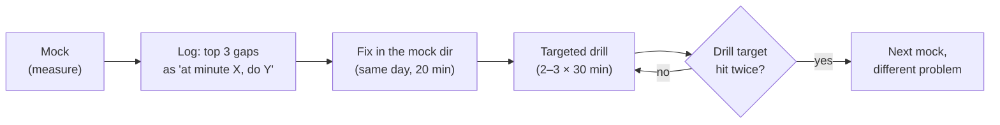

# D2 Unit 2 — Defending the code: walk-through, probes and re-attempts

> Time: ~5 h (including mocks 2 and 3) · CORE: §1–§3 · Lab: none; mocks 2 and 3 are built in `_mocks/` ·
> Kit: [probe-bank.md](probe-bank.md) · [rubric.md](rubric.md) · [mock-log.md](mock-log.md)

Unit 1 was about the 90 minutes. This unit is about the 15 minutes after them: the concurrency note at 1:20, the
tutor's checks at 1:30, and the probes. In a real round this is where a borderline packet is decided, because it's
the only part where the interviewer tests whether you understand the code you wrote, rather than whether you could
type it.

## Before you start

You've done mock 1 and scored it. Warm-up (write answers first):

1. What was the lowest-scoring gating dimension in your mock 1, and what's the one habit that would have moved it up?
2. Which probe categories must the tutor include in every mock?
3. In the D2 rubric, what's the difference between Tests *approaching* and *meets* in one phrase?

<details data-kind="answer">
<summary>Warm-up answers</summary>

1. Your own log has it. If you can't name a habit (an action at a specific minute), the debrief wasn't specific
   enough; ask the tutor to restate the fix as "at minute X, do Y".
2. At least one scale-up, one failure and one "why not X" ([format.md](format.md), the interviewer's script).
3. *Meets* catches the tutor's mutation; *approaching* doesn't (and usually lacks a concurrent test on a shared key).

</details>

**Session plan (≈ 5 h).** Session 1 (1 h): §1 and §2, then rehearse three probes from
[probe-bank.md](probe-bank.md) aloud on your mock-1 code. Session 2 (2 h): **mock 2**. Session 3 (2 h): **mock 3**,
then §3 if any mock scored below *meets*.

---

## §1 The walk-through and the concurrency note

### The failure story

A gym class roster: members check in to classes, each class has a capacity, and members can swap one class for
another. At 1:20 the learner says: "So it's thread-safe: there's a mutex on the roster, and swaps lock both classes.
I tested it with concurrent check-ins and the race detector is clean."

The tutor reads the code. The roster mutex guards the class map, but each `class` has its own mutex too, and `Swap`
locks `from` then `to` in argument order. The concurrent check-in test uses 50 different classes. The tutor's
mutation (reverse the lock order in one path) isn't caught; a quick acceptance test with opposite-direction swaps
deadlocks after ≈ 200 iterations. The note claimed three things ("thread-safe", "locks both classes", "tested") and
the code contradicted all three in detail. Dimension 7: *below*. Dimension 3 drops to *approaching*. Overall:
*approaching*, with a *below*.

The learner wasn't lying; they believed it. The note was a summary of intentions, not of the code.

### Predict

<!-- predict id="D2-U2-P01" -->
**Predict.** Write the 1:20 concurrency note (≤ 120 words) for this design, using the five headings: *an in-memory
gym class roster; one `sync.Mutex` per roster guards a `map[string]*class`; `CheckIn(classID, member)` takes the
roster lock for its whole body; an attendance report receives check-in events through a buffered channel of 1,000,
sent after unlocking, and if the channel is full the event is counted as dropped; `Close(ctx)` closes the channel and
waits for the report goroutine or the deadline.* Then name one claim in your note that the tutor could check with a
single test.
<!-- /predict -->

### Reveal

<details data-kind="reveal" data-for="D2-U2-P01">
<summary>Reveal</summary>

A note that would score *meets*:

- **Shared state and owners:** "The class map and every class's attendance, capacity and version are owned by the
  roster mutex; `CheckIn` holds it for the whole check-and-increment. The report's state is owned by its goroutine."
- **Bounds:** "The report channel holds 1,000 events; when full, events are dropped and counted, never blocking
  `CheckIn`."
- **Lifecycle:** "`Close` stops intake, closes the channel, and waits for the report goroutine up to the context
  deadline."
- **Failure handling:** "A slow report loses events (counted) instead of stalling check-ins; it can be rebuilt from
  the roster's current state."
- **Evidence:** "`TestCheckIn_ConcurrentSameClassLosesNothing` (50 goroutines, one class, attendance and version
  checked) and `TestCheckIn_BlockedReportDoesNotBlock`, both under `-race -count=20`."

Checkable claims: "a blocked report doesn't block `CheckIn`" (one test with a report consumer that never reads), or
"concurrent check-ins to one class don't lose updates" (same-class stress test). Tempting wrong answers: "it's
thread-safe" (not a claim anyone can check), or naming a test that uses distinct classes as evidence for same-class
safety.

</details>

### How it actually works

**The note is a set of claims the tutor will check.** Each heading produces one or two sentences that point at code
or a test:

| Heading | Answers | Points at |
|---|---|---|
| Shared state and owners | What is shared? Which lock or goroutine owns each piece? | Struct fields and the lock comment |
| Bounds | What can grow? What stops it? | Channel capacities, caps, eviction |
| Lifecycle | What starts? What stops it? What does `Close` wait for? | Constructors, `Close`, `WaitGroup` |
| Failure handling | Slow or panicking dependencies, errors, full queues | `recover`, timeouts, drop/reject policies |
| Evidence | Which test proves which property? | Test names, `-race -count=20` output |

**Write the note before 1:20.** The cheapest way to make the note true is to write the lock comment at 0:10 and update
it whenever the design changes. At 1:20 you read it, check each sentence against the code once, and say it.

**A test that makes a claim checkable.** "Concurrent check-ins don't lose updates" is only evidence if the
goroutines share a key. The shape (compiles as shown; in your mock it lives in `_test.go`):

```go
package roster

import (
	"sync"
	"testing"
	"time"
)

type Roster struct {
	mu         sync.Mutex
	attendance map[string]int
	versions   map[string]int
}

func NewRoster() *Roster {
	return &Roster{attendance: map[string]int{}, versions: map[string]int{}}
}

// CheckIn records one member in the class. It holds the lock for the whole read-modify-write.
func (r *Roster) CheckIn(classID string) {
	r.mu.Lock()
	defer r.mu.Unlock()
	r.attendance[classID]++
	r.versions[classID]++
}

func TestCheckIn_ConcurrentSameClassLosesNothing(t *testing.T) {
	r := NewRoster()
	const workers, each = 50, 200
	var wg sync.WaitGroup
	for i := 0; i < workers; i++ {
		wg.Add(1)
		go func() {
			defer wg.Done()
			for j := 0; j < each; j++ {
				r.CheckIn("spin-0700") // the SAME key: that's what makes a removed lock visible
			}
		}()
	}
	done := make(chan struct{})
	go func() { wg.Wait(); close(done) }()
	select {
	case <-done:
	case <-time.After(5 * time.Second):
		t.Fatal("check-ins did not finish within 5s: a deadlock or a stuck lock")
	}
	r.mu.Lock()
	defer r.mu.Unlock()
	if got, want := r.attendance["spin-0700"], workers*each; got != want {
		t.Fatalf("attendance = %d, want %d: concurrent check-ins lost updates (the class would look emptier than it is and overbook)", got, want)
	}
	if got, want := r.versions["spin-0700"], workers*each; got != want {
		t.Fatalf("version = %d, want %d: versions skipped or repeated", got, want)
	}
}
```

Remove the two lock lines from `CheckIn` and this test fails twice over: `-race` reports the race, and the attendance
check usually fails even without `-race`. That's what the tutor's mutation check looks for.

### Build it

No lab package. Take your mock-1 code and write its five-part note from the code alone, reading each struct and
`Close`. Then, for each sentence, name the line or test that proves it. Acceptance: no sentence without a pointer;
any sentence you can't point at is either deleted or turned into a TODO you say aloud.

### Break it

In a copy of your mock-1 code, remove the lock from the most-called method and run your tests with `-race -count=20`.
Then reverse a lock order or move a send/callback under a lock, and run again.

<details data-kind="answer">
<summary>What to look for</summary>

If both mutations are caught (a race report, an invariant failure or a timeout), your Tests dimension had real
evidence. If one survives, you've found the missing test: usually a concurrent test that shares a key, or a test
where a dependency blocks. Write it now; it's the test you'll write by reflex in mock 2.

</details>

### In the wild

- **Go's `sync` package docs and the Go memory model** describe exactly the happens-before edges the note relies on
  (unlock → later lock, channel send → receive completion); naming them is how Go reviewers talk about safety.
- **Design docs** at many companies have a "concurrency" or "threading model" section for the same reason: the model
  must be written down to be reviewed.
- **The `-race` detector** finds races only in executed code paths; its documentation is explicit that it can't
  prove the absence of races.

### Trade-offs

| Note style | Wins when | Loses when | When the answer flips |
|---|---|---|---|
| Five headings, ≈ 2 min | Default: complete and checkable | The interviewer cuts you off early | They interrupt → lead with owners and evidence, the two parts most often probed |
| Line-by-line code tour | The interviewer asks for it | Burns the time; hides the model | Only on request |
| Diagram of goroutines and channels | Designs with several goroutines | Single-mutex designs (nothing to draw) | When ownership moves between goroutines |

### Senior bar

- **Failure modes:** claims without pointers; evidence from tests that don't exercise the claim; skipping lifecycle
  (the part that causes deploy-time incidents); "thread-safe" as a property instead of a list of invariants.
- **Numbers:** ≈ 2 minutes, ≤ 120 words; stop at ≈ 3 minutes.
- **Ops:** lifecycle and bounds are what an on-call engineer needs; say them even if nobody asks.

**Interviewer follow-up probes:**

<details data-kind="answer">
<summary>Probe: "You said it's thread-safe. Which invariants, and which test proves each?"</summary>

List them: "Attendance never exceeds capacity: `TestCheckIn_ConcurrentNeverOverCapacity`, 100 goroutines
checking in to a class of 20. No lost updates: `TestCheckIn_ConcurrentSameClassLosesNothing`. A stuck report never
blocks check-ins: `TestCheckIn_BlockedReportDoesNotBlock`. All under `-race -count=20`." If one invariant has no test, say so before
they find it.

</details>

<details data-kind="answer">
<summary>Probe: "Your `Close` waits for the report goroutine. What if it never returns?"</summary>

"`Close` takes a context; it closes the channel, then selects on the goroutine's done channel and `ctx.Done()`. On
deadline it returns `ctx.Err()` and reports how many events were still buffered. The goroutine leaks until its
current `Record` call returns, which is why `Record` must not block indefinitely; I'd document that as the
report's contract."

</details>

### Check yourself

1. Name the five headings of the concurrency note.
2. Why must a "no lost updates" test use a single shared key?
3. When should the note be written?

<details data-kind="answer">
<summary>Answers</summary>

1. Shared state and owners; bounds; lifecycle; failure handling; evidence.
2. With distinct keys, goroutines never touch the same state, so removing the lock changes nothing observable; the
   test can't fail.
3. Started at 0:10 as the lock comment, kept current as the design changes, checked and spoken at 1:20.

</details>

---

## §2 Answering probes

### The failure story

Cinema concession order queue, 1:35. Tutor: "Why one worker per prep station and not a goroutine per order?" Learner:
"Goroutines are expensive at scale." Tutor: "How expensive? We have ≈ 300 orders in flight at the evening peak."
Learner: "…It depends on the workload." Tutor: "What happens when the grill station is down for the whole evening
rush?" Learner: "We'd retry." Tutor: "And the orders waiting for it?" Learner: "We could add a limit."

Each answer is vaguely right. None names a mechanism in *their* code, none has a number, none has a flip condition.
The tutor marks dimension 7 *approaching*: "needed two pushes per probe to reach a mechanism; no numbers." The facts
were available: ≈ 2 KB initial stack per goroutine (≈ 600 KB for 300), the station queue type in their own code, and
≈ 0.5 items/s × 2 h ≈ 3,600 items queued for that station.

### Predict

<!-- predict id="D2-U2-P02" -->
**Predict.** Answer these two probes for the concession queue in at most four sentences each. Use the shape
*mechanism in my code → number → cost → when it flips*.

1. "Why one worker per prep station and not a goroutine per order?"
2. "The grill station is down for the two-hour evening rush, and ≈ 0.5 items/s need it. What happens to memory and to
   those orders?"
<!-- /predict -->

### Reveal

<details data-kind="reveal" data-for="D2-U2-P02">
<summary>Reveal</summary>

1. "Each station has one worker draining its queue, because a station makes one item at a time; combo progress lives
   in an order table under the same mutex. A goroutine per order would also work: 300 goroutines start at ≈ 2 KB of
   stack each, ≈ 600 KB, which is cheap, and each order could wait for its own items, so combo tracking becomes
   structural. The cost of that design is lifecycle (300 goroutines to cancel on `Close`) and no natural place to cap
   load per station. I'd flip to goroutine-per-order if combo-tracking bugs kept showing up in the shared table, and
   keep the per-station workers for the cap."
2. "That station's queue would grow by ≈ 3,600 items (0.5/s × 7,200 s); at ≈ 200 B per queued item that's ≈ 720 KB,
   so memory isn't the problem, waiting time is. The per-station cap I set at 200 is hit after ≈ 7 minutes; past it,
   `Submit` rejects new orders that need the grill with `ErrStationBacklog`, and a combo containing a grill item is
   rejected whole, so the other stations keep serving. In production I'd alert on the age of the oldest queued item
   per station well before the cap and tell the kiosks to hide grill items."

What makes these *meets*: the mechanism is named in their own code (per-station worker, per-station cap), there's a
number, there's a cost, and there's a condition for changing course. Tempting wrong answers: attacking the
alternative ("goroutines are expensive") instead of comparing; "we'd add a limit" (future tense: is there one or
not?).

</details>

### How it actually works

**The answer shape.** Every probe answer at the senior bar has four parts, mirroring the HLD trade-off sentence from
the [framework card](../../docs/INTERVIEW_FRAMEWORK.md#stating-a-trade-off-use-this-shape-every-time):

1. **Mechanism in my code:** the type, lock, channel or test that handles it (or "nothing handles it yet", said
   plainly).
2. **Number:** a rate, a size, a latency, a count. Approximate is fine; say ≈.
3. **Cost:** what this choice gives up.
4. **Flip:** the measurable condition under which you'd change it.

**Categories and the number each one usually needs** (the full list is [probe-bank.md](probe-bank.md)):

| Category | Typical number |
|---|---|
| Scale-up | ops/s one lock sustains (≈ 10⁶ for a ≈ 1 µs critical section), entries × bytes per entry |
| Failure | outage length × rate = backlog; timeout values; retry attempts × backoff = worst-case latency |
| Concurrency | goroutines contending on one key; iterations needed to reproduce a race (`-count`) |
| Extensibility | lines/functions a change would touch |
| Testing | how long the suite runs under `-race` (≈ 2–20× slower, B3 playbook) |
| Cost | goroutines × ≈ 2 KB, memory per entry, store quota used per flush |
| Security / tenancy | per-tenant caps, input size limits |
| Why not X | the crossover point where X wins |

**When you don't know.** Say what you'd measure and how: "I don't know the contention level; I'd run the stress test
with `-cpu 1,4,8` and a mutex profile, and I'd shard if lock wait exceeds ≈ 10–20% of wall time." That's a *meets*
answer. An invented number stated confidently is a red flag.

**When the probe exposes a real flaw.** Own it in the same answer: "You're right, `Send` is under the lock there.
That means one slow partner blocks every enqueue. The fix is to copy the item out and send after unlocking; it's a
five-line change and I'd add a test with a blocking sender." This costs less on dimension 3 than being caught
defending it.

### Build it

No lab package. Pick three probes from [probe-bank.md](probe-bank.md) (one scale-up, one failure, one "why not X")
and answer them aloud about your mock-1 code, timed: ≤ 45 seconds each. Record yourself or write the answers down,
then check each for the four parts. Acceptance: all three have a mechanism in your code and a number.

### Break it

Answer the same three probes again, but about a *different* design for the same problem (e.g. if you used a mutex,
answer as if you'd used a single owner goroutine).

<details data-kind="answer">
<summary>What this shows</summary>

If your answers barely change, they weren't about your code; they were generic. Good probe answers are specific
enough that they'd be wrong for a different design. This is also the best preparation for "why not X": you've just
argued X's side.

</details>

### In the wild

- **Incident reviews** ask the same questions after the fact: what failed, how big was the backlog, what limited the
  blast radius, how did we know. Probe answers are a rehearsal of that analysis.
- **Go performance work** relies on the same evidence: `go test -bench`, `-cpuprofile`, `-mutexprofile` and
  `-blockprofile` give the numbers that turn "it might be slow" into a decision.

### Trade-offs

| Answer style | Wins when | Loses when | When the answer flips |
|---|---|---|---|
| Four-part (mechanism, number, cost, flip) | Default | The probe is a yes/no clarification | Answer yes/no, then one sentence of why |
| "I'd measure" | You genuinely don't know a number | Used to dodge a number you could estimate | Estimate first, then say how you'd confirm |
| Fix it live | A small, real flaw found by the probe | Large redesigns in the last minutes | > ≈ 5 minutes of change → describe the fix and the test instead |

### Senior bar

- **Failure modes:** generic answers; numbers with no derivation; defending a flaw; answering a different question
  than asked; long answers that never reach a mechanism.
- **Numbers:** ≤ 45–60 s per probe answer; 4–6 probes in ≈ 15 minutes.
- **Ops and cost:** at least one answer per mock should mention how you'd *know* (a metric or alert), even unprompted.

**Interviewer follow-up probes:**

<details data-kind="answer">
<summary>Probe: "Why not `sync.Map` for the order table?"</summary>

"`sync.Map` is built for keys that are written once and read many times, or for goroutines touching disjoint keys.
My hot operation is read-modify-write across two fields of an order (items remaining and status), which `sync.Map`
doesn't make atomic; I'd still need a lock per entry. A plain map under one mutex keeps the invariant in one place,
and at ≈ 5 orders/s it's nowhere near contended. If the table became read-mostly with rare writes, I'd consider it,
or an `atomic.Pointer` snapshot."

</details>

<details data-kind="answer">
<summary>Probe: "How do you know your tests aren't flaky?"</summary>

"They don't sleep: the clock and sleeper are injected, and every wait has a deadline that fails the test instead of
hanging. I ran the suite with `-race -count=20` before freezing; I'd add `-cpu 1,4` in CI to vary scheduling. If a
test failed once in 50 runs, I'd treat it as a real race until proven otherwise, not retry it."

</details>

### Check yourself

1. What are the four parts of a senior probe answer?
2. What do you say when you don't know a number?
3. A probe reveals a send under a lock with 6 minutes left. What do you do?

<details data-kind="answer">
<summary>Answers</summary>

1. Mechanism in my code; a number; the cost; when it flips.
2. Estimate if you can derive it; otherwise say exactly what you'd measure and how (`-mutexprofile`, a benchmark, a
   stress test with `-cpu`), and what threshold would change the decision.
3. Own it, state the fix (copy out, send after unlock) and the test that proves it (a blocking sender doesn't block
   enqueue); make the change if it's ≈ 5 minutes, otherwise describe it precisely.

</details>

---

## §3 The re-attempt loop

### The failure story

Mock 2 scored *approaching* (Tests: the mutation survived). The learner's plan: "do another mock tomorrow". Mock 3,
the next day, a different problem: *approaching* again, Tests again, for the same reason (no concurrent test on a
shared key). Two mocks, ≈ 4 hours, one lesson learned twice. The debrief named the gap both times; nothing between the
mocks changed the habit.

### Predict

<!-- predict id="D2-U2-P03" -->
**Predict.** A mock scored *approaching* with this log: Stage 1 green at 0:36; Stage 2 landed additively; tutor's
mutation (callback moved under the lock) survived; probes fine. Design a plan for the days between this mock and the
next one: what exactly do you practise, for how long, and how do you know the gap is closed *before* the next mock?
Also: should the next mock be the same problem?
<!-- /predict -->

### Reveal

<details data-kind="reveal" data-for="D2-U2-P03">
<summary>Reveal</summary>

Two gaps: Time (Stage 1 late) and Tests (mutation survived). A plan that works:

1. **Same day, ≈ 20 min:** in the mock directory, write the missing test (a callback that blocks; assert that the
   operation still returns within a deadline). Apply the tutor's mutation; confirm it now fails.
2. **Next 2–3 days, ≈ 30 min each:** a drill, not a mock. Take a B3 problem you know, start a timer, and do 0:00–0:30
   only: API at 0:10, a test before each method, and a "callback/dependency blocks" test before 0:30. Record the minute
   Stage 1 goes green. Target: ≤ 0:30 twice in a row.
3. **Next mock on a different problem**, preferably from a skill family with slow dependencies or
   callbacks (ask the tutor for one; don't pick it yourself from the bank) so the gap is tested again. Same-problem re-attempts don't count for the gate (only one passing
   mock per distinct problem counts) and measure recall, not skill.

You know the gap is closed when the drill hits the target twice and the mutation check on your drill code is caught.
Tempting wrong answer: "do more mocks". Mocks measure; drills change habits. A mock every day mostly measures
fatigue.

</details>

### How it actually works



**Turn each gap into an action at a minute.** "Write better tests" isn't actionable. "Before 0:30, write a test where
a dependency blocks and assert the operation returns" is. The mock log's gap table has a "fix to practise" column for
exactly this.

**Pick the next problem to re-test the gap.** The problem bank tags each problem with a skill family. If the gap was
lifecycle (`Close`, draining), pick a problem whose Stage 3 is lifecycle-heavy. The tutor picks; you can ask for a
family.

**Spacing.** At least a day between mocks; two weeks after a problem's mock, redo its Stage 1 from scratch, timed, as
retrieval practice (not for the gate).

### Build it

No lab package. After any mock below *meets*: write the missing test or fix in the mock directory the same day, then
schedule the drill sessions. Acceptance: the tutor's mutation, re-applied, is caught; the drill log shows the target
hit twice before the next mock.

### Break it

Look back over your three mocks' logs. Count how many top-3 gaps repeated across mocks.

<details data-kind="answer">
<summary>What it means</summary>

A gap that appears in two mocks means the drill between them didn't target it, or targeted it too vaguely. Record
it: `sd record note D2 --tags machine-coding,<tag> --notes "<gap> repeated in mocks N and M"` so the tutor attacks it
next session. Zero repeats across three mocks is a strong sign the loop is working.

</details>

### In the wild

- **Deliberate practice** (focused drills on a specific weakness with immediate feedback) is the standard account of
  how skills improve, as opposed to repeating whole performances; the research literature on it is large and debated
  in details (TODO-VERIFY any specific effect size before quoting one).
- **Blameless postmortems** end with action items that are specific, owned and checkable, for the same reason the
  mock log's gaps are phrased as "at minute X, do Y".

### Trade-offs

| Next step after a below-meets mock | Wins when | Loses when | When the answer flips |
|---|---|---|---|
| Targeted drill, then a new problem | Default | The gap is broad (everything slow) | Several gaps at once → one full untimed re-build of the mock problem with the debrief, then drills |
| Immediate new mock | You were ill, distracted or the problem was mis-sized | A habit gap | Only when the tutor judges the mock unrepresentative |
| Same-problem redo | Retrieval practice two weeks later | As a gate attempt (doesn't count) | Never for the gate |

### Senior bar

- **Failure modes:** treating mocks as practice; gaps phrased as adjectives; not re-testing the gap on the next
  problem.
- **Numbers:** three passing mocks on distinct problems for the gate; ≈ 2 h per mock; ≈ 1.5 h of drills per gap.
- **Long view:** D4's machine-coding round uses this format unchanged. A habit fixed here is one less thing to think
  about on loop day.

**Interviewer follow-up probes:**

<details data-kind="answer">
<summary>Probe (from the tutor, in the debrief): "What will you do differently in the next mock?"</summary>

One or two actions at specific minutes: "At 0:10, the lock comment lists every dependency call and says it happens
outside the lock. Before 0:30, one test where a dependency blocks." Not "be faster" or "test more".

</details>

<details data-kind="answer">
<summary>Probe: "Your mock 2 and mock 3 had the same gap. Why?"</summary>

An honest answer names the missing step: "I read the debrief but didn't drill between mocks, so the habit was the
same on the day. This time I'll do the 30-minute drill twice before booking mock 4." That's the reflection the tutor
records.

</details>

### Check yourself

1. Why don't same-problem re-attempts count toward the D2 gate?
2. What turns a gap into something practisable?
3. How do you know a gap is closed before the next mock?

<details data-kind="answer">
<summary>Answers</summary>

1. The gate counts one passing mock per distinct problem: a second attempt at a known problem measures recall, not
   the skill of handling an unseen one.
2. Phrasing it as an action at a minute ("before 0:30, write a blocking-dependency test"), then drilling exactly that.
3. A drill target hit twice in a row (e.g. Stage 1 green by 0:30), and the tutor's mutation caught on the drill code.

</details>

---

## Unit wrap-up

| Situation | Do this | Flip to this when… |
|---|---|---|
| 1:20 | Five-part note, ≤ 120 words, each sentence pointing at code or a test | Cut off early → owners and evidence first |
| A probe | Mechanism in my code → number → cost → flip, ≤ 60 s | No number available → say what you'd measure and the threshold |
| A probe finds a real flaw | Own it, state fix and test; fix live if ≈ 5 min | Bigger than that → describe precisely, leave the failing test |
| Mock below meets | Fix in the mock dir the same day; drill the gap; next mock on a different problem | The mock was unrepresentative (tutor's call) → new mock sooner |
| Gate | Three mocks ≥ meets on distinct problems, recorded by the tutor | — |

**Next:** mocks 2 and 3 (see [format.md](format.md)). When the gate passes, D2 counts toward
[D4](../D4-full-loop/README.md), whose machine-coding round uses this format and [rubric](rubric.md) unchanged.
