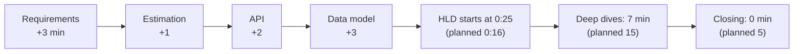
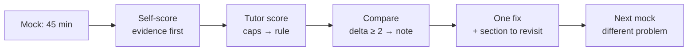

# D3 Unit 1 — The 45 minutes under a real clock

> Time: ~5 h · CORE: §1–§2 (≈ 2.5 h reading and drills) + the first mock with its debrief (≈ 1.5 h) + logging and
> revisits (≈ 1 h) · Lab: none (the mocks are the practice) · Kit: [format.md](format.md), [rubric.md](rubric.md),
> [mock-log.md](mock-log.md)

You already know the framework. A0 derived it, and every Track C case study ran through it. What you haven't had
is someone across the table who answers questions with numbers, probes the part you hoped they'd skip, changes a
requirement at minute 27, and writes a score that you can't negotiate. This unit is about the two skills that only
show up under those conditions: spending the clock where the score is, and scoring yourself as the interviewer
would, so each mock teaches you something specific.

## Before you start

You need A0–A7 and C1, C2, C5 and C6 passed (that's what unlocks D3). Warm-up from those, written down before you
open the answers:

1. From memory: the seven phases of the 45-minute framework, their time budget, and the three checkpoints.
2. 300M requests a day at a 3× peak. Peak requests per second?
3. State one trade-off from your C5 news-feed design in the four-part shape.

Warm-up answers

1. Requirements (0:00–0:06) → estimation (0:06–0:10) → API (0:10–0:13) → data model (0:13–0:16) → high-level
   design (0:16–0:25) → deep dives (0:25–0:40) → bottlenecks, failures, evolution (0:40–0:45). Checkpoints: numbers
   by 0:10, end-to-end diagram by 0:25, stop drilling at 0:40. If you had the phases but not *why* that order
   (each consumes the previous one's output), re-read A0 Unit 1 §1.
2. 300M / 86,400 ≈ 3.5k/s average, ≈ 10k/s at 3×. Napkin: 300M / 10^5 = 3k/s, × 3 ≈ 9k/s (≈ 14% low, fine).
3. For example: "Hybrid fan-out (claim), because ≈ 99% of authors have < 10k followers and push keeps feed reads to
   one cache lookup, while a 50M-follower author would cost 50M writes per post (why here); the cost is two read
   paths to merge and a celebrity threshold to tune (cost); if read QPS dropped below write fan-out cost — a
   write-heavy product with rare reads — pull-only wins (flip)." Any trade-off with all four parts counts.

**Session plan (≈ 5 h):** Session 1 (2 h): §1 and its drill. Session 2 (1.5 h): §2, then score the two transcript
excerpts. Session 3 (1.5 h): mock 1 with the tutor (45 min + ≈ 20 min self-score, scoring and debrief), then fill
the log and revisit the section the debrief names.

---

## §1 Checkpoints are scoring events

### The failure story

A mock on a city bike-sharing prompt. The candidate is careful and correct. Requirements take 9 minutes
(three over), because they ask about e-bike pricing, membership tiers and reservations. Estimation takes 5 (one
over). The API takes 5 (two over), because they write out request and response bodies. The data model takes 6
(three over), because they debate Postgres versus Cassandra for rentals. It is 0:25 and there is no diagram.

The diagram arrives at 0:33. Deep dives get 7 minutes instead of 15: one shallow pass over dock-occupancy updates. At
0:44 the interviewer asks what happens when the rental service crashes mid-unlock. No time to answer.

Nine minutes of overrun, spread across four phases, each one defensible on its own. The rubric doesn't see
"careful". It sees *High-level design* missed checkpoint B (at most approaching), *Deep dives* got one shallow dive
(approaching), *Failure, operations & cost* had no closing phase (at most approaching), and *Communication & time*
had two slipped checkpoints and one missed (at most approaching). Overall: approaching. The candidate knew enough to
score meets on every one of those dimensions.

### Predict

<!-- predict id="D3-U1-P01" -->
**Predict.** Write these down before you open the reveal.

1. It's 0:18. You've just finished the data model and there's no diagram yet. What exactly do you say, and what do
   you cut from the rest of the session?
2. Which of the three checkpoints is the most expensive to miss, and why?
3. At 0:12, while you're on the API, the interviewer asks, "How would you keep dock availability fresh?" Do you
   follow, defer, or decline? What do you say?
<!-- /predict -->

### Reveal

Reveal

**1. Say the slip, name the cut, go.** "I'm about two minutes behind. I'll draw the end-to-end write and read paths
now and keep the deep dives to the two riskiest parts." Then draw a *thin* diagram: every box, both paths, one
request walked through, no internals. That gets you to checkpoint B by ≈ 0:26. What you cut: the third deep dive and
any further API or schema detail. What you never cut: the diagram, failure modes, the closing phase. The tempting
wrong answer is to "make up time" by talking faster through the diagram while still detailing each box. That costs
the same minutes and leaves the interviewer unable to follow.

**2. Checkpoint B (end-to-end diagram by 0:25) is the most expensive.** Missing A (numbers) hurts *Estimation* and
weakens every later justification, but you can still produce numbers at 0:13 and use them. Missing B takes down
three things at once: *High-level design* is capped, the deep dives start late and shallow, and the closing phase is
squeezed out. And the interviewer has no system to probe, so *Probe handling* is scored on fragments. Missing C
(closing) costs one dimension. A common wrong answer is "A, because estimation comes first". It does, and it
matters, but the damage from B compounds.

**3. Follow briefly, then return.** The steer is a signal about what the interviewer wants to grade, so ignoring it
is the worst option. But a full deep dive at 0:12 means no diagram at 0:25. Say: "Good question. Short answer:
docks push an occupancy event on every change plus a heartbeat every ≈ 30 s into an in-memory index; I'll come back
to it as my first deep dive once the full design is up." Write "dock freshness" in a parking-lot corner of the board, and
make it deep dive #1. The interviewer sees that you heard them and that you're managing the clock.

### How it actually works

**Overrun propagates downstream.** The framework is a dependency chain, so time works like a single queue: every
minute a phase runs over is a minute taken from the phases after it, and the last phases (deep dives, closing) are
exactly where the senior signal lives. There is no slack at the end to absorb it.

**The interviewer's notes have a timeline too.** At each checkpoint they write something on the form. At 0:10:
"sized the problem / didn't size it." At 0:25: "end-to-end design / no design yet." At 0:40: "went deep on X and Y /
didn't get to depth." The checkpoints in [format.md](format.md) are those moments made explicit. Hitting them on time
doesn't guarantee a good score, but missing one caps a dimension (the caps in [rubric.md](rubric.md)).

**Where the minutes go in failed mocks.** Overruns are rarely one big mistake. They're small gold-plating habits:

| Habit | Typical cost | Fix |
|---|---|---|
| Asking about every feature before scoping | 2–4 min | Ask the 3–4 questions whose answers change the design; state an assumption for the rest |
| Computing numbers that drive no decision | 1–2 min | Only numbers next to a threshold (write QPS vs one primary, storage vs one node, egress vs a CDN) |
| Writing full request/response bodies | 2–3 min | Method, path, the 2–3 fields that matter, idempotency key, pagination |
| Debating two stores in the data-model phase | 2–4 min | Pick one with a one-line reason; promote the debate to a deep dive if it's risky |
| Detailing each box while drawing the diagram | 3–5 min | Draw thin first (boxes and arrows, one walk-through), then deepen |

These are ≈ figures from the kinds of overruns the A0 rehearsals produce; your own logs will show your personal
pattern within two or three mocks. That's what the phase-timestamp table in the log is for.

**The slip budget.** Treat each checkpoint as having a 2-minute tolerance. Within it: carry on. Beyond it: say the
slip and cut by the order in [format.md](format.md#behind-schedule-the-learners-rules) (API detail → data-model detail →
third deep dive → diagram polish; never numbers, the diagram or failure modes). Saying the slip out loud is itself
scored under *Communication & time*: it shows you know where you are.

**Pulled off-plan.** Interviewers steer for two reasons: they want a specific signal (follow it), or they're testing
whether you can hold structure (follow briefly, then return). You can't always tell which, so the same move works
for both: a short answer, a parking-lot note, and a commitment to come back. The only wrong moves are refusing, and
following so far that the diagram never happens.

### Build it

No Go lab for this section. The drill is **first-10 sprints**: the first ten minutes of a mock, on its own, on a
timer, three times. Use prompts that aren't in the problem bank:

1. "Design a status page service that thousands of SaaS companies use to tell their customers about incidents."
2. "Design the voting backend for a live TV talent show."
3. "Design a job board where companies post roles and candidates apply."

For each, stop at 10:00 exactly. Acceptance: requirements with every NFR as a number, an out-of-scope list, and ≤ 6
estimates each followed by a decision, all on the page by 10:00. Log the clock when you start estimating; if it's
after 6:30, your requirements phase is the habit to fix.

### Break it

Run sprint 2 again on another day, but this time ask no clarifying questions at all: state every requirement as an
assumption. Compare the two pages. What did the questions buy you, and how many minutes did they cost?

What you'll likely see

The no-questions version usually finishes requirements in ≈ 3 minutes instead of ≈ 6, and its estimates are just as
good, because the numbers you'd have asked for are ones you can assume (votes per second at the end of a show is
the number that matters, and you can state it). What it loses: the one or two questions that *change the design*,
such as "can a viewer vote more than once?" (idempotency and fraud) or "must results be exact at the deadline?"
(a consistency requirement that rules out approximate counting). The lesson isn't "ask nothing". It's "ask only
the questions whose answers fork the design, and say why you're asking".

### In the wild

- **Timeboxing** is the core mechanism of Scrum's events (sprint planning, daily scrum) and of many design-review
  formats: a fixed slot forces prioritisation of what gets discussed.
- **Checklists with pause points.** The WHO Surgical Safety Checklist puts three fixed pauses into an operation
  (before anaesthesia, before incision, before the patient leaves) where specific items must be confirmed. The
  checkpoints play the same role: a moment where you must confirm that something exists before going on.
- **Chess clocks.** Tournament players budget time per phase of the game and are taught to notice when they're
  spending it on a position that doesn't need it. Running out of time in a won position still loses, which is
  close to a correct design with no closing phase.
- **Company formats vary.** Some loops run HLD rounds of 60 minutes, some include a separate product or API
  round. TODO-VERIFY the format for the company you interview with; the checkpoint logic scales, so move the
  checkpoints proportionally (at ≈ 22%, 55% and 90% of the round).

### Trade-offs

| Approach | Wins when | Loses when | When the answer flips |
|---|---|---|---|
| Strict clock (checkpoints enforced by you) | Interviewer is passive; you need to show structure | Interviewer has a specific deep dive they need to see early | If the interviewer steers twice towards the same topic, it's their rubric item: follow it and compress elsewhere. |
| Thin diagram first, deepen later | Almost always in 45 min | The prompt is so small that the full diagram fits in 3 minutes anyway | For a single-component prompt (e.g. "design a rate limiter"), go straight to depth after a one-line context diagram. |
| Many clarifying questions | Ambiguous prompt with forks that change the design | Questions about features that don't change the architecture | If you can't say how the answer changes the design, state an assumption instead. |
| Cut the API to two lines | You're behind and the API is standard CRUD | The API *is* the hard part (idempotent payments, webhooks, pagination over a merged feed) | When retries or ordering are in the requirements, the API is a deep-dive candidate; keep it. |

### Senior bar

- **Failure modes:** gold-plating early phases; silent slips; following a steer for 10 minutes; drawing the diagram
  in detail on the first pass; "I'll come back to failures" and never doing it.
- **Numbers:** your log should show phase durations within ≈ 2 minutes of plan by your third mock. Track the slip at
  A, B and C across mocks; a consistent slip in one phase is the habit to fix, not "time management" in general.
- **Ops view of the clock:** the closing five minutes are the cheapest signal in the round. Even a 90-second closing
  (what breaks first at 10×, the alert you'd add, the cost driver) lifts *Failure, operations & cost* off "approaching".

**Interviewer follow-up probes:**

Probe: "We're at 0:31 and I haven't heard anything about failures. What's your plan for the rest of the time?"

Take it as the hint it is, and re-plan out loud in one breath: "Let me finish this deep dive in two minutes with the
failure case of this component — the rental service crashing mid-unlock — then do a second, shorter dive on dock-event
ingestion, and keep the last five minutes for what breaks first at 10× and how we'd detect it." Then do exactly that.
What scores is the visible re-plan, not an apology.

Probe: "Can you go deeper on that?" (at 0:39, mid-closing)

Give one more layer, bounded: "Briefly: the unlock is a compare-and-set on the bike's state from DOCKED to
UNLOCKING with a 10-second lease; if the rental service dies, the lease expires and the bike returns to DOCKED. That's
the core; I'd want two minutes for what breaks first at 10×." Depth on request, with a clock-aware handback, beats
both refusing and drilling until 0:46.

Probe: "You spent a while on requirements. Was that worth it?"

Answer with what the questions bought: "Two of them changed the design: 'can members reserve a bike before
arriving?' added a reserved state with an expiry, and 'must availability be exact?' split the design into a strongly
consistent unlock and an eventually consistent map. The e-bike pricing question didn't change anything, and I
should have assumed it." Owning a wasted minute is fine. Not knowing which
questions mattered isn't.

### Check yourself

1. Name the cut order when you're behind, and the three things you never cut.
2. You're asked about a deep-dive topic at 0:09. What do you do?
3. What does the phase-timestamp table in the log let you find after three mocks?

Answers

1. API detail → data-model detail → third deep dive → diagram polish. Never: the numbers, the end-to-end diagram,
   failure modes.
2. A short answer (one or two sentences with the mechanism), a parking-lot note, a promise to return to it as a
   deep dive, then back to estimation. Make it deep dive #1.
3. Your personal overrun pattern: which phase slips consistently. That's the habit to fix, rather than "be faster".

---

## §2 Scoring yourself like the interviewer

### The failure story

After the second mock, the learner self-scores *meets* on all eight dimensions. The tutor scores *Deep dives &
trade-offs* and *Probe handling* at approaching. The learner pushes back: "I know how consistent hashing handles a
node loss; I just didn't say it all." That's the point. The interviewer can only score what was said and drawn
before 0:45. Self-scoring from what you *know* rather than from what's *on the board* inflates every dimension that
depends on articulation, and those are the gating ones.

Calibration matters for a practical reason: each mock costs about an hour of the tutor's attention and yours, and
you need four at meets. If you misjudge which dimension held you back, you fix the wrong thing in the next mock and
burn another hour.

### Predict

<!-- predict id="D3-U1-P02" -->
**Predict.** Here are four minutes of a mock on a notification service (0:27–0:31). Score *Deep dives & trade-offs*
and *Probe handling* using [rubric.md](rubric.md), and write the one piece of evidence you'd cite for each.

> **Candidate:** For the deep dive I'll take provider failover, since that's where we lose messages. We have two SMS
> providers. I'd use the primary and fail over to the secondary when it's down.
>
> **Interviewer:** How do you decide it's down?
>
> **Candidate:** Health checks. If the health check fails we switch.
>
> **Interviewer:** The provider's health endpoint is green, but 30% of sends are timing out after 10 seconds.
>
> **Candidate:** Then we'd... use a circuit breaker on the send calls instead. If errors go over a threshold, open it
> and send to the secondary.
>
> **Interviewer:** What happens to the messages that timed out?
>
> **Candidate:** We retry them on the secondary.
>
> **Interviewer:** Could the user get the SMS twice?
>
> **Candidate:** Yes, possibly. That's probably acceptable for notifications.
<!-- /predict -->

### Reveal

Reveal

**Deep dives & trade-offs: approaching.** The choice of dive is good: it was picked by risk and said so. But only
one option is on the table (primary/secondary failover); there's no alternative compared (weighted routing across
both, per-region provider choice), no cost, and no flip condition. Evidence: "I'd use the primary and fail over to the
secondary" with no number and no alternative.

**Probe handling: approaching.** Three pushes were needed to reach a mechanism (health check → circuit breaker), and
the breaker has no numbers (threshold, window, half-open policy). The duplicate question was answered with
"probably acceptable" rather than a decision: for a one-time passcode a duplicate is harmless, but for "your payment
of $500 was sent" it's alarming, and the fix (an idempotency key per message, provider-side where supported, or a
dedupe window) is cheap. Evidence: "Then we'd... use a circuit breaker" after the second push.

A *meets* version of the same four minutes: "Failover is driven by send outcomes, not the provider's health endpoint:
a breaker per provider over a 30-second window opens at ≈ 20% timeouts or 5xx, and half-opens with 1% of traffic.
Timed-out sends are ambiguous — the provider may have delivered — so retries on the secondary carry our message id,
and for transactional messages I'd accept a rare duplicate over a miss, but suppress duplicates for marketing. The
alternative is weighted routing across both providers all the time, which costs more in the cheap provider's volume
discount but halves the blast radius; I'd flip to that if one provider's incidents exceed the 99.9% SLO budget."

A common mistake is to score the probe answers *meets* because the candidate "got there". Reaching the right
mechanism after three pushes is the definition of approaching: it needed heavy prompting.

### How it actually works

**Score from evidence, dimension by dimension.** For each of the eight dimensions in [rubric.md](rubric.md), write
one piece of evidence before the level: a timestamp ("diagram complete at 0:28"), a quote ("because it's
scalable"), or a number ("peak egress 12 Gbps, reference 96 Gbps: 8× bits/bytes error"). If you can't find evidence
for a level, you don't have that level.

**Gating dimensions decide the outcome.** *High-level design*, *Deep dives & trade-offs*, *Probe handling* and
*Communication & time* must all be at meets for an overall meets, and nothing can be at below. The other four still
matter (a below anywhere caps the overall at approaching), but the gating four are where senior and mid-level
candidates differ, and they map onto weak spots (b) and (d).

**Caps first, then the overall rule.** The caps in [rubric.md](rubric.md) turn the clock and a few hard failures into
mechanical limits (no numbers by 0:15, no diagram by 0:30, an uncaught 8× unit error, an ignored requirement
change). Apply them before you think about the overall, so a strong deep dive can't paper over a missing diagram.

**The order matters.** Self-score first, in writing, before the tutor says anything evaluative. Then the tutor
scores. Then compare. Seeing the tutor's score first anchors you, and the calibration signal is lost.

**What the log is for.** Across mocks, three columns of the log become your data: the phase slips (where your time
goes), the probe verdicts by kind (which kinds of probe you handle weakly), and the self-vs-tutor delta per dimension
(where your judgement is off). `sd progress` shows weak quiz tags; the logs show weak *interview* habits.

### Build it

No Go lab. Score this second excerpt fully, all eight dimensions where there's evidence, then check against the
answer. It's 0:00–0:12 of a mock on "design a pastebin" (A0's walkthrough problem, used here because you know it).

> **Candidate:** Let me pin down requirements. Users paste text and get a short link; anyone with the link can read
> it. Pastes expire; default 30 days. Out of scope: accounts, editing, syntax highlighting. NFRs: reads are much
> more common than writes — can I assume 10 million new pastes a day and 10 reads per paste?
>
> **Interviewer:** Yes.
>
> **Candidate:** Read latency p99 under 100 ms, 99.9% available, pastes durable until expiry. Max paste size?
>
> **Interviewer:** 1 MB, average 10 KB.
>
> **Candidate:** [at 0:05] Estimation. Writes: 10M a day is about 115 a second, peak maybe 350. Reads: 100M a day,
> ≈ 1,150 a second, peak ≈ 3,500. Storage: 10M × 10 KB = 100 GB a day, times 30 days retention, 3 TB live, 9 TB
> with three replicas. That's more than I'd want on one Postgres box, so blobs go to object storage and metadata in a
> database. Egress: 3,500 × 10 KB = 35 MB/s, 280 Mbps, so a CDN is nice but not required.
>
> **Candidate:** [at 0:09] API: `POST /pastes` with an `Idempotency-Key` header, returns the short id; `GET /p/{id}`.
> Data model: metadata table keyed by id with expiry; blob in object storage keyed by id.

Scoring

- **Requirements & scope: meets.** Functions, out-of-scope, NFRs with numbers, and the questions asked are the ones
  that size the system. Evidence: "Out of scope: accounts, editing…", "p99 under 100 ms, 99.9%".
- **Estimation: meets.** All numbers within tolerance (10M/86,400 ≈ 116/s; 100 GB/day × 30 = 3 TB; 35 MB/s ≈ 280
  Mbps), units carried, bits converted, and each tied to a decision (object storage; CDN optional). Evidence:
  "3 TB live, 9 TB with three replicas… so blobs go to object storage". Not exceeds: no sanity check or range.
- **API & data model: meets** so far. Idempotency key on the retried write; access pattern (by id) drives the key.
  Partition key not named yet, but at 3 TB of blobs and a few GB of metadata it isn't needed, and saying so would
  push it towards exceeds.
- **Communication & time: on track.** Estimation started at 0:05, API at 0:09: both checkpoints early.
- Not yet scorable at 0:12: high-level design, deep dives, probe handling, failure/ops/cost. Leave them blank rather
  than guessing; a score with no evidence is a guess.

### Break it

After your first real mock, before the tutor scores, write your self-score in the log. Then cover it, wait a day,
re-score from the log's notes and diagram alone (as if you were the interviewer reading their own notes). Compare
the two self-scores with the tutor's.

What you'll likely see

The next-day score is usually closer to the tutor's, mostly on *Deep dives & trade-offs* and *Probe handling*,
because a day later you can only see what was written, not what you meant. If the same-day score was two levels off
on a dimension, that dimension is where your sense of "I said that" is least reliable, so in the next mock, say
those things out loud and write them on the board.

### In the wild

- **Structured interviews.** Meta-analyses of hiring research (for example Schmidt & Hunter, 1998, *Psychological
  Bulletin*) found structured interviews, with fixed questions and scoring guides, predict job performance better
  than unstructured ones. A rubric with evidence per dimension is that idea applied to a design round.
- **Hiring committees.** Several large companies have interviewers write evidence-based feedback that a separate
  group reads to make the decision, so the written record matters more than the interviewer's impression.
  TODO-VERIFY the exact process for any specific company before relying on it.
- **Calibration sessions** among interviewers (scoring the same recorded interview and comparing) are a common
  practice for keeping levels consistent; your self-vs-tutor comparison is a one-person version.

### Trade-offs

| Approach | Wins when | Loses when | When the answer flips |
|---|---|---|---|
| Evidence-first scoring (one quote/timestamp per dimension) | Always for the gate; it's auditable and repeatable | It takes ≈ 5 more minutes than a gut call | Never for gate mocks. For an informal practice run, a gut score plus the single biggest gap is fine. |
| Gating dimensions with caps | Senior bar depends on a few dimensions; prevents one strong dive hiding a missing diagram | A problem where, say, the data model *is* the hard part | The tutor may note it, but the rule stays fixed; consistency across mocks is worth more than per-problem tuning. |
| Self-score before the tutor speaks | Builds calibration; reveals blind spots | Learner is demoralised after a bad mock | Even then, self-score first. Calibration is most valuable after bad mocks. |

### Senior bar

- **Failure modes in self-scoring:** scoring intent instead of evidence; scoring the last five minutes (recency) and
  forgetting the slipped checkpoint at 0:25; letting a strong dimension "carry" a weak one; leaving "not scorable"
  dimensions at meets by default.
- **Numbers:** aim for self-vs-tutor gaps of at most one level on every dimension by your third mock. Two-level gaps
  get a `sd record note D3 --tags calibration`.
- **Ops view:** treat your mock logs like incident postmortems: the goal is the one change that prevents the same
  failure next time, written as an action, not a feeling.

**Interviewer follow-up probes** (what the tutor asks in the debrief, not during the mock):

Probe: "Which dimension cost you the most, and what's the one change for next time?"

Name the dimension, the evidence, and an action: "*Probe handling*: three of four probes needed a second push before
I gave a number. Next time, every probe answer starts with the number from my estimates, then the mechanism." A
vague answer ("be more thorough") means the debrief hasn't landed yet; ask again.

Probe: "Your self-score on deep dives was meets and mine was approaching. Make the case for yours."

The only valid argument is evidence on the board or in the log: "At 0:31 I compared push and pull with the 50M
follower number and the flip at a 10k threshold." If the evidence isn't there, accept the lower score and note what
would have shown it. Arguing from what you knew but didn't say is exactly the habit this section is about.

### Check yourself

1. What must exist before you can assign a level to a dimension?
2. Which four dimensions are gating, and what does a single below elsewhere do?
3. Why self-score before the tutor speaks?

Answers

1. One piece of evidence: a timestamp, a quote or a number from before 0:45 (or from a probe answer).
2. High-level design, deep dives & trade-offs, probe handling, communication & time. A below anywhere caps the
   overall at approaching.
3. Seeing the tutor's score first anchors you, so you lose the calibration signal: the comparison is how you learn
   where your judgement of your own performance is off.

---

## Unit wrap-up

| Situation | Do this | Flip to this when… |
|---|---|---|
| Behind at a checkpoint (> 2 min) | Say the slip; cut API detail → schema detail → third dive → polish | Never cut numbers, the diagram or failure modes |
| Interviewer steers early | Short answer, parking-lot note, make it deep dive #1 | They steer to the same topic twice → it's their rubric item; go now and compress elsewhere |
| Drawing the HLD | Thin first: every box, both paths, one walk-through | Single-component prompt → one-line context diagram, then depth |
| Self-scoring | Evidence first, caps, then the overall rule | — (always, for gate mocks) |
| After the debrief | One fix, written as an action, plus the section to revisit | A two-level calibration gap → also `sd record note D3 --tags calibration` |

**Next:** [Unit 2 — Under the probe ladder](unit-2-probes-and-changes.md): answering follow-ups from your own design,
and absorbing the mid-way requirement change. Mocks 2–4 happen there.
