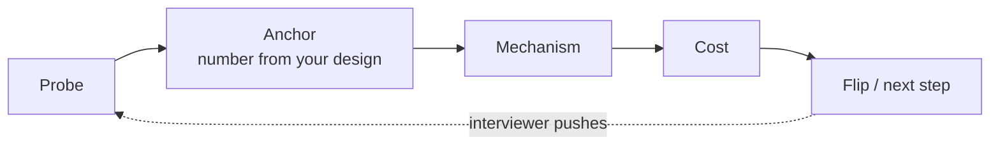

# D3 Unit 2 — Under the probe ladder

> Time: ~5 h · CORE: §1–§2 (≈ 1.5 h reading and drills) + mocks 2–4 with debriefs (≈ 3.5 h) · Lab: none · Kit:
> [probe-bank.md](probe-bank.md), [rubric.md](rubric.md) (dimension 6, *Probe handling*), [format.md](format.md)

Senior HLD rounds are decided after minute 25. By then most candidates have a reasonable diagram; what separates
them is what happens when the interviewer asks "what if this fails?", "why not a queue?", "what does this cost?",
and "now it has to run in two regions". This unit trains the answer shape for probes and the delta protocol for
requirement changes. Then you use them in three mocks.

## Before you start

You should have done mock 1 and filled its log ([Unit 1](unit-1-clock-and-scoring.md)). Warm-up:

1. From the log of mock 1: which probe kind did you answer weakest?
2. State the six rungs of the probe ladder from [docs/INTERVIEW_FRAMEWORK.md](../../docs/INTERVIEW_FRAMEWORK.md).
3. A cache tier has 8 nodes, 100k reads/s, a 90% hit rate. One node dies. Roughly how many reads/s hit the database
   right after?

Warm-up answers

1. Whatever your log says. If the verdict column is mostly "weak" for one kind (often cost or security, because
   they're asked less in practice), that's the kind to drill first in §1's exercise.
2. What if it fails? · What at 10× (or 100×)? · Why not Y? · How would you know? · What does it cost? · How do you get
   there (migration)?
3. Before: 10% of 100k = 10k/s. After: the dead node's share (1/8 = 12.5k/s) all miss, plus 10% of the remaining
   87.5k ≈ 8.75k → ≈ 21k/s, about double. Whether that's survivable depends on the database's headroom, which is
   exactly the follow-up you should expect.

**Session plan (≈ 5 h):** Session 1 (1.5 h): §1 and §2 with their drills. Session 2 (≈ 1.25 h): mock 2 and debrief.
Session 3 (≈ 1.25 h): mock 3 and debrief. Mock 4 (≈ 1.25 h) in a later sitting, on a different day from mock 3, so
four mocks are spread over at least three days. More mocks if any score below meets: they're on top of the hours.

---

## §1 Answering probes from your own design

### The failure story

Mock on a chat system. The design at 0:25 is solid: WebSocket gateways, a message service, a partitioned message
store, Kafka between them. Then four probes:

- "What happens if Kafka is unavailable for ten minutes?" — "Kafka is replicated, so that shouldn't happen." Push:
  "It happens." — "Then… we'd need a fallback. Maybe write directly to the database?" (≈ 3 minutes, and the
  fallback contradicts the ordering guarantee drawn on the board.)
- "Why not just use the database as the queue?" — "Databases don't scale for that." (Attacks the alternative; no
  number, no condition.)
- "How would you know messages are delayed?" — "We'd monitor it." (No metric, no threshold.)
- "Roughly what does the gateway tier cost?" — "Not sure." (Without "here's how I'd estimate it".)

Each answer took two or three pushes. Twelve minutes went on four probes, and three of the four answers capped
*Probe handling* at approaching. The design was fine. The answers weren't anchored in it.

### Predict

<!-- predict id="D3-U2-P01" -->
**Predict.** A design for a URL shortener at 0:28: a stateless redirect service behind a load balancer; a Redis
cache (95% hit rate) in front of a partitioned key-value store holding 2 billion mappings; ≈ 40k redirects/s at
peak; IDs from a range allocator. Write your answer to each probe in ≤ 4 sentences:

1. (scale-up) "Traffic goes 10×. What breaks first?"
2. (consistency) "A user creates a link and clicks it within a second. Can the redirect 404?"
3. (why not X) "Why not hash the long URL instead of allocating IDs?"
<!-- /predict -->

### Reveal

Reveal

**1. Scale-up.** "At 400k redirects/s the stateless tier just scales out, so the first thing to saturate is the
store behind the cache: misses go from ≈ 2k/s to ≈ 20k/s. I'd check the store's per-partition capacity, and before
that, raise the hit rate: redirects are very skewed, so a larger cache or a CDN for the hottest links does most of
the work. I'd alert on the miss rate and store p99, not only on CPU." *Why this works:* it names a component, a
number derived from the design, the fix, and how you'd know.

**2. Consistency.** "Yes, if the write lands in the store and the redirect reads a cache that has a negative entry
for that key, or reads a replica that hasn't caught up. Fixes: don't cache 404s for fresh IDs (IDs are allocated, so
anything above the allocator's high-water mark can bypass negative caching), and write-through the new mapping
into the cache on create. Cost: one extra cache write per create, ≈ 400/s — negligible." *Why this works:* it says
yes, explains the mechanism, and fixes it at a stated cost.

**3. Why not X.** "Hashing gives deduplication for free and no coordination. The cost is collisions at a 7-character
prefix: at 2 billion links the birthday bound makes collisions certain, so I'd need a check-and-retry on every
create, and the same long URL would always map to the same short one, which breaks per-user analytics. I'd flip to
hashing if dedupe of identical URLs mattered more than per-user links, for example an internal link service."
*Why this works:* it credits X with what it's good at, ties the cost to a number in the design, and says when X wins.

The tempting wrong answers: "the cache can handle it" (no number), "no, it's strongly consistent" (without saying
where), and "hashing has collisions, so it's worse" (attacks X without a condition).

### How it actually works

**The answer shape.** Every probe answer has four parts, in this order, in 30–90 seconds:

1. **Anchor**: restate the probe in your design's terms, with the number that matters. "At 400k redirects/s, misses
   go to ≈ 20k/s…"
2. **Mechanism**: what actually happens, component by component. Not "it handles it": *how*.
3. **Cost**: what your answer costs: money, latency, complexity, a weaker guarantee.
4. **Flip or next step**: when you'd choose differently, or what you'd do next if the interviewer pushes again.

It's the trade-off statement from A0 (claim → because → cost → flip), turned into a reply. The anchor is what most
answers skip; without it, the answer floats free of the design and invites a second push.

**What each kind of probe is testing.** The [probe bank](probe-bank.md) groups probes by kind. Each kind has a
characteristic weak answer:

| Kind | What they're checking | Weak answer | Meets answer contains |
|---|---|---|---|
| Scale-up (10×/100×) | Do you know which resource saturates first? | "Add more servers" | The first bottleneck named from your numbers, the fix, the metric that warns you |
| Failure | Detect → contain → recover, and blast radius | "It's replicated" | What fails, what users see, how you detect it, how you recover, what's lost (RPO) |
| Consistency | Do you know where your guarantees end? | "It's consistent" | The exact anomaly possible, the window, and the fix or the explicit acceptance |
| Cost | Do you know what dominates the bill? | "Not sure" | The dominant line (often egress, storage tier or idle capacity) with a ≈ number, and one lever |
| Security | Trust boundaries and abuse | "We'd use auth" | Who can do what, where it's enforced, the abuse case (spam, scraping, tenant crossover), and audit |
| Why not X | Judgement, not tribalism | Attacks X | What X is good at, the cost in *this* design, the condition where X wins |
| How would you know | Operability | "Monitoring" | One SLI with a threshold, one leading indicator (lag, saturation, miss rate) |
| Migration | Can you get there from here? | "Big-bang cutover" | Dual-write or shadow read, backfill, verify, cut over, rollback plan |

**"I don't know" is an answer, if it's shaped.** "I don't know the exact write limit of that store. I'd assume ≈ 10k
writes/s per partition, design for that, and load-test it before launch; if it's lower, I'd add partitions." Invented
facts stated with confidence are worse than a shaped "I don't know": they cap *Probe handling* (see the caps in
[rubric.md](rubric.md)).

**Answer from the board.** Point at the diagram while you answer ("this arrow, from the gateway to the queue…").
It keeps the answer anchored, and it makes the interviewer's notes easy to write. If the honest answer is "my design
breaks here", say so and fix it: changing the design under a probe is a strength when you name the reason.

### Build it

No Go lab. **Probe sprints:** pick a case study you've passed (C1, C2, C5 or C6), sketch its design from memory in
5 minutes, then answer every probe in its section of [probe-bank.md](probe-bank.md) out loud or in writing, each in
≤ 90 seconds, on a timer. Only then read the "listen for" column and mark each answer weak / ok / strong.

Acceptance: at least 10 probes answered; every answer has a number from your design (the anchor); no answer
attacks an alternative without stating when it wins. Repeat with a second case study on another day, starting with
the probe kind you marked weakest.

### Break it

Answer three probes from the sprint twice: once deliberately without the anchor (no number from the design), once
with it. Read both versions back as the interviewer.

What you'll likely see

Without the anchor, answers drift into general knowledge ("caches reduce load on databases") and are hard to
distinguish from someone who read a blog post. With it, the same knowledge reads as judgement about *this* system.
You'll also notice the anchored versions are shorter: the number does the work that adjectives were doing.

### In the wild

- **Design reviews.** Many engineering organisations run written design reviews where reviewers' questions are
  answered in the doc. The probe ladder is the same set of questions, asked live.
- **The four golden signals** (latency, traffic, errors, saturation) from Google's *Site Reliability Engineering*
  book are a ready-made checklist for "how would you know?": name one of them for the component in question, with a
  threshold.
- **Pre-mortems** (Gary Klein's technique: imagine the project has failed and explain why) are self-administered
  failure probes. Doing one on your own design in the last minute of the HLD phase predicts most of the failure
  probes you'll get.

### Trade-offs

| Approach | Wins when | Loses when | When the answer flips |
|---|---|---|---|
| Short anchored answer (30–90 s) | Most probes; keeps the clock | The probe is the interviewer's main deep dive | If they follow up twice on the same thread, it's a deep dive: go to whiteboard depth. |
| Change the design under a probe | The probe exposed a real flaw | The flaw is minor and the change is a full redraw | Patch locally and name the residual risk; a full redraw at 0:35 costs more than the flaw. |
| "I don't know, here's how I'd find out" | You genuinely don't know a vendor-specific limit | It's a fundamental you should know (e.g. what a quorum guarantees) | Fundamentals need an answer from first principles; save "I don't know" for product-specific numbers. |

### Senior bar

- **Failure modes:** answers without an anchor; defending instead of evaluating; attacking alternatives; "it's
  replicated" as a complete failure answer; inventing a number with confidence; spending > 3 minutes per probe.
- **Numbers:** in your logs, aim for ≥ 80% of probe verdicts at ok or strong, and no more than one probe per mock that
  needed a second push to reach a mechanism.
- **Ops and cost:** the cost and "how would you know" probes are the ones most often skipped in practice, which is
  why the tutor asks at least one of them in every mock.

**Interviewer follow-up probes:**

Probe: "Your queue is down for ten minutes. Walk me through what users see."

"Producers can't publish, so the write API has two choices: fail fast with 503 and let clients retry (they already
must, given our idempotency keys), or spill to a local durable buffer and replay later. For chat, a 503 surfaces as
'message not sent, tap to retry', which users understand; a local buffer risks reordering and loss if the gateway
host dies. So: fail fast, alert on publish error rate above 1% for 2 minutes, and after recovery consumers catch up at
≈ 3× normal throughput, so a ten-minute outage drains in ≈ 5 minutes. RPO is zero for acknowledged messages." The
shape: what fails → what users see → detection → recovery time → data loss.

Probe: "Why not a relational database for everything here?"

"For the metadata, a relational database is what I'd use; it gives me transactions on the user–conversation tables
and the write rate (≈ 2k/s) fits one primary. For the message log itself, ≈ 100k writes/s append-mostly, partitioned
by conversation, a wide-column or log-structured store fits the access pattern (latest N per conversation) without
sharding Postgres by hand. If the write rate were 10× lower I'd keep messages in Postgres too and avoid a second
store to operate." Credit, cost in this design, flip.

### Check yourself

1. What are the four parts of a probe answer?
2. What's wrong with "Kafka is replicated, so that won't happen"?
3. When is "I don't know" acceptable, and what must follow it?

Answers

1. Anchor (a number from your design) → mechanism → cost → flip or next step.
2. It denies the premise instead of answering it. Replication covers a broker failure, not a bad deploy, a quorum
   loss, a full disk or a network partition. The interviewer wants detect → contain → recover.
3. For product- or vendor-specific numbers you can't derive. It must be followed by the assumption you'll design
   with and how you'd verify it (load test, vendor docs).

---

## §2 The mid-way requirement change

### The failure story

Mock on a payments-notification design. At 0:27 the interviewer says: "One more thing: partner banks will call your
API directly, and they retry aggressively on timeouts." The candidate says "OK", erases the API section, and starts
redesigning the ingestion path. At 0:36 the new ingestion path is half-drawn; the original deep dives never happen.
Another candidate, same prompt, same change, says: "That makes every create endpoint a retry target, so creates
take an idempotency key, stored for 24 hours with the response; duplicates return the stored response. That touches
the API and adds one table. The rest of the design doesn't change. The cost is a lookup per create, ≈ 1 ms." Ninety
seconds, then back to the deep dives.

The change was the same size for both. Only one of them treated it as a delta.

### Predict

<!-- predict id="D3-U2-P02" -->
**Predict.** Your news-feed design at 0:27: fan-out-on-write into a Redis timeline cache per user, posts in a
partitioned store, everything in one region. The interviewer says, "We're launching in Europe; EU users' data must
stay in the EU." Write the delta in at most five lines: what it touches, what doesn't change, the new decision, and
what it costs.
<!-- /predict -->

### Reveal

Reveal

A strong delta: "This is a data-residency constraint, so it changes *where data lives*, not the architecture. Each
user gets a home region (EU or US) stored with their account; their posts and timeline cache live there. The
read and write paths stay as drawn, deployed twice. What changes is cross-region follows: a US user following an EU
author needs the post in their timeline, so fan-out sends a *reference* (post id + region) across, and the read
resolves the content from the EU region. That needs checking against the residency rule: whether a US reader may
receive EU content at all is a legal question I'd ask, not assume (TODO-VERIFY with counsel in a real design). Cost:
two deployments, ≈ 100 ms extra on cross-region post reads (US ↔ Europe RTT), and an ID scheme that encodes the
home region."

What makes it work: it classifies the change (residency), says what doesn't change (the per-region design), finds
the one place the change bites (cross-region follows), and names the cost with a number. The tempting wrong answer
is "replicate everything to both regions", which violates the requirement it was meant to satisfy.

### How it actually works

**Classify the change first.** Most mid-way changes fall into five classes, and each one bites in a predictable
place:

| Class | Example | Usually touches | Usually doesn't touch |
|---|---|---|---|
| Scale | "Traffic is 10× what we said" | Estimates, partitioning, cache sizing, the first bottleneck | API, data model shape |
| Topology | "Two regions, active-active" | Replication, conflict handling, ID generation, failover | API, most services |
| Contract | "Partners retry aggressively", "a mobile client on flaky networks" | API (idempotency, pagination, versioning), dedupe storage | Storage engine, topology |
| Constraint | Residency, retention, legal hold, audit, PCI scope | Where data lives, encryption, deletion paths, access control | Request flow |
| Product | "Users can now edit messages", "add a 'seen by' list" | Data model, one service, fan-out cost | Infrastructure |

**The delta protocol** (≤ 3 minutes):

1. **Restate and classify.** "So that's a contract change: every create is now a retry target."
2. **Find where it bites.** Which number or requirement does it change, and which component depends on that?
3. **Say what doesn't change.** This is what keeps the interviewer confident you won't redraw everything, and it's
   the step weak candidates skip.
4. **Decide, with cost.** One new decision, in the claim → because → cost → flip shape.
5. **Mark it on the board.** A small annotation on the existing diagram, not a new diagram.

Then return to your plan: "Back to the deep dives." The change is also probe material: the interviewer often comes
back to it in the closing minutes.

**Why interviewers do this.** Real requirements change after the design review. The change tests whether the design
has seams in the right places and whether you can reason about a design incrementally, which is most of senior
engineering work. That's why *Probe handling* scores it, and why ignoring it, or answering with a full redraw, is a
cap in [rubric.md](rubric.md).

### Build it

No Go lab. **Change drills:** take three of your passed Track C designs (your own notes, not the module files) and
apply one change of each of three different classes from the table. For each, write the five-step delta in ≤ 3
minutes on a timer.

Acceptance: every delta has an explicit "doesn't change" line and a cost with a number; none of them redraws the
diagram.

### Break it

Do one drill the wrong way on purpose: redraw the full design for the change, timed. Compare the time and what the
redraw actually changed against your delta.

What you'll likely see

The redraw takes ≈ 5–10 minutes, and when you diff it against the original, most boxes are unchanged. The delta
captured the real change in a fraction of the time. In a mock, those minutes come straight out of the deep dives,
which carry the most weight.

### In the wild

- **Architecture Decision Records** are written as deltas: each ADR states the context that changed, the decision,
  and its consequences, and *supersedes* an earlier ADR rather than rewriting the architecture document.
- **Data residency** is a real driver of multi-region designs. The EU's GDPR restricts transfers of personal data
  outside the EU/EEA; how that applies to a given product is a legal question (TODO-VERIFY with counsel; don't state
  legal conclusions in an interview as fact).
- **Strangler-fig migrations** (Martin Fowler's term) are the operational form of the same idea: change the system
  piece by piece behind a stable interface instead of replacing it.

### Trade-offs

| Approach | Wins when | Loses when | When the answer flips |
|---|---|---|---|
| Delta on the existing design | Almost always | The change invalidates the core assumption (e.g. strong consistency now required on a design built on eventual consistency) | When the change breaks a foundational assumption, say so explicitly, name the component that must be replaced, and redesign only that. |
| Ask a clarifying question about the change | The change is ambiguous ("multi-region" — active-active or failover?) | You use it to stall | One question, with your default stated: "Active-passive unless you need local writes?" |
| Defer the change to the closing phase | You're mid-deep-dive with 2 minutes left in it | The change affects the deep dive you're in | Finish the current sentence, take the change now if it touches what you're drawing. |

### Senior bar

- **Failure modes:** redrawing; "OK" with no consequences; solving the change by violating it (replicating EU data to
  the US); ignoring the cost; forgetting the change in the closing phase.
- **Numbers:** a delta in ≤ 3 minutes, with one number (latency added, storage added, requests added).
- **Org view (exceeds):** naming who's affected: "residency means the on-call team now runs two deployments, and
  schema migrations have to roll out per region".

**Interviewer follow-up probes:**

Probe: "Now make it active-active across two regions."

Classify (topology) and find the bite: writes. "Reads stay local. For writes I either keep a home region per entity
(no conflicts, ≈ 70 ms extra for users writing from the other region) or accept writes in both and resolve
conflicts. Which data has conflicts? Counters (likes) can be CRDTs; user profile edits can be last-writer-wins with
a hybrid logical clock; anything with an invariant (a balance, a seat) must have a single home. The ID generator
gets a region bit. Failover: if a region dies, the other takes over its home entities after a lease expires, and
we accept an RPO of the replication lag, ≈ seconds." The key: per-data-type reasoning, not "multi-master everything".

Probe: "Legal says we must delete a user's data within 30 days of a request, including backups."

Classify (constraint) and find where data hides: primary store, caches, search index, analytics, logs, backups.
"Online stores: a deletion job keyed by user id, with a tombstone so asynchronous consumers drop late events. Caches
expire within their TTL. Backups are the hard part: restoring and rewriting backups is impractical, so the usual
approach is crypto-shredding — encrypt each user's data with a per-user key and delete the key (TODO-VERIFY that
this satisfies the specific regulation). Cost: a key-management service and a lookup per read. Audit: log the
deletion request and its completion without the deleted content."

### Check yourself

1. Name the five classes of mid-way change.
2. Which step of the delta protocol do weak answers skip, and why does it matter?
3. When is a partial redesign the right answer?

Answers

1. Scale, topology, contract, constraint, product.
2. "Say what doesn't change." Without it, the interviewer can't tell whether you understand the blast radius of the
   change, and you're likely to redraw unchanged parts.
3. When the change breaks a foundational assumption of one component (e.g. strong consistency is now required where
   you relied on eventual consistency). Name that component, replace only it, and say why.

---

## Unit wrap-up

| Situation | Do this | Flip to this when… |
|---|---|---|
| Any probe | Anchor → mechanism → cost → flip, 30–90 s, pointing at the board | Asked twice on the same thread → it's a deep dive; go deeper |
| Failure probe | What fails → what users see → detection → recovery → data loss | — |
| "Why not X?" | Credit X, cost in *this* design, condition where X wins | X is clearly wrong for a hard requirement → say which requirement, still in one sentence |
| Don't know a number | Assume, design for it, say how you'd verify | It's a fundamental → reason from first principles instead |
| Mid-way change | Classify → bite → doesn't change → decide with cost → annotate | It breaks a foundational assumption → replace only that component |

**Next:** mocks 2–4 (see [format.md](format.md)); the gate is four `hld-45` mocks at meets on distinct, unseen
problems (`sd status D3`). Then D4, the full loop, once its other prerequisites pass.
