# D4 Unit 1 — The loop day

> Time: ~8 h · CORE: §1–§2 (≈ 1.5 h reading and the dry-run plan) + loop 1 with its debrief (≈ 4.5 h) + log review
> and revisits (≈ 2 h) · Lab: none · Kit: [format.md](format.md), [rubric.md](rubric.md), [mock-log.md](mock-log.md)

Every round in a loop is one you've already passed on its own. What's new is everything around the rounds: four
hours of sustained attention, three context switches between very different kinds of thinking, no feedback until
the end, and a decision made on the whole packet. This unit is about the day, and about how a loop is read.

## Before you start

D4 unlocks after D1, D2, D3, A8, A9 and the remaining core case studies. Warm-up, written before you open the
answers:

1. From your D1, D2 and D3 logs: for each format, the checkpoint you slipped most often.
2. The gating dimensions of the HLD, LLD and machine-coding rubrics.
3. What's the hard floor in the machine-coding rubric?

Warm-up answers

1. Whatever your logs say. Write the three down on a card for the loop day: they're the ones fatigue will make
   worse.
2. HLD (D3): high-level design, deep dives & trade-offs, probe handling, communication & time. LLD (D1): domain model,
   interfaces & extensibility, trade-offs & probe handling, communication & time. MC (D2): interfaces & extensibility,
   correctness & concurrency, time management.
3. If Stage 1 isn't green under `go test -race -count=20` at 1:30, the round is at most approaching, whatever else
   is good.

**Session plan (≈ 8 h):** Session 1 (1.5 h): §1 and §2, then write your loop-day plan (breaks, reset routine, the
three checkpoint cards). Session 2 (≈ 4.5 h, one sitting): loop 1 with the tutor. Session 3 (≈ 2 h, another day):
read the loop log, revisit the sections the debrief names, redo one weak phase as a short drill (for example a
first-10 sprint or a requirement-change drill).

---

## §1 Stamina and transitions

### The failure story

Loop 1, default order. The HLD round on a podcast-hosting platform is strong: numbers at 0:09, diagram at 0:24, crisp
probe answers. Meets, close to exceeds. Ten-minute break, spent replaying the HLD round's last probe. The LLD
round starts with the candidate still thinking in boxes and queues: they model the car-rental desk as services talking
over events, and only at 0:14 get to types. Approaching on domain model. The machine-coding round starts at 1:50.
At 2:25 (35 minutes in) Stage 1 isn't green; the candidate skipped writing the clock injection because "it's just
a small problem". At 3:20 Stage 2 is half done. The concurrency pass never happens.

None of these failures are new skills. Each round, run alone on a fresh morning, would have been at meets. The loop
tested what the separate mocks couldn't: whether the habits hold at hour three, and whether the candidate can
switch from "boxes and numbers" to "types and seams" to "code and tests" in ten minutes.

### Predict

<!-- predict id="D4-U1-P01" -->
**Predict.** Write these down before you open the reveal.

1. What should you do in a 10-minute break between the HLD and LLD rounds? What should you avoid?
2. Which round of the default order is most at risk from fatigue, and which rubric dimension shows it first?
3. Why does the course allow the tutor to run one loop in the order MC → HLD → LLD?
<!-- /predict -->

### Reveal

Reveal

**1. Reset, don't review.** Stand up, water, clear the page, and read the next format's checkpoints once (for the
LLD round: scope by 0:05, API as Go signatures by ≈ 0:12–0:15, core coded by 0:30, change landed by 0:37). Avoid
replaying the last round: you can't change its score, and the replay keeps you in its mode of thinking, which is
exactly what made the LLD round in the story start with services instead of types. The tempting wrong answer is "use
the break to prepare for likely LLD problems", which loads the wrong context and raises anxiety.

**2. The machine-coding round (round 3), and *time management* shows it first.** It's the longest round, it comes
last, and it's the one where small skipped steps (no injected clock, no test helper, no early `-race` run) compound
into a late Stage 1. Fatigue rarely makes you forget what a mutex is. It makes you skip the five minutes of setup
that make the next eighty go smoothly. The other early signal is *communication* in any round: fewer signposts,
more silent typing.

**3. To put structure under fatigue.** HLD structure (the checkpoints) is the habit most sensitive to being tired:
an HLD round done after 90 minutes of coding shows whether the 0:10 / 0:25 / 0:40 discipline is automatic. Real
loops don't let you choose the order, so one loop in an unfavourable order is better preparation than three in the
favourable one.

### How it actually works

**The loop as a load profile.** Each round has a different working mode, and the breaks are the only time to switch:

| Round | Mode | What fatigue erodes first | Counter-move |
|---|---|---|---|
| HLD | Breadth, numbers, talking | Estimation discipline; the 0:25 diagram | Write numbers before talking about boxes, every time |
| LLD | Types, responsibilities, seams | Scoping (starting to code too early or modelling services instead of types) | Say "types first" and write signatures before any bodies |
| MC | Code, tests, concurrency | Setup (clock, helpers, `-race` early) and the final concurrency pass | Do the 5-minute setup even when it feels unnecessary; run `-race` at every green |
| Oral | First principles, recall | Precision ("it's replicated") | Answer the four questions in order, each with a mechanism |

**No feedback between rounds** is deliberate. In a real loop you don't learn how round 1 went until long after
round 3. If you heard "great HLD" before the LLD round, you'd relax; if you heard "weak HLD", you'd tighten up and
probably overcompensate. The tutor scores each round privately right after it ends, which also stops a later round
from colouring an earlier score.

**Strict clock, flexible breaks.** A round that overruns takes its time out of the following break, never out of
the next round. That's how real loops work (the next interviewer arrives on time), and it means overrunning has a
visible price: a shorter reset.

```mermaid
gantt
  dateFormat HH:mm
  axisFormat %H:%M
  section Rounds
  HLD (hld-45)          :a1, 00:00, 45m
  Break                 :b1, after a1, 10m
  LLD (lld-45)          :a2, after b1, 45m
  Break                 :b2, after a2, 10m
  Machine coding (mc-90):a3, after b2, 90m
  Break                 :b3, after a3, 10m
  Component oral        :a4, after b3, 20m
  Debrief               :a5, after a4, 40m
```

### Build it

No Go lab. Write your **loop-day plan** on one page before loop 1:

1. Your three "most-slipped checkpoint" cards (one per format, from your D1–D3 logs).
2. Your break routine, in four steps, the same every time.
3. The machine-coding setup you'll do in the first five minutes regardless of the problem: injected clock, a
   timeout helper for tests, the package skeleton, the first `go test -race` run.
4. What you'll eat and when (a four-hour block with no plan for food is a real failure mode, not a joke).

Acceptance: the plan fits on one page, and the tutor has seen it before loop 1.

### Break it

Before loop 1, do a "mini-loop" dry run on your own: a 20-minute HLD first-10 sprint plus estimation, a 5-minute
break in which you deliberately replay the HLD, then a 20-minute LLD modelling sprint (scope, entities, Go
signatures) on a different problem. Then repeat on another day with your break routine instead of the replay.
Compare the time-to-first-signature in the two LLD sprints.

What you'll likely see

After the replay break, the LLD sprint usually starts slower and leans towards the previous round's vocabulary
(services, queues, "the API") before settling into types. With a reset, the first signatures appear minutes
earlier. The effect is small in a 20-minute sprint and larger at hour three of a real loop, which is why the routine
is worth having before it's needed.

### In the wild

- **Onsite loops** at large tech companies commonly consist of four to six interviews of 45–60 minutes in a day,
  covering coding, design and behavioural rounds (TODO-VERIFY the current format for the company you're interviewing
  with; many run the loop virtually and some split it over two days).
- **Sports and exam preparation** use full-length simulations under real conditions (timed practice papers,
  match simulations) for the same reason: performance at the end of a long session differs from performance on a
  short drill.

### Trade-offs

| Approach | Wins when | Loses when | When the answer flips |
|---|---|---|---|
| Full loop in one sitting | Tests stamina and transitions, like the real day | Hard to schedule; an interruption voids it | If you genuinely can't get 4.5 hours, don't split this one loop: postpone it. A split loop measures something else. |
| Default order (HLD → LLD → MC) | First loop: separates "can I do the rounds back to back?" from order effects | Hides how structure holds up under fatigue | Use the MC-first order for one of the three loops. |
| Score rounds privately and reveal at the end | Mirrors real loops; avoids anchoring | The learner can't correct a mistake mid-loop | Never reveal mid-loop. The debrief is where correction happens. |

### Senior bar

- **Failure modes:** replaying rounds in breaks; skipping setup in round 3; silent typing late in the day; letting an
  overrun eat into the next round; treating the oral as a formality after the "real" rounds.
- **Numbers:** compare checkpoint slips in round 3 with round 1 in your loop log. A slip that grows by more than
  ≈ 3 minutes between round 1 and round 3 is a stamina problem, not a skill problem.
- **Ops view:** a loop is an endurance test of habits, the same way an incident at 3 a.m. is: what you do
  automatically is what you'll do when tired.

**Interviewer follow-up probes** (debrief questions):

Probe: "Your machine-coding round was weaker than your D2 mocks. What changed?"

Look for a specific cause in the log rather than "I was tired": "I skipped the clock injection at the start, so
Stage 2's expiry needed a refactor at 0:40; in D2 I always did it in the first five minutes." The fix is then a
habit for the next loop (setup is non-negotiable), not "rest more".

Probe: "Which round would you most like to redo, and what would you do in its first five minutes?"

A strong answer picks the round with the weakest gating dimension and names the first-five-minute move that would
have changed it, for example "LLD: write the three core types and their method signatures before saying anything
about services". It shows the learner can turn a loop result into a concrete plan.

### Check yourself

1. What happens to the schedule when a round overruns by four minutes?
2. Why does the tutor score each round before the break that follows it?
3. Name the four steps of a good break routine.

Answers

1. The following break shrinks by four minutes; the next round starts on time.
2. So a later round can't colour the earlier score, and so the score reflects that round alone, as separate
   interviewers would write it.
3. Any four steps along the lines of: stand up and move; drink water; clear the page; read the next format's
   checkpoints once. What matters is that it's fixed, short, and doesn't include reviewing the last round.

---

## §2 How a loop is decided

### The failure story

Loop 2: HLD exceeds, LLD exceeds, machine coding approaching (Stage 1 green at 0:41, Stage 2 partial, a race found
by the tutor's mutation that no test caught), oral pass. The learner's reaction: "Two exceeds and one approaching
averages to meets." The course's rule says the loop is approaching. Many real hiring committees would discuss this
packet seriously; some would hire, some would ask for another coding round. For the course, it's clear: the
machine-coding round is where the gap is, and the next loop should show it closed.

### Predict

<!-- predict id="D4-U1-P02" -->
**Predict.** Apply the loop rule in [rubric.md](rubric.md) to each packet and write the loop level, with a one-line
reason:

1. HLD meets · LLD meets · MC exceeds · oral pass
2. HLD exceeds · LLD approaching · MC exceeds · oral pass
3. HLD exceeds · LLD exceeds · MC meets · oral revise (cache)
4. HLD meets · LLD meets · MC meets · oral pass, but the HLD estimates were 3× off and the HLD round's Estimation
   dimension was approaching

Then: which of these four loops evidences definition-of-done item 2 ("HLD cold")?
<!-- /predict -->

### Reveal

Reveal

1. **meets.** All rounds ≥ meets, oral pass; one exceeds isn't enough for exceeds (two are needed).
2. **approaching.** One round under the bar caps the loop, however strong the others are.
3. **approaching.** All rounds clear the bar, but the oral is revise. First principles are part of the definition
   of done, so the loop doesn't pass. The cache block is asked first next loop.
4. **meets.** The HLD round's overall is meets: Estimation isn't gating, nothing is below, and the round's own
   overall rule says meets. But the "3× off" matters elsewhere: it means this loop does *not* evidence DoD item 4
   (estimates within tolerance), and it doesn't evidence item 2 either, which needs ≥ meets on *every* HLD dimension.

**DoD item 2:** loops 1 and 3 can (if their HLD rounds were at meets or better on every dimension, which the
log shows), loop 2 can (the HLD round was exceeds), loop 4 can't. The tempting wrong answer is "only the loops that
passed", but DoD evidence is per item: a loop that fails on the oral can still evidence HLD cold.

### How it actually works

**Three layers, in order.** Each round is scored on its own rubric with its own caps and overall rule, exactly as in
D1–D3. The oral is pass/revise per block. Then the loop rule combines them: every round ≥ meets and the oral pass
for meets; two rounds at exceeds on top of that for exceeds; any round below the bar caps the loop.

**Why the rule is a minimum, not an average.** An average lets a strength hide a gap. The course is measuring mastery
of three formats, and the definition of done needs all three. A real hiring committee can trade strengths against
gaps because it's predicting job performance across many dimensions (TODO-VERIFY: committee practices vary by
company). The course has a simpler job: say exactly what's not yet at the bar.

**Cross-round patterns come first in the debrief.** A weakness in one round is often an accident. The same weakness
in two rounds is a habit, and it's what a committee would write down as "tends to…". The table in
[rubric.md](rubric.md#cross-round-signals-debrief-not-scoring) lists the common ones (doesn't quantify, change
lands as a rewrite, late-day slips, unanchored probe answers, concurrency hand-waving).

**Senior versus staff.** Exceeds on a round is staff signal: anticipating the interviewer, reasoning about evolution,
cost and organisational impact. Three loops at meets is the course's goal. Exceeds is welcome but isn't required,
and chasing it (over-elaborating to show breadth) is a common way to miss a checkpoint.

### Build it

No Go lab. Before loop 2, take loop 1's log and fill in, for each round, the one dimension that would most improve
the round, and the habit that would move it. Then pick **one** cross-round habit to fix in loop 2, write it at the
top of your loop-day plan, and tell the tutor which it is.

Acceptance: one habit, stated as an action ("write numbers before any box, every round"), checked in loop 2's
debrief.

### Break it

Score loop 1 with an *average* instead of the minimum rule (below = 0, approaching = 1, meets = 2, exceeds = 3, oral
pass/revise ignored), and compare the result with the rule's verdict and with what the debrief said to fix.

What you'll likely see

If one round was weak, the average says "meets" or close, and gives no direction. The minimum rule names the round
to fix, and the debrief names the dimension. The average answers "how good was the day?"; the rule answers "what's
next?", which is the question the course needs answered.

### In the wild

- **Hiring committees and debriefs.** Many companies collect independent written feedback from each interviewer
  before any discussion, then decide on the whole packet, for the same anchoring reasons as the private round
  scores here (TODO-VERIFY the process at any specific company).
- **"Bar raiser" roles**, where one interviewer focuses on the overall hiring bar rather than one skill, are publicly
  described by Amazon. The component oral plays a similar role in the loop: it checks the foundation under all the
  other rounds.

### Trade-offs

| Approach | Wins when | Loses when | When the answer flips |
|---|---|---|---|
| Minimum rule (every round ≥ meets) | Measuring mastery; naming what to fix | A strong candidate has one off-day round | Off-day rounds are why there are three loops and retakes; the rule doesn't flip. |
| Holistic committee judgement | Predicting job performance, many signals | Inconsistent across reviewers; hard to self-apply | If you're preparing for a specific company, read its published guidance on how loops are decided and practise for that too. |
| Private round scores, revealed at the end | Avoids anchoring and mid-loop over-correction | Delays feedback | — |

### Senior bar

- **Failure modes in reading a loop:** averaging away a weak round; treating a revise oral as a formality; fixing
  three things at once in the next loop instead of one; confusing "loop passed" with "DoD item evidenced".
- **Numbers:** three loops at meets, each on three new problems: nine unseen problems in total, plus the oral across
  all 13 building blocks.
- **Org view:** the debrief's "one habit to fix" is the same discipline as a postmortem's single most important
  action item.

**Interviewer follow-up probes** (debrief questions):

Probe: "If a hiring committee saw this loop, what would they write in one sentence?"

A calibrated answer is specific and honest, e.g. "Strong HLD and LLD with quantified trade-offs; machine coding ran
late and a race survived the tests, so concurrency under time pressure is a question mark." It shows the learner
can read their own packet as a third party would, which is the calibration goal.

Probe: "Which single habit, fixed, would have raised the most rounds?"

The answer should come from the cross-round table: for instance "anchoring every answer with a number", which would
lift probe handling in the HLD round, trade-offs in the LLD round and the walk-through in the machine-coding round.
One habit, many dimensions.

### Check yourself

1. State the loop rule for meets.
2. Can a loop that's approaching evidence a definition-of-done item?
3. What comes first in the debrief, and why?

Answers

1. All three rounds ≥ meets on their own rubrics, and the component oral passes.
2. Yes. DoD evidence is per item: an approaching loop (say, the oral at revise) can still evidence "HLD cold" if the
   HLD round was ≥ meets on every dimension.
3. Patterns across rounds, because a habit that appears in two rounds is what a committee reads as a trait, and fixing
   it lifts several dimensions at once.

---

## Unit wrap-up

| Situation | Do this | Flip to this when… |
|---|---|---|
| Break between rounds | Fixed reset routine; read the next format's checkpoints | — (never review the last round) |
| Round 3 setup | Clock injection, test helpers, first `-race` run in the first five minutes | — (always, even for "small" problems) |
| A round overruns | Take it out of the next break; next round starts on time | — |
| Reading a loop | Rounds on their own rubrics → oral → minimum rule | — |
| After a loop | One cross-round habit to fix, stated as an action | A revise oral → that block first in the next loop |

**Next:** [Unit 2 — The component oral and the finish line](unit-2-oral-and-finish.md), then loops 2 and 3.
