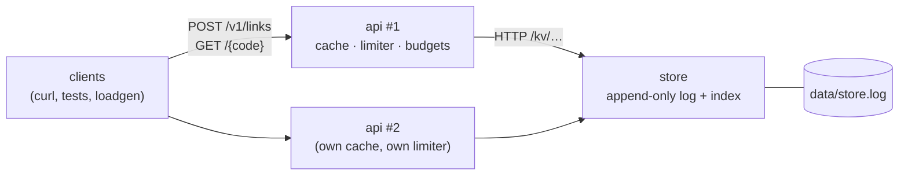

# E1 Spec — `shorty`, a URL shortener as separate processes

This is the contract for the E1 build. The tests in [`labs/e1/shorty`](../../labs/e1/shorty/) check every rule marked
**(tested)**; everything else is a decision you defend in the [design write-up](design-exercise.md). Where this spec
and a test disagree, the test wins and the spec has a bug.

## 1. What you are building



One Go binary, two **roles**, each its own OS process on `127.0.0.1`:

| Role | Holds | Owns | Scales by |
|---|---|---|---|
| `store` | an append-only, checksummed log on disk and an in-memory index of the latest value per key | durability, atomic insert-if-absent | one instance (E2 is the replicated version) |
| `api` | a bounded redirect cache and a per-client token bucket, both in memory | the public API, caching, rate limiting, deadlines, degradation | any number of instances, no coordination between them |

The API instances never talk to each other. Everything they must agree on (codes are unique, an idempotency key is
claimed once) goes through the store's insert-if-absent, which is atomic because one process serialises it.

**Out of scope:** authentication (the `X-Client-ID` header stands in for an authenticated principal; nothing but
loopback can reach these processes), click analytics, custom aliases, multi-region, TLS, compaction of the log
(Unit 1 §2 says what it would take).

## 2. Process contract (both roles) (tested)

- Entry point: `shorty.Run(ctx, args, stdout, stderr) int`, used by both `labs/e1/cmd/shorty` and the tests. `args[0]`
  is the role.
- **Loopback only.** `-addr` (and the api's `-store` URL) must be a loopback IP or `localhost`. Anything else exits with
  code **2** and a message that says "loopback", before listening.
- Once listening, print exactly one line `READY <host:port>` to stdout (the actual address, so `-addr 127.0.0.1:0`
  works).
- **SIGTERM / SIGINT** (ctx cancelled): stop accepting, let in-flight requests finish for up to `-drain`, exit **0**. A
  drain that times out exits 1.
- **SIGKILL** at any moment must not lose an acknowledged write (store) and must not leave a state the next start
  can't recover from.
- Exit codes: 0 clean shutdown, 2 usage or configuration error, 1 anything else (including a corrupt log).

`Run`, flag parsing, the loopback check and the HTTP server lifecycle (`serve`) are provided in the skeleton. You
implement what they call.

## 3. Store role

```text
shorty store -addr 127.0.0.1:7001 -data ./data -sync always|never -drain 5s
```

| Flag | Default | Meaning |
|---|---|---|
| `-addr` | `127.0.0.1:7001` | listen address |
| `-data` | `./data` | directory; the log is `<data>/store.log` |
| `-sync` | `always` | `always`: fsync before acknowledging every write; `never`: leave it to the OS |
| `-drain` | `5s` | graceful-shutdown drain |

### Store API (tested)

| Request | Response |
|---|---|
| `GET /kv/{key...}` | `200` + the value bytes · `404` |
| `PUT /kv/{key...}` + body | `204` |
| `PUT /kv/{key...}?if-absent=1` + body | `201` inserted · `409` + the **existing** value as the body |
| `DELETE /kv/{key...}` | `204` (also when the key was absent) |
| `GET /-/stats` | `200` `{"keys","reads","writes","conflicts","recovered_records","truncated_bytes"}` (integers) |
| `GET /-/healthz` | `200` |

Keys are 1–1024 bytes and may contain `/`; values are 0–64 KiB (`MaxKeyLen`, `MaxValueLen`). Violations are `400`; a
failed disk write is `500`. `reads` counts every `GET /kv` request, found or not — the API tests use it to count how
many lookups reached the store.

### On-disk format (tested byte for byte)

`store.log` is a sequence of records, big-endian:

```text
┌──────────────┬──────────────┬────────────────────────────────────────────────┐
│ crc32c  u32  │ length  u32  │ body (length bytes)                            │
│              │              │ op u8 (1 put, 2 delete) │ keylen u16 │ key │ value │
└──────────────┴──────────────┴────────────────────────────────────────────────┘
crc32c = CRC-32C (Castagnoli) over length‖body; value = everything after the key
```

A put of `link/abc` → `hello` is 8 + 1 + 2 + 8 + 5 = 24 bytes. A delete has an empty value.

### Recovery rules (tested)

On start the store reads the whole log and replays it into the index, then:

| What it finds | Classification | Action |
|---|---|---|
| fewer than 8 bytes left, or a record whose length runs past EOF | torn tail (a crash mid-append) | truncate at the record's start, fsync, start |
| a complete **last** record with a bad CRC or malformed body | torn tail (the length reached disk, the bytes didn't) | truncate, start |
| a tail that is all zero bytes | torn tail (the file grew, the data blocks didn't) | truncate, start |
| a bad record with more data after it | **corruption** | refuse to start: exit 1, stderr says "corrupt", file untouched |

`/-/stats` reports `recovered_records` and `truncated_bytes` from the last start.

## 4. API role

```text
shorty api -addr 127.0.0.1:8081 -store http://127.0.0.1:7001 [flags]
```

| Flag | Default | Meaning |
|---|---|---|
| `-store` | `http://127.0.0.1:7001` | store base URL (loopback only) |
| `-store-timeout` | `300ms` | cap on any single store call |
| `-request-budget` | `1s` | cap on all store calls one request makes together |
| `-cache-size` | `10000` | redirect cache entries (LRU) |
| `-cache-ttl` | `30s` | freshness of found and gone entries |
| `-neg-ttl` | `5s` | freshness of not-found entries |
| `-stale-if-error` | `5m` | how long past freshness an entry may be served while the store is failing |
| `-redirect-max-age` | `0` | `0`: redirects carry `private, no-store`; `>0`: `private, max-age=N` |
| `-create-rate` / `-create-burst` | `5` / `20` | token bucket per client for creates |
| `-max-clients` | `10000` | bound on limiter memory (LRU of client keys) |
| `-code-len` | `7` | generated code length, 4–16 |
| `-drain` | `5s` | graceful-shutdown drain |

### API (tested)

**Client identity.** `X-Client-ID` (1–64 chars of `[A-Za-z0-9._:-]`), else the remote IP. It scopes rate limits,
idempotency keys and ownership. A malformed header is `400`.

**`POST /v1/links`** — body `{"url": "https://…", "ttl_seconds": 0}`; optional `Idempotency-Key` (1–128 chars of
`[A-Za-z0-9_-]`).

| Case | Status | Body / headers |
|---|---|---|
| created | `201` | `{"code","short_url","url","expires_at"?}`; `short_url` is `http://<Host>/<code>`; `expires_at` only with a TTL |
| replay (same client, same key, same body) | `201` | the first response's link; `Idempotent-Replayed: true` |
| same key, different body | `422` | `{"error":"idempotency_key_reused"}` |
| over the client's create rate | `429` | `Retry-After: <whole seconds, rounded up, ≥ 1>`; checked **before** any other work |
| bad JSON, non-http(s) URL, no host, > 2 KiB, negative TTL, malformed key | `400` | `{"error": …}` |
| store unavailable (down, slow beyond budget, partitioned, 5xx) | `503` | `Retry-After: 1`, within the request budget |

**`GET /{code}`**

| Case | Status | Headers |
|---|---|---|
| live link | `302` | `Location: <url>` byte for byte; `Cache-Control: private, no-store` (or `private, max-age=N`, N ≤ seconds to expiry) |
| never existed | `404` | `Cache-Control: no-store` |
| deleted or expired | `410` | `Cache-Control: no-store` |
| malformed code (not 4–16 base-62 chars) | `404` | no cache entry, no store read |
| store failing, entry stale but inside `-stale-if-error` | `302`/`404`/`410` from the stale entry | `X-Cache: STALE` |
| store failing, nothing cached | `503` | `Retry-After: 1` |

Every redirect answer carries `X-Cache: HIT | MISS | STALE`. Expiry is checked when serving, so a cached entry can't
outlive its link.

**`DELETE /v1/links/{code}`** — owner only. `204` (also if already deleted); `404` for anyone else, exactly as for a
code that doesn't exist. Writes a tombstone (`deleted: true`) and invalidates **this** instance's cache.

**`GET /-/stats`** — integers including `cache_entries`, `cache_hits`, `stale_served`, `store_lookups`, `coalesced`,
`store_errors`, `rate_limited`, `created`, `replayed`, `limiter_keys`. **`GET /-/healthz`** — `200`.

### Store key layout and values (tested through the API)

| Key | Value (JSON) |
|---|---|
| `link/<code>` | `{"code","url","owner","created_at","expires_at","deleted"?}` (`Link`) |
| `idem/<client>/<key>` | `{"fingerprint","link"}` — the intent: whoever reads it can finish the create |

After one idempotent create the store holds exactly two keys.

## 5. Non-functional requirements

Targets for your laptop, not a datacenter (≈, measured on commodity hardware; yours will differ — measure):

| Property | Target | Why |
|---|---|---|
| Redirect, cache hit | p99 ≈ < 2 ms on loopback | the hot path touches only memory |
| Redirect, cache miss | ≈ one store round trip (sub-ms on loopback) | |
| Create, `-sync always` | bounded by fsync: ≈ 100–1,000 creates/s per store (TODO-VERIFY on your machine; on macOS Go's `File.Sync` uses `F_FULLFSYNC`, which is ms-scale) | Unit 1 §1 |
| Store reads per viral cold key | **1** per API instance per expiry | Unit 2 §2 |
| Store reads per unknown code | ≤ 1 per `-neg-ttl` per instance | Unit 2 §2 |
| Takedown on the deleting instance | immediate | Unit 2 §3 |
| Takedown on other instances | ≤ `-cache-ttl` (+ the in-flight request) | Unit 2 §3 |
| Any request while the store is down / slow / partitioned | answered within ≈ `-request-budget` | Unit 3 §2 |
| Acknowledged creates after SIGKILL of the store | 100% present | Unit 1, Unit 3 §2 |
| Memory | bounded by `-cache-size` and `-max-clients` | no input grows memory without limit |

## 6. Failure scenarios and predicted behaviour

Write your own prediction in the design write-up *before* running the tests; this table is the spec's.

| # | Inject | Predicted behaviour | Test |
|---|---|---|---|
| F1 | SIGKILL the store mid-burst of writes (`-sync always`) | every acknowledged write is present after restart | `TestM1_StoreAcknowledgedWritesSurviveSIGKILL` |
| F2 | append half a record to the log, restart | starts; truncates exactly the half record; later writes and restarts are clean | `TestM1_StoreRestartsAfterATornTail`, `TestM1_LogTornTail…` |
| F3 | flip a bit in the middle of the log, restart | refuses to start, says "corrupt", file untouched | `TestM1_StoreRefusesToStartOnMidFileCorruption` |
| F4 | 50 concurrent redirects of a cold code through a slow link | one store read; 49 coalesced waiters | `TestM2_StampedeOnAColdKeyIsCoalesced` |
| F5 | delete via instance A, read via B | A: 410 at once. B: 302 until its entry stops being fresh, then 410 | `TestM2_DeleteIsImmediateLocallyAndBoundedByTTLElsewhere` |
| F6 | SIGKILL the store | cached redirects 302; uncached and creates 503 + `Retry-After` in ≤ 1.5 s; restart → API recovers by itself | `TestM4_StoreDownCachedRedirectsKeepWorking` |
| F7 | +2 s latency on the store link | creates and misses 503 within the budget; hits unaffected; heal → recovers | `TestM4_SlowStoreFailsFastNotSlow` |
| F8 | blackhole the store link | as F7 (silence looks like slowness); heal → recovers | `TestM4_PartitionedStoreFailsFastAndRecovers` |
| F9 | store down, cache entries past freshness | `-stale-if-error 1m`: 302 `X-Cache: STALE`; `0s`: 503 | `TestM4_StaleIfError…` |
| F10 | SIGKILL the store under concurrent creates through the API | every 201 still resolves after restart, from a fresh API (no cache) | `TestM4_AcknowledgedCreatesSurviveAStoreCrash` |
| F11 | SIGTERM the API with 20 creates in flight | all 20 get 201; exit 0; then connections are refused | `TestM4_GracefulShutdownDrainsInFlightRequests` |
| F12 | an over-limit client while the store is down | 429 (cheap), not 503 | `TestM3_RateLimitIsCheckedBeforeTheStore` |

## 7. Milestones → tests

| Milestone | What | Run | Unit |
|---|---|---|---|
| M1 | the log (`OpenLog`, `Put`, `PutIfAbsent`, `Delete`, recovery) and the store process | `go test -race -run TestM1 ./labs/e1/shorty/` | 1 |
| M2 | the API: creates, idempotency, redirects, 404/410, the cache, singleflight, negative caching, invalidation | `go test -race -run TestM2 ./labs/e1/shorty/` | 2 |
| M3 | the per-client token bucket and 429s | `go test -race -run TestM3 ./labs/e1/shorty/` | 3 §1 |
| M4 | failure injection: F6–F11 | `go test -race -run TestM4 ./labs/e1/shorty/` | 3 §2 |
| M5 (STRETCH) | `loadgen`: open-loop load, intended-start latency, p50/p95/p99 report | `go test -race ./labs/e1/loadgen/` | 3 §3 |

`sd lab E1` runs M1–M4 under `-race` and records the gate. The suite takes ≈ 20 s on a laptop; each failure test
starts real processes and is bounded by timeouts, so a wrong implementation fails with a message, never a hang.

## 8. Running it by hand

```bash
go run ./labs/e1/cmd/shorty store -addr 127.0.0.1:7001 -data /tmp/e1
```

```bash
go run ./labs/e1/cmd/shorty api -addr 127.0.0.1:8081 -store http://127.0.0.1:7001
```

```bash
curl -si -X POST -H 'X-Client-ID: me' -d '{"url":"https://example.com"}' http://127.0.0.1:8081/v1/links
```

```bash
go run ./labs/e1/cmd/loadgen -url http://127.0.0.1:8081/<code> -rate 500 -duration 10s
```
