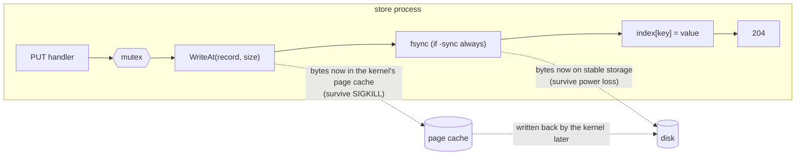
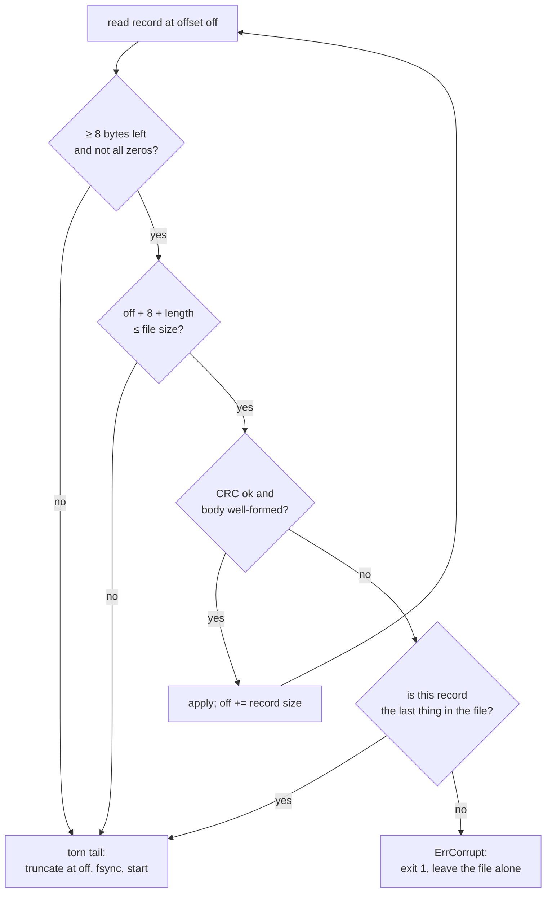
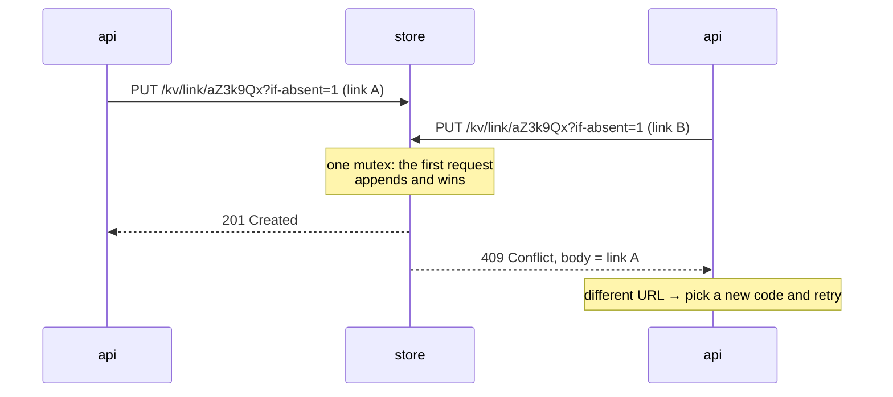

# E1 Unit 1 — The durable store: an append-only log, crash recovery and a store process

> Time: ~5.5 h (5 CORE + 0.5 STRETCH) · CORE: §1–§3 and the design write-up v1 · STRETCH: group commit (end of §1) ·
> Lab: `labs/e1/shorty` milestone 1 (`go test -race -run TestM1 ./labs/e1/shorty/`)

Everything the shortener promises rests on one sentence: *when the API says 201, the link exists*. This unit builds the
thing that makes the sentence true — a store process whose only job is to remember — and makes you prove it by killing
it. §1 is the write path (an append-only log, checksums, and what fsync does and doesn't buy), §2 is the read-back path
after a crash (telling a torn tail from corruption), and §3 turns the log into a process the API instances share, with
the one atomic primitive they need: insert-if-absent.

Before any code, read [spec.md](spec.md) and write **version 1 of the [design write-up](design-exercise.md)**. It asks
you to predict what each failure in spec §6 does to *your* design. You can't un-see a green test, so the predictions
only count if they come first.

## Before you start

You should have passed A2 (especially [Unit 2 §4](../A2-storage/unit-2-write-paths.md#4-durability-and-the-write-ahead-log)),
A3 and B0 Unit 2. Warm-up — answer first:

1. A database commits a transaction by appending a record to its write-ahead log and calling `fsync`. The machine loses
   power one microsecond after `fsync` returns. Is the transaction durable? What if power goes one microsecond *before*
   `fsync` returns?
2. Your HTTP handler writes a record, then returns 204. What does the client know if it gets a 204? What does it know if
   its connection is reset before any response arrives?
3. `srv.Shutdown(ctx)` is called with 20 requests in flight and a 5 s deadline on `ctx`. What happens to a new
   connection that arrives during the drain, and to the 20 in-flight requests?

<details data-kind="answer">
<summary>Warm-up answers</summary>

1. After: durable — `fsync` returning is the promise that the log bytes are on stable storage (assuming the drive
   honours flushes). Before: unknown. The record may be fully on disk, partly on disk (a torn write), or absent; the
   transaction was never acknowledged, so recovery may keep it or drop it, and both are correct (A2 Unit 2 §4).
2. A 204 means the server finished the write and decided to tell you. A reset tells you nothing: the write may or may
   not have happened. That ambiguity is why creates need idempotency keys (A1 Unit 3 §1) — and it is Unit 2's problem.
3. The listener is closed first, so the new connection is refused. The 20 in-flight requests run to completion as long
   as they finish within 5 s; idle keep-alive connections are closed. If the deadline passes, `Shutdown` returns the
   context error and the remaining connections are still open — `Close` cuts them (B0 Unit 2).

</details>

---

## §1 The append-only log, and what "durable" means

### The failure story

The first version of the store keeps every link in a `map[string]Link` and, after each create, writes the whole map to
`links.json` with `os.WriteFile`. At 2,000 links the file is ≈ 300 KB and a create takes ≈ 1 ms. At 200,000 links it
is ≈ 30 MB, every create rewrites all of it, and creates take ≈ 100 ms each — one viral marketing campaign and the
store is spending its life rewriting the same bytes. Then the laptop's battery dies during a write: `os.WriteFile`
truncates the file first and writes second, so the store restarts with a 4 MB prefix of a JSON document that doesn't
parse, and *every* link is gone, not just the last one.

Version two appends one line per create to `links.log` and keeps the map in memory, rebuilt on start. Creates are
fast again. Then someone notices that the store answers `201` as soon as `Write` returns, while the bytes are still in
the operating system's page cache. Nobody has lost data yet: every crash so far was a `kill -9` or an OOM kill, and the
page cache survives those. The first kernel panic will be different.

### Predict

<!-- predict id="E1-U1-P01" -->
**Predict.** Write your answers down before opening the reveal. The store appends a record with `WriteAt`, then calls
`fsync` (under `-sync always`), then updates its in-memory map, then the handler returns 204.

1. For each crash point — (a) before `WriteAt`, (b) after `WriteAt` but before `fsync`, (c) after `fsync` but before
   the 204 is sent — say what is on disk after a **SIGKILL**, what is on disk after a **power cut**, and what the client
   believes.
2. The lab's tests can SIGKILL processes but can't cut power. Which of your answers can a test therefore never catch?
3. Why update the map *after* the append rather than before?
<!-- /predict -->

<!-- predict id="E1-U1-P02" -->
**Predict.** `fsync` takes ≈ 1 ms on the volume behind your store. Writes take a mutex, append, fsync, release.

1. How many acknowledged writes per second can **one** client doing writes back to back get?
2. Eight clients write concurrently. How many writes per second does the store do in total now?
3. What would have to change for eight concurrent clients to get close to eight times the throughput, and what would it
   cost each client in latency?
<!-- /predict -->

### Reveal

<details data-kind="reveal" data-for="E1-U1-P01">
<summary>Reveal</summary>

1. (a) Nothing on disk, nothing acknowledged: clean either way. (b) **SIGKILL:** the record survives. `WriteAt` copied it
   into the page cache, the kernel owns it now, and the kernel didn't die; it writes it back later. **Power cut:** the
   record may be missing, complete, or *partially* written (a torn tail) — and the client was never told 204, so any of
   those is allowed. (c) The record is durable under both. The client never got the 204, so it believes nothing; if it
   retries, you'll write a second record (Unit 2's idempotency problem).
2. The difference between `-sync always` and `-sync never` only shows up in a **power cut or kernel crash**. A SIGKILL
   test passes with `-sync never` too. Your SIGKILL tests prove *process-crash* safety and recovery logic; fsync is
   proved by reasoning, by the torn-tail tests (which simulate what a power cut leaves behind), and in real systems by
   tools that cut power or drop unflushed writes. Tempting wrong answer: "my kill -9 test proves the data is durable".
3. If the map is updated first and the append fails (disk full, I/O error), readers have already seen a value the file
   doesn't have. The next restart "loses" it — a write that was visible, maybe already redirected to, then vanishes. The
   rule is the same as a WAL's: log first, then apply.

</details>

<details data-kind="reveal" data-for="E1-U1-P02">
<summary>Reveal</summary>

1. ≈ 1 / 1 ms ≈ **1,000 writes/s**: each write waits for its own fsync.
2. Still ≈ **1,000/s in total**: the mutex serialises the fsyncs, so eight clients take turns and each sees ≈ 125/s and
   ≈ 8 ms latency under load. Concurrency without batching buys nothing at the disk.
3. **Group commit:** let every write that arrives while an fsync is running share the *next* fsync. One fsync then
   makes up to eight records durable, so throughput approaches 8,000/s, and each client waits for at most one extra
   fsync (≈ +1 ms) — the same trade PostgreSQL's commit path makes (A2 Unit 2 §4). On the laptop this lab was written
   on, Go's `File.Sync` took ≈ 8 ms (macOS: `F_FULLFSYNC`, which flushes the drive's cache too), so the numbers were
   ≈ 125/s with one writer and ≈ 200/s with eight. Measure yours with the break-it below.

</details>

### How it actually works

**An append-only log plus an in-memory index.** Every change is a record appended at the end of one file; nothing is
ever overwritten in place. Reading never touches the file: a map holds the latest value of every key, and on start the
store rebuilds the map by replaying the log from the beginning. This is the Bitcask design (Riak's storage engine),
minus Bitcask's trick of keeping only file offsets in memory: at a few hundred bytes per link, the values themselves fit.



**The record format.** Each record is `crc32c | length | op | keylen | key | value` (spec §3). The length lets recovery
find the next record; the checksum lets it tell a complete record from garbage. CRC-32C (Castagnoli) is the same
polynomial ext4 uses for metadata and many storage engines use for log records, and Go's `hash/crc32` has a fast path
for it on modern CPUs (TODO-VERIFY: which instruction sets your Go version accelerates).

```go
package main

import (
	"encoding/binary"
	"fmt"
	"hash/crc32"
)

var castagnoli = crc32.MakeTable(crc32.Castagnoli)

// encode builds one record: crc32c | length | op | keylen | key | value.
func encode(op byte, key string, val []byte) []byte {
	n := 3 + len(key) + len(val)
	rec := make([]byte, 8, 8+n)
	binary.BigEndian.PutUint32(rec[4:8], uint32(n))
	rec = append(rec, op)
	rec = binary.BigEndian.AppendUint16(rec, uint16(len(key)))
	rec = append(rec, key...)
	rec = append(rec, val...)
	binary.BigEndian.PutUint32(rec[0:4], crc32.Checksum(rec[4:], castagnoli))
	return rec
}

func main() {
	fmt.Printf("% x\n", encode(1, "link/abc", []byte("hello"))) // 24 bytes
}
```

**What fsync buys, precisely.** `write` (and `WriteAt`) returns when the bytes are in the page cache. `fsync` returns
when the kernel has written the file's dirty pages *and* asked the device to make them persistent. Three failure
classes, three different answers:

| Failure | Page cache | Unsynced writes | Synced writes |
|---|---|---|---|
| process crash (SIGKILL, panic, OOM kill) | survives | survive | survive |
| kernel crash / power loss | lost | lost, partly written, or written (unknowable) | survive |
| fsync returns an error | may have dropped the dirty pages | **unknowable** | — |

The last row is why the log poisons itself after a failed write or fsync (`errLogBroken` in the skeleton): after an
fsync error, Linux may already have marked the pages clean, so a retried fsync can "succeed" without the data. PostgreSQL
learned this in 2018 and now treats an fsync failure as fatal and recovers from its WAL (TODO-VERIFY: exact versions).
Crashing and recovering from the file is the only honest response.

**The ack rule.** The store acknowledges only after the record is as durable as the policy promises: after `fsync`
under `-sync always`, after `WriteAt` under `-sync never`. `-sync never` is a legitimate choice — Redis's default AOF
setting and Kafka's defaults make a similar bet — but it is a bet you write down, not a default you inherit.

**STRETCH — group commit.** Replace "lock, append, fsync, unlock" with: append under the lock and remember your record's
end offset; then wait until a single background flusher has fsynced past your offset. The flusher loops: note the
current end offset, fsync, publish the offset, wake every waiter whose record ends at or before it. N concurrent
writers share one fsync. You don't need this for the tests; the break-it experiment shows why you'd want it.

### Build it

Edit `labs/e1/shorty/log.go`. Provided: `SyncPolicy` and its `String`, the limits, `ErrCorrupt`, `errLogBroken`,
`Recovery`, the format constants, `checkKV`, the suggested `Log` fields. Implement in this order:

1. `ParseSyncPolicy` (a warm-up), `encodeRecord`.
2. `OpenLog` for a clean file (replay puts and deletes), `Put`, `Get` (return copies), `Delete`, `Len`, `Close`.
3. `PutIfAbsent`: the check and the append under **one** lock.
4. Recovery (§2).

Acceptance tests (in-process): `TestM1_ParseSyncPolicy`, `TestM1_LogPutGetDeleteSurviveReopen`,
`TestM1_LogGetReturnsACopy`, `TestM1_LogOnDiskFormatMatchesSpec` (the bytes on disk, compared with an independent
encoder), `TestM1_LogReadsRecordsWrittenBySomeoneElse`, `TestM1_LogRejectsBadKeysAndValues`,
`TestM1_LogPutIfAbsentHasExactlyOneWinner` (50 goroutines), `TestM1_LogConcurrentWritersAndReaders`,
`TestM1_LogWritesFailAfterClose`.

```bash
go test -race -run 'TestM1_Log|TestM1_Parse' ./labs/e1/shorty/
```

### Break it

1. **Measure fsync.** `go test -tags breakit -run BreakIt_FsyncCost -v ./labs/e1/shorty/` prints writes/s for
   `always` and `never` with 1 and 8 writers. Predict the four numbers first, then compare with P02.
2. **Apply before you log.** In `Put`, update the map *before* `append`, and make `append` fail when the key is
   `"boom"` (temporarily). Write a five-line test: `Put("boom")`, then `Get("boom")`. What does a reader see, and what
   does the next restart see?
3. **Drop the copy.** Make `Get` return the map's slice directly and run `-run GetReturnsACopy`, then run
   `-run ConcurrentWriters` under `-race` with a reader that modifies what it got.

<details data-kind="answer">
<summary>What you should see</summary>

1. `never` is two to four orders of magnitude faster than `always`; with `always`, eight writers barely beat one,
   because the mutex serialises the fsyncs (group commit is the fix). Your absolute numbers depend on the drive and the
   OS; the ratios are the lesson.
2. The reader sees `boom` even though `Put` returned an error and the file doesn't contain it; after a restart it is
   gone. A value that was visible and then disappears is worse than a write that failed cleanly — a client may have
   been redirected by it.
3. `GetReturnsACopy` fails immediately; under `-race` the detector reports the reader's write racing with the index.
   Returning internal slices turns every caller into a potential corrupter of your store.

</details>

### In the wild

- **Bitcask** (Riak): append-only data files plus an in-memory "keydir" mapping each key to file id, offset and size;
  merges (compaction) rewrite live keys into new files; hint files speed up rebuilding the keydir on start.
- **PostgreSQL**: every change goes to the WAL first; `synchronous_commit` and `fsync` are separate knobs (A2 Unit 2
  §4); commits that arrive during a flush share it (group commit, tunable with `commit_delay`).
- **Redis AOF**: an append-only file of write commands with `appendfsync always | everysec | no`; `everysec` (the
  default) can lose about a second of writes on a power cut (TODO-VERIFY: current default and wording in the Redis docs).
- **Kafka**: appends to segment files and, by default, leaves flushing to the OS page cache, relying on replication to
  other brokers for durability rather than on per-message fsync (TODO-VERIFY: `flush.messages` / `log.flush.interval.*`
  defaults in your version).
- **etcd**: its WAL fsyncs before acknowledging Raft entries, and its disk-latency guidance is phrased in WAL fsync
  duration (TODO-VERIFY: the recommended p99 threshold in the etcd hardware docs).

### Trade-offs

| Policy | Wins when | Loses when | When the answer flips |
|---|---|---|---|
| fsync per write (`-sync always`) | every acknowledged write must survive power loss; write rate ≪ 1/fsync | write rate approaches 1/fsync; latency-sensitive writers queue behind each other | add **group commit** before giving up durability; flip to replication-based durability (E2) when one disk is no longer the unit of trust |
| group commit | many concurrent writers; same durability as above | a single writer gets nothing; adds up to one fsync of latency | a single-writer workload: plain fsync is simpler |
| fsync every N ms (`everysec`) | high write rates where losing ≈ N ms of writes on a power cut is acceptable and *documented* | you acknowledged writes you can lose: idempotency records, money, audit | anything where a 201 is a promise to a third party (this service's creates) |
| never fsync (OS decides) | caches, derived data, data replicated elsewhere before the ack | the only copy of the data | when the ack depends on another machine having it (E2's semi-sync), per-write fsync matters less |

### Senior bar

- **Failure modes.** Disk full (append fails → the log must refuse further writes and the API must turn that into
  503, not 201); fsync error (poison and restart); a drive or controller that acknowledges flushes it hasn't done
  (consumer SSDs without power-loss protection can; nothing in software fixes it — TODO-VERIFY for your hardware);
  unbounded log growth.
- **Capacity.** A link record is ≈ 150–300 bytes of JSON plus 11 bytes of framing plus the key. 10 M links ≈ 2–3 GB of
  log *if nothing is ever overwritten*, and the whole index lives in RAM (≈ the same again plus Go map overhead,
  ≈ 2×). Start-up replays the whole file: at ≈ 1 GB/s sequential read (NVMe, `docs/NUMBERS.md`) that's seconds per GB,
  plus parsing. Past a few GB you need compaction and snapshots/hint files.
- **Operations.** Backups: copying a live append-only file is *almost* safe — the copy may end in a torn record, which
  recovery handles. Deploys: a restart costs the replay time; measure it. Monitoring: `truncated_bytes > 0` after a
  start means the previous stop was a crash — alert on it.
- **Cost.** One fsync per create is invisible at 120 creates/s (C1's estimate) and a wall at 10,000/s; group commit
  or batching moves the wall by an order of magnitude before you need more hardware.

Interviewer probes:

<details data-kind="answer">
<summary>"Why not just use SQLite or Postgres for the store?"</summary>

In production you probably would: they give you the same log-first durability, plus indexes, compaction (vacuum),
backups and tooling, for free. Here the point is to see the mechanism they hide. The senior answer names what you'd
lose by writing your own (years of edge cases: torn pages, fsync semantics per filesystem, crash testing) and what
you'd gain (nothing, for a shortener). The flip: a narrow, very high-throughput append-only workload (a log broker, a
metrics store) where a general-purpose engine's write amplification is the bottleneck.

</details>

<details data-kind="answer">
<summary>"Your store acknowledged 1,000 writes and then the machine lost power. How many can you lose?"</summary>

With `-sync always`: zero, if the device honours flushes — every 204 was sent after `fsync` returned. With
`-sync never`: everything the kernel hadn't written back, typically up to tens of seconds of writes on Linux with
default dirty-page settings (TODO-VERIFY: `vm.dirty_expire_centisecs` default on your kernel). The real answer also
names the unknowable case (an fsync *error*) and the hardware caveat.

</details>

<details data-kind="answer">
<summary>"How would you make creates 10× faster without losing durability?"</summary>

Group commit first (concurrent creates share fsyncs: same guarantee, ≈ N× throughput for N concurrent writers, +≤ 1
fsync of latency). Then batching at the API (accumulate creates for 1–2 ms). Then a faster durability medium (NVMe
with power-loss protection, or a battery-backed controller). Only last, and in writing, a weaker policy. Replication to
a second machine before the ack (E2) is the alternative that changes *what* durable means.

</details>

### Check yourself

1. What does a SIGKILL test prove about `-sync always`, and what can it never prove?
2. Why must `Put` append to the file before updating the map?
3. A record's length field says 1,000 bytes but only 600 bytes remain in the file. What happened?

<details data-kind="answer">
<summary>Answers</summary>

1. It proves the logic: acknowledged writes are in the file, recovery replays them, nothing depends on a graceful
   shutdown. It can't prove fsync, because the page cache survives SIGKILL; `-sync never` passes the same test.
2. So the index never shows a value the file doesn't have; otherwise a failed append leaves a visible write that
   vanishes on restart.
3. The process (or machine) died in the middle of appending it: a torn tail. §2.

</details>

---

## §2 Recovery: torn tails versus corruption

### The failure story

The store has been running for months. At 02:10 the host reboots after a kernel panic. Two different recovery bugs are
waiting, and which one you have depends on a single `if`.

Store A treats any record that fails its checksum as fatal and exits. The last record before the panic was half
written, so the store refuses to start; the API instances return 503 for every create and every cache miss, and
someone is paged to delete 37 bytes from the end of a file by hand. Store B is more forgiving: it stops reading at the
first bad record and truncates the file there. Six weeks later a bad sector flips one bit in the middle of the log;
store B restarts cleanly, truncates at that record, and silently deletes the 1.4 million links written after it. Nobody
notices until members start reporting dead links from statements e-mailed in the spring.

### Predict

<!-- predict id="E1-U1-P03" -->
**Predict.** For each file, say whether recovery should **truncate and start** or **refuse to start**, and why.

1. 10 valid records, then 5 bytes.
2. 10 valid records, then a record whose length says 47 but only 20 bytes follow.
3. 10 valid records, then a complete record (length matches the remaining bytes exactly) with a bad CRC.
4. Record 4 of 10 has a bad CRC; records 5–10 are valid.
5. 10 valid records, then 4,096 zero bytes.
<!-- /predict -->

### Reveal

<details data-kind="reveal" data-for="E1-U1-P03">
<summary>Reveal</summary>

1–3, 5: **truncate and start.** Each is what an interrupted append looks like: a crash can persist any prefix of a
record (1, 2), can persist the length before the payload when the write spans pages that reach disk in a different
order (3), and on some filesystems can extend the file size before the data blocks are written, leaving zeros (5). In
every case, the damaged record is *the last thing in the file* — the one write that was never acknowledged (under
`-sync always`, its fsync never returned). Dropping it loses nothing anyone was promised.

4: **refuse to start.** A bad record with valid records after it isn't a crash artefact; something damaged data that
was already acknowledged (a bad sector, a buggy copy, a human with a text editor). Truncating at record 4 deletes six
acknowledged writes; skipping record 4 silently loses one and may resurrect a key it had deleted. The only safe move is
to stop and make a human (or a replica, in E2) decide. Tempting wrong answers: "skip bad records" (silent loss) and
"refuse on any bad record" (a 3 a.m. page for every power cut).

</details>

### How it actually works



Three details matter:

- **Truncate, then fsync, then append.** If you don't cut the torn bytes off, the next append lands *after* the
  garbage, and the following restart sees a bad record with good records after it — mid-file corruption you created
  yourself. `TestM1_LogTornTail…` writes after recovery and reopens to catch exactly that.
- **Leave a corrupt file untouched.** The operator needs the bytes as they were: to restore from a backup, to salvage
  the records after the bad one, or to file a bug. `TestM1_LogMidFileCorruption…` checks the file is byte-identical
  after the refusal.
- **Report it.** `Recovery{Records, TruncatedBytes}` goes to `/-/stats`. A non-zero `truncated_bytes` after a restart
  means "the last stop was a crash"; that's worth a dashboard tile.

The log only grows. Each overwrite and delete leaves the old record behind, so the file can be many times the live
data and every start replays all of it. **Compaction** — write the live keys to a new file, fsync it, atomically rename
it over the old one, fsync the directory — fixes both. It is out of scope for E1, but you should be able to describe it
(and why the directory fsync matters: the rename itself must be durable).

### Build it

Add recovery to `OpenLog` in `labs/e1/shorty/log.go`: the five rules above, truncation with `f.Truncate` + `f.Sync`,
`Recovery` filled in, `ErrCorrupt` wrapped with the offset.

Acceptance tests: `TestM1_LogTornTailIsTruncatedAndLogStaysUsable` (four sub-tests: short header, body cut short, bad
checksum at the end, zero-filled tail — each then writes and reopens) and `TestM1_LogMidFileCorruptionRefusesToOpen`.

```bash
go test -race -run 'TestM1_LogTornTail|TestM1_LogMidFile' ./labs/e1/shorty/
```

### Break it

1. Change recovery to "truncate at the first bad record, wherever it is". Which test fails, and what is the production
   incident it represents?
2. Change it to "skip a bad record and keep going". Construct (on paper) a log where skipping resurrects a deleted
   link.
3. Remove the truncation (keep reading, just ignore the tail). Which test catches it, and on which step?

<details data-kind="answer">
<summary>What you should see</summary>

1. `TestM1_LogMidFileCorruptionRefusesToOpen` fails: the log opened and dropped three acknowledged records. In
   production: months of links silently deleted by one bad sector.
2. `put link/x → A`, `delete link/x` (corrupted), `…`: skipping the delete leaves `link/x → A` live again — a
   taken-down phishing link redirects again. A CRC can tell you a record is bad; it can't tell you what it said.
3. The torn-tail sub-tests fail on the file-size check right after recovery. Had they not, the write after recovery
   would land after the garbage, and the next open would find a bad record followed by a good one and refuse (or, with
   the bug from 1, truncate the new write).

</details>

### In the wild

- **PostgreSQL** replays WAL until it finds a record that fails validation and treats that as the end of the WAL; the
  defence against mid-WAL damage is checksums plus replicas and backups, not skipping.
- **SQLite's WAL mode** checksums every frame and salts the header; recovery uses the frames up to the last valid
  commit and ignores the rest (TODO-VERIFY: frame validation details in the SQLite WAL format doc).
- **etcd** repairs a WAL that ends in a partial record on start, but fails on a CRC mismatch in the middle
  (TODO-VERIFY: `wal.Repair` behaviour in current etcd).
- **ZFS and ext4 metadata** use checksums for the same reason: detection is cheap, and a checksum turns silent
  corruption into a loud, local failure.

### Trade-offs

| Recovery policy | Wins when | Loses when | When the answer flips |
|---|---|---|---|
| truncate a torn **tail**, refuse on mid-file corruption (this lab) | a single copy of the data; acknowledged writes must not vanish | the store won't start until someone intervenes after real corruption | with replicas (E2), the right response to corruption is "drop this copy and re-sync from a healthy one", automatically |
| truncate at the first bad record anywhere | never; it only looks robust | silent loss of everything after a bit flip | — |
| skip bad records | logs of independent, idempotent events where a lost record is acceptable (some metrics pipelines) | key-value state: lost deletes resurrect data | when records are self-contained and losing one is cheaper than stopping |
| refuse on any bad record | ultra-conservative stores with humans on call | every power cut needs a human | almost never: torn tails are the *expected* result of a crash |

### Senior bar

- **Failure modes.** A torn record in the middle because two writers appended concurrently without a lock (that's
  why `append` runs under the mutex); a recovery that holds the whole file in memory (fine at MBs, not at 100 GB —
  stream it); clocks in records (don't: recovery must not depend on time).
- **Capacity.** Recovery is a sequential read plus a CRC per record: CRC-32C runs at several GB/s with hardware support
  (≈, TODO-VERIFY), so parsing and map inserts dominate. Measure start-up at 1 M links before you promise an RTO.
- **Operations.** A "refuse to start" store needs a runbook: copy the file aside, find the bad offset (the error
  includes it), restore from backup or replica, or knowingly truncate. Practise it once.

Interviewer probes:

<details data-kind="answer">
<summary>"How do you know your recovery code works?"</summary>

Tests that construct each damaged file deterministically (this lab), plus fault injection that kills the process at
random points under load and checks that every acknowledged write survives (F1), plus — for the power-loss case — a
filesystem or block-device layer that drops unflushed writes (Linux `dm-flakey` / `dm-log-writes` style tools,
TODO-VERIFY names) or a VM whose disk cache you can discard. Then measure it in production: `truncated_bytes` after
every unclean start.

</details>

<details data-kind="answer">
<summary>"Your store refuses to start because of corruption at 3 a.m. What do you do?"</summary>

Stop the bleeding first: the API keeps serving cached redirects (stale-if-error) and returns 503 for creates. Copy the
corrupt file aside. Then choose: restore the last backup and replay anything newer you can salvage (records after the
bad offset are still individually checksummed — you can read them); or, if you accept the loss and know its extent,
truncate at the bad offset knowingly and record what was lost. With a replica (E2) the answer is "promote the replica
and rebuild this one from it".

</details>

### Check yourself

1. Why is a bad CRC on the *last* record treated differently from a bad CRC on record 4 of 10?
2. Why must recovery fsync after truncating?
3. What does compaction need to do so that a crash in the middle of it never loses data?

<details data-kind="answer">
<summary>Answers</summary>

1. The last record is the one write that was in progress at the crash and was never acknowledged; any other bad record
   was acknowledged and something damaged it.
2. Otherwise a crash right after recovery can bring the torn bytes back, and the next append lands after them.
3. Write the new file completely, fsync it, rename it over the old one (atomic on POSIX filesystems), fsync the
   directory. A crash before the rename leaves the old file; after it, the new one.

</details>

---

## §3 The store as a process: insert-if-absent over HTTP

### The failure story

The API runs as two instances behind a load balancer, each generating random 7-character codes. Someone "optimises"
code allocation: generate a code, `GET` it from the store, and if it's a 404, `PUT` the link. On one instance a mutex
around the two calls makes it look safe. With 62⁷ ≈ 3.5 × 10¹² codes, a collision seems impossible — until a bug in a
deploy seeds the random generator with the start time on both instances, and they produce the same sequence. Both
`GET` code `aZ3k9Qx`, both see 404, both `PUT`. The second write wins. A member's statement link now redirects to
another member's loan offer, and the first member's link is gone. The mutex never had a chance: the race is between
two processes, and only the store sees both requests.

### Predict

<!-- predict id="E1-U1-P04" -->
**Predict.** Write your answers down.

1. Why does a mutex inside each API instance not prevent the duplicate? Where must the check and the write happen
   together?
2. With a correct random generator, 7 base-62 characters and 1 billion links, roughly how likely is it that the *next*
   create collides? Is a retry loop on conflict worth having anyway?
3. When an insert-if-absent loses, the store returns 409. What should the 409 body contain, and why will Unit 2 need it?
<!-- /predict -->

### Reveal

<details data-kind="reveal" data-for="E1-U1-P04">
<summary>Reveal</summary>

1. The two `GET`s and two `PUT`s come from different processes; each instance's mutex only orders its own requests.
   Check-then-act across a network is a race unless the **store** performs the check and the write as one atomic
   operation. Here that's easy: the store is one process, and `PutIfAbsent` runs both under the log's mutex.
2. ≈ 10⁹ / 3.5 × 10¹² ≈ **0.03%** per create, so about one create in 3,500 collides at that size — rare, not
   impossible, and growing with the table. A loop of a few retries with a fresh code makes it a non-event, and costs
   nothing on the common path. (C1 Unit 1 §5 has the full analysis and the alternatives.)
3. The **existing value**. For codes it says "taken, try another". For idempotency keys (Unit 2 §1) it is the
   *previous request's intent*: a retry that loses the race reads what the winner promised and replays it, in the same
   round trip.

</details>

### How it actually works

**One process serialises the decisions.** Every API instance sends its conditional writes to the same store, and the
store executes them one at a time under a mutex. That gives you a linearizable insert-if-absent for free — exactly one
of N concurrent callers wins, and the losers learn the winner's value. It also makes the store a single point of
failure and a throughput ceiling; E2 is what you do about that.



**Status codes that mean something.** `201` for "I created it", `409` for "it exists, here it is", `404` for "no such
key", `204` for "done, nothing to say", `400` for "your request is malformed", `500` for "my disk failed". The API turns
every 5xx and every transport error into the same thing — `ErrStoreUnavailable` — because none of them says anything
about the data.

**The process contract.** Every Track E process prints `READY <addr>` once it's listening (so tests and scripts don't
sleep and hope), binds only loopback (these processes have no authentication; `0.0.0.0` would publish your store to
every network your laptop joins — the A9 instinct), and treats SIGTERM as "drain and exit 0". `serve` in the skeleton
does the listening and draining; the B0 Unit 2 graceful-shutdown pattern is all there is to it.

**Counting reads.** `/-/stats` exposes how many `GET /kv` requests the store served. That is how Unit 2's tests prove
that negative caching and singleflight actually keep load off the store — by measuring it in another process, not by
trusting a counter inside the code under test.

### Build it

Edit `labs/e1/shorty/store.go`: `routes()` — the six routes in spec §3 with Go 1.22 patterns (`"GET /kv/{key...}"`,
`r.PathValue("key")`), `http.MaxBytesReader` on PUT bodies, the counters. Provided: `runStore` (open the log, then
`serve`), `storeServer`'s fields, `writeJSON`.

Acceptance tests (multi-process: each starts a real store process from the test binary):
`TestM1_ProcessesRefuseNonLoopbackAddresses`, `TestM1_StoreHTTPAPI`, `TestM1_StoreGracefulStopExitsZero`,
`TestM1_StoreAcknowledgedWritesSurviveSIGKILL` (eight writers, SIGKILL mid-traffic, every 204 must be readable after a
restart), `TestM1_StoreRestartsAfterATornTail`, `TestM1_StoreRefusesToStartOnMidFileCorruption`.

```bash
go test -race -run TestM1 ./labs/e1/shorty/
```

The harness (`harness_test.go`) re-runs the test binary as the child process with your `Run`, so the children are
race-instrumented too; a data race inside the store fails the test that started it.

### Break it

1. In `PutIfAbsent`, check the map under `RLock`, release it, then take `Lock` to append. Run
   `-run PutIfAbsentHasExactlyOneWinner -count=20` under `-race`.
2. Start a store by hand (spec §8), write a few keys with `curl`, `kill -9` it, append `printf 'garbage'` to the log,
   start it again and read `/-/stats`.
3. Start the store with `-addr 0.0.0.0:7001`. Then think about what your laptop's firewall would have had to do if it
   had started.

<details data-kind="answer">
<summary>What you should see</summary>

1. Sooner or later two goroutines both see "absent" and both append: the test reports more than one winner, and the
   log holds two records for one key. Atomicity needs the check and the write under the *same* critical section.
2. `truncated_bytes: 7`, every key intact, the next restart clean.
3. It refuses with exit code 2 and says why. Had it bound every interface, any device on the same Wi-Fi could read and
   overwrite every link — there's no authentication at all.

</details>

### In the wild

- **Redis** `SET key value NX`: set only if absent, atomic because Redis executes commands one at a time.
- **DynamoDB** conditional writes (`attribute_not_exists(pk)`) and **PostgreSQL** `INSERT … ON CONFLICT DO NOTHING`
  (with `RETURNING`, or a follow-up read, to learn the existing row).
- **etcd** transactions: `If(version(key) == 0).Then(Put(key, v)).Else(Get(key))` — insert-if-absent and "tell me what
  is there" in one round trip, the same shape as this store's 409.
- **ZooKeeper / etcd sequential keys and leases** are what you reach for when you need coordination beyond one key.

### Trade-offs

| Allocation approach | Wins when | Loses when | When the answer flips |
|---|---|---|---|
| random code + atomic insert-if-absent (this lab) | instances must not coordinate; codes must be unguessable | the table gets so full that collisions are frequent (lengthen the code) | the store can't do conditional writes (eventually consistent stores without CAS) |
| counter ranges leased from a coordinator + a keyed permutation (C1) | very high create rates; zero collisions; short codes | needs a CAS-capable coordinator and range bookkeeping | low rates where a retry is cheaper than the machinery |
| check-then-write from the API | never for uniqueness | two instances race (story above) | — |
| hash of the URL | dedupe identical URLs for free | different owners and TTLs for one URL; collisions need a fallback anyway | when "same URL ⇒ same code" is an actual requirement |

### Senior bar

- **Failure modes.** The store is a single point of failure: when it's down, creates fail and only cached redirects
  work (Unit 3 §2 measures it). Its mutex is a throughput ceiling: every conditional write is serialised, and with
  `-sync always` each one holds the lock across an fsync.
- **Capacity.** One store process on a laptop does thousands of `-sync never` writes/s and ≈ 1/fsync with
  `-sync always`; reads are memory lookups plus HTTP overhead (≈ tens of thousands/s, TODO-VERIFY on your machine with
  `loadgen`). C1's ≈ 120 creates/s is comfortably inside one node; its ≈ 12k redirects/s is why the API caches.
- **Operations.** A schema for values (here `Link` JSON) that changes needs readers that accept old and new shapes.
  Keep `/-/stats` cheap: it is called by dashboards and tests.

Interviewer probes:

<details data-kind="answer">
<summary>"Your store is a single process. What happens when it dies, and how would you remove the single point of failure?"</summary>

While it's down: cached redirects keep working (stale-if-error), uncached redirects and creates fail fast with 503 +
`Retry-After` (Unit 3 §2). It restarts and replays the log: RTO ≈ restart + replay time; RPO = 0 for acknowledged
writes with `-sync always`. To remove the SPOF: replicate the log to followers and fail over (E2), keeping the
insert-if-absent atomic on the leader — and fencing the old leader so two "leaders" can't both say "inserted"
(A5 Unit 3 §3). Partitioning by code hash (A4) adds capacity, not availability.

</details>

<details data-kind="answer">
<summary>"Why does the 409 carry the existing value instead of just 'conflict'?"</summary>

Because the caller's next move depends on it, and a second round trip is a second chance to race. For a code
collision, the caller compares URLs and retries with a fresh code. For an idempotency key, the existing value *is* the
answer: the retry replays the first request's result. It's the same reason etcd transactions have an `Else` branch.

</details>

### Check yourself

1. Why is insert-if-absent atomic in this design, and what would break that atomicity?
2. What does the `READY` line buy compared with sleeping for 500 ms after starting a process?
3. Which store status codes does the API treat as "unavailable", and why all of them the same way?

<details data-kind="answer">
<summary>Answers</summary>

1. One store process runs check and append under one mutex. Splitting the critical section, running two stores
   without a leader, or replicating asynchronously and accepting writes on a follower would break it.
2. Determinism: the test proceeds exactly when the process can accept connections, never too early on a slow machine
   and never wasting time on a fast one, and a process that dies before listening is reported immediately.
3. Transport errors and every 5xx. None of them says anything about the key — they mean "try later", so the API
   answers 503 + `Retry-After` (or serves stale), and never "not found".

</details>

---

## Unit wrap-up

| Decision | Use… | Flip when… |
|---|---|---|
| storage shape | append-only log + in-memory index; log first, then apply | the index no longer fits in RAM (keep offsets, Bitcask-style) or the log is mostly garbage (compact) |
| ack point | after fsync (`-sync always`) for anything a client was promised | data is derived or replicated before the ack (E2) |
| fsync throughput | group commit before weakening durability | single writer: plain fsync is enough |
| recovery | truncate a torn tail, refuse on mid-file corruption, report `truncated_bytes` | replicas exist: re-sync the bad copy automatically |
| uniqueness | atomic insert-if-absent in the store, 409 carries the existing value | the store can't do CAS: lease ranges from a coordinator (C1) |
| process contract | `READY <addr>`, loopback only, SIGTERM drains | — |

Next: `go test -race -run TestM1 ./labs/e1/shorty/` green, design write-up v1 done, then
[Unit 2](unit-2-api-and-cache.md).
