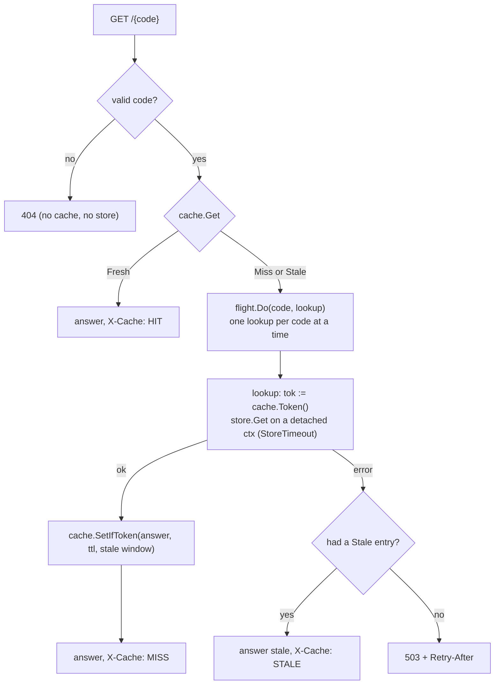

# E1 Unit 2 — The API and the redirect cache

> Time: ~5.5 h (5 CORE + 0.5 STRETCH) · CORE: §1–§3 · STRETCH: cross-instance invalidation sketch (end of §3) ·
> Lab: `labs/e1/shorty` milestone 2 (`go test -race -run TestM2 ./labs/e1/shorty/`)

Unit 1 gave you a store that remembers. This unit puts the shortener in front of it: an API whose create is safe to
retry (§1), a redirect path that almost never needs the store — and that doesn't fall over when a link goes viral or a
bot enumerates codes (§2) — and an honest answer to "how long after a takedown does the link stop working?" (§3). You
designed all of this in [C1](../C1-url-shortener/unit-1-url-shortener.md) and [A3](../A3-caching/README.md). Here you
find out which parts of the design were load-bearing.

## Before you start

You should have finished Unit 1 (`TestM1` green). Warm-up — answer first:

1. A client sends `POST /v1/links` with `Idempotency-Key: k1`, times out, and retries with the same key and body. What
   must the second response be? What if the retry changes the URL?
2. A cached value has a 30 s TTL. The source changes at t = 10 s. Until when can a reader see the old value from this
   cache, and what decides it?
3. 50 requests miss the cache for the same key at the same moment, and each load takes 600 ms. How many loads reach the
   source without coalescing, and with singleflight?

<details data-kind="answer">
<summary>Warm-up answers</summary>

1. The first request's response, replayed (here: `201` with the same code, marked `Idempotent-Replayed: true`). A
   different body under the same key is a client bug: `422`, never someone else's result (A1 Unit 3 §2).
2. Until t = 30 s at worst if the entry was filled at t = 0 — the TTL bounds staleness from the *fill* time, not the
   change time. An invalidation on write shortens it for the caches that hear about it (A3 Unit 2 §5).
3. 50 without coalescing; 1 with singleflight, as long as all 50 arrive while the first load is still running
   (A3 Unit 2 §6).

</details>

---

## §1 The API: creates you can retry, redirects that say what they mean

### The failure story

The statements team sends 400,000 "your statement is ready" e-mails on the first of the month. Their sender calls
`POST /v1/links` for each member with a 2 s timeout and retries twice on timeout. At 09:00 the store's disk is busy
with a backup and creates take 2.5 s for a few minutes. Every one of those creates *succeeds* at the store after the
sender has given up, and the sender's retry creates another link. 30,000 members get an e-mail whose link is not the
one in the audit log; 4,000 get two e-mails because the sender's own dedupe was keyed on the link. Separately, the
first version of the redirect returned `301 Moved Permanently` because "the mapping never changes". When compliance
asked for a phishing link to be taken down, it kept working for everyone who had clicked it once: their browsers had
cached the 301 and never asked again.

### Predict

<!-- predict id="E1-U2-P01" -->
**Predict.** Write your answers down before the reveal.

1. The create uses two store writes: `idem/<client>/<key>` (the claim) and `link/<code>` (the link). In which order,
   and why? What happens to a retry if the API instance crashes *between* the two writes, in your order?
2. Twenty copies of the same request (same client, same key, same body) arrive at once. How many links should exist
   afterwards, how many responses should be marked as replays, and how does your design guarantee it?
3. Why should `DELETE` by someone who doesn't own the link return `404` rather than `403`?
<!-- /predict -->

### Reveal

<details data-kind="reveal" data-for="E1-U2-P01">
<summary>Reveal</summary>

1. **Claim first, then the link.** The claim is an insert-if-absent of an *intent record* that already contains
   everything the response needs: the request's fingerprint and the complete link (code, URL, owner, created_at,
   expiry). Whoever wins the claim then writes `link/<code>`. If the instance crashes between the two writes, the
   client's retry loses the claim, reads the intent from the 409 body, and **rolls the link forward itself** with an
   insert-if-absent of the same link — the retry finishes the work the crashed request started, and the response is
   identical. The other order (link first, then the claim) leaves an orphan link on a crash and lets a retry create a
   second one. Tempting wrong answer: "store the response after the work completes", which is fine in one process but
   leaves a window where neither the client nor a retry knows what was promised.
2. **One link**, **19 replays**, **one original**. The store's insert-if-absent on `idem/…` has exactly one winner
   (Unit 1 §3). The 19 losers each read the winner's intent from the 409 and ensure the link exists — if the winner
   hasn't written it yet, one of them does, with identical content, and the others find it already there. The store
   ends with exactly two keys. `TestM2_ConcurrentDuplicatesCreateOneLink` checks all three numbers.
3. A `403` confirms the code exists and belongs to someone else: an existence oracle that lets an attacker enumerate
   live codes. "Not yours" and "not there" must be indistinguishable (A9 Unit 1 §3).

</details>

### How it actually works

**The create path.**

```mermaid
sequenceDiagram
  participant C as client (retries on timeout)
  participant A as api
  participant S as store
  C->>A: POST /v1/links  Idempotency-Key: k1  {url}
  A->>A: limiter.Allow(client) — 429 here, before any work
  A->>S: PUT idem/alice/k1 ?if-absent  {fingerprint, link{code: aZ3k9Qx, …}}
  S-->>A: 201 (claimed)
  A->>S: PUT link/aZ3k9Qx ?if-absent  {link}
  S-->>A: 201
  A-->>C: 201 {code: aZ3k9Qx}   (cache warmed)
  Note over C,A: the response is lost; the client retries
  C->>A: POST /v1/links  Idempotency-Key: k1  {url}
  A->>S: PUT idem/alice/k1 ?if-absent  {…new candidate…}
  S-->>A: 409, body = the first intent
  A->>A: fingerprint matches?  no → 422
  A->>S: PUT link/aZ3k9Qx ?if-absent  {the first intent's link}
  S-->>A: 409, same link → already done
  A-->>C: 201 {code: aZ3k9Qx}  Idempotent-Replayed: true
```

Details the tests check:

- **The key is scoped to the client** (`idem/<client>/<key>`): two clients that both use `k1` are not duplicates.
- **The fingerprint** is a hash of the request's meaning (URL and TTL), so a reused key with a different body is `422`.
- **One budget for the whole request.** `ctx, cancel := context.WithTimeout(r.Context(), cfg.RequestBudget)` once, and
  every store call derives `context.WithTimeout(ctx, cfg.StoreTimeout)` from it: each call is capped by the smaller of
  its own limit and what's left (A7 Unit 1 §1).
- **Collisions are retried with a fresh code**, and the owner of the claim rewrites its intent (a plain `Put`) so
  later replays see the new code. With 62⁷ codes this practically never runs; it's there because "practically never"
  isn't "never".
- **Don't warm the cache from a replay.** The link may have been deleted since the first response.

**The redirect response.** `302 Found` with `Location` and `Cache-Control: private, no-store` by default. Under
HTTP caching rules (RFC 9111) a 301 — and a 404 or 410 — is *heuristically cacheable*: with no explicit freshness, a
cache may pick a lifetime of its own. A 302 isn't, but clients and intermediaries vary, so say what you mean on every
answer.
`-redirect-max-age N` trades a few browser-cached clicks (fewer requests, no analytics, slower takedown for that browser)
for load, and is capped by the link's expiry so a browser never follows an expired link. `404` for a code that never
existed, `410 Gone` for a deleted or expired link (the `deleted: true` tombstone stays in the store so the answer can
be 410), both `no-store`.

**Validate before you look anything up.** A code that can't exist (wrong length, non-base-62 characters) is a `404`
with no cache entry and no store read: garbage must not cost you memory or a round trip.

### Build it

Edit `labs/e1/shorty/api.go` and `client.go`. Provided: `Link`, `idemRecord`, the request/response types, `cached`,
`runAPI`, `routes`, `clientID`, `validToken`, `validTarget`, `fingerprint`, `apiError`, `unavailable`, and
`NewStoreClient`. Implement:

1. `StoreClient.Get`, `Put`, `PutIfAbsent` (always read and close the body; transport errors and 5xx wrap
   `ErrStoreUnavailable`).
2. `newAPI`, `create`, `insertNew`, `ensureLink`, `insertIdempotent`.
3. `redirect` and `answer` with a plain store lookup first (no cache yet), then `remove` and `statsHandler`.

Acceptance tests: `TestM2_CreateAndRedirect`, `TestM2_CreateValidatesInput`,
`TestM2_ExpiredAndDeletedLinksAre410AndUnknownIs404`, `TestM2_IdempotentCreateReplaysTheFirstResponse`,
`TestM2_ConcurrentDuplicatesCreateOneLink`, `TestM2_RedirectMaxAgeIsCappedByExpiry`.

```bash
go test -race -run 'TestM2_Create|TestM2_Expired|TestM2_Idempotent|TestM2_Concurrent|TestM2_RedirectMaxAge' ./labs/e1/shorty/
```

### Break it

1. Swap the order: write `link/<code>` first, then claim the key. Run `TestM2_ConcurrentDuplicatesCreateOneLink`
   several times. What does `keys` in the store's stats say?
2. Return `301` instead of `302` and run `TestM2_CreateAndRedirect`. Then, by hand: create a link, open it in a
   browser, delete it, open it again.
3. Remove the fingerprint check. Which test fails, and what does a client with a key-reuse bug now receive?

<details data-kind="answer">
<summary>What you should see</summary>

1. Every concurrent request creates its own link before racing for the claim; the store ends with up to 21 keys
   instead of 2, and the losers' links are orphans nobody will ever be told about. Order matters because the claim is
   what makes the rest of the work single-owner.
2. The test fails on the status. In the browser, the deleted link still "works": the browser never asks the server
   again. That is a takedown you cannot perform.
3. `TestM2_IdempotentCreateReplaysTheFirstResponse` fails: the reused key returns the *first* link, pointing at the
   *first* URL. A client bug becomes a silent wrong redirect.

</details>

### In the wild

- **Stripe** idempotency keys: scoped per account, the first response (including errors) is replayed, a reused key
  with different parameters is rejected (TODO-VERIFY: exact status code and retention window in Stripe's docs).
- **The IETF Idempotency-Key header draft** (`draft-ietf-httpapi-idempotency-key-header`) standardises the header and
  recommends 422 for reuse with a different payload and 409 for a concurrent in-flight duplicate (TODO-VERIFY against
  the current draft).
- **Bitly** and most shorteners answer with 301 for permanent marketing links and offer analytics through their own
  redirect (TODO-VERIFY: current status codes and caching headers).

### Trade-offs

| Choice | Wins when | Loses when | When the answer flips |
|---|---|---|---|
| intent record claimed first, any retry rolls forward (this lab) | crashes between writes must not duplicate or orphan; no in-flight state to time out | two store writes per create | a store with multi-key transactions: write both in one transaction |
| `409` + `Retry-After` for an in-flight duplicate (A1's lab) | the work is long or has side effects only the first request may run | clients must handle 409 and retry | when the work is idempotent and cheap, rolling forward (this lab) is simpler for clients |
| 302 + `no-store` | analytics, takedown, expiry must be exact | every click reaches you | permanent public links where the owner accepts no analytics and no takedown: 301 |
| `410` with a tombstone | takedown and expiry are visible and distinguishable from typos | tombstones are kept forever (or until a retention job) | if storage of dead links matters more than the 404/410 distinction |

### Senior bar

- **Failure modes.** Idempotency records that expire before the client's retry window ends (here they never expire —
  say how long they should live and who deletes them); a fingerprint that includes fields that legitimately vary
  between retries (timestamps, trace ids) and turns every retry into a 422; a replay that warms caches with stale
  state.
- **Capacity.** Each keyed create is two store writes and two fsyncs under `-sync always`: halve your creates/s
  estimate, or put both writes in one record.
- **Operations.** Make `Idempotent-Replayed` visible on dashboards: a sudden rise means a caller is timing out.

Interviewer probes:

<details data-kind="answer">
<summary>"The API crashed after writing the claim but before writing the link. The client never retries. What's left?"</summary>

An intent record pointing at a code that doesn't exist yet. Nobody was told about that code, so nothing is broken, but
it's garbage. Options: leave it (cheap; it's one record); expire intent records after the retry window with a
background sweep; or have the sweep roll forward or delete pending intents. The important property is that no
*acknowledged* create is ever missing, and no retry ever creates a second link.

</details>

<details data-kind="answer">
<summary>"Why does the replay return 201 rather than 200?"</summary>

The contract is "the same response as the first time", so a client can't tell a replay from the original and doesn't
need a second code path. The `Idempotent-Replayed` header carries the difference for humans and dashboards. Returning
200 is defensible too; what is not defensible is a body that differs.

</details>

### Check yourself

1. Why is the intent record written with insert-if-absent rather than a plain put?
2. A retry arrives with the same key and the same URL but a different `ttl_seconds`. What should happen?
3. What does a code with a `!` in it cost the system?

<details data-kind="answer">
<summary>Answers</summary>

1. The insert-if-absent is the claim: exactly one concurrent request wins and the rest learn what it promised. A plain
   put would let every retry overwrite the intent and each believe it owns the key.
2. `422`: the fingerprint covers the TTL, so this is a different request reusing a key.
3. Nothing beyond parsing: it is rejected as `404` before the cache and the store.

</details>

---

## §2 The redirect cache: misses that don't hurt

### The failure story

The shortener now handles ≈ 12,000 redirects a second at peak (C1's estimate) against a store that can do a few
thousand reads a second. A 95% hit ratio sends ≈ 600 reads/s to the store; fine. Then three things happen in one week.
A bank's promotional link is posted on a popular forum and gets ≈ 5,000 clicks in the first second, all on an API
instance that has never seen it: 5,000 cache misses, 5,000 store reads for one key, and the store's p99 goes from 1 ms
to 900 ms for every other request. A scraper walks through random 7-character codes at 2,000 requests/s: none of them
exist, none of them are cached, and every one is a store read. And during a two-minute store restart, every redirect
that wasn't fresh in the cache — including the ones that were cached a minute ago, with a known answer — returns 503.

### Predict

<!-- predict id="E1-U2-P02" -->
**Predict.** Write your answers down.

1. For the viral link: with singleflight, how many store reads does the instance make? The first request's client
   gives up after 100 ms and closes the connection; what happens to the other 4,999 if the shared lookup uses the
   *first request's* context?
2. For the scraper: what do you cache for a code that doesn't exist, for how long, and what's the risk of caching it
   for too long?
3. For the restart: the cache entry for a popular link expired 20 s ago and the store is down. Serve the old answer or
   return 503? What decides it, and what must the response tell you?
<!-- /predict -->

### Reveal

<details data-kind="reveal" data-for="E1-U2-P02">
<summary>Reveal</summary>

1. **One** read per instance per expiry: every concurrent miss for the code joins the in-flight lookup. If that lookup
   runs on the first request's context, the first client's disconnect cancels it and all 4,999 waiters get
   `context canceled` — a self-inflicted outage triggered by the most impatient client. The shared work must run on a
   **detached** context with its own deadline (`context.WithTimeout(context.Background(), StoreTimeout)`), and each
   waiter can still give up on its own.
2. A **negative entry** ("404") with a *short* TTL (`-neg-ttl`, 5 s here): 2,000 probes/s of distinct codes still
   miss, but repeats of the same code don't, and enumeration of hot ranges is damped. The risk is serving 404 for a
   code that has just been created: only possible here if a random collision picks a code someone probed, and the
   create path overwrites the entry on its own instance. Never cache a store *error* as "not found".
3. **Serve stale, and say so** — if the entry is inside its `stale-if-error` window: the answer was right 20 s ago and
   links rarely change, so a redirect that might be 20 s stale beats a 503. Mark it (`X-Cache: STALE`, count it in
   `stale_served`). What decides the window is the cost of a wrong answer: for redirects, a takedown that is late by
   the window. The same policy for an account balance used to approve a payment would be wrong (A3 Unit 2 §8).

</details>

### How it actually works

**What the cache holds.** Not the store row: the *answer*. `cached{Status, Link}` with Status 302, 404 or 410. Every
entry has two deadlines:

```text
            fresh (CacheTTL or NegativeTTL)        stale-if-error window
set ───────────────────────────────────▶│◀───────────────────────────────▶│ removed
       Get → Fresh: serve, X-Cache HIT    Get → Stale: look up; on error   Get → Miss
                                          serve it, X-Cache STALE
```

**The miss path.**



**Expiry is checked when serving.** A link that expires in 10 s may sit in a 30 s cache entry; `answer` compares
`ExpiresAt` with the clock every time, so the cache can't outlive the link.

**LRU with a capacity.** The cache is a doubly linked list plus a map (A3's `lru` lab): `Get` promotes, `Set` evicts
from the back when full. A Go `map` plus `container/list` is enough here; at millions of entries you'd care about the
per-entry overhead (≈ 100+ bytes per entry before the value, TODO-VERIFY with a heap profile) and the GC cost of
pointers.

**Sizing it.** C1's hot set: if 20% of links get 80% of clicks and a day sees ≈ 10 M distinct links clicked, the
hot 2 M entries at ≈ 500 B each (entry + link + overhead) are ≈ 1 GB per instance. `-cache-size 10000` is a laptop
number; the design write-up asks you for the production one.

### Build it

Edit `labs/e1/shorty/cache.go`, then wire it into `redirect` and `lookup` in `api.go`:

1. `NewCache`, `Get` (Fresh / Stale / Miss, promote on hit, remove past the stale window), `Set` (replace, evict LRU,
   `fresh ≤ 0` stores nothing), `Len`.
2. `Group.Do` (singleflight): register under the mutex, run `fn` outside it, then remove the flight and close `done`.
3. `redirect` and `lookup` as in the diagram (use `Token`/`SetIfToken` already; §3 explains why), warm the cache on
   create, count `cache_hits`, `store_lookups`, `coalesced`, `stale_served`.

Acceptance tests: `TestM2_CacheLRUEvictsLeastRecentlyUsed`, `TestM2_CacheFreshThenStaleThenGone`,
`TestM2_CacheIsSafeForConcurrentUse`, `TestM2_SingleflightCoalescesConcurrentCalls`,
`TestM2_SingleflightSharesErrorsAndKeepsKeysApart` (in-process), and, across processes,
`TestM2_RepeatRedirectsAreServedFromCache`, `TestM2_NegativeCachingShieldsTheStore` (30 lookups of one unknown code →
exactly 1 store read), `TestM2_StampedeOnAColdKeyIsCoalesced` (50 concurrent misses through a link with 300 ms of
injected latency each way → exactly 1 store read).

```bash
go test -race -run 'TestM2_Cache|TestM2_Singleflight|TestM2_Repeat|TestM2_Negative|TestM2_Stampede' ./labs/e1/shorty/
```

### Break it

1. Bypass `flight.Do` (call `lookup` directly) and run `TestM2_StampedeOnAColdKeyIsCoalesced`. How many store reads?
2. Run the shared lookup on the first request's context (`r.Context()`), then by hand: put a 2 s delay in front of the
   store (spec §8 plus a `tProxy`, or just think it through), start 20 `curl --max-time 0.1` and one patient `curl`
   for the same cold code. What does the patient one get?
3. Cache store *errors* as 404 for `-neg-ttl`. Kill the store for one second and restart it. What do members see for
   the next 5 s?

<details data-kind="answer">
<summary>What you should see</summary>

1. Up to 50 reads for one key: the failure message says the stampede multiplied store load by the number of waiters.
2. The first impatient client's disconnect cancels the shared lookup; the patient client, which joined it, gets the
   cancellation as its own error (here a 503) although it was willing to wait. Detached contexts for shared work.
3. Working links answer 404 for up to `-neg-ttl` after the store is back: an outage converted into wrong answers that
   outlive it. Errors must never be cached as data.

</details>

### In the wild

- **Go's `golang.org/x/sync/singleflight`** is this `Group`, and its docs warn that a slow or hung `fn` blocks every
  caller of that key; `DoChan` lets each caller give up on its own (TODO-VERIFY current API).
- **HTTP `stale-if-error`** (RFC 5861) is the same knob for HTTP caches and CDNs, alongside `stale-while-revalidate`.
- **NGINX** `proxy_cache_lock` coalesces concurrent misses for one key, and `proxy_cache_use_stale error timeout`
  serves stale entries when the upstream fails.
- **Facebook's memcache paper** (NSDI 2013) describes *leases* for both stampedes and stale sets — the production
  version of `Token`/`SetIfToken` in §3.

### Trade-offs

| Choice | Wins when | Loses when | When the answer flips |
|---|---|---|---|
| in-process cache per instance (this lab) | zero network hops on a hit; survives a remote-cache outage | N instances = N copies, N misses per key per expiry, N different staleness clocks | many instances and a large working set: add a shared L2 (Redis) behind the L1 |
| short negative TTL | bounded cost for repeated unknown codes; quick recovery from a wrongly cached 404 | distinct-code enumeration still misses every time | high-rate enumeration: add a Bloom filter of existing codes in front, or rate-limit 404s per client |
| stale-if-error | availability during store outages for data that changes rarely | serves deleted links for up to the window during an outage | data where a stale answer is unsafe (balances for authorisation, revoked permissions): fail closed |
| singleflight | one load per key per instance per expiry | a hung load blocks all waiters for that key (bounded by its timeout) | cheap, fast sources where coalescing overhead dominates |

### Senior bar

- **Failure modes.** A hung lookup holding every waiter for a key (bounded only by `StoreTimeout`; make it short); a
  cold restart of all instances at once (every key misses at once: stagger deploys, warm the hottest keys);
  negative-cache pollution by an attacker inserting millions of distinct 404 entries (LRU evicts them, but they push
  out real entries: cap negative entries separately or keep them short).
- **Capacity.** Hit ratio *h* turns the redirect rate *R* into a store read rate of `R · (1 − h)` per fleet — plus
  one read per key per instance per expiry. At 12k redirects/s, h = 0.95, that's ≈ 600 reads/s; cold, it's 12k/s, the
  cold factor `1/(1 − h)` = 20× (A3 Unit 1 §4).
- **Operations.** Dashboard: hit ratio, `stale_served` (non-zero means the store is failing *now*), `coalesced`
  (spikes mean a hot key), cache entries vs capacity, eviction rate.

Interviewer probes:

<details data-kind="answer">
<summary>"A link gets 50,000 clicks a second across 20 instances. What does the store see?"</summary>

Once each instance has it cached: nothing until expiry. At each expiry: one read per instance (singleflight), so ≈ 20
reads per `CacheTTL`, plus the stale-revalidate traffic. If the link is created and goes viral before it's cached
everywhere, the first second costs ≈ 20 reads, not 50,000. Further out: a CDN in front (with `max-age`) removes even
that, at the cost of analytics and takedown precision.

</details>

<details data-kind="answer">
<summary>"Why cache the answer (302/404/410) rather than the store row?"</summary>

Because the hot path should do no work beyond a map lookup and an expiry check, and because 404 and 410 must be cached
too (negative caching): there is no row for a 404. It also makes the cache's contents exactly what you'd need to serve
during a store outage.

</details>

### Check yourself

1. Why is the shared lookup's context detached from the request that started it?
2. What's the difference between `Stale` and `Miss`, and which one can be served when the store is down?
3. Why is a negative entry's TTL shorter than a found entry's?

<details data-kind="answer">
<summary>Answers</summary>

1. Every waiter depends on it; tying it to one request lets that request's cancellation fail all of them.
2. Stale is past freshness but inside the stale-if-error window; Miss is absent or past that window. Only Stale can be
   served on error.
3. A wrong negative answer (a link that exists now) is worse and more likely to matter than a slightly stale positive
   one, and negative entries are the ones an attacker can create at will.

</details>

---

## §3 Invalidation across instances: how long does a takedown take?

### The failure story

A phishing campaign is using one of your links. Compliance asks you to take it down and asks a precise question: *when
will it stop working?* The delete goes to API instance A, which writes the tombstone and drops its cache entry: A
answers 410 at once. Instances B through F each cached the link a few seconds ago with a 30 s TTL and keep redirecting
for up to 30 more seconds — ≈ 150,000 more victims at the campaign's click rate. Worse, on instance A itself, a
redirect that started its store read 3 ms *before* the delete lands its cache fill 2 ms *after* the invalidation, and
puts the old 302 back for a full 30 s. Compliance asked for a number, and the honest answer was "usually
instantaneous, sometimes 30 s, occasionally 30 s on the instance that did the delete".

### Predict

<!-- predict id="E1-U2-P03" -->
**Predict.** Write your answers down.

1. Draw the interleaving on instance A that resurrects the deleted link: which events, in which order? What single
   rule about cache fills prevents it?
2. With purely local invalidation and `-cache-ttl 1.5s`, what's the worst-case time instance B keeps redirecting
   after the delete? Can it be longer than 1.5 s?
3. Name two ways to make B stop sooner, and what each costs.
<!-- /predict -->

### Reveal

<details data-kind="reveal" data-for="E1-U2-P03">
<summary>Reveal</summary>

1. (1) A redirect misses and its lookup reads `link/x` → 302. (2) The delete writes the tombstone. (3) The delete
   removes `x` from A's cache. (4) The lookup from (1) stores its 302. Now A serves the deleted link for a TTL. The
   rule: **a fill must not land if an invalidation happened after the fill's read started.** Take a token (an
   invalidation epoch) *before* reading the store and store the result only if no `Delete` has happened since
   (`Token`/`SetIfToken`). `TestM2_CacheDeleteBeatsAnInFlightFill` replays exactly this sequence.
2. Up to the TTL (1.5 s) after B's entry was filled, so up to ≈ 1.5 s after the delete if B filled it just before —
   plus, at the edge, a lookup in flight on B that read the store before the delete and lands with a fresh 1.5 s
   (bounded by the store timeout). `TestM2_DeleteIsImmediateLocallyAndBoundedByTTLElsewhere` asserts B stops within
   the TTL plus slack, and logs what B answered right after the delete (stale, by design).
3. (a) **Shorter TTLs**: simple; costs hit ratio and store reads (A3's miss-ratio arithmetic). (b) **Broadcast
   invalidation**: the deleting instance (or the store) publishes "invalidate x" to every instance — pub/sub, or the
   store's change log tailed by every instance; costs a new component whose own failures (a lost message) fall back to
   the TTL. (c) Version checks on every hit are a store read per redirect: no cache at all. The TTL remains the bound
   when everything else fails, so choose it from the takedown requirement.

</details>

### How it actually works

```mermaid
sequenceDiagram
  participant R as redirect (instance A)
  participant D as delete (instance A)
  participant Ca as A's cache
  participant S as store
  R->>Ca: Token() → 7
  R->>S: GET link/x
  S-->>R: 302 (old)
  D->>S: PUT link/x {deleted: true}
  D->>Ca: Delete(x)   (epoch → 8)
  R->>Ca: SetIfToken(x, 7, 302) → refused
  Note over Ca: x stays absent; next GET reads the tombstone → 410
```

The token here is cache-wide: any delete invalidates every in-flight fill. That's conservative — a delete of one link
drops concurrent fills of others, costing one extra store read each — and fine because deletes are rare. Per-key
versions or Facebook-style leases are the finer-grained versions.

**What "bounded staleness" means in numbers.** For instance B, the staleness of a deleted link is at most
`CacheTTL + StoreTimeout` after the delete (fill just before the delete, plus a lookup that started before it and
landed after). For a stale-if-error window, add "for the duration of a store outage, up to the window". Those two
numbers are your answer to compliance, and the break-it below measures them.

**STRETCH — broadcast invalidation.** Sketch (don't build) a version where the store appends every write to a change
feed (`GET /changes?from=<offset>`, long-polled) and every API instance tails it and deletes affected keys. What
offset does an instance start from after a restart? What does it do if it falls behind? What bounds staleness when the
feed is down? (Answer: still the TTL — the feed shortens the common case, the TTL bounds the worst case.)

### Build it

You already wrote `Token`/`SetIfToken`/`Delete` and use them in `lookup`; make sure `remove` writes the tombstone
*first* and invalidates *second*.

Acceptance tests: `TestM2_CacheDeleteBeatsAnInFlightFill` (in-process) and
`TestM2_DeleteIsImmediateLocallyAndBoundedByTTLElsewhere` (two API processes on one store).

```bash
go test -race -run TestM2 ./labs/e1/shorty/
```

This is milestone 2 done: all `TestM2` green.

### Break it

1. `go test -tags breakit -run BreakIt_TakedownWindow -v ./labs/e1/shorty/` measures how long instance B keeps
   redirecting after a delete on A, for three TTLs, and how many redirects it served meanwhile. Predict the three
   numbers first.
2. In `remove`, invalidate the cache *before* writing the tombstone. Which race opens, and would any test catch it?
3. Make `lookup` use `Set` instead of `SetIfToken` and run `-run CacheDeleteBeats` (it tests the cache, not your
   handler). Then write the handler-level test that would catch it — what makes it hard to write deterministically?

<details data-kind="answer">
<summary>What you should see</summary>

1. Each window ≈ its TTL (B's entry was filled just before the delete), and the number of redirects served grows
   linearly with it. That's the table to put in the design write-up.
2. A redirect that misses between the invalidation and the tombstone write reads the *old* link and caches it for a
   full TTL, on the very instance that performed the delete. The tests only catch it with unlucky timing: some races
   need a reasoning argument, not a test.
3. The in-process test still passes (it calls the cache directly). A handler-level test needs to pause a lookup
   between its store read and its cache fill — a hook or a slow store that releases on a signal — which is exactly what
   the tProxy delay plus careful sequencing can do, and why concurrency bugs are found by reading more often than by
   testing.

</details>

### In the wild

- **Facebook memcache** (NSDI 2013): deletes from the database's commit log are broadcast to every cache cluster
  (`mcsqueal`), and leases stop stale sets; the TTL is the backstop.
- **CDNs** offer purge APIs (seconds to minutes to propagate, provider-dependent, TODO-VERIFY per provider) — the same
  shape: a broadcast that is fast when it works, with `max-age` as the bound when it doesn't.
- **Kubernetes informers** tail a change feed (watch) with a resourceVersion to resume from, and fall back to a full
  re-list when they fall too far behind — the STRETCH design above.

### Trade-offs

| Invalidation | Wins when | Loses when | When the answer flips |
|---|---|---|---|
| local delete + TTL (this lab) | no extra components; staleness bound is easy to state | other instances are stale for up to the TTL | the takedown SLA is shorter than any TTL you can afford |
| broadcast (pub/sub or change feed) + TTL backstop | takedown in ≈ propagation time on all instances | a new component; lost messages fall back to the TTL; ordering against fills still needs tokens | very few instances or very short TTLs: not worth it |
| no cache for mutable data | always fresh | every request is a store read | immutable or rarely changing data: cache it |
| version check on every hit | fresh and cheap per check if the version is in a faster store | it's still a remote read per request | almost always: you have moved the cache, not removed it |

### Senior bar

- **Failure modes.** A delete that succeeds at the store but fails to invalidate (instance crashes in between: harmless
  here, the TTL bounds it); a broadcast consumer that falls behind silently (alert on lag); a fill racing a delete
  (tokens).
- **Capacity.** Takedown exposure ≈ click rate × staleness window. At 5,000 clicks/s and a 30 s TTL, ≈ 150,000 clicks
  after the delete; at 1.5 s, ≈ 7,500. That's the number that should choose your TTL.
- **Operations.** Measure the takedown window in production: delete a canary link every few minutes and probe every
  instance until it answers 410; graph the time.

Interviewer probes:

<details data-kind="answer">
<summary>"Compliance needs takedowns effective within 5 seconds. What do you change?"</summary>

Set the TTL bound first: `CacheTTL ≤ 5 s − StoreTimeout`, and either accept the hit-ratio cost (compute it: more
store reads per hot key per instance — usually fine, since the hot-key cost is one read per instance per TTL) or add
broadcast invalidation for the common case. Turn off `stale-if-error` for deleted links, or document that during a
store outage the SLA is suspended. Never send `max-age` to browsers longer than the SLA. Then measure it with a canary.

</details>

<details data-kind="answer">
<summary>"Why not update the cache entry to 410 on delete instead of removing it?"</summary>

On the deleting instance that's fine and saves a read, but it has the same race in reverse (an older fill landing
after the update) unless fills are token-checked too — so you need the token either way. Deleting is the textbook
choice because a concurrent reader then re-reads the source of truth.

</details>

### Check yourself

1. What is the worst-case takedown time on another instance with local invalidation?
2. Why does `remove` write the tombstone before invalidating the cache?
3. What bounds staleness when a broadcast invalidation system is down?

<details data-kind="answer">
<summary>Answers</summary>

1. ≈ `CacheTTL` (+ `StoreTimeout` for an in-flight fill), and, during a store outage with stale-if-error, up to that
   window too.
2. So that any read after the invalidation sees the tombstone; the other order lets a fill cache the old link.
3. The TTL, which is why it must still be chosen from the requirement.

</details>

---

## Unit wrap-up

| Decision | Use… | Flip when… |
|---|---|---|
| idempotent create | claim an intent record with insert-if-absent; any retry rolls it forward; 422 on mismatch | the store has multi-key transactions |
| redirect | 302 + `private, no-store`; 404 vs 410 with tombstones; expiry checked at serve time | permanent public links with no analytics: 301 / `max-age` |
| cache contents | the answer (302/404/410), fresh + stale-if-error windows | the answer is unsafe when stale: fail closed |
| misses | singleflight on a detached context; short negative TTL; validate codes first | enumeration at scale: Bloom filter, 404 rate limits |
| invalidation | tombstone first, then invalidate; token-checked fills; TTL as the cross-instance bound | takedown SLA < affordable TTL: broadcast + TTL backstop |

Next: all `TestM2` green, the takedown-window numbers in your design write-up, then
[Unit 3](unit-3-limits-failure-load.md).
