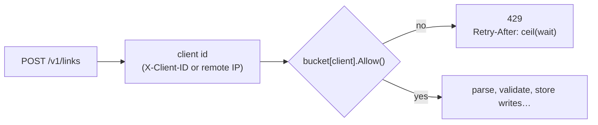
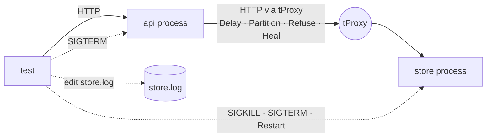

# E1 Unit 3 — Limits, failure injection and the p99 report

> Time: ~7 h (5 CORE + 2 STRETCH) · CORE: §1–§2 and the gate work · STRETCH: §3 (load test and the p99 report) ·
> Labs: `labs/e1/shorty` milestones 3–4 (`-run TestM3`, `-run TestM4`); `labs/e1/loadgen` (stretch)

The shortener works. This unit is about what it does when someone or something misbehaves: a client that sends too
much (§1), and a store that is down, slow or unreachable, or an API that is being redeployed under load (§2). Each of
those has a predicted behaviour in [spec.md](spec.md) §6 and a test that starts real processes and breaks them on
purpose. §3 (STRETCH) measures the result honestly: an open-loop load generator and a p99 that doesn't hide the stalls.

Version 2 of the [design write-up](design-exercise.md) is due at the end of §2: your predictions from Unit 1 next to
what the failure tests actually showed.

## Before you start

You should have finished Unit 2 (`TestM2` green). Warm-up — answer first:

1. A token bucket has rate 2/s and burst 5, and is full. A client sends 8 requests at once. How many are allowed, and
   when will the next one be?
2. A request arrives with 800 ms of budget and makes two sequential store calls, each capped at 300 ms. The store hangs.
   When does the request answer, and with what?
3. You measure latency by sending a request, waiting for the response, and sending the next. The server stalls for 1 s
   once during a 10 s run at an intended 100 req/s. What does your p99 miss?

<details data-kind="answer">
<summary>Warm-up answers</summary>

1. 5 allowed (the burst), 3 refused; the next token arrives 0.5 s later (A7 Unit 2 §2).
2. At ≈ 300 ms for the first call's timeout — then the second call gets min(300 ms, what's left) — so ≈ 600 ms total
   with two failures, or sooner if the code gives up after the first; answer 503 + `Retry-After`, never a hang
   (A7 Unit 1 §1).
3. The ≈ 100 requests that *would* have been sent during the stall, each of which would have waited up to 1 s. A
   closed loop records one slow sample instead of a hundred: coordinated omission (A8 Unit 1 §5).

</details>

---

## §1 The rate limiter: refuse early, refuse truthfully

### The failure story

A partner's integration has a retry bug: on any error it retries immediately, forever. At 14:02 the store has a
two-second hiccup, the partner's creates fail, and the partner starts sending ≈ 3,000 creates/s. The API has no limits;
every create takes a store write and an fsync, the store's queue grows, and every *other* client's creates time out.
The fix that ships at 14:20 is a limiter of 5 creates/s per client with burst 20 — enforced per API instance. There are
six instances behind the load balancer, so the partner still gets ≈ 30/s, and the limiter's `Retry-After: 0` (the
wait, 200 ms, truncated to whole seconds) tells their client to retry immediately, which it does.

### Predict

<!-- predict id="E1-U3-P01" -->
**Predict.** Write your answers down.

1. Where in the create handler must the limiter run, relative to parsing the body and calling the store, and why?
2. Six API instances, each with "5 creates/s, burst 20 per client", behind a round-robin load balancer. What does one
   client really get, in the first second and in steady state? What would you need to make it exactly 5/s?
3. The limiter keeps one bucket per client. An attacker sends each request with a fresh `X-Client-ID`. What happens
   to memory, and what does bounding it cost?
<!-- /predict -->

### Reveal

<details data-kind="reveal" data-for="E1-U3-P01">
<summary>Reveal</summary>

1. **First**, right after identifying the client: before reading the body, before any store call. A refusal must be
   cheaper than the work it prevents, or the limiter is just another way to spend resources under attack.
   `TestM3_RateLimitIsCheckedBeforeTheStore` kills the store and checks that an over-limit client still gets a fast
   429, not a 503. Tempting wrong answer: "after validation, so bad requests don't use tokens" — they shouldn't be
   cheap either.
2. First second: up to 6 × 20 = **120** (every instance's full burst); steady state **≈ 30/s** (6 × 5). Per-instance
   limits multiply by the number of instances a client can reach. To get exactly 5/s you need shared state — a
   central counter (Redis `INCR` with expiry, or a token bucket in the store) at the cost of a round trip per request,
   or each instance enforcing `limit / N` (wrong whenever load is uneven), or consistent routing of a client to one
   instance (A7 Unit 2 §3, C2). The break-it measures this directly.
3. Unbounded, it grows by one bucket per request: an easy memory exhaustion. Bounded (`-max-clients`, LRU), an
   evicted client comes back with a **full** bucket, so an attacker rotating through more ids than the bound gets a
   burst per request. Bounding memory trades accuracy for the long tail of clients; the real fix is that client
   identity must come from authentication, not a header the client chooses.

</details>

### How it actually works

**Token bucket, lazily refilled.** Each bucket stores `tokens` and `last`. On `Allow`: add `(now − last) × rate`, cap
at `burst`, set `last = now`; if `tokens ≥ 1`, take one and allow; else refuse with `retryAfter = (1 − tokens) / rate`.
No timers, no background goroutine: the arithmetic happens when a request arrives.



**`Retry-After` must be truthful.** It's whole seconds, so round *up*: truncating 200 ms to `0` tells a well-behaved
client to retry immediately and be refused again (the story's second bug). `RetryAfterSeconds` rounds up and never
returns less than 1.

**Bounded memory.** The buckets live in an LRU (`-max-clients`): touching a bucket moves it to the front; inserting
past the bound evicts the least recently used. The same pattern as the cache, for the same reason.

**What the limiter is not.** It's a fairness and abuse control per client, not overload protection for the store. A
thousand well-behaved clients at their limit can still overload the store; that's §2's job (budgets, fast failure),
and in a fuller design, a global concurrency limit or load shedder (A7 Unit 3 §2).

### Build it

Edit `labs/e1/shorty/limiter.go` (you may port your `labs/a7/ratelimit` token bucket) and call it first in `create`.

Acceptance tests: `TestM3_TokenBucketAllowsTheBurstThenTheRate` (exact `retryAfter` on a fake clock),
`TestM3_TokenBucketIdleTimeNeverBanksMoreThanBurst`, `TestM3_TokenBucketKeysAreIndependent`,
`TestM3_TokenBucketMemoryIsBounded`, `TestM3_TokenBucketConcurrentCallersNeverOverspend` (50 goroutines, 100 tokens),
`TestM3_RetryAfterSecondsRoundsUp`, and across processes `TestM3_CreatesAreRateLimitedPerClient` and
`TestM3_RateLimitIsCheckedBeforeTheStore`.

```bash
go test -race -run TestM3 ./labs/e1/shorty/
```

### Break it

1. `go test -tags breakit -run BreakIt_LimiterIsPerInstance -v ./labs/e1/shorty/` starts 1, 2 and 3 API instances
   with burst 5 and spreads 30 creates from one client across them. Predict the admitted counts first.
2. Truncate instead of rounding up in `RetryAfterSeconds` and run `-run RoundsUp`. Then explain what a client that
   honours `Retry-After: 0` does.
3. Move the limiter after the store write. Which test fails, and which production incident is it?

<details data-kind="answer">
<summary>What you should see</summary>

1. 5, 10 and 15 admitted: the configured limit times the number of instances. Put that sentence in your design
   write-up next to the limit you'd promise a tenant.
2. The test fails on the sub-second cases; a client honouring `0` retries at once, gets refused, retries at once… a
   tight loop the limiter itself caused.
3. `TestM3_RateLimitIsCheckedBeforeTheStore`: with the store down, the over-limit client now gets a slow 503 after a
   store timeout instead of a cheap 429 — the limiter no longer protects anything when you need it most.

</details>

### In the wild

- **Envoy** has a local (per-instance, token bucket) rate-limit filter and a global one that calls an external rate
  limit service — exactly the per-instance vs shared trade-off (A7 Unit 2 §3).
- **NGINX** `limit_req` is a leaky bucket per key, per worker-shared memory zone, with `burst` and `nodelay`
  (TODO-VERIFY: zone semantics across a fleet — each NGINX instance has its own zone).
- **GitHub's and Stripe's public APIs** return `429` (or `403` for some GitHub limits) with headers telling clients how
  long to wait (TODO-VERIFY: current header names, e.g. `X-RateLimit-Reset`, `Retry-After`).

### Trade-offs

| Limiter placement | Wins when | Loses when | When the answer flips |
|---|---|---|---|
| per instance, in memory (this lab) | no extra round trip; works when shared state is down | effective limit = limit × instances; uneven with sticky load | when the limit is a contract (billing, a tenant's quota): use shared state |
| shared counter (Redis/store) | exact fleet-wide limits | +1 round trip per request; the counter store is now on the hot path and must fail open or closed | very high rates: local token buckets with periodic sync (leases of tokens) |
| at the edge (gateway) | protects everything behind it; one place to configure | coarse identity (IP, API key) | per-operation limits that need application context stay in the app |
| no limiter, only overload protection | simple | one noisy client degrades everyone | multi-tenant platforms: always have per-tenant limits |

### Senior bar

- **Failure modes.** Clients behind one NAT IP share a bucket (identity by IP); header-based identity is forgeable;
  `Retry-After` that lies; limiter state lost on restart (every client gets a fresh burst: fine for abuse control,
  wrong for billing).
- **Capacity.** One bucket is ≈ a few dozen bytes plus map and list overhead (≈ 100–200 B, TODO-VERIFY with a heap
  profile); 10,000 clients ≈ 1–2 MB. The cost is the mutex: one lock per create, negligible next to an fsync.
- **Operations.** Count `rate_limited` per client and alert on a client stuck at its limit — usually a retry bug on
  their side, and the conversation you want to have before they open a ticket.

Interviewer probes:

<details data-kind="answer">
<summary>"A tenant pays for 100 creates per minute. You have 6 instances. How do you enforce it?"</summary>

Not with six local buckets (≈ 600/min). Options: a shared counter per tenant per window in the store or Redis
(sliding-window counter, one round trip, decide fail-open vs fail-closed when the counter store is down); or local
buckets that lease tokens in batches from a shared allocator (fewer round trips, slight overshoot bounded by the
lease size). State the accuracy you need: billing needs exact counting, abuse control doesn't.

</details>

<details data-kind="answer">
<summary>"Why a token bucket rather than a fixed window?"</summary>

A fixed window admits 2× the limit across a window boundary (A7 Unit 2 §2) and needs no less state. A token bucket
gives a sustained rate plus an explicit burst, an exact `Retry-After`, and O(1) state per key. A sliding-window log is
exact but stores every timestamp.

</details>

### Check yourself

1. Why does the limiter run before the store call, and what test proves it?
2. What does a per-instance limit of L admit across N instances?
3. Why round `Retry-After` up?

<details data-kind="answer">
<summary>Answers</summary>

1. A refusal must be cheaper than the work; `TestM3_RateLimitIsCheckedBeforeTheStore` gets a fast 429 with the store
   down.
2. ≈ N × L sustained and N × burst at once.
3. Rounding down tells clients to come back before a token exists; they're refused again, often in a tight loop.

</details>

---

## §2 Failure injection: the store is down, slow, or gone quiet

### The failure story

The store's host runs out of disk at 10:41 and the store hangs on writes; at 10:44 someone restarts it, and it takes
40 s to replay its log. Here is what the first version of the API did: every create waited on the store with the HTTP
client's default (no timeout), so goroutines piled up at ≈ 120 per second of outage — 21,600 by 10:44. Redirects whose
entries had expired a second earlier returned 503 although the cache knew the answer. The 10:44 restart of the store
was fine, but the on-call also restarted the API instances "to be safe", and the in-flight requests of every instance
were cut off mid-response. None of that was in the design doc, because the design doc said "the store is highly
available".

### Predict

<!-- predict id="E1-U3-P02" -->
**Predict.** For each injected fault, write down what *your* implementation does — status, how long it takes, and
what keeps working — before running `TestM4`. Use your design write-up v1 if you made these predictions there.

1. The store is SIGKILLed (connections refused).
2. 2 s of latency is added to every packet between the API and the store (`-store-timeout 200ms`,
   `-request-budget 500ms`).
3. The link is a blackhole: connections stay open, bytes vanish.
4. The store is down and a popular link's cache entry went stale 200 ms ago.
5. The API gets SIGTERM with 20 creates in flight, each waiting ≈ 600 ms on the store.
<!-- /predict -->

<!-- predict id="E1-U3-P03" -->
**Predict.** The partition test and the slow-store test both expect a 503 within the budget. One is much faster to
detect than the other in production. Which, why, and what does that mean for your timeouts?
<!-- /predict -->

### Reveal

<details data-kind="reveal" data-for="E1-U3-P02">
<summary>Reveal</summary>

1. **Cached redirects: 302, unaffected. Uncached redirects and creates: 503 + `Retry-After` in milliseconds** —
   connection refused is the fastest failure there is. After a restart the API must reconnect by itself (the transport
   dials new connections), and every acknowledged link must be there (F6, F10).
2. **503 within ≈ 200–500 ms.** The store call's context expires at `StoreTimeout`; the create's budget caps the sum.
   Cached redirects are unaffected — the hot path never waits on the store. Without a deadline the request would wait
   4 s (2 s each way) and hold a goroutine and a connection the whole time (F7).
3. **The same as 2, from the API's point of view.** A blackhole is indistinguishable from a very slow peer: no RST, no
   error, just silence until your own timeout fires. That's why every remote call needs a deadline, not just
   connection-error handling (F8).
4. With `-stale-if-error 1m`: **302, `X-Cache: STALE`**. With `0s`: **503**. Same cache, same outage, a policy choice
   with a measurable cost (F9).
5. **All 20 complete with 201, the process exits 0**, new connections are refused. `Shutdown` stops accepting and
   waits for in-flight requests up to `-drain`. Exiting on the signal (or `os.Exit` in a handler) would cut 20
   requests that the client can't safely retry without idempotency keys (F11).

</details>

<details data-kind="reveal" data-for="E1-U3-P03">
<summary>Reveal</summary>

A crashed host or process produces **fast** errors (connection refused, RST) as soon as you try. A **partition**, a
hung process or a dropped route produces **nothing**: you learn only when your timeout fires, and TCP itself may take
minutes to notice a dead peer on an idle connection. So timeouts are not an optimisation for the slow case; they are
the *only* way the partition case ever ends. Set them from the budget (A7 Unit 1 §1), make them short on the hot path,
and test the silent case explicitly — the proxy's `Partition()` exists for that.

</details>

### How it actually works

**The test harness.** Each failure test starts real processes from the test binary (`harness_test.go`: the binary
re-executes itself with your `Run`), so you test the thing you'd deploy: separate address spaces, real sockets, real
signals. Faults come from three places:

| Fault | How | What the API sees |
|---|---|---|
| crash | `p.Kill()` — SIGKILL, no cleanup | connection refused, reset |
| deploy | `p.Stop(timeout)` — SIGTERM, wait for exit | the drain, then refused connections |
| restart | `p.Restart()` — same port, same data directory | refused, then healthy again |
| slow link | `tProxy.Delay(d)` between API and store | every round trip ≥ 2d |
| partition | `tProxy.Partition()` | open connections, silence |
| refused | `tProxy.Refuse()` | immediate errors |
| disk damage | the test edits `store.log` between runs | recovery (Unit 1 §2) |



**Degradation, by request type.**

| Request | Store healthy | Store down / slow / partitioned |
|---|---|---|
| redirect, fresh entry | 302 HIT | 302 HIT (no store call) |
| redirect, stale entry (in window) | revalidate → MISS | 302/404/410 STALE |
| redirect, nothing cached | MISS | 503 + `Retry-After: 1`, within `StoreTimeout` |
| create | 201 | 503 + `Retry-After: 1`, within `RequestBudget` |
| create, client over limit | 429 | 429 (no store call) |

**The budget is the design.** `RequestBudget` (1 s) is what a create may spend in total; `StoreTimeout` (300 ms) is what
any single call may spend. Both are far below the client's own timeout (C1's senders use ≈ 2 s), so the API answers
*before* the client gives up and retries — a timeout that fires at the client after the server did the work is how the
story in Unit 2 §1 began.

**Draining.** `serve` calls `http.Server.Shutdown` with `-drain`: close the listener, close idle connections, wait for
active ones. Your handlers must not use `os.Exit`, must honour their contexts, and must not start new work after the
signal that can't finish within the drain.

### Build it

Nothing new to write if Units 1–2 were done carefully; this milestone is where you find out. Make `TestM4` green:

`TestM4_StoreDownCachedRedirectsKeepWorking` (F6), `TestM4_SlowStoreFailsFastNotSlow` (F7),
`TestM4_PartitionedStoreFailsFastAndRecovers` (F8), `TestM4_StaleIfErrorServesExpiredEntriesWhileTheStoreIsDown`
(F9), `TestM4_AcknowledgedCreatesSurviveAStoreCrash` (F10: eight concurrent creators through the API, SIGKILL the
store mid-burst, restart it, and resolve every acknowledged code through a *fresh* API instance with an empty cache),
`TestM4_GracefulShutdownDrainsInFlightRequests` (F11).

```bash
go test -race -run TestM4 ./labs/e1/shorty/
```

Then the gate run, which records the result:

```bash
sd lab E1
```

Finally, write **version 2 of the design write-up**: the predicted-vs-observed table for F1–F12, and a paragraph on
every row where you were wrong.

### Break it

1. Delete the `context.WithTimeout` in your store calls (keep the request budget). Run `-run SlowStore`. Then delete
   the request budget too, and run it again.
2. Set `-stale-if-error` to `0` in your head for the takedown problem: which is worse during a 10-minute store outage —
   serving a link deleted 5 minutes before the outage, or 503 for every link that went stale during it? Write the
   one-paragraph policy you'd put in the design write-up.
3. In the drain test, replace `serve`'s `Shutdown` with `Close` (temporarily, in your copy) and run
   `-run GracefulShutdown`.
4. Run the whole suite with `-count=5` under `-race`. If anything is flaky, it's a finding: either your code has a
   race the tests sometimes expose, or a timing assumption that isn't safe.

<details data-kind="answer">
<summary>What you should see</summary>

1. With only the request budget, a slow store still answers within ≈ 500 ms (the budget caps the call) — the
   per-call timeout matters when a request makes several calls. With neither, the test fails after ≈ 4 s: the request
   waited for the delayed store, exactly the goroutine pile-up in the story.
2. There's no universal answer: a shortener used for phishing takedowns may prefer failing closed for links deleted
   recently (cache 410s through the outage, but don't serve stale 302s older than the takedown SLA); a marketing
   shortener prefers availability. The point is to decide and write it down.
3. The in-flight creates get transport errors; the clients can't tell whether their links were created.
4. Nothing should flake. If something does, the failure message says what was expected; read it before re-running.

</details>

### In the wild

- **Netflix's Chaos Monkey** and its successors kill instances in production to make sure services tolerate it; the
  "fault injection" in Envoy (abort and delay filters) and Linux `tc netem` (delay, loss) inject network faults
  (TODO-VERIFY: current names and options).
- **Toxiproxy** (Shopify) is a TCP proxy for tests with latency, timeouts and bandwidth "toxics" — `tProxy` is a
  minimal version.
- **Kubernetes** sends SIGTERM, waits `terminationGracePeriodSeconds` (30 s by default), then SIGKILL; endpoints are
  removed concurrently, so servers commonly keep accepting for a few seconds after SIGTERM before draining
  (TODO-VERIFY: current guidance on preStop hooks).
- **HTTP `stale-if-error`** (RFC 5861) and CDN "serve stale" options are the same degradation choice as F9.

### Trade-offs

| Degradation choice | Wins when | Loses when | When the answer flips |
|---|---|---|---|
| fail fast with 503 + `Retry-After` | clients can retry later; no resources held during outages | the caller sees errors immediately | when a short wait would usually succeed: a bounded retry inside the budget (A7 Unit 1 §2) |
| serve stale on error | rarely changing data; availability matters more than freshness | deleted/changed data is served during the outage | safety-critical freshness (authorisation, balances for payments): fail closed |
| hang until the dependency answers | never on a request path | resources pile up; clients time out and retry | batch jobs with their own deadlines |
| drain on SIGTERM | deploys don't fail accepted requests | deploys take up to the drain timeout | long-lived connections (websockets): drain with a shorter deadline and tell clients to reconnect |

### Senior bar

- **Failure modes.** Timeouts longer than the client's (the client retries while you still work); retries inside the
  API without a budget (A7 Unit 1 §3's amplification); a health check that says "healthy" while the store is down (is
  the API healthy? Its hot path is. Decide what readiness means and write it down); a restart of every instance at
  once (cold caches everywhere: the cold factor hits the store just after it came back).
- **Capacity.** With a 300 ms store timeout and 120 creates/s, an outage holds ≈ 120 × 0.3 = 36 goroutines in flight
  (Little's law, A0 Unit 2 §5); with no timeout, it grows without bound. Bounded resources under failure is the
  property; the number tells you it holds.
- **Operations.** Alert on `store_errors` rate and on `stale_served > 0`; dashboards for 503s by route; a runbook that
  says "don't restart the API when the store is down — it throws away the cache that's keeping redirects alive".
- **Cost.** Every one of these defences is a few lines; the expensive thing is not knowing what your system does
  under failure until production tells you.

Interviewer probes:

<details data-kind="answer">
<summary>"Your store is down for ten minutes. Walk me through what users see."</summary>

Redirects for links cached on that instance: fresh entries work normally; entries that go stale during the outage keep
working with `X-Cache: STALE` for up to the stale-if-error window (5 min here), after which they 503. Uncached links:
503 within the store timeout, with `Retry-After`. Creates: 503 within the request budget. Over-limit clients: 429 as
usual. No goroutine pile-up (bounded by timeouts), no instance restarts. When the store comes back it replays its log,
the API reconnects on its own, and every acknowledged create is present. The numbers: hit ratio × redirect traffic
keeps working, the rest fails fast.

</details>

<details data-kind="answer">
<summary>"How do you know a partition is a partition and not a slow store?"</summary>

From one client, you can't, and you don't need to: both look like silence until a timeout, and both get the same
answer (fail fast, serve stale, retry later). What differs is the operator's response, which comes from other signals
(the store's own metrics, other clients' view). Design for the indistinguishable case; diagnose with more vantage
points.

</details>

<details data-kind="answer">
<summary>"Why didn't you add retries inside the API?"</summary>

The client already retries (with an idempotency key), and the API's budget is short; a retry inside the API would
double store load exactly when the store is struggling and spend the budget on attempts that will probably fail too.
A single retry for a *connection* error (provably not sent) inside the budget is defensible; anything more needs a
retry budget (A7 Unit 1 §3).

</details>

### Check yourself

1. Which failures are fast and which are silent, and which one makes timeouts mandatory?
2. What does `TestM4_AcknowledgedCreatesSurviveAStoreCrash` check that `TestM1_StoreAcknowledgedWritesSurviveSIGKILL`
   doesn't?
3. Why does the test resolve the codes through a fresh API instance?

<details data-kind="answer">
<summary>Answers</summary>

1. Crashes are fast (refused, reset); partitions and hangs are silent. Silent failures end only when a timeout fires.
2. The end-to-end promise: a 201 from the *API* (two processes, the idempotency and cache layers in between) means the
   link survives a store crash — not just that the store's own 204s do.
3. The original instance's cache would answer from memory and hide a store that lost the link.

</details>

---

## §3 STRETCH — Load test and the p99 report

### The failure story

The design doc says "p99 redirect latency 2 ms". It was measured with a loop that sends a request, waits for the
answer, and sends the next. During the run the Go garbage collector paused the API for ≈ 50 ms a few times and once the
store compaction you added later stalled the miss path for 800 ms. The loop recorded *one* 800 ms sample — and, during
those 800 ms, didn't send the ≈ 400 requests a real population of users would have sent, every one of which would have
waited. p99 stayed at 2 ms. The first time a real load test ran open-loop, p99 was 600 ms.

### Predict

<!-- predict id="E1-U3-P04" -->
**Predict.** A generator sends 100 req/s for 1 s through **one** connection (max one request in flight). Every
request takes 1 ms, except the 20th, which takes 300 ms.

1. With latency measured from the *actual send*, what are p50 and p99?
2. With latency measured from the *intended* send time (request i was due at i × 10 ms), what are they?
3. Which number would you put in the design write-up, and what would you write next to it?
<!-- /predict -->

### Reveal

<details data-kind="reveal" data-for="E1-U3-P04">
<summary>Reveal</summary>

1. ≈ 1 ms and ≈ 1 ms: 99 of 100 samples are ≈ 1 ms; nearest-rank p99 of 100 samples is the 99th smallest, still a
   1 ms sample. Only the max shows 300 ms.
2. p50 ≈ 1 ms, **p99 ≈ 290 ms**: requests 21–49 were due during the stall and waited behind it, by up to ≈ 290 ms
   each. About 30 samples are slow, not one. `TestM5_OpenLoopCountsTheQueueBehindAStall` runs exactly this.
3. The intended-start number, labelled: "p99 from intended start, open loop at R req/s, N in flight max, on
   <machine>", with the service-time p99 next to it so the reader sees how much is queueing. A latency number without
   its load and method is not a measurement.

</details>

### How it actually works

- **Open loop.** `Schedule(rate, d)` fixes every request's intended start up front (`i / rate`); `Generate` sleeps until
  each one, takes an in-flight slot (`MaxInFlight`), and sends. A slow response doesn't delay the schedule — it delays
  only the requests that can't get a slot, and their wait is counted.
- **Two latencies per request.** `done − intended` (what a user experiences) and `done − sent` (what the server took).
  The gap between their p99s is queueing in the client or the system.
- **Nearest-rank percentiles.** Sort; the p-th percentile is the sample at rank ⌈p/100 × n⌉. No interpolation: every
  reported number is a latency that actually happened. Don't average percentiles across runs or instances; merge the
  samples (or histograms) and recompute (A8 Unit 1 §3).
- **Report format** (`Result.Report`): requests and achieved rate, status counts, errors, then p50/p95/p99/max for both
  latencies. Achieved rate below intended means the generator itself fell behind: increase `-max-inflight` or the
  result is meaningless.

### Build it

Edit `labs/e1/loadgen/loadgen.go`: `Schedule`, `Percentile`, `Generate`, `Report`, `HTTPDoer`. `Run` (the CLI, with
its loopback-only target check) is provided.

Acceptance tests: `TestM5_ScheduleIsEvenlySpacedAndOpenLoop`, `TestM5_PercentileIsNearestRank`,
`TestM5_ReportFormat`, `TestM5_OpenLoopCountsTheQueueBehindAStall`, `TestM5_SmokeRunAgainstAnHTTPServer`,
`TestM5_RefusesNonLoopbackTargets`.

```bash
go test -race ./labs/e1/loadgen/
```

Then measure your own service (spec §8): a cached redirect at 200, 1,000 and 5,000 req/s; an uncached redirect; a
create with `-sync always`. Put the table in the design write-up's appendix with the machine and the flags.

### Break it

1. Measure latency from `sent` instead of `intended` in `Generate` and run `-run OpenLoopCounts`.
2. Run the generator at a rate your laptop can't sustain with `-max-inflight 1`. What does the "achieved" rate say,
   and what does that do to the meaning of the p99?
3. While a load test runs against the API, `kill -9` the store for two seconds. Compare the report with a quiet run:
   which percentile moves first?

<details data-kind="answer">
<summary>What you should see</summary>

1. The test fails: p99 drops from ≈ 290 ms to ≈ 1 ms. That's coordinated omission, implemented by one line.
2. Achieved ≪ intended: the generator became closed-loop, and its percentiles describe the generator, not the server.
3. With a hit ratio near 1, p50 doesn't move; the miss path's 503s show up in the status line and, with a cold cache,
   in p95/p99 first. Tail percentiles are where dependency failures live.

</details>

### In the wild

- **wrk2** (Gil Tene's fork of wrk) is open-loop with a constant throughput and records latency from the intended
  start; **HdrHistogram** has coordinated-omission correction built in (A8 Unit 1 §4–§5).
- **Vegeta** is an open-loop HTTP load tester with a fixed rate; **k6** supports open-model executors
  (`constant-arrival-rate`) alongside closed ones (TODO-VERIFY: executor names in current k6).

### Trade-offs

| Method | Wins when | Loses when | When the answer flips |
|---|---|---|---|
| open loop, intended-start latency | modelling independent users; finding queueing and stalls | can overload the system and the generator; needs enough in-flight capacity | closed systems with a fixed number of clients (a batch pool): closed loop is the honest model |
| closed loop | benchmarking a fixed concurrency's throughput | hides stalls (coordinated omission) | when you report latency to users: switch to open loop |
| exact samples, nearest rank (this lab) | small runs; exact answers | memory grows with requests | long runs: a log-linear histogram (A8's lab) |

### Senior bar

- **Failure modes.** The generator on the same laptop competes with the system for CPU; GC in the generator; DNS or
  connection setup in the measurement; reporting averages.
- **Capacity.** At 5,000 req/s for 60 s, 300,000 samples × 2 × 8 B ≈ 5 MB: exact samples are fine for this lab.
- **Operations.** A load test is a production change if it runs against production: limits, tenants, a kill switch.
  Here the loopback-only check makes that impossible by construction.

Interviewer probes:

<details data-kind="answer">
<summary>"Your p99 is 2 ms. How was it measured?"</summary>

State rate, method (open loop, latency from intended start), concurrency cap, duration, warm-up, the hit ratio during
the run, the machine, and whether generator and server shared it. Then the number means something. If any of that is
missing, the number is an anecdote.

</details>

<details data-kind="answer">
<summary>"Why not average p99 across your six instances?"</summary>

Percentiles don't compose: the average of six p99s is not the fleet's p99 (one bad instance can be most of the fleet's
tail). Merge the raw samples or mergeable histograms and recompute (A8 Unit 1 §3–§4).

</details>

### Check yourself

1. What does measuring from the intended start capture that measuring from the actual send doesn't?
2. What does it mean when the achieved rate is far below the intended rate?
3. Why nearest-rank rather than interpolation?

<details data-kind="answer">
<summary>Answers</summary>

1. The time requests spent waiting to be sent because the system (or connection) was busy — the queue behind a stall.
2. The generator couldn't keep up; it has become a closed loop and the result understates latency.
3. Every reported value is a latency that actually happened; interpolation can report latencies nobody saw.

</details>

---

## Unit wrap-up

| Decision | Use… | Flip when… |
|---|---|---|
| rate limiting | per-client token bucket first in the handler; truthful `Retry-After`; bounded keys | the limit is a contract: shared counters or leased tokens |
| dependency calls | a per-call timeout derived from a request budget shorter than the client's timeout | — (never without a deadline) |
| store failure | fail fast with 503 + `Retry-After`; serve stale within a documented window | stale answers are unsafe: fail closed |
| deploys | drain on SIGTERM within `-drain`; never `os.Exit` in a handler | long-lived connections: shorter drain + reconnect hint |
| measuring | open loop, intended-start latency, nearest-rank percentiles, with the method stated | fixed-concurrency systems: closed loop |

Gate work: `sd lab E1`, design write-up v2 to the tutor, the [teach-back](teachback.md), `sd quiz E1` (twice, on
different days).
