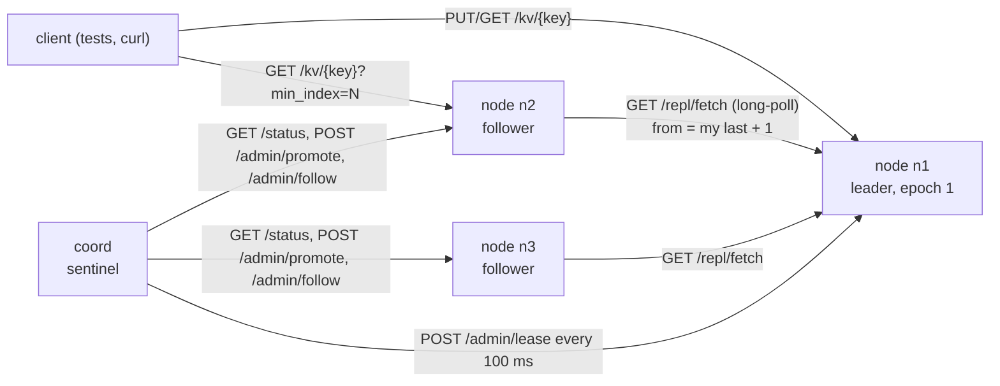

# E2 Spec — a replicated key-value store

This is the contract for the E2 build. The tests in [`labs/e2/`](../../labs/e2/) check every line marked **must**; the
units explain why each one exists. Read it once now and come back to it while you build. When the spec and a unit
disagree, the spec wins and the unit has a bug.

## 1. What you are building

A key-value store that keeps working, and keeps its promises, when processes die. It runs as separate operating-system
processes on one machine, talking HTTP over `127.0.0.1`:



- **node** (`rkv node …`): a KV server with a write-ahead log. Exactly one node per epoch is the **leader**; it orders
  every write. **Followers** pull the leader's log, store it in their own WAL and apply it.
- **coord** (`rkv coord …`): a sentinel. It grants the leader a lease, notices when renewals fail, waits for the lease
  to run out, promotes the most up-to-date follower at a higher epoch, and tells everyone else whom to follow.

One binary, `cmd/rkv`, runs both roles; the tests run the same code by re-executing the test binary (see
`labs/e2/rkv/harness_test.go`).

**Out of scope:** partitioning (C4 and A4 Unit 2), multi-key transactions, snapshots and log compaction, membership
changes, authentication (hence loopback only), more than one coordinator (Unit 3 §4 explains what that would take).

## 2. Requirements

Functional:

1. `PUT`, `GET` and `DELETE` single keys (1–256 bytes) with values up to 1 MiB.
2. Every acknowledged write has an `(epoch, index)`. Indexes are contiguous from 1; epochs never decrease along the log.
3. Followers converge to the leader's log, in the leader's order.
4. Two replication modes: `async` (ack after the leader's fsync) and `semi-sync` (ack after the leader's fsync **and**
   at least one follower has the entry on its disk).
5. The leader reports each follower's lag in records and in seconds.
6. When the leader dies, a follower becomes leader without a human, and nobody else accepts writes for the old epoch.
7. A client can read its own writes from a follower by passing the index it got back.

Non-functional (≈, measured on a laptop; the break-it runs print your numbers):

| Property | Target | Why this number |
|---|---|---|
| Durability of an ack | survives SIGKILL of the acking process (async) or of the leader (semi-sync) | an ack is a promise; Unit 1 §1, Unit 2 §2 |
| Write latency, async | ≈ 1 fsync: ≈ 4 ms measured on a recent Mac laptop, where Go's `Sync` issues `F_FULLFSYNC` (≈ 30 ms per write with 8 writers queued behind one lock); far less on a Linux server with a power-loss-protected NVMe drive (TODO-VERIFY: ≈ 0.05–2 ms, depends on the drive and filesystem) | fsync dominates; `TestBreakIt_WriteCostByMode` prints yours |
| Write latency, semi-sync | ≈ leader fsync + follower fetch round trip + follower fsync | Unit 2 §2 |
| Failover (leader SIGKILL → new leader accepts writes) | ≈ detection (3 × 100 ms ticks) + rest of the 1 s lease ≈ 1–2 s; test bound 15 s | Unit 3 §1 |
| RPO, async | the replication lag at the moment of the crash (> 0) | Unit 3 §1 |
| RPO, semi-sync with 1 follower | 0 acknowledged writes, while that follower survives | Unit 2 §2 |
| Read-your-writes wait on a follower | ≤ `-ryw-wait` (default 500 ms), then redirect | Unit 4 §1 |

## 3. Processes and flags

```text
rkv node  -id n1 -addr 127.0.0.1:0 -data DIR
          [-role leader|follower] [-leader URL] [-epoch 1]
          [-mode async|semi-sync] [-ack-timeout 2s] [-require-lease]
          [-ryw-wait 500ms] [-fetch-wait 500ms] [-sync always|never]
rkv coord -addr 127.0.0.1:0 -nodes n1=URL,n2=URL,...
          [-interval 100ms] [-fail-after 3] [-lease 1s] [-check-timeout 250ms]
```

Both roles **must**:

- refuse an `-addr` that is not loopback (`127.0.0.0/8`, `::1`, `localhost`) with exit code 2 and no `READY` line;
- print `READY <host:port>` on stdout once the listener is open (`-addr 127.0.0.1:0` picks a free port);
- on SIGTERM/SIGINT, stop accepting, let in-flight requests finish (≤ 5 s), close the WAL and exit 0;
- exit 1 on a runtime error, 2 on bad usage.

`-role`, `-leader` and `-epoch` only seed an empty data directory. Once `meta.json` exists, it wins: a restarted node
comes back in the role and epoch it last knew. (That is what makes the "returning old leader" scenario real.)

## 4. On-disk layout

```text
DIR/wal.log     the write-ahead log
DIR/meta.json   {"epoch":2,"role":"follower","leader":"http://127.0.0.1:54321"}
```

**WAL record** (package `wal`, all integers big-endian):

```text
+---------+----------+---------------------------------------------------------------+
| len u32 | crc  u32 | payload: epoch u64 | index u64 | time i64 | op u8 |              |
|         |          |          uvarint keyLen | key | uvarint valueLen | value        |
+---------+----------+---------------------------------------------------------------+
```

- `crc` is CRC-32C over the payload; `op` is 1 (put) or 2 (delete); `time` is the leader's wall clock at write time in
  Unix nanoseconds (it is how lag in seconds is computed).
- Recovery **must** keep the longest prefix of valid records whose indexes run 1, 2, 3, … and cut the file after it,
  durably. A short final record is *torn* (`ErrTorn`); a complete record with a bad length, checksum or payload is
  *corrupt* (`ErrCorrupt`); an out-of-sequence index is a *gap* (`ErrGap`). All three stop recovery at that point.
- `Append` **must** reject an entry whose index is not `LastIndex()+1` and write nothing.
- `meta.json` **must** be replaced atomically: temp file, fsync, rename, fsync the directory.

## 5. HTTP API — node

| Method & path | Who | Success | Errors |
|---|---|---|---|
| `PUT /kv/{key}` (body = value) | leader | `200 {"index":N,"epoch":E}` | `421` not leader (`X-Leader` + body `leader`), `503` no lease, `503` semi-sync not replicated (body `index` set: outcome unknown), `400` bad key, `413` value > 1 MiB |
| `DELETE /kv/{key}` | leader | `200 {"index":N,"epoch":E}` | as PUT |
| `GET /kv/{key}[?min_index=N]` | any | `200` raw value; headers `X-Index` (last applied index), `X-Epoch`, `X-Role` | `404`; `400` bad `min_index`; on a follower behind `N` after `-ryw-wait`: `307` with `Location: <leader URL>/kv/{key}?min_index=N`, or `503` if no leader is known |
| `GET /status` | any | `200` `NodeStatus` (below) | — |
| `GET /repl/fetch?id=&from=&last_epoch=&epoch=&wait_ms=` | leader | `200` `FetchResponse` | `421` not leader, `409` requester's epoch is newer (this leader is stale), `400` |
| `POST /admin/promote {"epoch","lease_expires_unix_ms"}` | coord → node | `200` `NodeStatus` | `409` epoch not newer than the node's |
| `POST /admin/follow {"leader","epoch"}` | coord → node | `200` `NodeStatus` | `409` epoch older than the node's, `400` no leader |
| `POST /admin/lease {"epoch","expires_unix_ms"}` | coord → leader | `200 {}` | `409` not leader or epoch ≠ node's |

`NodeStatus` fields (Go type in `rkv.go`): `id`, `url`, `role`, `mode`, `epoch`, `last_index`, `last_epoch`, `keys`,
`lease_valid`, `recovered_truncated_bytes`; on a leader `followers[]` of `{id, acked_index, lag_records, lag_seconds,
last_fetch_ago_ms}` sorted by id; on a follower `leader`, `leader_url`, `leader_last_index`, `last_contact_ago_ms`
(−1 before the first successful fetch).

## 6. Replication protocol

The follower loops: `GET <leader>/repl/fetch?id=n2&from=L+1&last_epoch=E_L&epoch=E&wait_ms=W`, where `L` is its last
index, `E_L` that entry's epoch, `E` its current epoch.

The leader:

1. answers `421` if it is not the leader, `409` if `epoch` > its own (it has been replaced);
2. **log matching:** with `prev = from − 1 > 0`, if `prev` > its last index or its entry `prev` has an epoch ≠
   `last_epoch`, answers `200 {"truncate_to": T}` with `T = min(last index whose epoch ≤ last_epoch, limit)`, where
   `limit` is its last index when `prev` is beyond it and `prev − 1` otherwise. The follower drops everything after `T`
   and fetches again. `T` falls every round, so this converges;
3. otherwise records `acked_index = prev` for that follower (the follower has everything up to `prev` on disk: it
   fsyncs before it asks for more), wakes semi-sync writers, and long-polls up to `min(wait_ms, 2 s)` for entries `≥
   from`, returning at most 512, with its epoch, its own URL and its last index.

The follower appends the batch to its WAL (one write, one fsync), applies it, adopts a newer epoch if the response
carries one, and remembers the leader's advertised URL for redirects.

## 7. Coordinator

Every `-interval`:

- **Renew:** `POST /admin/lease {epoch, now + lease}` to the leader. The expiry counts as granted from the moment it is
  sent. `-fail-after` consecutive failures → failover.
- **Failover:** wait until the latest expiry sent + 50 ms; read `/status` from the other nodes; promote the one with the
  highest `(last_epoch, last_index)` (ties: lowest id) at `max(epochs seen) + 1`, with a fresh lease; reconcile.
- **Reconcile:** any reachable node that is at an older epoch, or claims leadership without being the leader, is told to
  follow the leader at the current epoch. This demotes a returning old leader.

`GET /status` on the coordinator returns `CoordStatus`: `leader`, `leader_url`, `epoch`, `failovers`,
`last_failover_ms`, `events[]`.

With `-require-lease`, a leader **must** refuse writes (`503`) whenever `now ≥ lease expiry`. Lease expiries are
absolute wall-clock times; that is safe here because every process shares one clock (Unit 3 §2 discusses what changes
across machines).

## 8. Failure-injection scenarios and the predicted behaviour

Write your own predictions into the [design write-up](design-exercise.md) before running these. The column below is what
the reference design promises.

| # | Injection | Test | Predicted behaviour |
|---|---|---|---|
| F1 | SIGKILL the leader mid-traffic (8 writers) | `TestM1_EveryAcknowledgedWriteSurvivesSIGKILL` | every `200` reads back after restart; in-flight requests fail at the client |
| F2 | torn record appended to `wal.log`, restart | `TestM1_TornWALTailIsCutAndTheNodeKeepsGoing`, `TestM3_FollowerWithATornWALRecoversAndRefetches` | complete records kept, torn bytes cut and reported, next index continues |
| F3 | SIGTERM | `TestM1_SIGTERMShutsDownCleanlyAndRestartKeepsState` | exit 0 within the drain timeout; state and role intact |
| F4 | semi-sync leader with no follower | `TestM2_SemiSyncWithoutAFollowerAnswers503NotASilentAck` | `503` after `-ack-timeout`, entry stays in the log and replicates later |
| F5 | partition a follower (blackhole) | `TestM3_LeaderMeasuresLagForAPartitionedFollower` | leader-side lag grows in records and seconds; follower's own view stays "caught up"; heal → lag 0 |
| F6 | SIGKILL a follower, keep writing, restart it | `TestM3_KilledFollowerRestartsAndCatchesUp` | leader reports the gap; follower catches up from its WAL position |
| F7 | SIGKILL the leader (3-node cluster + coord) | `TestM4_CoordinatorFailsOverWhenTheLeaderIsKilled` | new leader at epoch 2 within ≈ 1–2 s; other follower repointed; replicated writes all present |
| F8 | async: partition follower, ack a write, SIGKILL leader | `TestM4_AsyncModeLosesAnAcknowledgedWriteAndFencesTheOldLeader` | the acknowledged write is **lost** (RPO > 0); the restarted old leader refuses writes, is demoted, truncates its divergent entry |
| F9 | same with semi-sync | `TestM4_SemiSyncLosesNoAcknowledgedWrite` | writes during the partition get `503`, none is acknowledged, none is lost |
| F10 | SIGSTOP the leader until failover, then SIGCONT | `TestM4_PausedZombieLeaderCannotAcceptWritesAfterFailover` | the zombie's lease has expired; it refuses every write, then is demoted |
| F11 | stale epochs at the admin API | `TestM4_FollowerRejectsAnOlderEpoch` | `409` for an older follow, a non-newer promote, a lease for another epoch |
| F12 | partition a follower, read with and without a token | `TestM5_*` | without: stale `200`; with: wait ≈ `-ryw-wait`, then `307` to the leader |

## 9. Milestones

| Milestone | Unit | Tests | Done when |
|---|---|---|---|
| M1 — durable single node | 1 | `go test -race ./labs/e2/wal/` and `go test -race -run TestM1 ./labs/e2/rkv/` | WAL recovery, ack-after-fsync, torn tail, loopback refusal, graceful stop |
| M2 — leader/follower replication | 2 | `-run TestM2` | pull replication, 421 + leader, concurrent ordering, semi-sync acks |
| M3 — lag measurement and follower faults | 2 | `-run TestM3` | leader-side lag, catch-up after SIGKILL and torn WAL |
| M4 — failure injection and failover | 3 | `-run TestM4` | failover, async loss vs semi-sync, fencing of returning and paused leaders |
| M5 — read-your-writes | 4 | `-run TestM5` | min_index wait, redirect, concurrent clients |
| Gate | — | `sd lab E2` | both packages green under `-race` |
