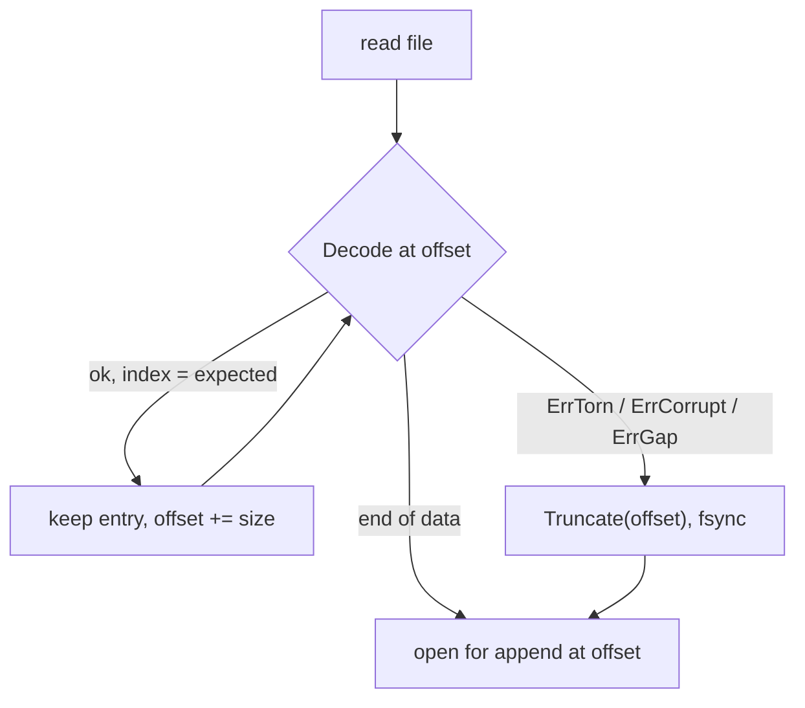
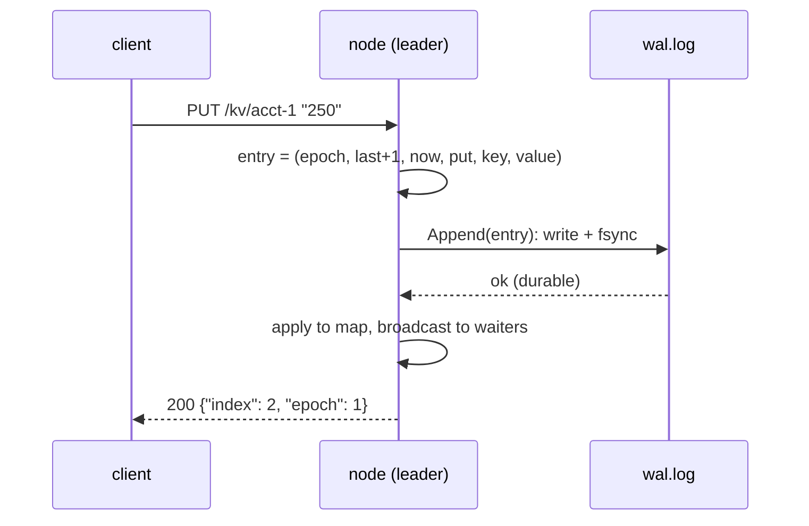
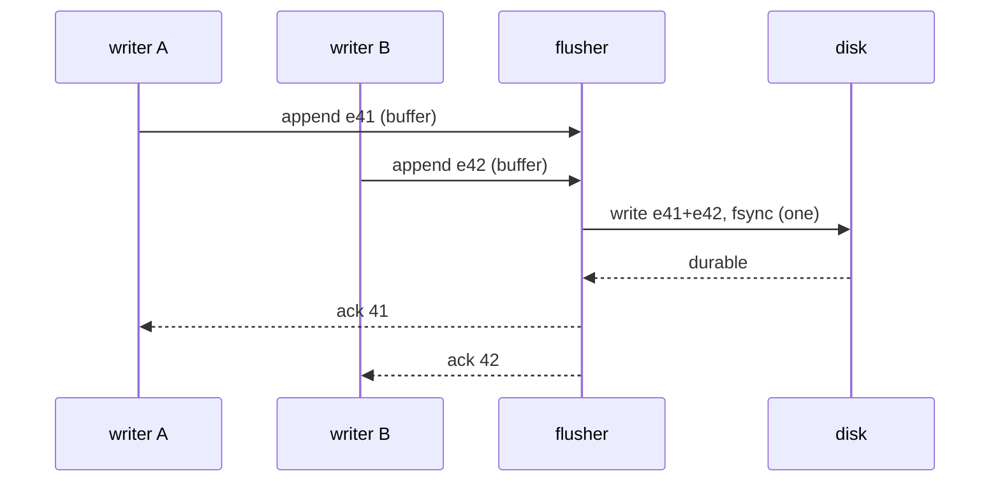

# E2 Unit 1 — A durable single node: the write-ahead log

> Time: ~5 h (4.5 CORE + 0.5 STRETCH) · CORE: §1–§2 · STRETCH: §3 (fsync cost and group commit) · Labs:
> `labs/e2/wal`, `labs/e2/rkv` (milestone M1)

Replication copies a log. Before there is anything worth copying, one node has to keep its own promises: when it says
"200, index 41", entry 41 must still be there after the process is killed, the machine loses power, or the disk hands
back half a record. This unit builds that node. §1 is the log file itself, §2 is the server around it and what an
acknowledgement may mean, §3 (stretch) is what durability costs and how real systems pay less for it.

You met the idea in [A2 Unit 2 §4](../A2-storage/unit-2-write-paths.md#4-durability-and-the-write-ahead-log); this time
the crashes are real `SIGKILL`s and the torn records are real bytes in a real file.

## Before you start

Read [spec.md](spec.md) §1–§5 and write sections 1–4 of the [design write-up](design-exercise.md) first: requirements,
the on-disk format, what an ack means, and your predictions for F1–F3. Then warm up, answering before you open the
answers:

1. A database `write()`s a record and returns success to the client without calling `fsync`. The *process* is killed
   with `SIGKILL` a millisecond later. Is the record lost? What if the *machine* loses power instead?
2. Why does a WAL need a checksum when the filesystem already has its own integrity checks and the disk has ECC?
3. A Go program holds a `sync.Mutex` while calling a function that takes 30 ms. Twenty goroutines call it concurrently.
   What is the throughput, and what is the latency of the last caller?

<details data-kind="answer">
<summary>Warm-up answers</summary>

1. Process kill: not lost. `write()` copied it into the kernel's page cache, which belongs to the OS, not the process;
   the kernel writes it back later. Power loss: probably lost, because the page cache is RAM. `fsync` is what moves
   "survives a process crash" to "survives a machine crash" (A2 Unit 2 §4).
2. Because the failure you are guarding against is not bit rot; it is a *partial write*. A crash in the middle of
   appending a record leaves a prefix of it (or, with some filesystems and drives, garbage) at the end of the file. The
   filesystem considers that a perfectly valid file. Only your own framing can tell "record 11 is complete" from
   "record 11 is half there".
3. Throughput ≈ 1 / 30 ms ≈ 33 calls/s no matter how many goroutines; the last caller waits ≈ 20 × 30 ms = 600 ms.
   Hold that thought for §3: a store that fsyncs under its write lock has exactly this shape.

</details>

---

## §1 The write-ahead log: framing, checksums and recovery

### The failure story

A small team builds a "durable" store for idempotency keys: an in-memory map plus a file where each write appends one
line, `key=value\n`. On start-up it reads the file line by line. It works for months.

Then the host is rebooted by the hypervisor during a deploy. On restart, the last line of the file is
`txn-88123=COMPL` with no newline. The parser reads it as key `txn-88123`, value `COMPL`, and the service starts
answering "this transfer already completed with status COMPL" for a transfer that never finished. A week later a second
crash leaves 4 KB of zeros at the end of the file (the filesystem had extended the file's size before the data block
reached the disk); the parser splits on `=` and crashes on start-up, every time, until someone edits the file by hand
at 3 a.m.

Both failures are normal crash states, not exotic ones. At 200 writes/s and one unclean shutdown a month, the
"half a record at the end" case is not a question of if.

### Predict

<!-- predict id="E2-U1-P01" -->
**Predict.** Write your answers down first.

1. Your WAL record is `[len u32][crc u32][payload]`. List every distinct state the *end* of the file can be in after a
   crash during an append. For each, what should recovery do?
2. Recovery finds a record in the *middle* of the file whose checksum is wrong, followed by 300 records that decode
   fine. Keep the 300, or cut the file at the bad one? Why?
3. Why must the length be checked against a maximum *before* allocating a buffer of that size?
<!-- /predict -->

### Reveal

<details data-kind="reveal" data-for="E2-U1-P01">
<summary>Reveal</summary>

1. The end of the file can be: (a) clean, the last record complete; (b) fewer than 8 bytes of a header; (c) a full
   header but fewer payload bytes than `len` promises; (d) a full-length record whose bytes are wrong (garbage or
   zeros the filesystem exposed, or a sector written out of order) so the checksum fails; (e) garbage in the length
   field itself, possibly promising gigabytes. (b) and (c) are *torn*; (d) and (e) are *corrupt*. Recovery does the
   same thing for all of them: keep every complete valid record before that point, truncate the file there (and fsync
   the truncation, or the next crash brings the garbage back), and continue appending from the cut. What it must
   **not** do is skip the bad bytes and keep looking for the next valid-looking record: in a binary format, "looks like
   a header" is easy to hit by accident.
2. Cut. A log's value is its *order*: entry 301 assumes entries 1–300 happened. Keeping records after a hole means
   applying writes whose predecessors are missing, which is a different history from the one any client saw. In a
   replicated store the missing suffix can be fetched again from the leader (Unit 2), so cutting costs nothing that
   matters. A standalone database without replicas faces a real dilemma here; Postgres, for example, stops WAL replay
   at the first invalid record and treats that as the end of the log (TODO-VERIFY: exact Postgres messages and
   behaviour per version). Tempting wrong answer: "keep the 300, they're valid". Valid in isolation is not valid in
   sequence.
3. Because a torn or zeroed tail can contain any 4 bytes, and `0xFFFFFFFF` is a 4 GiB allocation. A recovery path that
   OOMs on a corrupt length turns "lose one torn record" into "the node cannot start". The lab treats a length outside
   `[27, 4 MiB]` as corruption.

</details>

### How it actually works

**Framing.** Each record carries its own length and a checksum of its payload:

```text
+---------+----------+------------------------------------------------------+
| len u32 | crc  u32 | epoch u64 | index u64 | time i64 | op u8 | key | value |
+---------+----------+------------------------------------------------------+
```

The length makes the file self-delimiting; the CRC-32C makes "complete and correct" checkable without trusting
anything else. CRC-32C (Castagnoli) is the common choice because modern CPUs compute it in hardware; Go exposes it
as `crc32.MakeTable(crc32.Castagnoli)`, and it uses the hardware instruction where it exists (TODO-VERIFY: which Go
architectures accelerate Castagnoli).

**Recovery is a decode loop that stops at the first failure.**



The lab's `Decode` distinguishes torn (the data ends early) from corrupt (the data is complete but wrong) so recovery
can report *why* it cut, but both end the log. A third check is semantic: indexes must run 1, 2, 3, …; a record whose
index doesn't follow is a gap and also ends the log.

**Durability has two halves.** `f.Sync()` (fsync) makes the file's *contents* durable. A newly created file also needs
its *directory entry* durable, which means fsyncing the directory: otherwise the data can survive a power loss while
the name pointing at it doesn't (A2 Unit 2 §4). The lab does this once, when `Open` creates the file. `meta.json` (§2)
uses the same idea in its "write temp, fsync, rename, fsync directory" dance.

**Appends are contiguous by construction.** `Append` refuses an entry whose index isn't `LastIndex()+1` and writes
nothing. That one check catches a whole class of replication bugs in Unit 2 (a follower applying a batch twice, or
after a gap) at the place where they would otherwise become permanent.

### Build it

`labs/e2/wal/wal.go`. Provided: the types, constants, errors and `syncDir`. Implement, in order:

1. `Encode` and `Decode` — `TestM1_EncodeDecodeRoundTrip`, `TestM1_DecodeDistinguishesTornFromCorrupt`.
2. `Open` with recovery, `LastIndex`, `Size`, `Close` — `TestM1_AppendThenReopenRecoversEverything`,
   `TestM1_TornTailIsCutOffAndTheLogStaysUsable`, `TestM1_CorruptRecordCutsTheLogThere`.
3. `Append` (one write and one fsync per call) and `TruncateAfter` — `TestM1_AppendRejectsGapsAndDuplicates`,
   `TestM1_TruncateAfterDropsTheSuffixDurably`, `TestM1_ConcurrentAppendersNeverInterleaveRecords`.

```bash
go test -race ./labs/e2/wal/
```

Acceptance: all eight tests green under `-race`; `go vet` clean.

### Break it

1. In your `Open`, skip a corrupt record instead of stopping (continue decoding at `offset + HeaderSize`). Which test
   fails, and what would a real store have done with the records after the hole?
2. Remove the `f.Sync()` after `Truncate` in `Open`. No test fails. Describe the crash sequence that makes this a real
   bug.
3. Make `Append` write each entry with its own `Write` call instead of one buffer. Run
   `go test -race -count=50 -run Concurrent ./labs/e2/wal/`. Does anything fail? Why is it still worse?

<details data-kind="answer">
<summary>Break-it answers</summary>

1. `TestM1_CorruptRecordCutsTheLogThere` fails: it expects 3 entries and `ErrCorrupt`. Skipping forward almost never
   finds a valid header by chance in this test, so you'll more likely see recovery stop at a later, accidental "gap" or
   return entries 1–3 plus garbage-derived nonsense. A real store would apply entries 5–6 without entry 4: a history no
   client ever observed.
2. Recovery truncates the torn tail and the node acknowledges new writes appended after the cut. The truncation itself
   was only in the page cache. Power fails; on the next boot the file has the *old* length back, with the torn bytes in
   the middle followed by newly acknowledged records that recovery can no longer reach, because it stops at the torn
   record. Those acknowledged writes are gone. Tests can't see it because a process kill never loses the page cache.
3. Nothing fails, because `Append` holds the mutex. It is still worse: a crash between two of the writes leaves the
   first half of a batch durable and the second half not, and the batch was supposed to be atomic for the follower
   (Unit 2). It also turns one syscall into N.

</details>

### In the wild

- **Postgres** WAL records carry a CRC-32C and a back-pointer to the previous record; replay stops at the first record
  that fails validation and treats that point as the end of WAL (TODO-VERIFY: exact field layout per version).
- **etcd**'s WAL (the log under its Raft state) frames records with a length and a CRC (TODO-VERIFY: etcd uses
  CRC-32C/Castagnoli and chains the CRC across records) and repairs a torn last record on start-up.
- **Kafka** record batches carry a CRC-32C (message format v2); a broker that crashes truncates its active segment to
  the last valid batch during recovery.
- **SQLite**'s WAL mode frames each page with a checksum and a salt so that stale frames from an earlier WAL generation
  are not mistaken for valid ones.
- **The 2018 "fsyncgate"** discussion showed that on Linux a failed `fsync` may clear the error and drop the dirty
  pages, so retrying `fsync` can report success for data that is gone; Postgres changed to crash (PANIC) on an fsync
  failure rather than retry (TODO-VERIFY: version in which Postgres made `data_sync_retry` default to off).

### Trade-offs

| Option | Wins when | Loses when | When the answer flips |
|---|---|---|---|
| Length + CRC per record, stop at first bad record (this lab) | simple, recovery is a loop, cost ≈ one CRC per record | a single corrupt record in the middle loses everything after it on a standalone node | with replicas, the lost suffix is re-fetched, so this is the right default; without them, you'd add redundancy (checksummed pages, mirrored logs) |
| Text lines (`key=value\n`) | debuggable with `cat` | no way to tell torn from complete, values can't contain the delimiter | only for logs a human reads, never for state you recover from |
| Fixed-size slots with a checksum each | random access by index without an offset table | wastes space for variable-size values | small fixed-size entries (an index log, a sequence allocator) |
| Rely on the filesystem (journaling, copy-on-write) | no code | ext4's default journaling protects metadata, not your file's contents; a torn append is still torn | essentially never for a database; the filesystem doesn't know your record boundaries |

### Senior bar

- **Failure modes to name:** torn tail, corrupt length, zeroed tail after a size extension, missing directory entry for
  a new file, truncation that was never fsynced, an fsync error that you retried, a disk that lies about flushes
  (consumer drives with volatile write caches).
- **Capacity:** 1 M entries of ≈ 100 bytes ≈ 100 MB of WAL; recovery reads and checksums it at disk speed (≈ 1 GB/s on
  NVMe, so ≈ 0.1 s) but rebuilding the map is the real cost. Without snapshots, start-up time grows with history
  forever: the reason real systems checkpoint and truncate (out of scope here).
- **Operations:** expose `recovered_truncated_bytes` (the lab does, in `/status`) and alert when it is non-zero more
  than rarely; a node that cuts bytes on every restart has a bug or a bad disk.

**Interviewer probes**

<details data-kind="answer">
<summary>"Why not just fsync every 100 ms instead of on every write?"</summary>

You can, and many systems do (Redis `appendfsync everysec`, Kafka's default of relying on replication rather than
fsync). But then the ack has to mean something weaker: "on the leader's page cache" plus whatever replication
guarantees. Say what you're trading: up to 100 ms of acknowledged writes lost on a power failure, in exchange for ≈ one
fsync per 100 ms instead of per write. For a cache, fine. For a ledger, only if replication (semi-sync to another
machine, Unit 2 §2) gives you the durability the local disk no longer does.

</details>

<details data-kind="answer">
<summary>"How would you know your recovery code works?"</summary>

You test the crash states directly, not "a crash": truncate the file at every byte offset of the last record and check
recovery each time (the lab's `DecodeDistinguishesTornFromCorrupt` does this for `Decode`), flip bytes, append zeros,
append a huge length. Then you kill real processes mid-write (M1). For the power-loss cases you need fault injection
below the page cache (a FUSE or block-device layer that drops unsynced writes, like the tools used by Jepsen-style or
ALICE-style crash-consistency testing — TODO-VERIFY: current tool names).

</details>

<details data-kind="answer">
<summary>"Your log grows forever. What do you do?"</summary>

Snapshot the state machine at index N (atomically, like `meta.json`), then delete WAL segments entirely below N.
That needs the log split into segment files, so deletion is a file removal rather than rewriting the head of one file.
Followers that are further behind than the oldest retained segment can't catch up from the log any more and must be
sent the snapshot first: that's Raft's `InstallSnapshot` and Postgres's need for a base backup when a standby falls
behind the retained WAL.

</details>

### Check yourself

1. What is the difference between `ErrTorn` and `ErrCorrupt`, and why does recovery treat them the same?
2. Why does `Append` take a batch rather than one entry?
3. Which crash states can a `SIGKILL` test produce, and which can it never produce?

<details data-kind="answer">
<summary>Answers</summary>

1. Torn: the data ends before the record does (an append that never finished). Corrupt: the record is complete but its
   length, checksum or payload is wrong. Either way nothing after it can be trusted to be in order, so recovery cuts
   there; the distinction is for the operator (a torn tail is routine, corruption mid-file is a disk or bug alarm).
2. So a follower can store a fetched batch with one write and one fsync (atomic as a batch, and ≈ N× cheaper), and so
   a leader can group-commit concurrent writers (§3).
3. A process kill can leave a partial record that was `write()`n in pieces, but everything that was written is in the
   page cache, so it never loses fsynced-or-not distinctions. It cannot produce a power-loss state (unsynced data
   vanishing, metadata surviving without data). That's why the lab also appends torn bytes by hand.

</details>

## §2 The node: acknowledging only what is durable

### The failure story

A payments team runs a KV store as the source of truth for transfer states. To get latency down they move the fsync
to a background goroutine that runs every 10 ms, and ack writes as soon as they're in the map and written to the file.
p99 write latency drops from 9 ms to 0.4 ms.

Six weeks later a kernel panic takes the node down at 14:02:31. On restart, the last ≈ 10 ms of writes are gone: at
1,500 writes/s, ≈ 15 transfers that the mobile app had shown as "Submitted". Four of them were retried by members who
saw them missing; the rest show up as reconciliation breaks the next morning. Nobody had written down that "200" now
meant "in this process's memory and maybe on disk soon".

### Predict

<!-- predict id="E2-U1-P02" -->
**Predict.** Write your answers down first.

1. Eight goroutines PUT keys as fast as they can; after ≈ 80 acknowledgements the test `SIGKILL`s the node, restarts
   it, and reads every acknowledged key. With the lab's design (append + fsync under the node's lock, then apply,
   then 200), can any acknowledged key be missing? Can a key that was *not* acknowledged be present?
2. The node restarts with `-role follower -leader X` on its command line, but its data directory says it was the
   leader at epoch 3. Which should win, and what goes wrong in Unit 3 if you pick the other?
<!-- /predict -->

### Reveal

<details data-kind="reveal" data-for="E2-U1-P02">
<summary>Reveal</summary>

1. No acknowledged key can be missing: the 200 is written only after `Append` returned from fsync, and the kill can't
   undo a completed fsync (or even a completed `write()`, for a process kill). Yes, an unacknowledged key can be
   present: the entry was appended and fsynced, then the process died before the response left. That is the
   *ambiguous outcome* from [A1 Unit 3 §1](../A1-networking-api/unit-3-idempotency-auth.md#1-retries-timeouts-and-duplicates),
   on your own server: the client saw a reset, the write happened. The test only checks the direction that must hold
   (acked ⇒ present); the other direction is why clients need idempotency keys.
2. The data directory wins. Flags describe how to *create* a node; `meta.json` records what it has since *become*. If
   flags won, an old leader restarted by a supervisor with its original command line would come back as leader at
   epoch 1 forever, or a promoted follower restarted with `-role follower` would quietly forget it had been made leader
   at epoch 2 and start following a dead node. Unit 3's fencing depends on every node remembering the highest epoch it
   has seen, across restarts.

</details>

### How it actually works

The write path on the leader, in order, all under the node's mutex:



Rules that make the ack honest:

- **The index is assigned under the same lock that appends.** Two concurrent writers can't get the same index or append
  out of order (`TestM2_ConcurrentWritersGetDistinctIndexesAndOneOrder` checks this through HTTP).
- **Apply after the log, never before.** If the map were updated first and the append failed, a reader could see a
  value that will not survive a restart.
- **Restart = replay.** `runNode` opens the WAL (recovery cuts any torn tail), reads `meta.json`, replays every entry
  into the map, and takes `epoch = max(meta epoch, last entry's epoch)`.
- **`meta.json` is replaced, never edited:** write `meta.json.tmp`, fsync it, rename over `meta.json`, fsync the
  directory. `rename` is atomic on POSIX filesystems, so a crash leaves the old file or the new one.
- **Graceful shutdown is a feature with a test.** `serve` calls `Shutdown` when the context is cancelled (SIGTERM):
  stop accepting, wait for in-flight handlers (≤ 5 s), then `runNode` stops the fetch loop and closes the WAL. Long
  waits (semi-sync, long-poll fetches) watch a `closing` channel so they end promptly instead of holding shutdown
  hostage.
- **Loopback only.** There is no authentication, so `Run` refuses any `-addr` that isn't loopback, before it listens.
  The cheapest security control is the one that makes the attack surface not exist (A9 Unit 1 §1).

### Build it

`labs/e2/rkv/node.go`: `runNode`, `readMeta`/`writeMeta`, `handleWrite` (async path), `handleGet` (without
`min_index`), `handleStatus` (leader fields). Provided in `rkv.go`: `Run`, flag parsing, the loopback check, `serve`,
all wire types. The stub's `runNode` returns `errNotImplemented`, so every M1 test fails fast with the child's stderr.

Acceptance (`TestM1_*`): loopback refusal (already passes: it is provided), PUT/GET/DELETE with indexes 1, 2, 3, the
SIGKILL durability test with 8 concurrent writers, the torn-tail restart, and SIGTERM → exit 0 with state intact.

```bash
go test -race -run TestM1 ./labs/e2/rkv/
```

### Break it

1. Move the `n.applyLocked(e)` call *before* `n.log.Append(e)` and make `Append` fail (temporarily return an error for
   index 3). What does a reader see, and what does it see after a restart?
2. Run the node with `-sync never` and repeat `TestM1_EveryAcknowledgedWriteSurvivesSIGKILL`. It passes. Explain why,
   and say what test would fail.
3. Make `writeMeta` write `meta.json` in place (`os.WriteFile`) instead of temp-and-rename. Which crash makes the node
   unable to start?

<details data-kind="answer">
<summary>Break-it answers</summary>

1. The value is visible on the leader but not in its log, so a follower (which copies the log) never gets it: leader
   and follower now disagree. The client gets a 500, and after a restart the
   value is gone because replay only knows the log. A value that is readable and then un-happens is a dirty read.
2. A `SIGKILL` doesn't lose the page cache, so un-fsynced data survives a process kill. Only a power loss or kernel
   crash would show the difference, which a unit test can't produce. This is exactly why "we kill -9 it in CI and
   nothing is lost" is not evidence of durability.
3. A crash mid-`WriteFile` leaves a truncated or empty `meta.json`; `readMeta` fails to parse it and `runNode` exits
   1 on every start. Temp-and-rename means the file is always either the old complete one or the new complete one.

</details>

### In the wild

- **Postgres** `synchronous_commit = on` (the default) makes `COMMIT` wait for the WAL flush; `off` acknowledges before
  the flush and can lose the last few hundred milliseconds of commits on a crash, without corrupting the database
  (TODO-VERIFY: the exact bound, ≈ 3 × `wal_writer_delay`).
- **Redis** AOF has `appendfsync always | everysec | no`: the same dial as `-sync`, with `everysec` as the default.
- **MySQL/InnoDB** `innodb_flush_log_at_trx_commit = 1` (fsync at every commit, the default) vs 2 (write at commit,
  fsync once a second) vs 0.
- Atomic file replacement by temp-file-plus-rename is how editors, package managers and most config stores update
  files; the directory fsync is the part most implementations forget.

### Trade-offs

| Option | Wins when | Loses when | When the answer flips |
|---|---|---|---|
| Ack after local fsync (this milestone) | single node must not lose acked writes | latency floor = fsync; throughput capped without group commit | the moment there's a replica on another machine, its fsync (semi-sync) can carry durability instead |
| Ack after `write()`, fsync periodically | latency and throughput matter more than the last second | power loss loses acked writes | caches, metrics, anything recomputable; never a ledger without a synchronous replica |
| Ack after a replica has it, no local fsync | Kafka-style: survive machine loss via replication | correlated failure (both machines lose power) loses data | when replicas are in independent failure domains (different racks, AZs) |
| Flags as truth on restart | stateless services | stateful nodes forget what they became (epoch, role) | never for a replicated store's identity |

### Senior bar

- **Failure modes:** apply-before-log, ack-before-fsync without saying so, an in-place config rewrite, a restart that
  resets the epoch, a graceful shutdown that hangs on a long-poll.
- **Capacity:** with one fsync per write under one lock, throughput ≈ 1 / fsync latency: ≈ 250 writes/s at ≈ 4 ms
  (measured on a recent Mac laptop), ≈ 1,000–10,000 writes/s at 0.1–1 ms (server NVMe; TODO-VERIFY per device). `docs/NUMBERS.md` puts a
  relational primary at ≈ 1k–10k small TPS "bounded by fsync/WAL", which is the same ceiling with group commit.
- **Operations:** a deploy is a SIGTERM; if shutdown doesn't finish inside the orchestrator's grace period (Kubernetes
  defaults to 30 s), it becomes a SIGKILL every time, and your "graceful" path is never exercised in production.

**Interviewer probes**

<details data-kind="answer">
<summary>"A client got a connection reset on PUT. Did the write happen?"</summary>

Maybe. The entry may have been fsynced before the process died, or not. The client cannot tell from the error.
The fix is end to end: the client sends an idempotency key, the server stores the key with the result in the same
log entry, and the client retries with the same key or queries by key. Without that, retrying risks a double write
and not retrying risks a lost one (A1 Unit 3 §2, A5 Unit 2 §4).

</details>

<details data-kind="answer">
<summary>"Why is the index assigned by the leader rather than by the client or a timestamp?"</summary>

Because the index is the order, and only one party can decide the order without coordination: the leader, under one
lock. Client-assigned order needs a consensus on whose wins; timestamps need synchronized clocks and still collide
(A5 Unit 2 §1). A dense, contiguous index also makes replication trivial: "send me everything after 41".

</details>

### Check yourself

1. What exactly does a `200` from the M1 node promise?
2. Why does the node take `epoch = max(meta, last entry)` on start-up instead of just `meta`?

<details data-kind="answer">
<summary>Answers</summary>

1. That the entry is in this node's WAL and fsynced (with `-sync always`), so it survives a process crash and a machine
   crash of this node. Nothing about any other node, yet.
2. Belt and braces: an entry can only carry an epoch the node knew when it wrote or fetched it, so the WAL is a lower
   bound on the epoch the node has seen. If `meta.json` lagged (a bug, or an older file restored), taking the max
   guarantees the epoch never goes backwards, which fencing depends on.

</details>

## §3 STRETCH — What fsync costs, and group commit

### The failure story

The M1 node does ≈ 240 writes/s on a laptop no matter how many clients you add, and latency grows linearly with the
number of writers. Someone proposes "just shard it". The real problem is that every writer waits for its own fsync,
one at a time, under one lock: 8 writers × ≈ 4 ms ≈ 32 ms p50 (and 100 writers ≈ 400 ms) for a store whose disk
could absorb all of those writes in one flush.

### Predict

<!-- predict id="E2-U1-P03" -->
**Predict.** fsync costs 30 ms. 8 writers write continuously. Estimate writes/s and p50 latency for (a) the M1 design
(fsync per write, under the lock) and (b) group commit: writers append to a buffer, and one flusher fsyncs whatever has
accumulated, then wakes everyone it covered. Then run
`go test -tags breakit -run BreakIt_WriteCostByMode -v ./labs/e2/rkv/` and compare with (a).
<!-- /predict -->

### Reveal

<details data-kind="reveal" data-for="E2-U1-P03">
<summary>Reveal</summary>

(a) ≈ 1 / 30 ms ≈ 33 writes/s *per lock*, so ≈ 33 in total, and each write waits for the other seven writers' fsyncs
plus its own: latency ≈ 8 × 30 ms ≈ 240 ms. The reference prints ≈ 245 writes/s with p50 ≈ 32 ms on a recent Mac,
which is the same arithmetic with an fsync of ≈ 4 ms (1 / 4 ms ≈ 250/s, 8 × 4 ms ≈ 32 ms): measure, don't assume. (b) Each flush covers
everyone who arrived during the previous flush: with 8 writers ≈ 8 entries per fsync, so ≈ 8 × 33 ≈ 260 writes/s at
30 ms, and latency ≈ one to two fsyncs (30–60 ms) regardless of writer count. Throughput scales with concurrency until
the batch hits a size limit or the disk's bandwidth. Tempting wrong answer: "group commit trades latency for
throughput". It barely costs latency: you were already waiting for someone else's fsync.

</details>

### How it actually works



The lab's `Append(entries ...Entry)` already writes a batch with one fsync; a group-committing node would collect
entries from concurrent `handleWrite`s while a flush is in progress and hand them to the next `Append`. The follower
side already batches: one fetch response (up to 512 entries) is one `Append`.

### Build it

No required lab. Optional: in your own `node.go`, release the mutex during the fsync by splitting `Append` into
"write to the file" and "sync up to offset X", and let a single flusher goroutine own the sync. Re-run the break-it and
check that M1–M5 still pass, especially the semi-sync tests.

### Break it

Run `BreakIt_WriteCostByMode` twice, once on battery saver if you're on a laptop. Which row moves most, and why?

<details data-kind="answer">
<summary>Answer</summary>

The fsync rows: they're bound by the storage stack's flush latency, which power management and background I/O affect;
the `-sync never` row is bound by CPU and the HTTP stack and barely moves. That's the whole argument for measuring
durability cost on the hardware you'll run on.

</details>

### In the wild

Postgres has group commit (`commit_delay`, `commit_siblings` tune how long to wait for company); InnoDB groups redo log
flushes; Kafka avoids per-message fsync entirely and relies on replication plus periodic flushes; etcd batches Raft
entries before fsyncing (TODO-VERIFY: etcd's batching parameters).

### Trade-offs

| Option | Wins when | Loses when | When the answer flips |
|---|---|---|---|
| fsync per write under a lock | simplest correct code | throughput = 1 / fsync | low write rates (< ≈ 50/s) where nobody notices |
| Group commit | many concurrent writers | more code: flusher, wake-ups, error fan-out | a single writer gets no benefit |
| No fsync, rely on replicas | Kafka-scale ingest | correlated power loss | replicas in independent failure domains |

### Senior bar

When an fsync **fails** inside group commit, every writer in the batch must get an error and the node must stop
acknowledging until it knows what's on disk (after fsyncgate, the safe answer is usually: crash and recover from the
log). Probe: "What do you return to the 40 writers in a failed batch?" — an error, and the outcome is unknown for each;
then the node exits and recovery decides.

### Check yourself

Why does group commit not help a single client that writes sequentially?

<details data-kind="answer">
<summary>Answer</summary>

Because it waits for each ack before sending the next write, so there is never more than one entry to batch. Group
commit converts concurrency into fewer fsyncs; a sequential client has no concurrency. Pipelining (sending the next
write before the previous ack) or batching on the client side is the fix there.

</details>

## Unit wrap-up

| Decision | Use this when | Flip when |
|---|---|---|
| Length + CRC-32C per record, cut at the first bad record | any recovered log | — (add segments and snapshots when history grows) |
| Fsync the truncation and new files' directories | always | — |
| Ack after local fsync | single node holds the truth | a synchronous replica carries durability (Unit 2 §2) |
| `meta.json` wins over flags | node identity: role, epoch | stateless processes |
| Temp file + fsync + rename + fsync dir | replacing any small state file | append-only data (use the log) |
| Group commit | many concurrent writers on slow fsync | single sequential writer |

Next: [Unit 2](unit-2-replication-lag.md) copies this log to followers. Before you start it, `go test -race -run TestM1
./labs/e2/rkv/` and `go test -race ./labs/e2/wal/` must be green.
