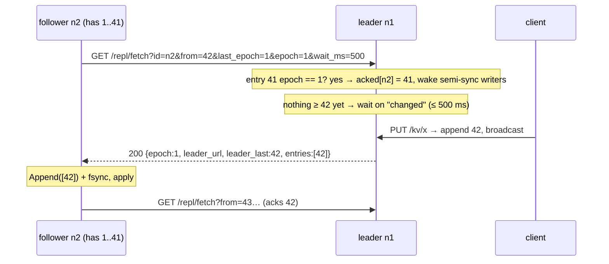
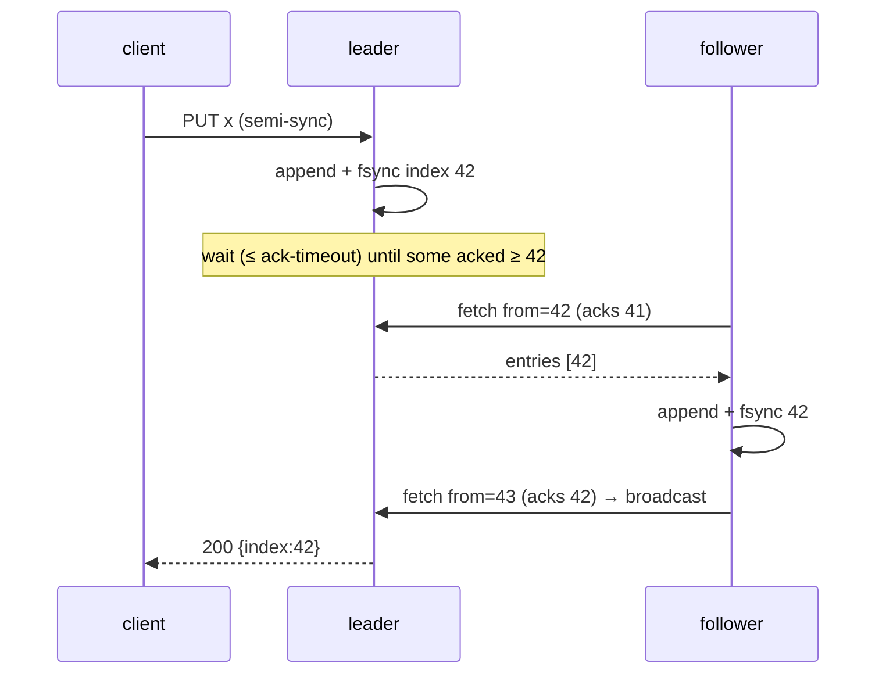
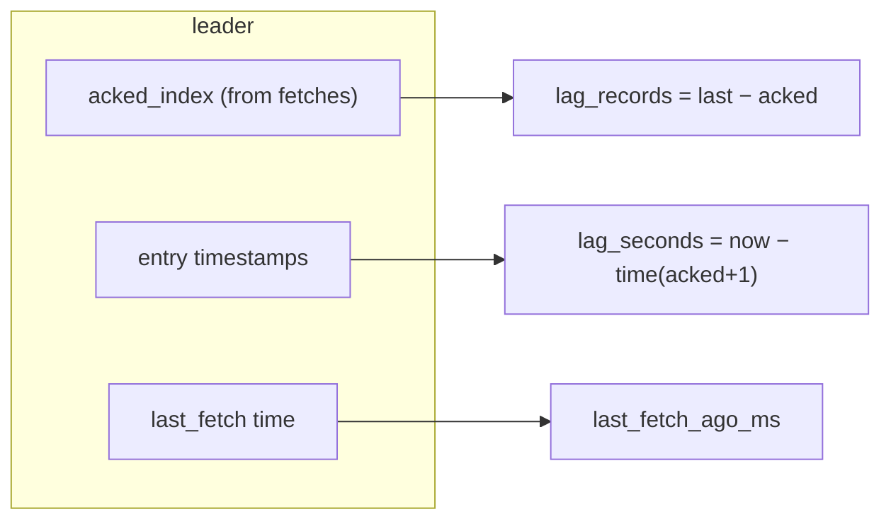

# E2 Unit 2 — Leader/follower replication and lag

> Time: ~6 h (5.5 CORE + 0.5 STRETCH) · CORE: §1–§3 · STRETCH: the pipelining part of §3 · Lab: `labs/e2/rkv`
> (milestones M2, M3)

A follower is a second copy of the leader's log, kept by a different process with its own disk. This unit builds the
copying (§1), decides what "acknowledged" means once there are two disks (§2), and measures how far behind the copy
is, from the side that can actually tell (§3). It is [A4 Unit 1 §1–§3](../A4-replication-partitioning/unit-1-replication.md#1-leaderfollower-replication-and-log-shipping)
with real processes: the lag simulator there was a number of ticks; here it is a TCP connection that goes silent.

## Before you start

M1 must be green. Warm up:

1. A4's `replkv` followers applied entries "strictly in order, buffering gaps". Why does a *pull* design never need
   that buffer?
2. Semi-sync with one follower: the follower acks, the leader acks the client, then the *follower* dies. Is the write
   safe? What about if the leader dies instead?
3. Little's law: a follower fetches with one request in flight, each round trip takes 20 ms, and each response can
   carry at most 512 entries. What is the maximum replication rate?

<details data-kind="answer">
<summary>Warm-up answers</summary>

1. Because the follower asks for exactly `from = last + 1` and appends what comes back; it can never receive entry 50
   before entry 49. Push designs (the leader sends each entry as it's written) need ordering and gap handling because
   messages can overtake each other or be lost; pull moves that problem to "ask again from where you are".
2. Follower dies: the write is still on the leader's disk, so it's safe as long as the leader survives; you now have
   one copy and should stop acking semi-sync writes (or fall back, Unit 2 §2). Leader dies: the follower has it, so
   failover to that follower keeps it. Semi-sync with one follower tolerates the loss of *either* node, not both.
3. 512 entries per 20 ms ≈ 25,600 entries/s. Below that rate the follower keeps up; above it, lag grows without bound
   (A0 Unit 2 §5). The break-it in §3 shows this.

</details>

---

## §1 Pull replication: the fetch is the acknowledgement

### The failure story

A team builds replication by having the leader `POST` every write to each follower right after appending it. It works
in the demo. In production a follower is restarted for a kernel patch: for 90 s the leader's POSTs fail, and the leader
has to decide what to do with them. It queues them in memory (≈ 18,000 writes at 200/s) and when the follower comes
back it replays the queue, except that two POSTs that had timed out *had* actually been applied, and now apply twice,
and one POST from before the restart arrives after newer ones. A second follower that's slow for a minute makes the
leader's queue grow until it runs out of memory, taking the *leader* down because of a *follower*.

Every one of these is a push-design problem: the sender owns delivery, ordering, retries and buffering for every
receiver.

### Predict

<!-- predict id="E2-U2-P01" -->
**Predict.** Write your answers down first.

1. In the lab, a follower sends `GET /repl/fetch?from=42&…`. What does the leader learn from that request alone, before
   it sends anything back? Why can it treat that as an acknowledgement?
2. The follower is killed for 90 s, then restarted. Who has to remember anything about that gap, and how does catch-up
   happen?
3. When should the leader *wait* before answering a fetch, and how long?
<!-- /predict -->

### Reveal

<details data-kind="reveal" data-for="E2-U2-P01">
<summary>Reveal</summary>

1. That the follower holds entries 1–41 durably: it only asks for 42 after appending and fsyncing everything up to 41.
   So `from − 1` is a free, always-current acknowledgement, piggybacked on the next request. This is how Kafka followers
   tell the leader their position: the fetch offset *is* the ack, and the leader advances the high watermark from it.
   Caveat that §3 of Unit 3 depends on: it is an ack only if the follower's log *matches* the leader's up to 41, which
   is what `last_epoch` lets the leader check.
2. Nobody but the follower. The leader keeps no per-follower queue; the WAL *is* the queue. The restarted follower
   reads its own WAL (Unit 1), sees it has 41, and asks for 42; the leader serves from its log. The only per-follower
   state on the leader is `acked_index` and `last_fetch`, for lag reporting and semi-sync, and both are rebuilt by the
   next fetch.
3. When the follower is caught up (`from` > last index): hold the request open (long-poll) until a new entry arrives or
   a bound passes (the lab caps it at 2 s and the follower asks for `-fetch-wait`, 300–500 ms). That gives push-like
   latency (the response goes out as soon as a write lands) with pull's simplicity, without a busy loop of empty
   fetches. Tempting wrong answer: "answer immediately with nothing" — that's a hot spin, ≈ thousands of requests a
   second per idle follower.

</details>

### How it actually works



The pieces:

- **One fetch loop per follower**, a goroutine that runs for the node's life and idles while it leads. Each iteration
  builds `from`, `last_epoch` and `epoch` from its own state under the lock, does the HTTP call without the lock, and
  applies the result under the lock **only if nothing changed meanwhile** (still a follower, same leader, same last
  index). A promotion or repoint during a fetch cancels it (`fetchCancel`).
- **Errors back off with jitter** (≈ 50 ms doubling to 1 s, [A7 Unit 1 §2](../A7-reliability/unit-1-timeouts-retries.md#2-retries-backoff-jitter-and-when-retrying-is-safe)):
  a dead leader must not be hammered by its followers' reconnects.
- **The leader's wait is a broadcast channel,** closed and replaced on every append and every ack. Waiters re-check
  their own condition. This one mechanism serves three waiters: long-poll fetches (new entries), semi-sync writers
  (an ack ≥ my index) and read-your-writes reads (Unit 4). Every wait also watches a deadline, the request context and
  shutdown.
- **Batching:** a response carries up to 512 entries and the follower stores them with one `Append` (one fsync).
- **Writes on a follower get `421 Misdirected Request`** with the leader's advertised URL in `X-Leader` and the body.
  The follower learns that URL from fetch responses (`leader_url`), which matters when it reaches the leader through
  a different path than clients do (in the tests, through a fault-injecting proxy).

### Build it

`labs/e2/rkv/node.go`: `handleFetch` (the match path and the long-poll; the truncation path can wait for Unit 3) and
`replicate`, plus the 421 in `handleWrite` and the follower fields of `/status`.

Acceptance: `TestM2_FollowersReplicateTheLeadersLogInOrder` (two followers, 30 writes and a delete, identical reads,
leader lists both followers), `TestM2_FollowerRefusesWritesAndNamesTheLeader`,
`TestM2_ConcurrentWritersGetDistinctIndexesAndOneOrder` (8 writers × 20 PUTs, indexes 1–160 with no gaps or
duplicates, same final values on the follower).

```bash
go test -race -run 'TestM2_(Followers|FollowerRefuses|Concurrent)' ./labs/e2/rkv/
```

### Break it

1. Make the follower apply a fetch response without checking that its last index is still what it was when it sent the
   request. Which interleaving makes it append a batch twice, and what stops the damage?
2. Remove the long-poll (answer at once when there's nothing new) and watch CPU with `top` while a follower idles
   against a leader for a minute.
3. Take out the jitter from the follower's back-off and kill the leader of a three-node cluster. What do the two
   followers' reconnects look like?

<details data-kind="answer">
<summary>Break-it answers</summary>

1. A promotion/repoint or a slow response crossing a newer one: the follower sends fetch A (from 42), times out,
   sends fetch B (from 42), and both responses arrive; applying both would append 42 twice. `wal.Append` refuses the
   second batch with `ErrGap` (index 42 is not `LastIndex()+1` any more), which is why contiguity is checked at the
   lowest layer. The state check is still needed: the map would be updated from a batch the log refused.
2. Thousands of empty request/response pairs per second per follower and a core pinned on each side, for zero
   replication. Long-polling costs one idle goroutine and one open connection.
3. They retry in lockstep (both started failing at the same instant and double the same delays), so a leader that comes
   back sees synchronized bursts. With two followers it's harmless; with a hundred consumers of a log it's a thundering
   herd (A7 Unit 1 §2).

</details>

### In the wild

- **Kafka** followers are fetchers: they send `Fetch` requests with their log-end offset, and the leader uses those
  offsets to track the in-sync replica set and advance the high watermark. Long-polling is `fetch.max.wait.ms` /
  `replica.fetch.wait.max.ms`.
- **Postgres** streaming replication is initiated by the standby (the WAL receiver connects to the primary's WAL
  sender), which then streams WAL continuously; the standby reports its write, flush and replay positions back, and
  the primary shows them in `pg_stat_replication`.
- **MySQL** replicas pull the binary log with an I/O thread and apply it with SQL (applier) threads; the position
  (file + offset, or GTID set) is the replica's own state.
- **Redis** replicas connect to the primary and receive a continuous stream; they acknowledge their offset with
  `REPLCONF ACK` about once a second (TODO-VERIFY: interval).

### Trade-offs

| Option | Wins when | Loses when | When the answer flips |
|---|---|---|---|
| Pull with long-poll (this lab) | catch-up after any outage is the normal path; the leader keeps no per-follower queue | one round trip per batch caps throughput per follower (§3) | very high rates or long RTTs: pipeline several fetches or stream (Postgres) |
| Leader push per write | lowest latency for a fixed, healthy set of followers | the leader owns retries, ordering, buffering for every follower; a slow follower hurts the leader | almost never for a log; fine for best-effort notifications |
| Continuous stream over one connection, follower-initiated | Postgres, Redis: lowest overhead | needs flow control and a resume protocol anyway | when you already need ordering per connection |
| Leaderless (Dynamo-style) | no failover at all | conflicts, read repair, quorum arithmetic (A5 Unit 1 §3) | partition tolerance for writes matters more than a single order |

### Senior bar

- **Failure modes:** double-applied batches, a follower that applies before fsyncing (then acks entries it doesn't
  have durably), busy-loop fetching, synchronized reconnects, a leader that keeps per-follower buffers and dies of a
  slow follower.
- **Capacity:** a follower with one fetch in flight and RTT `r` replicates at most `batch / (r + fsync)` entries/s:
  512 / (0.5 ms + 1 ms) ≈ 340k/s in a datacenter, 512 / (70 ms) ≈ 7k/s across a continent (round trips from
  `docs/NUMBERS.md`).
- **Operations:** the follower's position is in its WAL; restoring a follower from a backup is "copy a WAL, start it,
  it fetches from where the copy ends". A follower whose position is older than anything the leader still has (once
  you truncate logs) needs a snapshot: plan for it.

**Interviewer probes**

<details data-kind="answer">
<summary>"Why does the follower fsync before asking for more? Isn't that slow?"</summary>

Because its next request *is* the acknowledgement. If it asked for 43 with 42 only in its page cache, the leader could
count 42 as replicated (semi-sync would ack the client), the follower's machine could lose power, and the write would
exist on one disk while the client was told two. The fsync cost is amortized by batching: one fsync per response,
not per entry. Kafka makes the opposite call by default (it doesn't fsync per fetch and relies on replicas being in
different failure domains), which is a legitimate choice when you say it out loud.

</details>

<details data-kind="answer">
<summary>"How does a brand-new follower join?"</summary>

It starts with an empty WAL and fetches from 1. That's fine for a lab and terrible at 2 TB: you'd seed it from a
snapshot or backup taken at index N, then fetch from N+1. The leader must retain its log back to N for as long as the
copy takes, which is a retention policy question (Postgres replication slots and `wal_keep_size` exist for this).

</details>

### Check yourself

1. Why can the leader count `from − 1` as acknowledged?
2. What three conditions does the follower check before applying a fetch response, and why each?

<details data-kind="answer">
<summary>Answers</summary>

1. The follower only asks for `from` after it has appended and fsynced everything before it, and the leader has just
   verified (via `last_epoch`) that the follower's entry `from − 1` matches its own.
2. Still a follower (a promotion during the fetch makes the response irrelevant), still following the same leader (a
   repoint makes it a stale leader's data), same last index as when it asked (another response already advanced it).
   Any of them failing means "drop this response and fetch again".

</details>

## §2 Async vs semi-sync: what an acknowledgement means

### The failure story

A credit union's core-banking replica sits in a second datacenter, replicating asynchronously; "RPO near zero" says
the DR document. On the day the primary site loses power, the replica is promoted in 4 minutes, a good result. The
morning reconciliation finds 312 card authorizations and 41 internal transfers that the primary had acknowledged in its
last ≈ 1.5 s and the replica never received. Each one was a "success" shown to a member. Nobody had lied; nobody had
written down that *async* means the RPO is exactly the replication lag at the instant of the crash, and that lag was
≈ 1.5 s at peak.

### Predict

<!-- predict id="E2-U2-P02" -->
**Predict.** Write your answers down first.

1. Semi-sync, one follower, `-ack-timeout 2s`. The follower is partitioned from the leader (blackholed, not refused).
   A client PUTs. What does the client see, after how long, and is the entry in the leader's WAL?
2. The follower comes back 10 s later. Does that entry reach it? Is that a bug?
3. Why does the lab answer `503` on the timeout instead of acknowledging the write as async (as MySQL's semi-sync does
   after its timeout)?
<!-- /predict -->

### Reveal

<details data-kind="reveal" data-for="E2-U2-P02">
<summary>Reveal</summary>

1. A `503` after ≈ 2 s with `{"error": "not replicated within ack timeout; outcome unknown", "index": N}`. The entry
   *is* in the leader's WAL: the leader appended and fsynced it before it started waiting. The 503 does not mean "not
   written"; it means "not known to be on two disks".
2. Yes, it replicates as soon as the follower fetches again (`TestM2_SemiSyncWithoutAFollowerAnswers503NotASilentAck`
   checks exactly this). Not a bug: it's the honest meaning of "outcome unknown". The write may survive (it's on the
   leader, and will replicate) or may not (if the leader dies before the follower returns). A client that needs to know
   retries with an idempotency key or reads back by key. Undoing the entry would require a second coordinated write,
   which can fail too.
3. Because a silent downgrade turns the guarantee into "usually". MySQL's semi-sync falls back to asynchronous
   replication when no replica acknowledges within `rpl_semi_sync_master_timeout` (≈ 10 s by default; renamed
   `rpl_semi_sync_source_timeout` in newer versions — TODO-VERIFY defaults per version) and returns to semi-sync when a
   replica catches up, so the RPO during exactly the incidents you care about is not zero. That is a reasonable
   availability choice if you monitor and alert on it; it's a terrible one if the DR document says RPO = 0. The lab
   chooses consistency: refuse to *promise* rather than promise falsely.

</details>

### How it actually works



What each mode promises at the moment of `200`:

| Mode | Entry is durable on | Survives | Write latency (≈) |
|---|---|---|---|
| async | the leader's disk | leader process crash; leader *machine* crash only if the leader restarts with its disk | 1 fsync |
| semi-sync (≥ 1 follower) | the leader's disk **and** one follower's disk | loss of either node | leader fsync + RTT + follower fsync + up to one long-poll wake-up |
| sync to all followers | every disk | anything short of losing all | the slowest follower, always |

The semi-sync wait is the broadcast pattern from §1: after appending, the writer loops `while no follower has acked ≥
my index: if I'm no longer leader of this epoch → 503; wait (deadline = ack-timeout)`. Every fetch that moves an ack
broadcasts. If leadership changes while waiting (Unit 3), the writer also answers 503: the new leader may or may not
have the entry.

Notice what semi-sync with one follower does **not** do: it doesn't make the *follower's* view of the data current
for readers (it acked before the leader answered, but a read on the follower may still race), and it doesn't
guarantee that failover picks *that* follower. With several followers, only a follower that acked is safe to promote;
the coordinator's rule "highest (last_epoch, last_index)" picks one that has every acked entry, as long as that
follower is reachable at failover time (Unit 3 §1).

### Build it

`handleWrite`'s semi-sync branch: wait for `replicatedLocked(index)` with the deadline, the request context and the
leadership check.

Acceptance: `TestM2_SemiSyncAcksOnlyAfterAFollowerHasTheWrite` (at the instant of each 200, the follower's
`last_index` is already ≥ the write's index; no waiting allowed), `TestM2_SemiSyncWithoutAFollowerAnswers503NotASilentAck`
(503 within the bound, index in the body, entry replicates when a follower appears).

```bash
go test -race -run TestM2 ./labs/e2/rkv/
```

### Break it

1. Make the semi-sync path return 200 after the timeout instead of 503 (MySQL-style fallback). Which M4 test fails, and
   what did your change do to the RPO?
2. Count an ack when the follower's fetch *arrives* with `from = 42`, as "acked 42" (an off-by-one). Which test catches
   it, and what's the real-world failure?

<details data-kind="answer">
<summary>Break-it answers</summary>

1. `TestM4_SemiSyncLosesNoAcknowledgedWrite`: during the partition, writes are now acknowledged after 500 ms, the
   leader dies, the follower is promoted without them, and the test finds acknowledged keys missing. Your RPO went from
   0 to "the duration of the partition" exactly when a partition is happening.
2. `TestM2_SemiSyncAcksOnlyAfterAFollowerHasTheWrite` catches it (the follower's `last_index` is 41 when the client
   gets the ack for 42). Real failure: the leader acks 42, dies, the follower that "acked" it doesn't have it.

</details>

### In the wild

- **Postgres** `synchronous_standby_names` plus `synchronous_commit` = `remote_write` (standby has written it, not
  flushed), `on` (standby has flushed it), or `remote_apply` (standby has applied it, so reads there see it). Postgres
  does *not* fall back to async on its own: commits wait until a synchronous standby is back, which blocks writes during
  the outage (TODO-VERIFY: unchanged in current versions).
- **MySQL** semi-sync with `AFTER_SYNC` (lossless) vs `AFTER_COMMIT` wait points; `AFTER_SYNC` waits for the replica
  ack before committing to the storage engine, so other sessions can't see a not-yet-replicated row (TODO-VERIFY: the
  default wait point since 5.7 is `AFTER_SYNC`).
- **Kafka** `acks=all` with `min.insync.replicas=2`: the producer gets an ack only when every in-sync replica has the
  batch, and the broker refuses writes (`NotEnoughReplicas`) when fewer than 2 are in sync: the "refuse, don't
  downgrade" choice, per topic.
- **Redis** `WAIT numreplicas timeout` blocks the client until that many replicas acknowledged; `min-replicas-to-write`
  refuses writes when too few replicas are connected and recent. Redis replication is otherwise asynchronous.

### Trade-offs

| Option | Wins when | Loses when | When the answer flips |
|---|---|---|---|
| async | latency, availability of writes with replicas down | RPO = lag at crash time | money, consents, anything you've told a human "done" about |
| semi-sync, refuse on timeout (this lab) | RPO 0 for one failure | writes unavailable when no follower acks | a single follower in a flaky link: add a second follower so one is usually up |
| semi-sync, fall back to async on timeout | availability first, durability usually | RPO > 0 exactly during incidents | only with monitoring that pages on the fallback |
| sync to all | strongest | one slow follower slows everything | almost never beyond 2–3 nodes; use "any k of n" instead |
| quorum acks (k of n) | tolerate slow followers | needs failover that respects the quorum | it's where semi-sync generalizes, and where Raft starts (A5 Unit 3 §2) |

### Senior bar

- **Failure modes:** a silent fallback to async, counting an ack before fsync, a semi-sync writer that never times out
  (holding a goroutine and a connection per write while the follower is down), treating a 503 as "not written".
- **Capacity:** semi-sync latency ≈ leader fsync + follower RTT + follower fsync + wake-up: in one datacenter ≈ 1 +
  0.5 + 1 ≈ 2.5 ms on server hardware (TODO-VERIFY: the fsync parts), cross-region ≈ 70 ms + fsyncs. The break-it
  `WriteCostByMode` shows the laptop version (≈ 195 vs ≈ 245 writes/s).
- **Operations:** alert on "semi-sync writes timing out" separately from "errors"; one is a durability incident.

**Interviewer probes**

<details data-kind="answer">
<summary>"Your follower is in another region and semi-sync adds 70 ms to every payment. What do you do?"</summary>

Put a semi-sync follower in a second AZ of the same region (≈ 1–2 ms RTT, `docs/NUMBERS.md`) for RPO 0 against a
machine or AZ loss, and replicate *async* to the other region for disaster recovery with a stated RPO (seconds).
Region loss is rarer than machine loss; pay the latency for the common case only. Then say the flip: if regulation
demands RPO 0 for region loss, you pay the 70 ms (or use a consensus system spread over three regions and pay ≈ the
median RTT).

</details>

<details data-kind="answer">
<summary>"A semi-sync write timed out. The client retried and got 200. How many copies of the transfer exist?"</summary>

Possibly two: the first entry is in the leader's log and replicates when the follower returns; the retry is a second
entry. Unless the write carries an idempotency key that the state machine dedupes on apply (the key and the result live
in the same entry), "retry on 503" double-applies. That's A1 Unit 3 §2 and A5 Unit 2 §4, unchanged by replication.

</details>

### Check yourself

1. What is the RPO of async replication, precisely?
2. In semi-sync, why must a writer that's waiting answer 503 if the node is demoted?

<details data-kind="answer">
<summary>Answers</summary>

1. The set of writes the leader had acknowledged that no surviving replica had received at the moment the leader was
   lost: in time, the replication lag at that instant; in writes, that lag × the write rate.
2. Because after demotion the entry's fate depends on whether the new leader had it, which this node can't know; the
   only honest answer is "outcome unknown". Answering 200 would be acking for an epoch that is over.

</details>

## §3 Measuring lag honestly

### The failure story

A dashboard shows each replica's lag as reported by the replica itself: "leader's last index I've heard of" minus "my
last index". During a 40-minute network problem between racks, one replica reports lag 0 the whole time: it hasn't
heard of any new entries, so by its own arithmetic it's perfectly current. The read traffic routed to it ("lag < 1 s,
safe for reads") serves 40-minute-old balances. The leader's side would have shown the truth immediately: that
replica's last fetch was 40 minutes ago, and it's 480,000 entries behind.

### Predict

<!-- predict id="E2-U2-P03" -->
**Predict.** The test blackholes the follower's link, writes 20 entries, and waits 400 ms. Write down what each side's
`/status` shows for: the follower's acked index and lag in records (leader's view); lag in seconds and time since last
fetch (leader's view); `leader_last_index`, `last_index` and `last_contact_ago_ms` (follower's view). Which number
would you alert on?
<!-- /predict -->

### Reveal

<details data-kind="reveal" data-for="E2-U2-P03">
<summary>Reveal</summary>

Leader's view: `acked_index` 1 (its last fetch acked 1), `lag_records` 20, `lag_seconds` ≈ 0.4 (the age of entry 2,
the oldest one the follower doesn't have), `last_fetch_ago_ms` ≈ 400 and growing. Follower's view: `last_index` 1,
`leader_last_index` 1 (it hasn't been told otherwise), so its self-computed lag is **0**; `last_contact_ago_ms` ≈ 400
is the only honest signal it has. Alert on the leader's `lag_seconds` (it's what readers experience) and on
`last_fetch_ago_ms` (a silent follower), both from the leader. A follower-side rule needs to be "time since last
contact", never "records behind". The test `TestM3_LeaderMeasuresLagForAPartitionedFollower` asserts all of these.

</details>

### How it actually works

- **Lag in records** = leader's last index − follower's acked index. Cheap, exact, but not what a reader feels: 20
  records at 1 write/s is 20 s; at 10,000 writes/s it's 2 ms.
- **Lag in seconds** = now − (timestamp of the oldest entry the follower doesn't have). That's why every entry carries
  the leader's wall-clock `time`: the leader compares its own clock to its own timestamps, so clock skew between
  machines doesn't enter. When the follower is caught up, lag is 0, not "time since the last write".
- **Silence** = now − last fetch from that follower. During a partition it grows without bound even if no writes
  happen, which is exactly when `lag_seconds` (no unreplicated entries) would say 0.



**STRETCH — why lag grows with round-trip time.** With one fetch in flight, a follower replicates at most `batch /
RTT`. The break-it `LagUnderLoad` adds 0, 5 and 20 ms of delay to the link and drives the leader as hard as it goes:
on the reference run, max lag went from ≈ 55 records (0.016 s) to ≈ 3,850 records (≈ 2 s) at 20 ms. The fixes are
bigger batches (until the response size hurts), several fetches in flight (pipelining, with ordering handled by
`from`), or a stream. Kafka's replica fetchers and Postgres's continuous streaming are the two real-world answers.

### Build it

Leader: `followers` map updated by matching fetches; `/status` computes `lag_records`, `lag_seconds`,
`last_fetch_ago_ms`, sorted by id. Follower: `leader_last_index` and `last_contact_ago_ms` from fetch responses.

Acceptance (M3): `TestM3_LeaderMeasuresLagForAPartitionedFollower`, `TestM3_KilledFollowerRestartsAndCatchesUp` (the
leader reports a lag of exactly 10 for a dead follower; it catches up after restart from its own WAL position),
`TestM3_FollowerWithATornWALRecoversAndRefetches` (cut 9 torn bytes, then fetch the rest).

```bash
go test -race -run TestM3 ./labs/e2/rkv/
go test -tags breakit -run BreakIt_LagUnderLoad -v ./labs/e2/rkv/
```

### Break it

1. Compute `lag_seconds` as "now − time of the *last* entry" instead of "the oldest missing entry". What does it say
   for a caught-up follower when nobody has written for an hour?
2. Compute it on the follower as "now − time of my last entry" using the follower's clock. Run the follower with its
   clock skewed (in your head: +3 s). What does it report?

<details data-kind="answer">
<summary>Break-it answers</summary>

1. One hour, for a follower that's perfectly current. Idle periods look like disasters, so the alert gets muted, and
   then the real one is missed.
2. Lag is off by the skew (3 s too much or too little, possibly negative), and an idle follower again looks behind.
   Comparing two clocks is a measurement of the clocks. MySQL's `Seconds_Behind_Master` is computed on the replica
   from event timestamps and is notoriously misleading under skew, idle periods and a stopped I/O thread, which is
   why tools like `pt-heartbeat` write a timestamp row on the primary every second and compare it on the replica
   (TODO-VERIFY: current MySQL replacements such as performance_schema replication tables).

</details>

### In the wild

- **Postgres** `pg_stat_replication` on the primary has `write_lag`, `flush_lag` and `replay_lag` per standby
  (since 10), computed on the primary from its own timestamps of when WAL positions were sent and acknowledged.
- **Kafka** tracks replica lag on the leader; a follower that hasn't caught up within `replica.lag.time.max.ms` is
  dropped from the ISR, which is a *time* rule, not a record count (record-count lag rules were removed because they
  misfired on bursts — TODO-VERIFY: the version that removed `replica.lag.max.messages`).
- **Heartbeat tables** (`pt-heartbeat`, custom "write now() every second" rows) are the portable way to measure lag in
  seconds from the reader's point of view.

### Trade-offs

| Option | Wins when | Loses when | When the answer flips |
|---|---|---|---|
| Leader-side lag from acks and entry timestamps (this lab) | one clock, honest during partitions | needs the leader to be reachable to ask | for read routing, the router asks the leader (or each follower's last-contact age) |
| Follower self-reported lag | no leader needed | lies (0) exactly when partitioned | only combined with time-since-last-contact |
| Heartbeat rows | measures what readers see, end to end | one write per second forever | when the replication path has stages (apply threads) the leader can't see |
| Records-behind thresholds | cheap | meaningless without the write rate | alert on time; graph records |

### Senior bar

- **Failure modes:** self-reported lag during partitions, idle-time false alarms, skewed clocks, lag measured at
  receipt rather than apply (a replica that has received but not applied is not readable).
- **Capacity:** lag in records ≈ write rate × lag in seconds; a 2 s lag at 5,000 writes/s is 10,000 entries the
  follower needs to replay before it's readable at "now".
- **Operations:** routing reads to followers needs a lag budget per use case ("statements: ≤ 5 s; balance after a
  transfer: read-your-writes, Unit 4").

**Interviewer probes**

<details data-kind="answer">
<summary>"How would a load balancer decide whether a replica is fresh enough for a read?"</summary>

It needs a number that's honest during partitions: either the leader's per-follower `lag_seconds` (polled, cached for
≈ 1 s), or the replica's own time since last contact as an upper bound on staleness, or a heartbeat row's age read on
the replica. A replica's own "records behind" can't be used. And for the reads that must not be stale, don't use lag at
all: use a token (Unit 4).

</details>

<details data-kind="answer">
<summary>"Lag is growing steadily and the follower is healthy. Why, and what do you change?"</summary>

The write rate exceeds what one fetch loop can carry: `batch / (RTT + follower fsync)`. Check the RTT and the follower's
fsync time first; then raise the batch size, pipeline fetches, or make the follower's apply parallel where entries
don't conflict (MySQL's multi-threaded applier). If none fits, the honest answer is that this follower can't be a
synchronous replica at this rate.

</details>

### Check yourself

1. Why does every entry carry the leader's timestamp?
2. What is the only honest staleness signal a follower has on its own?

<details data-kind="answer">
<summary>Answers</summary>

1. So the leader can turn "the follower hasn't got entry N" into seconds using only its own clock: lag = now − time(N),
   with no cross-machine clock comparison.
2. Time since it last heard from the leader. It can't know what it hasn't been sent.

</details>

## Unit wrap-up

| Decision | Use this when | Flip when |
|---|---|---|
| Follower pulls with long-poll; `from − 1` is the ack | log replication with catch-up as the normal case | very high rate or RTT: pipeline or stream |
| Follower fsyncs before the next fetch | its fetch is an ack | acks don't carry durability (Kafka-style, independent failure domains) |
| async | latency first, RPO > 0 accepted and stated | anything a human was told is done |
| semi-sync that refuses on timeout | RPO 0 for one failure | availability of writes matters more: fall back, and page on it |
| Lag measured on the leader in seconds, plus silence | alerting and read routing | — |

Next: [Unit 3](unit-3-failover-fencing.md) kills the leader. Update the predictions table in your
[design write-up](design-exercise.md) for F7–F11 before you start it.
