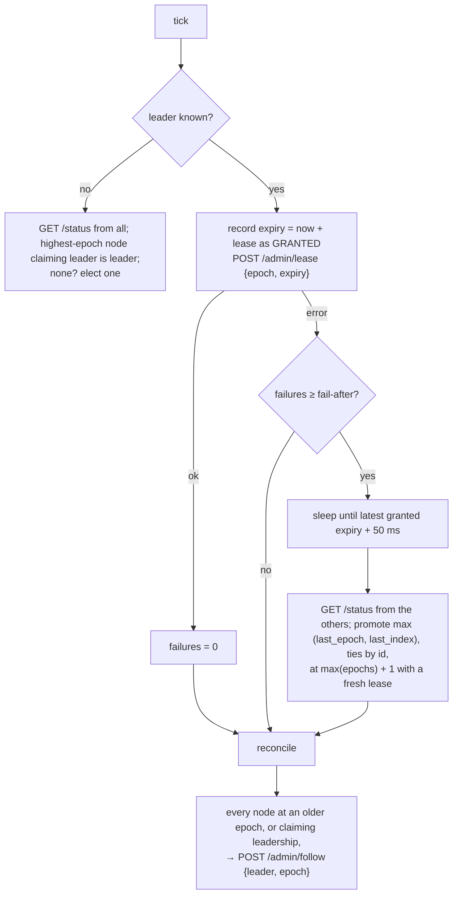
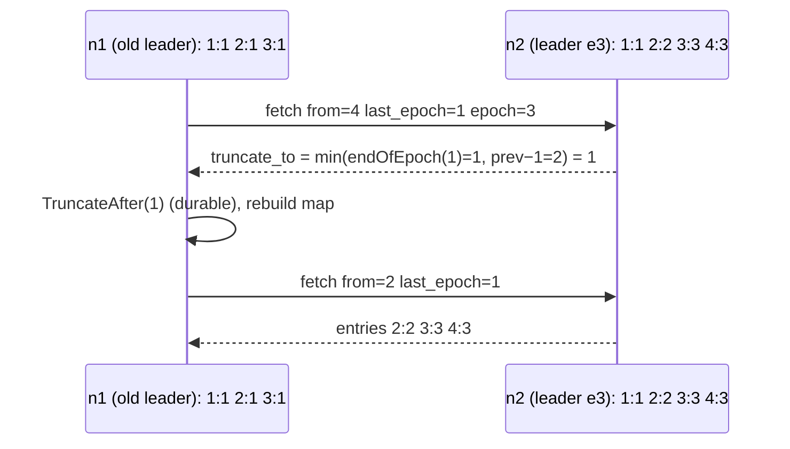

# E2 Unit 3 — Failure injection, failover and fencing

> Time: ~7 h (6 CORE + 1 STRETCH) · CORE: §1–§3 · STRETCH: §4 (the sentinel is a single point of failure) · Lab:
> `labs/e2/rkv` (milestone M4)

Everything so far assumed the leader stays up. This unit kills it, freezes it and brings it back from the dead, and
the cluster has to keep three promises while that happens: some node takes over (§1), at no moment do two nodes both
accept writes (§2), and the replicas end up with one history (§3). It is [A4 Unit 1 §2](../A4-replication-partitioning/unit-1-replication.md#2-synchronous-asynchronous-and-semi-synchronous-replication-failover)
and [A5 Unit 3 §3](../A5-consistency/unit-3-consensus-leases.md#3-leases-and-fencing-tokens) on real processes, and the
tests in M4 are the scenarios F7–F11 from the [spec](spec.md#8-failure-injection-scenarios-and-the-predicted-behaviour).

## Before you start

M1–M3 green, and your design write-up's predictions for F7–F11 written down. Warm up:

1. A leader renews a 1 s lease every 100 ms. Its last successful renewal was at t = 10.0 s. When is it safe to promote
   someone else, assuming clocks are perfect? What if renewals sent at 10.1, 10.2 and 10.3 s timed out?
2. What is a fencing token, and who checks it?
3. Node A (epoch 1) has entries 1–5, all epoch 1. B was promoted at epoch 2 when it had 1–3, and has since written 4
   and 5 at epoch 2. A comes back. Which of A's entries must go?

<details data-kind="answer">
<summary>Warm-up answers</summary>

1. With only the successful renewal: after 11.0 s. But the three that "timed out" may have been delivered and applied
   late (they're in a socket buffer, or the leader was paused, not dead), granting leases until 11.1, 11.2, 11.3 s.
   Safe is after the **latest expiry you sent**, 11.3 s, plus a margin for clock drift. This exact bug is
   `TestM4_PausedZombieLeaderCannotAcceptWritesAfterFailover`.
2. A number that increases every time authority changes hands (here, the epoch), attached to every action taken with
   that authority, and checked by whoever *receives* the action: the resource, not the holder. A holder can't check its
   own staleness reliably; that's the point (A5 Unit 3 §3).
3. Entries 4 and 5: they are epoch 1 entries that B (the leader of a later epoch) doesn't have. A keeps 1–3 and takes
   B's 4 and 5.

</details>

---

## §1 Detecting a dead leader and choosing its successor

### The failure story

On 21 October 2018, a 43-second network partition between GitHub's US East Coast data centre and its other sites led
its MySQL failover tooling (Orchestrator) to promote replicas on the West Coast. When connectivity returned, the
original primaries had accepted writes the new ones didn't have, and vice versa, so neither side could simply be
discarded; GitHub ran degraded for about 24 hours while it reconciled them (TODO-VERIFY: figures from GitHub's
post-incident analysis). Failover worked; what failed was agreeing on *who* was the leader and *what* the history was.

A smaller version is in this lab: an async leader acknowledges a write while its follower can't hear it, then dies,
and the follower is promoted. That write is gone, and the old leader, when it reboots, believes it is still in charge.

### Predict

<!-- predict id="E2-U3-P01" -->
**Predict.** Write your answers down first. Coordinator: `-interval 100ms -fail-after 3 -lease 1s -check-timeout 250ms`.

1. The leader is `SIGKILL`ed (connections are refused at once). Estimate the time until a follower accepts writes.
   Now the leader is `SIGSTOP`ped instead (connections hang). Estimate again.
2. Two followers: n2 has (last_epoch 1, last_index 40), n3 has (1, 38). Which do you promote and why? What if n2 is
   unreachable from the coordinator at that moment?
3. In async mode, which acknowledged writes are lost when you promote n2? In semi-sync with one acked follower?
<!-- /predict -->

### Reveal

<details data-kind="reveal" data-for="E2-U3-P01">
<summary>Reveal</summary>

1. Killed: three failed renewals take ≈ 3 ticks ≈ 0.3 s (refusals are instant); then the coordinator waits for the
   latest lease it sent (sent ≤ 0.3 s ago, 1 s long) ≈ 0.7–1 s more; promotion is one request; the new leader has a
   fresh lease, so ≈ 1–1.4 s total. The reference test logs ≈ 1.3 s. Stopped: each renewal now hangs for the 250 ms
   check timeout, so detection ≈ 3 × (100 + 250) ms ≈ 1 s, but those hung renewals each *sent* a lease, so the wait
   runs to ≈ 1 s after the third one: ≈ 2 s total. Detection time is `fail-after × (interval + timeout)`; failover time
   adds the lease. The break-it `FailoverTimeVsLease` prints a row per setting.
2. n2: it has everything n3 has and more, and "most up to date" is compared as (last_epoch, last_index) because an
   entry from a later epoch beats a longer log from an earlier one (§3). If n2 is unreachable, the coordinator promotes
   n3 and n2's entries 39–40 (if they were from epoch 1 and the new leader doesn't have them) are truncated when n2
   rejoins. In async that may destroy acknowledged writes; in semi-sync it destroys an acked write only if n2 was the
   *only* follower that had acked it, which is why "k of n acks" plus "promote only from the acked set" is where this
   design grows into a quorum system.
3. Async: every write the old leader acked after n2's last fetch: the replication lag at the crash. With the follower
   partitioned beforehand, that's every write during the partition (`TestM4_AsyncModeLosesAnAcknowledgedWriteAndFencesTheOldLeader`
   logs exactly one). Semi-sync: none, as long as the acked follower is the one promoted: during the partition no write
   was acked at all (each got a 503), so there was nothing to lose (`TestM4_SemiSyncLosesNoAcknowledgedWrite`).

</details>

### How it actually works

The coordinator is one loop, ticking every `-interval`:



Design points, each with a test behind it:

- **Failure detection is a timeout and therefore a guess** ([A7 Unit 1 §1](../A7-reliability/unit-1-timeouts-retries.md#1-timeouts-and-deadline-budgets)).
  A paused or partitioned leader looks exactly like a dead one. Everything below exists because the guess can be
  wrong.
- **The new epoch is `max(every epoch seen) + 1`,** not "coordinator's epoch + 1": a coordinator that restarted (and
  forgot) can't reuse an epoch, as long as one node that saw the last epoch answers.
- **Most up-to-date = highest (last_epoch, last_index).** Comparing index alone is wrong after a previous failover
  (§3).
- **Reconcile is idempotent and runs every tick.** A follower that was unreachable during failover gets repointed
  later; a dead leader that reboots is demoted the first time the coordinator can reach it. Followers already at the
  current epoch are left alone, whatever address they use for the leader (in the tests, some go through a proxy).
- **Promotion carries a lease,** so the new leader can accept writes immediately.

### Build it

`labs/e2/rkv/coord.go`: `runCoord`, the tick (renew, count failures, failover, reconcile), `GET /status`. In
`node.go`: `handlePromote` and `handleFollow` (409 on older epochs, persist `meta.json`, cancel the fetch, broadcast).

Acceptance: `TestM4_CoordinatorFailsOverWhenTheLeaderIsKilled` (3 nodes; new leader at epoch 2 within the bound; the
other follower repointed; all replicated writes present; the log continues at the next index with epoch 2),
`TestM4_AsyncModeLosesAnAcknowledgedWriteAndFencesTheOldLeader` (subtest "acknowledged write is lost"),
`TestM4_SemiSyncLosesNoAcknowledgedWrite`, `TestM4_FollowerRejectsAnOlderEpoch`.

```bash
go test -race -run 'TestM4_(Coordinator|SemiSync|FollowerRejects)' ./labs/e2/rkv/
```

### Break it

1. Promote by highest `last_index` only. Construct a two-failover sequence where that picks the wrong node, and say
   which test would need to exist to catch it.
2. Set `-fail-after 1` and add 150 ms of delay to the leader's link with a `tProxy` in a scratch test (copy a test
   into `scratch_test.go`, keep it out of the shared files). What happens, and what is this called?
3. `go test -tags breakit -run BreakIt_FailoverTimeVsLease -v ./labs/e2/rkv/`: predict each row first.

<details data-kind="answer">
<summary>Break-it answers</summary>

1. A (epoch 1) writes 1–10; B has 1–8, C has 1–10, D has 1–8. A dies while C is briefly unreachable, so B is
   promoted at epoch 2, writes index 9 at epoch 2 (semi-sync: D acks it, the client gets 200), then B dies too. Now C
   has (last_epoch 1, last_index 10) and D has (2, 9). Index-only picks C, and D's acknowledged epoch-2 entry 9 is
   truncated when D follows C. (epoch, index) picks D, and C's epoch-1 entries 9–10 (written by a leader that was
   already deposed) are the ones dropped. The test would chain two failovers with a different follower cut off each
   time and check every acknowledged write afterwards.
2. One slow renewal (> 250 ms) is a failover: the leader is healthy, the coordinator fails over anyway, and the next
   slow moment fails over again. That's flapping, a false positive in failure detection. Detection thresholds trade
   time-to-detect against false positives, which is why `fail-after` is > 1 and timeouts sit above the healthy p99.
3. The table is `lease + detection` almost exactly: the lease dominates. Shorter leases fail over faster and cost more
   renewals and more sensitivity to pauses.

</details>

### In the wild

- **Redis Sentinel** runs several sentinels; a primary is "subjectively down" for one sentinel after
  `down-after-milliseconds` and "objectively down" when a quorum agrees; the sentinels elect one of themselves to run
  the failover, which picks a replica by priority, replication offset and run id, under a new configuration epoch.
- **Orchestrator** (MySQL) detects primary failure by also asking the replicas whether they can see the primary,
  which reduces false positives from the orchestrator's own network problems.
- **Patroni** (Postgres) keeps the leader key in a consensus store (etcd, Consul, ZooKeeper) with a TTL; the leader
  renews it, and a replica that can't take the key can't promote itself (TODO-VERIFY: Patroni's default TTL ≈ 30 s and
  loop wait ≈ 10 s).
- **Kafka**'s controller picks a new partition leader from the in-sync replica set, so only replicas with every
  committed message are eligible; `unclean.leader.election.enable` (default false) is the switch that allows an
  out-of-sync replica and accepts data loss.

### Trade-offs

| Option | Wins when | Loses when | When the answer flips |
|---|---|---|---|
| External sentinel with leases (this lab) | simple, one place to read the decision | the sentinel is a single point of failure for failover; its view of the network may be the broken one | three or more sentinels with a quorum (Redis Sentinel), or a consensus store (§4) |
| Followers vote (Raft) | no external dependency, majority rule built in | more protocol; needs ≥ 3 nodes | always, when you can use an existing implementation |
| Manual failover (a human) | rare failovers, high cost of a wrong one | minutes to hours of downtime | when automatic false positives have cost more than the downtime |
| Promote only from the acked set | no acked write lost | may have no eligible candidate | ISR-style; flip to "unclean" only with an explicit data-loss decision |

### Senior bar

- **Failure modes:** a false-positive failover (slow, not dead), a promotion that picks a less complete replica, a
  coordinator on the wrong side of a partition, followers left following the dead leader, a restarted coordinator
  reusing an epoch.
- **Capacity / timing:** failover ≈ `fail-after × (interval + check-timeout) + lease`; the reference's ≈ 1.3 s comes
  from 3 × 100 ms + 1 s. Halving the lease halves the floor and doubles renewal traffic (trivial here, 10 req/s).
- **Operations:** every failover is an event with a timestamp and the chosen node's position (the coordinator's
  `events`); after one, the first question is "what did we lose?", which needs the old leader's WAL (don't wipe it on
  rejoin without saving the truncated suffix, §3).

**Interviewer probes**

<details data-kind="answer">
<summary>"Your coordinator can't reach the leader, but clients can. What happens?"</summary>

The coordinator fails over to a follower it *can* reach, and for the old lease's remaining time the old leader may
still accept writes from clients. Correctness holds only because the coordinator waits out the lease before promoting
and the old leader stops at its lease expiry (§2). Availability suffers for nothing: the old leader was fine. The fix is
to make the detection decision from more than one vantage point (several sentinels, or ask the followers too), which is
what Orchestrator and Sentinel quorums do.

</details>

<details data-kind="answer">
<summary>"What's your RPO and RTO with this design?"</summary>

RTO ≈ detection + lease ≈ 1–2 s here (seconds to tens of seconds with production-safe timeouts), plus client retry
time. RPO: async = replication lag at the crash; semi-sync = 0 for the loss of one node, provided the acked follower is
the one promoted. Both are stated per failure, not as one number: "RPO 0 for a machine loss, ≈ seconds for a region
loss" is a senior answer (A7 Unit 3 §3).

</details>

### Check yourself

1. Why does the coordinator wait before promoting, and until when?
2. Why is the new epoch `max(all epochs seen) + 1`?

<details data-kind="answer">
<summary>Answers</summary>

1. Because until the old leader's lease expires, the old leader may legitimately be accepting writes (it may be alive
   and just unreachable from the coordinator). It waits until the latest expiry it ever *sent*, plus a margin.
2. So no two leaders ever share an epoch, even if the coordinator restarted and lost its own memory of the current one.

</details>

## §2 Leases, epochs and fencing: the zombie leader

### The failure story

A leader is frozen for 4 s: a stop-the-world pause, a VM live-migration, an `fsync` stuck behind a failing disk.
Everybody else sees a dead leader and fails over in 1.5 s. Then the old leader wakes up. From its own point of view,
nothing happened: the instruction after the pause runs next. Its socket buffer holds three lease renewals the
coordinator sent while it was frozen (they "timed out" on the coordinator's side), plus a client's `PUT`. If it applies
the renewals as "valid for 1 s from now" and then processes the `PUT`, it acknowledges a write, as leader, two seconds
after someone else became leader. That's split brain, built out of a pause and a buffer.

### Predict

<!-- predict id="E2-U3-P02" -->
**Predict.** Write your answers down first.

1. Renewals carry an *absolute* expiry (`expires_unix_ms`), not a duration. Why does that alone defuse the buffered
   renewals? What does it assume?
2. The zombie wakes up and checks "lease valid?", gets yes, and is frozen *again* just before appending. It wakes after
   the lease expired and appends. What protects the cluster now, in semi-sync mode? In async mode?
3. A deposed leader restarts from disk and finds `meta.json` saying "leader, epoch 1". What must it do before it can
   accept a write, and who tells it otherwise?
<!-- /predict -->

### Reveal

<details data-kind="reveal" data-for="E2-U3-P02">
<summary>Reveal</summary>

1. A buffered renewal says "you may lead until 10:00:01.300"; applied late, it changes nothing once that time has
   passed. A duration ("1 s from when you read this") would be extended by every delay. The assumption: the
   coordinator's clock and the leader's clock agree to within the safety margin. In this lab they're the same clock
   (one machine); across machines you assume bounded drift and subtract it (the margin), which is how Chubby-style
   leases and Spanner's TrueTime-based leader leases reason (A5 Unit 2 §3). And the coordinator must still wait for the
   latest expiry it *sent*, not the latest one acknowledged; otherwise those buffered renewals extend past the
   promotion.
2. Semi-sync: the write can't be acknowledged, because no follower will ack it: the followers have been repointed to
   the new leader (epoch 2), and a follower that had already heard of epoch 2 sends `epoch=2` and gets 409 from the
   zombie. That's the epoch acting as a fencing token at the *followers*. Async: the zombie acks locally; the write is
   in its WAL only, and it is truncated when the zombie is demoted (§3). The client was lied to. Leases make that window
   small; only checking the token at the resource closes it. This is Kleppmann's point about locks with leases: a lease
   check at the holder is a race; a token check at the storage isn't (A5 Unit 3 §3).
3. Refuse writes until it has a lease (`-require-lease` and no in-memory lease after a restart → 503). The
   coordinator's reconcile sees "leader at epoch 1" while the current epoch is 2 and sends `follow {leader, epoch 2}`.
   If the coordinator were down, the old leader would sit there refusing writes, which is the right failure: unavailable
   beats wrong.

</details>

### How it actually works

```mermaid
sequenceDiagram
  participant K as coord
  participant A as n1 (epoch 1)
  participant B as n2
  K->>A: lease {e1, until 10.30}  (ok)
  Note over A: SIGSTOP
  K-->>A: lease {e1, until 10.40} (times out, buffered)
  K-->>A: lease {e1, until 10.75} (times out, buffered)
  K-->>A: lease {e1, until 11.10} (times out, buffered)
  Note over K: 3 failures → wait until 11.10 + 50 ms
  K->>B: promote {epoch 2, lease until 12.15}
  Note over A: SIGCONT at 11.3: applies buffered leases (all expired)
  A-->>A: PUT → 503 no valid lease
  K->>A: follow {n2, epoch 2}
  Note over A: demoted; fetches from n2; divergent suffix truncated
```

Three independent fences, so that no single one has to be perfect:

| Fence | Where it is checked | What it stops |
|---|---|---|
| Lease with an absolute expiry | the leader, before every write | a paused or partitioned leader acknowledging writes after the coordinator could have promoted someone |
| Epoch on every admin request (`promote` must be newer, `follow` not older, `lease` equal) | every node | a delayed or replayed coordinator message reverting a newer decision |
| Epoch on every fetch (`409` if the follower's epoch is newer) | the old leader, when a follower that knows better asks | a deposed leader collecting semi-sync acks from up-to-date followers |
| `meta.json` persists role and epoch | every restart | a rebooted node forgetting that it was demoted or promoted |

### Build it

`handleLease` (accept only for your own epoch while leading; extend, never shorten), the lease check in `handleWrite`
under `-require-lease`, and the coordinator's "count it as granted when sent" rule.

Acceptance: `TestM4_PausedZombieLeaderCannotAcceptWritesAfterFailover` (SIGSTOP the leader until failover, SIGCONT,
five PUTs must all be refused, then it is demoted and replicates from the new leader), the subtest "returning old
leader is fenced and truncates its divergent suffix", `TestM4_FollowerRejectsAnOlderEpoch`.

```bash
go test -race -run TestM4 ./labs/e2/rkv/
```

### Break it

Do each mutation in your own code, run `-run TestM4`, and name the incident:

1. The coordinator records `lastExpiry` only when a renewal succeeds.
2. The leader skips the lease check.
3. The coordinator promotes without waiting for the lease.
4. `handleLease` accepts any epoch.

<details data-kind="answer">
<summary>Break-it answers</summary>

1. The zombie test fails: the renewals buffered during the pause carry expiries later than the last acknowledged one,
   so the coordinator promotes while the zombie still holds a valid lease, and the zombie acks a write on resume.
   (Timing-dependent: run with `-count=5`.) Incident: split brain from a GC pause.
2. Both the zombie test and the returning-old-leader subtest fail: the rebooted old leader acks a write at epoch 1
   while epoch 2 exists. Incident: two primaries.
3. The zombie test fails: promotion happens while the old lease is still valid. Incident: split brain during every
   false-positive failover.
4. Probably no test fails directly (the coordinator sends the right epoch), but a delayed lease from before a failover
   could re-arm a demoted-then-repromoted node at the wrong epoch. Incident: a fence with a hole that's only hit by
   reordered messages, which is why the rule is checked anyway.

</details>

### In the wild

- **Martin Kleppmann's "How to do distributed locking"** (2016) is the standard argument that a lease without a fencing
  token checked by the resource is unsafe under process pauses, with a real HBase incident as the example
  (TODO-VERIFY: the HBase example's details).
- **ZooKeeper** gives every znode version and every session a `zxid`; using the `zxid` of the lock node as a fencing
  token is the documented pattern.
- **Raft** terms are fencing tokens for the whole protocol: a node rejects any message from a lower term, and a leader
  that sees a higher term steps down. etcd's leases on top of Raft and its `ReadIndex` / leader-lease reads are the same
  ideas at the read path.
- **Kafka** leader epochs and controller epochs; **Redis Sentinel** configuration epochs, so a sentinel's stale view
  can't overwrite a newer failover.

### Trade-offs

| Option | Wins when | Loses when | When the answer flips |
|---|---|---|---|
| Lease checked at the leader | stops most zombies cheaply | a pause between check and act still slips through | combine with a token checked at the resource |
| Fencing token checked at the resource | closes the race completely | every resource must check it (followers here; a storage service elsewhere) | when you don't control the resource (a third-party API): then you need idempotency at that API instead |
| STONITH (power off the old leader) | physically guarantees one leader | needs out-of-band control, slow, can kill the wrong node | classic HA clusters on shared disks |
| No fencing, rely on detection | simplest | every false positive is split brain | never for writes |

### Senior bar

- **Failure modes:** duration-based leases, waiting for the last *acknowledged* renewal, admin messages without epochs,
  a node that forgets its epoch on restart, a lease checked once per batch rather than per write.
- **Numbers:** lease ≥ several renewal intervals (here 10×) so one slow renewal doesn't drop leadership; clock drift
  margin ≈ 1 ms on one host, ≈ tens of ms with NTP across machines (TODO-VERIFY: typical NTP error in a datacenter),
  ≈ 7 ms worst-case uncertainty with TrueTime as published by Google (TODO-VERIFY).
- **Operations:** a leader that drops its lease should log loudly and expose `lease_valid` (the lab does); "leader
  without a lease" for more than a few seconds means the coordinator is down or partitioned.

**Interviewer probes**

<details data-kind="answer">
<summary>"Why not just make the old leader check with the coordinator before every write?"</summary>

That's a lease of zero length: a round trip per write (latency), the coordinator on the write path (it's now a
bottleneck and a single point of failure for writes, not just failover), and it *still* doesn't close the race,
because the leader can pause between the check and the append. The check has to be at the resource: here, a follower
refusing to ack for a stale epoch.

</details>

<details data-kind="answer">
<summary>"Clocks across machines drift. Is your lease still safe?"</summary>

Only if drift is bounded and the margin covers it: the leader stops at `expiry − drift_bound` by its clock, and the
coordinator promotes after `expiry + drift_bound` by its clock. If a clock can jump (a misconfigured NTP step, a VM
resumed with a stale clock), the lease's safety is gone and only the fencing token protects you. That's why the token
is not optional.

</details>

### Check yourself

1. Name the three fences in this design and where each is checked.
2. Why is an absolute expiry safer than a duration?

<details data-kind="answer">
<summary>Answers</summary>

1. Lease (at the leader, per write), epoch on admin requests (at every node), epoch on fetches (at the old leader,
   from followers that know a newer epoch). `meta.json` makes the epoch survive restarts.
2. A delayed message carrying a duration extends authority by however long it was delayed; one carrying an absolute
   time is harmless once that time has passed.

</details>

## §3 Divergent logs and log matching

### The failure story

After the async failover in §1, the old leader n1 reboots. Its WAL says index 2 is `b=2` (epoch 1), the write that was
acknowledged and lost. The new leader n2's index 2 is `c=3` (epoch 2). If n1 is simply told "follow n2" and asks for
`from=3`, it gets index 3 onward and keeps its own index 2 forever: two replicas that disagree about index 2, both
"caught up", and a read of `b` returns 2 on one and 404 on the other. Nothing will ever notice, until a failover makes
n1 the leader again and the bad entry replicates everywhere.

### Predict

<!-- predict id="E2-U3-P03" -->
**Predict.** n1 has (index: epoch) `1:1, 2:1, 3:1`. n2, the leader at epoch 3, has `1:1, 2:2, 3:3, 4:3`. n1 fetches
with `from=4, last_epoch=1`. Walk the lab's protocol: what does n2 answer, what does n1 do, and how many rounds until
n1 matches? Then: why is `(epoch, index)` enough to identify an entry across the whole cluster?
<!-- /predict -->

### Reveal

<details data-kind="reveal" data-for="E2-U3-P03">
<summary>Reveal</summary>

Round 1: `prev = 3`; n2's entry 3 has epoch 3 ≠ 1 → mismatch. `limit = prev − 1 = 2`; the last index in n2's log with
epoch ≤ 1 is 1; `truncate_to = min(1, 2) = 1`. n1 drops 2 and 3. Round 2: `from=2, last_epoch=1`; n2's entry 1 has
epoch 1 → match; n2 sends 2, 3, 4. Two rounds. `(epoch, index)` identifies an entry because only one leader ever writes
in a given epoch (the coordinator never reuses an epoch, and fencing stops a stale leader), and that leader assigns
each index once; so two logs that agree on `(epoch, index)` for an entry agree on that entry, and (because a leader
only appends to a log that matched its predecessor's) on everything before it. That's Raft's Log Matching property,
and Kafka's leader-epoch truncation is the same mechanism. Tempting wrong answer: "compare the values" — two different
writes can have the same key and value; equality of content is not identity.

</details>

### How it actually works



The leader's rule (spec §6): if the follower's `prev = from − 1` is beyond the leader's log, or the leader's entry
`prev` has a different epoch, answer `truncate_to = min(endOfEpoch(last_epoch), limit)` where `limit` is the leader's
last index (when `prev` is beyond it) or `prev − 1`. `endOfEpoch(e)` jumps over a whole divergent epoch at once; the
`limit` guarantees progress when it can't. The follower truncates its WAL durably (`TruncateAfter` fsyncs), rebuilds
its map from the kept entries, and fetches again.

Two properties to notice:

- **Only the follower changes.** A leader never truncates its own log; everyone converges to the leader's history.
  That's why *who* becomes leader (§1: highest `(last_epoch, last_index)`) decides which writes survive.
- **The acknowledgement waits for the match.** The leader records `acked_index` only on a matching fetch, so a
  follower that still holds divergent entries can't satisfy a semi-sync writer with them.

### Build it

The truncation path of `handleFetch` and `applyFetchLocked`'s `TruncateTo` handling (`wal.TruncateAfter`, rebuild the
map).

Acceptance: the subtest "returning old leader is fenced and truncates its divergent suffix" (the restarted n1 ends as
a follower at epoch 2 whose index 2 has epoch 2, `b` is gone, `c` is present) and the zombie test's final replication.

```bash
go test -race -run TestM4_Async ./labs/e2/rkv/
```

### Break it

1. Disable the log-matching check in `handleFetch` (always take the match path). Which test fails, and how?
2. Truncate in memory but not in the WAL. Which failure would expose it, and why don't the tests?

<details data-kind="answer">
<summary>Break-it answers</summary>

1. The async-loss test's second subtest: n1 keeps `b` at index 2 and appends n2's index 3 after it; it times out
   waiting for `last_epoch == 2` at index ≥ 2 or finds `b` still readable. (The reference mutation run takes ≈ 15 s
   because the test waits for the full timeout.)
2. A restart of the follower after truncation: replay brings the divergent entries back, and its log no longer matches
   (`ErrGap` on the next append, or a silent disagreement if indexes happen to line up). The tests don't restart a node
   right after a truncation; it's a good scratch test to write.

</details>

### In the wild

- **Raft**'s `AppendEntries` carries `prevLogIndex` and `prevLogTerm`; a follower that doesn't match rejects it and the
  leader decrements `nextIndex` (with optimizations that skip a whole term at a time, like `endOfEpoch` here).
- **Kafka** (KIP-101, leader epochs): a follower asks the leader for the end offset of its latest epoch and truncates
  to it, replacing the earlier high-watermark-based truncation that could lose or diverge data.
- **MongoDB** replica sets *roll back* writes on a former primary that the new primary doesn't have, and write them to
  rollback files for manual inspection: the "save the truncated suffix" advice from §1's senior bar, built in.
- **MySQL** with GTIDs makes divergence detectable (errant transactions); repairing it is an operator task.

### Trade-offs

| Option | Wins when | Loses when | When the answer flips |
|---|---|---|---|
| Epoch-based matching and truncation (this lab) | automatic, provably converges | silently discards the deposed leader's unreplicated writes | save the suffix to a side file for audit (MongoDB-style) |
| Refuse to rejoin a diverged node; rebuild it from a snapshot | simple, no partial-history logic | slow for big data sets | small data, rare failovers |
| Manual reconciliation | nothing is discarded silently | hours (GitHub 2018) | multi-leader by accident; avoid getting here |

### Senior bar

- **Failure modes:** comparing by index or value instead of `(epoch, index)`, truncating without fsync, letting a
  diverged follower ack, discarding the suffix without a record of what was lost.
- **Capacity:** each round of matching is one fetch; `endOfEpoch` makes it ≈ one round per divergent epoch instead of
  one per entry.
- **Operations:** log "dropped divergent entries 2–2" (the reference does) with the entries, and count them: that
  number is your measured data loss for the incident.

**Interviewer probes**

<details data-kind="answer">
<summary>"The old leader had acknowledged those entries. Can't you merge them into the new leader's log?"</summary>

Not automatically for arbitrary operations: they were ordered against a history that no longer exists (they might have
been decided on balances the new leader never had). For commutative operations (counters, set adds) a CRDT-style merge
works; for a ledger the safe path is to surface them to reconciliation with the idempotency keys, so each can be
re-submitted or reversed deliberately.

</details>

### Check yourself

1. Why does the leader cap `truncate_to` at `prev − 1` when its entry `prev` mismatches?
2. Why is it the follower, never the leader, that truncates?

<details data-kind="answer">
<summary>Answers</summary>

1. To guarantee progress: the mismatching entry itself must go, and `endOfEpoch` alone might point at or beyond it
   (when the leader's entry at `prev` is from an *older* epoch than the follower's).
2. Because the leader's log defines the history for its epoch; replicas converge to it. Letting the leader change its
   log would undo writes it has acknowledged in this epoch.

</details>

## §4 STRETCH — The sentinel is a single point of failure

### The failure story

The coordinator process is deployed on the same host as n1. The host dies. n1 is gone, and so is the only thing that
could promote n2. Writes are down until a human notices, despite two healthy replicas. Or, subtler: the coordinator is
partitioned from n1 but n1 is fine and serving clients; the coordinator fails over to n2 and correctly waits out the
lease, and now n1 is unavailable *because of the coordinator's view of the network*.

### Predict

<!-- predict id="E2-U3-P04" -->
**Predict.** You run three coordinators instead of one. What must they agree on, and why does "promote if a majority of
coordinators think the leader is down" still need epochs? What is the smallest change to this lab that removes the
coordinator as a single point of failure for failover?
<!-- /predict -->

### Reveal

<details data-kind="reveal" data-for="E2-U3-P04">
<summary>Reveal</summary>

They must agree on *one* decision per epoch: who leads at epoch N+1. A majority vote that "the leader is down" isn't
enough: two coordinators could each start a failover and promote different nodes. Each failover must be numbered
(epoch) and agreed by a majority, so two failovers can't both claim epoch N+1. That is consensus, and it's what Redis
Sentinel does (sentinels vote for a leader sentinel per configuration epoch) and what Raft does with terms. The
smallest change to this lab: store the leader and epoch in a consensus-backed key with compare-and-swap (etcd,
ZooKeeper, Consul), as Patroni does; any coordinator replica can then run failover, and the CAS on the epoch makes
racing ones harmless. The bigger change is to make the nodes themselves run Raft and delete the coordinator. See
[A5 Unit 3 §1](../A5-consistency/unit-3-consensus-leases.md#1-why-consensus-needs-a-majority) for why it must be a
majority.

</details>

### How it actually works

The lab's coordinator is safe (fencing protects correctness when it's wrong) but not highly available (when it's
gone, failover stops). Writes keep working without it as long as the leader keeps its lease... which the coordinator
renews: with `-require-lease`, a dead coordinator also stops writes after ≈ 1 s. That's a deliberate choice: the
alternative, a leader that keeps writing without anyone able to fence it, is exactly what leases exist to prevent.
Removing the single point of failure means replicating the coordinator's one piece of state (`leader`, `epoch`,
lease) with consensus, so a majority of 3 or 5 must agree on each change.

### Build it

No lab. If you want to try: run two coordinators against the same nodes in a scratch test and watch them fight
(promotions at epochs 2 and 3 within a second). Then explain why the nodes' epoch rules keep the data safe anyway, and
what the availability cost was.

### Break it

What happens to writes if you `SIGKILL` the coordinator in `TestM4_CoordinatorFailsOverWhenTheLeaderIsKilled`'s
cluster before killing the leader?

<details data-kind="answer">
<summary>Answer</summary>

Within ≈ 1 s the leader's lease expires and it refuses writes (503); nothing promotes anyone; the cluster is read-only
until the coordinator returns. Correct, and unavailable: the trade this design makes.

</details>

### In the wild

Redis Sentinel (quorum of sentinels, configuration epochs), Patroni (leader key in etcd/Consul/ZooKeeper), Kafka KRaft
(the controller quorum is itself a Raft group, replacing ZooKeeper), MongoDB replica sets (members elect a primary
among themselves with a Raft-like protocol).

### Trade-offs

| Option | Wins when | Loses when | When the answer flips |
|---|---|---|---|
| One coordinator | lab, small deployments with a human on call | SPOF for failover (and for writes under leases) | as soon as unattended failover matters |
| Coordinator state in a consensus store | reuses etcd/ZooKeeper you already run | another critical dependency | you don't already run one |
| Nodes run consensus themselves (Raft) | no external dependency; majority writes give RPO 0 without semi-sync's single-follower caveat | protocol complexity; ≥ 3 nodes | always for new systems, via a library |

### Senior bar

A design-review question you should expect: "list every single point of failure". Here: the coordinator (failover and,
with leases, writes), the leader (writes, until failover), the one host (in the lab). The answer "the coordinator is a
SPOF but fencing makes it fail safe" is the senior one; "it's fine, it's small" is not.

<details data-kind="answer">
<summary>Probe: "Why not let the followers promote themselves when they stop hearing from the leader?"</summary>

Because two followers would both do it, at the same epoch, unless they vote, and voting with a majority rule *is*
consensus (Raft's election). Without a majority, a partition gives you one leader per side.

</details>

### Check yourself

Why does killing the coordinator stop writes in this design, and is that a bug?

<details data-kind="answer">
<summary>Answer</summary>

The leader needs lease renewals to keep accepting writes, and only the coordinator renews. It's a design choice, not a
bug: a leader nobody can fence must not write. The fix is to make the lease-granting state highly available, not to
drop the lease.

</details>

## Unit wrap-up

| Decision | Use this when | Flip when |
|---|---|---|
| Detect with consecutive failed renewals | always; tune `fail-after` above the healthy p99 | — |
| Wait for the latest lease *sent*, then promote | any lease-based failover | — |
| Promote max (last_epoch, last_index) | single-leader failover | promote only from the acked set (ISR) for RPO 0 with k-of-n acks |
| Epoch = max seen + 1 on every failover; fence on it everywhere | always | — |
| Truncate divergent suffixes on the follower, log what was dropped | after any failover | rebuild from snapshot if histories are huge |
| One coordinator | lab / small, with fencing | consensus-backed coordinator or Raft |

Next: [Unit 4](unit-4-read-your-writes.md). Fill in the "observed" column of your write-up for F7–F11 now, while the
runs are fresh.
