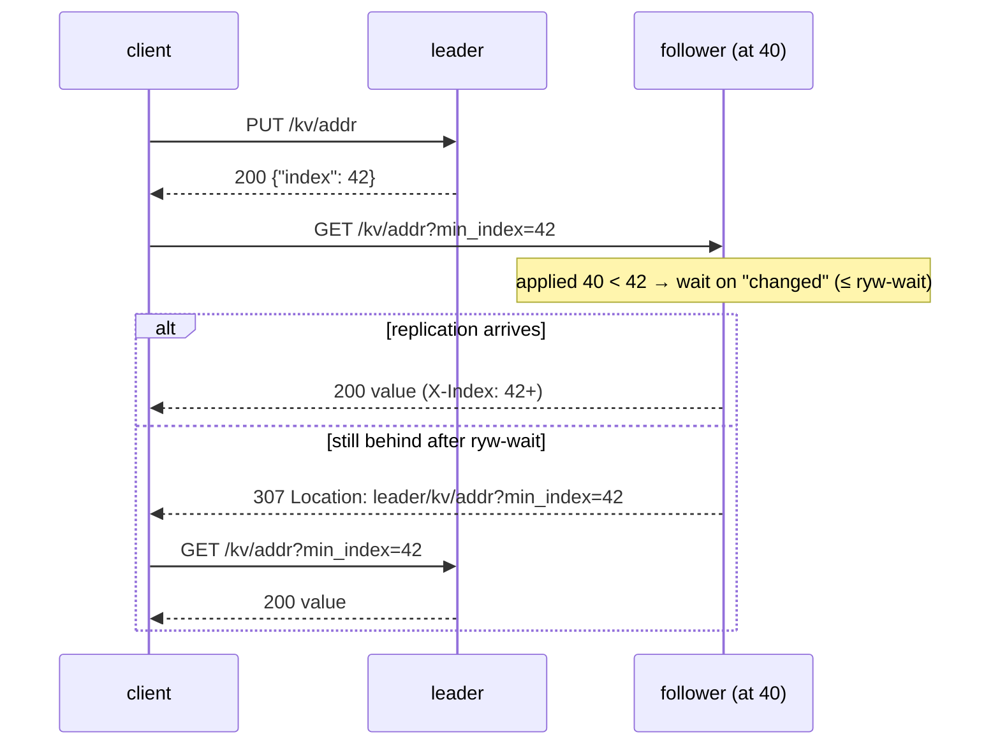

# E2 Unit 4 — Read-your-writes and the design review

> Time: ~6 h (4 CORE + 2 STRETCH) · CORE: §1, then the design review (finish the [write-up](design-exercise.md),
> `sd quiz E2`, the [reflection](teachback.md)) · STRETCH: §2 (monotonic and linearizable reads) · Lab:
> `labs/e2/rkv` (milestone M5)

Followers exist to be read from: they take read load off the leader and they're the copy you fail over to. But a
follower is behind by definition, and "behind" is fine for a statement page and wrong for the screen a member sees
right after changing their address. This unit gives clients a way to ask a follower for "at least my own last write"
(§1), and, as a stretch, looks at the stronger guarantees that a token doesn't give you (§2). Then you close the loop on
your design rationale.

The anomaly is [A4 Unit 1 §3](../A4-replication-partitioning/unit-1-replication.md#3-replication-lag-anomalies-and-how-to-fix-them);
the consistency models are [A5 Unit 1 §1](../A5-consistency/unit-1-consistency-quorums.md#1-consistency-models-what-a-read-may-return).

## Before you start

M1–M4 green. Warm up:

1. Name the replication-lag anomalies from A4 Unit 1 §3 and the usual fix for each.
2. Is read-your-writes a property of the *store* or of a *client session*?
3. The A4 `replkv` lab's sessions carried an LSN token. What did a session do when the replica it picked was behind?

<details data-kind="answer">
<summary>Warm-up answers</summary>

1. Read-your-writes (you don't see your own write: read from the leader, or carry a token), monotonic reads (time goes
   backwards when consecutive reads hit replicas with different lag: stick to one replica, or carry the highest index
   seen), consistent prefix (you see an effect before its cause, mostly in partitioned stores: keep causally related
   writes in one partition or track dependencies).
2. A session: it's defined relative to one client's own writes. The store's job is to make it possible (expose an
   index, honour `min_index`); the client's job is to carry the token.
3. Waited or fell back to another replica (or the leader) until one at least at the token's LSN answered: the same
   choice M5 makes with a bounded wait and a redirect.

</details>

---

## §1 Read-your-writes with a version token

### The failure story

The member app writes a new mailing address to the leader and immediately reloads the profile screen, which reads from
a follower to keep load off the primary. On a normal day the follower is ≈ 5 ms behind and the reload lands after it
caught up. During the nightly batch, the follower is 4 s behind, the profile shows the *old* address, the member
assumes the change failed and submits it again, and support gets a ticket: "the app keeps losing my changes". At
1 million profile updates a month and a 1% chance of hitting the lag window, that's ≈ 10,000 confused members a month,
and some of the resubmissions are for money (a changed payee account).

### Predict

<!-- predict id="E2-U4-P01" -->
**Predict.** Write your answers down first. The leader returns `{"index": 42}` for the address write.

1. The client then reads from a follower that's at 40, with `?min_index=42`. What should the follower do, and what
   are the two bad options it must avoid?
2. The follower is partitioned from the leader and will never reach 42 on its own. With `-ryw-wait 500ms`, what does the
   client see and after how long? Where does the redirect point, and why not at the address the follower itself uses
   to reach the leader?
3. Four concurrent clients each write their own key and read it back through the follower with their token. Can any of
   them see a stale value? Can client A's read show client B's *newer* write?
<!-- /predict -->

### Reveal

<details data-kind="reveal" data-for="E2-U4-P01">
<summary>Reveal</summary>

1. Wait, bounded, for its applied index to reach 42 (it's usually a few milliseconds away), then serve. Bad option
   one: serve the stale value (that's the anomaly). Bad option two: wait forever (a partitioned follower turns every
   such read into a hung request, holding a goroutine and a connection each; at 1,000 reads/s and a 30 s client timeout
   that's 30,000 stuck requests: A7 Unit 1 §1's Little's law again).
2. After ≈ 500 ms, a `307 Temporary Redirect` with `Location: <leader's advertised URL>/kv/x?min_index=42`; following
   it returns the fresh value from the leader. The redirect uses the URL the leader *advertises* in its fetch responses
   (`leader_url`), not the follower's replication path, because the client may not be able to use that path (in the
   tests it's a fault-injecting proxy that is currently blackholed; in production it might be a private replication
   network). `TestM5_MinIndexWaitsThenRedirectsToTheLeader` checks the time window and the exact `Location`.
3. No stale reads for any client's *own* key: each read is at least at that client's write. Yes, A can see a newer
   value written by someone else if the key were shared: read-your-writes is a floor, not a snapshot. With
   `TestM5_ConcurrentClientsAlwaysReadTheirOwnWrites` each client has its own key, so every read must equal that
   client's last write.

</details>

### How it actually works



- **The token is the index** the write returned. It's monotonic within the leader's log, cheap to carry (a cookie, a
  header, a field in the client's session), and every node can compare it with its own applied index.
- **The wait reuses the broadcast channel** from Unit 2 §1: every applied fetch broadcasts, so a waiting read wakes as
  soon as replication catches up. The deadline is `-ryw-wait`; the request context and shutdown end it early.
- **Every read exposes `X-Index`** (and `X-Epoch`, `X-Role`), so a client that didn't pass a token can still tell how
  fresh the answer was, and a client can carry `max(seen X-Index)` forward to get monotonic reads (§2).
- **The leader always serves.** It has every entry it ever acknowledged in this epoch; a token higher than its last
  index can only come from a write lost in a failover (§2).

### Build it

`handleGet`: parse `min_index` (400 if not a number); on a follower below it, wait up to `-ryw-wait`; then 307 to the
advertised leader URL with the original request URI, or 503 if no leader is known. Set `X-Index`, `X-Epoch`, `X-Role`
on every 200 and 404.

Acceptance: `TestM5_FollowerReadWithoutATokenCanBeStale` (the anomaly is real: a partitioned follower returns the old
value, with `X-Index: 1`), `TestM5_MinIndexWaitsThenRedirectsToTheLeader` (307 after ≈ 300 ms, never before 250 ms
nor after 3 s; following it returns the new value; after healing, the follower serves the token itself),
`TestM5_ATokenTheFollowerAlreadyHasIsServedLocallyAtOnce`, `TestM5_ConcurrentClientsAlwaysReadTheirOwnWrites`.

```bash
go test -race -run TestM5 ./labs/e2/rkv/
sd lab E2
```

### Break it

1. Redirect immediately instead of waiting. What happens to the leader's read load during a nightly batch when
   followers are 4 s behind? And on a normal day?
2. Use `n.leader` (the replication URL) in `Location` instead of the advertised one. Which test fails?
3. Make the follower wait without a deadline. Run the partitioned-follower test. What do you see, and what would you
   see in production?

<details data-kind="answer">
<summary>Break-it answers</summary>

1. During the batch, every token read goes to the leader: read-your-writes traffic is now leader traffic, and if
   followers exist to protect the leader, they've stopped doing so at the worst moment. On a normal day it barely
   matters (followers are ms behind and the token is usually already satisfied). The short wait converts most
   would-be redirects into slightly slower local reads; the reference run shows 0 redirects out of 90 reads on an idle
   machine.
2. `TestM5_MinIndexWaitsThenRedirectsToTheLeader`: `Location` points at the proxy, which is partitioned; the test
   checks the exact URL.
3. The test fails on the harness's 5 s client timeout instead of a 307. In production, every read with a token on that
   follower hangs until the client gives up, the follower's goroutines and connections pile up, and a partition of one
   follower becomes an outage of its reads.

</details>

### In the wild

- **MongoDB** causal consistency sessions carry an `operationTime` / `afterClusterTime`; a secondary read with
  `afterClusterTime` waits until it has applied that time (TODO-VERIFY: maximum wait behaviour).
- **Postgres** has no built-in token, but `pg_current_wal_lsn()` on the primary and `pg_last_wal_replay_lsn()` on a
  standby let an application implement exactly this ("wait until replay ≥ my commit LSN, or go to the primary").
  `synchronous_commit = remote_apply` makes every commit wait until the synchronous standby has applied it, giving
  read-your-writes on that standby at the cost of write latency.
- **CockroachDB, Spanner** follower reads serve reads at a timestamp the follower is known to have caught up to
  ("bounded staleness" / "exact staleness" reads), the timestamp version of a token.
- **Read-from-leader for a time window** ("after a write, read your own profile from the primary for 1 minute") is the
  low-tech version many web applications use; it needs no token, but the window is a guess.

### Trade-offs

| Option | Wins when | Loses when | When the answer flips |
|---|---|---|---|
| Token + bounded wait + redirect (this lab) | reads scale on followers, own writes always visible | clients must carry a token; partitions push token reads to the leader | — |
| Always read own data from the leader | simple, no token | the leader carries all "my data" reads | when "my data" is a small fraction of reads |
| Leader for N seconds after a write | no token, works with dumb clients | N is a guess; wrong during big lag | lag is reliably ≪ N |
| `remote_apply`-style synchronous apply | every follower read is fresh enough | write latency includes the follower's apply | read-your-writes everywhere matters more than write latency |
| Sticky sessions to one replica | monotonic reads for free | doesn't give read-your-writes (the replica can still be behind your write) | combine with a token |

### Senior bar

- **Failure modes:** unbounded waits, redirect loops (a follower redirecting to a node that thinks it's a follower:
  cap redirects at the client), tokens from a previous epoch (§2), a token lost by the client between requests
  (mobile app restarts: store it with the session).
- **Capacity:** with followers ≈ 5 ms behind and writes followed by reads ≈ 100 ms later, nearly every token is
  already satisfied; the wait matters for the tail. The fraction redirected ≈ P(lag > ryw-wait), which is ≈ 0 on a
  good day and ≈ 100% for a partitioned follower: plan leader capacity for the second case.
- **Operations:** count `307`s per follower; a jump means that follower is behind or cut off, earlier than most lag
  alerts would tell you.

**Interviewer probes**

<details data-kind="answer">
<summary>"Where does the client keep the token in a web app with many devices?"</summary>

Per session (a cookie or the session record), not per device, and updated to the max index of every write and read the
session has seen. Across devices of the same user it doesn't carry automatically: if the phone writes and the laptop
reads, the laptop has no token. Either store "last write index" per user server-side (one small read from the leader
or a cache), or accept that cross-device read-your-writes is a weaker promise and say so.

</details>

<details data-kind="answer">
<summary>"Isn't this just linearizability?"</summary>

No. A token gives "at least as new as my write". A linearizable read must return the latest value written by
*anyone* before the read started, which a follower can't know without asking the leader (and the leader can't
answer without a valid lease or a quorum check, §2). Read-your-writes is a session guarantee; linearizability is a
global one (A5 Unit 1 §1).

</details>

### Check yourself

1. Why does every read carry `X-Index`, even without a token?
2. What does the follower do with `min_index` above its applied index, and what bounds each step?

<details data-kind="answer">
<summary>Answers</summary>

1. So the client can measure staleness, and carry the highest index it has *seen* (not only written) into its next
   read for monotonic reads.
2. Waits on the broadcast channel, bounded by `-ryw-wait`, the request context and shutdown; then redirects to the
   advertised leader URL (or 503 with no known leader).

</details>

## §2 STRETCH — Monotonic reads, linearizable reads, and the epoch in the token

### The failure story

A member's transaction list is served by a pool of three followers behind a round-robin balancer. They refresh twice:
the first request hits a follower 50 ms behind and shows today's card payment; the second hits one 2 s behind and the
payment is gone. Then a failover happens: a client still holds token `{"index": 42}` from the old leader, whose entry
42 was lost (Unit 3 §1). The new leader's log reaches index 42 a minute later with an unrelated write, and every
follower now cheerfully "satisfies" that token.

### Predict

<!-- predict id="E2-U4-P02" -->
**Predict.** (1) What does the client have to carry, and what do replicas have to check, for monotonic reads across
the pool? (2) What's wrong with an index-only token across a failover, and what would you put in the token instead?
(3) What extra step does the *leader* need before its own reads are linearizable?
<!-- /predict -->

### Reveal

<details data-kind="reveal" data-for="E2-U4-P02">
<summary>Reveal</summary>

1. Carry `max(X-Index of every response seen)` and send it as `min_index` on every read; no replica will then answer
   from before what the client already saw. That's monotonic reads with exactly the M5 mechanism; nothing new is needed
   on the server.
2. An index names a slot, not an entry; after a failover the same index can hold a different entry. The token should
   be `(epoch, index)`: a node satisfies it only if it has an entry at `index` *with that epoch* (the write survived and
   is applied). If its entry at `index` has a different epoch, the write was lost in a failover: answer `409` (or a
   specific error) so the client knows, instead of pretending. The lab keeps the
   index-only token for simplicity and this is the documented gap.
3. Confirm it is still the leader *at the moment of the read*: either a valid lease (with the clock-bound
   assumptions of Unit 3 §2) or a quorum round trip (Raft's `ReadIndex`: ask a majority "am I still leader?", then serve
   once applied up to the commit index known at that moment). Otherwise a deposed leader that hasn't noticed serves
   stale reads, which a lease-less leader in this lab would do.

</details>

### How it actually works

| Guarantee | Client carries | Server checks | In this lab |
|---|---|---|---|
| Read-your-writes | index of its last write | applied ≥ token | yes (M5) |
| Monotonic reads | max index seen | applied ≥ token | yes, if the client carries `X-Index` forward |
| Token survives failover | (epoch, index) | entry at index has that epoch, else "lost" | no — exercise |
| Linearizable reads | nothing | leader with a valid lease, or a quorum check | partly: writes are lease-checked, reads on the leader are not |

### Build it

No required lab. Exercise: change `WriteResult` to return `"token": "<epoch>.<index>"` in a scratch copy, make
`handleGet` accept `?min_token=` and answer `409 {"error": "write lost in failover"}` when its entry at `index` has a
different epoch, and write the test that runs the async-loss scenario and then reads with the lost write's token.

### Break it

With the lab as it is, run the async-loss test's scenario by hand: note the lost write's index, write one more entry on
the new leader, and read with `?min_index=<lost index>` from the follower. What do you get, and what should you get?

<details data-kind="answer">
<summary>Answer</summary>

A `200` with whatever is at that key now (or 404), as if the token were satisfied, because index 2 exists again (it's
the new leader's `c=3`). You should get an error saying the write the token refers to no longer exists, so the client
can resubmit with its idempotency key.

</details>

### In the wild

etcd's linearizable reads use `ReadIndex` by default and offer serializable (possibly stale, local) reads as an
option; Raft-based systems with leader leases (CockroachDB's range leases, TiKV) serve leader reads without a quorum
round trip while the lease holds (TODO-VERIFY: current defaults); Kafka consumers' committed offsets are a
monotonic-reads token for a log.

### Trade-offs

| Option | Wins when | Loses when | When the answer flips |
|---|---|---|---|
| Index token | simple, enough within one epoch | silently wrong across a failover that lost the write | rare failovers and idempotent clients |
| (epoch, index) token | detects lost writes | slightly bigger token, one more comparison | almost always worth it |
| Lease-based leader reads | linearizable without a round trip | depends on clock bounds | clocks you can't bound: use ReadIndex |
| Quorum (ReadIndex) reads | no clock assumption | one round trip to a majority per read (or batch) | read-heavy hot paths: lease reads |

### Senior bar

The precise vocabulary is the senior signal: "read-your-writes and monotonic reads are session guarantees; I provide
them with a token; linearizable reads need the leader to prove it still leads, by lease or by quorum; and my token
includes the epoch so a failover can't satisfy it falsely."

<details data-kind="answer">
<summary>Probe: "A follower serves a read with min_index satisfied. Could the value be from a write that was later lost?"</summary>

Yes, in async mode: the follower may have received an entry from the old leader that the newly promoted leader
doesn't have; it will be truncated when the follower re-matches. A read in between saw a write that will un-happen.
Semi-sync narrows it; only "serve only what's committed on a majority" (Raft's commit index) removes it.

</details>

### Check yourself

What does a client need to do to get monotonic reads from a pool of followers in this lab?

<details data-kind="answer">
<summary>Answer</summary>

Remember the highest `X-Index` it has seen in any response and send it as `min_index` on every read. No server change
is needed.

</details>

## The design review

Before your first `sd quiz E2`:

1. Complete the "predicted vs observed" table in [design-exercise.md](design-exercise.md) for F1–F12, with the numbers
   your runs printed (failover time, RPO observed, lag under partition, write cost by mode). Every row where reality
   differed needs a one-line explanation.
2. Write the reflection in [teachback.md](teachback.md): it asks you to tie each design choice back to the Track A
   section it comes from.
3. Send both to the tutor.

## Unit wrap-up

| Decision | Use this when | Flip when |
|---|---|---|
| Version token = index returned by the write | read-your-writes on followers | — (add the epoch for failover safety) |
| Bounded wait, then redirect to the advertised leader | followers are usually ms behind | followers often far behind: route token reads to the leader directly |
| Expose `X-Index` on every read | always | — |
| Carry max index seen | monotonic reads across a pool | sticky routing to one replica is acceptable |
| Lease or quorum check for leader reads | linearizable reads | stale reads are acceptable (serializable reads) |

You've now built everything the [spec](spec.md) asks for. `sd lab E2`, the quiz, the write-up and the reflection are
the gate.
