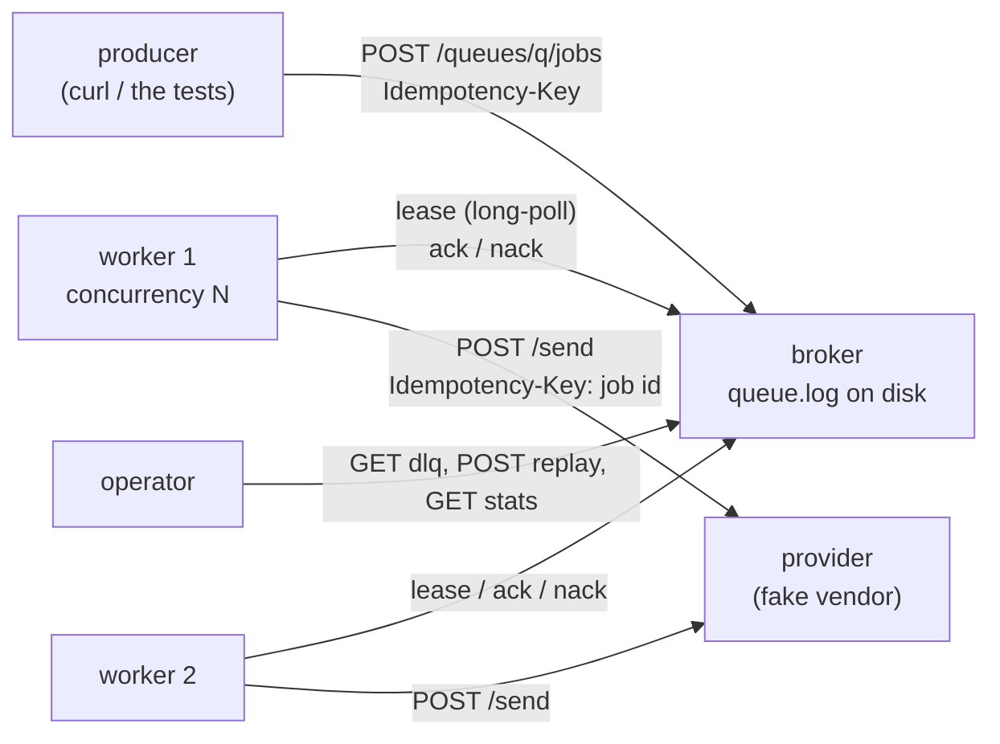

# E3 Spec — the job pipeline

This is the contract the tests in [`labs/e3/jobq`](../../labs/e3/jobq/) check from outside the processes. Anything
not written here is your decision; put it in your [design write-up](design-exercise.md) with the reason.

## 1. What you are building

A member-alert pipeline of the kind every digital-banking platform grows: the transfers service (the *producer*)
says "tell member 4471 their transfer posted", and that becomes an SMS or push through a notification vendor that
is sometimes slow, sometimes rate-limits you, sometimes says 503, and occasionally accepts a message and then times
out on you. Three kinds of process, each a separate OS process bound to 127.0.0.1:



| Role | Owns | State | Provided? |
|---|---|---|---|
| `broker` | the queue: durability, leases, retry timing, dead letters, depth bound, producer dedupe | `<data>/queue.log` | no — you build it |
| `worker` | delivery: the pull loop, concurrency, classification, backoff, the consumer idempotency key, drain | none (counters only) | no — you build it |
| `provider` | the vendor: dedupe by key, counting effects, fault injection | in memory | **yes** (`provider.go`) |

All three are one binary: `go run ./labs/e3/cmd/jobq <role> [flags]`. The tests start them by re-running the test
binary as a child process (see `harness_test.go`), kill them with SIGKILL, stop them with SIGTERM, restart them on the
same port, and put a fault-injecting TCP proxy between them.

## 2. Process rules (all roles)

- `Run(ctx, args, stdout, stderr) int` is the entry point; `args[0]` is the role. Provided in `jobq.go`.
- **Loopback only.** `-addr` must be a loopback address (`127.0.0.1`, `::1`, `localhost`); anything else exits with
  code 2 before listening. None of these processes authenticate anyone.
- Print `READY <host:port>` on stdout once the listener accepts connections (`serveOn` does it).
- SIGTERM/SIGINT cancels `ctx`: shut down gracefully and exit 0. A runtime failure exits 1, bad usage 2.
- Durations are Go durations (`300ms`, `2s`). Tests pass small values so the suite runs in seconds.

## 3. Broker

### Flags

| Flag | Default | Meaning |
|---|---|---|
| `-addr` | `127.0.0.1:7300` | listen address |
| `-data` | (required) | directory holding `queue.log` |
| `-visibility` | `30s` | default lease length |
| `-max-attempts` | `5` | default attempts before dead-lettering |
| `-max-depth` | `10000` | live jobs (ready + delayed + leased) per queue |
| `-dedupe-window` | `10m` | how long a producer `Idempotency-Key` is remembered |
| `-fsync` | `true` | fsync each enqueue before answering 201 |

### API

| Method and path | Body | Answers |
|---|---|---|
| `POST /queues/{q}/jobs` | `{"payload": <JSON>, "max_attempts": n}` (`max_attempts` optional, 0 = default); header `Idempotency-Key` optional | `201 {"id","duplicate":false}` new job, durable · `200 {"id","duplicate":true}` same key within the window (checked **before** the depth bound) · `400` bad body · `429` + `Retry-After` queue full |
| `POST /queues/{q}/lease?wait=2s&visibility=30s` | none | `200 Job` · `204` nothing within `wait` (or the broker is shutting down) |
| `POST /jobs/{id}/ack` | `{"lease": "<token>"}` | `204` · `404` unknown or already acked · `409` not the current attempt's lease, or dead |
| `POST /jobs/{id}/nack` | `{"lease","error","retry_after_ms","permanent"}` | `204` · `404` · `409` |
| `GET /queues/{q}/dlq` | | `200 {"jobs": [DeadJob]}` sorted by id |
| `POST /queues/{q}/dlq/replay` | `{"ids": [...]}` (empty = all) | `200 {"replayed": n, "skipped": n}` (replay respects `-max-depth`) |
| `GET /queues/{q}/stats` | | `200 QueueStats` |
| `GET /healthz` | | `204` |

`Job`, `DeadJob`, `QueueStats` and the request types are Go structs in `jobq.go`; their JSON tags are the wire format.

### Semantics

- **Durable before acknowledged.** Every state change (enqueue, lease, ack, nack, dead, replay) is appended to the
  log before it is applied and before the response. With `-fsync`, an enqueue is fsynced before its 201.
- **Leases.** A lease makes the job invisible until `lease_expires_at`. The lease token is unique per attempt. Ack and
  nack need the token of the job's latest, unsettled attempt. An expired lease makes the job leasable again
  (attempt + 1, `redelivered_total` + 1), unless its attempts are used up, in which case it is dead-lettered with a
  `last_error` that says its lease expired.
- **Order.** Among a queue's leasable jobs, the oldest enqueue wins. A nacked job waits for `retry_after_ms` and does
  not hold its place; a replayed job goes to the back.
- **Dead letters.** `permanent: true`, or a nack on the last attempt, or a lease expiry on the last attempt, moves the
  job to the DLQ with its attempt history (`n`, `at`, `error` per attempt). Dead jobs don't count towards depth.
- **Replay** resets the attempt count, keeps the history and the job id.
- **Producer keys** are scoped to a queue and remembered for `-dedupe-window`, across restarts.
- **Restart.** Recovery rebuilds everything above from the log, including leases (their expiry is an absolute time),
  attempt counts, the DLQ and producer keys.

## 4. The log format (`<data>/queue.log`)

A sequence of frames, nothing else in the file:

```text
+----------------+----------------+---------------------------+
| length uint32  | crc32c uint32  | payload (length bytes)    |
| big-endian     | big-endian     | your record, e.g. JSON    |
+----------------+----------------+---------------------------+
```

- `crc32c` is CRC-32 with the Castagnoli polynomial of the payload only. `length` is 1 … `MaxFrame` (1 MiB).
- Write each frame with one `Write` call.
- Recovery reads frames until EOF or the first frame that is cut short, has a length of 0 or above `MaxFrame`, or
  fails its CRC. Everything from there on is discarded: **truncate the file to the end of the last good frame**, then
  append after it.
- The payload encoding is yours. The tests only parse the frame headers.

## 5. Worker

### Flags

| Flag | Default | Meaning |
|---|---|---|
| `-addr` | `127.0.0.1:0` | status endpoint (`GET /stats` → `WorkerStats`) |
| `-broker`, `-provider` | (required) | base URLs |
| `-queue` | `default` | queue to consume |
| `-concurrency` | `4` | jobs in flight at most |
| `-call-timeout` | `5s` | per provider call (also capped by the lease) |
| `-backoff-base`, `-backoff-max` | `200ms`, `30s` | exponential backoff caps |
| `-jitter` | `full` | `full`, `equal` or `none` |
| `-lease-wait` | `2s` | long-poll duration |
| `-visibility` | `0` | lease length to request; 0 = broker default |
| `-drain-timeout` | `15s` | how long SIGTERM waits for in-flight jobs |
| `-hold-before-ack` | `0` | **fault injection** (tests only): sleep between a successful send and its ack |

### Semantics

- At most `-concurrency` jobs in flight; each pool goroutine runs lease → send → ack/nack.
- Send: `POST {provider}/send`, body = the job payload, `Idempotency-Key: <job id>` on every attempt and redelivery.
- Deadline per call: `min(-call-timeout, time left on the lease − a margin)`.
- Classify: transport error / 408 / 425 / 429 / 5xx → retry with `max(Backoff(attempt), Retry-After)`; 2xx → ack;
  other statuses → `permanent: true`.
- Broker unreachable → back off and keep polling. Never exit, never spin.
- SIGTERM → stop leasing, finish and ack in-flight jobs without cancelling their calls, print `drained` to stderr,
  exit 0; if that exceeds `-drain-timeout`, exit 1.

## 6. Provider (provided)

`POST /send` (needs `Idempotency-Key` and a JSON object body), `POST /control` (`ProviderControl`: `fail_next`,
`fail_status`, `retry_after`, `slow_next`, `slow_ms`, `latency_ms`, `reject_class`, `reject_status`; each POST replaces
all settings), `GET /stats` (`ProviderStats`, including `effects_by_key` and `attempts_by_key` arrival times). A slow
call records its effect even if the caller has gone. That is the ambiguous timeout, on purpose.

## 7. Non-functional targets (≈, for the design write-up)

| Target | Value | Why it matters |
|---|---|---|
| Acknowledged enqueues lost on SIGKILL | 0 | a 201 is a promise to the producer |
| Acknowledged enqueues lost on power loss | 0 with `-fsync`; accepted risk without | measured cost: ≈ 4–5 ms per fsync on a Mac laptop SSD (F_FULLFSYNC), so ≈ 200 enqueues/s per connection, vs ≈ 7k/s without (run the break-it); `TODO-VERIFY` for Linux NVMe and cloud block storage |
| Vendor effects per job | exactly 1 (0 only for dead-lettered jobs) | a member texted twice is a complaint; zero times is a missed fraud alert |
| Vendor load | ≤ workers × `-concurrency` in flight | the vendor contract caps you, not your CPU |
| Delay of a healthy job behind a poison job | none | one bad template must not stall every member's alerts |
| Queue memory | bounded by `-max-depth` per queue | an unbounded queue is an outage that hasn't happened yet |
| SIGTERM to exit | ≤ `-drain-timeout`, well inside the orchestrator's grace period (Kubernetes' default is 30 s) | after the grace period comes SIGKILL |

## 8. Failure-injection scenarios

Predict each row in your design write-up *before* you run it; the tests check the right-hand column.

| # | Injected fault | How the test injects it | What must happen | Test |
|---|---|---|---|---|
| F1 | broker SIGKILL with acknowledged jobs queued | `Kill`, `Restart` | every 201 job is still there and gets delivered once | `TestM1_BrokerCrashLosesNoAcknowledgedEnqueue` |
| F2 | broker SIGKILL mid-delivery | `Kill`, 300 ms down, `Restart` | worker keeps polling; every job delivered, one effect each; depth returns to 0 | `TestM1_BrokerCrashMidDeliveryLosesNothing` |
| F3 | torn log tail (power loss mid-write) | append a half frame to `queue.log` | recovery keeps the complete frames, truncates, and later appends survive the next restart | `TestM1_ATornLogTailIsTruncatedOnRecovery` |
| F4 | bit flip in the last frame | flip a payload bit | the CRC catches it; log truncated to the previous frame | `TestM1_ACorruptFrameEndsRecoveryThere` |
| F5 | worker dies holding a lease | lease without ack | redelivered after the visibility timeout; the old token gets 409 | `TestM1_AnExpiredLeaseIsRedelivered` |
| F6 | vendor 503 burst | `fail_next: 3` | three retries spaced ≥ base, 2×base, 4×base; then one effect | `TestM2_AVendorBurstIsRetriedWithGrowingBackoff` |
| F7 | vendor 429 with `Retry-After: 1` | `fail_status: 429, retry_after: 1` | retry waits ≥ 1 s even with a 50 ms backoff cap | `TestM2_RetryAfterFromTheVendorIsAFloor` |
| F8 | vendor stalls | `slow_next: 1, slow_ms: 1500` | the worker times out at its call timeout and retries | `TestM2_ATimedOutCallIsRetried` |
| F9 | partition worker ↔ broker | proxy blackhole, then heal | no deliveries during it, worker alive and counting lease errors, all delivered after | `TestM2_TheWorkerRidesOutABrokerPartition` |
| F10 | worker SIGKILL after the vendor's effect, before the ack | `-hold-before-ack 1m`, `Kill` | redelivery to another worker with the same key; 2 attempts, **1 effect** | `TestM3_AWorkerKilledBetweenEffectAndAckCausesOneEffect` |
| F11 | ambiguous timeout | vendor completes after the worker gave up | 1 effect, ≥ 1 duplicate recognised by key | `TestM3_AnAmbiguousTimeoutCausesOneEffect` |
| F12 | producer retries after a timeout | same `Idempotency-Key` twice, concurrently, and after a restart | one job | `TestM3_*Producer*`, `TestM3_ConcurrentDuplicateEnqueuesCreateOneJob` |
| F13 | permanent 400 | `reject_class` with 400 | dead after 1 attempt, survives a restart | `TestM4_APermanentErrorDeadLettersAfterOneAttempt` |
| F14 | permanent 503 for one payload class | `reject_class` with 503, `max_attempts: 3` | dead after 3 with history; replay after the fix delivers once | `TestM4_ExhaustedRetriesDeadLetterWithTheirHistoryAndReplayDelivers` |
| F15 | a job that crashes every worker | lease twice, never settle | dead-lettered by lease expiry, not redelivered forever | `TestM4_AJobThatKeepsKillingWorkersRunsOutOfAttempts` |
| F16 | poison job at the head of the queue | `reject_class: poison` + 20 healthy jobs, concurrency 1 | all 20 delivered before the poison job's last attempt | `TestM4_APoisonJobDoesNotBlockTheQueue` |
| F17 | overload | 80 concurrent enqueues, `-max-depth 50` | exactly 50 × 201, 30 × 429 with `Retry-After`; depth 50 | `TestM5_AFullQueueRefusesWith429AndRetryAfter` |
| F18 | producer retry into a full queue | same key while full | 200 duplicate, not 429 | `TestM5_AProducerRetryIsADuplicateEvenWhenTheQueueIsFull` |
| F19 | SIGTERM under load | `Stop` while calls are in flight | exit 0 within ≈ one call; replacement worker finishes; 0 duplicates | `TestM5_SIGTERMDrainsAWorkerWithoutLosingOrDuplicating` |
| F20 | SIGTERM with a stuck call | 6 s vendor latency, `-drain-timeout 500ms` | exits non-zero within ≈ the drain timeout | `TestM5_ADrainThatCannotFinishGivesUpAtItsTimeout` |

## 9. Milestones

| Milestone | Unit | You implement | Tests |
|---|---|---|---|
| M1 queue + workers | 1 | `AppendFrame`, `ScanFrames`; broker enqueue, lease (long-poll, visibility), ack, stats, recovery; worker loop, send, ack | `go test -race -run TestM1 ./labs/e3/jobq/` |
| M2 retries with backoff + jitter | 2 | `Backoff`, `RetryDelay`, `Classify`, `ParseRetryAfter`; broker nack with not-before; worker nack path and broker-outage backoff | `-run TestM2` |
| M3 idempotent handlers | 2 | producer keys (window, concurrency, restart); the stable consumer key | `-run TestM3` |
| M4 dead letters + replay | 3 | dead-lettering (permanent, exhausted, lease-expired), history, DLQ listing, replay | `-run TestM4` |
| M5 backpressure + drain | 3 | depth bound with 429 + Retry-After, dedupe before the bound, worker drain with its timeout | `-run TestM5` |

`sd lab E3` runs everything with `-race`; that is the gate.
