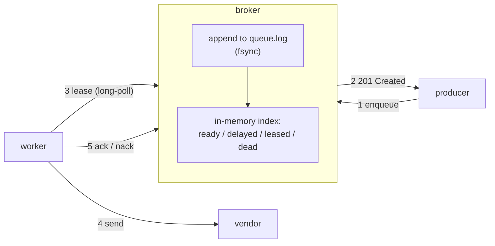
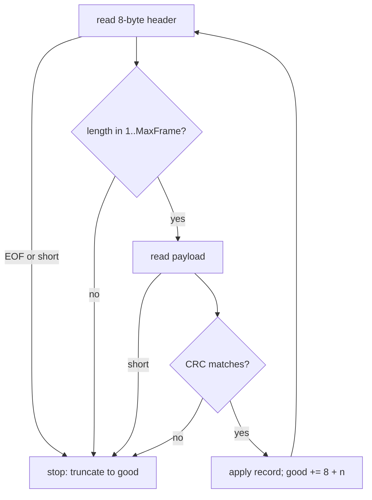
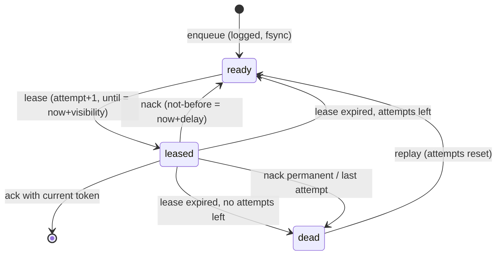
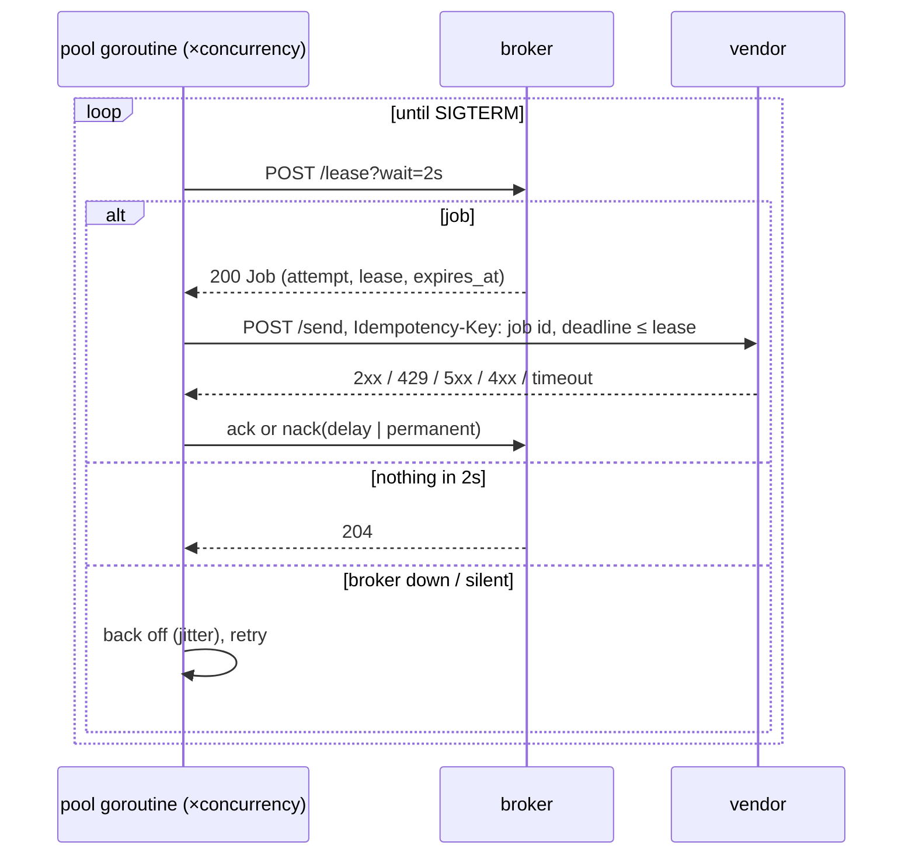

# E3 Unit 1 — A durable queue and a pool of workers

> Time: ~6 h (5 CORE + 1 STRETCH) · CORE: §1–§4 · STRETCH: §5 (log compaction) · Lab: `labs/e3/jobq` (milestone M1)

This unit builds milestone M1: a broker that keeps jobs in a checksummed log on disk and hands them out on leases,
and a worker pool that pulls them and delivers them to the vendor. By the end, `go test -race -run TestM1
./labs/e3/jobq/` is green, and you have watched the broker die with SIGKILL, come back from a torn log, and lose
nothing it acknowledged. Read [spec.md](spec.md) first; this unit explains *why* the spec says what it says.

## Before you start

You should have passed A6 (queues, delivery guarantees, DLQs), A7 (timeouts, retries) and B0 (worker pools,
graceful shutdown). You will reuse the vocabulary of
[A6 Unit 1 §4](../A6-async/unit-1-queues-logs.md#4-delivery-guarantees-and-commit-timing) and
[A2 Unit 2 §4](../A2-storage/unit-2-write-paths.md#4-durability-and-the-write-ahead-log) constantly. Warm-up, answer
first:

1. A consumer acks a message, then calls the vendor, then crashes before the call returns. Which delivery guarantee
   did it implement, and what happens to the message?
2. `write()` returned successfully and the process was then killed with SIGKILL. Are the bytes in the file after a
   restart? After a power cut?
3. A worker pool has 8 goroutines and each vendor call takes 250 ms. What is the most it can send per second?

<details data-kind="answer">
<summary>Warm-up answers</summary>

1. At-most-once: the ack happened before the effect, so a crash between them loses the message for good (A6 Unit 1
   §4). Ack *after* the effect and you get at-least-once instead, and duplicates become your problem.
2. After SIGKILL, yes: the data is in the kernel's page cache, and the kernel outlives the process. After a power
   cut, only if it was fsynced (and the drive honoured the flush). These are two different failure models, and the
   lab tests can only simulate the first one directly (A2 Unit 2 §4).
3. 8 / 0.25 s = 32 calls/s (Little's law, A0 Unit 2 §5). Concurrency, not CPU, bounds a pipeline that waits on a
   vendor.

</details>

---

## §1 Why a broker between the producer and the vendor

### The failure story

The transfers service posts ≈ 40 transfers/s at peak and sends a "transfer posted" SMS for each, inline, through an
adapter with a 10 s timeout and 3 retries. The vendor's p50 is 300 ms. On a degraded day its p99 is 9 s, and 5% of
calls end in 503. Per transfer, the SMS now costs up to 4 × 10 s = 40 s of a request goroutine in the worst case, and
by Little's law the transfers service holds ≈ 40/s × (average ≈ 2 s) ≈ 80 extra requests in flight, then several
hundred once the timeouts start stacking. Its connection pool to the core-banking system is shared with those
requests. At 09:10 transfers start failing, not because the core is slow but because the *SMS vendor* is.

The second attempt runs the send in a goroutine: `go sendSMS(...)`. Transfers p99 recovers. On the next deploy, the
≈ 30 goroutines in flight die with the pod, and so do the ≈ 400 that were sleeping between retries. Nobody notices
until a member calls: "I moved $9,000 and never got the alert; was it fraud?"

### Predict

<!-- predict id="E3-U1-P01" -->
**Predict.** Write your answers down before opening the reveal.

1. Name the two different problems in the story. Which one does a queue fix, and which one only a *durable* queue
   fixes?
2. The transfers service now writes the alert to a queue and returns. What must the queue promise when it answers
   "accepted", and what is the first failure that breaks that promise if the queue is a Go channel in the same
   process?
3. List the things that can now go wrong *after* "accepted" that couldn't before.
<!-- /predict -->

### Reveal

<details data-kind="reveal" data-for="E3-U1-P01">
<summary>Reveal</summary>

1. **Coupling** and **loss.** The inline call couples the transfer's latency and availability to the vendor's (A6
   Unit 1 §1: a queue converts "the dependency is slow" into "the backlog grows", which you can survive). Any queue,
   even a channel, fixes the coupling. Only a queue whose "accepted" survives the process dying fixes the loss; the
   goroutine version proved that by losing ≈ 430 alerts on a deploy.
2. "Accepted" must mean "this will be delivered (or end up somewhere a human will look) even if any single process
   dies now". An in-process channel breaks on the first restart. A Redis list without persistence breaks on the first
   Redis restart. A broker that answers before its write reaches the log breaks on the first crash. That is why the
   spec says *durable before acknowledged*.
3. The job can be taken by a worker that dies (lost unless something notices: leases, §3); delivered twice (the
   worker died after the vendor acted but before saying so, Unit 2 §3); fail forever and block others (Unit 3 §1);
   pile up faster than it drains (Unit 3 §2). A queue does not remove failure; it gives each failure a place to
   happen where you can see it and handle it. Tempting wrong answer: "a queue makes it reliable". It makes it
   *asynchronous*, and asynchronous failures are quieter.

</details>

### How it actually works

The broker sits between two different speeds. The producer wants a fast, durable "yes" (≈ milliseconds); the vendor
works at its own pace (hundreds of milliseconds, with bad days). Everything in the broker exists to keep those apart
without losing anything:



Three properties, each implemented by one mechanism you build in this unit:

| Property | Mechanism | Where |
|---|---|---|
| an accepted job survives any single crash | append to a log before answering; replay it on start | §2 |
| a job taken by a worker that dies is not lost | a lease with an expiry instead of "remove on receive" | §3 |
| the vendor sees bounded load, and nothing spins when things break | a fixed pool of workers that long-poll and back off | §4 |

The broker is a *queue*, not a *log* in A6's sense
([A6 Unit 1 §2](../A6-async/unit-1-queues-logs.md#2-queues-versus-logs-and-partitions)): consumers don't keep an
offset; the broker tracks each job's state and deletes it when it is acked. Internally it *uses* a log (its write-ahead
log) to make that state durable. Keep the two meanings apart; interviewers probe exactly this.

Why HTTP between processes, and why separate processes at all? Because the failures you are here to study (a peer
that dies, a link that goes silent, a restart on the same port) don't exist inside one process. Goroutine tests
can't SIGKILL half of your system. The test harness can.

### Build it

Milestone M1 starts with the skeleton in [`labs/e3/jobq`](../../labs/e3/jobq/): `jobq.go` (provided: `Run`, flags,
loopback check, `serveOn`, wire types) and `provider.go` (the vendor, provided). Read both, then the design comments
at the top of `broker.go` and `worker.go`. No code for this section; write sections 1–2 of the
[design rationale](design-exercise.md) now, before you have code to rationalise.

Acceptance for the whole milestone: `go test -race -run TestM1 ./labs/e3/jobq/`. The first test,
`TestM1_EveryRoleRefusesANonLoopbackAddress`, already passes on the skeleton; read it to see how the tests start your
processes.

### Break it

Before writing the broker, run the provided vendor and break the naive design by hand:

```bash
go run ./labs/e3/cmd/jobq provider -addr 127.0.0.1:7400
```

In another shell, make it slow and then call it the way the inline adapter would:

```bash
curl -s -XPOST localhost:7400/control -d '{"latency_ms":3000}'
time curl -s -XPOST localhost:7400/send -H 'Idempotency-Key: t1' -d '{"to":"member-1"}' -m 1
curl -s localhost:7400/stats
```

Predict what `/stats` shows after `curl` gave up at 1 s.

<details data-kind="answer">
<summary>What you should see</summary>

`curl` reports a timeout after 1 s, and `/stats` shows `effects: 1` for key `t1` (after the 3 s have passed). The
vendor did the work. Your caller doesn't know that, and if it retries without the same key the member gets two texts.
That one observation is the reason for most of Unit 2.

</details>

### In the wild

- **Amazon SQS** is this design as a service: at-least-once delivery, a visibility timeout per receive (default
  30 s), long polling up to 20 s, a redrive policy to a dead-letter queue after `maxReceiveCount` receives. FIFO
  queues add a 5-minute deduplication window on a message deduplication id. (`TODO-VERIFY` the current limits in
  the SQS developer guide before quoting them.)
- **RabbitMQ** acknowledges per delivery with manual acks, bounds unacknowledged messages per consumer with
  `prefetch`, and dead-letters through `x-dead-letter-exchange`; quorum queues add a delivery limit.
- **Postgres as a queue** (`SELECT … FOR UPDATE SKIP LOCKED`, available since 9.5) is the common "we already have a
  database" broker, used by libraries such as Que, GoodJob and River; the transaction *is* the lease.
- **Kafka** is the log alternative: consumers track offsets, there is no per-message ack or visibility timeout, and
  retries and DLQs are built as extra topics (A6 Unit 2 §3).

### Trade-offs

| Option | Wins when | Loses when | When the answer flips |
|---|---|---|---|
| Inline call from the producer | very low volume, the vendor is fast and reliable, a synchronous answer is required (e.g. an OTP the UI waits on) | the vendor has bad days; deploys; retries | the producer's own SLO starts depending on the vendor's p99 |
| In-process queue (channel, goroutines) | best-effort messages you can afford to lose | any restart | the first message somebody asks about |
| Dedicated broker (this module, SQS, RabbitMQ) | per-message ack, visibility timeouts, DLQ, retries per job | you need replay of history or many independent consumers of the same events | several consumers need the same stream, or you need ordering per key at high volume → a log (Kafka) |
| Database table as a queue | you already run Postgres and need the enqueue in the same transaction as the business write | thousands of jobs/s with polling contention | the queue's write rate dominates the database's |

### Senior bar

- **Failure modes:** "accepted" without durability; a queue that grows forever while the vendor is down (Unit 3 §2);
  consumers that treat "received" as "done"; a single broker as a single point of failure (it is one here: say so,
  and say what replication would cost, A4 Unit 1).
- **Capacity:** the broker's enqueue rate is bounded by its fsync rate when every enqueue is synced (≈ 200/s per
  connection measured on a laptop with F_FULLFSYNC, much more with group commit); the drain rate is bounded by
  workers × concurrency / vendor latency.
- **Operations:** queue depth and the age of the oldest ready job are the two numbers to alert on; a growing depth
  with a flat age is load, a growing age is a stuck consumer.
- **Cost:** one more stateful service to run, back up and upgrade. Worth it when losing or duplicating a message has a
  price; for click analytics it often isn't.

Interviewer probes:

<details data-kind="answer">
<summary>"Why not just use Kafka?"</summary>

Because these are jobs, not events. Each one is consumed once, needs its own retry schedule, may fail permanently
and needs to be dead-lettered individually. A log gives one offset per partition: a job that needs a 5-minute retry
either blocks its partition or has to be copied to a retry topic, and per-message DLQ handling is built by hand. I
would pick Kafka if several services consumed the same stream or I needed to replay history; for "send this alert"
a queue with per-message leases is the simpler correct tool.

</details>

<details data-kind="answer">
<summary>"The broker is a single process. What happens when its disk dies?"</summary>

Everything not yet delivered is gone, and so is the DLQ. On one disk the log protects against process crashes and
(with fsync) power loss, not against losing the machine. The fix is replication: synchronously to a second node
before the 201 (A4 Unit 1 §2), or putting the log on replicated storage. That costs a network round trip per
enqueue, ≈ 1–2 ms across availability zones (`docs/NUMBERS.md`, `TODO-VERIFY` per region). Here I'd state it as an
accepted risk with an RPO, not pretend it isn't there.

</details>

<details data-kind="answer">
<summary>"How would you know the pipeline is healthy?"</summary>

Depth and age of the oldest ready job per queue, the DLQ size and its growth rate, redeliveries per minute (leases
that expired: crashing or too-slow workers), the vendor's error rate by status, and an end-to-end SLI: the fraction
of alerts delivered within N seconds of enqueue (A8 Unit 2 §6). The stats endpoints in the spec expose the raw
counters.

</details>

### Check yourself

1. What is the difference between the broker being a "queue" and the broker using a "log"?
2. Why does putting the send in a goroutine fix latency but make loss worse?
3. Which number tells you a consumer is stuck rather than the system being busy?

<details data-kind="answer">
<summary>Answers</summary>

1. Queue semantics: per-job state, ack deletes, no consumer offsets. The log is an internal write-ahead log for
   durability of that state.
2. The producer no longer waits, but the job now lives only in that process's memory; every restart drops it, and
   nothing records that it existed.
3. The age of the oldest ready job. Depth can grow under healthy load; age only grows when nothing is taking work.

</details>

---

## §2 Durability: a framed log, fsync and torn tails

### The failure story

The first broker writes one JSON line per enqueue to `queue.jsonl` and replays it on start. It survives `kill -9`
in testing. Then the host loses power during a burst of ≈ 500 enqueues/s. On restart, the last line of the file is
`{"op":"enq","id":"j00418` and the replay code's `json.Unmarshal` returns an error. The broker refuses to start. The
on-call engineer deletes the last line by hand at 03:00, the broker starts, and nobody notices that the next morning's
restart *also* fails: the deleted line was a different torn record each time. The week after, a disk returns a
flipped bit in the middle of the file (rare, but at ≈ 10⁹ records a year rare happens), and a job's payload silently
becomes another member's phone number.

### Predict

<!-- predict id="E3-U1-P02" -->
**Predict.** Write your answers down first.

1. The tail of the log is half a record. What should recovery do, and why is "refuse to start" wrong? What about a
   half record in the *middle* of the file?
2. Recovery skips the torn tail and appends new records after it. What happens on the *next* restart?
3. Your broker fsyncs every enqueue and each fsync costs ≈ 5 ms. What is the maximum enqueue rate on one connection?
   Which other writes (lease, ack, nack) must be fsynced before answering, and why?
<!-- /predict -->

### Reveal

<details data-kind="reveal" data-for="E3-U1-P02">
<summary>Reveal</summary>

1. A torn **tail** is the expected result of a crash or power loss during an append: the record was never
   acknowledged (the 201 is sent after the write), so dropping it loses nothing anyone was promised. Recovery keeps
   the good prefix and discards the rest. Refusing to start turns a normal event into an outage. A bad record in the
   *middle* is different: everything after it may be fine, but you cannot know where the next record starts once a
   length field is wrong. This design stops at the first bad frame and truncates there (what most WALs do; A2 Unit 2
   §4), which loses later records if corruption hits mid-file. That is the trade for simplicity; alert on it loudly.
2. If recovery skipped the garbage *without truncating*, new frames would be appended after it, and the next
   recovery would stop at the garbage again and lose them: silent data loss, one restart later. That is why the spec
   says truncate to the end of the last good frame, and why `TestM1_ATornLogTailIsTruncatedOnRecovery` restarts
   twice.
3. ≈ 1 / 5 ms = 200 enqueues/s per connection when each is synced alone (group commit, one fsync for many concurrent
   enqueues, raises that a lot; §5 and the senior bar). Lease, ack and nack don't need an fsync before answering:
   losing one after a power cut makes the job look unacked or unleased, so it is **redelivered**, and Unit 2's
   idempotency key makes a redelivery harmless. Losing an *enqueue* loses a message. Fsync what you can't afford
   to lose, not everything. (They must still be *written* before answering, so a process crash, which keeps the page
   cache, loses nothing.)

</details>

### How it actually works

Each record is a **frame**: a length, a checksum, and the payload. The length tells recovery where the next frame
starts; the checksum tells it whether this one is intact:

```text
offset 0        4        8                   8+n
       +--------+--------+-------------------+--------+--------+------
       | n      | crc32c | payload (n bytes) | n'     | crc'   | ...
       +--------+--------+-------------------+--------+--------+------
```

```go
package main

import (
	"encoding/binary"
	"fmt"
	"hash/crc32"
)

var castagnoli = crc32.MakeTable(crc32.Castagnoli)

// frame encodes one record; write the result with a single Write call.
func frame(payload []byte) []byte {
	buf := make([]byte, 8+len(payload))
	binary.BigEndian.PutUint32(buf[0:4], uint32(len(payload)))
	binary.BigEndian.PutUint32(buf[4:8], crc32.Checksum(payload, castagnoli))
	copy(buf[8:], payload)
	return buf
}

func main() {
	f := frame([]byte(`{"op":"enq","id":"j00000001"}`))
	fmt.Printf("%d bytes, header % x\n", len(f), f[:8])
}
```

Recovery is a loop with four exits, all of which mean "the good prefix ends here":



Three details that the tests check and that real logs get wrong:

- **One `Write` per frame.** A process killed between a header write and a payload write leaves a header with no
  payload. A single `write(2)` of a small buffer is not torn by a process kill (the kernel finishes the system call);
  it can still be torn by power loss, which is what the checksum is for.
- **Cap the length.** A corrupted length field of 4 GB must not make recovery allocate 4 GB. Anything above
  `MaxFrame` is corruption.
- **Zero is not a length.** File systems may expose preallocated or zero-filled blocks at the tail after a crash
  (`TODO-VERIFY` which file systems and when); a header of zeros must read as "end", not as an empty record.

What SIGKILL tests and what it doesn't: the tests kill processes, which keeps the page cache, so they prove you
*wrote* before answering. They cannot cut the power, so they can't prove you *synced*. The torn-tail and
bit-flip tests simulate what a power loss or a bad disk leaves behind. Write down in your rationale which of your
guarantees rests on fsync and which on write ordering.

On macOS, Go's `File.Sync` issues `F_FULLFSYNC` (a plain `fsync` there doesn't flush the drive's cache), which is why
a laptop measures ≈ 4–5 ms per sync (`TODO-VERIFY` the Go version that introduced this and the Linux/NVMe figure).

### Build it

Implement in `labs/e3/jobq/frame.go`: `AppendFrame` (one buffer, one `Write`; reject empty and oversized payloads)
and `ScanFrames` (the loop above; returns the good payloads and the good offset). Then, in `broker.go`, the start-up
path: open `<data>/queue.log`, `ScanFrames`, apply every record, `Truncate(good)`, seek to `good`, and append from
there.

Acceptance:

```bash
go test -race -run 'TestM1_(FramesRoundTrip|AppendFrameIsASingleWrite|ScanStops|ScanRejects)' ./labs/e3/jobq/
go test -race -run 'TestM1_(BrokerCrashLosesNoAcknowledgedEnqueue|ATornLogTail|ACorruptFrame|AckedJobsStayAcked)' ./labs/e3/jobq/
```

### Break it

1. Remove the `Truncate` call and run `TestM1_ATornLogTailIsTruncatedOnRecovery`. Predict which assertion fails and
   with what depth.
2. Split `AppendFrame` into two `Write` calls and run the suite. Does anything fail? Why not, and what would it take
   to see the bug?
3. Run the fsync measurement: `go test -tags breakit -run BreakIt_FsyncCost -v ./labs/e3/jobq/`. Predict both numbers
   first.

<details data-kind="answer">
<summary>What you should see</summary>

1. The first restart shows depth 5 (the good prefix is read either way). The second restart shows depth 5, not 6: the
   job enqueued after the first recovery sits behind the garbage and is unreadable. A job that got a 201 is lost.
2. Only `TestM1_AppendFrameIsASingleWrite` fails; every multi-process test still passes, because the window between
   the two writes is microseconds and the tests never kill inside it. Seeing it would need a kill timed into that
   window, thousands of runs, or a power-loss simulator. That is why the contract test checks the *structure* (one
   write) rather than hoping to catch the crash.
3. On the machine this was written on: ≈ 4.6 ms per synced enqueue (≈ 220/s) vs ≈ 0.14 ms unsynced (≈ 7,000/s), a
   ≈ 30× difference. Your numbers will differ; the ratio is the point.

</details>

### In the wild

- **LevelDB and RocksDB** write-ahead logs use CRC-32C per record and 32 KiB blocks, so recovery can resynchronise at
  the next block boundary after corruption instead of stopping (a step past this lab's "stop at the first bad frame").
- **Postgres** WAL records carry a CRC, and recovery stops at the first record that fails it; the end of valid WAL is
  the end of recovery.
- **Kafka** stores a CRC per record batch and truncates a partition's log to the last valid batch on unclean
  restart (`TODO-VERIFY` the exact recovery behaviour per version).
- **SQLite** in WAL mode checksums frames and ignores a tail of frames whose checksums don't chain.

### Trade-offs

| Option | Wins when | Loses when | When the answer flips |
|---|---|---|---|
| fsync every enqueue | each message matters (fraud alerts, payment notices); low rate | > a few hundred enqueues/s per connection | rate grows → group commit (one fsync per batch, same guarantee) |
| group commit | many concurrent producers | a single slow producer gets no benefit | — usually the right default for a real broker |
| no fsync, rely on the page cache | losing the last ≈ seconds on power loss is acceptable (metrics, analytics) | anything a human will ask about | the first compliance question |
| replicate before acking instead of fsync | you need to survive losing the machine, not just its power | every enqueue pays a network round trip | when one box's disk is the failure you care about |

### Senior bar

- **Failure modes:** a torn tail treated as fatal (outage) or skipped without truncating (silent loss later); a
  length field trusted without a bound; fsync on every write including acks (≈ 3× the syncs for no extra safety); a
  checksum over the header but not the payload.
- **Capacity:** ≈ 200 synced enqueues/s per connection with per-write fsync on a laptop SSD; the log grows ≈ 3–4
  records per delivered job, so ≈ 0.5–1 KB per job with small payloads. At 1 M alerts/day that is ≈ 0.5–1 GB/day before
  compaction (§5).
- **Operations:** log recovery time grows with log size (every record is replayed); measure it, because it is your
  restart time. Alert on any recovery that truncated more than a tail.

Interviewer probes:

<details data-kind="answer">
<summary>"Why a checksum? The file system has its own."</summary>

Most file systems don't checksum data blocks (ext4 and XFS checksum metadata, not file contents; ZFS and Btrfs do
checksum data; `TODO-VERIFY` per file system and configuration). More importantly the checksum detects *my* torn
writes, records whose bytes never all reached the disk, which no file-system checksum would flag because the
blocks themselves are fine. And it costs ≈ a microsecond per kilobyte.

</details>

<details data-kind="answer">
<summary>"How do you get 10k enqueues/s with fsync?"</summary>

Group commit: concurrent enqueues append their frames, one goroutine fsyncs, and every enqueue whose frame was
before that fsync's offset gets its 201. At ≈ 5 ms per fsync and 50 enqueues per batch that is ≈ 10k/s with the same
guarantee. Latency goes up slightly (waiting for the batch), throughput up by the batch size. Postgres's
`commit_delay` and Kafka's batching are the same idea.

</details>

### Check yourself

1. Why is it safe to drop a torn tail?
2. Why must recovery truncate, not just skip?
3. Which of the broker's writes need an fsync before the response, and which don't?

<details data-kind="answer">
<summary>Answers</summary>

1. The record in it was never acknowledged: the response is sent after the write completes.
2. Appends after untruncated garbage are unreadable on the next recovery, so acknowledged jobs vanish one restart
   later.
3. Enqueue (and replay, which recreates live work) needs one; lease, ack and nack only need to be written, because
   losing them causes a redelivery that idempotency absorbs.

</details>

---

## §3 Leases and visibility timeouts

### The failure story

The Redis-list version used `RPOP`: a worker takes the job and the job is gone from the list. Workers crash about
twice a week (an OOM on a huge template, a node drain). Each crash loses the 4–8 jobs it was holding. Someone writes
a "requeue script" that pushes back any job that hasn't been marked done after 60 s. Now jobs that are merely slow,
like a vendor call that takes 70 s on a bad day, get a second copy while the first is still running, and the member
gets two texts. The script's 60 s was chosen by someone who measured the vendor on a good day.

### Predict

<!-- predict id="E3-U1-P03" -->
**Predict.** Write your answers down first.

1. Design the replacement for `RPOP` + the requeue script in one sentence. What does the broker remember about a
   taken job, and what makes the job come back?
2. Worker A's lease expires while it is still sending; the broker gives the job to worker B. A finishes and sends an
   ack. Should the broker accept it? What does that require of the ack?
3. The broker crashes and restarts while A holds a lease. What should happen to that lease?
<!-- /predict -->

### Reveal

<details data-kind="reveal" data-for="E3-U1-P03">
<summary>Reveal</summary>

1. **Lease, don't remove**: leasing marks the job invisible until `now + visibility` and remembers the attempt; an
   ack deletes it; if no ack arrives before the expiry, the job becomes visible again and the next lease is attempt
   + 1. The requeue script was a lease implemented badly, outside the broker, without attempt numbers.
2. Not as "the" ack: the job now belongs to B's attempt. The broker must be able to tell A's ack from B's, so every
   lease gets a **token unique to the attempt** and ack/nack must present it; A's stale token gets 409. A's work may
   still have happened (the vendor may have sent the text), which is why redelivery must be harmless (Unit 2 §3). A
   lease is a fencing token's little sibling (A5 Unit 3 §3): it can tell late messages apart, but it can't stop A from
   having acted.
3. Keep it. The expiry is an absolute time in the log, so after recovery the lease is still running: A can ack, and
   if it doesn't, the job comes back on schedule. Voiding every lease on restart would redeliver everything in flight
   (a burst of duplicates after every broker deploy); extending every lease would hide crashed workers. Attempt
   counts must survive too, or a job that crashes workers gets infinite attempts across broker restarts.

</details>

### How it actually works

A job's life in the broker:



A lease is a promise with an expiry, not a lock. Choosing the visibility timeout is the whole game:

- **Too short:** a slow but healthy call outlives its lease, the job is redelivered, two workers run it in
  parallel. The worker caps its call deadline by the lease (`min(call timeout, lease left − margin)`) to make this
  impossible for its own calls.
- **Too long:** a crashed worker's job waits the full timeout before anyone retries it. With a 30 s visibility, a
  fraud alert held by a crashed worker is ≥ 30 s late.
- **Rule of thumb:** visibility ≈ several × the p99 of one attempt, and the worker's call timeout strictly less than
  the visibility. Long jobs extend their lease with a heartbeat (SQS `ChangeMessageVisibility`); this lab doesn't,
  and that is a choice to defend in your rationale.

The token: the reference uses `"<id>.<attempt>"`, which is unique per attempt because the attempt number only grows
(a replay resets it to 0 but also changes the job's state, so a pre-replay token is refused). An unguessable token
would also stop a buggy worker from acking jobs it never leased; say whether that matters on loopback.

The long-poll: a lease request waits up to `wait` for a job instead of returning 204 at once. Without it, idle
workers poll in a loop: 10 workers × 4 goroutines polling every 10 ms is 4,000 requests/s to say "nothing yet". The
broker wakes waiting leases when something becomes leasable (an enqueue, a nack, a replay) and re-checks
periodically for not-before times and lease expiries passing.

### Build it

In `broker.go`: enqueue (append, apply, 201), lease (scan in enqueue order; ready and not-before passed, or leased and
expired; long-poll with `wait`), ack (token must match the latest unsettled attempt), stats, and the lease and ack
records in the log so a restart keeps them.

```bash
go test -race -run 'TestM1_(EnqueueLeaseAck|JobsAreLeasedInEnqueueOrder|LongPollWakesUp|AnExpiredLease|ALeaseSurvives|BrokerShutsDown)' ./labs/e3/jobq/
```

### Break it

1. Make ack accept any token for the job. Which test fails, and what production incident is it?
2. On recovery, set every leased job back to ready. Which test fails? What would the vendor see after every broker
   deploy?
3. Remove `BaseContext` from `serveOn` in your copy (don't commit it) and run `TestM1_BrokerShutsDownGracefullyDuringALongPoll`.

<details data-kind="answer">
<summary>What you should see</summary>

1. `TestM1_AnExpiredLeaseIsRedelivered`: the expired first lease's ack gets 204 instead of 409. In production, worker
   A's late ack deletes the job while B is still sending it; if B then fails and nacks, the nack hits a deleted job
   and the retry is lost.
2. `TestM1_ALeaseSurvivesABrokerRestart`: the job is leasable again right after the restart. Every in-flight job is
   delivered a second time after each broker restart; the vendor dedupes them only if your keys are right.
3. `Shutdown` waits for active requests, and a 20 s long-poll is active, so the broker takes ≈ 5 s (the grace
   timeout) and the test fails on its 4 s bound. With request contexts derived from the server's `ctx`, the long-poll
   sees cancellation and returns 204 at once.

</details>

### In the wild

- **SQS** visibility timeout: default 30 s, adjustable per message up to 12 hours (`TODO-VERIFY`); a receipt handle
  per receive plays the role of the lease token: deleting with an old one is rejected or ignored.
- **Google Cloud Pub/Sub** calls it the ack deadline (default 10 s, extendable; client libraries extend it
  automatically while the handler runs; `TODO-VERIFY` limits).
- **RabbitMQ** has no time-based visibility for an open channel: an unacked delivery returns to the queue when the
  consumer's channel or connection closes, with a separate consumer ack timeout as a backstop (`TODO-VERIFY` the
  default).
- **Celery** with the Redis broker emulates it with a `visibility_timeout`, and long tasks that exceed it are run
  twice, a classic Celery incident (`TODO-VERIFY` the default).

### Trade-offs

| Option | Wins when | Loses when | When the answer flips |
|---|---|---|---|
| Remove on receive (at-most-once) | losing a message is cheaper than a duplicate (presence pings) | anything that matters | the first lost alert someone asks about |
| Lease with a fixed visibility | job duration is predictable (≈ seconds) | job duration varies 100× | variance grows → heartbeat extension |
| Lease with heartbeat extension | long or variable jobs (video transcoding, reports) | a hung worker that still heartbeats holds the job forever | add a maximum total lease |
| Connection-scoped ack (RabbitMQ style) | low latency, persistent connections | a partitioned consumer with an open TCP connection holds work | NAT or proxy idle timeouts on long-lived connections |

### Senior bar

- **Failure modes:** visibility shorter than the call timeout (guaranteed duplicates under slowness); tokens not tied
  to attempts (late acks delete the wrong attempt); leases voided on restart (a duplicate burst per deploy); attempts
  not persisted (poison jobs that crash workers get infinite attempts).
- **Capacity:** a lease is one log append and an in-memory scan; with ≤ 10k live jobs per queue the scan is
  microseconds. At 100k+ you would index ready jobs (a heap by not-before) instead of scanning.
- **Operations:** `redelivered_total` is the lease-expiry counter; a sudden rise means crashing workers or a vendor
  slower than your visibility timeout.

Interviewer probes:

<details data-kind="answer">
<summary>"Your worker's call takes 40 s on a bad day and the visibility is 30 s. Walk me through it."</summary>

The worker caps its call deadline by the lease, so with 30 s left it gives the call ≈ 24 s and then gives up, nacks
and backs off. Without that cap, the lease would expire at 30 s, another worker would start the same job while the
first is still waiting, and both might succeed: two sends, deduplicated only by the vendor's key. If 40 s calls are
normal, the fix is a longer visibility or a heartbeat that extends it, not a shorter call timeout that never succeeds.

</details>

<details data-kind="answer">
<summary>"Can a lease give you mutual exclusion?"</summary>

No. A lease tells the *broker* who may settle the job; it can't stop a paused worker from waking up after its lease
expired and calling the vendor anyway (GC pause, SIGSTOP, a slow network). That is A5's fencing problem, and the fence
has to be checked by the resource, here the vendor, through the idempotency key. Leases bound the duplicates; keys
make them harmless.

</details>

### Check yourself

1. What makes a lease token different from a job id, and why does it need to be?
2. How do you choose the visibility timeout?
3. Why does the attempt count have to survive a broker restart?

<details data-kind="answer">
<summary>Answers</summary>

1. It identifies one attempt. The broker must tell a late ack from attempt 1 apart from attempt 2's ack.
2. Several × the p99 of one attempt, longer than the worker's call deadline, and short enough that a crashed worker's
   job isn't delayed past its useful life.
3. Otherwise a job that kills its workers is retried forever across restarts and never reaches the DLQ.

</details>

---

## §4 The worker pool: bounded concurrency and long-polling

### The failure story

The worker's first version starts a goroutine per leased job and leases as fast as the broker answers. During a
campaign the queue holds ≈ 200k jobs, and the worker has ≈ 12,000 goroutines calling the SMS vendor within 10
seconds. The vendor's contract is 100 messages/s. It answers 429 to ≈ 11,900 of them. Each 429 becomes a nack and a
retry, and the vendor flags the account for abuse. Meanwhile, when the broker restarts for a deploy, the same worker
sees "connection refused" and its loop, which has no delay on errors, spins at ≈ 100% CPU, logging ≈ 50,000 errors a
second until the broker is back.

### Predict

<!-- predict id="E3-U1-P04" -->
**Predict.** Write your answers down first.

1. The vendor allows 100 sends/s and a send takes ≈ 300 ms. What concurrency per worker (with 3 workers) keeps you
   under the cap, and what bounds it in your design: the broker, the worker or the vendor?
2. What should the lease loop do when the broker is unreachable? When it answers 204?
3. A partition makes the broker silent (no refusal, no answer). What does the loop need so it doesn't hang forever?
<!-- /predict -->

### Reveal

<details data-kind="reveal" data-for="E3-U1-P04">
<summary>Reveal</summary>

1. Little's law: in flight = 100/s × 0.3 s = 30 calls in total, so ≈ 10 per worker. The worker must bound it: a fixed
   pool of `-concurrency` goroutines, each doing lease → send → settle, so a worker never has more jobs than
   goroutines. The broker can't know the vendor's limits and the vendor enforces them with 429s, which is the
   expensive way to find out. (A rate limiter in front of the vendor is the refinement when latency varies a lot:
   concurrency bounds load only while latency stays put; A7 Unit 2 §2.)
2. Unreachable: back off with jitter (tens of ms growing to ≈ 2 s) and try again, forever. Exiting turns a broker
   deploy into a worker outage; spinning turns it into a CPU and log storm. A 204 is not an error: the long-poll
   already waited, so ask again at once.
3. A client timeout on the lease request slightly longer than the long-poll `wait`. Without it, a blackholed
   connection hangs forever; with it, the loop counts a lease error and backs off. The default `http.Client` has no
   timeout at all.

</details>

### How it actually works



Design points:

- **The pool is the bound.** N goroutines → at most N jobs leased by this worker. Leasing ahead (prefetch) would
  raise throughput and hold jobs invisible that another idle worker could have taken; RabbitMQ's `prefetch` is that
  knob.
- **Three HTTP clients, three timeouts.** Lease: `wait` + a margin. Ack/nack: short (≈ 2 s), retried a few times.
  Vendor: no client-wide timeout, a per-call context deadline from the lease and `-call-timeout` instead.
- **Connection reuse.** The default transport keeps only 2 idle connections per host; with concurrency 8 that means
  constant reconnects. Size `MaxIdleConnsPerHost` to the pool (A1 Unit 1 §3).
- **Status endpoint.** The worker listens on its own loopback port only to print READY and expose counters; it is
  how the tests (and you) see `lease_error`, `acked` and `in_flight` from outside.

### Build it

In `worker.go`: the status listener, `-concurrency` loops, lease with long-poll and a client timeout, back off on lease
errors, send with `Idempotency-Key: <job id>` and the lease-capped deadline, ack on 2xx. (Classification and retries
are Unit 2; for now nack anything that isn't 2xx with a small delay.)

```bash
go test -race -run TestM1 ./labs/e3/jobq/
```

All of M1 should be green, including `TestM1_WorkersDeliverEveryJobExactlyOnce`,
`TestM1_WorkerConcurrencyIsBounded` and `TestM1_BrokerCrashMidDeliveryLosesNothing`.

### Break it

1. Remove the backoff after a lease error and run `TestM1_BrokerCrashMidDeliveryLosesNothing` with `-v`. Look at the
   worker's stderr in the failure output, or count lease errors on the status endpoint while the broker is down.
2. Replace the pool with "a goroutine per leased job, lease again immediately". Which test catches it?
3. Use `http.DefaultClient` for the lease. Which test hangs until its own timeout, and why only that one?

<details data-kind="answer">
<summary>What you should see</summary>

1. The test still passes (the broker is down only 300 ms) but the worker makes thousands of lease attempts in that
   window: a CPU and log storm that scales with the outage. Passing tests are not proof of good behaviour; the
   counters are.
2. `TestM1_WorkerConcurrencyIsBounded`: the vendor sees up to 24 concurrent calls instead of ≤ 3.
3. `TestM2_TheWorkerRidesOutABrokerPartition` (Unit 2) fails: during the partition `lease_error` never rises,
   because every pool goroutine is stuck reading from a connection that will never answer. Nothing recovers until
   something closes those connections (in the test, the proxy's heal does; in production, maybe a NAT idle timeout
   minutes later). A refused connection fails fast, so the crash tests don't notice.

</details>

### In the wild

- **Sidekiq** runs a fixed number of worker threads per process (its `concurrency` setting) fetching with a blocking
  pop; the open-source fetch removes the job from Redis, so a crash loses in-flight jobs, which is what the paid
  "reliable fetch" addresses (`TODO-VERIFY` current Sidekiq editions).
- **SQS consumers** long-poll with `WaitTimeSeconds` (≤ 20 s) and receive up to 10 messages per call; the AWS SDK
  HTTP client timeout must exceed the wait (`TODO-VERIFY`).
- **Go's `net/http`**: `http.Client{}` has no timeout; `Transport.MaxIdleConnsPerHost` defaults to 2
  (`http.DefaultMaxIdleConnsPerHost`).

### Trade-offs

| Option | Wins when | Loses when | When the answer flips |
|---|---|---|---|
| Fixed pool (this lab) | vendor latency is stable; simple to reason about | latency swings 10× (concurrency fixed, throughput falls) | → adaptive concurrency (A7 Unit 3 §2) or a rate limiter |
| Rate limiter before the vendor | the contract is in messages/s | latency spikes still pile up in-flight calls | combine: limiter for rate, pool for memory |
| Prefetch / batch lease | high throughput, cheap jobs | jobs sit invisible in a busy worker | jobs are expensive or slow → lease one at a time |
| Push from broker to workers | lowest latency | the broker must track worker capacity and liveness | → pull, which gives backpressure for free |

### Senior bar

- **Failure modes:** unbounded goroutines; no client timeouts; spinning on errors; exiting on errors; a pool shared
  between lanes so a slow campaign starves OTPs (A7 Unit 3 §1, bulkheads).
- **Capacity:** throughput per worker = concurrency / vendor latency; with concurrency 10 and 300 ms that is ≈ 33/s;
  the vendor cap, not the worker count, is the real ceiling.
- **Operations:** scale workers on queue *age*, not depth; cap the total (workers × concurrency) at the vendor's
  contract, or autoscaling will DDoS your vendor during a backlog.

Interviewer probes:

<details data-kind="answer">
<summary>"The backlog is 2 M alerts. Do you autoscale the workers to 200?"</summary>

Only up to the vendor's capacity. At 100 sends/s contracted, the backlog drains in ≈ 5.5 h whatever I do; 200
workers would get 429s for everything above 100/s and possibly an account suspension. I'd keep total concurrency at
≈ 100/s × latency, prioritise lanes (OTPs and fraud alerts first), expire what is stale (a "your OTP is 4471" from
three hours ago is noise), and talk to the vendor about burst capacity. Workers are the cheap part.

</details>

<details data-kind="answer">
<summary>"Why pull instead of push?"</summary>

Pull gives backpressure for free: a worker only asks when it has a free slot, and a dead worker simply stops asking.
With push, the broker must know every worker's capacity and liveness, and a slow worker gets jobs it can't handle.
The cost is latency (a long-poll mostly removes it) and polling load when idle (long-polls again).

</details>

### Check yourself

1. Where is the bound on vendor load in this design?
2. What two timeouts does the lease loop depend on, and how do they relate?
3. Why does the worker have its own HTTP listener?

<details data-kind="answer">
<summary>Answers</summary>

1. The worker's fixed pool: `-concurrency` goroutines per worker, times the number of workers.
2. The broker's long-poll `wait` and the client timeout on the lease request, which must be a bit longer than `wait`
   so a normal 204 isn't an error and a silent broker is.
3. To print READY on a known address and expose counters for tests and operators; it is a status endpoint, not part
   of the job path.

</details>

---

## §5 STRETCH: compacting the log

### The failure story

The broker has run for six weeks at ≈ 1 M alerts/day. `queue.log` is ≈ 40 GB, ≈ 99.9% of it records about jobs acked
weeks ago. A restart replays every record: ≈ 7 minutes before READY, during which every producer gets connection
refused. The disk alert fires at 85%.

### Predict

<!-- predict id="E3-U1-P05" -->
**Predict.** How would you shrink the log without stopping the broker for long, and without ever having a moment
where a crash loses an acknowledged job? What does recovery need to know about the new file?
<!-- /predict -->

### Reveal

<details data-kind="reveal" data-for="E3-U1-P05">
<summary>Reveal</summary>

Write a **snapshot**: under the lock, note the current log offset and copy the live state (ready, delayed, leased,
dead jobs and the producer keys still inside their window) as records into `queue.log.new`; fsync it; then
atomically `rename` it over `queue.log` (and fsync the directory). Records appended after the snapshot point must
be in the new file too, either by holding the lock for the whole copy (simple; pauses enqueues for the copy time) or
by copying the tail after the snapshot. Recovery needs nothing new if the snapshot is written in the same record
format: replaying "enqueue + current attempt + current state" for each live job gives the same state. The crash
windows: before the rename the old log is intact; after it the new one is complete and synced. That is the classic
write-new-then-rename pattern.

</details>

### How it actually works

Size triggers (log > 4 × live data, say) start compaction. The copy is proportional to *live* data, not to history,
so with ≈ 10k live jobs it is milliseconds. Alternatives: segment the log (one file per N MB) and delete segments
whose records are all dead, which is how Kafka does retention and compaction (`TODO-VERIFY` details), or keep
state in an embedded store and use its compaction.

### Build it

Optional, not tested: add `POST /admin/compact` that does the snapshot under the lock, plus a test of your own that
enqueues 1,000 jobs, acks 990, compacts, kills the broker, restarts it and checks depth 10 and a log under a size
bound. Keep it in your own `*_test.go` file outside the lab (tests in the lab must stay identical to the solution's).

### Break it

Skip the directory fsync after the rename and reason through a power cut immediately after `rename` returns: which
file is there after reboot?

<details data-kind="answer">
<summary>Answer</summary>

On some file systems and mount options the rename may not be durable until the directory is synced, so after the
crash you may find the old `queue.log` (fine, just big) or, with a careless implementation that deleted the old file
first, neither. Write-new, fsync file, rename, fsync directory is the order that never leaves you without a complete
log (`TODO-VERIFY` per file system).

</details>

### In the wild

Redis AOF rewrite (a background process writes a compact AOF, then the server swaps it in), Kafka log compaction per
key, and the LSM compactions from A2 Unit 2 §5 are the same move: rewrite live state, swap atomically.

### Trade-offs

| Option | Wins when | Loses when | When the answer flips |
|---|---|---|---|
| Snapshot under the lock | live state small (≈ 10k jobs) | live state large: long pause | → copy outside the lock + tail catch-up |
| Segments + delete dead segments | high throughput, sequential | a single long-lived job pins a whole segment | → snapshot for the pinned records |
| No compaction, rotate by time | logs are archived for audit anyway | restart time grows | when recovery time hits the restart SLO |

### Senior bar

Restart time is an availability number: at ≈ 10 µs per replayed record, 400 M records is ≈ 70 minutes. Compaction
bounds it by live data. Probe:

<details data-kind="answer">
<summary>"Compliance wants every attempt for a year. Doesn't compaction destroy that?"</summary>

Yes, so don't use the broker's log as the audit trail. Write attempts to an append-only audit store (A9 Unit 2 §4)
as part of settling a job, and let the broker's log be the operational state only. The two have different
retention, different readers and different failure tolerances.

</details>

### Check yourself

Why is write-new-then-rename crash-safe, and what extra step does it need for durability?

<details data-kind="answer">
<summary>Answer</summary>

At every moment either the complete old file or the complete, synced new file is in place, because rename is atomic.
For durability, fsync the new file before the rename and fsync the directory after it.

</details>

---

## Unit wrap-up

| Decision | Use | Flip when |
|---|---|---|
| Producer → vendor coupling | a durable broker with per-job state | several consumers need the same events → a log |
| What makes "accepted" true | append (and fsync) before the 201 | you need to survive losing the box → replicate before acking |
| Which writes to fsync | enqueue (and replay) | losing a lease/ack would cost more than a redelivery (it doesn't here) |
| Torn tail | keep the good prefix, **truncate**, continue | corruption mid-file → stop and alert; consider block-aligned resync |
| Taking a job | a lease with an attempt-scoped token | jobs much longer than a lease → heartbeat extension |
| Lease across a broker restart | keep it (absolute expiry in the log) | — |
| Worker load on the vendor | a fixed pool: `concurrency` per worker | latency swings → limiter or adaptive concurrency |
| Broker unreachable | back off with jitter, keep polling, client timeouts on every call | never exit, never spin |

Next: [Unit 2](unit-2-retries-idempotency.md) makes failures retry correctly and duplicates harmless. Check M1 with
`go test -race -run TestM1 ./labs/e3/jobq/` and update sections 1–4 of your [design rationale](design-exercise.md).
