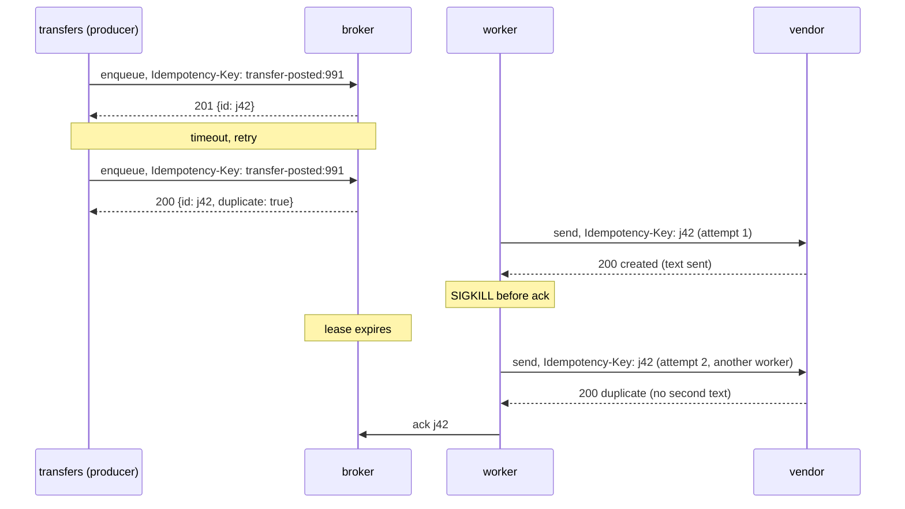

# E3 Unit 2 — Retries and idempotency at the vendor boundary

> Time: ~6 h (5 CORE + 1 STRETCH) · CORE: §1–§3 · STRETCH: §4 (a retry budget for the fleet) · Lab: `labs/e3/jobq`
> (milestones M2 and M3)

M1 made the pipeline at-least-once: nothing acknowledged is lost, and anything a worker drops comes back. This unit
deals with the two consequences. Things come back *too much* (retries that hammer a struggling vendor, retries of
requests that can never succeed) and things come back *twice* (a redelivery of something the vendor already did).
You will make the worker classify every outcome, back off with jitter, respect Retry-After, and carry a key that
makes the vendor see one effect per job however many times it is delivered.

## Before you start

You need M1 green (`go test -race -run TestM1 ./labs/e3/jobq/`) and A7 Unit 1
([§2](../A7-reliability/unit-1-timeouts-retries.md#2-retries-backoff-jitter-and-when-retrying-is-safe),
[§3](../A7-reliability/unit-1-timeouts-retries.md#3-retry-budgets-amplification-and-metastable-failures)) fresh.
Warm-up, answer first:

1. With full jitter, base 100 ms and a cap of 10 s, what range can the delay before the 4th retry fall in?
2. A1 Unit 3: an idempotency key is stored with the *result*. Why the result and not just "seen"?
3. In E3 so far, which two events can make the vendor receive the same job twice?

<details data-kind="answer">
<summary>Warm-up answers</summary>

1. The cap for retry 4 is 100 ms × 2³ = 800 ms, so [0, 800 ms).
2. So a retry gets the same answer as the original (the same 201 body, the same transfer id) instead of either
   repeating the effect or getting a confusing "duplicate" error it can't act on (A1 Unit 3 §2).
3. A worker dying (or being partitioned) between the vendor's effect and the ack, so the lease expires and the job is
   redelivered; and a call that times out on the worker's side after the vendor accepted it, so the worker retries.

</details>

---

## §1 Classifying failures at the vendor boundary

### The failure story

The worker from Unit 1 nacks everything that isn't 2xx with a 100 ms delay. Over one week: a marketing template with
a malformed phone-number field produces 400s, ≈ 12,000 jobs × 5 attempts = 60,000 pointless calls, each billed by the
vendor as an API request (`TODO-VERIFY` whether your vendor bills rejected requests). The vendor's 429s with
`Retry-After: 30` get retried after 100 ms, 200 ms, 400 ms, all inside the 30 s, all 429 again, so jobs burn
their five attempts in under a second and land in the DLQ, where nobody looks. And a 401 after a credential rotation
retries 5 times per job for 2 hours before anyone notices that *every* job is failing.

### Predict

<!-- predict id="E3-U2-P01" -->
**Predict.** Sort these outcomes into *retry*, *don't retry (dead-letter now)* and *something else*, and say why for
each: connection refused · read timeout after the request was sent · 200 · 400 · 401 · 404 · 408 · 409 · 422 · 429
with `Retry-After: 30` · 500 · 502 · 503 · 504. Which of them could have had an effect at the vendor?
<!-- /predict -->

### Reveal

<details data-kind="reveal" data-for="E3-U2-P01">
<summary>Reveal</summary>

- **Retry:** connection refused (never arrived), read timeout (*may* have arrived, so retry with the same key; §3),
  408 (the server timed out reading), 429 (wait at least Retry-After), 500, 502, 503, 504 (the vendor's or its
  gateway's problem; 502/504 may have reached the vendor's backend).
- **Dead-letter now:** 400 and 422 (the same payload fails the same way forever), 404 (the endpoint or resource
  doesn't exist; retrying won't create it).
- **Something else:** 401/403 are permanent *for this job* but are really a *fleet-wide* signal: every job is about
  to fail the same way. Dead-lettering 12,000 jobs one by one is the wrong response; stop the lane (a circuit breaker
  on auth failures, A7 Unit 2 §1) and page. 409 depends on the vendor: with idempotency keys it often means "same
  key, different payload", a bug on your side, so dead-letter and alert.
- **Possible effect:** read timeout, 500, 502, 504 and arguably 503 can all follow a request the vendor processed.
  Only connection refused (and DNS/TLS failures) prove it never arrived (A1 Unit 3 §1).

The classifier in the lab encodes the first two buckets; the third is a design-rationale item and a STRETCH idea.
Tempting wrong answer: "retry all 5xx, never retry 4xx". 408 and 429 are 4xx you must retry.

</details>

### How it actually works

`Classify(status, err)` is a pure function so you can test it in isolation and argue about it in review:

| Input | Outcome | Worker action |
|---|---|---|
| transport error (timeout, refused, reset), status 0 | `Retryable` | nack, delay = `max(Backoff(attempt), 0)` |
| 2xx | `Success` | ack |
| 408, 425, 429, 5xx | `Retryable` | nack, delay = `max(Backoff(attempt), Retry-After)` |
| anything else | `Permanent` | nack with `permanent: true` → DLQ now |

Two rules sit around it:

- **The broker owns attempt counting.** The worker asks for a delay; the broker decides when the last attempt was
  the last (`max_attempts`) and dead-letters. One place, persisted, survives worker crashes.
- **The worker owns timing.** It knows the vendor's `Retry-After`, the jitter policy and the attempt number; the
  broker just honours `not-before`.

### Build it

`Classify` and `ParseRetryAfter` in `backoff.go`; in `worker.go`, the switch on the outcome (ack, nack with delay,
nack permanent). In `broker.go`, nack: record the error in the attempt's history, set `not-before`, and dead-letter on
`permanent` or on the last attempt (you'll list the DLQ in Unit 3; the state change belongs here).

```bash
go test -race -run 'TestM2_(Classify|ParseRetryAfter|ANackDelaysRedelivery|ATimedOutCallIsRetried)' ./labs/e3/jobq/
```

### Break it

Classify 429 as permanent and run `TestM2_RetryAfterFromTheVendorIsAFloor`. Then classify every 4xx as retryable and
run `TestM4_APermanentErrorDeadLettersAfterOneAttempt` (Unit 3's test; it only needs your nack path). Predict both.

<details data-kind="answer">
<summary>What you should see</summary>

The first job is dead-lettered on the 429 instead of waiting a second and succeeding: a rate limit turned into a
lost alert. The second job reaches the DLQ only after 5 attempts and the test sees 5 vendor calls instead of 1; with
the test's small backoff it may still pass the DLQ wait but fails the attempt-count assertion. In production that is
5× the vendor bill for bad payloads and a 5× later page.

</details>

### In the wild

- **gRPC** retry policies list `retryableStatusCodes` explicitly (typically `UNAVAILABLE`), and never retry by default
  on codes that mean "your request is wrong".
- **The AWS SDKs** classify throttling errors and 5xx as retryable and use separate "retry quota" accounting for
  them (`TODO-VERIFY` the current SDK retry modes, "standard" and "adaptive").
- **Stripe** documents that a request with an idempotency key can be retried safely after network errors and 5xx,
  and that 4xx errors (other than 409/429 cases) are not worth retrying (`TODO-VERIFY` exact wording).

### Trade-offs

| Option | Wins when | Loses when | When the answer flips |
|---|---|---|---|
| Classify by status (this lab) | vendors use HTTP status codes honestly | a vendor returns 200 with `{"error": ...}` | → parse the body for that vendor (an adapter per vendor) |
| Retry everything with a cap | quick to build | bad payloads burn attempts and money; auth failures go unnoticed | the first 401 storm |
| Per-error policies (e.g. 401 → stop the lane) | you know the vendor well | more code per vendor | always for the vendors that matter most |

### Senior bar

- **Failure modes:** retrying permanent errors (cost, delay of the page); not retrying 429/408; treating a timeout as
  failure-without-effect (duplicates) or as success (losses); counting attempts in the worker (lost on crash).
- **Capacity:** a 400 retried 5 times multiplies vendor load by 5 for that traffic; a 1% bad-payload rate with 5
  attempts is ≈ 5% of your vendor quota wasted.
- **Operations:** dashboards by outcome class and status; alert when permanent failures exceed a small rate, because
  a template or credential change is almost always behind it.

Interviewer probes:

<details data-kind="answer">
<summary>"The vendor returns 503 for 10 minutes. What does your pipeline do, minute by minute?"</summary>

Each job gets retried with growing jittered delays (base 200 ms, cap 30 s) and burns one attempt per try; with 5
attempts a job spends at most ≈ 0.2 + 0.4 + 0.8 + 1.6 s of backoff caps before dead-lettering, so most in-flight jobs
would be dead after ≈ 3 s. That is too fast for a 10-minute outage. The answer is either more attempts with a larger
cap (so the schedule spans ≈ 15 minutes), or a circuit breaker that stops leasing for that lane while the vendor is
down so jobs don't spend attempts at all. I'd do the breaker: attempts are for *job* failures, the breaker is for
*vendor* failures.

</details>

<details data-kind="answer">
<summary>"Why does the broker count attempts and not the worker?"</summary>

Because the worker that made attempt 3 may be dead. Only the broker sees every lease of a job across workers and
restarts, and it persists the count in its log. A worker-side counter resets on every crash, which is exactly when
you need it most: a job that crashes its worker would retry forever.

</details>

### Check yourself

1. Which outcomes may have had an effect at the vendor?
2. Why is 401 different from 400 even though both are permanent for the job?
3. Where does the decision "this was the last attempt" live, and why?

<details data-kind="answer">
<summary>Answers</summary>

1. Any outcome after the request was sent: timeouts, resets after sending, 500/502/503/504. Only failures before
   sending (refused, DNS, TLS) prove it never arrived.
2. 401 says the *worker* is broken (credentials), so every job will fail; it needs a lane-wide stop and a page, not
   12,000 dead letters.
3. In the broker, because it sees all attempts across workers and persists the count.

</details>

---

## §2 Backoff, jitter and Retry-After

### The failure story

The vendor has a 20-second brownout at 09:00 while ≈ 3,000 jobs are in flight across 4 workers. Every job fails at
roughly the same moment. With "retry after 1 s, then 2 s, then 4 s" and no jitter, all 3,000 come back at 09:00:21,
the vendor (recovering, at half capacity) fails most of them, and all of those come back together at 09:00:23, then
09:00:27. The vendor sees a square wave of 3,000-request spikes with nothing in between. Its recovery takes 6
minutes instead of 20 seconds. Separately, a bug computes `base << attempt` in an `int64` of nanoseconds; on attempt 40
of a long-lived job the shift overflows, the delay is negative, and the job retries in a tight loop.

### Predict

<!-- predict id="E3-U2-P02" -->
**Predict.** Write your answers down first.

1. Base 150 ms, no jitter, max 2 s, a vendor that fails the next 3 sends. What gaps between attempts do you expect,
   and what will the test assert about them?
2. Same vendor, but it answers the one failure with 429 and `Retry-After: 1`, and the worker's backoff cap is 50 ms.
   When is the retry?
3. Why does full jitter spread a synchronised burst better than equal jitter, and why might you still choose equal?
<!-- /predict -->

### Reveal

<details data-kind="reveal" data-for="E3-U2-P02">
<summary>Reveal</summary>

1. Delays of 150, 300, 600 ms (retries 1–3), plus the broker's lease-poll granularity and the HTTP round trips, so
   the gaps the vendor sees are *at least* that and slightly more. The test asserts lower bounds only (≥ 120, 270,
   570 ms with a 30 ms slack); upper bounds on timing are where flaky tests come from.
2. ≥ 1 s after the 429. Retry-After is a floor: `max(backoff, Retry-After)`. Treating it as a ceiling or ignoring it
   earns another 429 and, from some vendors, a longer block.
3. Full jitter draws from [0, cap), so a burst of N retries spreads across the whole window and the arrival rate is
   ≈ N / cap; equal jitter draws from [cap/2, cap), half the window, so twice the peak rate. Equal jitter guarantees
   a minimum wait, which you want when retrying immediately is useless (a vendor that needs ≥ 1 s to recover)
   (A7 Unit 1 §2; the AWS "Exponential Backoff And Jitter" analysis found full jitter does the least total work).

</details>

### How it actually works

```text
cap(retry) = min(max, base × 2^(retry−1))
full   : delay = rnd × cap                  rnd ∈ [0, 1)
equal  : delay = cap/2 + rnd × cap/2
none   : delay = cap
final  : delay = max(delay, Retry-After)     (the vendor's floor wins, even above max)
```

Overflow-safe without floats: double from `base` and stop as soon as the next doubling would pass `max`:

```go
package main

import (
	"fmt"
	"time"
)

func capFor(retry int, base, max time.Duration) time.Duration {
	c := base
	for i := 1; i < retry && c < max; i++ {
		if c > max/2 {
			return max
		}
		c *= 2
	}
	return min(c, max)
}

func main() {
	for _, r := range []int{1, 2, 3, 10, 1 << 20} {
		fmt.Println(r, capFor(r, 150*time.Millisecond, 2*time.Second))
	}
}
```

The loop runs at most log₂(max/base) times whatever `retry` is, so attempt 1,000,000 costs the same as attempt 5.

Where the delay goes: the worker sends it as `retry_after_ms` in the nack; the broker records `not-before` in the log
(so it survives a restart) and the job stays out of line until then. Nothing sleeps while holding a job.
That matters: a worker that slept on its own goroutine for 30 s of backoff would hold a pool slot and a lease for
30 s, doing nothing.

Run the break-it below to *see* the square wave. It is far more convincing than the formula.

### Build it

`Backoff` and `RetryDelay` in `backoff.go`; the worker's retryable branch computes
`RetryDelay(Backoff(job.Attempt, base, max, jitter, rand.Float64()), retryAfter)` and nacks with it. The broker's
`not-before` from §1 does the rest. Also make the lease loop's own error backoff use `Backoff` (with jitter), so a
broker outage doesn't synchronise every worker's polls either.

```bash
go test -race -run TestM2 ./labs/e3/jobq/
```

### Break it

Run the retry-storm measurement with your code:

```bash
go test -tags breakit -run BreakIt_RetryStorm -v ./labs/e3/jobq/
```

200 jobs, 4 workers × 16 concurrency, a vendor that fails the next 400 sends, base 200 ms. Predict the arrival
histogram (per 100 ms) for `none` and `full` before you run it.

<details data-kind="answer">
<summary>What you should see</summary>

With `none`, three bars of ≈ 200 and nothing between them: 0 ms, ≈ 200 ms, ≈ 600 ms. Every job failed together, so
every job retries together, and the vendor sees the whole backlog at once, twice. With `full`, the first wave is the
same, then the retries smear out: on the run behind this text, the busiest 100 ms after the first wave held ≈ 120
sends instead of 200, with a long tail. Total work is the same 600 sends; the *peak* is what kills a recovering
vendor. Jitter is cheap insurance.

</details>

### In the wild

- **AWS Architecture Blog, "Exponential Backoff And Jitter" (Marc Brooker, 2015):** simulated contending clients and
  recommended full or decorrelated jitter over equal or none.
- **gRPC** retry policy: `initialBackoff`, `maxBackoff`, `backoffMultiplier`, with the delay drawn uniformly from
  [0, current backoff) (`TODO-VERIFY` against the gRPC retry design doc).
- **HTTP `Retry-After`** (RFC 9110) is delay-seconds or an HTTP-date; it is standard on 429 (RFC 6585) and 503.

### Trade-offs

| Option | Wins when | Loses when | When the answer flips |
|---|---|---|---|
| Full jitter | many clients fail together | a retry before ≈ some minimum is pointless | vendor needs a known recovery time → equal jitter or a floor |
| Equal jitter | you want a guaranteed minimum wait | burst peaks are 2× full jitter's | — |
| No jitter | deterministic tests, a single client | any fleet | never in production |
| Backoff in the broker (not-before) | the worker shouldn't hold a slot while waiting | you need sub-millisecond retry precision | — |
| Backoff by sleeping in the worker | trivial | holds a pool slot and the lease while doing nothing | always prefer not-before |

### Senior bar

- **Failure modes:** no jitter (synchronised waves); `Retry-After` ignored or used as a ceiling; overflow on large
  attempt numbers; sleeping while holding a lease; backoff caps far shorter than the vendor's typical outage, so
  jobs die in seconds during a 10-minute incident.
- **Capacity:** the total retry load is (attempts − 1) × failure rate × traffic; backoff spreads it in time, it does
  not reduce it. Reducing it is §4's job (a budget) or a breaker's.
- **Operations:** chart attempts per job and the share of sends that are retries; when retries exceed ≈ 10% of sends,
  the vendor is in trouble and your retries are part of its load.

Interviewer probes:

<details data-kind="answer">
<summary>"Your retry schedule gives up after ≈ 3 s. The vendor's outages last 10–30 minutes. Fix it."</summary>

Make the schedule fit the failure: with base 1 s and cap 5 minutes, 8 attempts span ≈ 1+2+4+…+128 s plus capped
retries ≈ 10+ minutes, with full jitter so recovery isn't hit by a wave. But before that, make vendor-wide failures
not consume job attempts at all: a breaker per vendor that stops leasing from that lane while open, with a probe to
close it. Then attempts measure *job* failures, and a vendor outage just grows the backlog, which depth and age
alerts will show.

</details>

<details data-kind="answer">
<summary>"Why not exponential backoff without jitter but with a random initial delay?"</summary>

A random start only desynchronises the first retry. Clients that fail together at attempt k still share the same
deterministic schedule afterwards, so later waves re-align whenever the vendor fails them together again. Jitter on
every delay keeps them apart at every step.

</details>

### Check yourself

1. Compute `Backoff(5, 100ms, 1s, NoJitter)` and `Backoff(5, 100ms, 1s, EqualJitter, rnd=0)`.
2. Why must `Retry-After` be allowed to exceed the backoff cap?
3. Why is the delay sent to the broker rather than slept in the worker?

<details data-kind="answer">
<summary>Answers</summary>

1. Cap = min(1 s, 100 ms × 2⁴ = 1.6 s) = 1 s; no jitter → 1 s; equal jitter with rnd 0 → 500 ms.
2. Because it is the vendor telling you when it will accept you again. Your cap is a guess about failures in
   general; their header is a fact about this one.
3. So the job leaves its pool slot and lease while waiting, the delay survives restarts in the log, and other jobs
   proceed in the meantime.

</details>

---

## §3 Idempotency at both ends

### The failure story

Two incidents in one month. First, the transfers service calls `POST /queues/alerts/jobs`, the broker is mid-fsync on
a slow disk, the producer's 1 s timeout fires, it retries, and both enqueues succeed: two jobs, two texts. Second, a
worker sends an alert, the vendor sends the text, and the worker is OOM-killed before it acks. The lease expires,
another worker delivers the job again, and the vendor, which had no key to recognise it, sends a second text. The
member calls: "Did $2,000 leave my account twice?" Each incident looks like an edge case. Across ≈ 1 M alerts a day,
they are a daily occurrence.

### Predict

<!-- predict id="E3-U2-P03" -->
**Predict.** Write your answers down first.

1. Where must the deduplication happen for each incident, and what is the key in each case? Who chooses it?
2. The consumer key: why not a random UUID per attempt? Why not the payload's hash?
3. Twenty producer retries with the same key arrive concurrently. What must the broker do so exactly one job is
   created, and what does it answer the other nineteen?
<!-- /predict -->

### Reveal

<details data-kind="reveal" data-for="E3-U2-P03">
<summary>Reveal</summary>

1. **Producer → broker:** the broker dedupes on an `Idempotency-Key` that the *producer* chooses from the business
   fact (`transfer-posted:<transfer id>`), so every retry of the same intent carries it. **Worker → vendor:** the
   *vendor* dedupes on a key the worker sends, which must be the same for every delivery of the job: the job id. You
   can't dedupe the second incident inside your own system, because the effect (the text) happened outside it. The
   only place that sees both deliveries and controls the effect is the vendor (A5 Unit 2 §4: exactly-once is an
   end-to-end property, built from at-least-once delivery plus an idempotent effect).
2. A UUID per attempt defeats the purpose: each redelivery looks new. A payload hash merges *different* jobs that
   happen to be identical (two genuine "your OTP is 4471" alerts to the same member from two logins) and splits the
   same job if any field changes between attempts (a timestamp). The key identifies the *intent*, and the job id is
   the broker's name for the intent.
3. The check ("seen this key?") and the insert must be one atomic step: in this lab, both under the broker's mutex,
   with the key recorded by the same log record that creates the job. One request gets 201; the others get 200 with
   the **same id** and `duplicate: true`, so their retries resolve to the job that exists (A1 Unit 3 §2). Check then
   insert without the lock creates two jobs about one time in a few hundred under load, which is exactly what
   `TestM3_ConcurrentDuplicateEnqueuesCreateOneJob` probes.

</details>

### How it actually works



Details that matter:

- **Scope and window.** Producer keys are per queue and remembered for `-dedupe-window` (10 minutes by default),
  rebuilt from the log on restart. The window bounds memory (≈ keys/s × window) and has to exceed the producer's
  retry horizon; a producer that retries for an hour needs an hour's window, or its own outbox (Unit 3 §5).
- **Duplicates beat backpressure.** A producer's retry of a job the broker already accepted must get 200 even when
  the queue is full. A 429 would tell it "not accepted", and it would keep retrying something already queued
  (`TestM5_AProducerRetryIsADuplicateEvenWhenTheQueueIsFull`).
- **Replays keep the id.** A job replayed from the DLQ carries the same key to the vendor. If the original attempt
  did have an effect (the ack was what failed), the vendor dedupes the replay. If it didn't, the replay delivers. The
  key makes replay safe to press.
- **The vendor's window is not yours.** Vendors remember keys for a limited time (Stripe documents 24 hours;
  `TODO-VERIFY` for your SMS vendor, many don't support keys at all). A redelivery after that window is a duplicate.
  If the vendor has no keys, you need a different guard: record "sent j42" in your own store *before* the call and
  reconcile ambiguous ones by lookup (C7 Unit 2 §5). That still leaves a window, which is why vendors with
  idempotency keys are worth paying for.

### Build it

Broker: producer keys checked before the depth bound, recorded in the enqueue record, rebuilt on recovery, expired
after the window, atomic under concurrency. Worker: `Idempotency-Key: <job id>` on every send (you may have done this
in M1; now the tests depend on it).

```bash
go test -race -run TestM3 ./labs/e3/jobq/
```

`TestM3_AWorkerKilledBetweenEffectAndAckCausesOneEffect` uses `-hold-before-ack 1m` to hold the crash window open,
SIGKILLs the worker after the vendor recorded the effect, and checks that a second worker's redelivery is recognised:
2 attempts at the vendor, 1 effect.

### Break it

1. Send `Idempotency-Key: <lease token>` instead of the job id. Predict how many tests fail and which kind.
2. Move the producer-key check outside the broker's mutex (check, unlock, lock, insert). Run
   `go test -race -count=20 -run TestM3_Concurrent ./labs/e3/jobq/`.

<details data-kind="answer">
<summary>What you should see</summary>

1. Almost every multi-process test that counts the vendor's effects by job id fails, even the happy-path
   `TestM1_WorkersDeliverEveryJobExactlyOnce`, because the vendor now sees keys like `j00000001.1`. The ones that
   matter are the crash and timeout tests in M3: two attempts, two keys, two effects, two texts. A key that changes
   per attempt is not a key.
2. Some runs create 2 or more jobs for one key. The race detector may not flag anything, because every access is
   still under *a* lock: this is a logic race (check-then-act), not a data race. `-race` doesn't find those; tests
   with real concurrency do.

</details>

### In the wild

- **Stripe** idempotency keys: sent as `Idempotency-Key`, the stored result is replayed for retries, keys are kept
  for 24 hours, and reusing a key with different parameters is an error (`TODO-VERIFY` current docs).
- **SQS FIFO** deduplicates on `MessageDeduplicationId` for 5 minutes, or on a content hash if content-based
  deduplication is on, with exactly the payload-hash caveat above.
- **Kafka's idempotent producer** dedupes producer retries per partition with a producer id and sequence numbers,
  the broker-side half of this section, without a business key.
- **Webhooks**: most providers deliver at-least-once with an event id and expect *you* to dedupe on it; that is
  §3 from the receiving side, and your adapter experience.

### Trade-offs

| Option | Wins when | Loses when | When the answer flips |
|---|---|---|---|
| Producer key from the business fact | retries of the same intent | the producer can't name its intent (fire-and-forget logs) | → no key; accept duplicates |
| Broker generates ids, no producer key | simplest | producer timeouts create duplicates | the first producer retry |
| Consumer key = job id | the vendor supports keys | the vendor forgets keys before your last redelivery | → your own sent-log + reconciliation |
| Consumer key = payload hash | no job ids available | merges genuine duplicates, splits changed payloads | — rarely right |
| Dedupe store in the consumer, before the effect | the effect is in your own database (same transaction) | the effect is external (a text) | effect is external → the vendor's key is the only real guard |

### Senior bar

- **Failure modes:** check-then-insert without atomicity; keys per attempt; a dedupe window shorter than the
  producer's retry horizon; a 429 instead of a duplicate for an accepted job; trusting "exactly-once delivery"
  claims from a broker without looking at where the effect happens.
- **Capacity:** the producer-key table holds ≈ enqueue rate × window: 50/s × 600 s = 30k keys ≈ a few MB. At 5k/s
  it is 3 M keys, still fine in memory, but now worth a TTL index or a separate store.
- **Operations:** a rising `duplicates_total` at the broker is a producer retrying (often a timeout set below your p99
  enqueue latency); rising duplicates at the vendor mean redeliveries, so look at lease expiries.

Interviewer probes:

<details data-kind="answer">
<summary>"So your system is exactly-once?"</summary>

Delivery is at-least-once; the *effect* is exactly-once within the vendor's key-retention window, because every
delivery of a job carries the same key and the vendor dedupes. Outside that window, or with a vendor that ignores
keys, a redelivery is a duplicate, and I'd bound the window with lease and retry settings shorter than the vendor's
retention. That is the honest version of "exactly-once": a property of the whole pipeline, not of the queue.

</details>

<details data-kind="answer">
<summary>"Your dedupe window is 10 minutes. A producer replays yesterday's batch by mistake."</summary>

Every job is created again and every member gets a second alert. The window was sized for retries, not for replays.
Defences: the producer's outbox should be the only enqueuer and should mark events as published; a business-level
guard (a "notified for transfer 991" record in the producer's database); or a longer window for this queue. I'd
also treat "replay yesterday" as an operation with its own runbook, not as a retry.

</details>

### Check yourself

1. Who chooses the producer key and who chooses the consumer key?
2. Why does the broker answer 200 with the original id instead of 409 for a duplicate?
3. Why can't the duplicate in the "OOM-killed before ack" story be prevented inside your own system?

<details data-kind="answer">
<summary>Answers</summary>

1. The producer chooses the producer key from its business fact; the worker uses the broker's job id as the
   consumer key.
2. So a retrying producer learns that its job exists and stops, with the id it needs, instead of treating an error as
   "not accepted".
3. The effect happened at the vendor; your system only knows that it didn't get an ack. Only the vendor sees both
   deliveries, so only the vendor can recognise the second.

</details>

---

## §4 STRETCH: a retry budget for the fleet

### The failure story

The vendor degrades to a 50% error rate. Every job now averages ≈ 2 attempts, so vendor traffic doubles at the moment
the vendor has half its capacity: 4 workers × 16 concurrency all retrying (A7 Unit 1 §3's metastable failure). The
vendor stays degraded for as long as your retries keep it there.

### Predict

<!-- predict id="E3-U2-P04" -->
**Predict.** Where would you enforce "retries may be at most 10% of sends" across 4 worker processes, and what happens
to a job whose retry is refused by the budget?
<!-- /predict -->

### Reveal

<details data-kind="reveal" data-for="E3-U2-P04">
<summary>Reveal</summary>

Per-process budgets are the simple version: each worker deposits 0.1 token per first attempt and withdraws 1 per
retry (A7's `Budget`). With 4 identical workers that approximates a fleet budget without coordination. A shared one
would live in the broker (it sees every lease and knows each one's attempt number), which can refuse to lease retries
(attempt > 1) beyond the budget and leave them delayed. A refused retry must not be dropped: it stays queued with its
not-before pushed out, so the backlog grows while the vendor recovers instead of the vendor's load growing. A budget
trades latency for the vendor's survival.

</details>

### How it actually works

Fleet-wide rate of retries ≤ ratio × first attempts. In the broker: count first-attempt leases and retry leases over a
sliding window; when retries would exceed the ratio, skip jobs with attempt > 0 in `tryLease`. In the worker: a
token bucket refilled by successes. Either way, a breaker per vendor (A7 Unit 2 §1) handles the "vendor fully down"
case better than a budget does.

### Build it

Optional, not tested: add `-retry-budget 0.1` to the broker and a measurement in your own breakit-style test: vendor
failing 50% for 10 s, compare vendor requests/s with and without the budget.

### Break it

Set the budget to 0 and run `TestM2_AVendorBurstIsRetriedWithGrowingBackoff` against your build. What does the test
report, and why is "0" the wrong production default?

<details data-kind="answer">
<summary>Answer</summary>

No retries are ever leased, so the job sits delayed forever and the test times out waiting for the effect. A budget
of 0 converts every transient failure into indefinite delay; budgets need a floor (a minimum retry rate) so isolated
failures still retry.

</details>

### In the wild

Envoy's retry budgets (`retry_budget` with a budget percent and a minimum concurrency) and the AWS SDK's retry
quota implement the same idea at the client (`TODO-VERIFY` current field names).

### Trade-offs

| Option | Wins when | Loses when | When the answer flips |
|---|---|---|---|
| Per-worker budget | no coordination | uneven workers drift from the fleet target | many small workers → central |
| Broker-side budget | one place sees all attempts | the broker becomes policy-heavy | — |
| Breaker per vendor | vendor fully down | partial degradation (50%) | combine both |

### Senior bar

A retry policy without a budget is a load amplifier with a delay. Probe:

<details data-kind="answer">
<summary>"What do you show the on-call engineer when the budget is refusing retries?"</summary>

The refused-retry rate, the delayed-job count and the oldest delayed job's age per lane, next to the vendor's error
rate. It answers "are we protecting the vendor, and what is it costing members?" with two numbers.

</details>

### Check yourself

What happens to a retry that the budget refuses?

<details data-kind="answer">
<summary>Answer</summary>

It stays in the queue, delayed (its not-before pushed out), and is leased later when the budget allows. It is never
dropped.

</details>

---

## Unit wrap-up

| Decision | Use | Flip when |
|---|---|---|
| Which failures to retry | transport errors, 408, 425, 429, 5xx | a vendor misuses status codes → per-vendor adapter |
| Which to dead-letter now | other 4xx | 401/403 → stop the lane and page, not per-job DLQ |
| Who counts attempts | the broker (persisted) | — |
| Who times retries | the worker computes, the broker enforces `not-before` | — |
| Delay | `max(Backoff(attempt) with full jitter, Retry-After)` | need a minimum wait → equal jitter |
| Producer duplicates | `Idempotency-Key` from the business fact, atomic check+insert, window ≥ retry horizon | no stable intent → accept duplicates |
| Consumer duplicates | `Idempotency-Key = job id` on every attempt and replay | vendor has no keys → sent-log + reconciliation |
| Duplicate into a full queue | 200 duplicate, never 429 | — |
| Vendor-wide failure | breaker or budget, so job attempts aren't spent | — |

Next: [Unit 3](unit-3-dead-letters-backpressure.md). Check `go test -race -run 'TestM[123]' ./labs/e3/jobq/`, then
update sections 5–6 of your [design rationale](design-exercise.md).
