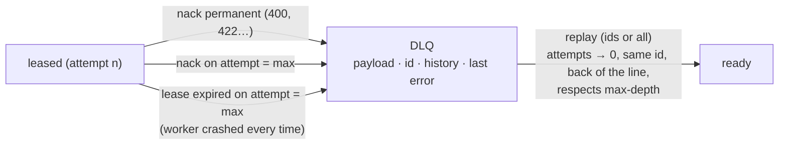
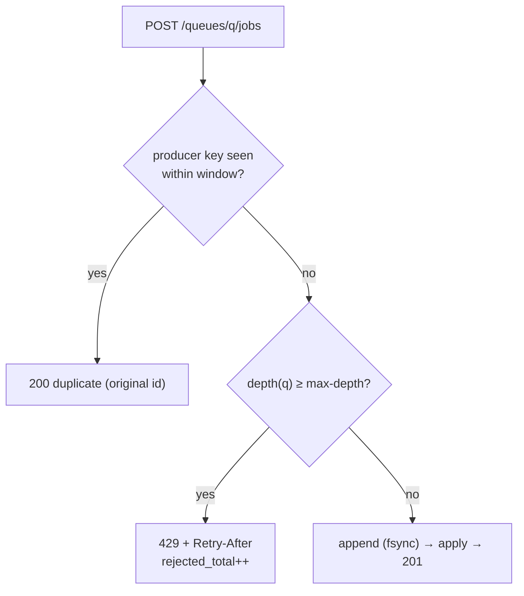
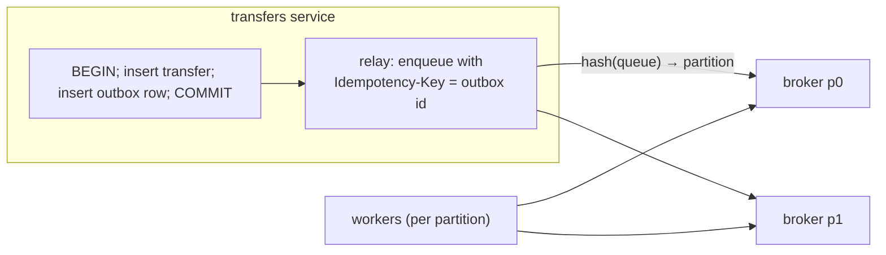

# E3 Unit 3 — Dead letters, backpressure, drain and the failure run

> Time: ~6 h (5 CORE + 1 STRETCH) · CORE: §1–§4 · STRETCH: §5 (the producer's outbox and a partitioned broker) ·
> Lab: `labs/e3/jobq` (milestones M4 and M5, then the whole suite)

The pipeline now survives crashes and makes duplicates harmless. Three things can still take it down: a job that can
never succeed, more work arriving than can leave, and the routine act of stopping a worker. This unit handles each
(M4, M5), then runs every failure scenario in [spec.md §8](spec.md#8-failure-injection-scenarios) against your build
and has you account, in writing, for every place where reality differed from your prediction.

## Before you start

You need `go test -race -run 'TestM[123]' ./labs/e3/jobq/` green, and
[A6 Unit 2 §3](../A6-async/unit-2-outbox-consumers.md#3-poison-messages-dlqs-and-replay) and
[A6 Unit 3 §3](../A6-async/unit-3-sagas-backpressure.md#3-backpressure-and-load-shedding) fresh. Warm-up, answer
first:

1. In a Kafka partition, a message that always fails blocks everything behind it. Why doesn't that happen in your
   broker?
2. A queue receives 120 jobs/s and drains 100 jobs/s. How deep is it after 10 minutes, and how long would the
   last job wait?
3. What does Kubernetes do to a pod after `terminationGracePeriodSeconds` if it hasn't exited?

<details data-kind="answer">
<summary>Warm-up answers</summary>

1. Because a nack moves the job out of line until its not-before time, and the lease scan takes the first *eligible*
   job, not the head. Per-message state is what a queue has and a log doesn't (A6 Unit 1 §2).
2. 20 jobs/s × 600 s = 12,000 jobs; the last one waits 12,000 / 100 = 120 s behind them, and the wait keeps growing
   for as long as the overload lasts.
3. It sends SIGKILL. The default grace period is 30 s. SIGTERM first, then SIGKILL, so your drain has to fit inside it.

</details>

---

## §1 Poison jobs, dead letters and replay

### The failure story

A template change ships a broken placeholder, and every "statement ready" job now renders a payload the vendor
rejects. Version 1 of the worker retried everything: the bad jobs cycled through 5 attempts each with backoff, using
≈ 40% of the vendor quota for an hour. Version 2 added `max_attempts`, and after the fifth failure… deleted the job.
The fix shipped two hours later and there was nothing left to resend: ≈ 18,000 members never got their statement
notice, and the only record was a log line per job that had already rotated. Separately, one job's payload makes the
worker's renderer panic and kill the process. It is redelivered after every visibility timeout, to a different worker
each time, and takes down a worker every 30 s for a day.

### Predict

<!-- predict id="E3-U3-P01" -->
**Predict.** Write your answers down first.

1. What should happen to a job after its last failed attempt, and what must be kept with it so the fix-and-replay
   two hours later is safe and quick?
2. The renderer-crash job never gets a nack: its worker dies every time. How does it end up anywhere other than the
   queue, and which component notices?
3. You fix the template and replay 18,000 jobs. What could go wrong with the replay itself?
<!-- /predict -->

### Reveal

<details data-kind="reveal" data-for="E3-U3-P01">
<summary>Reveal</summary>

1. **Dead-letter it, don't delete it**: move it to a DLQ that keeps the payload, the id, every attempt (`n`, time,
   error) and the last error. The history answers "what happened?" for the member and compliance; the error groups
   18,000 dead jobs into one cause; the id lets the replay reuse the vendor key. A DLQ that only an engineer with
   database access can read is a slower deletion; list and replay must be first-class operations (A6 Unit 2 §3).
2. Through **lease expiry**: each crash leaves the job leased, the lease expires, the broker counts that as an attempt
   (the attempt number went up when it was leased) and, once attempts are used up, dead-letters it with "lease expired
   on attempt N", instead of redelivering it forever. Only the broker can notice, because no worker survives long
   enough to report anything; this is why attempts are counted and persisted in the broker.
3. A replay is a burst: 18,000 jobs at once into a pipeline sized for the normal rate, ahead of today's alerts, and if
   some had actually been delivered (the failure was the ack), duplicates. The defences: replay respects the depth
   bound (the reference replays what fits and reports the rest as skipped), replayed jobs go to the *back* of the
   line, and they keep their ids so the vendor dedupes anything that did go through. Replaying is idempotent only
   because of Unit 2 §3.

</details>

### How it actually works

Three roads into the DLQ, one road out:



**Why a poison job doesn't block the queue here.** The broker keeps per-job state; a nacked job gets a `not-before`
and the lease scan skips it until then, so the jobs behind it keep flowing. With concurrency 1 and a poison job at
the head, `TestM4_APoisonJobDoesNotBlockTheQueue` checks that all 20 healthy jobs reach the vendor before the poison
job's last attempt. In a log, where consumers commit an offset, the same job would hold its partition until it was
skipped or copied to a retry topic.

**Dead jobs don't count towards depth.** Depth bounds the live work the system must drain; dead jobs need a human. But
they do use memory and disk, so a real broker bounds the DLQ too (age or size) and alerts long before that.

**Replay is the only way out, and it is explicit.** No automatic "retry the DLQ every hour": if the cause isn't fixed,
an automatic replay just recycles the poison through the vendor. Replay is an operator decision, after a fix, with
a count.

### Build it

Broker: the three roads in (`permanent`, last-attempt nack, last-attempt lease expiry) with history and last error;
`GET /queues/{q}/dlq`; `POST /queues/{q}/dlq/replay` (attempts reset, same id, back of the line, depth respected,
logged so it survives a restart). Dead state must survive a restart.

```bash
go test -race -run TestM4 ./labs/e3/jobq/
```

### Break it

1. On replay, put the job back at its *original* position in the lease order. Which test notices, and what is the
   production symptom?
2. Make lease expiry always redeliver, ignoring `max_attempts`. Which test hangs until its timeout and which fails?
3. Make `tryLease` stop at the first job of the queue if it isn't eligible (head-of-line) and run the poison test.

<details data-kind="answer">
<summary>What you should see</summary>

1. None of the lab's tests check the position of a replayed job relative to newer work, so this mutation passes,
   which is worth noticing. In production, a replay of 18,000 old jobs at their original positions goes ahead of every
   alert enqueued since, including today's fraud alerts. Write the test yourself if you want the guarantee.
2. `TestM4_AJobThatKeepsKillingWorkersRunsOutOfAttempts` fails: the third lease returns the job instead of 204 and
   the DLQ is empty. In production this is the worker-killer redelivered every visibility timeout forever.
3. `TestM4_APoisonJobDoesNotBlockTheQueue` fails: the healthy jobs wait for the poison job's whole backoff schedule
   (≈ 0.3 + 0.6 + 1.2 s), so the last healthy job reaches the vendor after the poison job's final attempt.

</details>

### In the wild

- **SQS** redrive policy: a source queue's `maxReceiveCount` moves a message to its DLQ, and a "redrive to source"
  operation moves messages back (`TODO-VERIFY` its rate controls).
- **RabbitMQ** dead-letters on reject without requeue, on TTL expiry and, for quorum queues, on exceeding the
  delivery limit; the reason is recorded in the `x-death` header.
- **Sidekiq** retries with exponential backoff (≈ 25 retries over ≈ 3 weeks by default) and then moves jobs to a
  "Dead" set from which they can be retried from the web UI (`TODO-VERIFY` the current defaults).
- **Kafka** has no built-in DLQ; Kafka Connect and frameworks such as Spring Kafka add dead-letter topics, and the
  retry-topic pattern (delayed retry topics, then a DLQ topic) was popularised by Uber's engineering blog.

### Trade-offs

| Option | Wins when | Loses when | When the answer flips |
|---|---|---|---|
| DLQ with history + manual replay (this lab) | failures need a human decision; audit | nobody watches the DLQ | always pair with an alert on DLQ growth |
| Delete after max attempts | the message is worthless when late (presence, typing) | anything someone will ask about | the first "did we send it?" |
| Automatic DLQ re-drive on a schedule | causes are mostly transient and self-healing | poison is recycled forever | the cause is a bug → manual replay |
| Retry topics with increasing delays (log-based) | you are on Kafka and need ordering per partition elsewhere | operational sprawl (topics per delay) | per-message state needed → a queue |

### Senior bar

- **Failure modes:** deleting instead of dead-lettering; a DLQ without the error or history; poison blocking the line;
  lease-expiry loops without an attempt cap; replays that go ahead of live work or exceed capacity; a DLQ nobody
  alerts on.
- **Capacity:** at a 0.1% permanent-failure rate and 1 M jobs/day, ≈ 1,000 dead jobs/day; at ≈ 1 KB each that is
  ≈ 1 MB/day, so retention is cheap and the bottleneck is human attention: group by last error.
- **Operations:** alert on DLQ *growth rate* (a template change shows up as a step) and on any dead job in a critical
  lane (fraud, OTP); keep replay idempotent and logged (who replayed what, when).

Interviewer probes:

<details data-kind="answer">
<summary>"How do you replay 2 M dead jobs after a week-long vendor outage?"</summary>

In batches through the normal lanes, at a rate that leaves headroom for live traffic: the replay respects the depth
bound, so a loop that replays up to the free capacity every few seconds does it naturally. Order by priority lane,
then age. Expire what is now useless (a week-old OTP), and keep the ids so the vendor dedupes any that went through.
2 M at a spare ≈ 50/s is ≈ 11 hours, and that number goes in the incident update.

</details>

<details data-kind="answer">
<summary>"A job kills the worker every time. How long until it is dead-lettered, and what did it cost?"</summary>

max_attempts × visibility timeout: with 5 and 30 s, ≈ 2.5 minutes and 5 worker crashes, each crash also dropping the
other jobs in flight on that worker back to their own lease expiries. To shorten it: a smaller attempt limit for
lease-expiry deaths than for nacks, or quarantining a job id after two crashes. To contain it: isolate the renderer in
a subprocess so the panic costs one job, not the worker.

</details>

### Check yourself

1. What are the three ways into the DLQ?
2. Why don't dead jobs count towards depth?
3. What makes a replay safe to run twice?

<details data-kind="answer">
<summary>Answers</summary>

1. A permanent nack, a nack on the last attempt, and a lease expiry on the last attempt.
2. Depth bounds live work the pipeline must drain; dead jobs wait for a human and must not cause 429s for new work.
3. Replayed jobs keep their ids, so the vendor dedupes anything already delivered; and the broker only replays jobs
   that are still dead.

</details>

---

## §2 Backpressure: a bounded queue and 429

### The failure story

A marketing campaign enqueues 2.1 M pushes in 15 minutes (≈ 2,300/s) into a pipeline that drains ≈ 100/s, the
vendor's contract. Nothing refuses anything. The queue holds ≈ 2 M jobs, ≈ 2 GB of memory in the broker's index, and
growing; the broker is OOM-killed at 1.6 M. Recovery replays a 3 GB log for the better part of a minute while producers get connection
refused and retry, adding more. When the broker is back, the 09:30 OTP for a member trying to log in is behind 2 M
campaign pushes: ≈ 5.5 hours.

### Predict

<!-- predict id="E3-U3-P02" -->
**Predict.** Write your answers down first.

1. With a depth bound of 50 and 80 concurrent enqueues, how many 201s and how many 429s exactly? What must be true of
   the broker's code for "exactly" to hold?
2. How would you choose `-max-depth` for the alerts queue, given a drain rate of 100/s and alerts that are useless
   after ≈ 10 minutes?
3. A producer's retry arrives for a job that was accepted, while the queue is full. 201, 200 or 429?
<!-- /predict -->

### Reveal

<details data-kind="reveal" data-for="E3-U3-P02">
<summary>Reveal</summary>

1. 50 × 201 and 30 × 429, exactly, if the depth check and the insert happen in the same critical section; otherwise a
   few extra slip through under concurrency. Each 429 carries `Retry-After` so the producer knows when to try again.
2. From the **time** a job may wait, not from memory: drain rate × acceptable wait = 100/s × 600 s = 60,000. Above
   that depth a new alert would be useless by the time it is sent, so refusing it at the door (and letting the
   producer decide: fall back to email, drop a marketing push, page) beats accepting it into a queue it can't leave
   in time. Then check memory: 60k × ≈ 1 KB ≈ 60 MB, fine. The campaign belongs in its own queue with its own bound
   (and its own share of the vendor) so it can't fill the alerts queue (A7 Unit 3 §1).
3. 200 duplicate with the original id. Deduplication is checked before the depth bound, because the job is
   accepted; a 429 would make the producer believe it wasn't and retry forever.

</details>

### How it actually works

Backpressure is the queue telling the producer the truth early: "I can't take this in time". The broker's job is to
make that answer cheap, correct and actionable:



- **Bound per queue**, so one lane's overload doesn't refuse another's work.
- **Depth = ready + delayed + leased.** Delayed jobs are still work you have promised to do; leaving them out lets a
  vendor outage (everything delayed) admit unbounded new work.
- **`Retry-After`** gives producers a schedule; a producer that ignores it is the next thing to rate-limit.
- **What the producer does with 429** is a design decision you write down: an alert producer might retry with its
  own backoff from its outbox (§5); a campaign producer slows its send rate (that is what backpressure is *for*); an
  OTP producer falls back to another channel.
- **Load shedding vs backpressure.** Shedding drops work you already accepted (A7 Unit 3 §2); backpressure refuses it
  at the door. Prefer the door: a refused job's producer still knows about it.

### Build it

In the broker's enqueue: dedupe first, then the depth check, then append. Both checks and the insert under one lock.
Replay respects the bound too.

```bash
go test -race -run 'TestM5_(AFullQueue|AProducerRetry)' ./labs/e3/jobq/
```

### Break it

1. Do the depth check before taking the lock (read `live[q]`, unlock, lock, insert). Run
   `go test -race -count=10 -run TestM5_AFullQueue ./labs/e3/jobq/`. Does `-race` complain? Does the test?
2. Leave delayed jobs out of the depth. Construct (on paper) the vendor-outage scenario in which the bound stops
   bounding anything.

<details data-kind="answer">
<summary>What you should see</summary>

1. If the read is under a lock in both places, `-race` stays silent, but some runs accept 51–55 jobs: a
   check-then-act race again. If the read isn't under any lock, `-race` reports it as well.
2. The vendor goes down; every job is nacked and delayed; depth (ready + leased only) drops to ≈ 0; producers are
   admitted without limit; the backlog of delayed jobs grows to whatever memory allows. The bound has to count every
   job the system has promised to deliver.

</details>

### In the wild

- **RabbitMQ** `max-length` with `overflow: reject-publish` nacks publishes when a queue is full (with publisher
  confirms), the closest match to this broker; the default overflow behaviour drops from the head instead.
- **SQS** has effectively no depth limit for standard queues (a very large in-flight limit instead; `TODO-VERIFY`),
  so backpressure has to come from your consumers and alarms on `ApproximateAgeOfOldestMessage`.
- **Kafka** bounds by retention (time or bytes), not by consumer lag: producers are never refused because consumers
  are behind, which is a design choice you must compensate for with lag alerts.

### Trade-offs

| Option | Wins when | Loses when | When the answer flips |
|---|---|---|---|
| Bounded queue, 429 at the door | the producer can do something with "no" | producers that can't (a webhook from a vendor you don't control) | → accept, persist, and shed later by priority |
| Unbounded queue + alerts on age | bursts are short and rare | sustained overload: memory, restart time, staleness | first overload longer than the alert response time |
| Drop oldest on overflow | only the newest state matters (location updates) | every message matters | — |
| Bound by bytes, not count | payload sizes vary 1000× | harder to reason about drain time | — |

### Senior bar

- **Failure modes:** no bound (OOM, multi-hour staleness); a bound that excludes delayed jobs; a non-atomic check;
  429 for duplicates; one bound shared by all lanes; producers that retry 429s without backoff (they become the
  overload).
- **Capacity:** size by time (drain rate × useful life), check against memory and recovery time; e.g. 60k jobs ×
  ≈ 1 KB ≈ 60 MB in memory and seconds of log replay.
- **Operations:** `rejected_total` per queue is a first-class signal; a sustained 429 rate means capacity or priority
  is wrong, not that the broker is broken.

Interviewer probes:

<details data-kind="answer">
<summary>"The producer is a vendor's webhook. It can't handle 429. Now what?"</summary>

Then the door can't say no, so accept and persist cheaply (an append-only intake log or a separate intake queue with
a much larger bound), return 2xx fast, and move the backpressure one hop inward: the intake drains into the bounded
work queues at their rate, and sheds by priority if the intake itself crosses a bound. The vendor will redeliver
anything you fail with 5xx, so a 5xx is also a form of backpressure, at the cost of their retries.

</details>

<details data-kind="answer">
<summary>"Why not just autoscale the broker?"</summary>

Because the bottleneck is the vendor's 100/s, not the broker. A bigger queue only means a longer wait before a job
is sent, past its useful life. Backpressure is how the pipeline tells the producer the vendor's capacity.

</details>

### Check yourself

1. Why is dedupe checked before the depth bound?
2. What counts towards depth, and why delayed jobs too?
3. How do you size the bound?

<details data-kind="answer">
<summary>Answers</summary>

1. A duplicate is a job already accepted; refusing it would mislead the producer into retrying.
2. Ready, delayed and leased jobs: everything the pipeline has promised to deliver. Without delayed jobs, a vendor
   outage removes the bound.
3. Drain rate × the longest a job may usefully wait, then check memory and recovery time.

</details>

---

## §3 Graceful drain

### The failure story

Every deploy sends SIGTERM to each worker pod. The first worker version cancels its root context on SIGTERM, which
cancels the in-flight vendor calls, and exits. Of the ≈ 40 jobs in flight across the fleet, the vendor had already
accepted ≈ 30; their calls returned "context canceled", the workers exited without acking, the leases expired 30 s
later, and other workers sent them again. With keys, the vendor deduplicated them. Without keys (an older vendor
integration) members got two texts per deploy, ≈ 10 deploys a week. A second version waits for in-flight work with
no bound; one call that hangs on a stalled TCP connection keeps the pod alive until Kubernetes SIGKILLs it at 30 s,
and the deploy takes 30 s per pod.

### Predict

<!-- predict id="E3-U3-P03" -->
**Predict.** Write your answers down first.

1. List, in order, what a worker should do between SIGTERM and exit.
2. Which context should the in-flight vendor call use: the one SIGTERM cancels, or another? What bounds it then?
3. How should `-drain-timeout` relate to the call timeout and to the orchestrator's grace period? What should the exit
   code be if the drain times out?
<!-- /predict -->

### Reveal

<details data-kind="reveal" data-for="E3-U3-P03">
<summary>Reveal</summary>

1. Stop leasing new jobs (cancel the long-polls) → let in-flight jobs finish their calls → ack or nack each → exit 0.
   A lease response that was in transit at the moment of cancellation leaves a job leased to nobody; it comes back
   after its visibility timeout, late but not lost (say this in your rationale).
2. *Not* the one SIGTERM cancels: a call the vendor may already have accepted must be allowed to finish so you can
   ack it (B0 Unit 2 §5). It is bounded by its own deadline (the call timeout, capped by the lease), which is why every
   call has one.
3. call timeout < drain timeout < grace period, with margin: e.g. 5 s < 15 s < 30 s. If the drain times out, exit
   non-zero: something was abandoned to its lease, and the operator should know (`TestM5_ADrainThatCannotFinish…`).

</details>

### How it actually works

```mermaid
sequenceDiagram
  participant K as orchestrator
  participant W as worker
  participant B as broker
  participant V as vendor
  K->>W: SIGTERM
  W->>W: ctx cancelled: lease loops stop, long-polls end
  Note over W,V: in-flight calls continue on their own deadlines
  V-->>W: 200 (job 17)
  W->>B: ack 17
  W->>W: all pool goroutines returned → print "drained", exit 0
  Note over K: (or after -drain-timeout: exit 1; after the grace period: SIGKILL)
```

In Go: the pool goroutines take the root `ctx` for *leasing*, and `handle` uses `context.Background()` plus the call
deadline for *sending* and *acking*. `runWorker` waits for the pool with a `select` on a done channel and
`time.After(drain-timeout)`. The status endpoint has its own context so it keeps answering during the drain (that is
how you'd watch `in_flight` fall in production).

`TestM5_SIGTERMDrainsAWorkerWithoutLosingOrDuplicating` checks the strong form: after a drain under load and a
replacement worker, every job has one effect **and the vendor saw zero duplicates**. Keys would hide a sloppy drain
from the effect count; the duplicate count doesn't.

### Build it

In `runWorker`: on `ctx.Done()`, mark draining, wait for the pool (bounded by `-drain-timeout`), print `drained`, and
return nil (or an error on timeout). Make sure `handle` doesn't use `ctx` for the call or the ack.

```bash
go test -race -run TestM5 ./labs/e3/jobq/
sd lab E3
```

### Break it

1. Use the root `ctx` for the vendor call. Which assertion fails in `TestM5_SIGTERMDrainsAWorker…`?
2. Remove the drain timeout (wait forever). Which test fails, and how long does it take?

<details data-kind="answer">
<summary>What you should see</summary>

1. `vendor saw N duplicate sends; want 0`: the cancelled calls had been accepted by the vendor (it sleeps, then
   records the effect, whatever the caller does), the worker never acked them, and the replacement worker sent them
   again. The effect count is still right because of keys; the duplicate count catches the bug.
2. `TestM5_ADrainThatCannotFinishGivesUpAtItsTimeout`: the worker sits on a 6 s call; the harness waits 5 s for the
   exit and fails with "still running after SIGTERM". In production the orchestrator's SIGKILL ends it instead, and
   every deploy takes the full grace period.

</details>

### In the wild

- **Kubernetes** sends SIGTERM, waits `terminationGracePeriodSeconds` (default 30 s), then SIGKILL; a `preStop` hook
  runs before SIGTERM and counts against the same period.
- **Sidekiq** on TERM stops fetching and waits for jobs up to a timeout (its `-t` option, ≈ 25 s by default), then
  pushes unfinished jobs back to Redis (`TODO-VERIFY` current behaviour per edition).
- **Go's `http.Server.Shutdown`** is the same pattern for a server: stop accepting, wait for active requests, bounded
  by the context you pass.

### Trade-offs

| Option | Wins when | Loses when | When the answer flips |
|---|---|---|---|
| Finish in-flight, bounded drain (this lab) | calls are short relative to the grace period | very long jobs (minutes) | → checkpoint and release, or hand back the lease |
| Cancel in-flight on SIGTERM | calls are idempotent *and* cheap, deploy speed matters | any external effect without keys | — |
| Release leases on SIGTERM (nack with 0 delay) | jobs not yet started | jobs already sent (duplicate risk) | only for jobs that haven't called the vendor |
| Wait unbounded | never | always | — |

### Senior bar

- **Failure modes:** cancelling accepted calls (duplicates per deploy); unbounded drains (slow deploys, SIGKILL
  anyway); exit 0 after an incomplete drain (silent); leasing during the drain.
- **Capacity:** drain time ≈ the longest in-flight call; with a 5 s call timeout a 15 s drain budget has 3× margin.
  Rolling deploys of N workers take ≈ N × drain time if done one at a time.
- **Operations:** log the drain (jobs finished, jobs abandoned) and alert on non-zero drain exits; they show up as
  redeliveries 30 s later.

Interviewer probes:

<details data-kind="answer">
<summary>"Jobs take 10 minutes (video transcodes). What changes?"</summary>

Finishing in-flight work no longer fits a 30 s grace period. Options: a much longer grace period for that worker
pool (Kubernetes allows it, and deploys get slower); checkpoints, so a job resumes from its last checkpoint after a
redelivery; or hand the lease back with progress saved. A drain that finishes short jobs and checkpoints long ones
is the usual compromise.

</details>

<details data-kind="answer">
<summary>"How do you know your drain works in production?"</summary>

Every deploy is a test: compare redeliveries and vendor duplicates in the minutes after a deploy with a quiet
period. A working drain shows no bump. I'd put that comparison on the deploy dashboard.

</details>

### Check yourself

1. Which context does the vendor call use, and why?
2. Order: drain timeout, call timeout, grace period.
3. What does a non-zero exit after SIGTERM tell the operator?

<details data-kind="answer">
<summary>Answers</summary>

1. Its own (background plus the call deadline), because the vendor may already have accepted it; cancelling it causes
   a redelivery and a possible duplicate.
2. call timeout < drain timeout < grace period.
3. That at least one job was abandoned to its lease and will be redelivered later.

</details>

---

## §4 The failure-injection run: predicted vs observed

### The failure story

A team ships a pipeline with a design doc that says "at-least-once with idempotent consumers; jobs are never lost".
Six months later an audit finds 0.02% of alerts missing. The cause: the broker answered 201 before its write, on a
code path added for a "fast enqueue" mode. Every claim in the doc was true for the code that existed when it was
written, and nobody re-checked the claims against the code, because nobody had written down how each one could be
tested.

### Predict

<!-- predict id="E3-U3-P04" -->
**Predict.** Before you run the full suite, fill in the "predicted" column of the table in your
[design rationale](design-exercise.md) for every scenario in [spec.md §8](spec.md#8-failure-injection-scenarios),
F1–F20: what the producer sees, what the vendor sees (effects, duplicates), what the broker's stats show, and how
long recovery takes. Then pick the two scenarios you are least sure about and write one sentence each on why.
<!-- /predict -->

### Reveal

<details data-kind="reveal" data-for="E3-U3-P04">
<summary>Reveal</summary>

There is no single right table; the tests are the reference for the behaviour, and your table is graded on whether
its predictions are *specific* (numbers, which counter moves) and whether you explain every mismatch. Scenarios
learners most often mispredict:

- **F2 (broker crash mid-delivery):** people predict duplicates at the vendor. There are redeliveries (acks lost while
  the broker was down) but the vendor's *effects* stay at one per job, and `duplicates` is often > 0. The
  distinction between a duplicate *send* and a duplicate *effect* is the point.
- **F9 (partition):** people predict fast failure. A blackhole produces silence; the worker learns about it only
  when its lease request times out (`lease-wait` + margin), so `lease_error` lags the partition by seconds.
- **F10 (kill between effect and ack):** the redelivery happens only after the visibility timeout, not when the
  worker dies; the broker has no way to know it died.
- **F19 (drain):** people predict zero redeliveries. A lease response in transit at SIGTERM can leave one job
  leased to nobody until its visibility timeout; that is a delay, not a duplicate.

</details>

### How it actually works

The run is the whole suite plus your own observation:

```bash
sd lab E3                                   # the gate: everything, with -race
go test -race -count=3 -run 'TestM[1-5]' -v ./labs/e3/jobq/ 2>&1 | tee e3-run.txt
go test -tags breakit -run BreakIt -v ./labs/e3/jobq/
```

For each scenario compare your prediction with the test's assertions *and* with what the processes printed (the
harness dumps each process's output when a test fails; for passing tests, add `t.Logf` lines in a scratch copy or
query the stats endpoints by hand while the scenario runs, as in Unit 1 §1's break-it). Record: predicted, observed,
match?, and for every mismatch which mental model was wrong. Then run three scenarios by hand with `cmd/jobq` and
`curl` so you have seen them outside a test: a broker `kill -9` with jobs queued, a vendor `fail_next` burst, and a
SIGTERM to a busy worker.

### Build it

No new code. The deliverable is the completed predicted-vs-observed table in the design rationale (section 8), with
every mismatch explained.

### Break it

Choose one mutation from Units 1–3 that you predict *no* test catches, apply it, and run the suite. If you were right,
write the test that would catch it (in your own scratch file) and add the gap to your rationale's "known gaps"
section.

<details data-kind="answer">
<summary>Some mutations the suite doesn't catch</summary>

Replaying to the original position (§1 Break it); splitting `AppendFrame`'s write only fails the structural test, no
crash test (Unit 1 §2); a worker without jitter on its *lease-error* backoff (every worker polls a recovering broker
in lockstep, invisible at 1–2 workers); a broker that fsyncs acks too (slower, not wrong). Naming what your tests
don't prove is part of the senior bar.

</details>

### In the wild

- **Jepsen** analyses run real distributed systems under injected partitions, crashes and clock skew and check the
  history against the claimed consistency model; the method (claims → faults → checker) is what this section scales
  down.
- **Chaos engineering** practice (Netflix's Chaos Monkey and its successors) runs faults in production on purpose,
  after the claims have been tested in staging (A7 Unit 3 §4).
- **Game days**: teams rehearse a specific failure with the on-call rotation and compare the runbook's predictions
  with what happens.

### Trade-offs

| Option | Wins when | Loses when | When the answer flips |
|---|---|---|---|
| Fault tests in the default suite (this lab) | faults are cheap to inject locally (kill, proxy) | faults that need real infrastructure (disk loss, AZ loss) | → staging game days |
| Faults only in a separate chaos run | slow or destructive faults | regressions slip in between runs | the fault is cheap → move it into CI |
| No fault tests, design review only | never for claims about durability | always | — |

### Senior bar

A durability or idempotency claim without a test that would fail if it were false is a hope. The rationale's table
turns each claim into a test, and its "known gaps" section says which claims rest on argument only (power loss,
disk loss). Probe:

<details data-kind="answer">
<summary>"Your tests kill processes. What failure can't they simulate, and how would you test it?"</summary>

Power loss (page cache lost, fsync semantics matter) and disk loss. For power loss: a VM whose disk is snapshotted at
a random point during writes, or a fault-injecting file system layer, then recovery from that image; at minimum,
the torn-tail and bit-flip tests that simulate what power loss leaves. For disk loss: replication, which this
single-node broker doesn't have, so it is an accepted risk with a stated RPO.

</details>

### Check yourself

What makes a prediction in the table "specific enough"?

<details data-kind="answer">
<summary>Answer</summary>

It names observable quantities (status codes, effects and duplicates at the vendor, which broker counter moves, a time
bound) so that the observation can contradict it.

</details>

---

## §5 STRETCH: where the outbox sits, and scaling the broker out

### The failure story

The transfers service commits the transfer, then calls the broker's enqueue. The broker is down for a deploy; the
enqueue fails; the transfers service logs a warning. The transfer posted, the alert never existed. Later, at 50k
alerts/s, a single broker's fsync rate and memory are the ceiling.

### Predict

<!-- predict id="E3-U3-P05" -->
**Predict.** Where does the producer's transactional outbox sit relative to this broker, and what key does the
outbox relay send? How would you scale the broker past one process without losing per-job leases?
<!-- /predict -->

### Reveal

<details data-kind="reveal" data-for="E3-U3-P05">
<summary>Reveal</summary>

The outbox lives in the **producer's** database: the transfer and an outbox row ("alert for transfer 991") commit in
one transaction (A6 Unit 2 §1). A relay reads outbox rows and enqueues them with `Idempotency-Key` = the outbox
row's id (or the business fact), retrying on 429/5xx with backoff, and marks rows published after a 201/200. The
broker's dedupe window must cover the relay's retry horizon. That closes the gap between "transfer posted" and
"alert accepted".

Scaling out: partition queues across broker processes by a hash of the queue name (or of a job key within a big
queue), each partition with its own log, leases and DLQ, and route producers and workers by the same hash (A4 Unit 2
§5). Per-job leases stay local to a partition, so nothing needs cross-node coordination. What gets harder: global
ordering (gone), a global depth bound (per partition instead), and replication of each partition for availability.

</details>

### How it actually works



### Build it

Optional: a tiny relay that reads a file of outbox rows and enqueues them with keys, retrying 429s using the
`Retry-After`; then a script that runs two brokers and routes by `crc32(queue) % 2`.

### Break it

Kill the relay after it enqueued a row but before it marked the row published, then restart it. What does the
broker answer, and what does the member get?

<details data-kind="answer">
<summary>Answer</summary>

The relay re-sends the row with the same key; if it is within the dedupe window the broker answers 200 duplicate and
the member gets one alert. Outside the window: a second job and a second alert, so the relay's restart-and-retry
horizon must be shorter than the window.

</details>

### In the wild

Debezium-style change-data-capture relays read the outbox from the database's log instead of polling the table;
SQS and Pub/Sub partition internally and hide it; RabbitMQ streams and super streams partition explicitly
(`TODO-VERIFY` current feature names).

### Trade-offs

| Option | Wins when | Loses when | When the answer flips |
|---|---|---|---|
| Outbox + relay | the alert must exist iff the transfer committed | adds a relay to run | always for money-adjacent alerts |
| Enqueue after commit, best effort | losing an alert is acceptable | the first broker deploy | — |
| Partitioned broker | one node's fsync rate or memory is the limit | global ordering or a global bound needed | — |

### Senior bar

The outbox moves the dual-write problem from "transfer vs alert" to "relay vs broker", where idempotency keys solve it.
Probe:

<details data-kind="answer">
<summary>"Why not have the broker read the producer's database directly?"</summary>

Because it couples the broker to every producer's schema and database availability, and the broker would need
credentials to every producer's data. The relay is the producer's code, owns its schema, and speaks the broker's
API; that's the boundary.

</details>

### Check yourself

Which key does the outbox relay use, and what must its retry horizon be shorter than?

<details data-kind="answer">
<summary>Answer</summary>

The outbox row id (or the business fact it represents); its retry horizon must be shorter than the broker's dedupe
window.

</details>

---

## Unit wrap-up

| Decision | Use | Flip when |
|---|---|---|
| After the last failure | dead-letter with payload, id, history, last error | the message is worthless late → drop it |
| A job that kills workers | count lease expiries as attempts; DLQ after max | — |
| Poison at the head | per-job not-before; the scan takes the first eligible job | log-based broker → retry topics |
| Replay | explicit, same id, back of the line, within the depth bound | — |
| Overload | per-queue depth bound (ready + delayed + leased), 429 + Retry-After, dedupe first | producer can't take "no" → intake queue, shed inward |
| Sizing the bound | drain rate × useful life, then memory and recovery time | — |
| SIGTERM | stop leasing, finish calls on their own deadlines, ack, exit 0; bounded by drain timeout | jobs longer than the grace period → checkpoint |
| Claims in the design | each one mapped to a fault test or listed as a known gap | — |

You are done with the build when `sd lab E3` is green. You are done with the module when the
[design rationale](design-exercise.md) has its predicted-vs-observed table, the [reflection](teachback.md) is
written, and `sd quiz E3` has passed twice.
